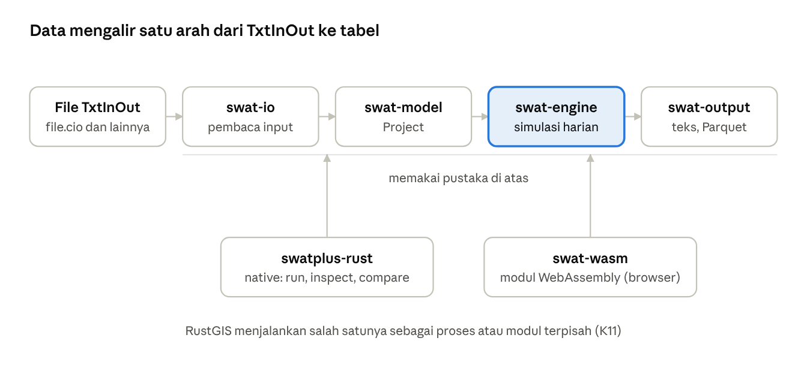

# Nota Desain SWAT+ Rust Engine 1.0

## Bab 1  Pendahuluan

Nota ini, yang sudah diperbarui untuk perbaikan versi 1.0.1, menjelaskan engine SWAT+ versi Rust 1.0.0 (`swatplus-rust`) fungsi demi fungsi: apa tugas setiap fungsi, subrutin SWAT+ mana yang ditirunya, persamaan yang dihitungnya, dan kebiasaan SWAT+ yang sengaja dipertahankan. Engine ini adalah terjemahan SWAT+ Fortran commit `6f51536` (16 Oktober 2026) yang menghasilkan tabel keluaran yang sama bit demi bit.

### 1.1  Tujuan nota

- Menjadi rujukan teknis bagi siapa pun yang membaca, memperbaiki, atau memperluas engine.
- Menjelaskan hubungan setiap fungsi Rust dengan kode SWAT+ aslinya, sehingga perbedaan atau bug bisa dilacak ke sumbernya.
- Mencatat keputusan desain: kenapa hasil harus identik, kenapa kebiasaan SWAT+ dipertahankan, kenapa engine dipisah dari RustGIS.
- Menyediakan glosarium istilah dan daftar pustaka dari persamaan yang dipakai.

### 1.2  Ruang lingkup engine 1.0

Engine 1.0 menjalankan proyek SWAT+ dari lahan sampai outlet:

- **HRU**: cuaca, neraca air, tanaman, nutrien, karbon (model asli dan Century), erosi, manajemen berdasarkan tanggal, heat unit, dan tabel keputusan, sawah, lahan basah, tile drain dan struktur lain, septik, kawasan urban.
- **Routing**: routing lanskap antar HRU, unit routing, akuifer, saluran SWAT-DEG, reservoir, dan sumber titik (recall).
- **Langkah waktu**: harian, atau subharian dengan Green-Ampt atau curve number dengan hidrograf satuan.
- **Keluaran**: tabel teks SWAT+, tabel yang sama dalam Parquet, arsip tar, dan progres JSON-line.
- **Platform**: program native (Linux, macOS, Windows) dan modul WebAssembly untuk browser.

Fitur yang belum di-port ditolak dengan namanya: `run` menyebut alasannya dan meneruskan air bagian itu, atau gagal bila `--strict` dipakai. Engine tidak pernah menebak.

### 1.3  Dasar validasi

Tabel keluaran dibandingkan dengan SWAT+ Fortran pada dua contoh SWAT+ (Osu\_1hru, Ames\_sub1), dua proyek nyata dari Sumatera Barat (Batanghari, 1.858 HRU; Pessel, 3.966 HRU), dan 33 varian yang menguji fitur tertentu. CI menjalankan kedua engine pada setiap push dan membandingkan setiap tabel. Target keputusan K12: beda relatif paling banyak 1e-4 atau satu satuan pada desimal terakhir yang dicetak. Pada kenyataannya hasil identik bit demi bit; rinciannya di Bab 17.

### 1.4  Konvensi penulisan

| Konvensi | Arti |
| --- | --- |
| `nama_fungsi` | Fungsi atau method Rust, ditulis seperti di kode |
| Padanan SWAT+ | Subrutin Fortran (`nama.f90`) yang ditiru fungsi itu |
| Kebiasaan SWAT+ (quirk) | Perilaku SWAT+ yang mengejutkan atau keliru tetapi dipertahankan agar hasil identik |
| `--fix-swat` | Mode koreksi: kebiasaan yang jelas bug diperbaiki, hasil tidak lagi sama dengan SWAT+ |
| f32 / f64 | Presisi tunggal / ganda. SWAT+ memakai `real` (f32) untuk hampir semua variabel, sehingga engine juga memakai f32 |
| mm, kg/ha, m3, ha, °C, MJ/m2 | Satuan seperti di SWAT+ |

Persamaan ditulis dalam notasi matematika, bukan salinan kode Fortran. SWAT+ berlisensi LGPL-2.1, dan engine ini juga LGPL-2.1 karena merupakan terjemahannya.

### 1.5  Cara membaca nota

- Bab 2 memberi gambaran arsitektur dan prinsip desain. Baca ini dulu.
- Bab 3 sampai 16 mengikuti crate dan modul, dari model data, pembaca input, loop simulasi, proses di HRU, routing, sampai keluaran dan program.
- Setiap fungsi punya entri sendiri: lokasi, padanan SWAT+, tujuan, masukan dan keluaran, cara kerja, dan catatan. Fungsi kecil dikumpulkan dalam tabel.
- Bab 17 merangkum validasi, katalog kebiasaan SWAT+, koreksi `--fix-swat`, dan fitur yang ditolak.
- Glosarium dan daftar pustaka ada di akhir.

## Bab 2  Arsitektur dan prinsip desain

Engine terdiri dari enam crate Rust tanpa dependensi eksternal. Data mengalir satu arah: file TxtInOut dibaca menjadi model proyek, model disimulasikan hari demi hari, dan hasilnya ditulis sebagai tabel. RustGIS menjalankan engine sebagai program terpisah atau modul WebAssembly, tidak pernah sebagai pustaka yang ditautkan.

### 2.1  Crate dan tugasnya

| Crate | Jenis | Tugas | Bergantung pada |
| --- | --- | --- | --- |
| `swat-model` | pustaka | Data proyek: `file.cio`, kode dan parameter DAS, periode simulasi, pengaturan cetak, objek spasial dan alirannya, cuaca, HRU, tanah, tabel database. Tanpa I/O | — |
| `swat-io` | pustaka | Pembaca file TxtInOut, mengikuti aturan input list-directed Fortran seperti SWAT+ membacanya; dari folder atau dari file di memori | `swat-model` |
| `swat-engine` | pustaka | Simulasi: jam, cuaca, jadwal cetak, HRU, routing unit, akuifer, saluran, reservoir, recall, dalam urutan perintah SWAT+ | `swat-model` |
| `swat-output` | pustaka | Keluaran: tabel teks SWAT+, Parquet, arsip tar, progres JSON-line; penyimpanan di folder atau memori | `swat-model`, `swat-engine` |
| `swat-wasm` | cdylib | Engine sebagai modul WebAssembly: arsip tar skenario masuk, arsip tar tabel keluar | semua di atas |
| `swatplus-rust` | program | Program baris perintah: `inspect`, `run`, `compare` | semua kecuali `swat-wasm` |

`swat-engine` tidak bergantung pada `swat-io`: engine menerima `Project` yang sudah jadi, dari mana pun asalnya. Ini memungkinkan RustGIS kelak membangun proyek tanpa file TxtInOut.



Empat pustaka membentuk satu jalur dari file ke tabel; program baris perintah dan modul WebAssembly hanyalah dua cara membungkus jalur yang sama.

### 2.2  Alur data satu kali jalan

1. **Baca.** `swat-io` membaca `file.cio`, lalu setiap file yang dirujuknya, menjadi `swat_model::Project`. Sumber file bisa folder (`DirSource`) atau memori (arsip tar di browser).
2. **Siapkan.** `swat-engine::run_with` membangun objek simulasi: stasiun cuaca, HRU dengan tanah dan tanamannya, unit routing, akuifer, saluran, reservoir. Kalibrasi diterapkan setelah inisialisasi, seperti di SWAT+.
3. **Simulasikan.** Untuk setiap hari: perbarui jam, hitung cuaca, jalankan perintah objek dalam urutan `object.cnt`/`*.con` (HRU, unit routing, akuifer, saluran, reservoir, recall), akumulasikan periode.
4. **Tulis.** Setiap hasil harian dikirim ke `OutputSink`. `swat-output` mengubahnya menjadi tabel teks persis seperti format `write` Fortran, atau Parquet, lalu menyimpannya lewat `Store` (folder atau memori).
5. **Laporkan.** Progres dan peristiwa (`start`, `progress`, `note`, `table`, `done`, `error`) keluar sebagai baris JSON.

### 2.3  Prinsip desain

**Bit demi bit.** Tujuannya bukan model yang “mirip SWAT+”, melainkan tabel yang sama persis. Akibatnya:

- Presisi mengikuti SWAT+: variabel `real` tetap f32, `real*8` tetap f64, dan konversi antar presisi terjadi di tempat yang sama.
- Urutan operasi aritmetika dipertahankan, karena penjumlahan floating point tidak asosiatif.
- Fungsi matematika dan format angka meniru gfortran dan glibc (`fortran.rs`).
- Urutan pemrosesan objek mengikuti urutan perintah SWAT+, termasuk variabel yang membawa nilai dari satu HRU ke HRU berikutnya.

**Kebiasaan SWAT+ dipertahankan.** Perilaku yang tampak salah tetap ditiru, dan dicatat di `docs/swat-quirks.md`. Yang jelas bug bisa dikoreksi dengan `--fix-swat`, dan daftarnya ada di `docs/swat-fixes.md`.

**Tolak, jangan tebak.** Fitur yang belum di-port menghasilkan catatan bernama, bukan perkiraan. Bagian yang ditolak meneruskan airnya ke hilir; `--strict` mengubahnya menjadi kode keluar 3.

**Tanpa dependensi, tanpa `unsafe`.** Semua crate hanya memakai pustaka standar Rust (`unsafe_code = "forbid"`). Penulis Parquet, tar, dan JSON ditulis sendiri. Karena itu engine bisa dibangun untuk `wasm32-unknown-unknown` tanpa glue JavaScript.

**Pemisahan lisensi (keputusan K11).** Engine berlisensi LGPL-2.1, sama dengan SWAT+. RustGIS berlisensi Apache-2.0 dan hanya menjalankan engine sebagai proses terpisah atau modul WASM; keduanya bertemu lewat format data: TxtInOut masuk, tabel dan JSON keluar.

### 2.4  Mode koreksi `--fix-swat`

Tanpa flag ini, hasil sama dengan SWAT+. Dengan flag ini, bug yang terdokumentasi diperbaiki: misalnya variabel yang tak sengaja dibawa dari HRU sebelumnya, atau pembagian luas yang dilakukan dua kali. Hasilnya tidak bisa dibandingkan lagi dengan SWAT+, sehingga validasi bit demi bit hanya berlaku untuk mode bawaan. Paralelisme HRU direncanakan hanya untuk mode koreksi, karena di mode bawaan urutan HRU memengaruhi hasil (Bab 17).

### 2.5  Hubungan dengan RustGIS

RustGIS (editor SWAT+) membaca dan mengedit TxtInOut dengan crate-nya sendiri (`rustgis-swat-model`, `rustgis-swat-txtinout`), lalu menjalankan engine ini lewat runner. Di desktop runner memanggil program `swatplus-rust run --progress json --format parquet`; di browser runner memuat `swat_wasm.wasm` di Web Worker. Kontrak antarmukanya dijelaskan di Bab 15 dan 16.

## Bab 3  swat-model: model data proyek dan waktu

Bab ini membahas *crate* `swat-model`, yaitu lapisan data murni dari engine. Crate ini tidak membaca file dan tidak menghitung proses hidrologi apa pun: ia hanya mendefinisikan tipe-tipe yang menampung isi sebuah proyek SWAT+ (folder TxtInOut) setelah dibaca. Pembaca di crate `swat-io` mengisi tipe-tipe ini dari file teks, lalu `swat-engine` menjalankan simulasi di atasnya. Karena itu hampir setiap bab berikutnya merujuk ke struct yang dijelaskan di sini: `Project`, `TimeSim`/`SimDay`, `Table`, `BasinParams`, `SpatialObject`, `Soil`, `MgtSchedule`, `DecisionTable`, dan seterusnya.

File yang dicakup: `crates/swat-model/src/lib.rs`, `time.rs`, `table.rs`, `schema.rs`, `cio.rs`, `basin.rs`, `climate.rs`, `hru.rs`, `cal.rs`, `mgt.rs`, `objects.rs`, `routing.rs`, dan `print.rs`. Tiga prinsip desain berlaku di seluruh crate dan dinyatakan di komentar modul `lib.rs`: (1) nama field mengikuti nama SWAT+ di tempat pembaca kode Fortran akan mencarinya, dan setiap tipe menyebut file input serta rutin Fortran yang dicerminkannya; (2) bilangan real disimpan sebagai `f32`, karena `real` bawaan SWAT+ adalah presisi tunggal (keputusan K4 dalam dokumen desain RustGIS, `docs/swat/design.md`), sehingga nilai yang dibaca identik bit demi bit dengan nilai di memori program Fortran; (3) crate ini dikompilasi dengan larangan `unwrap`, `expect`, `panic`, `unimplemented`, dan `unreachable` di luar kode uji (atribut `deny(clippy::...)`), sehingga semua akses yang dapat gagal mengembalikan `Option`.

Dalam alur simulasi, crate ini berada di antara tahap pembacaan input (setara dengan `readcio_read`, `time_read`, `basin_read_*`, `hyd_read_connect`, `cli_*read`, `soil_db_read`, `mgt_read_*`, dan sebagainya di SWAT+) dan tahap inisialisasi objek di engine. Satu-satunya "logika" yang ada di sini adalah logika yang di SWAT+ dijalankan tepat setelah pembacaan: normalisasi periode simulasi (`time_read`), penurunan daftar hari simulasi (`time_control`), konversi hari Julian ke bulan dan tanggal (`xmon`), pengisian nilai bawaan parameter basin (`basin_prm_default`), ekspansi daftar elemen (`define_unit_elements`), dan pencarian baris tabel menurut nama dengan aturan perbandingan string Fortran. Jumlah fungsi yang didokumentasikan di bab ini: 42 fungsi non-uji ditambah 6 fungsi uji unit.

### 3.1  `lib.rs`: tipe akar `Project` dan tipe pendukung

`lib.rs` mendeklarasikan modul-modul crate, mengekspor ulang tipe-tipe utamanya (`pub use`), dan mendefinisikan tipe akar `Project` beserta lima tipe kecil yang tidak punya modul sendiri: `SepticSys`, `RecallDb`, `RecallRow`, `AtmoDep`, dan `AtmoStation`.

**Struct `Project`.** Satu nilai `Project` adalah seluruh proyek SWAT+ sejauh pembaca sudah mendukungnya. Semua field bersifat `pub`; `Project` menurunkan `Clone`, `Debug`, `Default`, dan `PartialEq`. Field dapat dikelompokkan sebagai berikut.

| Kelompok | Field | Isi dan file sumber |
| --- | --- | --- |
| Kendali | `cio: FileCio` | `file.cio`, peta slot ke nama file (subbab 3.5) |
| Kendali | `time: TimeSim` | `time.sim`, periode simulasi (subbab 3.2) |
| Kendali | `print: PrintSettings` | `print.prt` (subbab 3.13) |
| Basin | `codes: BasinCodes`, `params: BasinParams` | `codes.bsn`, `parameters.bsn` (subbab 3.6) |
| Basin | `carbon`, `carbon_lyr: Option<Table>` | `carbon.bsn` (satu baris) dan `carbon_lyr.bsn` (satu baris per jenis lapisan; namanya diturunkan dari nama `carbon.bsn`) |
| Basin | `basin_name: String`, `area_ls_ha`, `area_tot_ha: f32` | nama basin dan luas daratan serta luas total (ha) dari `object.cnt` (`bsn`) |
| Objek | `objects: Vec<SpatialObject>` | semua baris semua file `*.con` (subbab 3.11) |
| Iklim | `stations: Vec<WeatherStation>`, `wgn: Vec<Wgn>` | `weather-sta.cli`, `weather-wgn.cli` |
| Iklim | `station_lists: Vec<StationList>`, `series: Vec<StationSeries>` | daftar stasiun per variabel terukur (`pcp.cli`, `tmp.cli`, …) dan isi file stasiun terukur sesuai urutan daftar |
| Iklim | `atmodep: Option<AtmoDep>` | `atmo.cli` (deposisi atmosfer) |
| Iklim | `co2_yr_dat: bool` | apakah proyek memiliki `co2_yr.dat` (CO2 tahunan, dibaca SWAT+ oleh `co2_read`; menurut komentar kode belum ditangani) |
| HRU | `hru_data: Vec<HruData>` | `hru-data.hru`, diindeks dengan nomor HRU − 1 (SWAT+ menempatkan baris menurut nomornya) |
| HRU | `soils: Vec<Soil>`, `soil_plant_init: Vec<SoilPlantInit>`, `soil_test: Option<Table>` | `soils.sol`, `soil_plant.ini`, `nutrients.sol` |
| HRU | `soil_lyr_depths: Option<Vec<i32>>` | `soil_lyr_depths.sol` (kedalaman lapisan kustom, mm) bila ada |
| HRU | `topography`, `hydrology`, `field`, `snow: Option<Table>` | `topography.hyd`, `hydrology.hyd`, `field.fld`, `snow.sno` |
| Tutupan lahan | `landuse`, `cntable`, `ovn_table`, `cons_practice`, `urban`, `plants`, `tillage: Option<Table>` | `landuse.lum`, `cntable.lum`, `ovn_table.lum`, `cons_practice.lum`, `urban.urb`, `plants.plt`, `tillage.til` |
| Tutupan lahan | `plant_communities: Vec<PlantCommunity>` | `plant.ini` |
| Pengelolaan | `management: Vec<MgtSchedule>`, `lum_dtl: Vec<DecisionTable>` | `management.sch`, `lum.dtl` |
| Pengelolaan | `harv_ops`, `fertilizer`, `irr_ops`, `chem_app: Option<Table>` | `harv.ops`, `fertilizer.frt`, `irr.ops`, `chem_app.ops` |
| Pengelolaan | `puddle_ops`, `manure_db`, `manure_om`, `transplant_ops: Option<Table>` | dibaca dengan nama tetap ini apa pun isi `file.cio`: `puddle.ops`, `manure_db.frt`, `manure_om.frt`, dan keberadaan `transplant.ops` |
| Waduk/lahan basah | `wetland`, `wet_hyd`, `res_init`, `res_sed`, `res_nut`, `weir_res`, `res_dat`, `res_hyd: Option<Table>`; `res_dtl: Vec<DecisionTable>` | `wetland.wet`, `hydrology.wet`, `initial.res`, `sediment.res`, `nutrients.res`, `weir.res`, `reservoir.res`, `hydrology.res`, tabel rilis `res_rel.dtl` |
| Struktur | `tiledrain`, `fstrip`, `grassww`, `bmpuser`, `septic_sep: Option<Table>`; `septic: Vec<SepticSys>` | `tiledrain.str`, `filterstrip.str`, `grassedww.str`, `bmpuser.str`, `septic.sep`, `septic.str` (baris 0 adalah elemen kosong 0 milik SWAT+) |
| Recall | `recalls: Vec<RecallDb>` | `recall.rec` dan file-file yang disebutnya (`recall_read`) |
| Lanskap/routing | `lsu_defs: Vec<LsuDef>`, `lsu_elems: Vec<LsuElem>`, `aqu_elems: bool` | `ls_unit.def`, `ls_unit.ele` (indeks = nomor baris, elemen 0 tidak dipakai; kosong bila file tidak ada) dan apakah `aqu_catunit.ele` ada (diperlukan tabel akuifer basin) |
| Lanskap/routing | `ru_elements: Vec<RuElement>`, `ru_defs: Vec<RuDef>`, `ru_data: Vec<RuData>` | `rout_unit.ele` (elemen 0 tidak dipakai), `rout_unit.def`, `rout_unit.rtu` |
| Akuifer | `aquifer_db: Vec<AquiferDb>` | `aquifer.aqu` menurut nomor baris; elemen 0 menampung nilai bawaan |
| Kanal | `sd_channel_data: Vec<SdChannelData>`; `hyd_sed_lte`, `ch_nut`, `ch_init`, `om_water: Option<Table>`; `ch_temp_file: bool` | `channel-lte.cha` (elemen 0 tidak dipakai), `hyd-sed-lte.cha`, `nutrients.cha`, `initial.cha`, `om_water.ini`, dan apakah `temperature.cha` disebut |
| Kalibrasi | `cal_parms: Vec<CalParm>`, `cal_upd: Vec<CalUpdate>` | `cal_parms.cal`, `calibration.cal` (subbab 3.9) |

Pola umum: tabel basis data "satu tipe turunan per baris" disimpan sebagai `Option<Table>` (generik, skema di `schema.rs`); `None` berarti file tidak ada atau slotnya `null`. Struktur dengan bentuk khusus (jumlah lapisan bervariasi, daftar operasi, tabel keputusan) memiliki struct sendiri. Beberapa vektor sengaja memakai indeks berbasis 1 dengan elemen 0 kosong atau berisi nilai bawaan, meniru larik Fortran yang dialokasikan dari 0.

**Struct `SepticSys`** (baris `septic.str`, tipe Fortran `septic_system`, dibaca oleh `sep_read`):

| Field | Tipe | Arti |
| --- | --- | --- |
| `name` | `String` | nama sistem septik |
| `typ` | `i32` | jenis efluen: nomor baris di `septic.sep` |
| `yr` | `i32` | tahun pertama sistem beroperasi |
| `opt` | `i32` | status operasi: 0 tidak dioperasikan, 1 aktif, 2 gagal |
| `tfail` | `i32` | jumlah hari sistem yang gagal sampai diperbaiki |
| `r` | `[f32; 23]` | 23 bilangan real berurutan: `cap`, `area`, `z`, `thk`, `strm_dist`, `density`, `bd`, `bod_dc`, `bod_conv`, `fc1`, `fc2`, `fecal`, `plq`, `mrt`, `rsp`, `slg1`, `slg2`, `nitr`, `denitr`, `pdistrb`, `psorpmax`, `solpslp`, `solpintc` |

`SepticSys` juga mendefinisikan konstanta indeks untuk larik `r` agar kode engine tidak memakai angka ajaib: `CAP` = 0, `Z` = 2, `THK` = 3, `BD` = 6, `BOD_DC` = 7, `BOD_CONV` = 8, `FC1` = 9, `FC2` = 10, `FECAL` = 11, `PLQ` = 12, `MRT` = 13, `RSP` = 14, `SLG1` = 15, `SLG2` = 16, `NITR` = 17, `DENITR` = 18, `PDISTRB` = 19, `PSORPMAX` = 20, `SOLPSLP` = 21, `SOLPINTC` = 22. Satuan masing-masing besaran mengikuti `septic.str` SWAT+; proses biozona septik dibahas di bab tentang HRU.

**Struct `RecallDb`** (satu objek *recall*: beban terukur atau hasil model): `id: usize` (nomor baris di `recall.rec`), `name: String`, `typ: i32` (langkah waktu: 0 subharian, 1 harian, 2 bulanan, 3 tahunan, 4 koefisien ekspor), `file: String`, dan `rows: Vec<RecallRow>`.

**Struct `RecallRow`** (satu rekaman file recall): `jday` (hari dalam tahun), `mo` (bulan), `day_mo` (tanggal), `iyr` (tahun), semuanya `i32`, dan `vals: [f32; 18]`, yaitu 18 nilai sebuah hidrograf dalam urutan `hyd_output` SWAT+: debit `flo` (m3), sedimen `sed` (t), N organik `orgn`, P organik `sedp`, `no3`, `solp`, klorofil-a `chla`, `nh3`, `no2`, `cbod`, oksigen terlarut `dox` (kg), fraksi sedimen `san`, `sil`, `cla`, `sag`, `lag`, `grv` (t), dan suhu `temp` (°C).

**Struct `AtmoDep`** (`atmo.cli`, dibaca SWAT+ oleh `cli_read_atmodep`): `timestep: String` (`aa` rata-rata tahunan, `yr` tahunan, atau `mo` bulanan), `mo_init: i32` dan `yr_init: i32` (bulan dan tahun awal deret), `num: usize` (jumlah nilai per deret), dan `stations: Vec<AtmoStation>`.

**Struct `AtmoStation`**: `name: String` dan empat deret `Vec<f32>`: `nh4_rf` dan `no3_rf` (amonium dan nitrat dalam air hujan, mg/L), serta `nh4_dry` dan `no3_dry` (deposisi kering, kg/ha per tahun). Setiap deret berisi satu nilai per langkah waktu (satu nilai saja untuk `aa`).

#### 3.1.1  `Project::objects_of`

- **Lokasi:** `crates/swat-model/src/lib.rs`, `pub fn objects_of(&self, kind: ObjectKind) -> impl Iterator<Item = &SpatialObject>`
- **Padanan SWAT+:** tidak ada; khusus port. Di SWAT+ setiap jenis objek punya larik sendiri (`ob` dengan rentang per jenis), sedangkan port menyimpan semua objek dalam satu vektor.
- **Tujuan:** Mengiterasi objek spasial dari satu jenis saja (misalnya semua HRU atau semua kanal SWAT-DEG).
- **Masukan dan keluaran:** jenis objek `kind`; keluaran berupa iterator referensi `SpatialObject` dalam urutan file.
- **Cara kerja:**
  1. Mengambil iterator atas `self.objects`.
  2. Menyaring elemen dengan `o.kind == kind`.
- **Catatan port:** urutan dipertahankan sesuai urutan baris dalam file `*.con`, yang menentukan nomor objek di SWAT+; karena itu engine dapat bergantung pada urutan iterator ini.

### 3.2  `time.rs`: periode simulasi dan kalender

Modul ini mencerminkan `time.sim` dan bagian kalender dari `time_module`, `time_read`, `time_control`, dan `xmon` di SWAT+. Ia menentukan hari-hari mana yang disimulasikan, dalam urutan apa, dan bagaimana hari Julian dipetakan ke bulan dan tanggal. Seluruh loop harian engine (bab tentang *runner*) berjalan di atas daftar `SimDay` yang dihasilkan di sini.

**Konstanta.**

| Konstanta | Nilai | Padanan SWAT+ |
| --- | --- | --- |
| `NDAYS_LEAP: [i32; 13]` | 0, 31, 60, 91, 121, 152, 182, 213, 244, 274, 305, 335, 366 | `ndays_leap` di `time_module` |
| `NDAYS_NOLEAP: [i32; 13]` | 0, 31, 59, 90, 120, 151, 181, 212, 243, 273, 304, 334, 365 | `ndays_noleap` |

Kedua larik adalah hari kumulatif pada akhir setiap bulan: elemen ke-*m* (berbasis 0) adalah hari Julian terakhir bulan ke-*m* (dengan elemen 0 = 0 sebagai "akhir bulan ke-0"), dan elemen ke-12 adalah panjang tahun.

**Struct `TimeSim`** (isi `time.sim` apa adanya; `Copy`, `Eq`, `Default`):

| Field | Tipe | Arti |
| --- | --- | --- |
| `day_start` | `i32` | hari Julian pertama yang disimulasikan pada tahun pertama (0 atau kurang = 1 Januari) |
| `yrc_start` | `i32` | tahun kalender pertama |
| `day_end` | `i32` | hari Julian terakhir pada tahun terakhir (0 atau kurang = 31 Desember) |
| `yrc_end` | `i32` | tahun kalender terakhir |
| `step` | `i32` | jumlah langkah waktu per hari (0 atau kurang = harian, dinormalkan menjadi 1); nilai > 1 mengaktifkan mode subharian |

**Struct `SimDay`** (satu hari simulasi; `Copy`, `Eq`):

| Field | Tipe | Arti |
| --- | --- | --- |
| `year` | `i32` | tahun kalender |
| `jday` | `i32` | hari dalam tahun, 1 = 1 Januari |
| `month` | `u8` | bulan, 1–12 |
| `day` | `u8` | tanggal dalam bulan |
| `year_index` | `i32` | tahun simulasi ke-berapa, 1 = tahun pertama (SWAT+ `time%yrs`) |

#### 3.2.1  `TimeSim::normalized`

- **Lokasi:** `crates/swat-model/src/time.rs`, `pub fn normalized(self) -> Self`
- **Padanan SWAT+:** baris setelah pembacaan di `time_read` (`time_read.f90`).
- **Tujuan:** Menghasilkan periode sebagaimana SWAT+ menggunakannya setelah membaca `time.sim`.
- **Masukan dan keluaran:** `TimeSim` mentah; keluaran `TimeSim` dengan `step` dan `day_start` yang sudah dinormalkan, field lain tidak berubah.
- **Cara kerja:**
  1. Bila `step <= 0`, `step` menjadi 1 (harian).
  2. Bila `day_start <= 0`, `day_start` menjadi 1 (1 Januari).
  3. `day_end`, `yrc_start`, dan `yrc_end` disalin apa adanya; `day_end = 0` tetap 0 dan ditafsirkan oleh `days()` sebagai "sampai akhir tahun".
- **Kebiasaan SWAT+ / catatan port:** fungsi bersifat murni (mengambil dan mengembalikan nilai salinan), sehingga `TimeSim` yang tersimpan di `Project` tetap merepresentasikan isi file. Proyek Ames\_sub1 menulis `day_start` = 0 dan `day_end` = 0; normalisasi inilah yang membuatnya berarti "tahun penuh".

#### 3.2.2  `TimeSim::years`

- **Lokasi:** `crates/swat-model/src/time.rs`, `pub fn years(&self) -> i32`
- **Padanan SWAT+:** `time%nbyr = time%yrc_end - time%yrc_start + 1` di `time_read`.
- **Tujuan:** Jumlah tahun kalender yang disimulasikan (termasuk tahun *warm-up* yang tidak dicetak).
- **Masukan dan keluaran:** `yrc_start`, `yrc_end`; keluaran jumlah tahun (dapat 0 atau negatif bila `yrc_end < yrc_start`).
- **Cara kerja:**

```latex
n_{byr} = yrc_{end} - yrc_{start} + 1
```

- **Catatan port:** nilai negatif tidak dipotong di sini; pemanggil `days()` memotongnya dengan `max(0)`.

#### 3.2.3  `TimeSim::days`

- **Lokasi:** `crates/swat-model/src/time.rs`, `pub fn days(&self) -> Vec<SimDay>`
- **Padanan SWAT+:** penentuan hari awal dan akhir per tahun di loop `do curyr = 1, time%nbyr` dalam `time_control` (`time_control.f90`), ditambah `xmon` untuk bulan dan tanggal.
- **Tujuan:** Membentuk daftar lengkap hari simulasi, berurutan, persis seperti yang dikunjungi loop tahunan dan harian SWAT+.
- **Masukan dan keluaran:** `TimeSim` (dinormalkan secara internal); keluaran `Vec<SimDay>`.
- **Cara kerja:**
  1. `t = self.normalized()`; `years = max(t.years(), 0)`.
  2. Untuk `year_index` = 1 … `years`: `year = yrc_start + year_index − 1`; ambil tabel bulan kumulatif `ndays = month_table(year)` dan `year_len = ndays[12]` (365 atau 366).
  3. Hari pertama: `day_start` pada tahun pertama, 1 pada tahun-tahun berikutnya.
  4. Hari terakhir: pada tahun terakhir dan bila `day_end > 0`, `min(day_end, year_len)`; selain itu `year_len`.
  5. Untuk setiap `jday` dari hari pertama sampai terakhir, hitung `(month, day)` dengan `month_day_in(&ndays, jday)` dan tambahkan `SimDay { year, jday, month, day, year_index }`.
- **Kebiasaan SWAT+ / catatan port:**
  - Pemotongan `min(day_end, year_len)` meniru `amin0 (time%day_end_yr, ndays(13))` di SWAT+, yang melindungi dari masukan 366 pada tahun bukan kabisat.
  - Bila `day_start` melampaui panjang tahun pertama atau `day_end` lebih kecil dari hari pertama pada tahun tunggal, rentang menjadi kosong dan tidak ada hari yang dihasilkan untuk tahun itu.
  - Penentuan tahun kabisat di loop utama `time_control` mengikuti aturan Gregorian penuh (habis dibagi 4, kecuali abad yang tidak habis dibagi 400), dan itulah yang dipakai di sini. Perlu dicatat bahwa SWAT+ di awal `time_control` (sebelum loop, untuk membangkitkan presipitasi hari pertama) memakai uji `Mod(yrc,4) == 0` saja; perbedaan ini tidak berpengaruh untuk tahun 1901–2099 dan tidak dicerminkan di fungsi ini.
  - Daftar dibentuk di muka (bukan iterator malas) agar *runner* dapat mengetahui jumlah hari total dan hari terakhir setiap tahun/bulan sebelum loop dimulai.

#### 3.2.4  `is_leap`

- **Lokasi:** `crates/swat-model/src/time.rs`, `pub fn is_leap(year: i32) -> bool`
- **Padanan SWAT+:** uji `Mod` bertingkat di `time_control.f90`.
- **Tujuan:** Menentukan apakah `year` adalah tahun kabisat Gregorian.
- **Cara kerja:** benar bila `(year mod 4 = 0 dan year mod 100 ≠ 0)` atau `year mod 400 = 0`. Contoh dari uji: 2000 dan 2024 kabisat; 1900 dan 2023 bukan.

#### 3.2.5  `month_table`

- **Lokasi:** `crates/swat-model/src/time.rs`, `pub fn month_table(year: i32) -> [i32; 13]`
- **Padanan SWAT+:** pemilihan `ndays = ndays_leap` atau `ndays = ndays_noleap` di `time_control`.
- **Tujuan:** Mengembalikan tabel hari kumulatif akhir bulan yang berlaku untuk `year`.
- **Cara kerja:** `NDAYS_LEAP` bila `is_leap(year)`, selain itu `NDAYS_NOLEAP`.

#### 3.2.6  `month_day`

- **Lokasi:** `crates/swat-model/src/time.rs`, `pub fn month_day(year: i32, jday: i32) -> Option<(u8, u8)>`
- **Padanan SWAT+:** subrutin `xmon` (`xmon.f90`).
- **Tujuan:** Mengubah hari Julian `jday` pada tahun `year` menjadi (bulan, tanggal).
- **Masukan dan keluaran:** tahun dan hari Julian; keluaran `Some((bulan 1–12, tanggal))`, atau `None` bila `jday < 1` atau melewati panjang tahun.
- **Cara kerja:** memanggil `month_day_in(&month_table(year), jday)`.
- **Catatan port:** `xmon` di SWAT+ bekerja pada larik `ndays` global yang sedang aktif dan tidak punya keluaran "tidak valid"; versi Rust menerima tahun secara eksplisit dan mengembalikan `None` untuk masukan di luar rentang. Contoh dari uji unit: (2023, 59) → (2, 28); (2023, 60) → (3, 1); (2024, 60) → (2, 29); (2024, 366) → (12, 31); (2023, 366) → `None`; (2023, 0) → `None`.

#### 3.2.7  `month_day_in` (privat)

- **Lokasi:** `crates/swat-model/src/time.rs`, `fn month_day_in(ndays: &[i32; 13], jday: i32) -> Option<(u8, u8)>`
- **Padanan SWAT+:** isi loop `do i_mo = 1, 12` di `xmon.f90`.
- **Tujuan:** Inti konversi hari Julian ke bulan/tanggal terhadap tabel kumulatif tertentu.
- **Cara kerja:**
  1. Bila `jday < 1`, kembalikan `None`.
  2. Untuk `mo` = 1 … 12, cari bulan pertama dengan `jday <= ndays[mo]`.
  3. Tanggal dihitung sebagai

```latex
day = jday - ndays[mo-1]
```

4. Bila tidak ada bulan yang memenuhi (hari melampaui `ndays[12]`), kembalikan `None`.

- **Catatan port:** akses larik memakai `get` (bukan indeks langsung) agar tidak ada jalur *panic*, sesuai larangan clippy crate ini.

#### 3.2.8  Uji unit `time.rs`

| Fungsi uji | Lokasi | Yang diuji |
| --- | --- | --- |
| `leap_years` | `time.rs`, modul `tests` | `is_leap` untuk 2000, 2024, 1900, 2023 |
| `xmon` | `time.rs`, modul `tests` | `month_day` di batas bulan Februari/Maret, akhir tahun kabisat, dan masukan tidak valid |
| `whole_years` | `time.rs`, modul `tests` | 2010–2023 dengan `day_end` 365 menghasilkan 14 × 365 + 3 hari (tiga tahun kabisat), hari pertama (2010, 1), hari terakhir (2023, 365, 12, 31), dan `step` 0 dinormalkan menjadi 1 |
| `zeros_mean_whole_years` | `time.rs`, modul `tests` | pola Ames\_sub1: `day_start` = `day_end` = 0 pada 1975–1976 memberi 365 + 366 hari, hari terakhir (1976, 366) dengan `year_index` 2 |
| `partial_first_and_last_year` | `time.rs`, modul `tests` | tahun pertama mulai hari 100 dan tahun terakhir berakhir hari 10; `day_end` 366 pada tahun bukan kabisat dipotong menjadi 365; tahun akhir sebelum tahun awal memberi daftar kosong |

### 3.3  `table.rs`: tabel generik "satu tipe turunan per baris"

Banyak file basis data SWAT+ dibaca dengan pola yang sama: hitung jumlah baris, alokasikan larik tipe turunan, lalu `read (unit, *) db(i)` untuk setiap baris, yaitu satu pembacaan *list-directed* yang mengisi semua komponen tipe secara berurutan. Daripada membuat satu struct Rust untuk setiap tipe Fortran itu, port menyimpan tabel-tabel ini secara generik: sebuah *skema* (daftar `Field` yang disalin dari definisi tipe Fortran, termasuk nilai bawaannya) dan baris-baris berupa `Vec<Value>` yang komponennya diratakan (larik dalam tipe diekspansi menjadi beberapa nilai). Pencarian baris menurut nama mengikuti perilaku SWAT+: baris pertama yang namanya sama, dibandingkan seperti Fortran membandingkan string.

**Enum `Kind`** (jenis komponen): `Int` (integer Fortran, disimpan `i32`), `Real` (`real` presisi tunggal, `f32`), `Text` (`character`, `String`).

**Struct `Field`** (satu komponen tipe turunan; `Copy`): `name: &'static str` (nama komponen seperti di Fortran), `kind: Kind`, `default: &'static str` (nilai bawaan persis seperti tertulis di kode Fortran, misalnya `".02"` atau `"50."`), dan `count: usize` (panjang larik; 1 untuk skalar).

**Enum `Value`** (satu nilai sel): `Int(i32)`, `Real(f32)`, `Text(String)`.

**Struct `Table`**: `file: String` (nama file sumber, untuk pesan dan diagnosis), `fields: &'static [Field]` (skema; selalu salah satu konstanta di `schema.rs`), dan `rows: Vec<Vec<Value>>` (baris dalam urutan file; setiap baris memiliki panjang Σ `count`).

Pembaca di `swat-io` (`read_table`, `fill`) memulai setiap baris dari `default_row`, lalu menimpa nilai satu per satu sampai menemukan nilai yang tidak dapat dikonversi; komponen sesudahnya tetap bernilai bawaan. Ini meniru gfortran, di mana pembacaan *list-directed* yang gagal berhenti di tengah tipe dan komponen sisanya mempertahankan inisialisasi tipe.

#### 3.3.1  `f`

- **Lokasi:** `crates/swat-model/src/table.rs`, `pub const fn f(name: &'static str, kind: Kind, default: &'static str) -> Field`
- **Padanan SWAT+:** deklarasi komponen skalar dalam `type ... end type` (mis. `real :: slope = .02`).
- **Tujuan:** Konstruktor ringkas komponen skalar untuk menulis skema di `schema.rs`.
- **Cara kerja:** mengembalikan `Field { name, kind, default, count: 1 }`. Karena `const fn`, skema dapat dibangun sebagai konstanta waktu kompilasi.

#### 3.3.2  `a`

- **Lokasi:** `crates/swat-model/src/table.rs`, `pub const fn a(name, kind, default, count: usize) -> Field`
- **Padanan SWAT+:** komponen larik, mis. `real, dimension(4) :: cn` pada `curvenumber_table`.
- **Tujuan:** Konstruktor komponen larik dengan `count` nilai yang semuanya berbawaan sama.
- **Cara kerja:** mengembalikan `Field { name, kind, default, count }`.
- **Catatan port:** untuk `cntable.lum`, nilai bawaan Fortran adalah (30, 55, 70, 77) yang berbeda per elemen; karena `a` hanya mendukung satu nilai bawaan, skema menulis `0.` dan engine menangani nilai bawaan Fortran saat nama CN tidak ditemukan (lihat komentar `CNTABLE`).

#### 3.3.3  `default_row`

- **Lokasi:** `crates/swat-model/src/table.rs`, `pub fn default_row(fields: &[Field]) -> Vec<Value>`
- **Padanan SWAT+:** inisialisasi komponen tipe turunan saat larik dialokasikan.
- **Tujuan:** Membuat satu baris baru yang berisi nilai bawaan semua komponen, diratakan.
- **Masukan dan keluaran:** skema; keluaran vektor `Value` sepanjang Σ `count`.
- **Cara kerja:**
  1. Untuk setiap `Field`, ulangi `count` kali.
  2. `Int`: `default.trim()` diparse sebagai `i32`, gagal → 0.
  3. `Real`: diparse sebagai `f32`, gagal → 0.0. Penulisan gaya Fortran seperti `".02"` dan `"50."` diterima pengurai float Rust.
  4. `Text`: string bawaan disalin apa adanya (termasuk spasi, mis. `" "` untuk `fertnm`).
- **Catatan port:** parsing ke `f32` langsung dari teks desimal memberi nilai yang sama dengan inisialisasi konstanta `real` di gfortran (pembulatan ke nilai presisi tunggal terdekat).

#### 3.3.4  `Value::as_real`, `Value::as_int`, `Value::as_text`

- **Lokasi:** `crates/swat-model/src/table.rs`; `as_real(&self) -> Option<f32>`, `as_int(&self) -> Option<i32>`, `as_text(&self) -> Option<&str>`
- **Padanan SWAT+:** tidak ada; khusus port (akses bertipe ke sel generik).
- **Tujuan:** Mengambil isi sel dengan tipe yang diharapkan.
- **Cara kerja:**
  1. `as_real`: `Real(v)` → `Some(v)`; `Int(v)` → `Some(v as f32)` (konversi integer ke real, seperti penugasan campuran di Fortran); `Text` → `None`.
  2. `as_int`: hanya `Int(v)` → `Some(v)`; `Real` sengaja tidak dikonversi (menghindari pemotongan diam-diam).
  3. `as_text`: hanya `Text`.

#### 3.3.5  `Table::empty`

- **Lokasi:** `crates/swat-model/src/table.rs`, `pub fn empty(file: &str, fields: &'static [Field]) -> Self`
- **Padanan SWAT+:** tidak ada; khusus port.
- **Tujuan:** Membuat tabel tanpa baris untuk file dan skema tertentu; titik awal pembaca.

#### 3.3.6  `Table::offset`

- **Lokasi:** `crates/swat-model/src/table.rs`, `pub fn offset(&self, field: &str) -> Option<usize>`
- **Padanan SWAT+:** tidak ada; setara dengan alamat komponen dalam tipe turunan.
- **Tujuan:** Posisi nilai pertama komponen `field` dalam baris yang sudah diratakan.
- **Cara kerja:** menjumlahkan `count` semua komponen sebelum komponen yang namanya sama persis dengan `field`; `None` bila nama tidak ada di skema.
- **Catatan port:** pencarian linear per akses; skema terpanjang (`PLANTS`, 56 nilai) masih kecil sehingga biaya ini tidak signifikan dan engine umumnya menyalin nilai ke struct bertipe saat inisialisasi.

#### 3.3.7  `Table::get`

- **Lokasi:** `crates/swat-model/src/table.rs`, `pub fn get(&self, row: usize, field: &str, index: usize) -> Option<&Value>`
- **Tujuan:** Nilai ke-`index` (berbasis 0) dari komponen `field` pada baris `row` (berbasis 0).
- **Cara kerja:** `offset(field) + index`, lalu akses aman `rows.get(row)?.get(at)`.
- **Catatan port:** `index` tidak dibatasi oleh `count`; indeks yang melewati larik akan membaca komponen berikutnya. Pemanggil bertanggung jawab memakai indeks yang benar (mis. 0–3 untuk `cn`).

#### 3.3.8  `Table::real`, `Table::int`, `Table::text`

- **Lokasi:** `crates/swat-model/src/table.rs`; `real(&self, row, field) -> Option<f32>`, `int(...) -> Option<i32>`, `text(...) -> Option<&str>`
- **Tujuan:** Jalan pintas untuk komponen skalar: `get(row, field, 0)` lalu `as_real`/`as_int`/`as_text`.

#### 3.3.9  `Table::find`

- **Lokasi:** `crates/swat-model/src/table.rs`, `pub fn find(&self, name: &str) -> Option<usize>`
- **Padanan SWAT+:** loop pencarian nama yang tersebar di rutin inisialisasi, berbentuk `do i = 1, db_mx%... ; if (nama == db(i)%name) then ... exit`.
- **Tujuan:** Indeks baris pertama yang komponen pertamanya (nama) sama dengan `name`.
- **Cara kerja:**
  1. Iterasi baris dari indeks 0.
  2. Ambil nilai pertama baris sebagai teks.
  3. Bandingkan dengan `fortran_eq`; kembalikan indeks pertama yang cocok.
- **Kebiasaan SWAT+ / catatan port:** bila nama ganda, baris pertama yang menang, seperti loop SWAT+ yang memakai `exit`. Di beberapa tempat SWAT+ tidak keluar dari loop sehingga yang menang adalah kecocokan terakhir; untuk kasus-kasus itu engine tidak memakai `find` tetapi pencarian mundur (`rev().find`/`rfind` di `swat-engine/src/hru/mgt.rs`). Untuk skema yang komponen pertamanya bukan nama (mis. `WETLAND` dan `RES_DAT` dimulai dengan `id` integer), `find` tidak menemukan apa pun; pemanggil memakai `text(row, "name")`.

#### 3.3.10  `fortran_eq`

- **Lokasi:** `crates/swat-model/src/table.rs`, `pub fn fortran_eq(a: &str, b: &str) -> bool`
- **Padanan SWAT+:** semantik operator `==` pada `character` Fortran: string yang lebih pendek dianggap diisi spasi di kanan, sehingga spasi di ujung tidak berpengaruh.
- **Tujuan:** Membandingkan nama seperti Fortran.
- **Cara kerja:** membuang karakter spasi (`' '`) di ujung kanan kedua string lalu membandingkan sisanya secara persis (peka huruf besar/kecil).
- **Catatan port:** hanya spasi yang dibuang, bukan tab; spasi di awal tetap signifikan, seperti di Fortran. Fungsi ini juga dipakai engine untuk mencocokkan nama tanaman dalam operasi pengelolaan (`plnt`, `hvkl`, `all`, dsb.).

### 3.4  `schema.rs`: skema tabel basis data

`schema.rs` tidak berisi fungsi. Isinya adalah 39 konstanta `&[Field]`, masing-masing salinan definisi tipe turunan Fortran (nama komponen, urutan, jenis, dan nilai bawaan) untuk satu file basis data. Urutan komponen sangat penting karena pembacaan *list-directed* mencocokkan nilai dengan komponen menurut posisi, bukan menurut header kolom file; komentar setiap konstanta menyebut tipe dan rutin pembacanya. Satuan di bawah diambil dari komentar kode Rust atau definisi tipe Fortran; bila tidak disebut, lihat bab yang memakai tabel itu.

| Konstanta | File | Tipe / rutin SWAT+ | Nilai | Komponen (urutan) dan catatan |
| --- | --- | --- | --- | --- |
| `TOPOGRAPHY` | `topography.hyd` | `topography_db` / `topo_read` | 6 | `name`, `slope` (m/m, bawaan 0,02), `slope_len` (m, 50), `lat_len` (m, 50), `dis_stream` (m, 100), `dep_co` (1) |
| `HYDROLOGY` | `hydrology.hyd` | `hydrology_db` / `hydrol_read` | 15 | `name`, `lat_ttime`, `lat_sed`, `canmx`, `esco`, `epco`, `erorgn`, `erorgp`, `cn3_swf`, `biomix`, `perco`, `lat_orgn`, `lat_orgp`, `pet_co` (1,0), `latq_co` (0,3) |
| `WETLAND` | `wetland.wet` | `wet_read` | 7 | `id` (integer), `name`, lalu nama data `init`, `hyd`, `rel`, `sed`, `nut` |
| `WET_HYD` | `hydrology.wet` | `wetland_hyd_data` | 11 | `name`, `psa`, `pdep`, `esa`, `edep`, `k` (0,01), `evrsv` (0,7), `acoef`, `bcoef`, `ccoef` (1), `frac` (0,5) |
| `RES_INIT` | `initial.res` | `res_init_dat_c` | 6 | `name`, `org_min`, `pest`, `path`, `hmet`, `salt` (semuanya nama) |
| `RES_SED` | `sediment.res` | `reservoir_sed_data` | 7 | `name`, `nsed`, `d50`, `carbon`, `bd`, `sed_stlr`, `velsetlr` |
| `RES_NUT` | `nutrients.res` | `reservoir_nut_data` | 13 | `name`, `ires1`, `ires2` (integer, awal dan akhir "musim" pengendapan nutrien pertengahan tahun), `nsetlr1`, `nsetlr2`, `psetlr1`, `psetlr2`, `nsolr`, `psolr`, `theta_n`, `theta_p`, `conc_nmin`, `conc_pmin` |
| `URBAN` | `urban.urb` | `urban_db` | 11 | `name`, `fimp`, `fcimp`, `curbden`, `urbcoef`, `dirtmx`, `thalf`, `tnconc`, `tpconc`, `tno3conc`, `urbcn2` |
| `LANDUSE` | `landuse.lum` | `land_use_management` / `landuse_read` | 14 | `name`, `cal_group`, `plant_cov`, `mgt_ops`, `cn_lu`, `cons_prac`, `urb_lu`, `urb_ro`, `ovn`, `tiledrain`, `septic`, `fstrip`, `grassww`, `bmpuser` (semuanya nama rujukan ke tabel lain) |
| `CNTABLE` | `cntable.lum` | `curvenumber_table` / `cntbl_read` | 5 | `name`, `cn[4]` (CN kelompok hidrologi A–D; bawaan Fortran 30, 55, 70, 77, ditulis 0 di skema) |
| `OVN_TABLE` | `ovn_table.lum` | `overlandflow_n_table` / `overland_n_read` | 4 | `name`, `ovn`, `ovn_min`, `ovn_max` (koefisien Manning aliran permukaan, bawaan 0,5) |
| `CONS_PRACTICE` | `cons_practice.lum` | `conservation_practice_table` / `cons_prac_read` | 3 | `name`, `pfac` (faktor P USLE, 1,0), `sl_len_mx` (1,0) |
| `SNOW` | `snow.sno` | `snow_parameters` / `snowdb_read` | 9 | `name`, `falltmp`, `melttmp`, `meltmx`, `meltmn`, `timp`, `covmx`, `cov50`, `init_mm` |
| `FIELD` | `field.fld` | `field` / `field_read` | 4 | `name`, `length` (500), `wid` (100), `ang` (30) |
| `TILLAGE` | `tillage.til` | `tillage_db` / `till_parm_read` | 6 | `tillnm`, `effmix`, `deptil`, `ranrns`, `ridge_ht`, `ridge_sp`; baris bernama `biomix` menetapkan pencampuran biologis basin (`bmix_eff`, `bmix_depth`) |
| `CARBON_BSN` | `carbon.bsn` | skalar karbon basin / `carbon_bsn_read` (bila `cswat` = 2) | 28 | `frac_seq`, `frac_hum_microb`, `frac_hum_slow`, `frac_hum_passive`, `prmt_21`, `prmt_44`, `till_eff_days`, `rtof`, `bio_consf`, `till_consf`, `tmpf`, `watf`, `tn`, `top`, `tx`, `bmix_a`, `bmix_b`, `bmix_c`, `tillmix_a`, `tillmix_b`, `tillmix_c`, `photo_degrade_factor`, `n_act_frac`, `cnr_cap`, `cnr_ref`, `cpr_cap`, `cpr_ref`, `mathers_int`; bawaan = nilai awal variabel Fortran; dibaca sebagai satu rekaman |
| `PLANTS` | `plants.plt` | `plant_db` / `plant_parm_read` | 56 | `plantnm`, `typ`, `trig`, `nfix_co`, `days_mat`, `bio_e`, `hvsti`, `blai`, `frgrw1`, `laimx1`, `frgrw2`, `laimx2`, `dlai`, `dlai_rate`, `chtmx`, `rdmx`, `t_opt`, `t_base`, `cnyld`, `cpyld`, `pltnfr1`–`3`, `pltpfr1`–3, `wsyf`, `usle_c`, `gsi`, `vpdfr`, `gmaxfr`, `wavp`, `co2hi`, `bioehi`, `rsdco_pl`, `alai_min`, `laixco_tree`, `mat_yrs`, `bmx_peren`, `ext_coef`, `leaf_tov_min`, `leaf_tov_max`, `bm_dieoff`, `rsr1`, `rsr2`, `pop1`, `frlai1`, `pop2`, `frlai2`, `frsw_gro`, `aeration`, `rsd_pctcov`, `rsd_covfac`, `meta_frac`, `str_frac`, `lig_frac`; tiga terakhir adalah `res_part_fracs` (di file bernama `avg_lig_frac`, `ab_lig_frac`, `bg_lig_frac`); deskripsi di ujung baris dilewati |
| `SOILTEST` | `nutrients.sol` | `soiltest_db` / `solt_db_read` | 12 | `name`, `exp_co`, `lab_p`, `nitrate`, `fr_hum_act`, `hum_c_n`, `hum_c_p`, `inorgp`, `watersol_p`, `h3a_p`, `mehlich_p`, `bray_strong_p` (P uji tanah, ppm) |
| `CARBON_LYR` | `carbon_lyr.bsn` | laju per lapisan / `carbon_bsn_read` | 12 | `layer` (1 = lapisan atas, 2 = lainnya), `hp_rate`, `hs_rate`, `microb_rate`, `meta_rate`, `str_rate`, `microb_top_rate`, `hs_hp`, `a1co2`, `asco2`, `apco2`, `abco2` |
| `HARV_OPS` | `harv.ops` | `harvest_operation` / `mgt_read_harvops` | 5 | `name`, `typ`, `hi_ovr`, `eff`, `bm_min` |
| `FERTILIZER` | `fertilizer.frt` | `fertilizer_db` / `fert_parm_read` | 6 | `fertnm` (16 karakter di SWAT+), `fminn`, `fminp`, `forgn`, `forgp`, `fnh3n` (fraksi) |
| `IRR_OPS` | `irr.ops` | `irrigation_operation` / `mgt_read_irrops` | 8 | `name`, `amt_mm` (mm), `eff`, `surq`, `dep_mm` (mm), `salt`, `no3`, `po4` |
| `CHEM_APP` | `chem_app.ops` | `chemical_application_operation` / `mgt_read_chemapp` | 9 | `name`, `form`, `op_typ`, `app_eff`, `foliar_eff`, `inject_dep`, `surf_frac`, `drift_pot`, `aerial_unif` |
| `HYD_SED_LTE` | `hyd-sed-lte.cha` | `swatdeg_hydsed_data` / `sd_hydsed_read` | 23 | `name`, `order`, `chw`, `chd`, `chs`, `chl`, `chn`, `chk`, `bank_exp`, `cov`, `sinu`, `vcr_coef`, `d50`, `ch_clay`, `carbon`, `ch_bd`, `chss`, `bankfull_flo`, `fps`, `fpn`, `n_conc`, `p_conc`, `p_bio`; kolom file `erod_fact`, `cov_fact`, `eq_slp` = komponen `bank_exp`, `cov`, `vcr_coef`; deskripsi akhir baris dilewati |
| `CH_NUT` | `nutrients.cha` | `channel_nut_data` / `ch_read_nut` | 39 | `name`, `onco`, `opco`, `rs1`–`rs7`, `rk1`–`rk6`, `bc1`–`bc4`, `lao`, `igropt`, `ai0`–`ai6`, `mumax`, `rhoq`, `tfact`, `k_l`, `k_n`, `k_p`, `lambda0`–`lambda2`, `p_n` (laju dan koefisien QUAL2E) |
| `INIT_CHA` | `initial.cha` dan file `initial.*` lain | `ch_init` | 6 | `name`, `org_min`, `pest`, `path`, `hmet`, `salt` |
| `OM_WATER` | `om_water.ini` | `om_init_water` (sebuah `hyd_output` bernama) | 19 | `name`, lalu 18 komponen hidrograf `flo` … `temp` (lihat `RecallRow`) |
| `WEIR_RES` | `weir.res` | `reservoir_weir_outflow` | 5 | `name`, `c` (1,84), `k` (2,6), `w` (lebar, m, 2,5), `h` (tinggi, m) |
| `PUDDLE_OPS` | `puddle.ops` | `puddle_operation` | 9 | `name`, `wet_hc` (konduktivitas lapisan atas, mm/h), `sed`, `orgn`, `sedp`, `no3`, `solp`, `nh3`, `no2` (konsentrasi air setelah pelumpuran, ppm) |
| `MANURE_DB` | `manure_db.frt` | `manure_database` | 7 | `name`, `org_min`, `pests`, `paths`, `hmets`, `salts`, `constit` |
| `MANURE_OM` | `manure_om.frt` | `manure_attributes` | 8 | `name`, `frac_water`, `fcbn`, `fminn`, `fminp`, `forgn`, `forgp`, `fnh3n` |
| `TRANSPLANT` | `transplant.ops` | `transplant_operation` | 1 | hanya `name`; operasi transplantasi belum di-port |
| `RES_DAT` | `reservoir.res` | `reservoir_data_char_input` | 7 | `id`, `name`, `init`, `hyd`, `rel`, `sed`, `nut` |
| `RES_HYD` | `hydrology.res` | `reservoir_hyd_data` | 11 | `name`, `iyres`, `mores` (tahun dan bulan operasi), `psa` (ha), `pvol` (ha-m), `esa` (ha), `evol` (ha-m) pada pelimpah utama dan darurat, `k`, `evrsv`, `br1`, `br2` |
| `SEPTIC_SEP` | `septic.sep` | `septic_db` | 11 | `name`, `q_rate`, `bod`, `tss`, `nh4_n`, `no3_n`, `no2_n`, `org_n`, `min_p`, `org_p`, `fcoli` (efluen jenis tangki septik) |
| `FSTRIP` | `filterstrip.str` | `filtstrip_operation` | 5 | `name`, `flag`, `fld_vfs`, `con_vfs`, `cha_q` |
| `GRASSWW` | `grassedww.str` | `grwaterway_operation` | 8 | `name`, `flag`, `mann`, `sed_co`, `dp`, `wd`, `len`, `slp` |
| `BMPUSER` | `bmpuser.str` | `bmpuser_operation` | 8 | `name`, `flag`, `sed_eff`, `ptlp_eff`, `solp_eff`, `ptln_eff`, `soln_eff`, `bact_eff` (bagian yang disisihkan) |
| `TILEDRAIN` | `tiledrain.str` | `subsurface_drainage_parameters` | 9 | `name`, `depth`, `time`, `lag`, `radius`, `dist`, `drain_co`, `pumpcap`, `latksat` |

**Catatan port.** (1) Di kode sumber, komentar dokumen `landuse.lum` tertulis tepat di atas `WETLAND` (bersama komentar `wetland.wet`), sementara `LANDUSE` sendiri tidak berkomentar; ini hanya kosmetik dan tidak memengaruhi perilaku. (2) Untuk `plants.plt` dan `hyd-sed-lte.cha`, file memuat kolom deskripsi teks di ujung baris yang tidak menjadi bagian tipe; pembacaan seluruh tipe berhenti sebelum kolom itu, sehingga kolom itu terlewati seperti di SWAT+. (3) Skema yang dimulai dengan integer (`WETLAND`, `RES_DAT`) mencerminkan file yang menulis nomor baris sebelum nama.

### 3.5  `cio.rs`: file induk `file.cio`

`file.cio` adalah file induk proyek SWAT+: setiap barisnya memberi nama file input untuk sekelompok "slot". SWAT+ membacanya di `readcio_read` dengan satu `read (107,*) name, in_xxx` per baris, berurutan, sehingga baris dicocokkan menurut **posisi**; nama yang tertulis di awal baris diabaikan. Nama bawaan setiap slot berasal dari inisialisasi tipe di `input_file_module`; slot yang tidak pernah terisi (baris hilang di akhir file) mempertahankan nama bawaannya.

**Konstanta `SCHEMA: &[(&str, &[(&str, &str)])]`.** Daftar baris `file.cio` dalam urutan pembacaan SWAT+. Setiap entri adalah (kunci baris, daftar (slot, nama file bawaan)). Ringkasannya:

| No. | Kunci baris | Slot (bawaan) |
| --- | --- | --- |
| 1 | `simulation` | `time` (`time.sim`), `prt` (`print.prt`), `object_prt` (`object.prt`), `object_cnt` (`object.cnt`), `cs_db` (`constituents.cs`) |
| 2 | `basin` | `codes_bas` (`codes.bsn`), `parms_bas` (`parameters.bsn`), `carbon_bsn` (`carbon.bsn`) |
| 3 | `climate` | `weat_sta`, `weat_wgn`, `pet_cli`, `pcp_cli`, `tmp_cli`, `slr_cli`, `hmd_cli`, `wnd_cli`, `atmo_cli` (`weather-sta.cli` … `atmodep.cli`) |
| 4 | `connect` | `hru_con`, `hruez_con`, `ru_con`, `gwflow_con`, `aqu_con`, `aqu2d_con`, `chan_con`, `res_con`, `rec_con`, `exco_con`, `delr_con`, `out_con`, `chandeg_con` (file `*.con`) |
| 5 | `channel` | `init`, `dat`, `hyd`, `sed`, `nut`, `chan_ez`, `hyd_sed`, `temp` |
| 6 | `reservoir` | `init_res`, `res`, `hyd_res`, `sed_res`, `nut_res`, `weir_res`, `wet`, `hyd_wet` |
| 7 | `routing_unit` | `ru_def`, `ru_ele`, `ru`, `ru_dr` |
| 8 | `hru` | `hru_data` (`hru-data.hru`), `hru_ez` (`hru-lte.hru`) |
| 9 | `exco` | `exco`, `om`, `pest`, `path`, `hmet`, `salt` |
| 10 | `recall` | `recall_rec` |
| 11 | `dr` | `del_ratio`, `om`, `pest`, `path`, `hmet`, `salt` |
| 12 | `aquifer` | `init` (`initial.aqu`), `aqu` (`aquifer.aqu`) |
| 13 | `herd` | `animal`, `herd`, `ranch` |
| 14 | `water_rights` | `pou`, `pod` |
| 15 | `link` | `chan_surf`, `aqu_cha` |
| 16 | `hydrology` | `hydrol_hyd`, `topogr_hyd`, `field_fld` |
| 17 | `structural` | `tiledrain_str`, `septic_str`, `fstrip_str`, `grassww_str`, `bmpuser_str` |
| 18 | `hru_parm_db` | `plants_plt`, `fert_frt`, `till_til`, `pest`, `pathcom_db`, `hmetcom_db`, `saltcom_db`, `urban_urb`, `septic_sep`, `snow` |
| 19 | `ops` | `harv_ops`, `graze_ops`, `irr_ops`, `chem_ops`, `fire_ops`, `sweep_ops` |
| 20 | `lum` | `landuse_lum`, `management_sch`, `cntable_lum`, `cons_prac_lum`, `ovn_lum` |
| 21 | `chg` | `cal_parms`, `cal_upd`, `codes_sft`, `wb_parms_sft`, `water_balance_sft`, `ch_sed_budget_sft`, `ch_sed_parms_sft`, `plant_parms_sft`, `plant_gro_sft` |
| 22 | `init` | `plant`, `soil_plant_ini`, `om_water`, `pest_soil`, `pest_water`, `path_soil`, `path_water`, `hmet_soil`, `hmet_water`, `salt_soil`, `salt_water` |
| 23 | `soils` | `soils_sol`, `nut_sol`, `lte_sol` |
| 24 | `decision_table` | `dtbl_lum` (`lum.dtl`), `dtbl_res` (`res_rel.dtl`), `dtbl_scen` (`scen_lu.dtl`), `dtbl_flo` (`flo_con.dtl`) |
| 25 | `regions` | 17 slot `ele_*`/`def_*` untuk unit lanskap, region, dan unit tangkapan kanal, akuifer, waduk, dan recall |
| 26–30 | `pcp_path`, `tmp_path`, `slr_path`, `hmd_path`, `wnd_path` | satu slot masing-masing (`pcp`, `tmp`, `slr`, `hmd`, `wnd`), bawaan kosong = folder skenario |

**Struct `CioSection`** (satu baris): `key: String` (kunci baris di `SCHEMA`), `name_in_file: Option<String>` (nama yang tertulis di awal baris, bila baris ada; hanya informatif), `files: Vec<(String, Option<String>)>` (setiap slot dan nama filenya; `None` bila file menulis `null`, artinya slot dimatikan).

**Struct `FileCio`**: `title: String` (baris judul), `sections: Vec<CioSection>`, dan `out_path: Option<String>` (folder keluaran dari baris setelah baris-baris folder cuaca, bila ada).

#### 3.5.1  `FileCio::defaults`

- **Lokasi:** `crates/swat-model/src/cio.rs`, `pub fn defaults() -> Self`
- **Padanan SWAT+:** nilai awal variabel `in_sim`, `in_basin`, … di `input_file_module`, sebelum `readcio_read` dijalankan.
- **Tujuan:** Membuat `FileCio` yang setiap slotnya berisi nama file bawaan, sebagai titik awal pembaca.
- **Cara kerja:**
  1. Untuk setiap entri `SCHEMA`, buat `CioSection` dengan `key` dari skema, `name_in_file = None`, dan `files` = setiap (slot, `Some(nama bawaan)`).
  2. `title` kosong dan `out_path = None`.
- **Kebiasaan SWAT+ / catatan port:** pembaca `swat-io` lalu menimpa slot menurut posisi. Baris yang memuat lebih banyak nama daripada slot mengabaikan sisanya (Ames\_sub1 menulis 12 nama pada baris `init` yang punya 11 slot); baris yang hilang di akhir file mempertahankan bawaan; nilai kosong (`,,`) atau yang terpotong oleh `/` membiarkan bawaan (`docs/swat-quirks.md`).

#### 3.5.2  `FileCio::file`

- **Lokasi:** `crates/swat-model/src/cio.rs`, `pub fn file(&self, section: &str, slot: &str) -> Option<&str>`
- **Padanan SWAT+:** akses `in_xxx%slot` disertai uji `/= "null"` dan pemeriksaan `inquire (file=..., exist=...)` yang biasa mendahului pembacaan file.
- **Tujuan:** Nama file untuk sebuah slot, atau `None` bila slot tidak boleh dibaca.
- **Masukan dan keluaran:** kunci baris dan nama slot; keluaran nama file.
- **Cara kerja:**
  1. Cari `CioSection` dengan `key == section`; tidak ada → `None`.
  2. Cari slot dengan nama `slot`; tidak ada → `None`.
  3. Kembalikan nama file bila `Some` dan tidak kosong setelah `trim`; `None` untuk `null` atau kosong.
- **Catatan port:** nama slot tidak unik antar-baris (mis. `pest`, `om`, `init` muncul di beberapa baris), sehingga baris harus selalu disebut. Untuk slot folder cuaca (`pcp_path` dan sejenisnya) nilai kosong berarti folder skenario; fungsi ini mengembalikan `None` untuk kasus itu dan pemanggil menafsirkannya sebagai "folder kerja".

### 3.6  `basin.rs`: kode kendali dan parameter basin

Modul ini memuat dua file tingkat basin: `codes.bsn` (kode kendali, dibaca `basin_read_cc` ke tipe `basin_control_codes`) dan `parameters.bsn` (parameter real, dibaca `basin_read_prm` ke tipe `basin_parms`). Keduanya dibaca SWAT+ dengan satu pembacaan *list-directed* per file, sehingga nilai dicocokkan ke field menurut posisi, apa pun isi header file.

**Struct `BasinCodes`** (`codes.bsn`, urutan field = urutan `basin_control_codes`). Makna diambil dari komentar tipe Fortran di `basin_module.f90`.

| Field | Bawaan | Arti |
| --- | --- | --- |
| `petfile: String` | `"         pet.cli"` (diawali 9 spasi, seperti di Fortran) | nama file PET |
| `wwqfile: String` | kosong | file kualitas air aliran basin |
| `pet: i32` | 0 | metode PET: 0 Priestley-Taylor, 1 Penman-Monteith, 2 Hargreaves, 3 dibaca dari file |
| `nam1` | 0 | tidak dipakai |
| `crk` | 0 | 1 = hitung aliran retakan tanah |
| `swift_out` | 0 | 1 = tulis berkas masukan SWIFT |
| `sed_det` | 0 | metode laju puncak: 0 hidrograf tak berdimensi NRCS dengan PRF, 1 intensitas hujan setengah jam |
| `rte` | 0 | routing air: 0 *variable storage*, 1 Muskingum |
| `deg`, `wq`, `cn`, `cfac`, `sed_ch`, `smax` | 0 | tidak dipakai menurut komentar Fortran |
| `nostress` | 0 | 0 semua stres tanaman, 1 matikan semua stres, 2 matikan stres nutrien saja |
| `cswat` | 0 | model karbon: 0 statis, 1 C-FARM (dicadangkan), 2 CENTURY/SWAT-C dinamis |
| `lapse` | 0 | 1 = koreksi presipitasi dan suhu terhadap elevasi (laju *lapse*) |
| `uhyd` | 1 | hidrograf satuan: 0 segitiga, 1 fungsi gamma |
| `tdrn` | 0 | drainase tile: 0 persamaan *drawdown days*, 1 DRAINMOD |
| `wtdn` | 0 | muka air tanah dangkal: 0 rutin asli, 1 DRAINMOD |
| `sol_p_model` | 0 | 0 model P tanah asli, 1 Vadas dan White (2010) |
| `gampt` | 0 | 0 bilangan kurva, 1 Green-Ampt |
| `atmo: String` | `"a"` | tidak dipakai menurut komentar Fortran |
| `qual2e` | 0 | 0 QUAL2E, 1 QUAL2E dengan transformasi disederhanakan |
| `gwflow` | 0 | 1 = modul gwflow aktif |
| `idc_till` | 3 | metode pengolahan tanah bila `cswat` = 2: 1 DSSAT, 2 EPIC, 3 Kemanian, 4 DNDC |

**Konstanta `BASIN_PARAM_NAMES: [&str; 42]` dan `BASIN_PARAM_DEFAULTS: [f32; 42]`.** Nama dan bawaan ke-42 field real `basin_parms` dalam urutan Fortran. Satuan dari komentar Fortran bila ada:

| Indeks | Nama | Bawaan | Arti (satuan) |
| --- | --- | --- | --- |
| 0 | `evlai` | 3,0 | LAI saat evaporasi tanah berhenti |
| 1 | `ffcb` | 0 | kadar air tanah awal sebagai fraksi kapasitas lapang |
| 2 | `surlag` | 4,0 | koefisien jeda limpasan permukaan (hari) |
| 3 | `adj_pkr` | 1,0 | faktor penyesuaian laju puncak |
| 4 | `prf` | 484 | faktor laju puncak (persamaan laju puncak) |
| 5 | `pestgwfact` | 0 | faktor pencampuran pestisida air tanah |
| 6 | `temp_decay` | 0 | faktor peluruhan pestisida terhadap suhu |
| 7 | `cmn` | 0,003 | laju mineralisasi N organik aktif |
| 8, 9 | `n_updis`, `p_updis` | 20, 20 | parameter distribusi serapan N dan P |
| 10 | `nperco` | 0,10 | koefisien perkolasi nitrat |
| 11 | `pperco` | 10,0 | koefisien perkolasi P |
| 12 | `phoskd` | 175 | koefisien partisi P tanah |
| 13 | `psp` | 0,40 | indeks ketersediaan P |
| 14 | `rsdco` | 0,05 | koefisien dekomposisi residu |
| 15 | `percop` | 0,5 | koefisien perkolasi pestisida |
| 16, 17, 18 | `msk_co1`, `msk_co2`, `msk_x` | 0,75; 0,25; 0,20 | koefisien Muskingum |
| 19 | `nperco_lchtile` | 0,5 | koefisien konsentrasi N untuk aliran tile dan pelindian |
| 20 | `evrch` | 0,60 | faktor penyesuaian evaporasi sungai |
| 21 | `scoef` | 1,0 | koefisien tampungan kanal |
| 22 | `cdn` | 1,40 | koefisien laju eksponensial denitrifikasi |
| 23 | `sdnco` | 1,30 | ambang denitrifikasi (fraksi kapasitas lapang) |
| 24 | `bact_swf` | 0,15 | fraksi pupuk kandang berisi koloni aktif |
| 25 | `tb_adj` | 0 | penyesuaian waktu dasar hidrograf satuan subharian |
| 26 | `cn_froz` | 0,000862 | parameter tanah beku untuk infiltrasi/limpasan |
| 27 | `dorm_hr` | −1 | ambang waktu dormansi (jam) |
| 28 | `plaps` | 0 | laju *lapse* presipitasi (mm/km) |
| 29 | `tlaps` | 6,5 | laju *lapse* suhu (°C/km) |
| 30 | `nfixmx` | 20 | fiksasi N harian maksimum (kg/ha) |
| 31 | `decr_min` | 0,01 | peluruhan residu harian minimum |
| 32 | `rsd_covco` | 0,75 | faktor tutupan residu |
| 33 | `urb_init_abst` | 1,0 | abstraksi awal maksimum area urban (Green-Ampt) |
| 34 | `petco_pmpt` | 100 | penyesuaian PET (%) untuk Penman-Monteith dan Priestley-Taylor |
| 35 | `uhalpha` | 1,0 | koefisien alfa hidrograf satuan gamma |
| 36–39 | `eros_spl`, `rill_mult`, `eros_expo`, `c_factor` | 0 | koefisien erosi percik, alur, eksponen aliran permukaan, dan skala faktor C |
| 40 | `ch_d50` | 0 | diameter median partikel kanal utama (mm) |
| 41 | `co2` | 400 | konsentrasi CO2 awal simulasi (ppm) |

**Struct `BasinParams`** (`parameters.bsn`): `reals: [f32; 42]` (urutan `BASIN_PARAM_NAMES`), `day_lag_mx: i32` (jumlah hari maksimum penundaan hidrograf), dan `igen: i32` (kode pembangkit bilangan acak: 0 mempertahankan benih tetap SWAT+; nilai lain menggeser benih).

#### 3.6.1  `BasinCodes::default`

- **Lokasi:** `crates/swat-model/src/basin.rs`, `impl Default for BasinCodes`
- **Padanan SWAT+:** inisialisasi komponen `basin_control_codes` di `basin_module.f90`.
- **Tujuan:** Nilai bawaan `codes.bsn` sebelum dibaca (tabel di atas). Pembaca mulai dari nilai ini, sehingga field yang tidak terbaca mempertahankan bawaan Fortran.
- **Catatan port:** `petfile` meniru persis string bawaan Fortran yang diawali sembilan spasi; `uhyd` = 1 (gamma) dan `idc_till` = 3 adalah satu-satunya kode integer yang bawaannya bukan 0.

#### 3.6.2  `BasinParams::default`

- **Lokasi:** `crates/swat-model/src/basin.rs`, `impl Default for BasinParams`
- **Padanan SWAT+:** inisialisasi komponen `basin_parms`.
- **Tujuan:** `reals = BASIN_PARAM_DEFAULTS`, `day_lag_mx = 0`, `igen = 5`.
- **Kebiasaan SWAT+:** bawaan `igen` = 5 penting. SWAT+ hanya memeriksa akhir file (`iostat < 0`) saat membaca; nilai yang gagal dikonversi menghentikan pembacaan secara diam-diam. `parameters.bsn` Osu\_1hru yang ditulis SWAT+ Editor menulis `day_lag_mx` sebagai `0.00000`, yang tidak dapat dibaca gfortran sebagai integer, sehingga `igen` tetap 5 dan benih acak bergeser. File Ames\_sub1 menulis `0 0`, sehingga `igen` = 0 (`docs/swat-quirks.md`).

#### 3.6.3  `BasinParams::get`

- **Lokasi:** `crates/swat-model/src/basin.rs`, `pub fn get(&self, name: &str) -> Option<f32>`
- **Padanan SWAT+:** akses `bsn_prm%<nama>`.
- **Tujuan:** Mengambil parameter real menurut namanya.
- **Cara kerja:** cari posisi `name` di `BASIN_PARAM_NAMES`, lalu kembalikan `reals[posisi]`; nama tidak dikenal → `None`.
- **Catatan port:** engine memanggilnya dengan nilai cadangan yang sama dengan bawaan SWAT+, misalnya `get("surlag").unwrap_or(4.0)`.

#### 3.6.4  `BasinParams::complete`

- **Lokasi:** `crates/swat-model/src/basin.rs`, `pub fn complete(&mut self)`
- **Padanan SWAT+:** subrutin `basin_prm_default` (`basin_prm_default.f90`), dipanggil setelah `basin_read_prm`. Di port dipanggil oleh `swat-io/src/project.rs` setelah membaca `parameters.bsn`.
- **Tujuan:** Mengganti parameter yang nol atau tidak diisi dengan nilai bawaan operasional.
- **Masukan dan keluaran:** `self.reals` diubah di tempat.
- **Cara kerja:**
  1. Untuk 34 parameter dalam daftar `FLOORED`, bila nilai < 10⁻⁶ maka diganti dengan nilai pengganti:

```latex
p \leftarrow \begin{cases} p_{def} & p < 10^{-6} \\ p & \text{lainnya} \end{cases}
```

Pengganti umumnya sama dengan bawaan tipe, kecuali tiga yang berbeda: `prf` = 1 (bawaan tipe 484), `cmn` = 0,0003 (bawaan tipe 0,003), dan `urb_init_abst` = 0 (bawaan tipe 1). Parameter yang tidak termasuk daftar: `pestgwfact`, `temp_decay`, `scoef`, `dorm_hr`, `plaps`, `tlaps`, `petco_pmpt`, `co2` (dua terakhir punya aturan sendiri). Untuk `dorm_hr`, baris yang bersangkutan dikomentari di kode Fortran.

2. `petco_pmpt`: bila 0 < nilai < 0,5, nilai menjadi 0.
3. `co2`: bila < 100, nilai menjadi 400 ppm.

- **Kebiasaan SWAT+ / catatan port:**
  - Nilai negatif juga lolos uji `< 10⁻⁶` dan diganti; perilaku ini sama dengan Fortran.
  - `basin_prm_default` juga mengubah `petco_pmpt` menjadi fraksi, `(100 + petco_pmpt)/100`, menghitung faktor normalisasi serapan (`uptake%water_norm`, `n_norm`, `p_norm`), dan menetapkan `day_lag_mx = 2`. Langkah-langkah itu tidak dilakukan di `complete`: faktor serapan dihitung di modul tanaman engine, penyimpanan hidrograf dua hari ditanam langsung di `swat-engine/src/route.rs` (HRU, unit routing, kanal, dan outlet menyimpan 2 hari, objek lain 1), dan pencarian di kode engine tidak menemukan pemakaian `petco_pmpt`.

#### 3.6.5  Akses langsung `BasinParams`

| Fungsi | Lokasi | Kegunaan |
| --- | --- | --- |
| `adj_pkr(&self) -> f32` | `basin.rs` | `reals[3]`, faktor penyesuaian laju puncak |
| `dorm_hr(&self) -> f32` | `basin.rs` | `reals[27]`, ambang dormansi (jam) |
| `plaps(&self) -> f32` | `basin.rs` | `reals[28]`, laju *lapse* presipitasi (mm/km) |
| `tlaps(&self) -> f32` | `basin.rs` | `reals[29]`, laju *lapse* suhu (°C/km) |

Keempatnya mengindeks larik secara langsung (indeks konstan dalam batas larik berukuran tetap 42, sehingga tidak dapat *panic*) dan dipakai di jalur panas modul iklim dan tanaman.

### 3.7  `climate.rs`: stasiun cuaca, pembangkit cuaca, dan deret terukur

Modul ini menampung masukan iklim: definisi stasiun (`weather-sta.cli`), parameter pembangkit cuaca per stasiun (`weather-wgn.cli`), daftar file stasiun per variabel (`pcp.cli`, `tmp.cli`, `slr.cli`, `hmd.cli`, `wnd.cli`, `pet.cli`), dan isi file stasiun terukur (`*.pcp`, `*.tmp`, `*.slr`, `*.hmd`, `*.wnd`). Pemakaian data ini (pembangkitan cuaca, penempatan rekaman ke larik harian, koreksi elevasi) dibahas di bab iklim engine.

**Struct `WeatherStation`** (`cli_staread`): `name: String` lalu tujuh `Option<String>`: `wgn` (nama pembangkit cuaca), `pcp`, `tmp`, `slr`, `hmd`, `wnd` (nama file terukur, atau `sim` yang berarti variabel dibangkitkan), `pet` (kolom kedelapan; header file menyebutnya `wnd_dir`, tetapi SWAT+ membacanya sebagai `petgage`), dan `atmo_dep` (stasiun deposisi atmosfer). `None` berarti file menulis `null`.

**Struct `Wgn`** (`cli_wgnread`, tipe `weather_generator_db`): `name`, `lat` dan `lon` (derajat), `elev` (m), `rain_yrs` (jumlah tahun rekaman di balik statistik hujan maksimum setengah jam; bawaan tipe Fortran 10), dan `months: [WgnMonth; 12]`.

**Struct `WgnMonth`** (satu bulan parameter pembangkit, urutan file; satuan dari `climate_module.f90`):

| Field Rust | Fortran | Arti (satuan) |
| --- | --- | --- |
| `tmp_max_ave` | `tmpmx` | rata-rata suhu maksimum bulanan (°C) |
| `tmp_min_ave` | `tmpmn` | rata-rata suhu minimum bulanan (°C) |
| `tmp_max_sd` | `tmpstdmx` | simpangan baku suhu maksimum (°C) |
| `tmp_min_sd` | `tmpstdmn` | simpangan baku suhu minimum (°C) |
| `pcp_ave` | `pcpmm` | jumlah presipitasi bulan (mm) |
| `pcp_sd` | `pcpstd` | simpangan baku presipitasi harian (mm/hari) |
| `pcp_skew` | `pcpskw` | koefisien kemencengan presipitasi harian |
| `wet_dry` | `pr_wd` | peluang hari basah setelah hari kering |
| `wet_wet` | `pr_ww` | peluang hari basah setelah hari basah |
| `pcp_days` | `pcpd` | rata-rata jumlah hari hujan dalam bulan (hari) |
| `pcp_hhr` | `rainhmx` | hujan maksimum setengah jam dalam bulan (mm) |
| `slr_ave` | `solarav` | radiasi matahari harian rata-rata (MJ/m²/hari) |
| `dew_ave` | `dewpt` | suhu titik embun rata-rata (°C) |
| `wnd_ave` | `windav` | kecepatan angin rata-rata (m/s) |

**Enum `ClimateVar`** (variabel terukur, satu file daftar stasiun masing-masing): `Pcp` (presipitasi, mm), `Tmp` (suhu maksimum dan minimum, °C), `Slr` (radiasi matahari, MJ/m²), `Hmd` (kelembapan relatif), `Wnd` (kecepatan angin, m/s), `Pet` (PET terukur, mm). Konstanta `ClimateVar::ALL` memuat keenamnya dalam urutan ini.

**Struct `StationList`**: `var: ClimateVar` dan `files: Vec<String>` (nama file stasiun apa adanya, dalam urutan file). Urutan dipertahankan karena SWAT+ mencari file stasiun di daftar ini dengan pencarian biner (`search`), yang hanya andal pada daftar terurut.

**Struct `StationSeries`** (satu file stasiun terukur, apa adanya): `var`, `file`, `nbyr: i32` (jumlah tahun menurut header), `tstep: i32` (langkah per hari; 0 = harian), `lat`, `lon` (derajat), `elev` (m), dan `records: Vec<ClimateRecord>`. Rekaman disimpan sebagaimana dibaca; SWAT+ menempatkannya ke larik harian saat simulasi dimulai, dan engine mereproduksi langkah itu.

**Struct `ClimateRecord`**: `year`, `jday` (`i32`), `hour: Option<i32>` (jam, hanya untuk presipitasi subharian), dan `values: [f32; 2]` (nilai variabel; elemen kedua hanya untuk suhu, yaitu suhu minimum). Nilai hilang ditandai −99 seperti di SWAT+.

#### 3.7.1  `ClimateVar::cio_slot`

- **Lokasi:** `crates/swat-model/src/climate.rs`, `pub fn cio_slot(self) -> &'static str`
- **Padanan SWAT+:** komponen `in_cli%pcp_cli`, `tmp_cli`, dan seterusnya di `input_file_module`.
- **Tujuan:** Nama slot daftar stasiun variabel ini di baris `climate` `file.cio`.
- **Cara kerja:** pemetaan tetap `Pcp` → `pcp_cli`, `Tmp` → `tmp_cli`, `Slr` → `slr_cli`, `Hmd` → `hmd_cli`, `Wnd` → `wnd_cli`, `Pet` → `pet_cli`.

#### 3.7.2  `ClimateVar::path_section`

- **Lokasi:** `crates/swat-model/src/climate.rs`, `pub fn path_section(self) -> Option<(&'static str, &'static str)>`
- **Padanan SWAT+:** baris folder data cuaca di akhir `file.cio` (`in_path_pcp`, `in_path_tmp`, dsb.).
- **Tujuan:** (baris, slot) `file.cio` yang memuat folder data variabel ini.
- **Cara kerja:** `Pcp` → (`pcp_path`, `pcp`), `Tmp` → (`tmp_path`, `tmp`), `Slr` → (`slr_path`, `slr`), `Hmd` → (`hmd_path`, `hmd`), `Wnd` → (`wnd_path`, `wnd`); `Pet` → `None` (tidak punya baris folder).

#### 3.7.3  `ClimateVar::values`

- **Lokasi:** `crates/swat-model/src/climate.rs`, `pub fn values(self) -> usize`
- **Padanan SWAT+:** bentuk pembacaan rekaman di `cli_tmeas` (dua nilai) dibanding `cli_pmeas`, `cli_smeas`, `cli_hmeas`, `cli_wmeas` (satu nilai).
- **Tujuan:** Jumlah nilai per rekaman harian: 2 untuk `Tmp` (maksimum, minimum), 1 untuk yang lain.

### 3.8  `hru.rs`: HRU, tanah, dan kondisi awal

Modul ini memuat baris `hru-data.hru`, profil tanah `soils.sol`, kondisi awal tanah-tanaman `soil_plant.ini`, dan komunitas tanaman awal `plant.ini`. Struct-struct ini terutama berisi *nama* yang menunjuk ke tabel lain; penggabungan dan penurunan sifat HRU dilakukan di engine (bab HRU).

**Struct `HruData`** (`hru_read`): `id: i32` (nomor HRU), `name`, dan nama-nama rujukan: `topo` (`topography.hyd`), `hyd` (`hydrology.hyd`), `soil` (`soils.sol`), `land_use_mgt` (`landuse.lum`), `soil_plant_init` (`soil_plant.ini`), `surf_stor` (tampungan permukaan: lahan basah), `snow` (`snow.sno`), dan `field` (`field.fld`). `Project.hru_data` diindeks dengan `id − 1`.

**Struct `Soil`** (`soil_db_read`, tipe `soil_profile_db` + larik lapisan):

| Field | Tipe | Arti (satuan) | Bawaan tipe Fortran |
| --- | --- | --- | --- |
| `name` | `String` | nama seri tanah | — |
| `nly` | `i32` | jumlah lapisan | 1 |
| `hydgrp` | `String` | kelompok hidrologi tanah A–D | `A` |
| `zmx` | `f32` | kedalaman perakaran maksimum (mm) | 1500 |
| `anion_excl` | `f32` | fraksi porositas tempat anion tereksklusi | 0,5 |
| `crk` | `f32` | potensi volume retakan tanah | 0,01 |
| `texture` | `String` | tekstur tanah | — |
| `layers` | `Vec<SoilLayer>` | lapisan dalam urutan file | — |

**Struct `SoilLayer`** (`soildb%ly`, tipe `soilayer_db`):

| Field | Arti (satuan) | Bawaan tipe Fortran |
| --- | --- | --- |
| `z` | kedalaman dari permukaan ke dasar lapisan (mm) | 1500 |
| `bd` | berat isi (Mg/m³ = g/cm³) | 1,3 |
| `awc` | kapasitas air tersedia (mm air/mm tanah) | 0,2 |
| `k` | konduktivitas hidraulik jenuh (mm/jam) | 10 |
| `cbn` | karbon organik (%) | 2,0 |
| `clay`, `silt`, `sand` | liat, debu, pasir (%) | 10, 60, 30 |
| `rock` | fragmen batuan (%) | 0 |
| `alb` | albedo tanah lembap | 0,1 |
| `usle_k` | faktor erodibilitas USLE K | 0,2 |
| `ec` | daya hantar listrik (dS/m) | 0 |
| `cal` | CaCO3 (%) | 0 |
| `ph` | pH tanah | 0 |

Catatan: `Soil` dan `SoilLayer` menurunkan `Default` Rust (semua nol/kosong), bukan bawaan tipe Fortran di atas. Pembaca mengisi semua field dari file; bawaan Fortran hanya relevan bila baris file terpotong, dan penanganannya ada di pembaca `swat-io`.

**Struct `SoilPlantInit`** (`soil_plant_init`): `name`, `sw_frac: f32` (air tanah awal sebagai fraksi kapasitas lapang), dan nama-nama rujukan inisialisasi: `nutc` (nutrien, `nutrients.sol`), `pestc` (pestisida), `pathc` (patogen), `saltc` (garam), `hmetc` (logam berat), `csc` (konstituen).

**Struct `PlantInit`** (satu tanaman dalam komunitas `plant.ini`, tipe `plant_init_db`):

| Field | Arti (satuan) | Bawaan |
| --- | --- | --- |
| `cpnm` | nama tanaman di `plants.plt` | `frsd` |
| `igro` | status tumbuh di awal: `y` tumbuh (`lc_status`) | `y` |
| `lai` | indeks luas daun (m²/m²) | 0 |
| `bioms` | biomassa tanaman (kg/ha) | 0 |
| `phuacc` | fraksi unit panas yang sudah terkumpul | 0 |
| `pop` | populasi tanaman | 0 |
| `fr_yrmat` | fraksi tahun menuju kematangan yang telah dicapai (`yrs_init`) | 1 |
| `rsdin` | residu permukaan awal (kg/ha) | 10000 |

**Struct `PlantCommunity`** (`plant_community_db`, dibaca `readpcom`): `name`, `rot_yr_ini: i32` (tahun rotasi awal), `plants: Vec<PlantInit>`.

#### 3.8.1  `PlantInit::default`

- **Lokasi:** `crates/swat-model/src/hru.rs`, `impl Default for PlantInit`
- **Padanan SWAT+:** inisialisasi komponen `plant_init_db` di `plant_data_module.f90`.
- **Tujuan:** Nilai bawaan satu tanaman komunitas sebelum dibaca: `cpnm = "frsd"`, `igro = "y"`, `lai = bioms = phuacc = pop = 0`, `fr_yrmat = 1`, `rsdin = 10000` kg/ha.
- **Catatan port:** berbeda dari `Soil`, struct ini sengaja memakai bawaan Fortran karena baris `plant.ini` boleh lebih pendek dari tipe (komponen sisanya mempertahankan bawaan, termasuk residu awal 10.000 kg/ha). Field Fortran `db_num` (indeks ke `plants.plt`) tidak disimpan di sini; engine mencarinya menurut nama.

### 3.9  `cal.rs`: kalibrasi keras

Modul ini memuat dua file kalibrasi SWAT+: `cal_parms.cal` (daftar parameter yang boleh diubah beserta rentang absolutnya, dibaca `cal_parm_read`) dan `calibration.cal` (daftar perubahan, dibaca `cal_parmchg_read`). Perubahan diterapkan satu kali setelah objek disiapkan (`cal_conditions`, dipanggil dari `proc_cal`); penerapannya dibahas di bab HRU. Modul ini juga berisi fungsi `define_unit_elements` yang dipakai bersama oleh pembaca kalibrasi dan pembaca unit routing.

**Struct `CalParm`** (tipe `calibration_parameters`): `name` (nama parameter, mis. `cn2`, `esco`, `awc`), `ob_typ` (jenis objek pemilik parameter: `hru`, `chan`, `res`, `bsn`, `plt`, …), `absmin` dan `absmax` (`f32`, batas absolut nilai hasil perubahan). Field Fortran `units` tidak disimpan.

**Struct `CalUpdate`** (tipe `update_parameters`, satu baris `calibration.cal`):

| Field | Tipe | Arti |
| --- | --- | --- |
| `name` | `String` | parameter yang diubah |
| `chg_typ` | `String` | jenis perubahan: `absval`, `abschg`, `pctchg`, `relchg` |
| `val` | `f32` | besar perubahan |
| `conds` | `Vec<CalCond>` | kondisi yang membatasi objek yang diubah |
| `val1`, `val2` | `f32` | batas bawah dan atas kondisi `range` (yang terakhir dibaca) |
| `lyr1`, `lyr2` | `i32` | lapisan tanah pertama dan terakhir (0 = semua / sampai lapisan terakhir) |
| `year1`, `year2` | `i32` | tahun pertama dan terakhir (untuk presipitasi dan suhu) |
| `day1`, `day2` | `i32` | hari pertama dan terakhir (untuk presipitasi dan suhu) |
| `elems` | `Vec<usize>` | nomor objek (berbasis 1) yang diubah; kosong = semua objek jenis parameter itu |

Untuk referensi, fungsi Fortran `chg_par` menghitung nilai baru dari nilai lama *x* sebagai berikut, lalu memotongnya ke \[`absmin`, `absmax`\]:

```latex
x' = \begin{cases} v & \text{absval} \\ x + v & \text{abschg} \\ (1 + v/100)\,x & \text{pctchg} \\ (1 + v)\,x & \text{relchg} \end{cases}, \qquad x'' = \min(\max(x', absmin), absmax)
```

**Struct `CalCond`** (tipe `calibration_conditions`): `var` (variabel yang diuji; `cal_conditions` mengenali antara lain `hsg`, `texture`, `plant`, `pl_class`, `landuse`, `cal_group`, `res_typ`, `sol`, dan `range`), `alt` (operator), `targ: f32` (angka; tidak dipakai oleh kondisi yang diterapkan SWAT+), dan `targc` (teks yang harus sama dengan variabel). Kondisi `range` hanya memakai `var`; batasnya adalah `val1`/`val2` milik `CalUpdate`.

#### 3.9.1  `CalParm::default`

- **Lokasi:** `crates/swat-model/src/cal.rs`, `impl Default for CalParm`
- **Padanan SWAT+:** inisialisasi `calibration_parameters`.
- **Tujuan:** `name = "default"`, `ob_typ = "plt"`, `absmin = 0`, `absmax = 1×10⁶`.

#### 3.9.2  `define_unit_elements`

- **Lokasi:** `crates/swat-model/src/cal.rs`, `pub fn define_unit_elements(cnt: &[i32]) -> Vec<usize>`
- **Padanan SWAT+:** subrutin `define_unit_elements` (`define_unit_elements.f90`), yang bekerja pada larik global `elem_cnt` dan mengisi `defunit_num`.
- **Tujuan:** Mengekspansi daftar nomor objek yang ditulis ringkas, di mana bilangan negatif menutup rentang yang dibuka bilangan sebelumnya. Contoh: `1 -1858` berarti objek 1 sampai 1858; `2 5 -7 9` berarti 2, 5, 6, 7, 9.
- **Masukan dan keluaran:** `cnt` = daftar integer seperti tertulis di file (tanpa hitungannya); keluaran daftar nomor objek berbasis 1.
- **Cara kerja:** dengan `n = len(cnt)` dan penunjuk `ii` berbasis 1:
  1. Bila `n = 1`, keluaran adalah `[max(cnt[1], 0)]`, selesai.
  2. Selama `ii <= n`:
     - Bila `ii = n` (elemen terakhir yang belum terpakai): ambil `ie1 = cnt[ii-1]`, `ie2 = cnt[ii]`. Bila `ie2 > 0`, tambahkan `ie2`; selain itu tambahkan `ie1, ie1+1, …, |ie2|`. Lalu `ii += 1`.
     - Selain itu: ambil `ie1 = cnt[ii]`, `ie2 = cnt[ii+1]`. Bila `ie2 > 0`, tambahkan `ie1` dan `ii += 1`; selain itu tambahkan rentang `ie1 … |ie2|` dan `ii += 2`.
  3. Setiap nilai yang ditambahkan dipotong ke `max(·, 0)` sebelum diubah ke `usize`.
- **Kebiasaan SWAT+ / catatan port:**
  - Algoritme Fortran berjalan dua kali (hitung dulu, lalu alokasikan dan isi); port melakukannya dalam satu lintasan dengan hasil yang sama.
  - Untuk daftar kosong (`n = 0`), hasilnya kosong. Pemanggil di `swat-io` menafsirkan hitungan 0 sebagai "semua objek" (`elems` kosong), sesuai `docs/swat-quirks.md`.
  - Rentang yang terbalik (mis. `5 -3`) menghasilkan rentang kosong, sama seperti `do ie = 5, 3` di Fortran.
  - Kasus patologis di mana bilangan negatif muncul sendiri di posisi terakhir setelah sebuah rentang (mis. `1 -3 -5`) memakai elemen sebelumnya yang negatif sebagai awal rentang; Fortran akan menghasilkan nomor negatif, sedangkan port memotongnya menjadi 0. Masukan seperti ini tidak dihasilkan oleh SWAT+ Editor.

#### 3.9.3  Uji unit `cal.rs`

| Fungsi uji | Lokasi | Yang diuji |
| --- | --- | --- |
| `unit_elements` | `cal.rs`, modul `tests` | `[1, -4]` → 1, 2, 3, 4; `[7]` → 7; `[2, 5, -7, 9]` → 2, 5, 6, 7, 9 |

### 3.10  `mgt.rs`: jadwal pengelolaan dan tabel keputusan

Modul ini tidak berisi fungsi; isinya struct untuk `management.sch` (dibaca `mgt_read_mgtops`/`read_mgtops`) dan tabel keputusan `lum.dtl` (serta `res_rel.dtl`, yang memakai struktur sama; dibaca `dtbl_lum_read`/`dtbl_res_read`). Eksekusi operasi dan evaluasi tabel keputusan dibahas di bab pengelolaan HRU.

**Struct `MgtOp`** (tipe `management_ops`, satu operasi terjadwal seperti tertulis di file):

| Field | Tipe | Arti |
| --- | --- | --- |
| `op` | `String` | kode operasi: `plnt` (tanam), `hvkl` (panen dan matikan), `till` (olah tanah), `irrm` (irigasi), `fert` (pemupukan), `skip` (lompat ke tahun berikutnya), dan lain-lain |
| `mon`, `day` | `i32` | bulan dan tanggal operasi (operasi bertanggal) |
| `husc` | `f32` | fraksi unit panas pemicu operasi; 0 untuk operasi bertanggal |
| `op_char` | `String` | nama pertama (`op_data1`): tanaman, alat olah, operasi irigasi, atau pupuk |
| `op_plant` | `String` | nama kedua (`op_data2`): operasi panen, atau aplikasi kimia |
| `op3` | `f32` | jumlah (`op_data3`), mis. dosis pupuk (kg/ha) |

**Struct `MgtSchedule`** (tipe `management_schedule`): `name`, `autos: Vec<String>` (nama tabel keputusan otomatis, `auto_name`), `auto_crops: Vec<String>` (tanaman untuk tabel tanam-panen generik `auto_crop`: satu untuk `pl_hv_summer1` dan `pl_hv_winter1`, dua untuk `pl_hv_summer2`, ditulis setelah nama tabelnya), dan `ops: Vec<MgtOp>`.

**Struct `DtblCond`** (tipe `conditions_var`, satu kondisi tabel keputusan): `var` (variabel yang diuji, mis. `soil_water`, `phu_plant`, `year_rot`, `jday`), `ob` (jenis objek), `ob_num: i32` (nomor objek; 0 = objek yang sedang diproses), `lim_var` (variabel pembatas), `lim_op` (operator pada batas: `*`, `+`, `-`, `/`), dan `lim_const: f32` (konstanta pembatas).

**Struct `DtblAct`** (tipe `actions_var`, satu aksi): `typ` (jenis aksi, mis. `plant`, `harvest_kill`, `fertilize`, `irrigate`, `till`), `ob`, `ob_num: i32`, `name` (nama aksi), `option` (opsi, mis. nama tanaman atau pupuk), `const_: f32` (konstanta pertama; dinamai `const_` karena `const` adalah kata kunci Rust), `const2: f32` (konstanta kedua; paling kecil 1, sebagaimana dipaksakan `dtbl_lum_read`), dan `file_pointer` (nama rujukan tambahan, mis. operasi aplikasi).

**Struct `DecisionTable`** (tipe `decision_table`):

| Field | Tipe | Arti |
| --- | --- | --- |
| `name` | `String` | nama tabel |
| `alts` | `usize` | jumlah alternatif (kolom) |
| `conds` | `Vec<DtblCond>` | kondisi (baris atas) |
| `alt` | `Vec<Vec<String>>` | `alt[kondisi][alternatif]`: operator perbandingan tiap sel (`<`, `>`, `=`, `-` untuk diabaikan, dsb.) |
| `acts` | `Vec<DtblAct>` | aksi (baris bawah) |
| `outcomes` | `Vec<Vec<String>>` | `outcomes[aksi][alternatif]`: `y` bila aksi dijalankan saat alternatif terpenuhi, `n` bila tidak |

Penamaan `alt(cond, alt)` dan `act_outcomes(act, alt)` di komentar Rust mengikuti nama larik dua dimensi di Fortran; di port larik itu disimpan sebagai vektor dari vektor dengan urutan indeks yang sama.

### 3.11  `objects.rs`: objek spasial dan sambungannya

SWAT+ memodelkan DAS sebagai graf objek spasial (HRU, unit routing, akuifer, kanal, waduk, recall, outlet, dan sebagainya). Setiap jenis objek punya file sambungan `*.con` yang dibaca `hyd_read_connect`: satu baris per objek, berisi identitas, lokasi, penunjuk data, stasiun cuaca, dan daftar ke mana airnya dialirkan. Modul ini mendefinisikan representasi baris-baris itu. Penyusunan urutan perhitungan dan routing hidrograf berdasarkan graf ini dibahas di bab routing.

**Enum `ObjectKind`** (13 jenis, satu per file sambungan). Konstanta `ObjectKind::ALL` memuatnya dalam urutan baris `connect` `file.cio`:

| Varian | Slot `file.cio` | File bawaan | Kode `obj_typ` penerima |
|---|---|---|---|
| `Hru` | `hru_con` | `hru.con` | `hru` |
| `HruLte` | `hruez_con` | `hru-lte.con` | `hlt` |
| `RoutingUnit` | `ru_con` | `rout_unit.con` | `ru` |
| `Gwflow` | `gwflow_con` | `gwflow.con` | `gwflow` |
| `Aquifer` | `aqu_con` | `aquifer.con` | `aqu` |
| `Aquifer2d` | `aqu2d_con` | `aquifer2d.con` | tidak ada (tidak menerima air) |
| `Channel` | `chan_con` | `channel.con` | `cha` |
| `Reservoir` | `res_con` | `reservoir.con` | `res` |
| `Recall` | `rec_con` | `recall.con` | tidak ada (hanya sumber) |
| `ExportCoefficient` | `exco_con` | `exco.con` | `exc` |
| `DeliveryRatio` | `delr_con` | `delratio.con` | `dr` |
| `Outlet` | `out_con` | `outlet.con` | `out` |
| `ChannelDeg` | `chandeg_con` | `chandeg.con` | `sdc` |

`ChannelDeg` adalah kanal SWAT-DEG, jenis kanal yang dirouting SWAT+ saat ini.

**Struct `SpatialObject`** (satu baris file sambungan):

| Field | Tipe | Arti (satuan) |
|---|---|---|
| `kind` | `ObjectKind` | jenis objek |
| `id` | `i32` | nomor dalam jenisnya |
| `name` | `String` | nama |
| `gis_id` | `i32` | identitas GIS |
| `area_ha` | `f32` | luas (ha) |
| `lat`, `lon` | `f32` | lintang dan bujur (derajat) |
| `elev` | `f32` | elevasi (m) |
| `props` | `i32` | baris data objek di file data jenisnya (kolom `hru`, `rtu`, `aqu`, `lcha`, …; SWAT+ `props`) |
| `weather_station` | `String` | nama stasiun cuaca (`wst`) |
| `constit` | `i32` | penunjuk data konstituen (`cst`) |
| `props2` | `i32` | penunjuk kedua, mis. *overbank* (`ovfl`; SWAT+ `props2`) |
| `ruleset` | `String` | set aturan aliran (`rule`) |
| `outflows` | `Vec<Outflow>` | daftar tujuan aliran keluar |

**Struct `Outflow`** (satu bagian air yang dikirim ke objek lain): `obj_type: String` (kode jenis penerima, lihat tabel di atas), `obj_id: i32` (nomor penerima dalam jenisnya), `hyd_type: String` (komponen air: `tot` total, `sur` limpasan permukaan, `lat` aliran lateral, `til` aliran tile, `rhg` imbuhan, `aqu`, …), dan `frac: f32` (fraksi komponen itu yang dikirim).

#### 3.11.1  `ObjectKind::cio_slot`

- **Lokasi:** `crates/swat-model/src/objects.rs`, `pub fn cio_slot(self) -> &'static str`
- **Padanan SWAT+:** komponen `in_con%hru_con`, `in_con%ru_con`, dan seterusnya.
- **Tujuan:** Nama slot file sambungan jenis ini di baris `connect` `file.cio` (kolom kedua tabel di atas). Dipakai pembaca untuk memperoleh nama file lewat `FileCio::file("connect", slot)`.

#### 3.11.2  `ObjectKind::code`

- **Lokasi:** `crates/swat-model/src/objects.rs`, `pub fn code(self) -> Option<&'static str>`
- **Padanan SWAT+:** nilai `obj_typ` yang dikenali `hyd_read_connect` saat memetakan tujuan aliran ke larik objek.
- **Tujuan:** Kode teks yang dipakai objek lain untuk mengirim air ke jenis ini.
- **Cara kerja:** pemetaan tetap (kolom terakhir tabel di atas); `Aquifer2d` dan `Recall` mengembalikan `None` karena tidak dapat menjadi penerima.
- **Catatan port:** engine memakai fungsi ini secara terbalik (dari `Outflow.obj_type` ke `ObjectKind`) saat membangun graf routing.

### 3.12  `routing.rs`: unit routing, unit lanskap, akuifer, dan kanal SWAT-DEG

Modul ini berisi struct untuk file definisi unit routing (`rout_unit.ele`, `rout_unit.def`, `rout_unit.rtu`; dibaca `ru_read_elements` dan `ru_read`), unit lanskap (`ls_unit.def`, `ls_unit.ele`; tipe `lsu_out`, `lsu_elem`), basis data akuifer (`aquifer.aqu`; `aqu_read`), dan nama data kanal SWAT-DEG (`channel-lte.cha`).

**Struct `RuElement`** (tipe `routing_unit_elements`, satu baris `rout_unit.ele`): `name`, `obtyp` (jenis objek elemen: `hru`, `ru`, `sdc`, …), `obtypno: i32` (nomornya), `frac: f32` (bagian objek itu di dalam unit), dan `dr_name` (nama rasio pengiriman: `0` atau `calc` = dihitung dari waktu konsentrasi, `1` atau `full` = tanpa pengurangan).

**Struct `LsuDef`** (`ls_unit.def`, `lsu_out`): `name`, `area_ha: f32` (ha), `elems: Vec<usize>` (nomor baris `ls_unit.ele`, yang kemudian dibaca SWAT+ sebagai nomor HRU).

**Struct `LsuElem`** (`ls_unit.ele`, `lsu_elem`): `name`, `obtyp`, `obtypno: i32`, `bsn_frac: f32` (bagian elemen terhadap basin), `ru_frac: f32` (bagian terhadap unit lanskapnya).

**Struct `RuDef`** (`rout_unit.def`): `name`, `elems: Vec<usize>` (nomor baris `rout_unit.ele`, berbasis 1, sudah diekspansi dengan `define_unit_elements`).

**Struct `RuData`** (`rout_unit.rtu`): `name`, lalu nama-nama rujukan `elem_def` (definisi), `elem_dr` (rasio pengiriman), `topo` (topografi), `field` (lahan).

**Struct `AquiferDb`** (tipe `aquifer_database`, satu baris `aquifer.aqu`; satuan dari `aquifer_module.f90`):

| Field | Arti (satuan) | Bawaan |
|---|---|---|
| `name`, `init` | nama akuifer dan nama data awal di `initial.aqu` | kosong |
| `flo` | aliran balik awal (mm) | 0,05 |
| `dep_bot` | kedalaman dari permukaan lereng tengah ke dasar akuifer (m) | 0 |
| `dep_wt` | kedalaman awal muka air tanah (m) | 0 |
| `no3` | konsentrasi awal NO3-N (ppm) | 0 |
| `minp` | konsentrasi awal P mineral (ppm) | 0 |
| `cbn` | karbon organik awal (%) | 0,5 |
| `flo_dist` | jarak aliran rata-rata ke sungai atau objek (m) | 50 |
| `bf_max` | aliran dasar harian maksimum (mm) | 0 |
| `alpha` | konstanta resesi aliran dasar (1/hari) | 0 |
| `revap_co` | koefisien *revap* (evaporasi = PET × `revap_co`) | 0 |
| `seep` | fraksi imbuhan yang merembes ke akuifer dalam | 0 |
| `spyld` | hasil jenis akuifer (m³/m³) | 0 |
| `hlife_n` | waktu paruh nitrat di air tanah (hari) | 30 |
| `flo_min` | kedalaman muka air tanah agar aliran balik terjadi (m) | 0 |
| `revap_min` | kedalaman muka air tanah agar *revap* terjadi (m) | 0 |

**Struct `SdChannelData`** (tipe `swatdeg_datafiles`, satu baris `channel-lte.cha`): `name`, lalu nama-nama rujukan `init` (`initial.cha`), `hyd` (`hyd-sed-lte.cha`), `sed`, `nut` (`nutrients.cha`).

#### 3.12.1  `AquiferDb::default`

- **Lokasi:** `crates/swat-model/src/routing.rs`, `impl Default for AquiferDb`
- **Padanan SWAT+:** inisialisasi komponen `aquifer_database` di `aquifer_module.f90`.
- **Tujuan:** Nilai bawaan akuifer (kolom terakhir tabel di atas): `flo` 0,05 mm, `cbn` 0,5 %, `flo_dist` 50 m, `hlife_n` 30 hari, lainnya 0.
- **Catatan port:** `Project.aquifer_db[0]` menyimpan nilai bawaan ini, meniru larik Fortran yang elemen 0-nya berisi bawaan tipe; baris file mulai dari indeks 1.

### 3.13  `print.rs`: pengaturan keluaran `print.prt`

`print.prt` menentukan keluaran apa yang ditulis SWAT+ dan kapan; dibaca `basin_print_codes_read`. Penulisan keluaran sendiri dibahas di bab keluaran.

**Struct `PrintSettings`**:

| Field | Tipe | Arti |
|---|---|---|
| `nyskip` | `i32` | jumlah tahun yang dilewati sebelum mencetak (*warm-up*) |
| `day_start`, `yrc_start`, `day_end`, `yrc_end` | `i32` | jendela cetak (hari Julian dan tahun) |
| `interval` | `i32` | cetak setiap *n* hari (SWAT+ `int_day`) |
| `aa_years` | `Vec<i32>` | tahun-tahun interval rata-rata tahunan; kosong = seluruh periode |
| `csvout` | `String` | `y` = tulis juga file CSV |
| `use_obj_labels` | `String` | bendera kedua baris itu (header file: `dbout`; SWAT+: `use_obj_labels`) |
| `cdfout` | `String` | bendera keluaran netCDF |
| `crop_yld` | `String` | bendera pertama baris berikutnya (header file: `soilout`; SWAT+: `crop_yld`) |
| `mgtout` | `String` | tulis keluaran pengelolaan |
| `hydcon` | `String` | tulis keluaran sambungan hidrograf |
| `fdcout` | `String` | tulis kurva durasi aliran |
| `objects` | `Vec<PrintObject>` | tabel objek keluaran, urutan file |

**Struct `PrintObject`**: `name` (nama keluaran, mis. `basin_wb`, `hru_wb`, `channel_sd`) dan empat bendera `daily`, `monthly`, `yearly`, `avann` (`y`, `n`, dan `l` untuk sebagian keluaran karbon).

**Kebiasaan SWAT+** (dari `docs/swat-quirks.md`): jumlah interval rata-rata tahunan dibaca lebih dulu, lalu rekamannya dibaca ulang beserta tahun-tahunnya (`backspace`). Setelah itu jendela cetak dilengkapi: hari pertama 0 menjadi 1, hari terakhir 0 menjadi 366, tahun pertama 0 menjadi tahun simulasi pertama, tahun terakhir 0 menjadi satu tahun setelah tahun simulasi terakhir, dan penghitung interval mulai dari nilai interval. Pelengkapan ini dilakukan di `swat-io/src/print.rs` dan `swat-engine/src/run.rs`, bukan di crate model; `PrintSettings` menyimpan nilai seperti tertulis di file.

#### 3.13.1  `PrintSettings::object`

- **Lokasi:** `crates/swat-model/src/print.rs`, `pub fn object(&self, name: &str) -> Option<&PrintObject>`
- **Padanan SWAT+:** tidak ada fungsi padanan langsung; SWAT+ membaca tabel objek ke variabel bernama tetap (`pco%...`) menurut posisi baris.
- **Tujuan:** Mencari baris tabel objek keluaran menurut nama.
- **Cara kerja:** iterasi `objects` dan kembalikan yang pertama dengan `name` sama persis (perbandingan string Rust biasa, bukan `fortran_eq`); `None` bila tidak tercantum.
- **Catatan port:** pencarian hanya cocok bila nama di file ditulis persis; tidak ada pemangkasan spasi atau penyamaan huruf.

### 3.14  Rekapitulasi fungsi

| Berkas | Fungsi non-uji | Fungsi uji |
|---|---|---|
| `lib.rs` | 1 (`Project::objects_of`) | 0 |
| `time.rs` | 7 (`normalized`, `years`, `days`, `is_leap`, `month_table`, `month_day`, `month_day_in`) | 5 |
| `table.rs` | 14 (`f`, `a`, `as_real`, `as_int`, `as_text`, `default_row`, `empty`, `offset`, `get`, `real`, `int`, `text`, `find`, `fortran_eq`) | 0 |
| `schema.rs` | 0 (39 konstanta skema) | 0 |
| `cio.rs` | 2 (`defaults`, `file`) | 0 |
| `basin.rs` | 8 (`BasinCodes::default`, `BasinParams::default`, `get`, `complete`, `adj_pkr`, `dorm_hr`, `plaps`, `tlaps`) | 0 |
| `climate.rs` | 3 (`cio_slot`, `path_section`, `values`) | 0 |
| `hru.rs` | 1 (`PlantInit::default`) | 0 |
| `cal.rs` | 2 (`CalParm::default`, `define_unit_elements`) | 1 |
| `mgt.rs` | 0 | 0 |
| `objects.rs` | 2 (`cio_slot`, `code`) | 0 |
| `routing.rs` | 1 (`AquiferDb::default`) | 0 |
| `print.rs` | 1 (`object`) | 0 |
| **Jumlah** | **42** | **6** |

## Bab 4  swat-io: membaca file input TxtInOut

Bab ini membahas crate `swat-io`, lapisan paling bawah engine: kode yang mengubah teks file masukan SWAT+ di folder *TxtInOut* (`file.cio`, `time.sim`, `print.prt`, `codes.bsn`, `parameters.bsn`, file `*.con`, file iklim, tabel basis data, `soils.sol`, `management.sch`, tabel keputusan, `septic.str`, `recall.rec`, file kalibrasi) menjadi struktur data crate `swat-model` (`Project`, `TimeSim`, `PrintSettings`, `SpatialObject`, `Table`, dan seterusnya). Crate ini tidak menghitung proses hidrologi apa pun; tugasnya hanya memastikan bahwa sebuah file *berarti hal yang sama* bagi port Rust seperti bagi SWAT+ Fortran: nilai yang sama, nilai bawaan (default) yang sama, dan kelonggaran yang sama terhadap file yang cacat atau tidak lengkap.

File Rust yang dicakup: `crates/swat-io/src/lib.rs`, `source.rs`, `list.rs`, `table.rs`, `cio.rs`, `time.rs`, `print.rs`, `basin.rs`, `con.rs`, `routing.rs`, `climate.rs`, `hru.rs`, `septic.rs`, `recall.rs`, `cal.rs`, `project.rs`, ditambah uji integrasi `crates/swat-io/tests/refdata.rs`. Hampir setiap pembaca bergantung pada `list.rs`, emulasi masukan *list-directed* Fortran (`read (unit, *) a, b, c`) persis seperti gfortran memprosesnya; karena itu `list.rs` dibahas lebih dulu dan paling rinci, sebab aturan pemotongan token, nilai *null*, garis miring, dan perilaku akhir file di sana menentukan arti setiap file lainnya.

Dalam alur simulasi, `swat-io` dipanggil sekali di awal: `load_project` (subbab 4.9) membaca `file.cio`, lalu mengikuti urutan pembacaan SWAT+ (`readcio_read` → `basin_read_cc`/`basin_read_prm` → `time_read` → `basin_print_codes_read` → `basin_read_objs` → `hyd_read_connect` → `cli_staread`/`cli_wgnread` → basis data → `hru_read` → data terukur iklim). Hasilnya, sebuah `Project` plus `LoadReport` (daftar file yang hilang atau tidak terbaca), diteruskan ke `swat-engine` (bab-bab berikutnya) yang melakukan inisialisasi dan simulasi harian. Crate ini tidak pernah menyentuh disk secara langsung: semua file datang melalui trait `FileSource`, sehingga engine yang sama dapat dijalankan dari folder di disk maupun dari berkas yang dipegang di memori (misalnya di peramban). Seluruh crate dikompilasi dengan larangan `unwrap`, `expect`, `panic`, `unimplemented`, dan `unreachable` di luar uji (atribut `deny(clippy::…)` di `lib.rs`): file yang rusak menghasilkan `Error`, bukan kepanikan program.

### 4.1  Fondasi: galat, dekode teks, dan sumber file (`lib.rs`, `source.rs`)

Subbab ini mencakup tipe galat crate, fungsi dekode byte menjadi teks, dan abstraksi sumber file. Tidak ada padanan langsung di SWAT+: Fortran membuka file dengan `open` dan memeriksa keberadaannya dengan `inquire (file=…, exist=…)`; `FileSource::read` yang mengembalikan `None` adalah padanan `exist = .false.`.

**Tipe penting.**

| Tipe | Lokasi | Isi |
| --- | --- | --- |
| `Error` (enum) | `lib.rs` | `Parse { file, line, msg }` nilai tidak dapat dikonversi (nomor baris 1-based dari awal *read*); `Eof { file }` *read* mencapai akhir file sebelum selesai (padanan `iostat < 0`); `Io { file, source }` galat sistem operasi selain *not found*; `Missing(file)` file wajib (`file.cio`) tidak ada. |
| `Result<T>` | `lib.rs` | alias `std::result::Result<T, Error>`. |
| `FileSource` (trait) | `source.rs` | satu metode `read(&self, name) -> Result<Option<String>>`; nama adalah nama file atau jalur relatif seperti yang ditulis di file SWAT+. |
| `DirSource` | `source.rs` | folder skenario di disk (field privat `root: PathBuf`). |
| `MemSource` | `source.rs` | `HashMap<String, String>` nama → teks; untuk skenario yang dibongkar di peramban atau dibangun dalam uji. |

Modul publik yang diekspor: `basin, cal, cio, climate, con, hru, list, print, project, recall, routing, septic, source, table, time`, dan ekspor ulang `load_project`, `LoadReport`, `DirSource`, `FileSource`, `MemSource`.

#### 4.1.1  `decode`

- **Lokasi:** `crates/swat-io/src/lib.rs`, `pub fn decode(bytes: &[u8]) -> String`
- **Padanan SWAT+:** tidak ada; khusus port (Fortran membaca byte apa adanya).
- **Tujuan:** mengubah isi mentah file menjadi `String` tanpa pernah gagal.
- **Masukan dan keluaran:** byte file → teks.
- **Cara kerja:**
  1. Coba tafsirkan byte sebagai UTF-8 (`std::str::from_utf8`). Bila sah, kembalikan salinannya.
  2. Bila tidak sah, petakan setiap byte `b` ke karakter Unicode dengan kode `b` (tafsiran Latin-1). Setiap urutan byte dengan demikian selalu menjadi teks.
- **Kebiasaan SWAT+ / catatan port:** file SWAT+ pada dasarnya ASCII, tetapi sebagian membawa byte Latin-1 (nama yang ditulis alat lama). Fortran tidak peduli pengodean; port meniru ketidakpedulian itu dengan pemetaan byte-ke-karakter sehingga tidak ada file yang ditolak karena pengodean.

#### 4.1.2  `Error::fmt` (implementasi `Display`)

- **Lokasi:** `lib.rs`, `impl std::fmt::Display for Error`, `fn fmt(&self, f) -> std::fmt::Result`
- **Padanan SWAT+:** tidak ada; khusus port.
- **Tujuan:** pesan galat yang dapat dibaca manusia.
- **Cara kerja:** `Parse` → `"<file>: line <n>: <msg>"`; `Eof` → `"<file>: unexpected end of file"`; `Io` → `"<file>: <galat OS>"`; `Missing` → `"<file>: not found"`.

#### 4.1.3  `Error::source` (implementasi `std::error::Error`)

- **Lokasi:** `lib.rs`, `fn source(&self) -> Option<&(dyn Error + 'static)>`
- **Padanan SWAT+:** tidak ada; khusus port.
- **Tujuan:** merangkai galat: hanya varian `Io` yang memiliki penyebab di bawahnya (`std::io::Error`); varian lain mengembalikan `None`.

#### 4.1.4  `FileSource::read` (metode trait)

- **Lokasi:** `source.rs`, `fn read(&self, name: &str) -> Result<Option<String>>`
- **Padanan SWAT+:** pasangan `inquire (file=…, exist=i_exist)` + `open` + pembacaan isi.
- **Tujuan:** kontrak tunggal untuk memperoleh teks sebuah file berdasarkan nama.
- **Masukan dan keluaran:** nama file (dapat memuat jalur relatif, misalnya awalan folder data iklim dari `file.cio`) → `Ok(Some(teks))` bila ada, `Ok(None)` bila tidak ada, `Err` untuk galat lain.
- **Kebiasaan SWAT+ / catatan port:** membedakan "tidak ada" (`None`) dari "galat" penting karena SWAT+ melewati file yang tidak ada secara diam-diam pada kebanyakan pembaca (cabang `.not. i_exist`), sedangkan `load_project` mencatatnya di `LoadReport::missing`.

#### 4.1.5  `DirSource::read`

- **Lokasi:** `source.rs`, `impl FileSource for DirSource`
- **Padanan SWAT+:** `inquire` + `open` relatif terhadap direktori kerja.
- **Tujuan:** membaca file dari folder skenario.
- **Cara kerja:**
  1. Gabungkan `root` dengan `name` (`PathBuf::join`).
  2. `std::fs::read`; bila berhasil, `decode` byte-nya dan kembalikan `Some`.
  3. Bila galat berjenis `NotFound`, kembalikan `Ok(None)`.
  4. Galat lain (izin, perangkat) menjadi `Error::Io { file: name, source }`.

#### 4.1.6  `MemSource::insert`

- **Lokasi:** `source.rs`, `pub fn insert(&mut self, name: impl Into<String>, bytes: &[u8])`
- **Padanan SWAT+:** tidak ada; khusus port.
- **Tujuan:** menyimpan satu file di memori; byte langsung didekode dengan `decode`, sehingga semua `read` berikutnya murah dan tidak dapat gagal karena pengodean. Nama yang sama menimpa isi lama.

#### 4.1.7  `MemSource::read`

- **Lokasi:** `source.rs`, `impl FileSource for MemSource`
- **Padanan SWAT+:** tidak ada; khusus port.
- **Tujuan:** mengembalikan salinan teks (`cloned()`) untuk nama yang persis sama, atau `None`. Tidak pernah mengembalikan `Err`. Pencocokan nama peka huruf besar-kecil dan tidak menormalkan jalur.

**Fungsi trivial subbab 4.1**

| Fungsi | Lokasi | Kegunaan |
| --- | --- | --- |
| `DirSource::new(root: impl Into<PathBuf>) -> Self` | `source.rs` | membuat sumber dari folder TxtInOut. |
| `MemSource::new() -> Self` | `source.rs` | sumber memori kosong (`Default`). |

### 4.2  Masukan *list-directed* Fortran (`list.rs`)

Hampir semua subrutin baca SWAT+ memakai pernyataan `read (unit, *) v1, v2, …` (masukan *list-directed*). Arti sebuah file SWAT+ ditentukan bukan oleh nama kolom di baris judulnya, melainkan oleh aturan gfortran untuk pernyataan itu. `list.rs` menirukan aturan tersebut sebagai mesin pembaca *record* (baris) yang dipakai semua modul lain. Aturan yang ditiru (dari komentar modul dan `docs/swat-quirks.md`):

1. Setiap `read` mulai pada *record* (baris) baru. Bila baris memuat lebih sedikit nilai daripada yang diminta, pembacaan berlanjut ke baris berikutnya; nilai sisa di baris terakhir yang dipakai dibuang.
2. Nilai dipisahkan oleh spasi, tab, atau satu koma. Dua koma berturutan (`,,`) atau koma di awal menghasilkan nilai *null*: variabel Fortran tidak diubah (tetap bernilai default).
3. Garis miring `/` mengakhiri *read*: variabel yang tersisa tidak diubah.
4. `r*c` berarti nilai `c` diulang `r` kali; `r*` berarti `r` nilai *null*.
5. String bertanda kutip (`'…'` atau `"…"`) boleh memuat spasi, koma, dan garis miring; string tanpa kutip berakhir pada spasi, koma, garis miring, atau akhir baris.
6. Baris kosong dilewati ketika sebuah *read* membutuhkan nilai.
7. *Read* yang mencapai akhir file sebelum lengkap adalah `iostat < 0` (di port: `Error::Eof`).
8. Nilai yang tidak dapat dikonversi ke tipe variabel menghentikan *read* dengan `iostat > 0`; SWAT+ umumnya hanya memeriksa `eof < 0`, sehingga galat ini diabaikan diam-diam dan variabel sesudahnya tetap default.

**Tipe penting.**

| Tipe | Isi |
| --- | --- |
| `Item = Option<String>` | satu nilai hasil *read*; `None` = *null* (variabel mempertahankan default). |
| `Records<'a>` | `file: &str` (nama untuk pesan galat), `lines: Vec<&str>` (baris file, akhiran `\r` dibuang), `pos: usize` (indeks baris berikutnya). |
| `Mark(usize)` | posisi baris yang dapat dikembalikan, padanan `backspace`/`rewind` Fortran (boleh mundur beberapa baris sekaligus). |
| `Stop` (enum privat) | `Slash` (garis miring menghentikan *read*) atau `Full` (jumlah nilai sudah terpenuhi). |
| `Fields` | hasil satu *read*: `file`, `line` (nomor baris awal, 1-based), `items: Vec<Item>`; menyediakan akses bertipe. |

#### 4.2.1  `Records::new`

- **Lokasi:** `crates/swat-io/src/list.rs`, `pub fn new(file: &'a str, text: &'a str) -> Self`
- **Padanan SWAT+:** `open (unit, file=…)` (posisi di awal file).
- **Tujuan:** memecah teks menjadi *record* dan menaruh kursor di baris pertama.
- **Cara kerja:**
  1. `text.lines()` memecah pada `\n`; setiap baris yang berakhir `\r` dipotong akhiran itu (file Windows CRLF dibaca sama dengan file Unix).
  2. `pos = 0`.
- **Kebiasaan SWAT+ / catatan port:** `lines()` tidak menghasilkan baris kosong ekstra setelah `\n` terakhir, sama dengan gfortran yang tidak melihat *record* setelah akhir baris terakhir.

#### 4.2.2  `Records::raw`

- **Lokasi:** `list.rs`, `pub fn raw(&mut self) -> Option<&'a str>`
- **Padanan SWAT+:** `read (unit, '(A)') line` (pembacaan berformat seluruh baris).
- **Tujuan:** mengambil satu baris utuh, kosong atau tidak, dan maju satu baris; `None` di akhir file.
- **Kebiasaan SWAT+ / catatan port:** dipakai `cio::read` untuk baris folder keluaran, yang di `readcio_read` sengaja dibaca berformat `'(A)'` supaya spasi dan `/` dalam jalur tidak memotong nilai. Juga dipakai di dalam `read` untuk mengambil baris demi baris.

#### 4.2.3  `Records::skip`

- **Lokasi:** `list.rs`, `pub fn skip(&mut self) -> Result<Item>`
- **Padanan SWAT+:** `read (unit, *) titldum` / `read (unit, *) header`.
- **Tujuan:** membaca satu nilai (biasanya judul atau kepala kolom) lalu pindah ke baris berikutnya.
- **Cara kerja:** memanggil `read(1)` dan mengembalikan nilai tunggalnya (`None` bila *null*).
- **Kebiasaan SWAT+ / catatan port:** karena *read* list-directed melewati baris kosong, `skip` juga melewati baris kosong sebelum judul. Nilai yang dikembalikan hanya kata pertama (mis. judul `"file.cio: test"` menjadi `"file.cio:"`), sama dengan `titldum` yang dibaca Fortran. Pada file kosong, `skip` menghasilkan `Error::Eof`. Pola "hitung baris dengan `skip` sampai `Eof`" dipakai untuk meniru penghitungan `imax` SWAT+ (`do; read (107,*,iostat=eof) titldum; if (eof<0) exit; imax=imax+1`), sehingga baris kosong tidak dihitung.

#### 4.2.4  `Records::read`

- **Lokasi:** `list.rs`, `pub fn read(&mut self, n: usize) -> Result<Fields>`
- **Padanan SWAT+:** `read (unit, *) v1, …, vn` dengan pemeriksaan `iostat < 0`.
- **Tujuan:** pembacaan list-directed `n` nilai.
- **Masukan dan keluaran:** jumlah nilai `n` → `Fields` berisi tepat `n` item, atau kurang bila garis miring mengakhiri *read*; `Error::Eof` bila akhir file tercapai sebelum `n` nilai terkumpul.
- **Cara kerja:**
  1. Catat nomor baris awal (`line()`).
  2. Kasus `n == 0`: *read* tanpa variabel tetap mengonsumsi satu *record* (`read (107,*)` tanpa daftar, dipakai di `dtbl_lum_read`). Bila tidak ada baris, `Eof`.
  3. Ulangi: ambil baris berikutnya dengan `raw`; bila tidak ada, `Eof`. Panggil `tokenize(baris, n - terkumpul, &mut items)`.
  4. Bila `tokenize` melaporkan `Slash` atau `Full`, berhenti; bila item sudah ≥ `n`, berhenti; selain itu lanjut ke baris berikutnya (baris kosong menghasilkan nol item dan dengan sendirinya terlewati).
  5. Potong `items` menjadi panjang `n` (pengulangan `r*c` dapat melampaui) dan kembalikan `Fields`.
- **Kebiasaan SWAT+ / catatan port:** nilai sisa pada baris terakhir dibuang karena *read* berikutnya selalu mulai di baris baru (`pos` sudah maju). `read` tidak memeriksa tipe; konversi dilakukan kemudian oleh `Fields::int`/`real`. Bila tipe juga harus menghentikan *read* (perilaku gfortran untuk nilai salah tipe), dipakai `read_checked`.

#### 4.2.5  `Records::read_partial`

- **Lokasi:** `list.rs`, `pub fn read_partial(&mut self, n: usize) -> Option<(Fields, bool)>`
- **Padanan SWAT+:** `read (unit, *, iostat=eof) …` di mana nilai yang sudah terbaca sebelum akhir file tetap tersimpan di variabel.
- **Tujuan:** *read* `n` nilai yang tidak gagal di akhir file, tetapi mengembalikan apa yang sempat terbaca beserta penanda `eof`.
- **Cara kerja:** `read_checked(n, |_, _| true)` (semua nilai dianggap dapat dikonversi).
- **Masukan dan keluaran:** `None` bila akhir file tercapai tanpa satu nilai pun; selain itu `(Fields, eof)`.
- **Kebiasaan SWAT+ / catatan port:** Fortran mengisi variabel satu per satu; ketika `eof` terjadi di tengah, variabel awal sudah terisi. Pembaca seperti `read_hru_data`, `read_aquifers`, `read_cal_parms`, `read_soils` memakai ini lalu menghentikan loop bila `eof` benar (meniru `if (eof < 0) exit` yang datang *setelah* nilai disimpan).

#### 4.2.6  `Records::read_checked`

- **Lokasi:** `list.rs`, `pub fn read_checked(&mut self, n: usize, ok: impl Fn(usize, &str) -> bool) -> Option<(Fields, bool)>`
- **Padanan SWAT+:** `read (unit, *, iostat=eof) tipe_turunan` ketika sebuah nilai gagal dikonversi (gfortran: *read* berhenti dengan galat, *read* berikutnya mulai pada *record* berikutnya).
- **Tujuan:** pembacaan yang berhenti pada baris tempat nilai pertama yang tidak lolos `ok(i, teks)` berada.
- **Cara kerja:**
  1. Ulangi per baris: ambil `raw`; bila habis, tandai `eof` dan berhenti.
  2. `tokenize` baris itu; periksa setiap item baru (indeks ≥ jumlah sebelum baris ini): bila ada yang bukan *null* dan `ok(i, teks)` salah, tandai `bad`.
  3. Berhenti bila `bad`, `Slash`, `Full`, atau item ≥ `n`.
  4. Bila tidak ada item dan `eof`, kembalikan `None`; selain itu potong ke `n` dan kembalikan `(Fields, eof)`.
- **Kebiasaan SWAT+ / catatan port:** item yang salah tipe tetap ada di `Fields`; yang menghentikan pengisian adalah `table::fill`, yang berhenti di nilai pertama yang tidak terkonversi. Akibat penting (dicatat di `docs/swat-quirks.md`): `plants.plt` Batanghari (SWAT+ Editor 4.1.0) memiliki 53 nilai plus deskripsi per baris sedangkan `plant_db` mempunyai 56 variabel; deskripsi gagal sebagai nilai ke-54, sehingga tiga fraksi lignin tetap default dan setiap baris tetap satu baris. Membaca terus ke baris berikutnya akan menggeser semua tanaman setelah yang pertama.

#### 4.2.7  `tokenize` (privat)

- **Lokasi:** `list.rs`, `fn tokenize(line: &str, want: usize, out: &mut Vec<Item>) -> Option<Stop>`
- **Padanan SWAT+:** pemindai leksikal masukan list-directed gfortran (pustaka *runtime*, bukan kode SWAT+).
- **Tujuan:** menambahkan paling banyak `want` nilai dari satu baris ke `out` dan melaporkan mengapa berhenti.
- **Cara kerja:**
  1. `target = out.len() + want`; baris diubah menjadi larik karakter; `after_value = false` mencatat apakah hal terakhir yang dilihat adalah sebuah nilai (menentukan apakah koma berarti *null*).
  2. Untuk setiap posisi: bila `out` sudah mencapai `target`, kembalikan `Full`.
  3. Spasi atau tab: lewati.
  4. Koma: bila `after_value` salah (koma di awal atau koma kedua berturutan), dorong `None`; set `after_value = false`.
  5. `/`: kembalikan `Slash` (sisa baris dan sisa variabel diabaikan).
  6. Kutip `'` atau `"`: panggil `quoted`, dorong teksnya, `after_value = true`.
  7. Selain itu: kumpulkan karakter sampai spasi, tab, koma, atau `/`. Bila token berbentuk pengulangan (`repeat`), dorong nilai ulang sebanyak hitungan (dibatasi `target`); bila tidak, dorong token apa adanya. `after_value = true`.
  8. Di akhir baris: `Full` bila target tercapai, `None` bila belum (pemanggil lanjut ke baris berikutnya).
- **Kebiasaan SWAT+ / catatan port:** satu koma setelah nilai hanyalah pemisah (`a, b ,c` → tiga nilai); `,2` → *null* lalu `2`. Garis miring di tengah teks tanpa kutip memotong token: `data/pcp.pcp` dibaca sebagai `data` lalu *read* berakhir; inilah alasan `readcio_read` membaca baris folder keluaran dengan format `'(A)'`. Koma di akhir baris tidak menghasilkan *null* tambahan (yang dihitung hanya koma kedua). Uji `blanks_tabs_and_commas`, `nulls_slash_and_repeats` memverifikasi aturan ini.

#### 4.2.8  `quoted` (privat)

- **Lokasi:** `list.rs`, `fn quoted(chars: &[char], start: usize, quote: char) -> (String, usize)`
- **Padanan SWAT+:** konstanta karakter bertanda kutip dalam masukan list-directed.
- **Tujuan:** membaca string bertanda kutip mulai dari `start`.
- **Cara kerja:** mulai setelah kutip pembuka; kutip yang sama dua kali berturut (`''`) menghasilkan satu kutip literal; kutip tunggal menutup string dan fungsi mengembalikan indeks setelahnya. Bila baris habis tanpa kutip penutup, seluruh sisa baris menjadi teks.
- **Kebiasaan SWAT+ / catatan port:** kutip jenis lain di dalam string tidak istimewa (`"it''s"` tetap `it''s`). String kutip yang tidak ditutup tidak berlanjut ke baris berikutnya.

#### 4.2.9  `repeat` (privat)

- **Lokasi:** `list.rs`, `fn repeat(token: &str) -> Option<(usize, Item)>`
- **Padanan SWAT+:** faktor pengulangan `r*c` list-directed.
- **Tujuan:** mengenali `r*c` dan `r*`.
- **Cara kerja:** pisahkan pada `*` pertama; bagian kiri harus angka desimal tak kosong dan bukan 0 (selain itu token biasa). Bagian kanan kosong → nilai `None` (*null* berulang); selain itu `Some(c)`. Hitungan dibatasi 100 000.
- **Kebiasaan SWAT+ / catatan port:** batas 100 000 adalah pelindung khusus port agar file jahat tidak meminta miliaran nilai; `tokenize` juga hanya mendorong sampai `target`. Contoh: `3*0.5 2*` → `0.5, 0.5, 0.5, null, null`.

#### 4.2.10  `Records::eof` (privat)

- **Lokasi:** `list.rs`, `fn eof(&self) -> Error`
- **Padanan SWAT+:** kondisi `iostat < 0`.
- **Tujuan:** membangun `Error::Eof { file }` dengan nama file pembaca.

#### 4.2.11  `Fields::get` dan `Fields::bad` (privat)

- **Lokasi:** `list.rs`, `fn get(&self, i) -> Option<&str>`, `fn bad(&self, i, what: &str) -> Error`
- **Padanan SWAT+:** tidak ada; khusus port.
- **Tujuan:** `get` mengembalikan teks nilai ke-`i` atau `None` bila *null* atau tidak ada (garis miring/di luar panjang); `bad` membangun `Error::Parse` dengan pesan `value <i+1> ("<teks>") is not <what>` dan nomor baris awal *read*.

#### 4.2.12  `Fields::int`

- **Lokasi:** `list.rs`, `pub fn int(&self, i: usize) -> Result<Option<i32>>`
- **Padanan SWAT+:** konversi ke variabel `integer` dalam *read* list-directed.
- **Tujuan:** nilai ke-`i` sebagai bilangan bulat.
- **Cara kerja:** `None` bila *null*/hilang; selain itu `parse_int`; gagal → `Error::Parse` ("an integer").
- **Kebiasaan SWAT+ / catatan port:** angka dengan titik desimal (`1.0`, `0.00000`) ditolak, sama dengan gfortran. Pemanggil memutuskan apakah galat ini fatal (kebanyakan pembaca: `?`) atau diabaikan seperti SWAT+ (`read_params`, `read_hru_data`).

#### 4.2.13  `Fields::real`

- **Lokasi:** `list.rs`, `pub fn real(&self, i: usize) -> Result<Option<f32>>`
- **Padanan SWAT+:** konversi ke variabel `real` (presisi tunggal) dalam *read* list-directed.
- **Tujuan:** nilai ke-`i` sebagai `f32`.
- **Cara kerja:** `None` bila *null*/hilang; selain itu `parse_real`; gagal → `Error::Parse` ("a number").
- **Kebiasaan SWAT+ / catatan port:** teks desimal dibulatkan **sekali** langsung ke `f32` (bukan ke `f64` lalu ke `f32`), sama seperti gfortran membaca `real` default. Pembulatan ganda dapat menghasilkan bit berbeda pada kasus batas, sehingga ini penting untuk kecocokan *bit-for-bit*.

#### 4.2.14  `parse_int`

- **Lokasi:** `list.rs`, `pub fn parse_int(s: &str) -> Option<i32>`
- **Padanan SWAT+:** konversi integer gfortran.
- **Tujuan:** menafsirkan tanda opsional (`+`/`-`) diikuti digit.
- **Cara kerja:** lepaskan tanda; sisa harus tak kosong dan hanya digit ASCII; parse sebagai `i64` lalu `i32::try_from` (nilai di luar rentang 32-bit → `None`).
- **Kebiasaan SWAT+ / catatan port:** `99999999999` ditolak (melampaui `integer` 4-byte), `1.0` ditolak.

#### 4.2.15  `parse_real`

- **Lokasi:** `list.rs`, `pub fn parse_real(s: &str) -> Option<f32>`
- **Padanan SWAT+:** konversi `real` gfortran.
- **Tujuan:** menerima semua bentuk bilangan real Fortran: `1`, `1.`, `.5`, `1.5e3`, `1.5d3`, `1.5q3`, eksponen tanpa huruf (`1.5+3` = 1500), serta `inf` dan `nan`.
- **Cara kerja:**
  1. Ubah ke huruf kecil; bila parser `f32` Rust langsung menerimanya, selesai.
  2. Ganti `d` dan `q` dengan `e`.
  3. Cari tanda `+`/`-` yang bukan karakter pertama dan tidak didahului `e`; sisipkan `e` sebelumnya (eksponen tanpa huruf).
  4. Parse sebagai `f32`; tolak bila teks memuat huruf selain `e` dan hasilnya hingga (mencegah kata seperti `infinity` diterima sebagai angka hingga yang aneh).
- **Kebiasaan SWAT+ / catatan port:** `0.1` menghasilkan tepat `0.1_f32`. Pembacaan `-99` (nilai hilang data iklim) menghasilkan `-99.0`.

**Fungsi trivial subbab 4.2**

| Fungsi | Lokasi | Kegunaan |
| --- | --- | --- |
| `Records::file(&self) -> &str` | `list.rs` | nama file seperti diberikan. |
| `Records::line(&self) -> usize` | `list.rs` | nomor baris (1-based) tempat *read* berikutnya mulai. |
| `Records::at_end(&self) -> bool` | `list.rs` | tidak ada baris tersisa. |
| `Records::mark(&self) -> Mark` | `list.rs` | simpan posisi (padanan sebelum `backspace`). |
| `Records::reset(&mut self, Mark)` | `list.rs` | kembali ke posisi tersimpan (dibatasi panjang file); padanan `backspace`/`rewind`. |
| `Fields::len`, `Fields::is_empty` | `list.rs` | jumlah item / apakah kosong. |
| `Fields::text(i) -> Option<String>` | `list.rs` | nilai sebagai string, `None` bila *null* atau hilang. |
| `Fields::text_or(i, default) -> String` | `list.rs` | nilai sebagai string, `default` bila *null* atau hilang. |
| `Fields::int_or(i, default) -> Result<i32>` | `list.rs` | `int` dengan default untuk *null*/hilang; galat konversi tetap diteruskan. |
| `Fields::real_or(i, default) -> Result<f32>` | `list.rs` | `real` dengan default untuk *null*/hilang. |

**Uji unit `list.rs`.** Fungsi bantu uji `read(text, n)` dan `s(v)`, serta uji `blanks_tabs_and_commas`, `extra_values_are_skipped_and_short_records_continue` (sisa nilai dibuang; baris pendek berlanjut), `blank_records_are_skipped`, `nulls_slash_and_repeats`, `quoted_strings`, `end_of_file`, `crlf_and_mark`, `numbers`, dan `typed_access` (tiga nilai tanpa baris berikut → `Eof`; dengan `/` → tiga item dan default untuk yang keempat).

### 4.3  Tabel basis data generik (`table.rs`)

Banyak file basis data SWAT+ dibaca dengan pola yang sama: satu tipe turunan Fortran per baris, `read (unit, *) db(i)`. Contoh: `topography.hyd` (`topo_read`), `hydrology.hyd`, `field.fld`, `landuse.lum`, `cntable.lum`, `ovn_table.lum`, `cons_practice.lum`, `snow.sno`, `tillage.til`, `plants.plt` (`plant_parm_read`), `nutrients.sol`, `urban.urb`, `fertilizer.frt`, `irr.ops`, `chem_app.ops`, `harv.ops`, file reservoir/lahan basah, `tiledrain.str`, `septic.sep`, `filterstrip.str`, `grassedww.str`, `bmpuser.str`, `weir.res`, file kanal `*.cha`/`*.lte`, `om_water.ini`, `puddle.ops`, `manure_om.frt`, `manure_db.frt`, `transplant.ops`, `carbon.bsn`, dan `carbon_lyr.bsn`. Port tidak menulis pembaca terpisah untuk masing-masing; sebagai gantinya setiap tipe Fortran dideskripsikan sebagai skema di `swat_model::schema` dan dibaca oleh tiga fungsi di `table.rs`.

**Tipe penting (dari `swat_model::table`).**

| Tipe | Isi |
| --- | --- |
| `Field { name, kind, default, count }` | satu komponen tipe turunan: nama, jenis (`Kind::Int`, `Real`, `Text`), nilai default sebagaimana tertulis di definisi Fortran (string, mis. `".02"`), dan panjang larik (1 untuk skalar). |
| `Value` | `Int(i32)`, `Real(f32)`, atau `Text(String)`. |
| `Table { file, fields, rows }` | skema dan baris; setiap baris adalah nilai-nilai komponen dalam urutan tipe, larik dibentangkan. Pencarian `find(name)` mengembalikan baris pertama yang nama (komponen pertama)-nya sama menurut perbandingan string Fortran (spasi di akhir diabaikan). |

#### 4.3.1  `read_table`

- **Lokasi:** `crates/swat-io/src/table.rs`, `pub fn read_table(file: &str, text: &str, fields: &'static [Field]) -> Result<Table>`
- **Padanan SWAT+:** pola umum `*_read` basis data, misalnya `topo_read`, `hydrol_read`, `plant_parm_read`, `cntbl_read`, dan seterusnya (dua tahap: hitung `imax`, `rewind`, lalu `read (107,*,iostat=eof) db(i)` untuk `i = 1..imax`).
- **Tujuan:** membaca seluruh tabel menjadi `Table` dengan nilai default untuk komponen yang tidak terbaca.
- **Masukan dan keluaran:** nama file, teks, skema → `Table` (baris dalam urutan file, indeks 0-based; padanan `db(1)` Fortran adalah `rows[0]`).
- **Cara kerja:**
  1. Lewati judul dan kepala kolom (`skip` dua kali).
  2. Tandai posisi badan, lalu hitung baris: panggil `skip` sampai `Eof`, tambah `imax` setiap kali (baris kosong tidak dihitung). Kembali ke tanda (`rewind` + dua `read` judul di Fortran).
  3. Hitung lebar baris `width = Σ count` dan daftar jenis per posisi (larik dibentangkan).
  4. Ulangi `imax` kali: `read_checked(width, converts)`, dengan `converts` menerima teks bila jenis posisi itu `Int` dan `parse_int` berhasil, `Real` dan `parse_real` berhasil, atau `Text`. Hasilnya diisi ke baris lewat `fill`. Bila `read_checked` mengembalikan `None`, atau menandai `eof`, loop berhenti (setelah baris terakhir disimpan).
- **Kebiasaan SWAT+ / catatan port:** baris yang pendek mengambil nilai dari baris berikutnya (aturan list-directed), sehingga sebuah baris kekurangan kolom dapat "memakan" baris setelahnya; uji `rows_defaults_and_lookup` menunjukkan baris pendek terakhir yang bertemu akhir file tetap disimpan dengan default untuk sisanya. Nilai yang tidak terkonversi menghentikan baris itu (komponen berikutnya default) dan baris berikutnya dibaca dari *record* setelahnya (uji `arrays_and_bad_values`, juga kasus `plants.plt` Batanghari di 4.2.6). Akhir file mengakhiri tabel. Nilai *null* (`,,`) membiarkan default.

#### 4.3.2  `read_record`

- **Lokasi:** `table.rs`, `pub fn read_record(file: &str, text: &str, fields: &'static [Field]) -> Result<Table>`
- **Padanan SWAT+:** `carbon_bsn_read` (satu *record* setelah dua baris kepala, dibaca tanpa toleransi).
- **Tujuan:** membaca file satu-baris menjadi tabel satu baris, dengan galat bila nilai hilang atau tidak terkonversi.
- **Cara kerja:**
  1. Lewati dua baris kepala; `read(width)` (galat `Eof` diteruskan).
  2. Bangun baris dengan `fill`.
  3. Periksa setiap posisi: *null* sah; teks sah; `Int` harus lolos `parse_int`; `Real` harus lolos `parse_real`; nilai yang hilang (garis miring memotong *read*) tidak sah.
  4. Bila ada yang tidak sah, `Error::Parse` di baris 3 dengan nama komponen; selain itu, kembalikan tabel berisi satu baris.
- **Kebiasaan SWAT+ / catatan port:** komentar kode menyatakan SWAT+ berhenti dengan galat bila *record* hilang atau nilai tidak terkonversi (pembacaan tanpa `iostat`); port meniru dengan mengembalikan `Err`. Hanya dipanggil bila `codes.bsn` `cswat == 2` (lihat 4.9).

#### 4.3.3  `fill`

- **Lokasi:** `table.rs`, `pub fn fill(fields: &[Field], items: &Fields) -> Vec<Value>`
- **Padanan SWAT+:** pengisian komponen tipe turunan satu per satu oleh *read* list-directed.
- **Tujuan:** membangun satu baris: default, lalu nilai terbaca ditimpakan sampai nilai pertama yang gagal.
- **Cara kerja:**
  1. `default_row(fields)`: tiap komponen diisi dari string default skema (bilangan diparse; gagal → 0).
  2. Untuk setiap posisi `i` (jenis dari skema): bila item ke-`i` tidak ada (garis miring atau *read* pendek), berhenti; bila *null*, lewati (default tetap); bila ada, konversi menurut jenis. Konversi berhasil → timpa; gagal → **berhenti** (semua komponen sesudahnya tetap default).
- **Kebiasaan SWAT+ / catatan port:** perilaku "berhenti di nilai buruk" adalah perilaku gfortran untuk galat konversi; karena SWAT+ hanya memeriksa `eof < 0`, galat ini tidak terlihat dan komponen setelahnya tetap bernilai inisialisasi tipenya.

**Uji unit `table.rs`:** `rows_defaults_and_lookup` (baris kosong tidak dihitung, baris pendek mendapat default, `find`), `arrays_and_bad_values` (larik `cn` dan penghentian pada `x`).

### 4.4  Pengaturan simulasi dan cekungan (`cio.rs`, `time.rs`, `print.rs`, `basin.rs`)

Empat file ini dibaca pertama kali oleh SWAT+ dan menentukan apa yang dibaca dan disimulasikan berikutnya. `file.cio` adalah daftar isi skenario; `time.sim` menetapkan periode dan langkah waktu; `print.prt` menetapkan keluaran; `codes.bsn` dan `parameters.bsn` menetapkan pilihan metode dan parameter tingkat cekungan.

**Tipe penting.**

| Tipe (crate `swat-model`) | Field utama |
| --- | --- |
| `FileCio` | `title`, `sections: Vec<CioSection>`, `out_path: Option<String>`; `CioSection { key, name_in_file, files: Vec<(slot, Option<nama file>)> }`. Skema `cio::SCHEMA` memuat urutan baris dan nama file default tiap slot. |
| `TimeSim` | `day_start`, `yrc_start`, `day_end`, `yrc_end` (hari Julian dan tahun kalender), `step` (langkah sub-harian per hari; ≤ 0 = harian). |
| `PrintSettings` | `nyskip` (tahun pemanasan yang tidak dicetak), jendela cetak (`day_start`, `yrc_start`, `day_end`, `yrc_end`), `interval`, `aa_years`, bendera `csvout`, `use_obj_labels` (kolom `dbout`), `cdfout`, `crop_yld`, `mgtout`, `hydcon`, `fdcout`, dan `objects: Vec<PrintObject { name, daily, monthly, yearly, avann }>`. |
| `BasinCodes` | kode metode `codes.bsn` (`pet`, `nam1`, `crk`, `swift_out`, `sed_det`, `rte`, `deg`, `wq`, `nostress`, `cn`, `cfac`, `cswat`, `lapse`, `uhyd`, `sed_ch`, `tdrn`, `wtdn`, `sol_p_model`, `gampt`, `atmo`, `smax`, `qual2e`, `gwflow`, `idc_till`) plus `petfile`, `wwqfile`. |
| `BasinParams` | `reals` (42 parameter real `parameters.bsn` dalam urutan tipe `basin_parms`), `day_lag_mx`, `igen` (default 5); metode `complete()` meniru `basin_prm_default`. |

#### 4.4.1  `cio::read`

- **Lokasi:** `crates/swat-io/src/cio.rs`, `pub fn read(text: &str) -> Result<FileCio>`
- **Padanan SWAT+:** `readcio_read` (`readcio_read.f90`).
- **Tujuan:** membaca `file.cio`, peta "slot → nama file" untuk seluruh skenario.
- **File dan kolom:** baris 1 judul; lalu satu baris per kelompok dalam urutan tetap (`simulation`, `basin`, `climate`, `connect`, `channel`, `reservoir`, `routing_unit`, `hru`, `exco`, `recall`, `dr`, `aquifer`, `herd`, `water_rights`, `link`, `hydrology`, `structural`, `hru_parm_db`, `ops`, `lum`, `chg`, `init`, `soils`, `decision_table`, `regions`, lalu lima baris jalur data iklim `pcp_path` … `wnd_path`); setiap baris berisi nama kelompok diikuti nama file per slot. Baris setelah jalur iklim berisi label dan folder keluaran.
- **Cara kerja:**
  1. Mulai dari `FileCio::defaults()` (semua slot bernama file default SWAT+).
  2. Judul = nilai pertama baris 1 (`skip`).
  3. Untuk setiap kelompok dalam `SCHEMA`: `read(1 + jumlah_slot)`. Bila `Eof`, kembalikan hasil sejauh ini (kelompok sisanya tetap default). Nilai 0 disimpan sebagai `name_in_file` (hanya informasi). Untuk slot ke-`i`: bila nilai `i+1` ada (bukan *null*/terpotong), `"null"` → `None` (slot mati), selain itu `Some(nama)`.
  4. Folder keluaran: ambil baris berikutnya utuh dengan `raw`; buang spasi awal; teks setelah spasi pertama (dipangkas) menjadi `out_path`, atau `None` bila kosong.
- **Kebiasaan SWAT+ / catatan port:** baris dibaca **berdasarkan posisi**, bukan nama di awal baris (uji `rows_by_position_and_defaults`: nama `anything` diabaikan). Baris dengan nama file lebih banyak dari slot membuang kelebihannya (aturan list-directed; Ames\_sub1 baris `init` memuat 12 nama untuk 11 slot). Baris yang kurang nama berlanjut ke baris berikutnya; bila bertemu akhir file, `Eof` dan default dipertahankan. Folder keluaran dibaca seperti `readcio_read` membaca `line_buffer` dengan format `'(A)'` lalu `adjustl` dan `index(line, ' ')`, sehingga jalur dengan `/` atau spasi tidak terpotong.

#### 4.4.2  `time::read`

- **Lokasi:** `crates/swat-io/src/time.rs`, `pub fn read(text: &str) -> Result<TimeSim>`
- **Padanan SWAT+:** `time_read` (`time_read.f90`).
- **Tujuan:** membaca periode simulasi dari `time.sim`.
- **File dan kolom:** judul, kepala, lalu `day_start yrc_start day_end yrc_end step`.
- **Cara kerja:** lewati dua baris; `read(5)`; setiap kolom dengan `int_or(…, 0)` (nilai *null* → 0). Nilai tidak bulat → `Error::Parse`.
- **Kebiasaan SWAT+ / catatan port:** nilai disimpan **sebagaimana tertulis**; penyesuaian SWAT+ dilakukan di `TimeSim::normalized` (swat-model): `step ≤ 0` → 1 (harian) dan `day_start ≤ 0` → 1. `day_end = 0` berarti 31 Desember tahun terakhir dan `day_end` di atas panjang tahun dibatasi (`time_control`), ditangani di `TimeSim::days`. Port menolak file yang nilainya bukan bilangan bulat, sedangkan Fortran hanya memeriksa `eof`; ini perbedaan ketegasan, bukan nilai.

#### 4.4.3  `print::read`

- **Lokasi:** `crates/swat-io/src/print.rs`, `pub fn read(text: &str) -> Result<PrintSettings>`
- **Padanan SWAT+:** `basin_print_codes_read` (`basin_print_codes_read.f90`).
- **Tujuan:** membaca pengaturan keluaran `print.prt`.
- **File dan kolom:**
  1. judul; kepala; `nyskip day_start yrc_start day_end yrc_end interval`;
  2. kepala; `aa_int_cnt` diikuti tahun-tahun rata-rata tahunan;
  3. kepala; `csvout dbout cdfout`;
  4. kepala; `crop_yld mgtout hydcon fdcout` (kepala di file contoh menamai kolom pertama `soilout`);
  5. kepala; lalu satu baris per objek: `nama daily monthly yearly avann`.
- **Cara kerja:**
  1. Lewati dua baris; `read(6)` untuk enam bilangan bulat (default 0).
  2. Lewati kepala; tandai posisi; `read(1)` untuk hitungan. Bila > 0: kembali ke tanda (`backspace`), `read(1 + n)` dan simpan `n` tahun (`n` dibatasi 10 000).
  3. Lewati kepala; `read(3)` untuk `csvout`, `use_obj_labels`, `cdfout`.
  4. Lewati kepala; `read(4)` untuk `crop_yld`, `mgtout`, `hydcon`, `fdcout`.
  5. Lewati kepala; baca baris objek `read(5)` sampai `Eof`, disimpan dengan nama dalam urutan file.
  6. Bila `use_obj_labels == "n"`: potong daftar menjadi 52 baris dan **ganti nama** setiap baris dengan nama pada posisi yang sama di `SEQUENTIAL` (`basin_wb`, `basin_nb`, …, `wetland_cs`).
- **Kebiasaan SWAT+ / catatan port:** tanpa label objek (`dbout` = `n`, kasus umum), `basin_print_codes_read` membaca baris dalam urutan tetap tanpa melihat namanya. Akibatnya file dengan baris tambahan menggeser bendera semua baris setelahnya: Osu\_1hru memuat baris `hru_cb` ekstra sehingga `channel_sd` dicetak dengan bendera baris `channel` (`docs/swat-quirks.md`). Port mempertahankan pergeseran itu dengan sengaja. Penyempurnaan jendela cetak (hari pertama 0 → 1, hari terakhir 0 → 366, tahun pertama 0 → tahun simulasi pertama, tahun terakhir 0 → satu setelah yang terakhir) dilakukan di `swat-engine`, bukan di sini.

#### 4.4.4  `basin::read_record` (privat)

- **Lokasi:** `crates/swat-io/src/basin.rs`, `fn read_record(file: &str, text: &str, n: usize) -> Result<Option<Fields>>`
- **Padanan SWAT+:** pola `read (107,*,iostat=eof) bsn_cc` / `bsn_prm` (satu *read* tipe turunan setelah judul dan kepala).
- **Tujuan:** satu *read* `n` nilai setelah dua baris kepala; `Ok(None)` bila file terlalu pendek (`Eof`).
- **Kebiasaan SWAT+ / catatan port:** komentar menyatakan bahwa pada akhir file Fortran mempertahankan nilai yang sudah terbaca; implementasi ini (memakai `read`, bukan `read_partial`) mengembalikan `None` dan pemanggil mempertahankan **semua** default. Uji `short_file_keeps_defaults` mengonfirmasi perilaku port: berkas pendek → seluruh default. Untuk file yang ditulis lengkap oleh SWAT+ Editor, kedua perilaku sama.

#### 4.4.5  `read_codes`

- **Lokasi:** `basin.rs`, `pub fn read_codes(text: &str) -> Result<BasinCodes>`
- **Padanan SWAT+:** `basin_read_cc` (`basin_read_cc.f90`), tipe `basin_control_codes`.
- **Tujuan:** membaca 26 nilai `codes.bsn`.
- **File dan kolom (posisi 0-based):** 0 `pet_file`, 1 `wq_file` (teks); 2–20 bilangan bulat `pet`, `nam1`, `crk`, `swift_out`, `sed_det`, `rte`, `deg`, `wq`, `nostress`, `cn`, `cfac`, `cswat`, `lapse`, `uhyd`, `sed_ch`, `tdrn`, `wtdn`, `sol_p_model`, `gampt`; 21 `atmo` (teks); 22 `smax`; 23 `qual2e`; 24 `gwflow`; 25 `idc_till`.
- **Cara kerja:**
  1. Mulai dari `BasinCodes::default()`; `read_record(…, 26)`; `None` → kembalikan default.
  2. Teks 0 dan 1 menimpa bila bukan *null*.
  3. Larik 20 referensi ke field integer dibagi dua di indeks 19: 19 pertama diisi dari posisi 2–20 (`int_or` dengan nilai lama sebagai default), lalu `atmo` dari posisi 21, lalu `smax` dari posisi 22; `qual2e`, `gwflow`, `idc_till` dari 23–25.
- **Kebiasaan SWAT+ / catatan port:** urutan mengikuti deklarasi tipe Fortran, dengan satu komponen karakter (`atmo`) di tengah deretan bilangan bulat. Nilai `null` di kolom teks disimpan sebagai string `"null"` (diperiksa pemakai). Nilai salah tipe di sini menjadi galat port (bukan diabaikan).

#### 4.4.6  `read_params`

- **Lokasi:** `basin.rs`, `pub fn read_params(text: &str) -> Result<BasinParams>`
- **Padanan SWAT+:** `basin_read_prm` (`basin_read_prm.f90`), tipe `basin_parms`.
- **Tujuan:** membaca 42 parameter real dan dua bilangan bulat (`day_lag_mx`, `igen`) dari `parameters.bsn`, berdasarkan posisi.
- **Cara kerja:**
  1. Mulai dari `BasinParams::default()`; `read_record(…, 44)`; `None` → default.
  2. Untuk `i = 0..41`: `real(i)`; *null* mempertahankan default; galat konversi → **kembalikan segera** (sisanya default).
  3. `int(42)` → `day_lag_mx`; galat → kembalikan segera.
  4. `int(43)` → `igen` bila berhasil.
- **Kebiasaan SWAT+ / catatan port:** meniru gfortran: nilai yang tidak terkonversi mengakhiri *read* dengan `iostat > 0`, yang diabaikan SWAT+. SWAT+ Editor menulis `day_lag_mx` sebagai `0.00000` yang bukan bilangan bulat, sehingga *read* berhenti di sana dan `igen` tetap 5; ini mengubah benih bilangan acak generator cuaca (`docs/swat-quirks.md`; uji `a_bad_integer_ends_the_read`). Setelah membaca, `load_project` memanggil `BasinParams::complete` (padanan `basin_prm_default`) yang mengganti nilai < 1e-6 dengan default tertentu.

**Uji unit subbab 4.4:** `cio::tests::rows_by_position_and_defaults`, `extra_names_are_ignored`; `time::tests::reads`; `print::tests::reads` (urutan tetap tanpa label; dengan `dbout` `y` nama asli dipakai), `no_intervals`; `basin::tests::codes`, `params_by_position`, `a_bad_integer_ends_the_read`, `short_file_keeps_defaults`.

### 4.5  Objek spasial dan unit (`con.rs`, `routing.rs`)

SWAT+ memodelkan DAS sebagai graf objek spasial (HRU, HRU-lte, unit perutean/*routing unit*, akuifer, kanal, reservoir, *recall*, ekspor koefisien, *delivery ratio*, *outlet*, kanal SWAT-DEG, akuifer 2D). Setiap jenis punya file koneksi `*.con` yang menyatakan atribut objek dan aliran keluarnya; unit perutean dan unit lanskap juga punya file definisi dan elemen. Subbab ini membahas pembaca file tersebut serta `aquifer.aqu` dan `channel-lte.cha`, yang dibaca di modul yang sama.

**Tipe penting.**

| Tipe | Field utama (satuan) |
| --- | --- |
| `SpatialObject` | `kind: ObjectKind`, `id`, `name`, `gis_id`, `area_ha` (ha), `lat`, `lon` (derajat), `elev` (m), `props` (nomor basis data sifat), `weather_station` (nama stasiun cuaca), `constit`, `props2` (*overflow*), `ruleset`, `outflows: Vec<Outflow>`. |
| `Outflow` | `obj_type` (jenis objek tujuan, mis. `sdc`, `aqu`), `obj_id`, `hyd_type` (komponen hidrograf, mis. `tot`, `sur`, `lat`, `rhg`, `til`), `frac` (fraksi 0–1). |
| `RuElement` | `name`, `obtyp`, `obtypno`, `frac`, `dr_name` (nama *delivery ratio*). |
| `RuDef` | `name`, `elems: Vec<usize>` (nomor elemen hasil `define_unit_elements`). |
| `RuData` | `name`, `elem_def`, `elem_dr`, `topo`, `field` (nama rujukan basis data). |
| `LsuDef` | `name`, `area_ha`, `elems`. |
| `LsuElem` | `name`, `obtyp`, `obtypno`, `bsn_frac`, `ru_frac`. |
| `AquiferDb` | `name`, `init`, `flo` (mm), `dep_bot`, `dep_wt` (m), `no3`, `minp` (ppm), `cbn`, `flo_dist`, `bf_max` (mm), `alpha` (1/hari), `revap_co`, `seep`, `spyld`, `hlife_n` (hari), `flo_min`, `revap_min` (m). |
| `SdChannelData` | `name`, `init`, `hyd`, `sed`, `nut` (nama rujukan). |

Fungsi bantu `swat_model::cal::define_unit_elements` (padanan `define_unit_elements.f90`) mengubah daftar nomor dengan konvensi "angka negatif menutup rentang" menjadi daftar eksplisit, misalnya `[1, -4]` → `[1, 2, 3, 4]`; ia dipakai `read_ru_defs`, `read_lsu_defs`, dan `read_calibration`.

#### 4.5.1  `con::read`

- **Lokasi:** `crates/swat-io/src/con.rs`, `pub fn read(kind: ObjectKind, file: &str, text: &str) -> Result<Vec<SpatialObject>>`
- **Padanan SWAT+:** `hyd_read_connect` (`hyd_read_connect.f90`).
- **Tujuan:** membaca satu file koneksi (`hru.con`, `rout_unit.con`, `aquifer.con`, `chandeg.con`, `reservoir.con`, `recall.con`, dan lain-lain) menjadi daftar objek.
- **File dan kolom:** judul, kepala, lalu per objek 13 nilai tetap (`FIXED`): `id name gis_id area lat lon elev props wst cst ovfl rule out_tot`, diikuti `out_tot` kuartet `obj_typ obj_id hyd_typ frac`.
- **Cara kerja:**
  1. Lewati dua baris. Ulangi sampai `Eof`:
  2. Tandai posisi; `read(13)`. `n_out = int_or(12, 0)` dibatasi ke `[0, 10000]`.
  3. Bila `n_out > 0`: kembali ke tanda dan `read(13 + 4·n_out)` (galat diteruskan, termasuk `Eof`). Bila tidak, pakai hasil pertama.
  4. Isi `SpatialObject` dari posisi 0–11 (bilangan bulat dan real default 0, teks default kosong), lalu `n_out` aliran keluar dari posisi `13 + 4k`.
- **Kebiasaan SWAT+ / catatan port:** setiap baris dibaca **dua kali**, seperti SWAT+ (sekali untuk nilai tetap, lalu `backspace` dan dibaca lagi dengan aliran keluar), sehingga aliran keluar boleh berlanjut ke baris berikutnya (uji `rows_without_outflows_and_continued_rows`). Port kembali ke awal *record* pertama baris objek, sedangkan `backspace` Fortran mundur tepat satu *record*; keduanya sama bila 13 nilai tetap berada di satu baris (selalu demikian di file tulisan SWAT+ Editor). Port tidak menghitung `area_ha_calc` atau mengalokasikan hidrograf; itu dilakukan engine. `load_project` memotong hasil ke jumlah objek menurut `object.cnt`.

#### 4.5.2  `count_rows` (privat)

- **Lokasi:** `crates/swat-io/src/routing.rs`, `fn count_rows(rec: &mut Records) -> Result<usize>`
- **Padanan SWAT+:** loop hitung `imax` standar (`read titldum` sampai `eof`).
- **Tujuan:** lewati dua baris kepala, hitung *record* tak-kosong sisanya dengan `skip`, lalu kembali ke awal badan; kembalikan jumlahnya.

#### 4.5.3  `read_ru_elements`

- **Lokasi:** `routing.rs`, `pub fn read_ru_elements(file: &str, text: &str) -> Result<Vec<RuElement>>`
- **Padanan SWAT+:** bagian pertama `ru_read_elements` (`ru_read_elements.f90`).
- **Tujuan:** membaca `rout_unit.ele`: elemen-elemen unit perutean, masing-masing ditempatkan pada nomornya sendiri.
- **File dan kolom:** judul, kepala, lalu `id name obj_typ obj_typ_no frac dlr` per baris.
- **Cara kerja:**
  1. Lewati dua baris; tandai badan.
  2. Lintasan hitung: `read(1)` berulang; nomor `i` (default 0). `i == 0` menghentikan hitungan; selain itu `imax = max(imax, i)` dan `n += 1`. `Eof` menghentikan.
  3. Kembali ke badan; alokasikan `imax + 1` elemen default (indeks 0 tak dipakai).
  4. Ulangi `n` kali: `read(6)`; tempatkan di `out[i]` bila `i` dalam rentang.
- **Kebiasaan SWAT+ / catatan port:** Fortran membaca nomor dulu, `backspace`, lalu baris lengkap ke `ru_elem(i)`, dalam loop `do isp = 1, imax`. Port mengulang sebanyak baris yang terhitung (`n`), yang sama dengan `imax` untuk penomoran berurutan 1..n. Penghentian pada nomor 0 adalah tambahan port (Fortran `ru_read_elements` hanya berhenti di `eof`; `ru_read` memang berhenti pada `i == 0`).

#### 4.5.4  `read_ru_defs`

- **Lokasi:** `routing.rs`, `pub fn read_ru_defs(file: &str, text: &str, n_ru: usize) -> Result<Vec<RuDef>>`
- **Padanan SWAT+:** bagian kedua `ru_read_elements` (pembacaan `rout_unit.def`).
- **Tujuan:** daftar elemen setiap unit perutean.
- **File dan kolom:** judul, kepala, lalu `id name elem_tot elem1 elem2 …`.
- **Cara kerja:**
  1. Lewati dua baris. Ulangi `n_ru` kali (jumlah objek `RoutingUnit` dari `rout_unit.con`, padanan `sp_ob%ru`):
  2. Tandai; `read(3)`; `nspu = int_or(2, 0)` (min 0). `Eof` menghentikan.
  3. Bila `nspu > 0`: kembali, `read(3 + nspu)`, ambil nama dan `nspu` nomor, lalu `define_unit_elements`.
- **Kebiasaan SWAT+ / catatan port:** sama dengan Fortran, nama hanya diisi bila `nspu > 0` (pada pembacaan kedua). Daftar boleh berlanjut ke baris berikutnya.

#### 4.5.5  `read_lsu_defs`

- **Lokasi:** `routing.rs`, `pub fn read_lsu_defs(file: &str, text: &str) -> Result<Vec<LsuDef>>`
- **Padanan SWAT+:** `lsu_read_elements` (`lsu_read_elements.f90`), bagian `ls_unit.def`.
- **Tujuan:** membaca definisi unit lanskap (*landscape unit*, LSU) untuk agregasi keluaran.
- **File dan kolom:** judul; jumlah unit `mlsu` (satu nilai); kepala; lalu per unit `id name area elem_tot elem…`.
- **Cara kerja:** lewati judul; `read(1)` → `mlsu`; lewati kepala; ulangi `mlsu` kali seperti `read_ru_defs`, dengan `area_ha` dari posisi 2 dan `nspu` dari posisi 3.

#### 4.5.6  `read_lsu_elements`

- **Lokasi:** `routing.rs`, `pub fn read_lsu_elements(file: &str, text: &str) -> Result<Vec<LsuElem>>`
- **Padanan SWAT+:** `lsu_read_elements`, bagian `ls_unit.ele`.
- **Tujuan:** elemen LSU, ditempatkan pada nomornya (indeks 0 tak dipakai).
- **File dan kolom:** judul, kepala, `id name obj_typ obj_typ_no bsn_frac ru_frac`.
- **Cara kerja:** sama dengan `read_ru_elements`, tanpa penghentian pada nomor 0 (hanya `Eof`).

#### 4.5.7  `read_ru_data`

- **Lokasi:** `routing.rs`, `pub fn read_ru_data(file: &str, text: &str) -> Result<Vec<RuData>>`
- **Padanan SWAT+:** `ru_read` (`ru_read.f90`), pembacaan `rout_unit.rtu` (`read k, ru(i)%name, ru(i)%dbsc`).
- **Tujuan:** nama definisi, *delivery ratio*, topografi, dan lahan (*field*) setiap unit perutean.
- **File dan kolom:** `id name define dlr topo field`.
- **Cara kerja:** `count_rows`; ulangi sebanyak itu: `read(6)`; nomor `i` (minimal 1); perbesar vektor bila perlu dan simpan di `out[i-1]` (indeks 0-based untuk unit 1).
- **Kebiasaan SWAT+ / catatan port:** vektor ini berbasis 0 (unit 1 di indeks 0), berbeda dari `read_aquifers`/`read_sd_channels` yang menyediakan elemen 0 kosong. Nomor 0 atau negatif diperlakukan sebagai 1.

#### 4.5.8  `read_aquifers`

- **Lokasi:** `routing.rs`, `pub fn read_aquifers(file: &str, text: &str) -> Result<Vec<AquiferDb>>`
- **Padanan SWAT+:** `aqu_read` (`aqu_read.f90`).
- **Tujuan:** parameter basis data akuifer dari `aquifer.aqu`.
- **File dan kolom (18):** `id name init flo dep_bot dep_wt no3 minp cbn flo_dist bf_max alpha revap_co seep spyld hlife_n flo_min revap_min`.
- **Cara kerja:**
  1. `count_rows`; vektor mulai dengan satu elemen default (indeks 0).
  2. Ulangi: `read_partial(18)`; nomor `i`; perbesar vektor sampai `i`; isi `out[i]` dengan nilai terbaca atau default `AquiferDb::default()` per kolom; bila `eof`, berhenti setelah menyimpan.
- **Kebiasaan SWAT+ / catatan port:** pemakaian `read_partial` meniru bahwa Fortran menyimpan nilai yang sudah terbaca walau *read* bertemu akhir file. Default kolom berasal dari tipe `aquifer_database` (swat-model).

#### 4.5.9  `read_sd_channels`

- **Lokasi:** `routing.rs`, `pub fn read_sd_channels(file: &str, text: &str) -> Result<Vec<SdChannelData>>`
- **Padanan SWAT+:** `sd_channel_read` (`sd_channel_read.f90`).
- **Tujuan:** baris `channel-lte.cha` (nama dan rujukan ke basis data inisialisasi, hidrologi-sedimen, dan nutrien kanal SWAT-DEG).
- **File dan kolom:** `id name init hyd sed nut`.
- **Cara kerja:** `count_rows`; elemen 0 default; setiap baris `read(6)` ditempatkan di `out[i]`.

**Uji unit subbab 4.5:** `con::tests::outflows`, `rows_without_outflows_and_continued_rows`; `routing::tests::routing_unit_files` (elemen, definisi dengan rentang negatif, akuifer).

### 4.6  Iklim (`climate.rs`)

File iklim SWAT+ tersusun berlapis: `weather-sta.cli` mendefinisikan stasiun cuaca dan, untuk tiap variabel, nama *gage* terukur atau `sim` (disimulasikan generator); `weather-wgn.cli` berisi statistik bulanan generator cuaca; daftar stasiun (`pcp.cli`, `tmp.cli`, `slr.cli`, `hmd.cli`, `wnd.cli`, dan `pet.cli` bila ada) menamai file deret terukur; file deret (`*.pcp`, `*.tmp`, `*.slr`, `*.hmd`, `*.wnd`) memuat nilai harian atau sub-harian; `atmo.cli` memuat deposisi atmosfer nitrogen. Pembaca di modul ini tidak memotong deret ke periode simulasi; penempatan per tanggal dilakukan engine.

**Tipe penting.**

| Tipe | Field utama (satuan) |
| --- | --- |
| `WeatherStation` | `name`, `wgn`, `pcp`, `tmp`, `slr`, `hmd`, `wnd`, `pet`, `atmo_dep`: semua `Option<String>`; `None` bila kolom berisi `null` atau *null*. |
| `Wgn` | `name`, `lat`, `lon` (derajat), `elev` (m), `rain_yrs` (tahun data untuk curah hujan maksimum setengah jam), `months: [WgnMonth; 12]`. |
| `WgnMonth` | `tmp_max_ave`, `tmp_min_ave`, `tmp_max_sd`, `tmp_min_sd` (°C); `pcp_ave` (mm/bulan), `pcp_sd`, `pcp_skew`; `wet_dry`, `wet_wet` (peluang hari basah setelah hari kering/basah); `pcp_days` (rata-rata hari hujan); `pcp_hhr` (hujan maksimum setengah jam, mm); `slr_ave` (MJ/m²/hari); `dew_ave` (°C); `wnd_ave` (m/s). |
| `StationSeries` | `var: ClimateVar`, `file`, `nbyr`, `tstep` (0 = harian; > 0 = langkah per hari untuk hujan sub-harian), `lat`, `lon`, `elev`, `records: Vec<ClimateRecord { year, jday, hour: Option<i32>, values: [f32; 2] }>`. Suhu memakai dua nilai (maks, min); variabel lain satu. Nilai `-99` = data hilang dibiarkan apa adanya. |
| `AtmoDep` | `timestep` (`aa`, `mo`, atau `yr`), `mo_init`, `yr_init`, `num` (jumlah bulan/tahun), `stations: Vec<AtmoStation { name, nh4_rf, no3_rf, nh4_dry, no3_dry }>` (konsentrasi dalam hujan, mg/L, dan deposisi kering, kg/ha; satuan menurut dokumentasi SWAT+, tidak dikonversi di sini). |

#### 4.6.1  `opt` (privat)

- **Lokasi:** `crates/swat-io/src/climate.rs`, `fn opt(value: Option<String>) -> Option<String>`
- **Padanan SWAT+:** pemeriksaan `/= "null"` di `cli_staread`.
- **Tujuan:** menjadikan string `"null"` sama dengan tidak ada (`None`).

#### 4.6.2  `read_stations`

- **Lokasi:** `climate.rs`, `pub fn read_stations(file: &str, text: &str) -> Result<Vec<WeatherStation>>`
- **Padanan SWAT+:** `cli_staread` (`cli_staread.f90`): `read (107,*) wst(i)%name, wst(i)%wco_c`.
- **Tujuan:** daftar stasiun cuaca dan nama *gage* setiap variabel.
- **File dan kolom:** `name wgn pcp tmp slr hmd wnd wnd_dir atmo_dep`.
- **Cara kerja:** lewati dua baris; `read(9)` sampai `Eof`; nama dengan `text_or(0, "")`, delapan kolom lain melalui `opt`.
- **Kebiasaan SWAT+ / catatan port:** kolom ke-8 berlabel `wnd_dir` di kepala file tetapi dipakai SWAT+ sebagai *gage* PET (`wco_c%petgage`); port menyimpannya sebagai `pet`. Nama `sim` disimpan apa adanya (bukan `None`): artinya variabel disimulasikan.

#### 4.6.3  `read_wgn`

- **Lokasi:** `climate.rs`, `pub fn read_wgn(file: &str, text: &str) -> Result<Vec<Wgn>>`
- **Padanan SWAT+:** `cli_wgnread` (`cli_wgnread.f90`).
- **Tujuan:** statistik generator cuaca per stasiun.
- **File dan kolom:** judul; lalu per stasiun: baris `name lat lon elev rain_yrs`, kepala, dan 12 baris bulanan berisi 14 nilai dalam urutan `WgnMonth` di atas.
- **Cara kerja:**
  1. Lewati judul (hanya satu baris; file wgn tidak memiliki kepala global).
  2. Ulangi: `read(5)` (berhenti pada `Eof`); lewati kepala bulanan; 12 kali `read(14)` (galat atau `Eof` di tengah stasiun diteruskan); simpan.
- **Kebiasaan SWAT+ / catatan port:** tidak ada perhitungan turunan di sini (mis. peluang hari basah, `amp_r`, atau `pcf`); itu dikerjakan engine pada inisialisasi generator cuaca.

#### 4.6.4  `read_station_list`

- **Lokasi:** `climate.rs`, `pub fn read_station_list(file: &str, text: &str) -> Result<Vec<String>>`
- **Padanan SWAT+:** bagian awal `cli_pmeas`, `cli_tmeas`, `cli_smeas`, `cli_hmeas`, `cli_wmeas`, `cli_petmeas`: `read (107,*) pcp(i)%filename`.
- **Tujuan:** daftar nama file deret terukur untuk satu variabel.
- **Cara kerja:** lewati dua baris; `skip` berulang sampai `Eof`; nilai tidak-*null* ditambahkan.
- **Kebiasaan SWAT+ / catatan port:** karena `skip` membaca satu token list-directed, spasi di akhir nama dan CRLF tidak masuk (uji `station_list`).

#### 4.6.5  `read_series`

- **Lokasi:** `climate.rs`, `pub fn read_series(var: ClimateVar, file: &str, text: &str) -> Result<StationSeries>`
- **Padanan SWAT+:** bagian pembacaan file data di `cli_pmeas`, `cli_tmeas`, `cli_smeas`, `cli_hmeas`, `cli_wmeas`, `cli_petmeas`.
- **Tujuan:** membaca satu file deret terukur seluruhnya.
- **File dan kolom:** judul; kepala; `nbyr tstep lat lon elev`; lalu per catatan `tahun hari nilai` (suhu: `tahun hari tmax tmin`). Hujan sub-harian (`tstep > 0` dan variabel `Pcp`): `tahun hari bulan hari_bulan jam nilai`.
- **Cara kerja:**
  1. Lewati dua baris; `read(5)` kepala stasiun (galat `Eof` diteruskan; `load_project` menafsirkan ini sebagai file kosong/tak lengkap).
  2. `subdaily = tstep > 0 && var == Pcp`; lebar *read* 6 untuk sub-harian, selain itu `2 + var.values()` (3 atau 4).
  3. Ulangi `read(width)` sampai `Eof`: sub-harian → `hour = Some(kolom 4)`, `values[0] = kolom 5`; harian → `values[0] = kolom 2`, `values[1] = kolom 3` bila variabel bernilai dua.
- **Kebiasaan SWAT+ / catatan port:** pemisah tab dan nilai `-99` dibaca seperti Fortran (uji `series_tabs_and_missing`). `nbyr` di kepala tidak membatasi pembacaan: port membaca semua catatan sampai akhir file (pada Osu\_1hru isi file melampaui jumlah tahun di kepala; uji `refdata`). SWAT+ sendiri mencari catatan awal simulasi lalu menyimpan per tanggal; padanan itu ada di engine. Untuk hujan sub-harian kolom bulan dan hari-bulan dibaca tetapi tidak disimpan.

#### 4.6.6  `read_atmodep`

- **Lokasi:** `climate.rs`, `pub fn read_atmodep(name: &str, text: &str) -> Result<AtmoDep>`
- **Padanan SWAT+:** `cli_read_atmodep` (`cli_read_atmodep.f90`).
- **Tujuan:** deposisi atmosfer NH4 dan NO3 (basah dan kering) per stasiun.
- **File dan kolom:** judul; kepala; `num_sta timestep mo_init yr_init num`; lalu per stasiun: nama, kemudian empat baris (`nh4_rf`, `no3_rf`, `nh4_dry`, `no3_dry`) masing-masing berisi `n` nilai.
- **Cara kerja:**
  1. Lewati dua baris; `read(5)` kepala; `n = 1` bila `timestep == "aa"` (rata-rata tahunan), selain itu `n = num`.
  2. Untuk setiap stasiun (`num_sta`): `read(1)` nama (gagal → berhenti); hingga empat kali `read(n)` (gagal → berhenti di stasiun itu); larik yang tidak terbaca diisi `n` nol; simpan stasiun.
- **Kebiasaan SWAT+ / catatan port:** meniru `if (eof < 0) exit`: pembacaan berhenti di akhir file, tetapi stasiun yang sedang dibaca tetap disimpan dengan nol untuk sisanya. Fortran menyimpan rata-rata tahunan, bulanan, dan tahunan di larik berbeda (`nh4_rf` vs `nh4_rfmo` vs `nh4_rfyr`); port memakai satu vektor per komponen panjang `n`, sedangkan makna (per bulan/tahun) ditentukan oleh `timestep`.

**Uji unit `climate.rs`:** `stations`, `series_tabs_and_missing`, `subdaily_precipitation`, `station_list`.

### 4.7  HRU, tanah, tanaman, pengelolaan, dan tabel keputusan (`hru.rs`)

`hru.rs` membaca file yang mendefinisikan unit respons hidrologi (HRU) dan basis data yang dirujuknya: `hru-data.hru`, `soils.sol`, `soil_plant.ini`, `plant.ini`, `management.sch`, `lum.dtl`, `res_rel.dtl`, dan `soil_lyr_depths.sol`. File-file ini punya struktur bertingkat (catatan kepala diikuti sejumlah catatan anak), sehingga tidak dapat dibaca dengan `table::read_table`. Pola SWAT+ yang ditiru hampir selalu dua lintasan: lintasan hitung (`imax`) yang melompati catatan anak, lalu `rewind` dan lintasan baca.

**Tipe penting.**

| Tipe | Field utama (satuan) |
| --- | --- |
| `HruData` | `id`, `name`, dan nama rujukan `topo`, `hyd`, `soil`, `land_use_mgt`, `soil_plant_init`, `surf_stor`, `snow`, `field`. |
| `Soil` | `name`, `nly` (jumlah lapisan), `hydgrp` (kelompok hidrologi A–D), `zmx` (kedalaman akar maksimum, mm), `anion_excl` (fraksi pori yang mengecualikan anion), `crk` (volume retak potensial), `texture`, `layers`. |
| `SoilLayer` | `z` (kedalaman dasar lapisan, mm), `bd` (Mg/m³), `awc` (mm/mm), `k` (konduktivitas jenuh, mm/jam), `cbn` (C organik, %), `clay`, `silt`, `sand`, `rock` (%), `alb` (albedo tanah lembap), `usle_k`, `ec` (dS/m), `cal` (CaCO₃, %), `ph`. |
| `SoilPlantInit` | `name`, `sw_frac` (fraksi air tanah awal), nama tabel awal `nutc`, `pestc`, `pathc`, `saltc`, `hmetc`, `csc`. |
| `PlantCommunity` | `name`, `rot_yr_ini` (tahun rotasi awal), `plants: Vec<PlantInit>`. |
| `PlantInit` | `cpnm` (nama tanaman di `plants.plt`), `igro` (`y`/`n`, tumbuh saat awal), `lai` (m²/m²), `bioms` (kg/ha), `phuacc` (fraksi akumulasi satuan panas), `pop` (tanaman/m²), `fr_yrmat` (fraksi tahun menuju matang), `rsdin` (residu awal, kg/ha). |
| `MgtSchedule` | `name`, `autos` (nama tabel keputusan otomatis), `auto_crops`, `ops: Vec<MgtOp>`. |
| `MgtOp` | `op` (kode operasi, mis. `till`, `fert`, `plnt`, `harv`, `skip`), `mon`, `day`, `husc` (fraksi satuan panas), `op_char` (nama basis data operasi), `op_plant` (tanaman atau nama tambahan), `op3` (nilai, mis. kg/ha pupuk). |
| `DecisionTable` | `name`, `alts`, `conds: Vec<DtblCond>`, `alt: Vec<Vec<String>>`, `acts: Vec<DtblAct>`, `outcomes: Vec<Vec<String>>`. |
| `DtblCond` | `var`, `ob`, `ob_num`, `lim_var`, `lim_op`, `lim_const`. |
| `DtblAct` | `typ`, `ob`, `ob_num`, `name`, `option`, `const_`, `const2`, `file_pointer`. |

#### 4.7.1  `read_hru_data`

- **Lokasi:** `crates/swat-io/src/hru.rs`, `pub fn read_hru_data(text: &str) -> Result<Vec<HruData>>`
- **Padanan SWAT+:** `hru_read` (`hru_read.f90`).
- **Tujuan:** membaca `hru-data.hru` ke larik berindeks nomor HRU.
- **File dan kolom:** judul, kepala, lalu `id name topo hydro soil lu_mgt soil_plant_init surf_stor snow field`.
- **Cara kerja:**
  1. Lewati dua baris; tandai badan.
  2. Lintasan hitung: `read(1)` berulang; nomor yang sah memperbarui `imax = max(imax, i)`; *null* dan galat konversi diabaikan; `Eof` menghentikan. `imax` dibatasi `[0, 1 000 000]`.
  3. Alokasikan `imax` `HruData` kosong; kembali ke badan.
  4. Ulangi `imax` kali: `read_partial(10)`; bila tidak ada atau nomor tidak sah, berhenti; tempatkan di indeks `i - 1` (bila dalam rentang) dengan semua kolom teks (`text_or(k, "")`); berhenti setelah menyimpan bila `eof`.
- **Kebiasaan SWAT+ / catatan port:** SWAT+ mengukur tabel dengan nomor HRU terbesar, membaca sebanyak itu, dan menaruh setiap baris pada nomornya; nomor yang tidak muncul tetap baris kosong (uji `hru_rows_by_number` dengan baris tidak berurutan). Galat konversi nomor diabaikan saat menghitung, seperti Fortran yang hanya memeriksa `eof < 0`.

#### 4.7.2  `read_soils`

- **Lokasi:** `hru.rs`, `pub fn read_soils(text: &str) -> Result<Vec<Soil>>`
- **Padanan SWAT+:** `soil_db_read` (`soil_db_read.f90`).
- **Tujuan:** basis data tanah `soils.sol` beserta lapisannya.
- **File dan kolom:** judul, kepala; per tanah: `name nly hyd_grp dp_tot anion_excl perc_crk texture`, lalu `nly` baris lapisan `dp bd awc soil_k carbon clay silt sand rock alb usle_k ec caco3 ph`.
- **Cara kerja:**
  1. Lintasan hitung: `read(2)` (nama, `nly`), lalu `skip` sebanyak `nly`; bila akhir file tercapai di tengah lapisan, berhenti tanpa menghitung tanah itu.
  2. Kembali ke badan. Untuk setiap tanah: tandai, `read(2)` untuk `nly` (dibatasi 0–100), kembali, lalu `read_partial(7)` untuk kepala tanah.
  3. `nly` kali `read_partial(14)` untuk lapisan (default 0 bila tidak ada).
  4. Koreksi lapisan tipis: bila `z` lapisan pertama < 20 mm dan (tanah hanya berlapis satu atau `z` lapisan kedua > 20 mm), `z` pertama menjadi 20 mm.
- **Kebiasaan SWAT+ / catatan port:** tekstur dibaca sebagai satu kata list-directed, sehingga `L- L- L- L` menjadi `L-` (`docs/swat-quirks.md`); sisa kata dibuang karena baris berikutnya dibaca dari *record* baru. Aturan 20 mm sama dengan baris 79–81 `soil_db_read`. Kolom kedalaman tanah total (`dp_tot`) disimpan sebagai `zmx`; catatan di `docs/swat-quirks.md` menjelaskan bahwa `hydro_init` kemudian menetapkan `soil%zmx` ke kedalaman lain, jadi nilai ini bukan kedalaman akar akhir.

#### 4.7.3  `read_soil_plant_init`

- **Lokasi:** `hru.rs`, `pub fn read_soil_plant_init(text: &str, nam1: i32) -> Result<Vec<SoilPlantInit>>`
- **Padanan SWAT+:** `soil_plant_init` (`soil_plant_init.f90`).
- **Tujuan:** tabel inisialisasi tanah-tanaman per HRU.
- **File dan kolom:** `name sw_frac nutc pestc pathc saltc hmetc` dan, bila `codes.bsn` `nam1 ≠ 0`, kolom ke-8 `csc` (konstituen).
- **Cara kerja:** lewati dua baris; hitung baris dengan `skip`; kembali; `n = 7` atau `8` menurut `nam1`; ulangi `read_partial(n)`; berhenti setelah menyimpan bila `eof`.
- **Kebiasaan SWAT+ / catatan port:** jumlah kolom tergantung `nam1` persis seperti dua cabang `read` di Fortran; dengan `nam1 = 0` kolom ke-8 (bila ada) diabaikan.

#### 4.7.4  `read_plant_communities`

- **Lokasi:** `hru.rs`, `pub fn read_plant_communities(text: &str) -> Result<Vec<PlantCommunity>>`
- **Padanan SWAT+:** `readpcom` (`readpcom.f90`).
- **Tujuan:** komunitas tanaman awal `plant.ini`.
- **File dan kolom:** judul, kepala; per komunitas `name plt_cnt rot_yr_ini`, lalu `plt_cnt` baris `plt_name lc_status lai_init bm_init phu_init plnt_pop yrs_init rsd_init`.
- **Cara kerja:**
  1. Lintasan hitung: `read(2)` lalu `skip` sebanyak jumlah tanaman; akhir file di tengah → berhenti tanpa menghitung.
  2. Lintasan baca: `read_partial(3)` untuk kepala (jumlah tanaman default 1, dibatasi 0–100; nama default `frsd_frsd`; tahun rotasi default 1).
  3. Untuk setiap tanaman: `read_partial(8)`; nilai yang tidak terbaca memakai `PlantInit::default()`; `igro` hanya karakter pertamanya.
- **Kebiasaan SWAT+ / catatan port:** `igro` dipotong ke satu karakter karena variabel Fortran-nya `character(len=1)`. Default `PlantInit` mengikuti tipe di `plant_data_module` (mis. `rsdin` 10000 kg/ha, `fr_yrmat` 1).

#### 4.7.5  `read_management`

- **Lokasi:** `hru.rs`, `pub fn read_management(text: &str) -> Result<Vec<MgtSchedule>>`
- **Padanan SWAT+:** `mgt_read_mgtops` (`mgt_read_mgtops.f90`).
- **Tujuan:** jadwal pengelolaan `management.sch`.
- **File dan kolom:** judul, kepala; per jadwal `name numb_ops numb_auto`; lalu `numb_auto` baris nama tabel keputusan; lalu `numb_ops` baris operasi `op_typ mon day hu_sch op_data1 op_data2 op_data3`.
- **Cara kerja:**
  1. Lintasan hitung: `read(3)`, `skip` sebanyak `nauto + nops`; akhir file → berhenti tanpa menghitung.
  2. Lintasan baca: `read_partial(3)` kepala.
  3. Untuk setiap tabel otomatis: tandai, `skip` untuk nama. Untuk tabel tanam-panen generik (`pl_hv_summer1`, `pl_hv_winter1` → 1 tanaman; `pl_hv_summer2` → 2), kembali ke tanda dan `read(1 + ncrop)` untuk nama tanaman (`auto_crops`).
  4. Untuk setiap operasi: `read(7)` dengan konversi bertipe; galat konversi dan `Eof` diteruskan sebagai galat.
- **Kebiasaan SWAT+ / catatan port:** pembacaan ulang nama tabel generik adalah padanan `backspace` Fortran di baris 72–81. Komentar kode menyatakan SWAT+ berhenti pada operasi yang buruk dan port pun demikian (mengembalikan `Err`). Tab di akhir baris operasi tidak berpengaruh (uji `management_schedules`).

#### 4.7.6  `read_tables` (privat)

- **Lokasi:** `hru.rs`, `fn read_tables(file: &str, text: &str, res: bool) -> Result<Vec<DecisionTable>>`
- **Padanan SWAT+:** `dtbl_lum_read` (`dtbl_lum_read.f90`) bila `res = false`; `dtbl_res_read` (`dtbl_res_read.f90`) bila `res = true`.
- **Tujuan:** pembaca bersama file tabel keputusan.
- **File dan kolom:** judul; jumlah tabel; satu *record* dilewati; lalu per tabel: kepala; `name conds alts acts`; kepala; `conds` baris `var obj obj_num lim_var lim_op lim_const alt1 … alt_n`; kepala; `acts` baris `act_typ obj obj_num name option const const2 fp outcome1 … outcome_n`; untuk `res_rel.dtl` satu *record* tambahan dilewati di akhir tabel.
- **Cara kerja:**
  1. `skip` judul; `read(1)` jumlah `n`; `read(0)` melewati satu *record* (padanan `read (107,*)` tanpa variabel).
  2. Untuk setiap tabel: `skip` kepala (gagal → berhenti); `read(4)` untuk nama dan ukuran; `skip` kepala.
  3. `conds` kali `read(6 + alts)`: kondisi dan alternatifnya (string, mis. `>`, `<`, `=`, `-`).
  4. `skip` kepala; `acts` kali `read(8 + alts)`: aksi dan hasilnya. `const2`: untuk `lum.dtl` `max(1.0, nilai)` (default 1); untuk `res_rel.dtl` apa adanya (default 0).
  5. Simpan; bila `res`, `read(0)` melewati *record* penutup (akhir file → berhenti).
- **Kebiasaan SWAT+ / catatan port:** `const2 = Max(1., const2)` adalah baris eksplisit di `dtbl_lum_read`; `dtbl_res_read` tidak memilikinya. `dtbl_lum_read` membaca ulang kondisi `prob_unif` untuk mengambil `frac_app` dari kolom objek; port tidak melakukannya di sini, melainkan engine (`swat-engine/src/hru/mgt.rs`) menafsirkan kolom `ob` kondisi `prob_unif` sebagai peluang. Pemetaan nama ke nomor basis data (*cross walk*) dan penghitungan HRU per `land_use` juga dilakukan engine, bukan pembaca.

#### 4.7.7  `read_decision_tables` dan `read_res_decision_tables`

- **Lokasi:** `hru.rs`, `pub fn read_decision_tables(file, text) -> Result<Vec<DecisionTable>>` dan `pub fn read_res_decision_tables(file, text) -> Result<Vec<DecisionTable>>`
- **Padanan SWAT+:** `dtbl_lum_read` dan `dtbl_res_read`.
- **Tujuan:** pembungkus `read_tables` dengan `res = false` (untuk `lum.dtl`) dan `res = true` (untuk `res_rel.dtl`).

#### 4.7.8  `read_soil_lyr_depths`

- **Lokasi:** `hru.rs`, `pub fn read_soil_lyr_depths(text: &str) -> Result<Vec<i32>>`
- **Padanan SWAT+:** bagian `soils_init` (`soils_init.f90`) yang membuka `soil_lyr_depths.sol`.
- **Tujuan:** daftar kedalaman lapisan baku (mm, bilangan bulat) untuk membagi ulang profil tanah.
- **Cara kerja:** lewati **tiga** *record* kepala; `read(1)` berulang sampai `Eof`; setiap nilai dikonversi ke integer (galat diteruskan; *null* → 0).
- **Kebiasaan SWAT+ / catatan port:** file ini dibuka dengan nama tetap, apa pun isi `file.cio` (lihat 4.9). Pemakaian kedalaman untuk membelah lapisan dijelaskan di bab tentang inisialisasi tanah.

**Uji unit `hru.rs`:** `management_schedules`, `hru_rows_by_number`, `soils_and_thin_first_layer` (lapisan pertama 10 mm menjadi 20 mm; tekstur satu kata).

### 4.8  Septik, *recall*, dan kalibrasi (`septic.rs`, `recall.rs`, `cal.rs`)

Tiga pembaca dalam subbab ini menangani file yang strukturnya istimewa. `septic.str` dibaca dengan tokenisasi manual karena perilaku *read* tipe turunan SWAT+ pada file tulisan SWAT+ Editor menghasilkan pergeseran baris yang harus ditiru persis. `recall.rec` menunjuk file-file lain (deret hidrograf terukur atau tercatat dari luar model). `cal_parms.cal` dan `calibration.cal` memuat batas parameter dan perubahan parameter kalibrasi keras (*hard calibration*).

**Tipe penting.**

| Tipe | Field utama |
| --- | --- |
| `SepticSys` | `name`, `typ`, `yr`, `opt` (operasi: 0 tidak aktif, 1 aktif, 2 gagal; `docs/structures.md`), `tfail` (hari), dan larik `r: [f32; 23]` berisi komponen real tipe `septic_system` (mis. indeks bernama `SepticSys::Z`, `SLG2`, `NITR`). |
| `RecallDb` | `id`, `name`, `typ` (0 sub-harian, 1 harian, 2 bulanan, 3 tahunan, 4 koefisien ekspor rata-rata tahunan), `file`, `rows: Vec<RecallRow>`. |
| `RecallRow` | `jday`, `mo`, `day_mo`, `iyr`, `vals: [f32; 18]` (18 komponen hidrograf dalam urutan tipe `hyd_output` SWAT+: volume aliran, sedimen, unsur hara, dan seterusnya). |
| `CalParm` | `name`, `ob_typ`, `absmin`, `absmax` (batas mutlak parameter). |
| `CalUpdate` | `name`, `chg_typ` (`absval`, `abschg`, `pctchg`), `val`, `lyr1`, `lyr2`, `year1`, `year2`, `day1`, `day2`, `elems` (nomor objek; kosong = semua), `conds: Vec<CalCond>`, `val1`, `val2` (rentang kondisi `range`). |
| `CalCond` | `var`, `alt`, `targ`, `targc`. |

#### 4.8.1  `int` dan `real` (privat, `septic.rs`)

- **Lokasi:** `crates/swat-io/src/septic.rs`, `fn int(tok: &str) -> Option<i32>`, `fn real(tok: &str) -> Option<f32>`
- **Padanan SWAT+:** konversi gfortran untuk komponen integer dan real tipe `septic_system`.
- **Tujuan:** memutuskan apakah sebuah token dapat dibaca sebagai bilangan jenis itu.
- **Cara kerja:** `int`: parser `i32` Rust (tanda opsional dan digit). `real`: ganti `d`/`D` dengan `e`, parse `f32`, dan tolak bila token memuat huruf selain `e`, `E`, `d`, `D`.
- **Kebiasaan SWAT+ / catatan port:** versi yang lebih sederhana dari `list::parse_int`/`parse_real` (tidak mengenali eksponen tanpa huruf atau `q`); cukup untuk file septik yang ditulis Editor, dan yang penting di sini adalah bahwa nama sistem berikutnya *gagal* sebagai bilangan.

#### 4.8.2  `read_septic`

- **Lokasi:** `septic.rs`, `pub fn read_septic(text: &str) -> Vec<SepticSys>`
- **Padanan SWAT+:** `sep_read` (`sep_read.f90`): hitung `imax` dengan `read titldum` sampai `eof`, `rewind`, lalu `read (172,*,iostat=eof) sep(isep)` untuk `isep = 1..imax`.
- **Tujuan:** sistem septik `septic.str`, elemen 0 kosong (sistem yang ditunjuk HRU tanpa septik).
- **File dan kolom:** judul, kepala, lalu per sistem 28 item: nama, tiga integer (`typ`, `yr`, `operation`), dua real, satu integer (`tfail`), dan 21 real. Kepala yang ditulis Editor hanya menamai 22 kolom, tetapi Editor menulis 28 nilai.
- **Cara kerja:**
  1. Pisahkan teks pada `\n` (buang `\r`); badan = baris setelah dua baris pertama. `nlines` = jumlah baris badan, dikurangi satu bila teks diakhiri `\n` (baris kosong terakhir tidak dihitung). Inilah `imax`: berbeda dari pola umum, *read* list-directed ke variabel karakter juga "membaca" baris kosong, sehingga baris kosong di tengah ikut dihitung, tetapi akhir file tidak.
  2. Mulai dengan satu sistem default (elemen 0); kursor baris `line = 0`.
  3. Ulangi `nlines` kali: sistem default `s`, `item = 0`. Ambil token dari baris di kursor (pemisah spasi, koma, tab), maju satu baris. Untuk setiap token sampai `item = 28`: item 0 → nama; item 1, 2, 3, 6 → integer (`typ`, `yr`, `opt`, `tfail`); item lain → real ke `r[k]` dengan `k = item − 4` untuk item 4–5 dan `k = item − 5` untuk item 7–27. Token gagal → hentikan *read* sistem ini. Bila baris habis sebelum 28 item dan tidak ada galat, lanjut ke baris berikutnya.
  4. Bila kursor melewati `nlines` sebelum 28 item (akhir file), simpan `s` (apa yang terbaca tetap) dan hentikan loop.
  5. Isi sisa hingga `nlines + 1` elemen dengan sistem default.
- **Kebiasaan SWAT+ / catatan port:** dengan baris Editor yang memuat 22 nilai, *read* 28 item melanjutkan ke baris sistem berikutnya; nama sistem berikutnya, dibaca sebagai bilangan, menghentikan *read* dengan galat (item yang belum terbaca tetap 0), dan *read* berikutnya mulai di baris sesudahnya. Akibatnya setiap sistem kedua "termakan" oleh sistem sebelumnya, dan *read* yang mencapai akhir file menghentikan pembacaan; uji `editor_rows_take_the_next_line` menunjukkan dua baris Editor menghasilkan satu sistem terbaca dan satu sistem default. Port menirukan perilaku ini secara sengaja demi kecocokan *bit-for-bit*. Mengapa sistem septik praktis tidak mengalirkan efluen sama sekali dijelaskan di `docs/structures.md` dan bab struktur.

#### 4.8.3  `read_recalls`

- **Lokasi:** `crates/swat-io/src/recall.rs`, `pub fn read_recalls(src: &dyn FileSource, name: &str, text: &str) -> Result<Vec<RecallDb>>`
- **Padanan SWAT+:** `recall_read` (`recall_read.f90`).
- **Tujuan:** membaca `recall.rec` dan setiap file data yang dirujuknya.
- **File dan kolom:** `recall.rec`: judul, kepala, lalu `id name rec_typ file`.
- **Cara kerja:**
  1. Lewati dua baris. Ulangi `read(4)` sampai `Eof`.
  2. Bangun `RecallDb` (nomor minimal 0).
  3. Bila `typ ≠ 4`: baca file data lewat `src` (file tidak ada → teks kosong) dan panggil `read_rows`. Bila `read_rows` mengembalikan `None` (file berakhir sebelum kepalanya lengkap), **hentikan** pembacaan `recall.rec` di sana (catatan ini tidak disimpan).
  4. Simpan catatan (tipe 4 tidak punya file sendiri).
- **Kebiasaan SWAT+ / catatan port:** di Fortran, `open` pada file yang tidak ada membuatnya kosong, lalu `read titldum` bertemu `eof < 0` dan `exit` keluar dari loop seluruh `recall.rec`; port meniru dengan memperlakukan file hilang sebagai teks kosong.

#### 4.8.4  `read_rows` (privat)

- **Lokasi:** `recall.rs`, `fn read_rows(file: &str, text: &str) -> Result<Option<Vec<RecallRow>>>`
- **Padanan SWAT+:** bagian dalam `recall_read` yang membaca file data.
- **File dan kolom:** judul; jumlah tahun (`nbyr`); kepala; lalu per langkah waktu `jday mo day_mo iyr ob_typ ob_name` diikuti 18 nilai hidrograf (24 item).
- **Cara kerja:** `skip` tiga kali (gagal → `Ok(None)`); lalu `read(24)` berulang sampai `Eof`; nilai 6–23 ke `vals` (default 0), empat bilangan bulat tanggal ke field masing-masing; `ob_typ` dan `ob_name` dibaca tetapi tidak disimpan.
- **Kebiasaan SWAT+ / catatan port:** Fortran mencari tahun awal simulasi, menyimpan per hari/bulan/tahun menurut tipe, dan berhenti setelah `yrc_end`; port menyimpan semua baris apa adanya, sehingga pemilihan periode dan penempatan menurut tipe terjadi di luar crate ini.

#### 4.8.5  `read_cal_parms`

- **Lokasi:** `crates/swat-io/src/cal.rs`, `pub fn read_cal_parms(file: &str, text: &str) -> Result<Vec<CalParm>>`
- **Padanan SWAT+:** `cal_parm_read` (`cal_parm_read.f90`).
- **Tujuan:** daftar parameter yang dapat dikalibrasi beserta jenis objek dan batas mutlaknya.
- **File dan kolom:** judul; jumlah parameter; kepala; lalu `name obj_typ absmin absmax units`.
- **Cara kerja:** `skip`; `read(1)` jumlah (min 0); `skip`; ulangi: `read_partial(5)` (tidak ada → berhenti), kolom yang tidak terbaca memakai `CalParm::default()`; berhenti setelah menyimpan bila `eof`. Kolom satuan dibaca tetapi tidak disimpan.

#### 4.8.6  `read_calibration`

- **Lokasi:** `cal.rs`, `pub fn read_calibration(file: &str, text: &str) -> Result<Vec<CalUpdate>>`
- **Padanan SWAT+:** `cal_parmchg_read` (`cal_parmchg_read.f90`).
- **Tujuan:** perubahan parameter kalibrasi dari `calibration.cal`.
- **File dan kolom:** judul; jumlah perubahan; kepala; per perubahan baris `name chg_typ val conds soil_lyr1 soil_lyr2 yr1 yr2 day1 day2 obj_tot obj1 …`, lalu `conds` baris kondisi.
- **Cara kerja:**
  1. `skip`; `read(1)` jumlah `n`; `skip`.
  2. Untuk setiap perubahan: tandai; `read(11)` (`Eof` → berhenti); `nspu = obj_tot` (posisi 10, min 0); `nconds` (posisi 3).
  3. Bila `nspu > 0`: kembali; `read(11 + nspu)`; daftar nomor → `define_unit_elements` → `elems` (bila `obj_tot ≠ 0`; 0 berarti semua objek).
  4. Untuk setiap kondisi: intip kata pertama (tandai, `read(1)`, kembali). Bila `range`: `read(4)` → `range var val1 val2`, kondisi dengan `var` dan rentang disimpan di `val1`/`val2` milik perubahan. Selain itu: `read(4)` → `var alt targ targc`.
- **Kebiasaan SWAT+ / catatan port:** "intip lalu baca ulang" meniru `read range` + `backspace`-lalu-`read` di Fortran (baris 94–100). Seperti di Fortran, rentang `range` disimpan per perubahan, sehingga beberapa kondisi `range` dalam satu perubahan saling menimpa `val1`/`val2`.

**Uji unit subbab 4.8:** `septic::tests::editor_rows_take_the_next_line`; `cal::tests::calibration_with_object_list` (rentang `1 -5` → lima objek; `cal_parms`). `recall.rs` tidak memiliki uji unit.

### 4.9  Memuat satu skenario (`project.rs`)

`project.rs` adalah pintu masuk crate: satu fungsi yang memuat semua file yang dibutuhkan engine dari sebuah `FileSource`, dalam urutan yang mengikuti urutan pembacaan SWAT+, dan melaporkan apa yang hilang tanpa gagal.

**Tipe penting.**

| Tipe | Isi |
|---|---|
| `LoadReport` | `missing: Vec<String>`: file yang dinamai `file.cio` atau daftar stasiun tetapi tidak ada di skenario (SWAT+ memeriksa dengan `inquire (exist=…)` dan melewatinya); `unread: Vec<String>`: file deret terukur yang berakhir sebelum kepalanya lengkap (mis. file kosong) beserta file sesudahnya dalam daftar yang sama, karena SWAT+ berhenti membaca variabel itu di sana. |
| `Project` (swat-model) | `cio`, `codes`, `params`, `time`, `print`, `basin_name`, `area_ls_ha`, `area_tot_ha`, `objects`, `stations`, `wgn`, tabel basis data (`topography`, `hydrology`, `field`, `landuse`, `cntable`, `ovn_table`, `cons_practice`, `snow`, `tillage`, `plants`, `soil_test`, `urban`, `fertilizer`, `irr_ops`, `chem_app`, `harv_ops`, reservoir, struktur, kanal, dsb.), `lum_dtl`, `res_dtl`, `septic`, `recalls`, `management`, `plant_communities`, unit LSU/RU, `aquifer_db`, `sd_channel_data`, `cal_parms`, `cal_upd`, `soils`, `soil_plant_init`, `hru_data`, `station_lists`, `series`, dan beberapa bendera (`aqu_elems`, `ch_temp_file`, `co2_yr_dat`). |

#### 4.9.1  `load_project`

- **Lokasi:** `crates/swat-io/src/project.rs`, `pub fn load_project(src: &dyn FileSource) -> Result<(Project, LoadReport)>`
- **Padanan SWAT+:** urutan pembacaan masukan di program utama dan `proc_*` SWAT+: `readcio_read`, `basin_read_cc`, `basin_read_prm` (+ `basin_prm_default`), `time_read`, `basin_print_codes_read`, `basin_read_objs`, `hyd_read_connect`, `cli_staread`, `cli_wgnread`, pembaca basis data (`proc_db`), `proc_res`, struktur, `cli_read_atmodep`, `recall_read`, `mgt_read_mgtops`, `readpcom`, `lsu_read_elements`, `ru_read`/`ru_read_elements`, `aqu_read`, `proc_cha`, `proc_cal`, `soils_init`, `carbon_bsn_read`, `soil_db_read`, `soil_plant_init`, `hru_read`, dan pembaca data iklim terukur (`cli_pmeas` dan kerabatnya).
- **Tujuan:** menghasilkan `Project` lengkap dan `LoadReport`.
- **Masukan dan keluaran:** sumber file → `(Project, LoadReport)`; `Err(Missing("file.cio"))` bila `file.cio` tidak ada; galat parse dari pembaca mana pun diteruskan.
- **Cara kerja:**
  1. Baca dan urai `file.cio` (`cio::read`). Siapkan *closure* `fetch(section, slot)`: ambil nama file slot itu dari `file.cio`; slot `null` → `None` tanpa catatan; file tidak ada → catat di `report.missing` dan `None`; ada → `(nama, teks)`.
  2. `codes.bsn` → `basin::read_codes`; `parameters.bsn` → `basin::read_params`; lalu **selalu** `project.params.complete()` (padanan `basin_prm_default`, juga bila file tidak ada).
  3. `time.sim` → `time::read`; `print.prt` → `print::read`.
  4. `object.cnt` (padanan `basin_read_objs`): lewati dua baris, `read(19)`: nama cekungan, luas daratan dan luas total (ha), lalu 15 hitungan objek di posisi 4–18 (urutan `sp_ob`: hru, hru_lte, ru, gwflow, aqu, chan, res, recall, exco, dr, canal, pump, outlet, chandeg, aqu2d). Kegagalan `read` diabaikan (hitungan tidak diketahui).
  5. Untuk setiap `ObjectKind`: tentukan indeks hitungannya; bila hitungan diketahui dan 0, **lewati** file koneksi; selain itu baca file koneksi dari slot `connect` jenis itu dengan `con::read` dan potong ke `n` objek bila hitungan diketahui.
  6. `weather-sta.cli` → `read_stations`; `weather-wgn.cli` → `read_wgn`.
  7. Dua belas tabel HRU dengan `read_table` (topografi, hidrologi, lahan, `landuse.lum`, `cntable.lum`, `ovn_table.lum`, `cons_practice.lum`, salju, olah tanah, tanaman, `nutrients.sol`, perkotaan); empat tabel operasi (pupuk, irigasi, aplikasi kimia, panen).
  8. Tabel keputusan `lum.dtl` dan `res_rel.dtl`; tabel reservoir/lahan basah (`init_res`, `sed_res`, `nut_res`, `wet`, `hyd_wet`, `res`, `hyd_res`); struktur (`tiledrain.str`, `septic.str` lewat `read_septic`, `septic.sep`, `filterstrip.str`, `grassedww.str`, `bmpuser.str`); `atmo.cli`; `recall.rec` (lewat `read_recalls`, yang sendiri membaca file data dari `src`); `weir.res`.
  9. `management.sch`, `plant.ini`; `ls_unit.def`, `ls_unit.ele`; bendera `aqu_elems` bila slot `ele_aqu` dinamai dan filenya ada; `rout_unit.ele`, `rout_unit.rtu`, dan `rout_unit.def` (dengan `n_ru` = jumlah objek `RoutingUnit` yang telah dimuat); `aquifer.aqu`.
  10. Kanal: `hyd-sed-lte.cha`, `nutrients.cha`, `initial.cha` (slot `init`), `om_water.ini`, `channel-lte.cha` (`read_sd_channels`); bendera `ch_temp_file` bila slot suhu kanal tidak `null`.
  11. Kalibrasi: `cal_parms.cal`, `calibration.cal`. Bendera `co2_yr_dat` bila file `co2_yr.dat` ada (nama tetap).
  12. Empat tabel bernama tetap, apa pun isi `file.cio`: `puddle.ops`, `manure_om.frt`, `manure_db.frt`, `transplant.ops`; juga `soil_lyr_depths.sol` (nama tetap, seperti `soils_init`). Ketidakhadiran file-file ini tidak dicatat.
  13. Bila `codes.cswat == 2`: `carbon.bsn` dengan `read_record` (ketat), lalu file per lapisan yang namanya diturunkan dari nama `carbon.bsn` dengan menyisipkan `_lyr` sebelum titik terakhir (`x.bsn` → `x_lyr.bsn`; tanpa titik → `<nama>_lyr.bsn`); bila tidak ada, dicatat di akhir `missing`.
  14. `soils.sol`, `soil_plant.ini` (dengan `codes.nam1`), `hru-data.hru`.
  15. Iklim terukur: untuk setiap `ClimateVar`, baca daftar stasiunnya (`read_station_list`). Lalu per variabel: awalan folder dari slot jalur `file.cio` (dipangkas; kosong bila tidak ada) digabung langsung dengan nama file (tanpa pemisah tambahan, seperti `TRIM(ADJUSTL(in_path_pcp%pcp))//filename`). Untuk setiap file secara berurutan: bila variabel sudah dihentikan, masukkan ke `unread`; file tidak ada → `missing` dan hentikan variabel; `read_series` menghasilkan `Eof` → `unread` dan hentikan; galat lain diteruskan; berhasil → `project.series`.
  16. Simpan `station_lists`; tambahkan `late_missing` (file lapisan karbon) ke `missing`; kembalikan.
- **Kebiasaan SWAT+ / catatan port:**
  - File koneksi dengan hitungan 0 di `object.cnt` tidak dibaca sama sekali, dan hanya `n` baris pertama yang dipakai (`docs/swat-quirks.md`, bagian *Inputs read by count or position*). Akibatnya slot `file.cio` yang berisi salah ketik (Ames_sub1: `nbull` untuk akuifer) tidak menimbulkan catatan hilang bila tidak ada akuifer.
  - Berkas deret iklim yang hilang atau kosong menghentikan **seluruh** stasiun berikutnya untuk variabel yang sama, meniru `exit` di `cli_pmeas` dan kerabatnya (file yang dibuka `open` tanpa ada menjadi kosong, lalu `read` kepala bertemu `eof`).
  - Nama file bertetap (`puddle.ops`, `manure_om.frt`, `manure_db.frt`, `transplant.ops`, `soil_lyr_depths.sol`, `co2_yr.dat`) meniru subrutin SWAT+ yang membuka nama literal; contoh dari `docs/swat-quirks.md`: Osu_1hru menyertakan `transplant.plt`, bukan `transplant.ops`, sehingga tidak memiliki data tanam pindah.
  - `params.complete()` dipanggil sebelum `time.sim` dibaca, dan tidak bergantung pada keberadaan `parameters.bsn`.
  - Urutan pembacaan di port tidak memengaruhi nilai (pembaca saling independen kecuali `n_ru`, `nam1`, `cswat`, dan hitungan `object.cnt`), tetapi menentukan urutan entri `LoadReport::missing`.

### 4.10  Pengujian (`tests/refdata.rs` dan uji unit)

Selain uji unit yang disebut di akhir setiap subbab (34 fungsi uji, termasuk dua fungsi bantu di `list.rs`), crate ini memiliki uji integrasi `crates/swat-io/tests/refdata.rs` yang memuat skenario rujukan SWAT+ dari folder `testdata/` repo dan memeriksa isinya. Nilai data skenario tidak dicantumkan di nota ini; yang diuji adalah *perilaku* pembaca berikut.

| Fungsi | Lokasi | Kegunaan |
|---|---|---|
| `scenario(name) -> DirSource` | `tests/refdata.rs` | membuat `DirSource` ke `testdata/<name>` relatif terhadap `CARGO_MANIFEST_DIR`. |
| `osu_1hru` | `tests/refdata.rs` | skenario Osu_1hru: tidak ada file hilang; periode `time.sim` dan jumlah hari simulasi; `nyskip`; `igen` tetap default karena `day_lag_mx` ditulis `0.00000` (4.4.6); kode PET; bendera cetak; jumlah objek per jenis sesuai `object.cnt`; dua aliran keluar unit perutean (ke kanal SWAT-DEG `tot` dan ke akuifer `rhg`); stasiun dengan kelembapan `sim`; generator cuaca; deret hujan dan suhu (catatan pertama; jumlah catatan sama dengan jumlah hari yang benar-benar ada di file walaupun `nbyr` di kepala lebih kecil). |
| `ames_sub1` | `tests/refdata.rs` | skenario Ames_sub1: daftar `missing` tepat (file yang dinamai `file.cio` tetapi tidak ada; slot akuifer salah ketik tidak dicatat karena tidak ada akuifer); jadwal pengelolaan, tabel otomatis dan operasinya; tabel panen dan pupuk; `soil_lyr_depths.sol`; tabel keputusan (kondisi, alternatif, aksi, `const2`, objek `unlim`); baris `init` `file.cio` dengan nama berlebih; `time.sim` dengan `day_start`/`day_end` 0; HRU tanpa aliran keluar; `tmp.cli` menunjuk file kosong sehingga masuk `unread` dan tidak ada deret suhu; deret hujan dengan CRLF dan `-99`. |
| `ames_hru_inputs` | `tests/refdata.rs` | skenario Ames_sub1: `hru-data.hru`; tanah, tekstur satu kata, lapisan; `cn_froz` 0 menjadi default oleh `complete()`; baris `biomix` `tillage.til`; `carbon.bsn` (dibaca karena `cswat = 2`); tanaman `plants.plt`; komunitas `plant.ini`; `nutrients.sol` tidak ada; `co2_yr.dat` tidak ada; topografi, hidrologi, `landuse.lum`, `cntable.lum` (larik `cn`), salju, `soil_plant.ini`. |
| `osu_hru_inputs` | `tests/refdata.rs` | skenario Osu_1hru: satu HRU dengan penyimpanan permukaan *paddy*; tanah yang dirujuknya ada dan berlapis. |

**Ringkasan cakupan bab.** Bab ini mendokumentasikan 78 fungsi non-uji crate `swat-io`: `lib.rs` 3, `source.rs` 6, `list.rs` 27, `table.rs` 3, `cio.rs` 1, `time.rs` 1, `print.rs` 1, `basin.rs` 3, `con.rs` 1, `routing.rs` 8, `climate.rs` 6, `hru.rs` 9, `septic.rs` 3, `recall.rs` 2, `cal.rs` 2, `project.rs` 1; ditambah 34 fungsi uji unit dan 5 fungsi di `tests/refdata.rs`.

## Bab 5  swat-engine: inisialisasi dan loop simulasi

Bab ini menjelaskan jantung *crate* `swat-engine`: bagaimana sebuah `Project` (hasil pembacaan berkas masukan pada bab-bab sebelumnya) diubah menjadi simulasi harian, dan bagaimana hasil harian itu dijumlahkan menjadi tabel bulanan, tahunan, dan rata-rata tahunan. File yang dicakup adalah `crates/swat-engine/src/lib.rs` (deklarasi modul), `run.rs` (loop simulasi, trait `OutputSink`, `RunOptions`, `RunReport`, `run`, `run_with`, `regions`, `lapse_rates`, dan gerbang cetak harian), `clock.rs` (jam simulasi), `fortran.rs` (rutin kecil yang meniru gfortran dan SWAT+ secara bit demi bit), `hyd.rs` (tipe hidrograf dan operatornya), serta `periods.rs` (akumulator periode).

Dalam SWAT+ Fortran, peran ini dipegang oleh `time_control.f90` (loop tahun dan hari), `command.f90` (loop objek per hari beserta panggilan rutin keluaran), dan rutin keluaran seperti `hru_output.f90`, `basin_output.f90`, `aquifer_output.f90`, `sd_channel_output.f90`. Port Rust memisahkan perhitungan dari penulisan berkas: engine hanya memanggil method trait `OutputSink`, sedangkan penulisan tabel teks dilakukan oleh *crate* lain (lihat bab tentang keluaran). Semua bab tentang HRU, iklim, routing, kanal, dan reservoir yang lain dipanggil dari loop yang dijelaskan di sini.

Prinsip yang dipegang di seluruh bab: aritmetika dikerjakan dalam presisi tunggal (`f32`) dengan urutan operasi persis seperti Fortran, sebab dalam presisi tunggal urutan penjumlahan menentukan hasil. Bila sebuah fungsi tampak janggal (misalnya membagi dua kali, atau mengembalikan nilai lama setelah dijumlah), hampir selalu itu karena SWAT+ melakukannya demikian dan port mempertahankannya agar keluaran identik.

### 5.1  Modul crate (`lib.rs`) dan urutan satu hari simulasi

`lib.rs` tidak berisi fungsi. Isinya: dokumentasi crate, atribut lint, dan deklarasi sebelas modul publik: `channel`, `climate`, `clock`, `fortran`, `hru`, `hyd`, `periods`, `res`, `route`, `run`, `waterbody`.

Dua atribut lint patut dicatat karena mencerminkan kebijakan port:

- `#![allow(clippy::needless_range_loop, clippy::approx_constant, clippy::manual_clamp)]`: loop berindeks dan konstanta SWAT+ sendiri (misalnya `3.1416` dan `6.283185` alih-alih `π`) sengaja dipertahankan seperti ditulis Fortran, agar aritmetikanya sama. Mengganti `6.283185` dengan `2π` presisi penuh akan mengubah bit terakhir hasil.
- `#![cfg_attr(not(test), deny(clippy::unwrap_used, clippy::expect_used, clippy::panic, ...))]`: di luar pengujian, engine dilarang *panic*. Semua kegagalan dikembalikan sebagai `Result<_, String>` atau dicatat di `RunReport`.

#### 5.1.1  Urutan proses satu hari simulasi

Daftar bernomor berikut adalah diagram alir `run_with` (bagian 5.3), dengan padanan di `time_control.f90` dan `command.f90`. Indentasi menunjukkan sarang loop.

1. **Inisialisasi sebelum loop** (padanan: bagian awal `time_control` dan seluruh rantai `proc_*` sebelum itu).
   1. `Clock::new` membuat jam dari `time.sim` (tabel `ndays` mula-mula tabel tahun kabisat).
   2. `Weather::new` menyiapkan stasiun cuaca, generator cuaca (WGN), dan berkas pengukur (bab iklim).
   3. Untuk setiap HRU: cari stasiunnya dengan `fortran::search` (gagal = stasiun 1), lalu hitung koreksi *lapse rate* dengan `lapse_rates` (padanan `cli_lapse`).
   4. `init_hrus` membangun seluruh HRU (tanah, tanaman, CN, hidrologi). Bila gagal atau jumlahnya tidak cocok dengan `hru.con`, alasannya dicatat di `RunReport::hru_skipped` dan simulasi berlanjut hanya dengan cuaca.
   5. Bila HRU berhasil, `route::Network::new` membangun jaringan objek (unit routing, akuifer, kanal, reservoir, *recall*). Kegagalan dicatat di `routing_skipped`; kanal yang tidak dirouting dicatat di `channel_skipped`.
   6. Siapkan `HruBasin` (parameter cekungan, dengan `--fix-swat` bila diminta), status bersama `Saved`, pemetaan stasiun deposisi atmosfer (padanan `cli_read_atmodep`), dan indeks waktu awal deposisi.
   7. `clock.before_loop()` lalu `weather.precip_control(0, …)`: hujan hari pertama dibaca/dibangkitkan lebih dulu (padanan `call cli_precip_control (0)` sebelum `do curyr`).
   8. Buat `PrintGate` (jendela dan interval cetak harian), `PrintYears`, dan semua akumulator periode. Susun daftar tanaman cekungan (padanan `plant_all_init`).
2. **Untuk setiap tahun** `curyr = 1..nbyr` (padanan `do curyr = 1, time%nbyr`):
   1. `clock.start_year(curyr)`: tabel bulan tahun itu (kabisat Gregorian), hari pertama dan terakhir tahun itu.
   2. `prt.start_year(...)`: tambahkan hari tahun tercetak ke `yrs_prt` dan `days_prt` (atau set `yrs_prt = nbyr` pada tahun pemanasan).
   3. Bila ini tahun tercetak pertama (`yrs > nyskip`): `Hru::start_balance` untuk setiap HRU (padanan `basin_sw_init`).
   4. **Untuk setiap hari** `jday = day_start..day_end_yr` (padanan `do julian_day`):
      1. `clock.set_day(jday)`: bulan, tanggal, dan bendera akhir tahun (padanan `xmon` dan pemeriksaan `end_yr`).
      2. `out.progress(...)` untuk laporan kemajuan.
      3. `gate.update(&clock)`: perbarui status cetak harian (padanan blok `pco%day_print`).
      4. `weather.climate_control(&clock)`: cuaca hari ini di semua stasiun (padanan `climate_control`).
      5. Hitung bendera `output` (`yrs > nyskip`), `printing` (output dan gerbang membuka), `end_sim` (hari terakhir tahun terakhir; saat itu `prt.end_sim` membagi `yrs_prt`), dan isi `PeriodDay`.
      6. Majukan indeks deposisi atmosfer (padanan `cli_atmodep_time_control`).
      7. **Fase lahan, HRU demi HRU dalam urutan perintah SWAT+** (`Network::hru_order`, sehingga HRU yang menerima air HRU lain dihitung setelahnya; padanan cabang `case ("hru")` dalam `command`):
         1. Salin cuaca stasiun ke `HruWeather`, tambahkan deposisi atmosfer, lalu bila `lapse = 1` terapkan koreksi elevasi (padanan awal `hru_control`).
         2. Bila PET Penman-Monteith (`pet = 1`), naikkan angin minimum menjadi 0,01 m/s.
         3. Bentuk `DayCtx` (tanggal, data WGN, *runon* dari HRU hulu via `Network::hru_runon`) dan jalankan `Hru::day` (padanan `hru_control`).
         4. Catat panen ke hasil tanaman cekungan; bila `output`, `Hru::close_day` (bagian harian `hru_output`).
         5. Serahkan hidrograf HRU ke jaringan (`Network::set_hru`).
      8. **Keluaran HRU dalam urutan nomor HRU**: `out.hru_day` (bila mencetak), akumulasi periode `HruAcc::day` (bila `output`), baris untuk wilayah, dan pada hari terakhir simulasi `out.crop_yld_aa`.
      9. `regions(...)`: neraca cekungan dan unit lanskap (padanan `basin_output`, `lsu_output`).
      10. **Fase routing** `Network::day` (padanan sisa loop `command`: unit routing, akuifer, kanal SWAT-DEG, reservoir, *recall*, dalam urutan perintah).
      11. **Keluaran objek routing** bila `output`: jumlah kanal cekungan, jumlah akuifer cekungan (berbobot luas), lalu per kanal (subharian dan harian), per akuifer, per reservoir dan cekungan reservoir (setelah itu aliran masuk/keluar harian reservoir dinolkan, seperti `basin_reservoir_output`), per *recall* dan cekungan *recall*, terakhir per unit routing.
      12. Bila `day == 181`: `Hru::midyear` (reset unit panas dasar di belahan bumi selatan).
   5. **Akhir tahun** (setelah loop hari): tulis hasil tanaman cekungan tahunan dan, pada tahun terakhir, rata-rata tahunannya; `Hru::end_year` untuk setiap HRU (pencampuran tanah `cswat = 0`, umur tanaman tahunan, reset unit panas belahan utara); `yrc += 1`.
3. **Akhir simulasi**: satu panggilan `out.progress(total, total, …)` terakhir dan `Ok(report)`.

Perbedaan struktural dengan Fortran: `command.f90` menjalankan semua objek (HRU, unit routing, akuifer, kanal, …) dalam satu loop `do while (icmd /= 0)` dan baru setelah itu memanggil semua rutin keluaran. Port membagi loop itu menjadi fase HRU (di `run_with`) dan fase jaringan (`Network::day`). Hal ini setara karena HRU hanya menerima air dari HRU lain (dijamin oleh `hru_order`), bukan dari objek di hilir. Urutan *panggilan keluaran* juga sedikit berbeda (Fortran memanggil `hru_output` untuk semua HRU, lalu `aquifer_output`, `sd_channel_output`, `reservoir_output`, `ru_output`, `recall_output`, lalu `basin_output`, `lsu_output`, `basin_aquifer_output`, …), tetapi karena keluaran tidak mengubah keadaan model kecuali di tempat yang ditiru (reset `in_d`/`out_d` reservoir), angka yang dihasilkan sama. Fitur `time_control` yang belum diport (tabel keputusan bersyarat `conditions`/`actions` lewat `cond_up`, alokasi pupuk kandang `mallo_control`, alokasi air `wallo_*`, `calsoft`, HRU-lte, interval rata-rata tahunan `aa_numint`) tidak muncul di loop ini.

### 5.2  Tipe data `run.rs` dan trait `OutputSink`

`run.rs` mendefinisikan tipe-tipe yang menjadi antarmuka antara engine dan pemakainya (program `swatplus-rs`, modul WebAssembly, atau pengujian).

| Tipe | Jenis | Isi dan satuan |
| --- | --- | --- |
| `HruWeather` | struct `Copy` | Cuaca yang dilihat HRU pada satu hari (`w` di `hru_control`): `precip` (mm), `ts` (hujan per langkah waktu, mm, larik `MAX_STEP`, hanya `step` nilai pertama terpakai), `tmax`, `tmin`, `tave` (°C), `solrad`, `solradmx` (MJ/m²), `windsp` (m/s), `rhum` (fraksi), `phubase0` (unit panas dasar 0 °C), `station_pet` (PET Hargreaves stasiun, mm, minimal 0,01, dipakai bila `pet = 3`), `atmo` (deposisi atmosfer: NO3 hujan mg/L, NO3 kering kg/ha/hari, NH4 hujan mg/L, NH4 kering kg/ha/hari; `None` tanpa `atmo.cli`). |
| `Day` | struct `Copy` | Tanggal hari tercetak: `jday` (hari ke-n tahun), `mon`, `day` (tanggal), `yr` (tahun kalender). |
| `Region` | enum | `Basin` atau `Lsu`: wilayah tabel neraca tingkat cekungan. |
| `Period` | enum (diekspor ulang dari `periods`) | `Mon`, `Yr`, `Aa`. |
| `HruRows` | struct (diekspor ulang dari `periods`) | Satu baris periode HRU/wilayah: `wb` (32 kolom neraca air), `nb` (15 kolom neraca hara), `ls` (13 kolom kehilangan), `pw` (25 kolom tanaman dan cuaca). |
| `PrintGate` | struct privat | Saklar cetak harian SWAT+: `day_print`, `over` (`day_print_over`), `int_day_cur`, dan salinan `PrintSettings` yang sudah dilengkapi. |
| `RunReport` | struct | Apa yang dilakukan run selain keluaran: `hru_skipped`, `routing_skipped`, `channel_skipped` (masing-masing `Option<String>` berisi alasan bila bagian itu tidak disimulasikan). |
| `RunOptions` | struct `Copy` | Satu field `fixes: bool`: perbaiki bug SWAT+ (lihat `docs/swat-fixes.md`) alih-alih menirunya. Bawaan `false` = identik dengan SWAT+. |

#### 5.2.1  `HruWeather::default`

- **Lokasi:** `crates/swat-engine/src/run.rs`, `impl Default for HruWeather`, `fn default() -> Self`.
- **Padanan SWAT+:** tidak ada; khusus port (Fortran memakai variabel `w` bertipe `weather_daily` yang diisi ulang).
- **Tujuan:** Nilai awal semua nol dan `atmo = None`, dipakai untuk mengisi vektor `hru_ws` sebelum loop HRU (HRU yang stasiunnya tidak ada tetap punya baris cuaca nol).
- **Masukan dan keluaran:** tidak ada masukan; keluaran `HruWeather` nol.
- **Cara kerja:** mengisi setiap field dengan `0.0`, larik `ts` dengan nol, `atmo` dengan `None`. Implementasi manual (bukan `derive`) diperlukan karena `Default` tidak diturunkan otomatis untuk larik berukuran `MAX_STEP` yang besar.

#### 5.2.2  Trait `OutputSink`

`OutputSink` adalah satu-satunya jalur keluaran engine. Engine memanggil method-methodnya pada hari yang dicetak SWAT+ (atau pada akhir periode); implementasi di *crate* keluaran menulis tabel teks yang formatnya sama dengan SWAT+. Hanya `hru_day` yang wajib diimplementasikan; semua method lain punya implementasi bawaan kosong, sehingga pengujian cukup mengimplementasikan yang dibutuhkan. Semua method menerima `&mut self`. Argumen `Option<Period>` bernilai `None` berarti baris harian, `Some(p)` berarti baris periode. Padanan Fortran untuk setiap method adalah pernyataan `write` dalam rutin keluaran yang disebut.

#### 5.2.2.1  `progress`

- **Lokasi:** `run.rs`, `fn progress(&mut self, done: usize, total: usize, day: Day)`, bawaan kosong.
- **Padanan SWAT+:** baris `write (*,1234) cal_sim, time%mo, time%day_mo, ...` di `time_control` (tampilan kemajuan ke layar dan `9003`), secara fungsional.
- **Tujuan:** laporan kemajuan: simulasi akan memulai hari ke-`done + 1` dari `total`. Setelah selesai dipanggil sekali lagi dengan `done = total`.
- **Masukan dan keluaran:** `done`, `total` (jumlah hari `time.sim`), `day`. Tidak ada keluaran. Modul WebAssembly meneruskannya ke `env.swat_progress` pada setiap persen bulat (docs `runner.md`).
- **Kebiasaan SWAT+ / catatan port:** dipanggil untuk setiap hari, termasuk tahun pemanasan dan hari yang tidak dicetak.

#### 5.2.2.2  `hru_day`

- **Lokasi:** `run.rs`, `fn hru_day(&mut self, day: Day, hru: usize, gis_id: i32, name: &str, w: &HruWeather, d: Option<&HruDay>)`; **wajib** (tanpa bawaan).
- **Padanan SWAT+:** bagian harian `hru_output.f90` (tabel `hru_wb_day`, `hru_nb_day`, `hru_ls_day`, `hru_pw_day`) dan tabel cuaca harian.
- **Tujuan:** satu hari satu HRU: nomor HRU (mulai 1), id GIS dan nama dari `hru.con`, cuaca yang dilihatnya, dan neraca hariannya.
- **Masukan dan keluaran:** `d` bernilai `None` bila fase lahan tidak disimulasikan (lihat `RunReport::hru_skipped`); penerima lalu hanya bisa menulis cuaca.
- **Kebiasaan SWAT+ / catatan port:** dipanggil dalam urutan nomor HRU walaupun HRU dihitung dalam urutan perintah; hanya pada hari `printing`.

#### 5.2.2.3  `ru_day`

- **Lokasi:** `run.rs`, `fn ru_day(&mut self, day: Day, name: &str, hd: &Hyd)`.
- **Padanan SWAT+:** bagian harian `ru_output.f90` (`ru_day.txt`).
- **Tujuan:** hidrograf yang diteruskan sebuah unit routing (`ru_d`) pada hari tercetak.
- **Masukan dan keluaran:** `hd` dalam m³ (aliran), t (sedimen), kg (hara).

#### 5.2.2.4  `cha_day`

- **Lokasi:** `run.rs`, `fn cha_day(&mut self, day, ich: usize, gis_id: i32, name: &str, w: &ChWat, stor: &Hyd, hin: &Hyd, hout: &Hyd, wtemp: f32)`.
- **Padanan SWAT+:** bagian harian `sd_channel_output.f90` (`channel_sd_day.txt`).
- **Tujuan:** satu hari satu kanal SWAT-DEG: nomor (mulai 1), id GIS, nama, badan air (`ChWat`: luas ha, hujan, evaporasi, rembesan), simpanan, aliran masuk, aliran keluar, dan suhu air hari itu (°C).

#### 5.2.2.5  `cha_subday`

- **Lokasi:** `run.rs`, `fn cha_subday(&mut self, day, ich, gis_id, name, flo: &[f32])`.
- **Padanan SWAT+:** tabel `channel_sd_subday.txt` di `sd_channel_output.f90` (run subharian).
- **Tujuan:** aliran keluar kanal per langkah waktu.
- **Kebiasaan SWAT+ / catatan port:** nilainya dalam m³ per langkah walaupun tajuk tabel SWAT+ menulis `m^3/s` (komentar sumber). Dipanggil sebelum `cha_day` untuk kanal yang sama.

#### 5.2.2.6  `aqu_day`

- **Lokasi:** `run.rs`, `fn aqu_day(&mut self, day, iaq: usize, gis_id: i32, name: &str, d: &AquDay)`.
- **Padanan SWAT+:** bagian harian `aquifer_output.f90` (`aquifer_day.txt`).
- **Tujuan:** keadaan harian satu akuifer (aliran, kedalaman muka air, simpanan, nitrat, imbuhan, rembesan, *revap*, dsb.; rincian di bab akuifer).

#### 5.2.2.7  `hru_period`

- **Lokasi:** `run.rs`, `fn hru_period(&mut self, p: Period, day, hru, gis_id, name, rows: &HruRows, nutrients: bool)`.
- **Padanan SWAT+:** bagian bulanan/tahunan/rata-rata tahunan `hru_output.f90` (`hru_*_mon`, `_yr`, `_aa`).
- **Tujuan:** satu baris periode HRU pada hari terakhir periode itu, dihasilkan oleh `HruAcc::day`.
- **Masukan dan keluaran:** `nutrients` sama dengan untuk tabel harian (apakah tabel hara ditulis).

#### 5.2.2.8  `ru_period`

- **Lokasi:** `run.rs`, `fn ru_period(&mut self, p: Period, day, name, hd: &Hyd)`.
- **Padanan SWAT+:** `ru_output.f90` (`ru_mon`, `ru_yr`, `ru_aa`).
- **Tujuan:** jumlah periode unit routing (dari `RuAcc::day`).

#### 5.2.2.9  `cha_period`

- **Lokasi:** `run.rs`, `fn cha_period(&mut self, p: Period, day, ich, gis_id, name, w: &ChWat, stor: &Hyd, hin: &Hyd, hout: &Hyd, wtemp: f32)`.
- **Padanan SWAT+:** `sd_channel_output.f90` (`channel_sd_mon`, `_yr`, `_aa`).
- **Tujuan:** baris periode kanal (dari `ChaAcc::day`).
- **Kebiasaan SWAT+ / catatan port:** simpanan dan suhu air yang dicetak adalah nilai hari itu, bukan rata-rata periode.

#### 5.2.2.10  `aqu_period`

- **Lokasi:** `run.rs`, `fn aqu_period(&mut self, p: Period, day, iaq, gis_id, name, d: &AquDay)`.
- **Padanan SWAT+:** `aquifer_output.f90` (`aquifer_mon`, `_yr`, `_aa`).
- **Tujuan:** baris periode akuifer (dari `AquAcc::day`).

#### 5.2.2.11  `region`

- **Lokasi:** `run.rs`, `fn region(&mut self, r: Region, p: Option<Period>, day, unit: usize, gis_id: i32, name: &str, rows: &HruRows)`.
- **Padanan SWAT+:** `basin_output.f90` (`basin_wb_*`, `basin_nb_*`, `basin_ls_*`, `basin_pw_*`) dan `lsu_output.f90` (`lsunit_*`).
- **Tujuan:** neraca harian (`p = None`) atau periode cekungan maupun unit lanskap. Untuk cekungan `unit = 1`, `gis_id = 1`, nama = nama cekungan.

#### 5.2.2.12  `crop_yld_aa`

- **Lokasi:** `run.rs`, `fn crop_yld_aa(&mut self, day, hru: usize, plant: &str, y: [f32; 4])`.
- **Padanan SWAT+:** penulisan `crop_yld_aa.txt` (`bagian rata-rata tahunan hru_output.f90, unit 4008,` pada akhir simulasi).
- **Tujuan:** hasil rata-rata per panen satu tanaman HRU selama simulasi: massa, karbon, N, P (kg/ha), pada hari terakhir.
- **Kebiasaan SWAT+ / catatan port:** bila `harv_num > 0`, total hasil dibagi jumlah panen; bila belum pernah dipanen, yang dikirim adalah totalnya (docs `engine1.md`).

#### 5.2.2.13  `basin_crop_yld`

- **Lokasi:** `run.rs`, `fn basin_crop_yld(&mut self, p: Period, yrc: i32, iplt: usize, plant: &str, area: f32, yld: f32, t_ha: f32)`.
- **Padanan SWAT+:** blok `do iplt = 1, basin_plants` pada akhir tahun di `time_control.f90` (`basin_crop_yld_yr`, `_aa`).
- **Tujuan:** luas panen (ha), hasil (t), dan t/ha untuk setiap tanaman cekungan, per tahun dan rata-rata tahunan.

#### 5.2.2.14  `basin_aqu`

- **Lokasi:** `run.rs`, `fn basin_aqu(&mut self, p: Option<Period>, day, name, d: &AquDay)`.
- **Padanan SWAT+:** `basin_aquifer_output.f90` (`basin_aqu_*`).
- **Tujuan:** akuifer cekungan: setiap akuifer diberi bobot luasnya dibagi luas total cekungan.

#### 5.2.2.15  `basin_cha`

- **Lokasi:** `run.rs`, `fn basin_cha(&mut self, p: Option<Period>, day, name, w: &ChWat, stor: &Hyd, hin: &Hyd, hout: &Hyd)`.
- **Padanan SWAT+:** `basin_sdchannel_output.f90` (`basin_sd_cha_*`).
- **Tujuan:** jumlah semua kanal SWAT-DEG cekungan (tanpa bobot).

#### 5.2.2.16  `res`

- **Lokasi:** `run.rs`, `fn res(&mut self, p: Option<Period>, day, j: usize, gis_id, name, w: &ChWat, stor: &Hyd, hin: &Hyd, hout: &Hyd)`.
- **Padanan SWAT+:** `reservoir_output.f90` (`reservoir_*`).
- **Tujuan:** baris harian atau periode satu reservoir: nomor (mulai 1), id GIS, nama, badan air, simpanan, aliran masuk dan keluar.

#### 5.2.2.17  `basin_res`

- **Lokasi:** `run.rs`, `fn basin_res(&mut self, p: Option<Period>, day, unit: usize, name, w, stor, hin, hout)`.
- **Padanan SWAT+:** `basin_reservoir_output.f90` (`basin_res_*`).
- **Tujuan:** jumlah semua reservoir. `unit` adalah satu lebih dari nomor reservoir terakhir (meniru nomor yang dicetak SWAT+).

#### 5.2.2.18  `recall`

- **Lokasi:** `run.rs`, `fn recall(&mut self, p: Option<Period>, day, name, h: &Hyd)`.
- **Padanan SWAT+:** `recall_output.f90` (`recall_*`).
- **Tujuan:** beban harian atau periode satu objek *recall* (sumber titik).

#### 5.2.2.19  `basin_psc`

- **Lokasi:** `run.rs`, `fn basin_psc(&mut self, p: Option<Period>, day, name, h: &Hyd)`.
- **Padanan SWAT+:** `basin_recall_output.f90` (`basin_psc_*`).
- **Tujuan:** jumlah semua objek *recall* cekungan.

#### 5.2.3  `PrintGate::new`

- **Lokasi:** `run.rs`, `fn new(print: &PrintSettings, clock: &Clock) -> Self` (privat).
- **Padanan SWAT+:** bagian akhir `basin_print_codes_read.f90` yang melengkapi jendela cetak.
- **Tujuan:** menyalin pengaturan `print.prt` dan mengisi nilai nol dengan bawaan SWAT+.
- **Masukan dan keluaran:** `day_start`, `day_end`, `yrc_start`, `yrc_end`, `interval` dari `print.prt`; `clock.yrc`, `clock.nbyr`.
- **Cara kerja:**
  1. `day_start = 0` menjadi 1; `day_end = 0` menjadi 366.
  2. `yrc_start = 0` menjadi tahun pertama simulasi; `yrc_end = 0` menjadi `yrc + nbyr` (satu lewat tahun terakhir).
  3. `interval ≤ 0` menjadi 1.
  4. `day_print = false`, `over = false`, dan penghitung `int_day_cur` dimulai dari nilai `interval` (sehingga hari pertama yang memenuhi jendela langsung dicetak).
- **Kebiasaan SWAT+ / catatan port:** `yrc_end` bawaan yang satu lewat tahun terakhir berarti kondisi penutupan jendela di `update` tidak pernah terpenuhi kecuali pengguna mengisinya (docs `swat-quirks.md`, bagian `print.prt`).

#### 5.2.4  `PrintGate::update`

- **Lokasi:** `run.rs`, `fn update(&mut self, clock: &Clock)`.
- **Padanan SWAT+:** blok “check time interval for daily printing” di `time_control.f90` (`pco%day_print`, `pco%day_print_over`, `pco%int_day_cur`).
- **Tujuan:** memajukan status cetak harian satu hari.
- **Cara kerja:**
  1. Bila `over` sudah benar, tidak berbuat apa-apa.
  2. Bila belum mencetak: mulai mencetak (`day_print = true`) ketika `day ≥ day_start` dan `yrc ≥ yrc_start`. Penghitung interval tidak dimajukan pada hari ini.
  3. Bila sedang mencetak dan `day > day_end` serta `yrc == yrc_end`: berhenti dan tandai `over`.
  4. Selain itu: `int_day_cur += 1`, kembali ke 1 bila melampaui `interval`.
- **Kebiasaan SWAT+ / catatan port:** syarat mulai memakai `day ≥ day_start` dan `yrc ≥ yrc_start` secara terpisah, jadi pada tahun-tahun setelah `yrc_start` pencetakan dimulai juga pada hari pertama yang ≥ `day_start`. Urutan cabang persis seperti Fortran.

#### 5.2.5  `PrintGate::prints`

- **Lokasi:** `run.rs`, `fn prints(&self) -> bool`.
- **Padanan SWAT+:** syarat `pco%day_print == "y" .and. pco%int_day_cur == pco%int_day` yang dipakai rutin keluaran harian.
- **Tujuan:** apakah hari ini dicetak menurut jendela dan interval.
- **Kebiasaan SWAT+ / catatan port:** di `run_with` hasilnya masih di-AND-kan dengan `yrs > nyskip`, karena tahun pemanasan tidak pernah mencetak.

### 5.3  Fungsi simulasi `run.rs`: `run`, `run_with`, `regions`, `lapse_rates`

#### 5.3.1  `run`

- **Lokasi:** `crates/swat-engine/src/run.rs`, `pub fn run(project: &Project, out: &mut dyn OutputSink) -> Result<RunReport, String>`.
- **Padanan SWAT+:** `time_control.f90` (dipanggil dari program utama `main.f90` setelah semua pembacaan).
- **Tujuan:** menjalankan simulasi sepanjang `time.sim` dengan opsi bawaan (meniru SWAT+, tanpa koreksi).
- **Masukan dan keluaran:** proyek dan penerima keluaran; mengembalikan `RunReport` atau pesan galat.
- **Cara kerja:** satu baris: `run_with(project, out, RunOptions::default())`.

#### 5.3.2  `run_with`

- **Lokasi:** `run.rs`, `pub fn run_with(project: &Project, out: &mut dyn OutputSink, opts: RunOptions) -> Result<RunReport, String>`.
- **Padanan SWAT+:** `time_control.f90` seluruhnya, ditambah bagian `command.f90` yang memanggil `hru_control` dan rutin keluaran, `cli_lapse.f90`, `cli_read_atmodep.f90` (indeks awal), `cli_atmodep_time_control.f90`, `plant_all_init.f90` (urutan tanaman cekungan), serta awal `hru_control.f90` (penerapan *lapse rate*).
- **Tujuan:** loop tahun dan hari. Urutan lengkapnya ada di 5.1.1; berikut rincian yang penting bagi hasil.
- **Masukan dan keluaran:** `Project` (semua masukan yang sudah dibaca), `opts.fixes`. Keluaran lewat `out`; `Err(String)` hanya bila pembacaan/pembangkitan cuaca gagal (`precip_control` atau `climate_control`), sedangkan bagian yang belum diport tidak menghentikan run tetapi dicatat di `RunReport`.
- **Cara kerja:**
  1. **Jam dan cuaca.** `Clock::new(&project.time)`, `total_days = project.time.days().len()`, `Weather::new(project, &mut clock)` (pembaca suhu dapat mengubah `clock.ndays`, lihat 5.4).
  2. **Stasiun dan lapse HRU.** Daftar nama stasiun dibuat; untuk setiap objek `Hru` di `hru.con`, `ist = search(nama_stasiun, o.weather_station)` dengan bawaan 1 bila tidak ditemukan (SWAT+ membiarkan `ob%wst` bernilai awal 1), lalu `lapse_rates(project, &weather, ist, o.elev)`. Lapse aktif bila `codes.bsn` `lapse == 1`.
  3. **Generator per HRU.** `wgn_of[j]` = indeks WGN (berbasis 0) stasiun HRU itu, dipakai `init_hrus`.
  4. **Fase lahan.** `init_hrus(project, &wgn_of, &weather.wgn, clock.step, &clock.ndays)`. Bila jumlah HRU dari `hru-data.hru` berbeda dengan `hru.con`, alasan “*n* HRUs in hru-data.hru, *m* in hru.con” dicatat; bila `Err`, pesan galatnya dicatat; `land = None`.
  5. **Jaringan.** Hanya bila `land` ada: `Network::new(project, &station_names, &tconc, &ovn_km, opts.fixes)` dengan waktu konsentrasi dan (`ovn`, `km`) setiap HRU. `Ok(None)` berarti proyek tanpa objek routing.
  6. **Status lain.** `hru_wb[j] = [snomlt, surq_gen, latq, wateryld]` (mm, untuk unit routing yang membaca neraca HRU), `HruBasin::new(project).with_fixes(opts.fixes)`, `Saved` (benih acak kondisi dan opsi septik), pemetaan stasiun cuaca → stasiun deposisi atmosfer dengan `search`.
  7. **Indeks deposisi awal** (meniru `cli_read_atmodep`): untuk deret tahunan (`timestep == "yr"`) cari `iyr` dengan `yr_init + iyr − 1 = yrc_start`; untuk bulanan (`"mo"`) jalankan bulan-tahun dari (`yr_init`, `mo_init`) sebanyak `num` langkah sampai cocok dengan tahun dan bulan awal simulasi, lalu `atmo_ts = 12·(yrc0 − yr_init) + imo`. Bila ditemukan, `atmo_first = false`.
  8. `clock.before_loop()`; `weather.precip_control(0, &clock)?`.
  9. **Akumulator.** `PrintGate::new`, `PrintYears::default()`, `HruAcc` per HRU; `RuAcc`, `ChaAcc`, `AquAcc`, `ResAcc`, `RecAcc` dibuat malas (diperbesar dengan `resize` saat objek ke-*k* pertama muncul). `basin_on = lsu_elems.len() > 1` (padanan `db_mx%lsu_elem > 0`; elemen indeks 0 tampaknya pengisi agar indeks berbasis 1). `RegionAcc::new(false)` untuk cekungan, `RegionAcc::new(true)` per unit lanskap.
  10. **Tanaman cekungan** (`plant_all_init`): menelusuri komunitas tanaman setiap HRU, nama tanaman yang belum ada ditambahkan ke `plts_bsn` dalam urutan kemunculan pertama; `bsn_num[j][ipl]` menyimpan posisinya.
  11. **Loop tahun.** Untuk `curyr = 1..=nbyr`: `clock.start_year`, `prt.start_year(yrs, nyskip, nbyr, is_leap(yrc), day_start, day_end_yr)`, lalu satu kali saja `start_balance` HRU pada tahun tercetak pertama.
  12. **Loop hari.** Untuk setiap `jday`: `set_day`, `progress`, `gate.update`, `climate_control`. Lalu:
      - `output = yrs > nyskip`; `printing = output && gate.prints()`; `end_sim = end_yr && yrs == nbyr` (memanggil `prt.end_sim`).
      - `PeriodDay`: `end_mo = (day == ndays[mo])`, `end_yr`, `end_sim`, `mon_days = ndays[mo] − ndays[mo−1]`, `day_end_yr`, `yrs_prt`, `days_prt`.
      - **Deposisi atmosfer harian.** Bila masih `atmo_first`, indeks menjadi 1 ketika tahun (dan bulan, untuk deret bulanan) mencapai awal deret. Selain itu indeks maju 1 pada akhir tahun (deret tahunan) atau akhir bulan (deret bulanan). Nilai hari ini: untuk `"aa"` elemen pertama; untuk `"mo"`/`"yr"` elemen `atmo_ts − 1` bila `1 ≤ atmo_ts ≤ num`, dengan deposisi kering dibagi jumlah hari bulan (bulanan) atau 365 (tahunan dan rata-rata tahunan) agar menjadi kg/ha/hari. Di luar jangkauan: `None`.
      - **HRU dalam urutan perintah.** `hru_order` dari jaringan bila panjangnya cocok, kalau tidak urutan 0..n. Untuk HRU *j*: salin cuaca stasiun, terapkan lapse (lihat persamaan di bawah), naikkan angin ke 0,01 m/s bila `basin.pet == 1`, isi `DayCtx` (antara lain `tmp_an`, `phutot`, `daylmn`, `dormhr = daylth` dari WGN HRU, `tave` dan panjang hari stasiun, hujan setengah jam maksimum, `end_yr = (day == day_end_yr)`, `runon`), panggil `h.day(&w, &ctx, &basin, &mut saved)`.
      - **Panen.** Untuk setiap `(ipl, y)` di `d.harvests`: `bsn_yld[k].area += area_ha`, `bsn_yld[k].yld += y·area_ha/1000` (kg/ha × ha / 1000 = t).
      - `h.close_day(&mut d.wb, printing)` bila `output`; `n.set_hru(j, &d.hd, &d.hhsurfq)`; simpan `hru_wb[j]`.
      - **Keluaran HRU** dalam urutan nomor: `hru_day` bila mencetak; bila `output`: `hru_acc[j].day(...)` dengan cuaca `[tmax, tmin, tave, solrad, windsp, rhum]`, `day_rows[j] = region_values(...)`. Pada `end_sim`: `crop_yld_aa` per tanaman (rata-rata per panen bila `harv_num > 0`; padanan penulisan di `hru_output.f90`).
      - `regions(...)` bila `output` dan ada fase lahan.
      - **Jaringan.** Bentuk `NetDay` (cuaca semua stasiun, `daylth` per stasiun dari WGN-nya, pengukur suhu per stasiun bila dari berkas, `hru_wb`, tanggal, `print = yrs > nyskip`) dan panggil `n.day(&nd)`. Bila `output`: lihat langkah 2.4.11 di 5.1.1.
      - Hari 181: `midyear` setiap HRU.
  13. **Akhir tahun.** Untuk setiap tanaman cekungan *k*: bila `yrs > nyskip`, kirim baris tahunan dengan `t_ha = yld/(area + 10⁻⁶)` lalu tambahkan ke `bsn_yld_aa`; nolkan `bsn_yld[k]` (selalu, juga di tahun pemanasan); pada tahun terakhir kirim baris rata-rata tahunan dengan `area/yrs_prt`, `yld/yrs_prt`, dan `t_ha` yang dihitung **sebelum** pembagian. Lalu `h.end_year(basin.cswat, opts.fixes)` dan `clock.yrc += 1`.
  14. `progress(days_done, total_days, …)` terakhir; `Ok(report)`.

Koreksi elevasi (padanan `hru_control`):

```latex
P_{hru} = \max\left(0,\; P_{st} + \Delta P\right), \qquad T_{max,hru} = T_{max,st} + \Delta T, \quad T_{min,hru} = T_{min,st} + \Delta T, \quad \bar T_{hru} = \bar T_{st} + \Delta T
```

- **Kebiasaan SWAT+ / catatan port:**
  - Hujan yang dikoreksi lapse dipotong pada 0 seperti Fortran, tetapi larik hujan subharian `ts` **tidak** dikoreksi (disalin dari stasiun apa adanya).
  - PET stasiun (`station_pet`) dihitung dari suhu stasiun yang belum dikoreksi lapse (docs `engine1.md`).
  - Angin minimum 0,01 m/s untuk Penman-Monteith diterapkan pada `w` yang juga dicetak, karena SWAT+ mencetak angin HRU setelah `et_pot` mengubahnya.
  - HRU dihitung dalam urutan perintah tetapi dicetak dan diakumulasi dalam urutan nomornya; ini meniru `command` (urutan objek) dan `hru_output` (loop `ihru = 1, sp_ob%hru`).
  - Indeks deposisi dimajukan setelah bendera akhir bulan/tahun hari ini ditetapkan, sehingga hari terakhir bulan atau tahun sudah memakai deposisi bulan/tahun berikutnya (komentar sumber; meniru `cli_atmodep_time_control` yang dipanggil setelah pemeriksaan `end_mo`/`end_yr`).
  - `basin_reservoir_output` menolkan `in_d` dan `out_d` reservoir setelah dicetak; port meniru ini hanya bila `output`. Ini sudah diperiksa dan setara: di `command.f90` semua pemanggilan keluaran, termasuk `reservoir_output` dan `basin_reservoir_output`, ada di dalam `if (time%yrs > pco%nyskip)`, dan `res_control` mengisi `res_in_d`/`res_out_d` hanya pada kondisi yang sama.
  - Baris rata-rata tahunan tanaman cekungan memakai `t_ha` dari jumlah sebelum dibagi `yrs_prt`, persis urutan `time_control`.
  - Pada `--fix-swat`, `opts.fixes` diteruskan ke `HruBasin`, `Network::new`, dan `Hru::end_year`; `run_with` sendiri tidak mengandung koreksi.

#### 5.3.3  `regions`

- **Lokasi:** `run.rs`, `fn regions(project, rows: &[Option<HruRows>], basin_on: bool, basin: &mut RegionAcc, lsus: &mut [RegionAcc], ru_gis: &[i32], bsn_name: &str, pday: &PeriodDay, printing: bool, day: Day, out: &mut dyn OutputSink)` (privat).
- **Padanan SWAT+:** `basin_output.f90` dan `lsu_output.f90`.
- **Tujuan:** neraca cekungan dan setiap unit lanskap (LSU) pada satu hari: hari HRU diberi bobot bagiannya dari cekungan (`bsn_frac`) dan dari unit lanskapnya (`ru_frac`), lalu dijumlah periode.
- **Masukan dan keluaran:** baris harian HRU (`day_rows`, dari `region_values`), elemen `ls_unit.ele` (`project.lsu_elems`), definisi `ls_unit.def` (`project.lsu_defs`). Keluaran lewat `out.region`.
- **Cara kerja:**
  1. **Cekungan** (bila `basin_on`): mulai dari baris kosong (`region_start`). Untuk `ihru = 1..n`: baca `iihru = lsu_elems[ihru].obtypno` (elemen ke-`ihru` menunjuk HRU mana), ambil elemen `iihru`; bila `bsn_frac > 10⁻¹²`, jenisnya `"hru"`, dan HRU `iihru` punya baris, tambahkan `region_add(r, h, bsn_frac)` serta jumlahkan `init = Σ (sw_init, sno_init)·bsn_frac`.
  2. `basin.start(init)` (hanya efektif pertama kali: padanan `basin_sw_init`). Bila mencetak, `daily_row` lalu `out.region(Basin, None, …)`. Lalu `basin.day(...)` mengirim periode yang berakhir.
  3. **Setiap LSU** `ilsu`: sama, tetapi elemen diambil dari daftar `def.elems` dan bobotnya `ru_frac` dengan ambang `10⁻⁹`. Id GIS dari unit routing ke-`ilsu`.

```latex
R_d = \sum_{i} f_i \cdot H_{i,d}, \qquad f_i = \texttt{bsn\_frac}_i \text{ (cekungan) atau } \texttt{ru\_frac}_i \text{ (LSU)}
```

- **Kebiasaan SWAT+ / catatan port:**
  - Cekungan membaca `obtypno` dari elemen ke-*i* untuk HRU ke-*i* lalu memakai bobot elemen yang ditunjuk itu, bukan elemen ke-*i* langsung; urutan penjumlahan mengikuti urutan itu (docs `outputs.md`).
  - Ambang bobot berbeda: `1e-12` untuk cekungan, `1e-9` untuk LSU, seperti di kedua rutin Fortran.
  - Jumlah dilakukan dalam `f32` dalam urutan elemen; mengubah urutan akan mengubah bit terakhir.

#### 5.3.4  `lapse_rates`

- **Lokasi:** `run.rs`, `fn lapse_rates(project: &Project, weather: &Weather, ist: usize, elev: f32) -> (f32, f32)` (privat).
- **Padanan SWAT+:** `cli_lapse.f90`.
- **Tujuan:** koreksi hujan dan suhu untuk sebuah objek pada elevasi `elev` (m) yang memakai stasiun `ist`.
- **Masukan dan keluaran:** `plaps` (mm/km) dan `tlaps` (°C/km) dari `parameters.bsn`; elevasi WGN stasiun atau elevasi pengukur hujan/suhu bila datanya dari berkas. Mengembalikan `(ΔP, ΔT)` dalam mm dan °C; `(0, 0)` bila stasiun tidak ada.
- **Cara kerja:**

```latex
\Delta P = \texttt{plaps}\cdot\frac{z_{obj} - z_{ref,P}}{1000}, \qquad \Delta T = \texttt{tlaps}\cdot\frac{z_{ref,T} - z_{obj}}{1000}
```

Di sini `z_obj` adalah elevasi objek, `z_ref,P` elevasi WGN bila hujan disimulasikan (`Source::Sim`) atau elevasi pengukur hujan (`Source::Gage(i)`), dan `z_ref,T` serupa untuk suhu.

- **Kebiasaan SWAT+ / catatan port:** tanda pada ΔT dibalik terhadap ΔP (referensi dikurangi objek), sama dengan Fortran; dengan `tlaps` positif, objek yang lebih tinggi menjadi lebih dingin. Koreksi dihitung sekali sebelum loop, hanya untuk HRU (objek lain tidak memerlukannya di port ini).

### 5.4  Jam simulasi (`clock.rs`)

`Clock` adalah padanan variabel global `time` (modul `time_module`) dan tabel global `ndays` SWAT+. Banyak rutin membaca `ndays` sebagai keadaan global, sehingga port menyimpannya di jam dan meneruskannya ke mana pun dibutuhkan.

| Field | Padanan | Arti |
| --- | --- | --- |
| `yrc` | `time%yrc` | tahun kalender |
| `yrs` | `time%yrs` | tahun simulasi ke-n (1 = pertama) |
| `nbyr` | `time%nbyr` | jumlah tahun disimulasikan |
| `day` | `time%day` | hari ke-n dalam tahun (Julian) |
| `mo`, `day_mo` | `time%mo`, `time%day_mo` | bulan dan tanggal |
| `day_start` | `time%day_start` | hari pertama loop tahun ini (1 setelah tahun pertama) |
| `day_end` | `time%day_end` | hari terakhir tahun terakhir seperti dibaca (0 = 31 Desember) |
| `day_end_yr` | `time%day_end_yr` | hari terakhir loop tahun ini |
| `step` | `time%step` | jumlah langkah waktu per hari |
| `end_yr` | `time%end_yr` | hari ini hari terakhir tahun |
| `ndays` | `ndays(1:13)` | hari kumulatif di akhir setiap bulan; `ndays[0] = 0`, `ndays[12] = 365` atau `366` |

Indeks Rust bergeser satu dari Fortran: `ndays[m]` Rust sama dengan `ndays(m+1)` Fortran, yaitu hari terakhir bulan ke-*m*.

#### 5.4.1  `Clock::new`

- **Lokasi:** `crates/swat-engine/src/clock.rs`, `pub fn new(time: &TimeSim) -> Self`.
- **Padanan SWAT+:** `time_read.f90` (pembacaan `time.sim`) dan nilai awal `ndays` di `time_module`.
- **Tujuan:** jam setelah `time.sim` dibaca: tahun awal, jumlah tahun, hari awal, bulan dan tanggal hari awal.
- **Cara kerja:**
  1. `t = time.normalized()` (normalisasi `step ≤ 0` → harian, `day_start ≤ 0` → 1; lihat docs `swat-quirks.md`, bagian `time.sim`).
  2. `ndays = NDAYS_LEAP` (tabel kabisat), lalu `(mo, day_mo) = xmon(&ndays, day_start)`.
  3. Field lain: `yrc = yrc_start`, `yrs = 1`, `nbyr = t.years()`, `day_end_yr = 0`, `end_yr = false`.
- **Kebiasaan SWAT+ / catatan port:** tabel `ndays` mula-mula selalu tabel tahun kabisat, apa pun tahunnya; pembaca cuaca kemudian dapat menggantinya (`set_ndays_mod4`) sebelum loop dimulai. Rutin yang membaca `ndays` sebelum loop (misalnya `cli_initwgn`) melihat tabel dalam keadaan itu (docs `swat-quirks.md`: “The month table is global”).

#### 5.4.2  `Clock::set_ndays_mod4`

- **Lokasi:** `clock.rs`, `pub fn set_ndays_mod4(&mut self, year: i32)`.
- **Padanan SWAT+:** pernyataan `if (mod(iyr,4) == 0) then ndays = ndays_leap else ndays = ndays_noleap` di pembaca berkas cuaca (dipanggil dari `climate.rs`, pembaca suhu).
- **Tujuan:** menyetel `ndays` dengan aturan kabisat sederhana “habis dibagi 4”.
- **Kebiasaan SWAT+ / catatan port:** hanya `time_control` yang memakai aturan abad (habis dibagi 100 bukan kabisat kecuali habis dibagi 400); pembaca memakai aturan mod 4 saja. Port mempertahankan kedua aturan di tempatnya masing-masing.

#### 5.4.3  `Clock::before_loop`

- **Lokasi:** `clock.rs`, `pub fn before_loop(&mut self)`.
- **Padanan SWAT+:** awal `time_control.f90` sebelum `do curyr`: `day_end_yr` dari `mod(yrc,4)`, `time%yrs = 1`, `time%day = time%day_start`, `call xmon`.
- **Tujuan:** keadaan yang dibutuhkan `cli_precip_control(0)` untuk membangkitkan hujan hari pertama.
- **Cara kerja:** `day_end_yr = 366` bila `yrc mod 4 = 0`, selain itu `365`; `yrs = 1`; `(mo, day_mo) = xmon(ndays, day)` dengan `ndays` dalam keadaan setelah pembaca.
- **Kebiasaan SWAT+ / catatan port:** di sini pun aturan mod 4, bukan Gregorian penuh.

#### 5.4.4  `Clock::start_year`

- **Lokasi:** `clock.rs`, `pub fn start_year(&mut self, curyr: i32)`.
- **Padanan SWAT+:** awal badan `do curyr` di `time_control.f90`.
- **Tujuan:** awal tahun simulasi `curyr` (berbasis 1): tabel bulan tahun itu, hari pertama dan terakhir loop.
- **Cara kerja:**
  1. `yrs = curyr`; `ndays` = tabel kabisat bila `is_leap(yrc)` (Gregorian: habis dibagi 4 dan bukan 100, atau habis dibagi 400), selain itu tabel biasa.
  2. Bila `yrs > 1`: `day_start = 1`.
  3. `day_end_yr = ndays[12]`; pada tahun terakhir dengan `day_end > 0`: `day_end_yr = min(day_end, ndays[12])` (padanan `amin0`, untuk pengguna yang mengisi 366 pada tahun bukan kabisat).
- **Kebiasaan SWAT+ / catatan port:** penghitungan `num_leap` yang di Fortran ada di blok yang sama dipindahkan ke `PrintYears::start_year` (5.7). Fortran juga menyetel `day_start = 1` bila `day_start == 0`; di port kasus itu sudah dinormalisasi oleh `TimeSim::normalized`.

#### 5.4.5  `Clock::set_day`

- **Lokasi:** `clock.rs`, `pub fn set_day(&mut self, jday: i32)`.
- **Padanan SWAT+:** awal badan `do julian_day`: `time%day = julian_day`, `call xmon`, pemeriksaan `time%day == time%day_end_yr`.
- **Tujuan:** pindah ke hari `jday` tahun berjalan.
- **Cara kerja:** `day = jday`; `(mo, day_mo) = xmon(ndays, jday)`; `end_yr = (day == day_end_yr)`.
- **Kebiasaan SWAT+ / catatan port:** `end_mo` dan `end_sim` tidak disimpan di jam; `run_with` menghitungnya ke dalam `PeriodDay`.

#### 5.4.6  `Clock::month_index` dan `xmon`

| Fungsi | Lokasi | Kegunaan |
| --- | --- | --- |
| `Clock::month_index(&self) -> usize` | `clock.rs` | Indeks bulan 0–11 untuk tabel bulanan (WGN, dll.): `clamp(mo, 1, 12) − 1`. Khusus port (Fortran memakai `time%mo` langsung sebagai indeks berbasis 1). |

#### 5.4.7  `xmon`

- **Lokasi:** `clock.rs`, `pub fn xmon(ndays: &[i32; 13], jd: i32) -> (i32, i32)`.
- **Padanan SWAT+:** `xmon.f90`.
- **Tujuan:** bulan dan tanggal dari hari ke-`jd` menurut tabel `ndays`.
- **Cara kerja:** untuk `mo = 1..12`, bulan pertama dengan `jd ≤ ndays[mo]` dipilih, `day_mo = jd − ndays[mo−1]`. Bila tidak ada (hari melewati tabel), kembalikan `(0, 0)`.

```latex
mo = \min\{ m \in 1..12 : jd \le N_m \}, \qquad day\_mo = jd - N_{mo-1}
```

- **Kebiasaan SWAT+ / catatan port:** Fortran tidak mengisi argumen keluarannya bila hari melewati tabel; pemanggil lalu melihat nilai lama variabelnya (docs `swat-quirks.md`: hari-hari setelah 31 Desember dalam `plant_init` memakai suhu Desember karena `xmon` membiarkan bulan seperti sebelumnya). Fungsi port mengembalikan `(0, 0)`; pemanggil yang perlu meniru “nilai lama” harus menanganinya sendiri.

### 5.5  Rutin kecil peniru gfortran dan SWAT+ (`fortran.rs`)

Modul ini berisi rutin yang dipakai di banyak tempat dan yang hasilnya harus identik bit demi bit dengan biner SWAT+ yang dikompilasi gfortran: pemangkatan real, pembangkit bilangan acak beserta distribusinya, dan pencarian nama. Alasan modul ini ada:

- **Presisi tunggal dan urutan operasi.** SWAT+ memakai `real` (32 bit). Rust dengan `f32` dan urutan operasi yang sama memberikan bit yang sama untuk operasi dasar (+, −, ×, ÷, `sqrt`), karena keduanya mengikuti IEEE 754 dengan pembulatan ke terdekat.
- **Pustaka matematika.** `exp`, `ln`, `powf`, `cos` tidak wajib dibulatkan benar oleh IEEE 754. Biner SWAT+ di Linux memanggil glibc; port native di Linux juga memanggil glibc lewat `f32::exp` dsb., sehingga hasilnya sama. Di WebAssembly, macOS, dan Windows pustaka matematikanya lain dan bit terakhir sebagian hasil bisa berbeda (docs `runner.md`).
- **Optimisasi kompiler.** Di sinilah `rpow` diperlukan: LLVM dapat mengganti `x.powf(0.5)` dengan `sqrt`, yang hasilnya tidak selalu sama dengan `powf` glibc.
- **Semantik bahasa Fortran.** Perbandingan string Fortran mengisi spasi sampai panjang deklarasi; pencarian biner SWAT+ punya batas 25 iterasi. Keduanya ditiru.

Modul ini tidak berisi rutin format angka; penulisan angka bergaya Fortran (format `G`, `E`, dll.) ada di crate keluaran dan dibahas di bab tersebut.

#### 5.5.1  `rpow`

- **Lokasi:** `crates/swat-engine/src/fortran.rs`, `pub fn rpow(x: f32, y: f32) -> f32`.
- **Padanan SWAT+:** operator Fortran `x ** y` dengan eksponen `real` (gfortran memanggil `powf` dari libm).
- **Tujuan:** pemangkatan real yang selalu memanggil `powf` pustaka, tidak pernah diganti `sqrt` oleh optimisasi.
- **Cara kerja:** `x.powf(std::hint::black_box(y))`. `black_box` menyembunyikan nilai eksponen dari optimizer sehingga panggilan pustaka dipertahankan.
- **Kebiasaan SWAT+ / catatan port:** `sqrt` dibulatkan benar, `powf` glibc tidak selalu; keduanya berbeda di bit terakhir untuk kira-kira 1 dari 1600 nilai. Persamaan Hargreaves memuat `x ** 0.5`; satu bit PET cukup untuk menggeser air satu lapisan tanah satu bit beberapa hari kemudian dan satu digit tercetak beberapa minggu kemudian (docs `swat-quirks.md`).

#### 5.5.2  `aunif`

- **Lokasi:** `fortran.rs`, `pub fn aunif(seed: &mut i32) -> f32`.
- **Padanan SWAT+:** `aunif.f90`.
- **Tujuan:** bilangan acak seragam di (0, 1) dengan generator *minimal standard* Park–Miller (pengali 16807, modulus 2³¹ − 1), dihitung dengan metode Schrage agar tidak meluap dalam bilangan bulat 32 bit. Benih dimajukan.
- **Cara kerja:**

```latex
q = \lfloor s / 127773 \rfloor, \quad s' = 16807\,(s - 127773\,q) - 2836\,q, \quad s' \leftarrow s' + 2147483647 \text{ bila } s' < 0, \quad u = \mathrm{f32}\!\left(s' \times 4.656612875\times10^{-10}\right)
```

- **Kebiasaan SWAT+ / catatan port:** perkalian dikerjakan dalam presisi ganda lalu dibulatkan ke tunggal, karena Fortran menulis `x1 * 4.656612875d-10` (konstanta `d`) dan menyimpannya ke `real`. Diuji: benih 1 menghasilkan 16807 lalu 282475249, dan nilai ke-10.000 adalah 1043618065 (Park dan Miller 1988).

#### 5.5.3  `dstn1`

- **Lokasi:** `fortran.rs`, `pub fn dstn1(rn1: f32, rn2: f32) -> f32`.
- **Padanan SWAT+:** `cli_dstn1.f90`.
- **Tujuan:** deviasi normal baku dari dua bilangan seragam (transformasi Box–Muller), dipakai generator cuaca.

```latex
z = \sqrt{-2\,\ln r_1}\;\cos(6.283185\, r_2)
```

- **Kebiasaan SWAT+ / catatan port:** konstanta `6.283185` (bukan 2π presisi penuh) dipertahankan; semua operasi `f32`.

#### 5.5.4  `atri`

- **Lokasi:** `fortran.rs`, `pub fn atri(at1: f32, at2: f32, at3: f32, seed: &mut i32) -> f32`.
- **Padanan SWAT+:** `atri.f90`.
- **Tujuan:** nilai dari distribusi segitiga dengan batas `at1`, `at3` dan modus `at2`, diskalakan ke rata-rata dan dibatasi dalam (0, 1). Dipakai antara lain untuk fraksi hujan setengah jam maksimum.
- **Cara kerja:**
  1. `u3 = at2 − at1`, `rn = aunif(seed)`, `y = 2/(at3 − at1)`, `b2 = at3 − at2`, `b1 = rn/y`, `x1 = y·u3/2`.
  2. Bila `rn ≤ x1`: `xx = 2·b1·u3`, hasil `= at1 + √xx` (√ diambil 0 bila `xx ≤ 0`).
  3. Selain itu: `xx = b2² − 2·b2·(b1 − 0.5·u3)`, hasil `= at3 − √xx`.
  4. Skala ke rata-rata: `amn = (at3 + at2 + at1)/3`, `atri = atri·at2/amn`.
  5. Batasi: `≥ 1` menjadi `0.99`; `≤ 0` menjadi `0.001`.
- **Kebiasaan SWAT+ / catatan port:** urutan operasi dan konstanta pembatas persis seperti Fortran. Penskalaan dengan `at2/amn` membuat hasil bukan lagi distribusi segitiga murni; ini perilaku SWAT+.

#### 5.5.5  `fortran_cmp`

- **Lokasi:** `fortran.rs`, `pub fn fortran_cmp(a: &str, b: &str) -> Ordering`.
- **Padanan SWAT+:** perbandingan intrinsik Fortran antara dua `character(len=50)`.
- **Tujuan:** membandingkan dua nama seperti Fortran: dipotong 50 karakter, sisi pendek diisi spasi.
- **Cara kerja:** untuk `i = 0..50`, ambil byte ke-*i* masing-masing (spasi bila lewat ujung) dan kembalikan hasil perbandingan pertama yang tidak sama; bila semuanya sama, `Equal`.
- **Kebiasaan SWAT+ / catatan port:** `"abc"` sama dengan `"abc   "`; spasi (32) lebih kecil daripada `!` (33), sehingga `"ab" < "ab!"`. Perbandingan per byte (ASCII), bukan Unicode.

#### 5.5.6  `search`

- **Lokasi:** `fortran.rs`, `pub fn search(list: &[String], find: &str) -> Option<usize>`.
- **Padanan SWAT+:** `search.f90`.
- **Tujuan:** pencarian biner nama di daftar; mengembalikan posisi berbasis 1, `None` bila tidak ditemukan (SWAT+ lalu membiarkan nilai pemanggil seperti sebelumnya).
- **Cara kerja:**
  1. `nf = 1`, `nl = len`. Ulangi paling banyak 25 kali:
  2. `nn = (nl − nf)/2 + nf` (pembagian bulat).
  3. Bila `nl − nf = 1`: periksa `list[nl]` lalu `list[nf]`; bila sama, kembalikan.
  4. Bila `list[nn] = find`: kembalikan `nn`.
  5. Bila `list[nn] > find`: `nl = nn`; bila `list[nn] < find`: `nf = nn`.
- **Kebiasaan SWAT+ / catatan port:** fungsi ini menganggap daftar terurut. Pada daftar tak terurut, nama yang ada bisa tidak ditemukan (pengujian: di `["b","c","a"]`, `"a"` tidak ditemukan), dan nama bisa ditemukan hanya bila probe pertama kebetulan mengenainya. Dalam SWAT+ ini membuat stasiun yang berkas pengukurnya tidak ditemukan beralih ke data simulasi (docs `swat-quirks.md`: “Station files are found by binary search”; contoh Ames\_sub1 yang stasiunnya menyebut `ames.tem` sedangkan daftar berisi `ames.tmp`). Batas 25 iterasi cukup untuk daftar sampai sekitar 2²⁵ nama (komentar Fortran: “max for 100,000,000”).

#### 5.5.7  Pengujian dalam `fortran.rs`

| Fungsi | Lokasi | Kegunaan |
| --- | --- | --- |
| `park_miller` | `fortran.rs`, `mod tests` | Memeriksa urutan benih Park–Miller (16807, 282475249, nilai ke-10.000 = 1043618065). |
| `binary_search_quirks` | `fortran.rs`, `mod tests` | Daftar terurut ditemukan semua; nama tak ada → `None`; kasus Ames\_sub1; daftar tak terurut yang ditemukan dan yang terlewat. |
| `padded_comparison` | `fortran.rs`, `mod tests` | Kesetaraan dengan spasi pengisi dan urutan spasi < `!`. |
| `atri_stays_in_bounds` | `fortran.rs`, `mod tests` | 1000 nilai `atri(0.2, 0.6, 0.9)` semuanya dalam (0, 1). |

### 5.6  Hidrograf (`hyd.rs`)

`Hyd` adalah padanan tipe `hyd_output` di `hydrograph_module.f90`: air yang diteruskan sebuah objek dalam satu hari beserta muatannya. Semua field `f32`.

| Field | Satuan | Arti |
| --- | --- | --- |
| `flo` | m³ | volume air |
| `sed` | t | sedimen |
| `orgn`, `sedp`, `no3`, `solp`, `nh3`, `no2` | kg | N organik, P terikat sedimen, nitrat, P terlarut, amonium, nitrit |
| `chla`, `cbod`, `dox` | kg | klorofil-a, CBOD, oksigen terlarut |
| `san`, `sil`, `cla`, `sag`, `lag`, `grv` | t | kelas sedimen: pasir, debu, liat, agregat kecil, agregat besar, kerikil |
| `temp` | °C | suhu air |

Operator Fortran (`interface operator`) dipetakan ke method Rust. Ke-17 jumlah (semua kecuali `temp`) selalu diperlakukan sama; perlakuan `temp` berbeda per operator, mengikuti Fortran.

| Fungsi | Lokasi | Padanan SWAT+ | Kegunaan |
| --- | --- | --- | --- |
| `Hyd::amounts(&self) -> [f32; 17]` | `hyd.rs` (privat) | tidak ada; khusus port | 17 jumlah dalam urutan berkas, tanpa suhu. |
| `Hyd::from_amounts(a, temp) -> Hyd` | `hyd.rs` (privat) | tidak ada; khusus port | Kebalikan `amounts`, dengan suhu diberikan. |

#### 5.6.1  `Hyd::plus`

- **Lokasi:** `hyd.rs`, `pub fn plus(self, o: Hyd) -> Hyd`.
- **Padanan SWAT+:** `hydout_add` (operator `+`), `hydrograph_module.f90`.
- **Tujuan:** menjumlahkan dua hidrograf; suhu menjadi rata-rata berbobot aliran.

```latex
h_3[k] = h_1[k] + h_2[k], \qquad T_3 = \begin{cases} \dfrac{Q_1 T_1 + Q_2 T_2}{Q_1 + Q_2} & Q_1 + Q_2 > 10^{-6} \\ 0 & \text{lainnya} \end{cases}
```

- **Kebiasaan SWAT+ / catatan port:** suhu menjadi 0 (bukan rata-rata biasa) bila aliran gabungan ≤ 10⁻⁶ m³. Karena akumulator periode memakai `plus`, suhu dalam jumlah bulanan adalah rata-rata berbobot aliran, bukan rata-rata harian. Pengujian `temperature_mixes_by_flow` memeriksa (1 m³, 10 °C) + (3 m³, 20 °C) = 17,5 °C.

#### 5.6.2  `Hyd::minus`

- **Lokasi:** `hyd.rs`, `pub fn minus(self, o: Hyd) -> Hyd`.
- **Padanan SWAT+:** `hydout_subtract` (operator `-`).
- **Tujuan:** selisih jumlah demi jumlah; suhu diambil dari operand pertama.

#### 5.6.3  `Hyd::scale`

- **Lokasi:** `hyd.rs`, `pub fn scale(k: f32, h: Hyd) -> Hyd`.
- **Padanan SWAT+:** `hydout_mult_const` (operator `*` dengan konstanta di kiri).
- **Tujuan:** `k · h` untuk setiap jumlah; suhu tetap. Dipakai untuk fraksi aliran masuk (`frac_in * ob(iob)%hd(ihyd)` di `command`).
- **Kebiasaan SWAT+ / catatan port:** urutan operand dipertahankan (`k * a[i]`); untuk perkalian IEEE urutan ini tidak mengubah hasil, tetapi dipertahankan demi keterbacaan padanan.

#### 5.6.4  `Hyd::times`

- **Lokasi:** `hyd.rs`, `pub fn times(self, o: Hyd) -> Hyd`.
- **Padanan SWAT+:** `hydout_mult` (operator `**` didefinisikan ulang untuk hidrograf).
- **Tujuan:** perkalian jumlah demi jumlah (misalnya hidrograf dengan hidrograf rasio pengantaran); suhu dari operand pertama.

#### 5.6.5  `Hyd::over`

- **Lokasi:** `hyd.rs`, `pub fn over(self, k: f32) -> Hyd`.
- **Padanan SWAT+:** `hydout_div_const` (operator `/` dengan konstanta).
- **Tujuan:** `h / k` untuk setiap jumlah; suhu tetap. Dipakai untuk rata-rata tahunan (`/ yrs_prt`).
- **Kebiasaan SWAT+ / catatan port:** pembagian, bukan perkalian dengan `1/k`, karena dalam `f32` keduanya dapat berbeda di bit terakhir.

#### 5.6.6  `Hyd::add_const`

- **Lokasi:** `hyd.rs`, `pub fn add_const(k: f32, h: Hyd) -> Hyd`.
- **Padanan SWAT+:** `hydout_add_const` (operator `.add.`).
- **Tujuan:** `k + h[i]` untuk setiap jumlah; suhu tetap.

#### 5.6.7  `Hyd::columns`

- **Lokasi:** `hyd.rs`, `pub fn columns(&self) -> [(&'static str, f32); 18]`.
- **Padanan SWAT+:** tajuk `hyd_hdr` di `hydrograph_module.f90`.
- **Tujuan:** pasangan (nama kolom, nilai) untuk tabel hidrograf: 17 jumlah dengan nama `flo`…`grv`, lalu suhu.
- **Kebiasaan SWAT+ / catatan port:** kolom suhu bertajuk `null`, seperti tajuk SWAT+.

| Fungsi | Lokasi | Kegunaan |
| --- | --- | --- |
| `temperature_mixes_by_flow` | `hyd.rs`, `mod tests` | Uji `plus` (pencampuran suhu, suhu 0 untuk aliran nol) dan `scale` (suhu tetap). |

### 5.7  Akumulasi periode, bagian 1: aturan kolom, tahun tercetak, dan HRU (`periods.rs`)

`periods.rs` menjumlahkan nilai harian menjadi baris bulanan (`mon`), tahunan (`yr`), dan rata-rata tahunan (`aa`), dalam urutan operasi rutin keluaran SWAT+ (`hru_output`, `ru_output`, `aquifer_output`, `sd_channel_output`, `reservoir_output`, `recall_output`, `basin_output`, `lsu_output`, dan versi cekungannya). Karena semuanya `f32`, urutan penjumlahan dan pembagian adalah hasilnya; fungsi-fungsi ini tidak boleh “dirapikan”.

SWAT+ mendefinisikan tiga operator pada tipe neraca HRU (`output_landscape_module`): `+` menjumlah hari dalam periode, `/` membagi dengan jumlah tahun tercetak, dan `//` membagi dengan jumlah hari. Setiap kolom tunduk pada salah satu dari tiga aturan, yang di port dikodekan sebagai enum privat `Rule`:

| Aturan | `+` | `/` (tahun) | `//` (hari) | Contoh kolom |
| --- | --- | --- | --- | --- |
| `Sum` (fluks) | dijumlah | dibagi | tidak | `precip`, `surq_gen`, `et`, semua kolom hara dan kehilangan |
| `Ave` (keadaan) | dijumlah | tidak | dibagi | `cn`, `sw_ave`, `sw_300`, `snopack`, `wet_stor`, `lai`, `bioms`, suhu, cuaca |
| `Keep` (awal/akhir) | operand pertama dipertahankan | menjadi 0 | dipertahankan | `sw_init`, `sw_final`, `sno_init`, `sno_final` |

Konstanta aturan per tabel: `WB` (32 kolom `hru_wb` dalam urutan `HruWb::columns`: `precip`, `snofall`, `snomlt`, `surq_gen`, `latq`, `wateryld`, `perc`, `et`, `ecanopy`, `eplant`, `esoil`, `surq_cont`, `cn`, `sw_init`, `sw_final`, `sw_ave`, `sw_300`, `sno_init`, `sno_final`, `snopack`, `pet`, `qtile`, `irr`, `satex`, `satex_chan`, `sw_change`, `lagsurf`, `laglatq`, `lagsatex`, `wet_evap`, `wet_oflo`, `wet_stor`), `PW` (25 kolom `hru_pw`, daftar namanya publik sebagai `PW_NAMES`: `lai`, `bioms`, `yield`, `residue`, `sol_tmp`, `strsw`, `strsa`, `strstmp`, `strsn`, `strsp`, `strss`, `nplt`, `percn`, `pplnt`, `tmx`, `tmn`, `tmpav`, `solarad`, `wndspd`, `rhum`, `phubas0`, `lai_max`, `bm_max`, `bm_grow`, `c_gro`), serta `ALL_SUM_15` (neraca hara `nb`) dan `ALL_SUM_13` (kehilangan `ls`), yang semua kolomnya `Sum`. Indeks bernama: `WB_SW_INIT = 13`, `WB_SW_FINAL = 14`, `WB_SW = 15`, `WB_SNO_INIT = 17`, `WB_SNO_FINAL = 18`, `WB_SNOPACK = 19`, `PW_BIOMS = 1`, `PW_NPLT = 11`, `PW_PPLNT = 13`, `PW_BMMAX = 22`.

Struct publik:

| Tipe | Field | Arti |
| --- | --- | --- |
| `Period` | `Mon`, `Yr`, `Aa` | periode baris |
| `HruRows` | `wb [32]`, `nb [15]`, `ls [13]`, `pw [25]` | satu baris periode (atau hari) HRU/wilayah; satuan mengikuti tabel SWAT+ (mm, kg/ha, t/ha, °C, …) |
| `PeriodDay` | `end_mo`, `end_yr`, `end_sim` (bool); `mon_days`, `day_end_yr`, `yrs_prt`, `days_prt` (f32) | fakta kalender hari ini yang dibutuhkan akumulator; `mon_days = ndays(mo+1) − ndays(mo)` |
| `PrintYears` | `yrs_prt`, `days_prt` (f32), `num_leap` (i32) | padanan `time%yrs_prt`, `time%days_prt`, `time%num_leap` |
| `HruAcc` | `wb`, `nb`, `ls`, `pw` masing-masing `[…; 3]` (indeks 0 = bulan, 1 = tahun, 2 = rata-rata tahunan), `started` | padanan `hwb_m/y/a`, `hnb_m/y/a`, `hls_m/y/a`, `hpw_m/y/a` |

#### 5.7.1  Fungsi kecil

| Fungsi | Lokasi | Kegunaan |
| --- | --- | --- |
| `Period::suffix(self) -> &'static str` | `periods.rs` | Akhiran nama berkas SWAT+: `"mon"`, `"yr"`, `"aa"`. |
| `HruAcc::default()` | `periods.rs`, `impl Default` | Semua jumlah nol, `started = false`. `Ditulis manual (alasannya tidak dinyatakan di sumber).` |

#### 5.7.2  `add`

- **Lokasi:** `crates/swat-engine/src/periods.rs`, `fn add(acc: &mut [f32], x: &[f32], rules: &[Rule])` (privat).
- **Padanan SWAT+:** operator `+` pada tipe keluaran lahan (`hruout_waterbal_add`, `hruout_nutbal_add`, `hruout_losses_add`, `hruout_plantweather_add` di `output_landscape_module.f90`).
- **Tujuan:** `acc = acc + x` kolom demi kolom.
- **Cara kerja:** kolom `Sum` dan `Ave`: `acc[k] += x[k]`; kolom `Keep`: tidak berubah (nilai operand pertama dipertahankan).

#### 5.7.3  `add_pw`

- **Lokasi:** `periods.rs`, `fn add_pw(acc: &mut [f32; 25], x: &[f32; 25])` (privat).
- **Padanan SWAT+:** `hruout_plantweather_add`.
- **Tujuan:** `add` untuk tabel tanaman dan cuaca, lalu `acc[pplnt] = 0`.
- **Kebiasaan SWAT+ / catatan port:** `hruout_plantweather_add` tidak menyertakan P tanaman, sehingga jumlahnya selalu 0. Pada tabel HRU nilai ini ditimpa dengan nilai hari terakhir sebelum dicetak; pada cekungan tetap 0 (docs `outputs.md`).

#### 5.7.4  `div`

- **Lokasi:** `periods.rs`, `fn div(acc: &mut [f32], c: f32, rules: &[Rule])` (privat).
- **Padanan SWAT+:** operator `/` (`hruout_waterbal_div`, dsb.).
- **Tujuan:** membagi fluks dengan jumlah tahun tercetak.
- **Cara kerja:** `Sum`: `acc[k] /= c`; `Keep`: `acc[k] = 0`; `Ave`: tidak berubah.

#### 5.7.5  `ave`

- **Lokasi:** `periods.rs`, `fn ave(acc: &mut [f32], c: f32, rules: &[Rule])` (privat).
- **Padanan SWAT+:** operator `//` (`hruout_waterbal_ave`, dsb.).
- **Tujuan:** membagi kolom keadaan dengan jumlah hari.
- **Cara kerja:** hanya kolom `Ave`: `acc[k] /= c`.

#### 5.7.6  `hru_values`

- **Lokasi:** `periods.rs`, `pub fn hru_values(d: &HruDay, weather: [f32; 6]) -> ([f32; 32], [f32; 15], [f32; 13], [f32; 25])`.
- **Padanan SWAT+:** penyusunan `hwb_d`, `hnb_d`, `hls_d`, `hpw_d` di `hru_output.f90` (dengan cuaca dari `output_plantweather`).
- **Tujuan:** mengubah satu hari HRU menjadi empat larik kolom.
- **Masukan dan keluaran:** `d.wb`, `d.nb`, `d.ls`, `d.pw` (masing-masing dengan `columns()`), dan cuaca `[tmax, tmin, tave, solrad, windsp, rhum]` (°C, MJ/m², m/s, fraksi).
- **Cara kerja:**
  1. `wb`, `nb`, `ls` langsung dari `columns()`.
  2. `pw`: 14 kolom tanaman pertama, lalu 6 kolom cuaca (posisi 14–19), lalu 5 kolom sisanya (`phubas0`, `lai_max`, `bm_max`, `bm_grow`, `c_gro`).
  3. `pw[bm_max] = pw[bioms]`: harian, biomassa maksimum adalah biomassa hari itu.

#### 5.7.7  `PrintYears::start_year`

- **Lokasi:** `periods.rs`, `pub fn start_year(&mut self, yrs, nyskip, nbyr, leap: bool, day_start, day_end_yr)`.
- **Padanan SWAT+:** awal tahun di `time_control.f90` (penghitungan `num_leap` dan blok “sum years of printing”).
- **Tujuan:** memperbarui jumlah hari tercetak.
- **Cara kerja:**
  1. Bila tahun kabisat: `num_leap += 1`.
  2. Bila `yrs > nyskip`: `d = day_end_yr − day_start + 1`; `yrs_prt += d`, `days_prt += d`.
  3. Selain itu (tahun pemanasan): `yrs_prt = nbyr`.
- **Kebiasaan SWAT+ / catatan port:** pada tahun pemanasan `yrs_prt` disetel ke jumlah tahun simulasi (komentar Fortran: “tell user they are skipping more years than simulating”), lalu tahun tercetak *menambahkan hari* ke nilai itu. Jadi dengan `nyskip > 0`, `yrs_prt` akhirnya = `nbyr` + hari tercetak (docs `outputs.md`), sehingga setelah dibagi 365 hasilnya sedikit lebih besar dari jumlah tahun tercetak. Ditiru apa adanya; `num_leap` dihitung dengan aturan Gregorian seperti blok yang sama di Fortran.

#### 5.7.8  `PrintYears::end_sim`

- **Lokasi:** `periods.rs`, `pub fn end_sim(&mut self, nbyr: i32)`.
- **Padanan SWAT+:** `time%yrs_prt = time%yrs_prt / (365. + (time%num_leap / time%nbyr))` di `time_control.f90` pada hari `end_sim`.
- **Tujuan:** mengubah hari tercetak menjadi tahun.

```latex
\texttt{yrs\_prt} \leftarrow \frac{\texttt{yrs\_prt}}{365 + \lfloor \texttt{num\_leap} / \texttt{nbyr} \rfloor}
```

- **Kebiasaan SWAT+ / catatan port:** `num_leap / nbyr` adalah pembagian bilangan bulat, jadi bernilai 0 kecuali semua tahun kabisat; penyebutnya praktis selalu 365. Dipanggil di awal hari terakhir, sebelum akumulator memakai `yrs_prt`.

#### 5.7.9  `HruAcc::day`

- **Lokasi:** `periods.rs`, `pub fn day(&mut self, d: &HruDay, weather: [f32; 6], c: &PeriodDay, emit: impl FnMut(Period, &HruRows))`.
- **Padanan SWAT+:** bagian periode `hru_output.f90`, ditambah `basin_sw_init` (nilai awal) dan reset tahunan di `time_control`.
- **Tujuan:** menambahkan satu hari HRU tercetak ke jumlah bulan; pada akhir bulan, tahun, dan simulasi menggulirkan jumlah ke periode berikutnya dan memanggil `emit` dengan baris periode yang selesai.
- **Masukan dan keluaran:** hari HRU, cuaca, `PeriodDay`. Keluaran lewat `emit(Period, &HruRows)` (di `run_with` diteruskan ke `out.hru_period`).
- **Cara kerja:**
  1. `(wb, nb, ls, pw) = hru_values(d, weather)`; lalu `wb[sw_ave] = wb[sw_final]` dan `wb[snopack] = wb[sno_final]`: jumlah memakai air tanah dan salju **akhir hari**, bukan rata-rata harian.
  2. Pertama kali saja (`started`): isi `sw_init` dan `sno_init` ketiga periode dengan nilai hari ini (padanan `basin_sw_init`).
  3. Simpan `bioms` hari ini, `bm_max` bulan, dan `bm_max` rata-rata tahunan sebelum diubah.
  4. `+` ke jumlah bulan (`wb`, `nb`, `ls`, `pw` lewat `add_pw`); kembalikan `bm_max` bulan ke nilai sebelum ditambah, lalu `bm_max` bulan, tahun, dan rata-rata tahunan masing-masing = `max(bioms, bm_max)`.
  5. **Akhir bulan:** tambahkan jumlah bulan ke tahun (`bm_max` tahun dipertahankan); `//` jumlah bulan dengan `mon_days` (kolom keadaan menjadi rata-rata); kembalikan `bm_max` bulan; `sw_final` dan `sno_final` = nilai hari ini; `emit(Mon)` dengan `nplt` dan `pplnt` diganti nilai hari ini. Lalu nolkan bulan, kecuali `sw_init`/`sno_init` bulan berikutnya = `sw_final`/`sno_final` bulan ini.
  6. **Akhir tahun:** tambahkan jumlah tahun ke rata-rata tahunan; `//` tahun dengan `day_end_yr`; kembalikan `bm_max` tahun; **kembalikan `bm_max` rata-rata tahunan ke nilai sebelum hari ini**; `sw_final`/`sno_final` = hari ini; `emit(Yr)`. Nolkan tahun dengan awal = akhir tahun ini.
  7. **Akhir simulasi:** salin jumlah rata-rata tahunan, `/` dengan `yrs_prt` lalu `//` dengan `days_prt` (`wb` dan `pw`; `nb` dan `ls` hanya `/`); `sw_init`/`sno_init` = awal periode tercetak pertama, `sw_final`/`sno_final` = hari ini; `bm_max` = nilai rata-rata tahunan sebelum hari ini; `emit(Aa)`.

```latex
\bar X_{mon} = \frac{1}{N_{mo}} \sum_{d \in mo} X_d \;(\text{keadaan}), \qquad X_{aa} = \frac{1}{Y_{prt}} \sum_{d} X_d \;(\text{fluks}), \qquad \bar X_{aa} = \frac{1}{D_{prt}} \sum_{d} X_d \;(\text{keadaan})
```

- **Kebiasaan SWAT+ / catatan port:**
  - Jumlah bulanan keadaan dibagi **jumlah hari bulan itu**, juga untuk bulan yang hanya sebagian disimulasikan; tahunan dibagi `day_end_yr` (bukan jumlah hari yang benar-benar dijalankan bila `day_start > 1`).
  - Air tanah dan salju bulanan adalah rata-rata nilai akhir hari, sedangkan tabel harian mencetak rata-rata awal dan akhir hari (docs `outputs.md`).
  - `bm_max` rata-rata tahunan tidak memperhitungkan hari terakhir setiap tahun (dikembalikan ke nilai hari sebelumnya), dan `bm_max` tidak dibagi jumlah hari pada akhir simulasi walaupun aturannya `Ave`.
  - `nplt` dan `pplnt` setiap periode HRU adalah nilai hari terakhir periode, bukan jumlah atau rata-rata.
  - Hanya dipanggil pada hari `output` (bukan tahun pemanasan), sesuai `hru_output` yang hanya menjumlah setelah `nyskip`.

### 5.8  Akumulasi periode, bagian 2: unit routing, akuifer, kanal, wilayah, reservoir, recall (`periods.rs`)

Semua akumulator di bagian ini punya pola yang sama dengan `HruAcc::day`: jumlah bulan (`m`), tahun (`y`), dan rata-rata tahunan (`a`); pada `end_mo` bulan digulir ke tahun dan dicetak, pada `end_yr` tahun digulir ke rata-rata tahunan dan dicetak, pada `end_sim` rata-rata tahunan dibagi dan dicetak. Perbedaannya ada pada **kolom mana yang dirata-rata, dengan pembagi apa, dan kapan** (sebelum atau sesudah digulir). Perbedaan kecil itu berasal dari rutin Fortran yang berbeda-beda dan dipertahankan.

| Struct | Field | Padanan SWAT+ |
| --- | --- | --- |
| `RuAcc` | `m`, `y`, `a`: `Hyd` | `ru_m`, `ru_y`, `ru_a` (`ru_output.f90`) |
| `AquAcc` | `m`, `y`, `a`: `AquDay` | `aqu_m`, `aqu_y`, `aqu_a` (`aquifer_output.f90`); juga dipakai untuk akuifer cekungan |
| `ChaAcc` | `hin`, `hout`: `[Hyd; 3]`; `wat`: `[ChWat; 3]` | `ch_in_m/y/a`, `ch_out_*`, `ch_wat_*` (`sd_channel_output.f90`) |
| `RegionAcc` | `d_init: [f32; 2]` (publik), `wb`, `nb`, `ls`, `pw` `[…; 3]`, `point`, `started` | `bwb_*`, `bnb_*`, `bls_*`, `bpw_*` (`basin_output.f90`) dan `ruwb_*` dst. (`lsu_output.f90`) |
| `BasinChaAcc` | seperti `ChaAcc` | `basin_sdchannel_output.f90` |
| `ResAcc` | seperti `ChaAcc` | `reservoir_output.f90`, `basin_reservoir_output.f90` |
| `RecAcc` | `h: [Hyd; 3]` | `recall_output.f90`, `basin_recall_output.f90` |

`ChWat` (badan air kanal/reservoir) berisi `area_ha` (ha), `precip`, `evap`, `seep` (m³); `AquDay` dijelaskan di bab akuifer.

#### 5.8.1  `RuAcc::day`

- **Lokasi:** `periods.rs`, `pub fn day(&mut self, d: &Hyd, c: &PeriodDay, emit: impl FnMut(Period, &Hyd))`.
- **Padanan SWAT+:** bagian periode `ru_output.f90`.
- **Tujuan:** jumlah periode hidrograf yang diteruskan sebuah unit routing.
- **Cara kerja:** `m = m + d` (`hydout_add`); akhir bulan: `y = y + m`, `emit(Mon, m)`, `m = 0`; akhir tahun: `a = a + y`, `emit(Yr, y)`, `y = 0`; akhir simulasi: `emit(Aa, a / yrs_prt)`.
- **Kebiasaan SWAT+ / catatan port:** tidak ada perataan harian; karena `plus` merata-rata suhu berbobot aliran, kolom suhu periode adalah suhu campuran.

#### 5.8.2  `aqu_add`

- **Lokasi:** `periods.rs`, `fn aqu_add(a: &mut AquDay, b: &AquDay)` (privat).
- **Padanan SWAT+:** operator `+` untuk `aquifer_dynamic` (`aqu_add` di `aquifer_module.f90`).
- **Tujuan:** menjumlah 16 field; `cbn` (karbon) **diganti** dengan nilai `b`, bukan dijumlah.

#### 5.8.3  `aqu_div`

- **Lokasi:** `periods.rs`, `fn aqu_div(a: &AquDay, c: f32) -> AquDay` (privat).
- **Padanan SWAT+:** operator `/` untuk akuifer (`aqu_div`).
- **Tujuan:** membagi semua field dengan `c` kecuali `cbn`.

#### 5.8.4  `AquAcc::day`

- **Lokasi:** `periods.rs`, `pub fn day(&mut self, d: &AquDay, c: &PeriodDay, emit: impl FnMut(Period, &AquDay))`.
- **Padanan SWAT+:** bagian periode `aquifer_output.f90` (dan `basin_aquifer_output.f90` untuk cekungan).
- **Tujuan:** jumlah periode satu akuifer.
- **Cara kerja:**
  1. `m = m + d` (`aqu_add`).
  2. Akhir bulan: `stor`, `dep_wt`, `no3_st` dibagi `mon_days`; `y = y + m`; `emit(Mon, m)`; `m = 0`.
  3. Akhir tahun: `stor`, `dep_wt`, `no3_st` tahun dibagi **12** (rata-rata dari rata-rata bulanan); `a = a + y`; `emit(Yr, y)`; `y = 0`.
  4. Akhir simulasi: `emit(Aa, aqu_div(a, yrs_prt))`.
- **Kebiasaan SWAT+ / catatan port:** simpanan tahunan adalah rata-rata 12 rata-rata bulanan (bulan pendek berbobot sama dengan bulan panjang; bila simulasi dimulai di tengah tahun pembaginya tetap 12). Karbon adalah nilai hari terakhir (docs `outputs.md`).

#### 5.8.5  `wat_add`

- **Lokasi:** `periods.rs`, `fn wat_add(a: &mut ChWat, b: &ChWat)` (privat).
- **Padanan SWAT+:** operator `+` untuk `water_body` (`watbod_add` di `water_body_module.f90`).
- **Tujuan:** menjumlah `area_ha`, `precip`, `evap`, `seep`.

#### 5.8.6  `ChaAcc::day`

- **Lokasi:** `periods.rs`, `pub fn day(&mut self, w: &ChWat, hin: &Hyd, hout: &Hyd, c: &PeriodDay, emit: impl FnMut(Period, &ChWat, &Hyd, &Hyd))`.
- **Padanan SWAT+:** bagian periode `sd_channel_output.f90`.
- **Tujuan:** jumlah periode satu kanal SWAT-DEG.
- **Cara kerja:**
  1. Bulan: `hin_m += hin`, `hout_m += hout` (`plus`), `wat_m += w`.
  2. Akhir bulan: tambahkan bulan ke tahun (**sebelum** perataan); lalu `hin_m.flo`, `hout_m.flo`, dan `wat_m.area_ha` dibagi `mon_days`; `emit(Mon)`; nolkan bulan.
  3. Akhir tahun: `hin_y.flo`, `hout_y.flo` dibagi `day_end_yr`; **lalu** tambahkan tahun ke rata-rata tahunan; tambahkan `wat_y` ke `wat_a`; `wat_y.area_ha /= day_end_yr`; `emit(Yr)`; nolkan tahun.
  4. Akhir simulasi: `k = yrs_prt`; `area_ha / k / k`, `precip / k`, `evap / k`, `seep / k`; `hin_a / k`, `hout_a / k`; `emit(Aa)`.
- **Kebiasaan SWAT+ / catatan port:**
  - Hanya **aliran** (`flo`) yang dirata-rata per hari, bukan muatannya (docs `outputs.md`).
  - Aliran rata-rata tahunan adalah jumlah dari aliran tahunan yang **sudah** dirata-rata harian, dibagi `yrs_prt`; sedangkan luas air tahunan dijumlahkan ke rata-rata tahunan **sebelum** dirata-rata. Akibatnya luas air rata-rata tahunan dibagi tahun dua kali (`/ k / k`), seperti SWAT+.
  - Simpanan dan suhu air yang dicetak adalah nilai hari terakhir (diberikan pemanggil, tidak diakumulasi).

#### 5.8.7  `region_values`

- **Lokasi:** `periods.rs`, `pub fn region_values(d: &HruDay, weather: [f32; 6]) -> HruRows`.
- **Padanan SWAT+:** nilai harian HRU (`hwb_d` dst.) seperti dibaca `basin_output`/`lsu_output` setelah `hru_output` berjalan.
- **Tujuan:** baris harian HRU untuk wilayah: `hru_values` apa adanya (air tanah dan salju sebagai rata-rata hari, biomassa sebagai maksimum), dibungkus `HruRows`.
- **Kebiasaan SWAT+ / catatan port:** berbeda dengan `HruAcc::day`, di sini `sw_ave` dan `snopack` **tidak** diganti nilai akhir hari, sehingga wilayah menjumlahkan rata-rata harian (docs `outputs.md`).

#### 5.8.8  `region_add`

- **Lokasi:** `periods.rs`, `pub fn region_add(r: &mut HruRows, h: &HruRows, c: f32)`.
- **Padanan SWAT+:** `bwb_d = bwb_d + hwb_d(ihru) * frac` dan seterusnya di `basin_output.f90`/`lsu_output.f90` (operator `*` lalu `+`; `hruout_waterbal_mult`, `hruout_nutbal_mult`, dsb.).
- **Tujuan:** menambahkan satu HRU berbobot `c` ke baris wilayah.
- **Cara kerja:**
  1. `wb`: semua kolom kecuali `Keep`: `r += h·c`; lalu `sw_final` dan `sno_final` juga `r += h·c` (kolom akhir dijumlah tersendiri).
  2. `nb`: `r += h·c`, kecuali kolom 9 dan 10 (`rsd_nitorg_n`, `rsd_laborg_p`, N dan P organik dari residu) yang dianggap 0 bila `h < 10⁻¹⁰`.
  3. `ls` dan `pw`: `r += h·c`; lalu `pplnt = 0`.
- **Kebiasaan SWAT+ / catatan port:** ambang `10⁻¹⁰` berasal dari `hruout_nutbal_mult`; perkalian dilakukan sebelum penjumlahan (`h·c` lalu `+`), sesuai dua operator Fortran yang terpisah.

#### 5.8.9  `region_start`

- **Lokasi:** `periods.rs`, `pub fn region_start(prev: &HruRows) -> HruRows`.
- **Padanan SWAT+:** `bwb_d = bwbz` (nol) di awal `basin_output`, dengan nilai awal dipertahankan.
- **Tujuan:** baris wilayah kosong yang hanya membawa `sw_init` dan `sno_init` dari `prev`. Di `regions` dipanggil dengan baris nol.

#### 5.8.10  `RegionAcc::new`

- **Lokasi:** `periods.rs`, `pub fn new(point: bool) -> Self`.
- **Padanan SWAT+:** tidak ada; khusus port.
- **Tujuan:** akumulator wilayah kosong. `point = true` untuk unit lanskap (N dan P tanaman periode = nilai hari terakhir), `false` untuk cekungan (rata-rata).

#### 5.8.11  `RegionAcc::start`

- **Lokasi:** `periods.rs`, `pub fn start(&mut self, init: [f32; 2])`.
- **Padanan SWAT+:** `basin_sw_init.f90` untuk cekungan dan LSU.
- **Tujuan:** pada pemanggilan pertama saja, menyetel air tanah dan salju awal wilayah (`init`, jumlah berbobot `sw_init`/`sno_init` HRU) ke `d_init` dan ketiga periode. Pemanggilan berikutnya diabaikan.

#### 5.8.12  `RegionAcc::daily_row`

- **Lokasi:** `periods.rs`, `pub fn daily_row(&mut self, d: &HruRows) -> HruRows`.
- **Padanan SWAT+:** bagian harian `basin_output`/`lsu_output` yang mencetak `bwb_d`.
- **Tujuan:** baris harian yang dicetak: awal hari dari `d_init`, air tanah dan salju sebagai rata-rata awal dan akhir hari, lalu awal hari berikutnya = akhir hari ini.

```latex
SW_{ave} = \frac{SW_{init} + SW_{final}}{2}, \qquad SNO_{pack} = \frac{SNO_{init} + SNO_{final}}{2}
```

- **Kebiasaan SWAT+ / catatan port:** `d_init` hanya maju ketika baris harian dicetak (dipanggil hanya bila `printing`). Dengan interval cetak > 1, `sw_init` dan `sw_ave` mencakup seluruh interval (docs `swat-quirks.md`: “`sw_init` moves only on printed days”).

#### 5.8.13  `RegionAcc::day`

- **Lokasi:** `periods.rs`, `pub fn day(&mut self, d: &HruRows, c: &PeriodDay, emit: impl FnMut(Period, &HruRows))`.
- **Padanan SWAT+:** bagian periode `basin_output.f90` dan `lsu_output.f90`.
- **Tujuan:** sama dengan `HruAcc::day` untuk wilayah.
- **Cara kerja:** identik dengan 5.7.9 langkah 4–7, dengan tiga perbedaan: (a) baris harian dijumlah apa adanya (rata-rata harian air tanah dan salju, bukan nilai akhir); (b) tidak ada penanganan khusus `bm_max` (kolom itu mengikuti aturan `Ave` biasa); (c) `nplt` dan `pplnt` diganti nilai hari terakhir hanya bila `point` (LSU).
- **Kebiasaan SWAT+ / catatan port:** `pplnt` cekungan selalu 0 karena `add_pw` dan `region_add` menolkannya; pada LSU juga 0 karena nilai hari terakhirnya sendiri sudah 0 setelah `region_add` (docs `outputs.md`).

#### 5.8.14  `aqu_scaled`

- **Lokasi:** `periods.rs`, `pub fn aqu_scaled(a: &AquDay, c: f32) -> AquDay`.
- **Padanan SWAT+:** `aqu_mult` (operator `*` untuk akuifer).
- **Tujuan:** mengalikan semua field dengan `c` kecuali `cbn`.

#### 5.8.15  `aqu_sum`

- **Lokasi:** `periods.rs`, `pub fn aqu_sum(acc: &mut AquDay, a: &AquDay, c: f32)`.
- **Padanan SWAT+:** jumlah harian di `basin_aquifer_output.f90`: `baqu_d = baqu_d + aqu_d(iaq) * frac`.
- **Tujuan:** menambahkan satu akuifer berbobot bagian luasnya (`area_ha / area_tot_ha`) ke jumlah cekungan; karbon menjadi milik akuifer terakhir (efek `aqu_add`).

#### 5.8.16  `BasinChaAcc::day`

- **Lokasi:** `periods.rs`, `pub fn day(&mut self, w: &ChWat, hin: &Hyd, hout: &Hyd, c: &PeriodDay, emit: …)`.
- **Padanan SWAT+:** bagian periode `basin_sdchannel_output.f90`.
- **Tujuan:** jumlah periode semua kanal cekungan.
- **Cara kerja:** seperti `ChaAcc::day`, tetapi aliran masuk/keluar **tidak** dirata-rata per hari (hanya luas air: bulan dibagi `mon_days` setelah digulir ke tahun; tahun dibagi `day_end_yr` setelah digulir ke rata-rata tahunan), dan pada akhir simulasi luas air dibagi `yrs_prt` sekali.

#### 5.8.17  `wat_sum`

- **Lokasi:** `periods.rs`, `pub fn wat_sum(acc: &mut ChWat, w: &ChWat)`.
- **Padanan SWAT+:** jumlah harian badan air di rutin keluaran cekungan.
- **Tujuan:** pembungkus publik `wat_add`, dipakai `run_with` untuk menjumlah badan air semua kanal atau reservoir dalam sehari.

#### 5.8.18  `ResAcc::day`

- **Lokasi:** `periods.rs`, `pub fn day(&mut self, w: &ChWat, hin: &Hyd, hout: &Hyd, c: &PeriodDay, emit: …)`.
- **Padanan SWAT+:** bagian periode `reservoir_output.f90` dan `basin_reservoir_output.f90`.
- **Tujuan:** jumlah periode satu reservoir atau semua reservoir cekungan.
- **Cara kerja:**
  1. Bulan: `hin_m`, `hout_m`, `wat_m` dijumlah.
  2. Akhir bulan: tambahkan aliran bulan ke tahun; `wat_m.area_ha /= mon_days` **lalu** tambahkan `wat_m` ke tahun; `emit(Mon)`; nolkan.
  3. Akhir tahun: tambahkan aliran tahun ke rata-rata tahunan; `wat_y.area_ha /= 12` **lalu** tambahkan ke rata-rata tahunan; `emit(Yr)`; nolkan.
  4. Akhir simulasi: semua dibagi `yrs_prt` (luas sekali).
- **Kebiasaan SWAT+ / catatan port:** luas air tahunan reservoir adalah rata-rata 12 rata-rata bulanan (berbeda dengan kanal yang membagi `day_end_yr`). Aliran tidak dirata-rata. Simpanan yang dicetak adalah nilai hari itu.

#### 5.8.19  `RecAcc::day`

- **Lokasi:** `periods.rs`, `pub fn day(&mut self, d: &Hyd, c: &PeriodDay, emit: impl FnMut(Period, &Hyd))`.
- **Padanan SWAT+:** bagian periode `recall_output.f90` dan `basin_recall_output.f90`.
- **Tujuan:** jumlah periode beban *recall* (sumber titik).
- **Cara kerja:** identik dengan `RuAcc::day` (jumlah dengan `plus`; rata-rata tahunan = jumlah / `yrs_prt`).

#### 5.8.20  Ringkasan pembagi per tabel

| Tabel | Bulanan | Tahunan | Rata-rata tahunan |
| --- | --- | --- | --- |
| HRU, cekungan, LSU | fluks: jumlah; keadaan: / hari bulan | fluks: jumlah; keadaan: / `day_end_yr` | fluks: / `yrs_prt`; keadaan: / `days_prt` |
| Unit routing, *recall* | jumlah | jumlah | / `yrs_prt` |
| Akuifer | simpanan, muka air, NO3 tersimpan: / hari bulan | idem: / 12 | / `yrs_prt` (kecuali karbon) |
| Kanal SWAT-DEG | `flo` dan luas: / hari bulan | `flo` dan luas: / `day_end_yr` | / `yrs_prt`; luas / `yrs_prt`² |
| Kanal cekungan | luas: / hari bulan | luas: / `day_end_yr` | / `yrs_prt` |
| Reservoir | luas: / hari bulan | luas: / 12 | / `yrs_prt` |

#### 5.8.21  Daftar periksa kelengkapan bab

Fungsi yang didokumentasikan dalam bab ini: `run.rs` 27 (`HruWeather::default`, 19 method `OutputSink`, 3 method `PrintGate`, `run`, `run_with`, `regions`, `lapse_rates`); `clock.rs` 7; `fortran.rs` 6 ditambah 4 uji; `hyd.rs` 9 ditambah 1 uji; `periods.rs` 29. Jumlah: 78 fungsi produksi dan 5 fungsi uji. `lib.rs` tidak berisi fungsi.

## Bab 6  Iklim: cuaca terukur, generator cuaca, dan evapotranspirasi potensial

Bab ini membahas bagaimana engine menyediakan cuaca harian untuk setiap stasiun cuaca: menempatkan data stasiun terukur (hujan, suhu, radiasi matahari, kelembapan, angin) ke dalam larik harian, membangkitkan nilai yang hilang dengan generator cuaca stokastik SWAT+ (rantai Markov hujan, distribusi skew-normal, deviat normal berkorelasi untuk suhu, distribusi segitiga untuk kelembapan dan fraksi hujan setengah jam, distribusi eksponensial untuk angin), lalu menghitung besaran turunan: radiasi maksimum dan panjang hari, PET Hargreaves stasiun, indeks kelembapan 30 hari, *lag* suhu udara, dan satuan panas basis nol. Bab ini juga mencakup tiga metode PET tingkat HRU (Priestley-Taylor, Penman-Monteith, Hargreaves), koreksi *lapse rate* elevasi, serta deposisi nitrogen atmosfer (`atmo.cli`).

File Rust utama adalah `crates/swat-engine/src/climate.rs` (seluruhnya, 34 fungsi/method dan konstanta). Fungsi pendukung dari file lain yang dibahas di sini karena merupakan bagian alur iklim: generator bilangan acak dan distribusinya di `crates/swat-engine/src/fortran.rs` (`aunif`, `dstn1`, `atri`, `rpow`, `search`, `fortran_cmp`), penanganan bulan di `crates/swat-engine/src/clock.rs` (`set_ndays_mod4`, `month_index`), PET HRU di `crates/swat-engine/src/hru/mod.rs` (`pet_constants`, `pet_radiation`, `pet_priestley_taylor`, `pet_penman_monteith`, `pet_hargreaves`), serta `lapse_rates` dan kontrol waktu deposisi atmosfer di `crates/swat-engine/src/run.rs`. Padanan Fortran adalah keluarga `cli_*.f90`, `climate_control.f90`, `gcycl.f90`, `aunif.f90`, `atri.f90`, `ee.f90`, `et_pot.f90` dan `nut_nrain.f90`.

Posisi dalam alur simulasi: `Weather::new` dipanggil sekali di awal `run_with` (setara pembacaan `cli_*meas`, `cli_wgnread`, `cli_staread`); sebelum loop tahun, `precip_control(0)` menyiapkan hujan hari pertama; setiap hari `climate_control` dijalankan sebelum objek mana pun disimulasikan, kemudian `run.rs` menyalin cuaca stasiun ke `HruWeather` setiap HRU (dengan koreksi *lapse rate* bila `codes.bsn` `lapse` = 1) dan HRU menghitung PET-nya sendiri di dalam fase lahan. Urutan setiap tarikan bilangan acak dipertahankan persis seperti SWAT+, karena nilai yang dibangkitkan bergantung padanya: satu tarikan ekstra menggeser seluruh deret berikutnya.

### 6.1  Data stasiun terukur: `Gage` dan penempatannya

Struct `Gage` mewakili satu file stasiun terukur (`*.pcp`, `*.tmp`, `*.slr`, `*.hmd`, `*.wnd`) setelah ditempatkan ke larik harian, sebagaimana pembaca `cli_pmeas`, `cli_tmeas`, `cli_smeas`, `cli_hmeas`, `cli_wmeas` meninggalkannya.

| Field | Arti | Satuan |
| --- | --- | --- |
| `start_day`, `start_yr` | hari Julian dan tahun rekaman pertama file | hari, tahun |
| `end_day`, `end_yr` | hari dan tahun rekaman terakhir | hari, tahun |
| `yrs_start` | selisih tahun antara tahun pertama simulasi dan tahun pertama file, bila file mulai lebih lambat (0 bila tidak) | tahun |
| `tstep` | langkah waktu file: 0 harian, >0 sub-harian | – |
| `elev` | elevasi stasiun (dipakai *lapse rate*) | m |
| `ts` | `ts(day, year)`: nilai harian (hujan mm, suhu maksimum °C, radiasi MJ/m², kelembapan relatif fraksi, angin m/s), indeks `[year-1][day-1]` | sesuai variabel |
| `ts2` | suhu minimum (`ts2`), hanya untuk suhu | °C |
| `tss` | hujan sub-harian `tss(step, day, year)`, rata per tahun, hari, langkah | mm per langkah |
| `step` | jumlah langkah per hari | – |

Nilai hilang dalam file ditulis -99; hari di luar rentang file ditandai -98 oleh pemanggil. Ambang "hilang" yang dipakai di seluruh modul adalah `<= -97`.

Enum `Source` menyatakan sumber satu variabel di sebuah stasiun: `Sim` (nama `sim` di `weather-sta.cli`, dibangkitkan) atau `Gage(n)` (indeks 1-basis ke daftar gage variabel tersebut; 0 bila nama tidak ditemukan, yaitu gage kosong yang selalu di luar batas).

#### 6.1.1  `Gage::place`

- **Lokasi:** `crates/swat-engine/src/climate.rs`, `pub fn place(series: &StationSeries, yrc: i32, day_start: i32, step: usize, ndays: Option<&mut Clock>) -> Option<Gage>`
- **Padanan SWAT+:** bagian penempatan data di `cli_pmeas.f90`, `cli_tmeas.f90`, `cli_smeas.f90`, `cli_hmeas.f90`, `cli_wmeas.f90`.
- **Tujuan:** menempatkan rekaman sebuah deret stasiun (yang sudah dibaca `swat-io`) ke larik `ts`/`ts2`/`tss` dengan aturan yang sama persis dengan pembaca Fortran.
- **Masukan dan keluaran:** `series` (rekaman tahun, hari Julian, nilai; `tstep`; `elev`), `yrc` tahun pertama simulasi, `day_start` hari pertama simulasi, `step` langkah per hari, `ndays` tabel bulan global (hanya `Some` untuk suhu). Keluaran `Some(Gage)`; `None` bila file tidak berisi rekaman data (pembaca berhenti di variabel itu).
- **Cara kerja:**
  1. Ambil rekaman pertama dan terakhir untuk `start_*`/`end_*`; `yrs_start = first.year - yrc` bila positif.
  2. Jika `tstep > 0` (sub-harian): cari rekaman pertama dengan `year >= yrc` dan `jday >= day_start`. Mulai dari situ, setiap rekaman dengan hari 1–366 mengisi langkah berikutnya `iss` dari harinya di kolom tahun `iyrs`; `iss` berputar 1..`step` tanpa melihat kolom jam di file. Bila hari 365 atau 366 diikuti rekaman bertahun lain, kolom tahun maju.
  3. Jika harian: cari rekaman awal yang sama. Bila ini file suhu, tabel bulan global di-set dengan aturan kabisat "habis dibagi 4" dari tahun rekaman tempat pencarian berhenti (rekaman terakhir bila tidak ada yang memenuhi).
  4. Isi `ts[iyrs-1][jday-1]` dengan nilai pertama dan `ts2` dengan nilai kedua (suhu minimum). Pada hari 365/366 yang diikuti tahun berbeda, kolom maju dan (untuk suhu) `ndays` di-set ulang dari tahun berikutnya.
- **Kebiasaan SWAT+ / catatan port:** (a) Kondisi awal `year >= yrc && jday >= day_start` diterapkan bersama, sehingga pada tahun-tahun setelah `yrc` rekaman dengan hari < `day_start` tetap dilompati sampai ditemukan hari yang memenuhi, persis seperti loop lompat Fortran. (b) Pembaca suhu mengubah tabel `ndays` global; tabel itulah yang kemudian dipakai `cli_initwgn` untuk panjang bulan (lihat 6.3.8). (c) Header file bisa salah (contoh Osu\_1hru: header 42 tahun, isi 43); port mengikuti rekaman, bukan header. (d) Hujan sub-harian mengisi langkah menurut urutan baris, bukan kolom jam.

#### 6.1.2  `Gage::value`, `Gage::value2`, `Gage::steps`, `Gage::at`

- **Lokasi:** `crates/swat-engine/src/climate.rs`; `value(&self, day, year) -> f32`, `value2(&self, day, year) -> f32`, `steps(&self, day, year) -> Vec<f32>`, privat `at(ts: &[[f32;366]], day, year) -> f32`.
- **Padanan SWAT+:** akses langsung `pcp(ig)%ts(day, yrs)`, `tmp(ig)%ts2(...)`, `pcp(ig)%tss(:, day, yrs)`.
- **Tujuan:** membaca nilai harian (`ts`), suhu minimum (`ts2`), atau vektor langkah sub-harian (`tss`) untuk hari dan tahun-ke-n tertentu.
- **Masukan dan keluaran:** `day` 1–366, `year` tahun ke-n (1-basis) terhitung dari kolom pertama yang ditempatkan. Keluaran nilai f32 atau vektor `step` nilai.
- **Cara kerja:** `value`/`value2` mendelegasikan ke `at`, yang mengembalikan 0 bila `day < 1`, `year < 1`, atau indeks di luar yang sudah ditempatkan. `steps` menghitung indeks rata `((year-1)·366 + day-1)·step` dan mengembalikan irisan `step` nilai, atau vektor nol.
- **Kebiasaan SWAT+ / catatan port:** nilai 0 di luar jangkauan meniru larik Fortran yang dialokasikan dan diisi nol. Indeks di luar batas larik Fortran (perilaku tak terdefinisi) diganti 0 secara aman.

#### 6.1.3  `Gage::out_of_bounds`

- **Lokasi:** `crates/swat-engine/src/climate.rs`, `pub fn out_of_bounds(&self, clock: &Clock) -> bool`
- **Padanan SWAT+:** `cli_bounds_check.f90`.
- **Tujuan:** menentukan apakah hari simulasi berjalan berada di luar rentang rekaman file.
- **Masukan dan keluaran:** `clock.yrc` (tahun kalender), `clock.day` (hari Julian); keluaran `true` bila di luar.
- **Cara kerja:**
  1. Di luar bila file mulai setelah hari ini: `start_yr > yrc`, atau tahunnya sama dan `start_day > day`.
  2. Di luar bila file berakhir sebelum hari ini: `end_yr < yrc`, atau tahunnya sama dan `end_day < day`.
- **Kebiasaan SWAT+ / catatan port:** gage kosong (`Gage::default`, semua nol) selalu di luar batas, sehingga stasiun yang nama gagenya tidak ditemukan jatuh ke generator. Contoh nyata: seri radiasi dan angin Osu\_1hru berakhir hari 304 tahun 2022; hari sesudahnya ditandai -98 dan dibangkitkan.

#### 6.1.4  `build_gages`

- **Lokasi:** `crates/swat-engine/src/climate.rs`, `fn build_gages(project, var: ClimateVar, yrc, day_start, step, clock: Option<&mut Clock>) -> Vec<Gage>`
- **Padanan SWAT+:** loop stasiun di setiap `cli_*meas.f90` (membaca file-file yang terdaftar di `pcp.cli`, `tmp.cli`, dst.).
- **Tujuan:** membangun daftar gage satu variabel dalam urutan daftar stasiun, dengan indeks 0 sebagai gage kosong.
- **Masukan dan keluaran:** daftar file dari `project.station_lists` untuk `var`, deret dari `project.series`; keluaran `Vec<Gage>` sepanjang jumlah file + 1.
- **Cara kerja:**
  1. Alokasikan `files.len() + 1` gage kosong.
  2. Untuk setiap file dalam urutan daftar, ambil deret berikutnya dari variabel yang sama; bila nama file tidak cocok atau deret habis, berhenti.
  3. Tempatkan dengan `Gage::place`; bila `None` (file tanpa data), berhenti.
- **Kebiasaan SWAT+ / catatan port:** file kosong atau hilang menghentikan seluruh variabel: pembaca Fortran keluar dari loop stasiun pada file pertama yang berakhir di dalam header, sehingga file sesudahnya juga tidak dibaca (gfortran bahkan membuat file yang hilang sebagai file kosong). Contoh: `tmp.cli` Ames\_sub1 mendaftar `ames.tmp` yang kosong, sehingga tidak ada suhu terukur.

#### 6.1.5  Fungsi bantu tabel bulan

| Fungsi | Lokasi | Kegunaan |
| --- | --- | --- |
| `Clock::set_ndays_mod4(&mut self, year)` | `crates/swat-engine/src/clock.rs` | Men-set tabel kumulatif hari per bulan `ndays` ke tabel kabisat bila `year % 4 == 0`, selain itu non-kabisat; aturan yang dipakai pembaca file (aturan abad hanya di `time_control`). |
| `Clock::month_index(&self) -> usize` | `crates/swat-engine/src/clock.rs` | Indeks bulan 0–11 dari `clock.mo` (di-clamp 1–12) untuk tabel bulanan generator. |

### 6.2  Bilangan acak dan distribusinya

Semua keacakan generator cuaca berasal dari satu generator kongruensial linear per benih (*seed*). Setiap stasiun generator (`WgnState`) memiliki sepuluh benih `seed[0..10]` (`rndseed(1:10, iwgn)`), dan larik global `idg[0..9]` memetakan "tarikan ke-k" ke slot benih mana yang dipakai. Fungsi-fungsi berikut berada di `crates/swat-engine/src/fortran.rs` dan sengaja ditulis dalam presisi tunggal dengan urutan operasi Fortran agar hasilnya identik bit demi bit.

Pemetaan pemakaian benih (indeks `idg` 1-basis, sebelum pengacakan oleh `igen`):

| `idg(k)` | Dipakai oleh | Kegunaan |
| --- | --- | --- |
| 1 | `pgen` | uji basah/kering rantai Markov |
| 2 | `weatgn` | deviat normal ke-3 (radiasi) |
| 3 | `pgen`, salinan di `init_wgn` | jumlah hujan (skew-normal), faktor koreksi `pcf` |
| 4 | – | tidak dipakai di port (arah angin di Fortran dimatikan) |
| 5 | `wndgen` | kecepatan angin |
| 6 | `gcycl` | salinan awal untuk benih ke-10 |
| 7 | `rhgen` | kelembapan relatif (distribusi segitiga) |
| 8 | `weatgn` | deviat normal ke-1 (suhu maksimum) |
| 9 | `weatgn` | deviat normal ke-2 (suhu minimum) |
| benih ke-10 | `climate_control` | fraksi hujan setengah jam |

#### 6.2.1  `aunif`

- **Lokasi:** `crates/swat-engine/src/fortran.rs`, `pub fn aunif(seed: &mut i32) -> f32`
- **Padanan SWAT+:** fungsi `Aunif` di `aunif.f90`.
- **Tujuan:** menghasilkan bilangan seragam di (0, 1) dan memajukan benih; generator "minimal standard" Park–Miller dengan metode Schrage untuk menghindari *overflow* bilangan bulat 32-bit.
- **Masukan dan keluaran:** `seed` (i32, diubah di tempat); keluaran f32.
- **Cara kerja:**
  1. Hitung `x2 = seed / 127773` (pembagian bulat).
  2. Perbarui benih dengan dekomposisi Schrage dari perkalian modular:

```latex
s_{n+1} = 16807\,(s_n - x_2\cdot 127773) - 2836\,x_2,\qquad s_{n+1} \leftarrow s_{n+1} + 2147483647 \text{ bila } s_{n+1}<0
```

3. Ini setara dengan

```latex
s_{n+1} = 16807\,s_n \bmod (2^{31}-1),\qquad u = s_{n+1}\cdot 4.656612875\times10^{-10}
```

4. Perkalian dilakukan dalam presisi ganda lalu dibulatkan ke tunggal.

- **Kebiasaan SWAT+ / catatan port:** konstanta `4.656612875d-10` di Fortran adalah literal presisi ganda yang hasilnya ditugaskan ke `real`; port meniru dengan `(f64::from(seed) * 4.656612875e-10) as f32`. Pembulatan langsung di f32 dapat berbeda pada bit terakhir.

#### 6.2.2  `dstn1`

- **Lokasi:** `crates/swat-engine/src/fortran.rs`, `pub fn dstn1(rn1: f32, rn2: f32) -> f32`
- **Padanan SWAT+:** `cli_dstn1.f90`.
- **Tujuan:** deviat normal baku dari dua bilangan seragam (transformasi Box–Muller, cabang kosinus).
- **Masukan dan keluaran:** `rn1`, `rn2` di (0,1); keluaran deviat N(0,1).
- **Cara kerja:**

```latex
z = \sqrt{-2\ln r_1}\,\cos(6.283185\,r_2)
```

- **Kebiasaan SWAT+ / catatan port:** pemanggil selalu memakai `r_1` = bilangan seragam yang disimpan dari hari sebelumnya (`rnd2`, `rnd3`, `rnd8`, `rnd9`) dan `r_2` = tarikan baru, lalu menyimpan `r_2` untuk hari berikutnya. Dengan begitu setiap hari hanya satu tarikan baru per deviat. Konstanta 2π ditulis 6.283185 (presisi tunggal), bukan `std::f32::consts::TAU`.

#### 6.2.3  `atri`

- **Lokasi:** `crates/swat-engine/src/fortran.rs`, `pub fn atri(at1: f32, at2: f32, at3: f32, seed: &mut i32) -> f32`
- **Padanan SWAT+:** fungsi `Atri` di `atri.f90`.
- **Tujuan:** menarik nilai dari distribusi segitiga dengan batas bawah `at1`, modus `at2`, batas atas `at3`, kemudian diskalakan agar rerata sama dengan `at2`, dan dijaga di (0, 1).
- **Masukan dan keluaran:** tiga parameter (tanpa satuan, fraksi); benih dimajukan satu kali; keluaran fraksi.
- **Cara kerja:**
  1. Tarik `rn = aunif(seed)`; hitung `u3 = at2 - at1`, `y = 2/(at3 - at1)`, `b2 = at3 - at2`, `b1 = rn / y`, `x1 = y·u3/2` (luas di kiri modus).
  2. Invers CDF segitiga:

```latex
x = \begin{cases} a_1 + \sqrt{2\,b_1\,u_3} & rn \le x_1 \\ a_3 - \sqrt{b_2^2 - 2\,b_2\,(b_1 - 0.5\,u_3)} & rn > x_1 \end{cases}
```

(Akar dari argumen <= 0 diganti 0.)

- Langkah 3. Skala ke modus, dengan rerata segitiga:

```latex
\bar{a} = \frac{a_1+a_2+a_3}{3},\qquad x \leftarrow x\,\frac{a_2}{\bar a}
```

4. Batasi: `x >= 1` menjadi 0.99; `x <= 0` menjadi 0.001.

- **Kebiasaan SWAT+ / catatan port:** penskalaan ke `at2` membuat rerata hasil sama dengan nilai "rerata" yang diminta pemanggil, bukan rerata segitiga asli. Batas (0.001, 0.99) berlaku untuk semua pemakaian (kelembapan relatif, fraksi hujan setengah jam, bentuk badai sub-harian).

#### 6.2.4  `rpow`

- **Lokasi:** `crates/swat-engine/src/fortran.rs`, `pub fn rpow(x: f32, y: f32) -> f32`
- **Padanan SWAT+:** operator Fortran `x ** y` dengan eksponen real.
- **Tujuan:** memaksa pemanggilan `powf` pustaka matematika seperti gfortran.
- **Masukan dan keluaran:** basis dan eksponen f32.
- **Cara kerja:** `x.powf(black_box(y))`: eksponen disembunyikan dari pengoptimal.
- **Kebiasaan SWAT+ / catatan port:** pengoptimal Rust mengubah `x.powf(0.5)` menjadi `sqrt`, yang dibulatkan benar, sedangkan `powf` tidak selalu (berbeda di bit terakhir untuk kira-kira 1 dari 1600 nilai). Satu bit beda pada PET Hargreaves pernah cukup untuk menggeser air satu lapisan tanah satu bit beberapa hari kemudian dan satu digit tercetak beberapa minggu sesudahnya (`docs/swat-quirks.md`, `docs/phase2.md`). Karena itu kedua rumus Hargreaves (stasiun dan HRU) dan Penman-Monteith memakai `rpow`.

#### 6.2.5  Pencarian nama: `search` dan `fortran_cmp`

| Fungsi | Lokasi | Kegunaan |
| --- | --- | --- |
| `fortran_cmp(a, b) -> Ordering` | `crates/swat-engine/src/fortran.rs` | Membandingkan dua nama seperti Fortran membandingkan `character(len=50)`: dipotong 50 karakter dan diisi spasi. |
| `search(list, find) -> Option<usize>` | `crates/swat-engine/src/fortran.rs` | Padanan `search` SWAT+: pencarian biner posisi 1-basis, menganggap daftar terurut dan menyerah setelah 25 kali pembelahan. Dipakai `read_stations` (nama generator dan gage), `run_with` (stasiun tiap HRU) dan deposisi atmosfer. |

Kebiasaan penting: karena biner, nama yang ada dalam daftar tidak terurut bisa tidak ditemukan. Bila tidak ditemukan, SWAT+ membiarkan nilai pemanggil: generator jatuh ke 1, stasiun objek jatuh ke 1, gage menjadi 0 (gage kosong). Contoh Ames\_sub1: stasiun menyebut gage suhu `ames.tem` yang tidak ada di daftar `["ames.tmp"]`, sehingga suhu selalu dibangkitkan; HRU-nya menyebut `wgn_01` sedangkan stasiunnya `wgn_sta1`, sehingga memakai stasiun 1.

### 6.3  Inisialisasi: struktur `Weather`, generator, dan stasiun

Struktur data inti:

- **`Weather`**: seluruh keadaan iklim. Field: `pcp`, `tmp`, `slr`, `hmd`, `wnd` (daftar `Gage`, indeks 0 kosong); `wgn: Vec<WgnState>`; `stations: Vec<Station>`; `idg: [usize; 9]` (pemetaan tarikan ke slot benih); `ppet_mce` (posisi jendela bergerak 30 hari, 1–30); `rndseed_cond` (benih untuk manajemen bersyarat `prob_unif`).
- **`WgnState`**: parameter generator setelah `cli_initwgn` dan keadaannya. Field: `lat` (°), `elev` (m), `m: [WgnMonth; 12]` (parameter bulanan: `tmp_max_ave`, `tmp_min_ave`, `tmp_max_sd`, `tmp_min_sd` °C; `pcp_ave` mm/bulan, `pcp_sd`, `pcp_skew`; `wet_dry`, `wet_wet` peluang; `pcp_days` hari; `pcp_hhr` hujan setengah jam maksimum mm; `slr_ave` MJ/m²/hari; `dew_ave` °C atau fraksi; `wnd_ave` m/s), `rain_yrs` (tahun data hujan maksimum setengah jam), `latsin`, `latcos`, `daylmn` (panjang hari minimum, jam), `daylth` (ambang dormansi, jam), `phutot` (satuan panas tahunan basis 0, °C·hari), `pr_wdays` (fraksi hari basah per bulan), `pcpmean` (hujan rerata per hari basah, mm), `pcf` (faktor koreksi hujan), `amp_r` (rerata fraksi hujan setengah jam), `pet` (PET bulanan, mm), `dew_is_rhum`, jendela 30 hari `precip_mce`/`pet_mce` dan jumlahnya `precip_sum`/`pet_sum`, `p_pet_rto` (rasio P/PET), `pcp_an` (mm/tahun), `tmp_an` (°C), `seed[10]`, bilangan seragam tersimpan `rnd2`, `rnd3`, `rnd8`, `rnd9`, dan deviat berkorelasi `wgncur`/`wgnold[3]`.
- **`Station`**: `name`, `wgn` (1-basis), sumber `pcp`/`tmp`/`slr`/`hmd`/`wnd` (`Source`), `petgage`, `weat: Weat`, `tlag[6]`, `tlag_mne`, `airlag_temp` (°C).
- **`Weat`** (padanan `weather_daily`): `precip`, `precip_next` (mm), `tmax`, `tmin`, `tave`, `dewpt` (°C), `solrad`, `solradmx` (MJ/m²/hari), `rhum` (fraksi), `windsp` (m/s), `pet` (mm), `phubase0` (fraksi satuan panas tahunan), `ppet` (akumulasi P/PET), `daylength` (jam), `precip_half_hr` (fraksi), `prior_wet`, `ts`/`ts_next` (hujan per langkah, mm).
- Konstanta **`SEEDS`**: sembilan benih bawaan `gcycl` (748932582, 1985072130, 1631331038, 67377721, 366304404, 1094585182, 1767585417, 1980520317, 392682216).

#### 6.3.1  `Weather::new`

- **Lokasi:** `crates/swat-engine/src/climate.rs`, `pub fn new(project: &Project, clock: &mut Clock) -> Self`
- **Padanan SWAT+:** urutan pembacaan di `proc_read`/`proc_db`: `cli_pmeas`, `cli_tmeas`, `cli_smeas`, `cli_hmeas`, `cli_wmeas`, lalu `cli_wgnread` (memanggil `gcycl` dan `cli_initwgn`), lalu `cli_staread`.
- **Tujuan:** menyiapkan seluruh keadaan cuaca sebelum simulasi.
- **Masukan dan keluaran:** `project` (data masukan), `clock` (diubah: tabel `ndays` oleh pembaca suhu). Keluaran `Weather`.
- **Cara kerja:**
  1. Bangun gage dalam urutan baca: hujan, suhu (satu-satunya yang diberi `clock` agar mengubah `ndays`), radiasi, kelembapan, angin.
  2. Inisialisasi `idg = [1..9]`, `ppet_mce = 0`, `rndseed_cond = 748932582`.
  3. `read_wgn`, lalu `read_stations`.
- **Kebiasaan SWAT+ / catatan port:** urutan baca penting karena tabel bulan global yang ditinggalkan pembaca suhu menentukan panjang bulan di `init_wgn`.

#### 6.3.2  `Weather::seed`

- **Lokasi:** `crates/swat-engine/src/climate.rs`, `fn seed(&mut self, iwgn: usize, which: usize) -> Option<&mut i32>`
- **Padanan SWAT+:** ekspresi `rndseed(idg(which), iwgn)`.
- **Tujuan:** mengembalikan referensi mutable ke benih yang dipetakan `idg(which)` pada generator `iwgn` (keduanya 1-basis).
- **Cara kerja:** `slot = idg[which-1]`, lalu `wgn[iwgn-1].seed[slot-1]`; `None` bila indeks di luar jangkauan (pemanggil lalu memakai 0.0 sebagai bilangan acak).

#### 6.3.3  `Weather::read_wgn`

- **Lokasi:** `crates/swat-engine/src/climate.rs`, `fn read_wgn(&mut self, project: &Project, clock: &Clock)`
- **Padanan SWAT+:** `cli_wgnread.f90`.
- **Tujuan:** membuat `WgnState` untuk setiap generator di `weather-wgn.cli`, menjalankan `gcycl`, lalu `cli_initwgn` untuk setiap generator.
- **Masukan dan keluaran:** `project.wgn`, `project.params.igen` (dari `parameters.bsn`), `adj_pkr`, `dorm_hr`; mengisi `self.wgn`.
- **Cara kerja:** (1) `new_wgn_state` untuk tiap baris; (2) `gcycl(igen)`; (3) `slot = idg[2]` (slot benih jumlah hujan sesudah pengacakan); (4) `init_wgn` untuk tiap generator dengan slot itu.
- **Kebiasaan SWAT+ / catatan port:** nilai `igen` bisa tidak terbaca: bila `parameters.bsn` menulis `0.00000`, gfortran tidak membacanya sebagai bilangan bulat dan `igen` tetap bawaan 5, yang mengubah benih (`docs/swat-quirks.md`).

#### 6.3.4  `Weather::gcycl`

- **Lokasi:** `crates/swat-engine/src/climate.rs`, `fn gcycl(&mut self, igen: i32)`
- **Padanan SWAT+:** `gcycl.f90`.
- **Tujuan:** menetapkan benih awal, menggesernya menurut kode `igen` bila tidak nol, mengacak pemetaan `idg`, dan melakukan tarikan pertama.
- **Masukan dan keluaran:** `igen`; mengubah `idg`, `seed`, `rnd2/3/8/9` setiap generator, dan `rndseed_cond`.
- **Cara kerja:**
  1. `idg = [1..9]`; setiap generator mendapat sembilan benih `SEEDS`.
  2. Bila `igen != 0`, dengan benih bantu `rndseed10 = 64298628`, untuk j = 1..9: tarik `rn`, hitung `ii = int(100·igen·rn)`, buang `ii` tarikan berikutnya, lalu simpan `rndseed10` sebagai benih j **hanya untuk generator pertama**.
  3. `rndseed_cond = rndseed10` (benih untuk `prob_unif` di tabel keputusan).
  4. Masih dengan `igen != 0`, acak `idg` (Fisher–Yates mundur): untuk j = 9..1, `k = int(j·rn + 1)` (di-clamp 1..9), tukar `idg(j)` dan `idg(k)`.
  5. Untuk setiap generator: `seed[9] = seed[idg(6)-1]` (benih ke-10 adalah salinan), lalu tarikan pertama `rnd2 = aunif(seed[idg(2)])`, `rnd3 = aunif(seed[idg(3)])`, `rnd8 = aunif(seed[idg(8)])`, `rnd9 = aunif(seed[idg(9)])`.
- **Kebiasaan SWAT+ / catatan port:** (a) penggeseran benih oleh `igen` hanya mengenai generator pertama; generator lain tetap memakai benih bawaan, sehingga pada `igen = 0` semua generator dengan parameter sama menghasilkan deret yang sama. (b) Pengacakan `idg` berlaku global. (c) `rndseed_cond` = 748932582 bila `igen = 0`.

#### 6.3.5  `Weather::read_stations`

- **Lokasi:** `crates/swat-engine/src/climate.rs`, `fn read_stations(&mut self, project: &Project)`
- **Padanan SWAT+:** `cli_staread.f90`.
- **Tujuan:** membuat setiap `Station` dari `weather-sta.cli` dan mencari generator, gage tiap variabel, dan gage PET menurut nama.
- **Cara kerja:**
  1. Generator dicari dengan `search` di daftar nama generator; tidak ditemukan berarti 1.
  2. Untuk setiap variabel: nama `sim` berarti `Source::Sim`; nama lain (termasuk `null` atau kosong) dicari di daftar file variabel (`pcp.cli`, dst.), tidak ditemukan berarti `Gage(0)`.
  3. `petgage` dari daftar `pet.cli` (0 bila tidak ada).
  4. Larik *lag* suhu `tlag[0..6]` diisi `(tmp_min_ave + tmp_max_sd)/2` dari bulan Januari generator; `tlag_mne = 1`.
- **Kebiasaan SWAT+ / catatan port:** (a) nama `null` tidak sama dengan `sim`: ia lewat jalur terukur dengan gage kosong, akhirnya juga dibangkitkan, tetapi menarik lebih banyak bilangan acak di jalan (suhu memanggil `cli_weatgn` dua kali). (b) Nilai awal `tlag` memakai simpangan baku suhu maksimum, bukan rerata suhu maksimum; ini ditiru apa adanya dari kode Fortran (kemungkinan salah ketik di SWAT+, tetapi dipertahankan).

#### 6.3.6  `new_wgn_state`

- **Lokasi:** `crates/swat-engine/src/climate.rs`, `fn new_wgn_state(w: &Wgn) -> WgnState`
- **Padanan SWAT+:** alokasi `wgn`/`wgn_pms` di `cli_wgnread.f90`.
- **Tujuan:** menyalin nama, lintang, elevasi, parameter bulanan, dan `rain_yrs` dari masukan; semua besaran turunan dan keadaan diisi nol.

#### 6.3.7  `Weather::gage`

- **Lokasi:** `crates/swat-engine/src/climate.rs`, `fn gage(list: &[Gage], i: usize) -> Option<&Gage>`
- **Tujuan:** akses aman ke gage ke-`i`; pemanggil memakai `Gage::default()` (selalu di luar batas) bila `None`.

#### 6.3.8  `init_wgn`

- **Lokasi:** `crates/swat-engine/src/climate.rs`, `fn init_wgn(w: &mut WgnState, clock: &Clock, adj_pkr: f32, dorm_hr: f32, seed3_slot: usize)`
- **Padanan SWAT+:** `cli_initwgn.f90`.
- **Tujuan:** menghitung besaran turunan generator: lintang, panjang hari minimum, ambang dormansi, peluang Markov, hujan rerata per hari basah, PET bulanan, faktor koreksi hujan, rerata fraksi hujan setengah jam, isi awal jendela P/PET 30 hari.
- **Masukan dan keluaran:** `clock.ndays` (tabel bulan global saat itu), `clock.mo` (bulan hari pertama), `adj_pkr` (faktor penyesuaian puncak hujan, `parameters.bsn`), `dorm_hr` (jam ambang dormansi), `seed3_slot`.
- **Cara kerja:**
  1. Lintang ke radian `x = lat/57.296`; simpan `sin`, `cos`. Panjang hari minimum (jam):

```latex
x_1 = 0.4348\,|\tan\phi|,\qquad \text{daylmn} = 7.6394\,\arccos(x_1)\ (0 \text{ bila } x_1\ge1)
```

(0.4348 ≈ tan 23.5°; 7.6394 = 24/π.)

- Langkah 2. Ambang dormansi `daylth`: bila `dorm_hr` ≈ 0, 1 jam untuk |lat| > 40°, -1 jam untuk |lat| < 20°, dan `(|lat| - 20)/20` di antaranya; selain itu `dorm_hr`.
- Langkah 3. Hujan setengah jam maksimum dihaluskan tiga bulan (siklik): `rain_hhsm(m) = (pcp_hhr(m-1) + pcp_hhr(m) + pcp_hhr(m+1))/3`.
- Langkah 4. Per bulan (dengan `md` = jumlah hari bulan dari `ndays`): akumulasi `phutot += tav·md` untuk `tav > 0`. Bila `wet_wet <= wet_dry` atau `wet_dry <= 0`, peluang Markov diturunkan dari jumlah hari basah:

```latex
P(W|D) = 0.75\,\frac{\text{pcp\_days}}{md},\qquad P(W|W) = 0.25 + P(W|D)
```

(dengan `pcp_days >= 0.1`); sebaliknya jumlah hari basah dihitung dari peluang stasioner rantai Markov:

```latex
\text{pcp\_days} = md\,\frac{P(W|D)}{1 - P(W|W) + P(W|D)}
```

Lalu `pcp_days >= 0.001`, `pr_wdays = pcp_days/md`, `pcpmean = pcp_ave/pcp_days` (mm per hari basah), `pcp_skew >= 0.2`.

- Langkah 5. PET bulanan ala Priestley-Taylor dengan albedo 0.15 dan α = 1.28 (suhu Kelvin `tk = tav + 273`):

```latex
\Delta = \frac{5304}{tk^2}\,e^{21.255 - 5304/tk},\quad \gamma' = \frac{\Delta}{\Delta + 0.68},\quad H_o = \frac{23.9\,R_{s}\,(1-0.15)}{58.3},\quad PET_m = 1.28\,H_o\,\gamma'\,md
```

6. `pcp_an = Σ pcp_ave`; `tmp_an = (Σ tmp_max_ave + Σ tmp_min_ave)/24`.
7. `dew_is_rhum` benar bila semua `dew_ave` bulanan di \[0, 1\] (artinya kolom titik embun berisi kelembapan relatif).
8. Jendela 30 hari diisi rerata harian bulan **sebelum** bulan awal simulasi: `precip_mce[k] = pcp_ave/md`, `pet_mce[k] = PET_m/md`, dan jumlahnya.
9. Faktor koreksi hujan: dengan salinan benih `seed[seed3_slot-1]`, tarik `rndm1`, lalu per bulan bangkitkan 1000 nilai skew-normal (rumus sama dengan `pgen`, batas bawah 0.01 mm) dan

```latex
pcf_m = \frac{1000\,\overline{p}_m}{\sum_{i=1}^{1000} p_{gen,i}}
```

10. Rerata fraksi hujan setengah jam: `rain_yrs < 1` menjadi 10;

```latex
x_2 = \frac{0.5/\text{rain\_yrs}}{\text{pcp\_days}},\quad x_3 = \frac{\text{rain\_hhsm}}{\ln x_2},\quad amp\_r = adj\_pkr\,\bigl(1 - e^{x_3/\overline{p}}\bigr)
```

(0.95 bila `pcpmean` <= 1e-4), di-clamp ke \[0.1, 0.95\].

- **Kebiasaan SWAT+ / catatan port:** (a) panjang bulan diambil dari tabel `ndays` global sebagaimana ditinggalkan pembaca suhu (kabisat bila tahun rekaman terakhirnya habis dibagi 4), atau tabel kabisat awal bila tidak ada file suhu terbaca; bukan dari tahun simulasi. (b) Faktor koreksi memakai salinan benih, sehingga benih generator sendiri tidak bergerak; tetapi `rndm1` berlanjut antar bulan. (c) `phutot` diakumulasikan ke nilai yang sudah ada (nol dari `new_wgn_state`). (d) `time%mo` adalah bulan hari pertama sebagaimana ditemukan `time_read`. (e) `daylth = -1` untuk |lat| < 20° berarti tanaman tahunan (perennial) tidak pernah dorman di daerah tropis (lihat `docs/swat-quirks.md`).

### 6.4  Hujan: generator harian, badai sub-harian, dan kontrol hujan

Hujan diputuskan satu hari di muka: pada hari t, `precip_control` memindahkan `precip_next` menjadi hujan hari ini lalu membaca atau membangkitkan hujan hari t+1. Generator hujan adalah rantai Markov orde satu (basah/kering) dengan jumlah hujan dari distribusi skew-normal (Nicks 1974; Neitsch et al. 2009).

#### 6.4.1  `Weather::pgen`

- **Lokasi:** `crates/swat-engine/src/climate.rs`, `fn pgen(&mut self, ist: usize, mo: usize)`
- **Padanan SWAT+:** `cli_pgen.f90`.
- **Tujuan:** membangkitkan hujan hari berikutnya (`precip_next`, mm) untuk stasiun `ist` pada bulan `mo` (0–11).
- **Masukan dan keluaran:** `prior_wet` stasiun, parameter bulanan `wet_wet`, `wet_dry`, `pcp_skew`, `pcp_sd`, `pcpmean`, `pcf`; benih `idg(1)` dan `idg(3)`; keluaran `weat.precip_next` (mm).
- **Cara kerja:**
  1. Tarik `vv` dari benih `idg(1)`.
  2. Ambang `xx = P(W|W)` bila hari sebelumnya basah, `P(W|D)` bila kering.
  3. Bila `vv > xx`, hari kering: hujan 0 (tidak ada tarikan lain).
  4. Bila basah: tarik `v8` dari benih `idg(3)`, hitung deviat normal `z = dstn1(rnd3, v8)`, simpan `rnd3 = v8`, lalu transformasi skew-normal (persamaan di bawah), kalikan `pcf`, dan batasi minimal 0.1 mm.
- **Persamaan:**

```latex
r_6 = \frac{g}{6},\qquad x = \frac{2}{g}\Bigl[\bigl((z - r_6)\,r_6 + 1\bigr)^3 - 1\Bigr],\qquad P = \max\bigl(0.1,\ (x\,\sigma_m + \mu_m)\,pcf_m\bigr)
```

dengan g = `pcp_skew`, σ = `pcp_sd`, μ = `pcpmean` (mm per hari basah).

- **Kebiasaan SWAT+ / catatan port:** karena `prior_wet` diperbarui `clgen` dari hujan hari ini sesudah `precip_control` menghitung hari esok, peluang hujan hari yang dibangkitkan mengikuti status basah/kering **dua hari sebelumnya** (`docs/swat-quirks.md`). Pangkat tiga ditulis `xlv*xlv*xlv`, bukan `powi`, agar sama dengan Fortran.

#### 6.4.2  `Weather::pgenhr`

- **Lokasi:** `crates/swat-engine/src/climate.rs`, `fn pgenhr(&mut self, ist: usize, step: usize)`
- **Padanan SWAT+:** `cli_pgenhr.f90`.
- **Tujuan:** menyebar hujan **hari ini** ke langkah-langkah **besok** (`ts_next`) sebagai badai berbentuk eksponensial ganda (naik lalu turun di sekitar puncak) untuk run sub-harian.
- **Masukan dan keluaran:** `weat.precip` (mm), `weat.precip_half_hr` (fraksi hujan pada setengah jam terderas, dari hari sebelumnya), `step` (langkah per hari); keluaran `weat.ts_next[0..step]` (mm per langkah); `weat.ts` dinolkan.
- **Cara kerja:**
  1. Nolkan `ts` hari ini; perbesar `ts_next` ke `step` bila perlu. Bila hujan < 1e-6, selesai.
  2. Laju puncak `pkrr = 2·P·f_{0.5h}` (mm/jam).
  3. Posisi relatif puncak `vv = atri(0.05, 0.25, 0.95, k)` dengan benih lokal `k = 8` yang dibuat ulang setiap panggilan.
  4. Konstanta peluruhan `xk1 = vv/4.605`, `xk2 = (1-vv)/4.605` (4.605 = ln 100).
  5. Durasi `dur = P / (pkrr·(xk1 + xk2))` jam; bila > 24, `dur = 24` dan `pkrr` dihitung ulang.
  6. Hujan kumulatif sampai puncak `pkrain = vv·P`; waktu puncak `rtp = vv·dur·60` menit; `xkp1 = dur·xk1`, `xkp2 = dur·xk2`; `dtm = 1440/step` menit.
  7. Fase naik: untuk `pt` (menit, bilangan bulat) mulai `dtm` selama `pt < rtp`, hujan kumulatif `rx` dari persamaan pertama; `ts_next[itime] = rx - sumrain`.
  8. Fase turun: selama `pt < dur·60`, `rx` dari persamaan kedua.
  9. Sisa `P - sumrain` (bila positif) ditambahkan ke langkah terakhir yang diisi.
- **Persamaan:**

```latex
R(t) = \begin{cases} R_p - i_p\,k'_1\Bigl(1 - \exp\bigl(\frac{t - t_p}{60\,k'_1}\bigr)\Bigr) & t < t_p \\ R_p + i_p\,k'_2\Bigl(1 - \exp\bigl(\frac{t_p - t}{60\,k'_2}\bigr)\Bigr) & t_p \le t < 60\,dur \end{cases}
```

dengan R\_p = `pkrain`, i\_p = `pkrr`, k'\_1 = `xkp1`, k'\_2 = `xkp2`, t\_p = `rtp` (menit).

- **Kebiasaan SWAT+ / catatan port:** (a) `pt` disimpan sebagai bilangan bulat dan dimajukan dengan `int(pt + dtm)`, meniru variabel integer Fortran. (b) Karena benih di-set 8 setiap kali, setiap badai berpuncak di posisi relatif yang sama. (c) Badai mulai tengah malam dan memakai fraksi setengah jam kemarin (yang hari ini baru dibangkitkan sesudahnya). (d) Untuk stasiun `sim`, hari ini dinolkan sebelum hujan disebar, dan hujan besok diambil dari jumlah langkah hari ini: akibatnya stasiun yang dibangkitkan **tidak mendapat hujan sama sekali** dalam run sub-harian (`docs/subdaily.md`). (e) Komentar dokumentasi di atas fungsi ini dalam kode sumber juga memuat kalimat untuk `cli_pgen` (salah tempat, tidak berpengaruh).

#### 6.4.3  `Weather::precip_control`

- **Lokasi:** `crates/swat-engine/src/climate.rs`, `pub fn precip_control(&mut self, istart: i32, clock: &Clock) -> Result<(), String>`
- **Padanan SWAT+:** `cli_precip_control.f90`.
- **Tujuan:** menggeser hujan esok menjadi hujan hari ini, lalu membaca atau membangkitkan hujan esok untuk setiap stasiun.
- **Masukan dan keluaran:** `istart` (0 sebelum hari pertama, dipanggil dari `run_with`; 1 sesudahnya, dari `climate_control`), `clock` (hari, tahun ke-n `yrs`, `day_end_yr`, `step`). Mengubah `precip`, `precip_next`, `ts`, `ts_next`.
- **Cara kerja:**
  1. Untuk setiap stasiun: `precip = precip_next`, `precip_next = 0`, `ts = ts_next`. Pada run sub-harian dengan `ts_next` kosong (file harian), alokasikan `step` nol.
  2. **Sumber `sim`:** `pgen`; bila `step > 1`, `pgenhr` lalu `precip_next = Σ ts`.
  3. **Sumber gage:** `cur_day = day + istart`; `yrs_to_start = yrs - yrs_start`; bila `cur_day` melewati akhir tahun, `cur_day = 1` dan tahun +1.
  4. Gage sub-harian (`tstep > 0`): ambil langkah `tss(:, cur_day, yrs)` dari **kolom tahun simulasi berjalan**; salin ke `ts_next` sampai dan termasuk celah pertama (-99) bila ada; `precip_next` = jumlah semua langkah. Bila ada celah: `pgen`, `pgenhr`, lalu `precip_next` dikembalikan ke jumlah file.
  5. Gage harian: di luar batas bila `out_of_bounds` atau `yrs_to_start` melebihi rentang tahun file; nilai -98 bila di luar, selain itu `ts(cur_day, yrs_to_start)`. Bila <= -97, `pgen`.
- **Kebiasaan SWAT+ / catatan port:** (a) Pada gage sub-harian, langkah diambil dari kolom tahun `time%yrs` apa pun harinya, sehingga pada hari terakhir tahun, 1 Januari tahun berikutnya mendapat jam-jam 1 Januari tahun ini. (b) Pemeriksaan batas tidak dipakai di jalur sub-harian (Fortran mengisi -98 lalu langsung menimpanya). (c) Pada celah, total harian esok tetap jumlah file termasuk -99: negatif, sehingga hari itu tanpa hujan setelah penyesuaian (lantai 0). (d) Akumulator diagnostik `precip_aa`/`pet_aa` di Fortran tidak dipindahkan ke port karena tidak memengaruhi keluaran yang divalidasi.

### 6.5  Suhu, radiasi, kelembapan, dan angin

#### 6.5.1  `Weather::weatgn`

- **Lokasi:** `crates/swat-engine/src/climate.rs`, `fn weatgn(&mut self, iwgn: usize)`
- **Padanan SWAT+:** `cli_weatgn.f90`.
- **Tujuan:** membangkitkan tiga deviat normal harian berkorelasi silang dan berkorelasi seri (suhu maksimum, suhu minimum, radiasi) dengan model autoregresif multivariat orde satu (Matalas 1967; Richardson 1981).
- **Masukan dan keluaran:** benih `idg(8)`, `idg(9)`, `idg(2)`; `rnd8`, `rnd9`, `rnd2`; `wgnold[3]`. Keluaran `wgncur[3]` (tanpa satuan, dibatasi \[-1, 1\]).
- **Cara kerja:**
  1. Tiga deviat N(0,1) independen: `e1 = dstn1(rnd8, u)` dengan `u` dari `idg(8)`; `e2` dari `rnd9` dan `idg(9)`; `e3` dari `rnd2` dan `idg(2)`; tiap `rnd*` diganti tarikan baru.
  2. Gabungkan dengan matriks A (korelasi seri) dan B (korelasi silang), lalu clamp setiap komponen ke \[-1, 1\] dan simpan sebagai `wgnold`.
- **Persamaan:**

```latex
\chi_t = A\,\chi_{t-1} + B\,\varepsilon_t,\quad A=\begin{pmatrix}0.567&0.086&-0.002\\0.253&0.504&-0.050\\-0.006&-0.039&0.244\end{pmatrix},\quad B=\begin{pmatrix}0.781&0&0\\0.328&0.637&0\\0.238&-0.341&0.873\end{pmatrix}
```

- **Kebiasaan SWAT+ / catatan port:** penjumlahan dilakukan per baris: suku B·ε dijumlahkan ke `wgncur` dan suku A·χ ke `xx` dalam loop yang sama, kemudian `wgncur += xx`; urutan ini dipertahankan untuk pembulatan f32 yang sama. Pemotongan ke \[-1, 1\] adalah perilaku SWAT+. `weatgn` dipanggil sekali per stasiun per hari di loop suhu (bahkan bila suhu terukur), dan sekali lagi bila suhu terukur hilang.

#### 6.5.2  `Weather::tgen`

- **Lokasi:** `crates/swat-engine/src/climate.rs`, `fn tgen(&mut self, ist: usize, mo: usize)`
- **Padanan SWAT+:** `cli_tgen.f90`.
- **Tujuan:** suhu maksimum dan minimum harian (°C) dari deviat `wgncur`.
- **Cara kerja:**
  1. Amplitudo `tamp = 0.5·(μ_mx - μ_mn)`.
  2. Rerata suhu maksimum disesuaikan agar hari kering lebih panas dan hari basah lebih dingin: `txxm = μ_mx + tamp·pr_wdays`, dikurangi `tamp` bila hari ini hujan.
  3. `tmax = txxm + σ_mx·χ_1`, `tmin = μ_mn + σ_mn·χ_2`.
  4. Bila `tmin > tmax`: `tmin = tmax - 0.2·|tmax|`.
- **Persamaan:**

```latex
T_{mx} = \mu_{mx} + \tfrac12(\mu_{mx}-\mu_{mn})\,(p_w - \delta_{wet}) + \sigma_{mx}\,\chi_1,\qquad T_{mn} = \mu_{mn} + \sigma_{mn}\,\chi_2
```

dengan p\_w = `pr_wdays` dan δ\_wet = 1 bila hujan hari ini > 0.

- **Kebiasaan SWAT+ / catatan port:** suhu minimum tidak disesuaikan menurut basah/kering.

#### 6.5.3  `Weather::clgen`

- **Lokasi:** `crates/swat-engine/src/climate.rs`, `fn clgen(&mut self, ist: usize, day: i32)`
- **Padanan SWAT+:** `cli_clgen.f90`.
- **Tujuan:** memperbarui status basah hari ini (`prior_wet`), menghitung panjang hari (jam) dan radiasi matahari maksimum (MJ/m²/hari).
- **Cara kerja:**
  1. `prior_wet = precip >= 0.1` mm.
  2. Deklinasi matahari `sd`, koreksi jarak bumi–matahari `dd`, sudut jam terbit `h` (0 bila matahari tidak terbit, 3.1416 bila tidak terbenam).
  3. Panjang hari `7.6394·h`; radiasi maksimum dari radiasi ekstraterestrial dengan konstanta 30 MJ/m².
- **Persamaan:**

```latex
\delta = \arcsin\Bigl(0.4\,\sin\frac{J-82}{58.09}\Bigr),\quad d_r = 1 + 0.033\cos\frac{J}{58.09},\quad h = \arccos(-\tan\phi\tan\delta)
```

```latex
T_L = 7.6394\,h,\qquad H_{mx} = 30\,d_r\,\bigl(h\,\sin\phi\sin\delta + \cos\phi\cos\delta\,\sin h\bigr)
```

- **Kebiasaan SWAT+ / catatan port:** π ditulis 3.1416; argumen `-sinφ·tanδ/cosφ` dihitung dalam urutan Fortran. `clgen` dipanggil di loop radiasi untuk setiap stasiun, sebelum sumber radiasi diperiksa.

#### 6.5.4  `Weather::slrgen`

- **Lokasi:** `crates/swat-engine/src/climate.rs`, `fn slrgen(&mut self, ist: usize, mo: usize)`
- **Padanan SWAT+:** `cli_slrgen.f90`.
- **Tujuan:** radiasi matahari harian yang dibangkitkan (MJ/m²/hari).
- **Cara kerja:** `solrad = slr_ave(mo)`.
- **Kebiasaan SWAT+ / catatan port:** Fortran menghitung nilai stokastik (rerata disesuaikan hari basah, `rav = slr_ave/(1 - 0.5·p_w)`, separuh bila hujan, ditambah `χ_3·(H_mx - rav)/4`, minimal 0.05·H\_mx), lalu baris terakhirnya **menimpanya dengan rerata bulanan**. Port hanya menulis hasil akhirnya; tidak ada tarikan acak yang hilang karena χ\_3 sudah ditarik di `weatgn`. Akibatnya radiasi yang dibangkitkan konstan sepanjang bulan.

#### 6.5.5  `Weather::rhgen` dan `ee`

- **Lokasi:** `crates/swat-engine/src/climate.rs`, `fn rhgen(&mut self, ist: usize, mo: usize)`; `pub fn ee(tk: f32) -> f32`
- **Padanan SWAT+:** `cli_rhgen.f90`; fungsi `Ee` di `ee.f90`.
- **Tujuan:** `ee` memberi tekanan uap jenuh (kPa) pada suhu °C; `rhgen` membangkitkan kelembapan relatif harian (fraksi).
- **Cara kerja:**
  1. Kelembapan rerata bulanan `rhmo`: bila kolom titik embun berisi suhu, `ee(T_dew)/ee(T_mean)`; bila berisi kelembapan relatif (`dew_is_rhum`), nilai itu sendiri.
  2. Sesuaikan untuk hari kering: `yy = 0.9·p_w`, `rhm = (rhmo - yy)/(1 - yy)`; bila < 0.05, `rhm = 0.5·rhmo`.
  3. Hari hujan: `rhm = 0.1·rhm + 0.9`.
  4. Batas segitiga `uplm = rhm - (rhm-1)·e^{rhm-1}`, `blm = rhm·(1 - e^{-rhm})`; tarik `atri(blm, rhm, uplm)` dengan benih `idg(7)`.
- **Persamaan:**

```latex
e^{o}(T) = \exp\Bigl(\frac{16.78\,T - 116.9}{T + 237.3}\Bigr)\ \text{kPa}
```

- **Kebiasaan SWAT+ / catatan port:** `ee` mengembalikan 0 bila `T + 237.3 = 0`. Fungsi `ee` juga dipakai HRU untuk PET (6.7).

#### 6.5.6  `Weather::wndgen`

- **Lokasi:** `crates/swat-engine/src/climate.rs`, `fn wndgen(&mut self, ist: usize, mo: usize)`
- **Padanan SWAT+:** `cli_wndgen.f90`.
- **Tujuan:** kecepatan angin harian (m/s) dari distribusi eksponensial termodifikasi.
- **Cara kerja:** tarik `v6` dari benih `idg(5)`; lalu persamaan di bawah.
- **Persamaan:**

```latex
u = \mu_{wnd}\,\bigl(-\ln v_6\bigr)^{0.3}
```

- **Kebiasaan SWAT+ / catatan port:** cabang arah angin Fortran (`iwndir`) selalu 0, sehingga tidak ada tarikan kedua; port menghilangkannya.

#### 6.5.7  `Weather::measured`

- **Lokasi:** `crates/swat-engine/src/climate.rs`, `fn measured(&self, list: &[Gage], ig: usize, clock: &Clock) -> f32`
- **Padanan SWAT+:** pola `cli_bounds_check` + `ts(time%day, yrs_to_start)` di `climate_control.f90` untuk radiasi, kelembapan, dan angin.
- **Tujuan:** nilai terukur hari ini, atau -98 bila di luar rentang file.
- **Cara kerja:** ambil gage (default kosong); bila `out_of_bounds`, -98; selain itu `value(day, yrs - yrs_start)`.

### 6.6  Urutan harian: `climate_control`

#### 6.6.1  `Weather::climate_control`

- **Lokasi:** `crates/swat-engine/src/climate.rs`, `pub fn climate_control(&mut self, clock: &Clock) -> Result<(), String>`
- **Padanan SWAT+:** `climate_control.f90`.
- **Tujuan:** menghasilkan satu hari cuaca lengkap di setiap stasiun, dalam urutan loop dan urutan tarikan acak yang sama dengan SWAT+.
- **Masukan dan keluaran:** `clock` (hari, bulan, tahun ke-n, `end_yr`); mengisi seluruh field `Weat` setiap stasiun dan memperbarui jendela P/PET generator.
- **Cara kerja (setiap langkah adalah loop terpisah atas semua stasiun):**
  1. **Hujan:** `precip_control(1)`.
  2. **Suhu:** `weatgn(iwgn)` selalu dipanggil dulu. Sumber `sim`: `tgen`. Sumber gage: bila di luar batas, `tmax = tmin = -98`; selain itu `ts` dan `ts2`. Bila salah satunya <= -97, `weatgn` dipanggil **lagi** lalu `tgen`. Kemudian `tave = (tmax + tmin)/2`.
  3. **Radiasi:** `clgen` (status basah, panjang hari, radiasi maksimum), lalu `slrgen` atau nilai terukur (`measured`), dengan `slrgen` bila <= -97.
  4. **Kelembapan:** `rhgen` atau terukur (dengan `rhgen` bila hilang); titik embun `dewpt = tave - (1 - rhum)/5`.
  5. **Angin:** `wndgen` atau terukur (dengan `wndgen` bila hilang).
  6. **PET stasiun dan indeks kelembapan:** `ppet_mce` maju melingkar 1..30. Untuk setiap stasiun dihitung PET Hargreaves (persamaan di bawah), minimal 0.01 mm (0.01 bila `tmax <= tmin`). Bila PET > 0.1, `ppet += P/PET`. Jendela 30 hari generator diperbarui: jumlah bergerak `precip_sum += P - precip_mce[k]`, `pet_sum += PET - pet_mce[k]`, `p_pet_rto = precip_sum / max(pet_sum, 1e-6)` (pembagi 1e-6 bila `pet_sum <= 1e-6`), lalu slot k diganti nilai hari ini.
  7. **Lag suhu udara:** `tlag[tlag_mne] = tave`, `tlag_mne` maju melingkar 1..6, `airlag_temp = tlag[tlag_mne]` (suhu rerata enam hari sebelumnya; dipakai suhu air sungai).
  8. **Fraksi hujan setengah jam:** batas bawah 0.02083 (= 1/48, hujan merata), batas atas `1 - exp(-125/(P + 5))`, modus `amp_r(mo)`; `precip_half_hr = atri(...)` dengan benih ke-10, **setiap hari** termasuk hari kering.
  9. **Satuan panas basis nol:** bila `phutot > 0` dan `tave > 0`, `phubase0 += tave/phutot`; bila `phutot <= 0`, `phubase0 = 0`; direset 0 pada hari terakhir tahun.
  10. **Penyesuaian bulanan dan batas:** hujan dikali `(1 + rfinc/100)` dan dilantai 0 (juga setiap langkah `ts`, sehingga celah -99 menjadi 0); suhu ditambah `tmpinc`; radiasi ditambah `radinc` dan dilantai 0; kelembapan ditambah `huminc` dan dibatasi \[0.01, 0.99\].
- **Persamaan PET Hargreaves stasiun:**

```latex
R_a = H_{mx}\,\frac{37.59}{30},\quad \lambda = 2.501 - 2.361\times10^{-3}\,\bar T,\quad PET = \max\Bigl(0.01,\ 0.0023\,\frac{R_a}{\lambda}\,(\bar T + 17.8)\,(T_{mx}-T_{mn})^{0.5}\Bigr)
```

- **Persamaan jendela kelembapan:**

```latex
\frac{P}{PET}\Big|_{30} = \frac{\sum_{i=t-29}^{t} P_i}{\sum_{i=t-29}^{t} PET_i}
```

- **Kebiasaan SWAT+ / catatan port:** (a) Penyesuaian `rfinc`, `tmpinc`, `radinc`, `huminc` ditulis sebagai nol tetap di port (`* (1 + 0/100)`, `+= 0`): di SWAT+ nilainya hanya diisi kalibrasi, yang belum didukung jalur ini; operasi lantai/batas tetap dijalankan. (b) PET terukur (`pet.cli`, `cli_petmeas`) tidak diporting di sini: Fortran membacanya ke `weat%pet` lalu langkah 6 menimpanya dengan Hargreaves untuk setiap stasiun, sehingga nilai terukur tidak pernah dipakai, bahkan oleh HRU dengan `pet` = 3 (`docs/engine1.md`, skenario Ps\_pet). (c) PET stasiun dihitung dari suhu stasiun yang belum dikoreksi *lapse rate*, dan dipakai juga oleh *revap* akuifer apa pun metode PET HRU (`docs/swat-quirks.md`). (d) `(T_mx - T_mn)^{0.5}` memakai `rpow`. (e) Jendela `precip_mce`/`pet_mce` adalah milik generator, bukan stasiun: bila beberapa stasiun berbagi satu generator, masing-masing memperbarui slot yang sama secara berurutan. (f) Karena setiap variabel diproses dalam loop terpisah, urutan tarikan adalah: semua suhu, semua radiasi, semua kelembapan, semua angin, lalu semua fraksi setengah jam.

### 6.7  Evapotranspirasi potensial HRU dan koreksi elevasi

Setelah `climate_control`, `run_with` menyusun `HruWeather` setiap HRU dari stasiunnya (`precip`, `ts`, `tmax`, `tmin`, `tave`, `solrad`, `solradmx`, `windsp`, `rhum`, `phubase0`, `station_pet`, `atmo`). Bila `lapse` = 1, hujan ditambah `plaps` (dilantai 0) dan ketiga suhu ditambah `tlaps`. Di fase lahan, HRU menghitung `ea = ee(tave)`, `ed = ea·rhum`, `vpd = ea - ed` (kPa), memilih metode menurut `codes.bsn` `pet` (0 Priestley-Taylor, 1 Penman-Monteith, 2 Hargreaves, lainnya PET stasiun), lalu mengalikan dengan `pet_co` HRU. Fungsi-fungsi ini berada di `crates/swat-engine/src/hru/mod.rs` dan merupakan padanan `et_pot.f90`.

#### 6.7.1  `lapse_rates`

- **Lokasi:** `crates/swat-engine/src/run.rs`, `fn lapse_rates(project, weather: &Weather, ist: usize, elev: f32) -> (f32, f32)`
- **Padanan SWAT+:** `cli_lapse.f90`.
- **Tujuan:** koreksi hujan (mm/hari) dan suhu (°C) untuk objek pada elevasi `elev` relatif terhadap elevasi sumber datanya.
- **Masukan dan keluaran:** `plaps` (mm/km) dan `tlaps` (°C/km) dari `parameters.bsn`; elevasi generator (`wgn.elev`) untuk sumber `sim` atau elevasi gage (`pcp`/`tmp` `elev`) untuk sumber terukur. Keluaran `(plaps_obj, tlaps_obj)`.
- **Persamaan:**

```latex
\Delta P = p_{laps}\,\frac{z_{obj} - z_{src}}{1000},\qquad \Delta T = t_{laps}\,\frac{z_{src} - z_{obj}}{1000}
```

- **Kebiasaan SWAT+ / catatan port:** (a) koreksi hujan ditambahkan setiap hari, termasuk hari kering, lalu dilantai 0 (jadi `plaps` positif membuat hujan setiap hari di HRU yang lebih tinggi). (b) Sumber yang tidak ditemukan (`Gage(0)`) memakai elevasi gage kosong, 0 m. (c) Port menghitungnya sekali saat menyusun daftar HRU; SWAT+ menyimpannya di `ob%plaps`/`ob%tlaps`. (d) Radiasi maksimum, kelembapan, dan PET stasiun tidak dikoreksi.

#### 6.7.2  `Hru::pet_constants`

- **Lokasi:** `crates/swat-engine/src/hru/mod.rs`, `fn pet_constants(&self, w: &HruWeather, ea: f32) -> (f32, f32, f32)`
- **Padanan SWAT+:** bagian awal `et_pot.f90`.
- **Tujuan:** tekanan barometrik, panas laten penguapan, konstanta psikrometrik, dan kemiringan kurva tekanan uap jenuh.
- **Persamaan:**

```latex
P_b = 101.3 - z\,(0.01152 - 0.544\times10^{-6}\,z),\quad \lambda = 2.501 - 2.361\times10^{-3}\,\bar T,\quad \gamma = \frac{1.013\times10^{-3}\,P_b}{0.622\,\lambda},\quad \Delta = \frac{4098\,e^o}{(\bar T + 237.3)^2}
```

dengan z = elevasi HRU (m), P\_b kPa, λ MJ/kg, γ dan Δ kPa/°C.

#### 6.7.3  `Hru::pet_radiation`

- **Lokasi:** `crates/swat-engine/src/hru/mod.rs`, `fn pet_radiation(&self, w: &HruWeather, ed: f32) -> (f32, f32)`
- **Padanan SWAT+:** perhitungan radiasi netto di `et_pot.f90`.
- **Tujuan:** radiasi gelombang pendek netto tanaman acuan (`ralb`) dan radiasi gelombang panjang netto (`rout`), MJ/m²/hari.
- **Cara kerja:** albedo 0.23, atau 0.8 bila salju > 0.5 mm; emisivitas netto dari `ed`; faktor awan dari rasio radiasi aktual/maksimum (0 bila `solradmx < 1e-4`).
- **Persamaan:**

```latex
R_{ns} = H_{day}(1-\alpha),\quad R_{nl} = -\bigl(0.34 - 0.139\sqrt{e_d}\bigr)\Bigl(0.9\frac{H_{day}}{H_{mx}} + 0.1\Bigr)\,4.9\times10^{-9}\,T_K^4
```

- **Kebiasaan SWAT+ / catatan port:** `T_K^4` dihitung sebagai `(tk·tk)·(tk·tk)`, sebagaimana gfortran mengalikan untuk pangkat bulat 4, dengan `tk = tave + 273.15`.

#### 6.7.4  `Hru::pet_priestley_taylor`

- **Lokasi:** `crates/swat-engine/src/hru/mod.rs`, `fn pet_priestley_taylor(&self, w, ea, ed) -> f32`
- **Padanan SWAT+:** `et_pot.f90`, kasus `pet` = 0.
- **Tujuan:** PET Priestley-Taylor (mm/hari).
- **Persamaan:**

```latex
PET = \max\Bigl(0,\ 1.28\,\frac{\Delta}{\Delta+\gamma}\,\frac{R_{ns}+R_{nl}}{\lambda}\Bigr)
```

- **Kebiasaan SWAT+ / catatan port:** sudah diporting tetapi belum divalidasi terhadap skenario uji (`docs/phase3.md`). Fluks panas tanah diabaikan.

#### 6.7.5  `Hru::pet_penman_monteith`

- **Lokasi:** `crates/swat-engine/src/hru/mod.rs`, `fn pet_penman_monteith(&self, w, albday: f32, ea, ed, vpd, b: &HruBasin) -> (f32, f32)`
- **Padanan SWAT+:** `et_pot.f90`, kasus `pet` = 1.
- **Tujuan:** PET Penman-Monteith untuk tanaman acuan alfalfa (tinggi 40 cm), dan transpirasi tanaman maksimum `ep_max` untuk kanopi HRU (mm/hari).
- **Masukan dan keluaran:** `windsp` (m/s, sudah dinaikkan minimal 0.01 oleh `run_with`), `albday` (albedo hari ini), CO₂ cekungan (ppmv), tinggi kanopi `cht_mx`, LAI tanaman, konduktansi stomata maksimum `gsi` dan parameter VPD `vpd2` tanaman. Keluaran `(pet_day, ep_max)`.
- **Cara kerja:**
  1. `pet_constants` dan `pet_radiation`; radiasi netto acuan `rn_pet = ralb + rout`, radiasi netto kanopi `rn = H(1 - albday) + rout`; `ρ = 1710 - 6.85·T`.
  2. Tahanan aerodinamik acuan `rv = 114/(u·(170/1000)^{0.2})` (angin dikoreksi ke 1.7 m) dan tahanan kanopi acuan `rc = 49/(1.4 - 0.4·CO2/330)`; PET acuan dari persamaan Penman-Monteith.
  3. Bila tidak ada tanaman tumbuh, `ep_max = 0`.
  4. Bila ada: tinggi ukur `zz` (170 cm, atau `cht_mx·100 + 100` cm bila kanopi > 1 m), angin pada `zz`, tinggi kanopi `chz` (cm), kekasaran `zom = 0.123·chz` (atau `0.058·chz^{1.19}` bila > 200 cm), `zov = 0.1·zom`, perpindahan nol `d = 0.667·chz`; tahanan aerodinamik log-profil.
  5. Konduktansi stomata disesuaikan VPD: `fvpd = max(0.1, 1 - vpd2·(vpd - 1))` bila vpd > 1 kPa; tahanan kanopi dari konduktansi, LAI total, dan CO₂; `ep_max` dari Penman-Monteith dibatasi \[0, PET\].
- **Persamaan:**

```latex
\lambda E = \frac{\Delta\,R_n + \gamma\,\rho\,D/r_a}{\Delta + \gamma\,(1 + r_c/r_a)},\qquad r_a = \frac{\ln\frac{z-d}{z_{om}}\,\ln\frac{z-d}{z_{ov}}}{0.41^2\,u_z},\qquad r_c = \frac{1}{g_l\;0.5\,LAI\,(1.4 - 0.4\,CO_2/330)}
```

dengan D = `vpd` (kPa) dan g\_l = konduktansi daun (+0.01).

- **Kebiasaan SWAT+ / catatan port:** (a) SWAT+ memakai konduktansi tanaman **terakhir** dalam loop (`gsi_adj`), bukan rerata tertimbang LAI (`gsi_wav`) yang baru saja dijumlahkan; dengan `--fix-swat` (`b.fixes`) dipakai rerata tertimbang. (b) Kenaikan angin ke 0.01 m/s dilakukan pada cuaca HRU dan ikut tercetak di `hru_pw_day` (`wndspd`). (c) `ep_max` yang dihitung di sini ditimpa `et_act` dengan bagian LAI dari PET, kecuali pada hari tanpa PET tersisa setelah kanopi (`docs/swat-quirks.md`). (d) Pangkat 0.2 dan 1.19 memakai `rpow`. (e) CO₂ adalah `co2` cekungan, tetap tiap tahun tanpa `co2_yr.dat`.

#### 6.7.6  `pet_hargreaves`

- **Lokasi:** `crates/swat-engine/src/hru/mod.rs`, `fn pet_hargreaves(w: &HruWeather) -> f32`
- **Padanan SWAT+:** `et_pot.f90`, kasus `pet` = 2.
- **Tujuan:** PET Hargreaves untuk HRU (mm/hari), sebelum dikalikan `pet_co`.
- **Persamaan:** sama dengan PET stasiun (6.6.1), tetapi dengan batas bawah 0 (dan 0 bila `tmax <= tmin`), serta memakai suhu HRU yang sudah dikoreksi *lapse rate*.
- **Kebiasaan SWAT+ / catatan port:** perbedaan batas bawah (0 di HRU, 0.01 di stasiun) adalah perbedaan nyata di SWAT+ dan dipertahankan. Hargreaves digunakan untuk Ames\_sub1 dan Bh\_land; satu bit perbedaan dari `x ** 0.5` adalah alasan dibuatnya `rpow`.

### 6.8  Deposisi nitrogen atmosfer (`atmo.cli`)

Deposisi atmosfer tidak berada di `climate.rs`, tetapi melekat pada stasiun cuaca: setiap stasiun `weather-sta.cli` menunjuk satu stasiun deposisi melalui kolom `atmo_dep`. Logikanya tersebar di `crates/swat-engine/src/run.rs` (blok di `run_with`, bukan fungsi bernama) dan `crates/swat-engine/src/hru/mod.rs` (blok `nut_nrain` di fase nutrien HRU). Rinciannya juga ada di `docs/atmo.md`.

#### 6.8.1  Inisialisasi deposisi (blok di `run_with`)

- **Lokasi:** `crates/swat-engine/src/run.rs`, blok sesudah pembuatan `Saved` di `run_with`.
- **Padanan SWAT+:** `cli_read_atmodep.f90`.
- **Tujuan:** mencari stasiun deposisi setiap stasiun cuaca dan menentukan langkah waktu data untuk hari pertama.
- **Cara kerja:**
  1. `atmo_of[ist]` = posisi nama `atmo_dep` di daftar stasiun deposisi, via `search` (0 bila tidak ditemukan).
  2. Langkah waktu file: `aa` (satu nilai rerata tahunan), `yr` (satu nilai per tahun), `mo` (satu nilai per bulan).
  3. Untuk `yr`: `atmo_ts` = indeks tahun data yang sama dengan tahun awal simulasi. Untuk `mo`: telusuri bulan-bulan sejak `yr_init`/`mo_init` sampai cocok dengan tahun dan bulan awal; `atmo_ts = 12·(yrc0 - yr_init) + imo`. Bila ditemukan, `atmo_first = false`.

#### 6.8.2  Kontrol waktu deposisi dan nilai harian (blok `atmo_day` di `run_with`)

- **Lokasi:** `crates/swat-engine/src/run.rs`, di dalam loop hari; closure `atmo_day(ist) -> Option<[f32; 4]>`.
- **Padanan SWAT+:** `cli_atmodep_time_control.f90`.
- **Tujuan:** memajukan indeks waktu data deposisi dan memberi setiap HRU nilai harian `[no3_rf, no3_dry, nh4_rf, nh4_dry]`.
- **Cara kerja:**
  1. Bila data belum mulai (`atmo_first`), `atmo_ts = 1` pada tahun (dan bulan) pertama data.
  2. Selain itu, `atmo_ts += 1` pada hari terakhir tahun (`yr`) atau hari terakhir bulan (`mo`).
  3. Nilai harian: konsentrasi dalam hujan (mg/L) apa adanya; deposisi kering (kg/ha per periode) dibagi 365 untuk `aa`/`yr`, atau jumlah hari bulan untuk `mo`.
  4. Di luar rentang data (`atmo_ts` <= 0 atau > `num`), `None`.
- **Kebiasaan SWAT+ / catatan port:** penanda akhir bulan/tahun sudah di-set sebelum kontrol waktu dijalankan, sehingga **hari terakhir setiap bulan (atau tahun) sudah memakai deposisi periode berikutnya**. Kode `atmo_dep` di `codes.bsn` tidak dipakai; keberadaan file yang menentukan.

#### 6.8.3  Penambahan ke tanah (blok `nut_nrain` di HRU)

- **Lokasi:** `crates/swat-engine/src/hru/mod.rs`, blok bertanda `nut_nrain` di fase nutrien harian.
- **Padanan SWAT+:** `nut_nrain.f90`.
- **Tujuan:** menambahkan nitrat dan amonium dari hujan dan deposisi kering ke lapisan tanah teratas (kg N/ha).
- **Persamaan:**

```latex
NO_3^{atmo} = 0.01\,C_{NO_3,rf}\,P + D_{NO_3,dry},\qquad NH_4^{atmo} = 0.01\,C_{NH_4,rf}\,P + D_{NH_4,dry}
```

dengan C dalam mg N/L, P hujan HRU (mm, sesudah *lapse rate*), D dalam kg/ha/hari; faktor 0.01 mengubah mg/L·mm menjadi kg/ha.

- **Kebiasaan SWAT+ / catatan port:** di luar data deposisi tidak ada yang ditambahkan, tetapi kolom `no3atmo`/`nh4atmo` di `hru_nb` mencetak ulang nilai hari terakhir (`hnb_d` tidak dinolkan); port meniru dengan `atmo_prev`. Skenario Ps\_atmo memvalidasi ketiga bentuk langkah waktu.

## Bab 7  HRU: siklus air di unit respons hidrologi

Bab ini membahas berkas terbesar engine, `crates/swat-engine/src/hru/mod.rs` (sekitar 3.100 baris). Berkas ini memuat dua hal: (1) penyiapan HRU sebagaimana SWAT+ melakukannya di `proc_hru` (gabungan `hrudb_init`, `topohyd_init`, `soils_init`, `soil_phys_init`, `plant_init`, `cn2_init`, `hydro_init`) dan `time_conc_init`, termasuk penerapan `calibration.cal` ke parameter HRU dan lapisan tanah; dan (2) neraca air harian HRU yang di Fortran tersebar di `hru_control.f90` beserta subrutin `sq_*` (limpasan), `swr_*` (air tanah-profil), `ero_*` (erosi), `et_pot`/`et_act` (evapotranspirasi), `stmp_solt` (suhu tanah), dan `hru_urban`/`hru_urbanhr` (beban perkotaan). Submodul `bmp`, `carbon`, `mgt`, `nutrient`, `plant`, `septic`, `subdaily`, dan `wetland` di direktori yang sama dibahas di bab masing-masing; di sini mereka hanya disebut sejauh dipanggil oleh `Hru::day`.

Dalam alur simulasi, `init_hrus` dipanggil sekali oleh runner setelah generator cuaca diinisialisasi; lalu setiap hari runner memanggil `Hru::day` untuk setiap HRU dengan cuaca HRU (`HruWeather`), konteks hari (`DayCtx`), dan pengaturan DAS (`HruBasin`). Hasilnya, `HruDay`, berisi empat tabel harian (`hru_wb`, `hru_pw`, `hru_nb`, `hru_ls`) dan hidrograf keluaran HRU (`hd`: total, imbuhan, permukaan, lateral, tile) yang kemudian dirutekan ke objek hilir. Urutan operasi dalam `Hru::day` mengikuti `hru_control.f90` secara ketat karena kesamaan bit-for-bit bergantung padanya.

Semua besaran disimpan dalam `f32` (padanan `real` Fortran) kecuali dinyatakan lain. Satuan air adalah mm di atas luas HRU; massa adalah kg/ha.

### 7.1  Struktur data HRU dan pengaturan DAS

Subbab ini mencakup tipe-tipe data yang dipakai seluruh berkas serta method kecilnya.

**`Layer`** (padanan `soil(j)%phys(ly)` dan `soil(j)%ly(ly)`): satu lapisan tanah.

| Field | Arti | Satuan |
| --- | --- | --- |
| `d`, `thick` | kedalaman dasar lapisan, tebal lapisan | mm |
| `bd`, `awc`, `k` | bulk density, kapasitas air tersedia, konduktivitas jenuh | g/cm3, mm/mm, mm/jam |
| `clay`, `silt`, `sand`, `rock` | fraksi tekstur dan batuan | % |
| `alb`, `usle_k`, `cbn`, `cal` | albedo tanah lembap, faktor K USLE, karbon organik, CaCO3 | –, –, %, % |
| `wp`, `up`, `por` | titik layu, kapasitas lapang, porositas | fraksi volume |
| `ul`, `fc`, `st`, `wpmm` | air pada jenuh, air kapasitas lapang di atas titik layu, air tersimpan di atas titik layu, air titik layu | mm |
| `hk` | waktu tempuh perkolasi | jam |
| `tmp` | suhu lapisan | °C |
| `prk`, `flat` | perkolasi keluar lapisan dan aliran lateral dari lapisan hari ini | mm |
| `no3`, `nh4`, `wsol`, `lab`, `act`, `sta` | N mineral dan pool P mineral | kg/ha |
| `hact`, `hsta`, `cp` | humus aktif/stabil (`OrgMass`) dan pool model karbon | kg/ha |
| `psp_store`, `ssp_store`, `a_days`, `b_days` | status model P dinamis (`sol_p_model` 1) | –, hari |
| `init_bmix`, `bmix`, `tillagef`, `tillagef_biomix`, `tillagef_tillmix` | efisiensi pencampuran biologis dan efek olah tanah pada dekomposisi | fraksi |

**`Tile`** (baris `tiledrain.str`): `depth` (mm), `time` (jam untuk menguras tanah ke kapasitas lapang), `drain_co` (koefisien drainase, mm/hari), `ldrain` (lapisan tempat drain, berbasis-1, 0 bila tidak ada), `lag` (jam) dan `ttime` (bagian aliran tile tertahan yang dilepas per hari).

**`Snow`** (baris `snow.sno`): `falltmp` (suhu hujan salju, °C), `melttmp` (suhu ambang leleh, °C), `meltmx`/`meltmn` (faktor leleh maksimum 21 Juni dan minimum 21 Desember, mm/°C/hari), `timp` (faktor lag suhu paket salju), `covmx` (kedalaman salju untuk tutupan 100 %, mm), `cov50` (fraksi `covmx` untuk tutupan 50 %), `init_mm` (salju awal, mm).

**`Hru`**: parameter dan status satu HRU. Kelompok field utama:

| Kelompok | Field | Keterangan |
| --- | --- | --- |
| Topografi | `area_ha`, `km`, `elev`, `slope`, `slope_len`, `lat_len`, `field_wid`, `dep_co` | luas (ha, km2), elevasi (m), lereng (m/m), panjang lereng dan lateral (m) |
| Hidrologi | `esco`, `epco`, `cn3_swf`, `perco`, `perco_lim`, `latq_co`, `pet_co`, `lat_ttime`, `brt`, `canmx`, `ovn`, `tconc`, `ffc`, `anion_excl`, `hyd_biomix` | dari `hydrology.hyd`, `landuse.lum`, dll. |
| Bilangan kurva | `cn2`, `smx`, `wrt[2]`, `hydgrp` | CN kondisi II, retensi maksimum (mm), koefisien kurva retensi, grup hidrologi tanah |
| Status air | `layers`, `sumul`, `sumfc`, `sw`, `sw_300`, `avbd`, `zmx`, `sno_mm`, `canstor`, `surf_bs`, `bss`, `bss_tile`, `qtile` | mm kecuali `avbd` (g/cm3) dan `zmx` (kedalaman profil, mm) |
| Salju | `sno`, `snocov1`, `snocov2` | parameter dan koefisien kurva tutupan salju |
| Erosi | `usle_mult`, `usle_p`, `usle_ls`, `usle_cfac`, `surf_bs_sed[7]`, `surf_bs_cls[5]`, `erorgn`, `erorgp` | faktor gabungan USLE dan simpanan lag sedimen beserta nutrien terbawa |
| Tanaman | `plants`, `lai_sum`, `laimx_sum`, `cht_mx`, `tot_com`, `ab_gr_com`, `rsd_tot`, `phubase` | komunitas tanaman dan residu |
| Manajemen | `mgt`, `till_switch`, `till_days`, `till_depth`, `irr_applied`, `irr_runoff`, `irr_yr`, `fertn`, `fertp`, `pl_yield`, `harvests`, `days_plant`, `days_harv`, `days_kill`, `days_irr`, `irr_hmax`, `irr_hmin` | status jadwal operasi |
| Objek lain | `urban`, `twash`, `wet`, `wet_hyd_row`, `water_evap`, `tile`, `bmps`, `septic`, `sep_opt`, `sub` | perkotaan, lahan basah, drain, BMP, septik, langkah sub-harian |
| Kalibrasi/keluaran | `texture`, `lum_name`, `cal_group`, `sw_init`, `sno_init`, `lat`, `wgn`, `atmo_prev` | atribut kondisi `calibration.cal` dan status cetak |

**`HruWb`, `HruPw`, `HruNb`, `HruLs`**: satu baris harian dari `hru_wb_day`, `hru_pw_day`, `hru_nb_day`, dan `hru_ls_day` (hanya kolom yang dihitung port). **`HruDay`** membungkus keempatnya, ditambah `nutrients` (salah bila model karbon yang belum di-port), `hd: [Hyd; 5]` (padanan `ob%hd(1..5)` dari `hru_hyds`), `harvests`, dan `hhsurfq` (limpasan permukaan per langkah waktu setelah lag; kosong bila harian). **`Runon`** menampung `ob%hin_sur`, `hin_lat`, `hin_til` per hektar dari routing lanskap. **`DayCtx`** membawa hari dalam tahun, bulan, suhu tahunan, `phutot`, panjang hari dan `dormhr`, `precip_half_hr` (fraksi hujan puncak setengah jam untuk MUSLE), hujan stasiun, akhir tahun, dan `runon`. **`HruBasin`** membawa kode `pet`, `cn_froz`, `cswat`, `Biomix`, `PlantBasin`, `NutBasin`, `CarbonBasin`, `SubBasin`, dan bendera `fixes`. **`Biomix`** membawa `eff`, `depth` (mm), dan parameter faktor suhu `tmpf`, `tn`, `top`, `tx` dari `carbon.bsn`.

#### 7.1.1  `HruBasin::new`

- **Lokasi:** `crates/swat-engine/src/hru/mod.rs`, `fn new(project: &Project) -> HruBasin`
- **Padanan SWAT+:** pembacaan `codes.bsn` dan `parameters.bsn` (`basin_read_cc`, `basin_prm_read`); tidak ada satu subrutin padanan
- **Tujuan:** Mengumpulkan pengaturan tingkat DAS yang dibaca rutin HRU harian.
- **Masukan dan keluaran:** `project.codes.pet`, `cswat`; `params` `cn_froz` (bawaan 0,000862), `urb_init_abst`, `eros_spl`, `rill_mult`, `eros_expo`, `c_factor` (bawaan 0). Keluaran `HruBasin`.
- **Cara kerja:**
  1. Salin kode PET dan `cswat`.
  2. Bila `cswat` = 2, bangun `Biomix::new` dan `CarbonBasin::new`; selain itu `None`.
  3. Bangun `PlantBasin`, `NutBasin`, dan `SubBasin` (parameter Green-Ampt dan erosi sub-harian).
  4. `fixes` diawali `false`.
- **Kebiasaan SWAT+ / catatan port:** nilai bawaan `cn_froz` 0,000862 sama dengan bawaan Fortran saat parameter tidak ada.

#### 7.1.2  `HruBasin::with_fixes`

- **Lokasi:** `hru/mod.rs`, `fn with_fixes(self, fixes: bool) -> HruBasin`
- **Padanan SWAT+:** tidak ada; khusus port (opsi `--fix-swat`)
- **Tujuan:** Menyebarkan bendera koreksi bug ke `HruBasin`, `PlantBasin`, dan `NutBasin` sekaligus.
- **Cara kerja:** set `self.fixes`, `self.plant.fixes`, `self.nut.fixes` ke nilai yang sama dan kembalikan struct.

#### 7.1.3  `Biomix::new`

- **Lokasi:** `hru/mod.rs`, `fn new(project: &Project) -> Biomix`
- **Padanan SWAT+:** `till_parm_read.f90` (baris bernama `biomix`) dan `carbon_bsn_read.f90`
- **Tujuan:** Menentukan efisiensi dan kedalaman pencampuran biologis serta parameter faktor suhu.
- **Masukan dan keluaran:** tabel `tillage.til` (`tillnm`, `effmix`, `deptil`) dan baris pertama `carbon.bsn` (`tmpf`, `tn`, `top`, `tx`).
- **Cara kerja:**
  1. Tanpa berkas olah tanah: `eff` = 0, `depth` = 0.
  2. Dengan berkas: mulai dari bawaan 0,2 dan 50 mm; telusuri semua baris, dan setiap baris yang namanya sama (perbandingan gaya Fortran, `fortran_eq`) dengan `biomix` menimpa nilai. Jadi baris `biomix` terakhir yang menang.
  3. Baca `tmpf` (bawaan 2), `tn`, `top`, `tx` dari `carbon.bsn` atau baris bawaan skema.
- **Kebiasaan SWAT+ / catatan port:** "baris terakhir menang" meniru loop Fortran yang tidak berhenti saat menemukan nama.

#### 7.1.4  `Biomix::fcgd`

- **Lokasi:** `hru/mod.rs`, `fn fcgd(&self, xx: f32) -> f32`
- **Padanan SWAT+:** fungsi `fcgd` di `fcgd.f90`
- **Tujuan:** Faktor suhu berbentuk kurva beta untuk laju pencampuran biologis (dan dekomposisi pada model karbon).
- **Masukan dan keluaran:** suhu tanah `xx` (°C); parameter `tn` (minimum), `top` (optimum), `tx` (maksimum). Keluaran faktor 0–1.
- **Cara kerja:**
  1. Bila `xx` <= `tn` atau `xx` >= `tx`, kembalikan 0.
  2. Hitung eksponen dan faktor:

```latex
q = \frac{T_n - T_{op}}{T_{op} - T_x},\qquad
f = \frac{(T - T_n)^{q}\,(T_x - T)}{(T_{op} - T_n)^{q}\,(T_x - T_{op})}
```

3. Potong ke 0 bila negatif.

#### 7.1.5  `Biomix::temperature_factor`

- **Lokasi:** `hru/mod.rs`, `fn temperature_factor(&self, emix: f32, stemp: f32) -> f32`
- **Padanan SWAT+:** bagian awal `mgt_newtillmix_wet` / pencampuran biologis pada `cswat` 2 (pemilihan `tmpf`)
- **Tujuan:** Mengoreksi efisiensi pencampuran `emix` menurut suhu tanah.
- **Cara kerja:** bila `tmpf` = 3, gunakan fungsi sigmoid; selain itu kalikan dengan `fcgd`:

```latex
f_{mix} = \begin{cases} e_{mix}\left(0.9\,\dfrac{T}{T + \exp(9.93 - 0.312\,T)} + 0.1\right) & t_{mpf}=3 \\ e_{mix}\,\mathrm{fcgd}(T) & \text{lainnya} \end{cases}
```

#### 7.1.6  `Row::find_or_first`

- **Lokasi:** `hru/mod.rs`, `fn find_or_first(table: Option<&Table>, fields, name: &str) -> (Row, bool)`
- **Padanan SWAT+:** pencarian pointer database di `hru_read`/`hrudb_init` (pointer bawaan 1)
- **Tujuan:** Mencari baris tabel menurut nama untuk data yang dirujuk `hru-data.hru`; bila nama tidak ditemukan (termasuk `null` dari Editor), memakai baris pertama tabel.
- **Cara kerja:**
  1. Panggil `Row::find`; bila ditemukan, kembalikan.
  2. Bila tidak, ambil baris pertama tabel bila ada (`true`); bila tabel kosong atau hilang, kembalikan baris bawaan dengan `false`.
- **Kebiasaan SWAT+ / catatan port:** meniru perilaku Fortran: pointer yang tak ditemukan tetap bernilai awal 1, sehingga HRU diam-diam memakai baris pertama.

#### 7.1.7  `Row::find`

- **Lokasi:** `hru/mod.rs`, `fn find(table, fields, name) -> (Row, bool)`
- **Padanan SWAT+:** loop pencarian nama di rutin baca database
- **Tujuan:** Mencari baris bernama; bila tidak ada, mengembalikan baris bawaan skema (padanan elemen 0 array Fortran yang berisi nilai bawaan) dengan `false`.

#### 7.1.8  Fungsi pembantu trivial

| Fungsi | Lokasi | Kegunaan |
| --- | --- | --- |
| `HruPw::columns` | `hru/mod.rs` | 19 pasangan (nama kolom, nilai) untuk `hru_pw_day.txt` (`lai`, `bioms`, `yield`, …, `c_gro`) |
| `HruNb::columns` | `hru/mod.rs` | 15 pasangan untuk `hru_nb_day.txt` (`lab_min_p` … `puptake`) |
| `HruLs::columns` | `hru/mod.rs` | 13 pasangan untuk `hru_ls_day.txt`; perhatikan nama kolom `lat3no3` (ejaan SWAT+) untuk `latno3` |
| `HruWb::columns` | `hru/mod.rs` | 32 pasangan untuk `hru_wb_day.txt`; `sw` dicetak sebagai `sw_ave`, `delsw` sebagai `sw_change` |
| `Row::get` | `hru/mod.rs` | nilai field ke-`index` dengan menjumlahkan `count` field sebelumnya (field larik) |
| `Row::real` | `hru/mod.rs` | `get(field,0)` sebagai real, 0 bila tidak ada |
| `Row::text` | `hru/mod.rs` | `get(field,0)` sebagai teks, string kosong bila tidak ada |
| `is_null` | `hru/mod.rs` | benar bila teks (tanpa spasi kanan) adalah `null` |

### 7.2  Penyiapan HRU (`proc_hru`)

Penyiapan dibagi menjadi tiga tahap yang meniru urutan program utama SWAT+: (a) `init_hru` per HRU (padanan `hrudb_init`, `topohyd_init`, `soils_init`, `soil_phys_init`, `plant_init`, `cn2_init`, `hydro_init`, `structure_init`), lalu `init_bmix` dan `time_conc`; (b) `cal_conditions` (padanan `proc_cal`); (c) `nutcarb_stage` (padanan `soil_nutcarb_init`, dipanggil dari program utama setelah kalibrasi). Urutan (b) sebelum (c) penting: nutrien tanah awal dihitung dari tanah yang sudah dikalibrasi.

#### 7.2.1  `init_hrus`

- **Lokasi:** `crates/swat-engine/src/hru/mod.rs`, `pub fn init_hrus(project, wgn: &[usize], wgns: &[WgnState], step: i32, ndays: &[i32; 13]) -> Result<Vec<Hru>, String>`
- **Padanan SWAT+:** `proc_hru.f90` (dengan `hrudb_init`, `topohyd_init`, `soils_init`, `soil_phys_init`, `plant_init`, `cn2_init`, `hydro_init`), `time_conc_init.f90`, `cal_conditions.f90`, dan `soil_nutcarb_init`
- **Tujuan:** Membangun seluruh vektor `Hru` dalam keadaan yang sama dengan keadaan SWAT+ sesaat sebelum hari simulasi pertama, atau menolak dengan alasan bila masukan memerlukan bagian SWAT+ yang belum di-port.
- **Masukan dan keluaran:** proyek, indeks generator cuaca per HRU (`wgn`, berbasis-0), status generator (`wgns`), jumlah langkah waktu per hari (`step`), dan jumlah hari kumulatif per bulan (`ndays`). Keluaran vektor HRU atau `Err`.
- **Cara kerja:**
  1. Validasi kode: `cswat` harus 0 atau 2; Green-Ampt (`gampt` != 0) menuntut langkah sub-harian (`step` > 1); `step` maksimum 96; `pet` 0–3; `crk` (aliran retakan) dan `gwflow` harus 0. Pelanggaran menghasilkan `Err` dengan alasan.
  2. Baca `ffcb` (bawaan 0) dan `surlag` (bawaan 4) dari `parameters.bsn`.
  3. Untuk setiap baris `hru-data.hru` (berpasangan dengan objek HRU ke-i di `hru.con`): panggil `init_hru`, simpan `wgn`, panggil `init_bmix` dan `time_conc`.
  4. Bila `step` > 1 (sub-harian), dengan Δt = 1440/step menit:
     - faktor lag limpasan per langkah (`time_conc_init`):

```latex
brt = 1 - \exp\!\left(-\frac{surlag}{t_{conc}/(\Delta t/60)}\right)
```

- pasir lapisan atas dihitung ulang sebagai 100 − liat − debu (`soil_phys_init`) dan potensial matrik muka basah `wfsh` dihitung dengan `subdaily::wfsh` (lihat bab sub-harian/Green-Ampt);
- rata-rata `cvm` (log faktor C minimum) komunitas tanaman disimpan sebagai `cvm_com`;
- struktur `SubDaily` dibuat dengan larik simpanan `bs_q`, `bs_sed` sepanjang `step`.

5. Koefisien evaporasi lahan basah untuk `et_act` (`evrsv_et`) diambil dari lahan basah HRU bernomor sama dengan baris `hydrology.wet` milik HRU ini; bila HRU itu tidak punya lahan basah, 0,7.
6. Panggil `cal_conditions` lalu, per HRU, `nutcarb_stage` dengan `psp_saved` yang dibawa dari HRU ke HRU.

- **Kebiasaan SWAT+ / catatan port:** butir 5 meniru `et_act` yang membaca `wet_hyd(ihyd)` (indeks salah); di `--fix-swat` koefisien lahan basah sendiri yang dipakai (lihat `docs/swat-fixes.md`). Variabel `psp_saved` dan `igrow_saved` meniru variabel Fortran yang bertahan antarpanggilan (`save`): `psp` lapisan tanpa liat mewarisi nilai lapisan terakhir yang dihitung, dan `igrow` (hari tanam) di `plant_init`.

#### 7.2.2  `init_hru`

- **Lokasi:** `hru/mod.rs`, `fn init_hru(project, hd: &HruData, ob: &SpatialObject, g: &WgnState, ffcb: f32, ndays, igrow: &mut i32) -> Result<Hru, String>`
- **Padanan SWAT+:** `hrudb_init.f90`, `wet_initial`, `topohyd_init.f90`, `structure_init`, `soils_init.f90`, `soil_phys_init.f90`, `plant_init.f90`, `cn2_init.f90`, `hydro_init.f90`, `structure_set_parms`
- **Tujuan:** Membangun satu HRU dari baris `hru-data.hru`, objek spasialnya, dan generator cuacanya.
- **Masukan dan keluaran:** nama tabel yang dirujuk (`land_use_mgt`, `topo`, `hyd`, `snow`, `soil`, `surf_stor`, `field`); luas (ha), elevasi, lintang dari `hru.con`; statistik bulanan generator. Keluaran satu `Hru`.
- **Cara kerja:**
  1. **Dasar.** Cari baris `landuse.lum` dengan `Row::find_or_first`. Isi luas (ha dan km2 = ha/100), elevasi, lintang, dan `days_plant`/`days_harv`/`days_kill`/`days_irr` = −366.
  2. **Lahan basah** (`wet_initial`): bila `surf_stor` bukan `null`, bangun `wetland::Wetland` (ditolak bila `cswat` = 2).
  3. **Perkotaan** (`plant_init`): bila `urb_lu` ditemukan di `urban.urb`, isi `Urban` (`fimp`, `fcimp`, `curbden`, `urbcoef`, `dirtmx`, `thalf`, `tnconc`, `tpconc`, `tno3conc`) dan metode `urb_ro`: `buildup_washoff`, `usgs_reg` (kategori hujan tahunan generator < 508, < 1016, atau lebih), atau tidak ada.
  4. **Topografi dan hidrologi** (`topohyd_init`): `slope`, `dep_co`, `slope_len`, `lat_len` (50 m bila < 1e-6), lebar lahan dari `field.fld`; dari `hydrology.hyd`: `lat_ttime`, `canmx`, `erorgn`, `erorgp`, `biomix`, `esco`, `epco`, `cn3_swf`, `perco`. Sedimen lateral (`lat_sed` > 0) ditolak.
  5. **Drain bawah tanah**: bila tata guna lahan menyebut `tiledrain`, cari barisnya di `tiledrain.str` (ditolak bila tidak ada, bila `tdrn` = 1 (DRAINMOD), atau `wtdn` = 1). Isi `Tile` dan paksa `cn3_swf` = 0,95 serta `perco` = 0,1.
  6. **BMP** (`structure_init`): `bmp::init` dengan nama `fstrip`, `grassww`, `bmpuser`.
  7. **Salju**: salin parameter `snow.sno`, hitung koefisien kurva tutupan salju dengan `ascrv(0.5, 0.95, cov50, 0.95)`, dan `sno_mm` = `init_mm`.
  8. **Batas perkolasi** (`topohyd_init`): untuk `perco` > 1e-9,

```latex
f_{ln} = 1.0052\,\ln\!\left(-\ln(perco - 10^{-6})\right) + 5.6862,\qquad perco_{lim} = \min\!\left(e^{-f_{ln}},\,1\right)
```

Selain itu `perco_lim` = 0. `latq_co` dibaca; `pet_co` = 1 bila < 1e-6, dan dibagi 0,0023 bila < 0,01 (konversi koefisien Hargreaves lama).

9. **Tanah**: cari tanah bernama di `soils.sol` (wajib ada) dan panggil `soil_layers`.
10. **Septik**: bila tata guna lahan menyebut sistem septik yang dioperasikan (`opt` != 0), bentuk lapisan biozona (`septic::biozone`) dan baca efisiensi `septic.sep` (10 kolom: `q_rate`, `bod`, `tss`, `nh4_n`, `no3_n`, `no2_n`, `org_n`, `min_p`, `org_p`, `fcoli`). Ditolak bila `cswat` != 0.
11. **Tanaman** (`plant_init`): komunitas `plant_cov` dari `plant.ini` (maksimum 20 tanaman; ditolak dengan `cswat` 1 atau `co2_yr.dat`). Setiap tanaman dicari di `plants.plt` (bila tidak ada, baris pertama), dibangun dengan `PlantDb::new` dan `plant::plant_init` (Bab tanaman), residu dijumlahkan ke `rsd_tot` dan `blai` ke `laimx_sum`.
12. **Manajemen**: jadwal `mgt_ops` di `management.sch` dibangun dengan `mgt::Mgt::new` memakai tahun rotasi awal komunitas; tanpa tanaman, operasi pertama dikembalikan ke indeks 0 (padanan nilai bawaan 1 di Fortran).
13. **Faktor USLE** (`plant_init`): faktor P dari `cons_practice.lum` (`pfac`), dan faktor LS:

```latex
m = 0.6\left(1 - e^{-35.835\,S}\right),\quad \sin\theta = \frac{S}{\sqrt{S^2+1}},\quad LS = \left(\frac{L}{22.128}\right)^{m}\left(65.41\sin^2\theta + 4.56\sin\theta + 0.065\right)
```

Dengan S lereng (m/m) dan L panjang lereng (m). Simpan juga `lum_name` dan `cal_group`.

14. **Kekasaran Manning** `ovn` dari `ovn_table.lum`; 0,05 bila nama tidak ditemukan.
15. **Bilangan kurva** (`cn2_init`): CN2 dari `cntable.lum` menurut grup hidrologi A–D; nama tak ditemukan memberi bawaan tipe (30, 55, 70, 77); grup lain memberi 0. Lalu `curno`.
16. **`hydro_init`**: faktor USLE gabungan

```latex
usle_{mult} = e^{-0.053\,rock_1}\;K_1\;P\;LS\;11.8
```

Suhu tanah awal semua lapisan = rata-rata `tmpmx(12)` dengan dirinya sendiri; fraksi air awal kapasitas lapang:

```latex
sffc = \begin{cases} \dfrac{P_{an}}{P_{an} + \exp(9.043 - 0.002135\,P_{an})} & ffcb \le 0 \\ ffcb & \text{lainnya} \end{cases},\qquad st_l = sffc\cdot fc_l
```

Dengan P\_an hujan tahunan rata-rata generator (mm); `sw` dijumlahkan.

17. **Dormansi awal**: bila ada tanaman, panjang hari dihitung untuk hari 0 (deklinasi `asin(0.4 sin((0-82)/58.09))`, sudut jam dibatasi), dan tanaman yang sedang tumbuh menjadi dorman bila panjang hari − `daylth` < `daylmn`.
18. `zmx` = kedalaman dasar lapisan terakhir. Untuk drain: `ldrain` = lapisan pertama yang dasarnya lebih dalam dari drain (berbasis-1), dan `ttime` = 1 − exp(−24/lag) bila `lag` > 0,01.
19. **Waktu tempuh lateral**: bila `lat_ttime` <= 0 dihitung dari konduktivitas terbesar profil,

```latex
t_{lat} = \max\!\left(1,\ \frac{10.4\,L_{lat}}{K_{sat,max}}\right),\qquad lat\_ttime = 1 - e^{-1/t_{lat}}
```

Selain itu `lat_ttime` = 1 − exp(−1/lat\_ttime).

- **Kebiasaan SWAT+ / catatan port:** (a) suhu tanah awal memakai `tmpmx(12)` dua kali, bukan rata-rata maksimum dan minimum (`docs/swat-quirks.md`); (b) dormansi diuji untuk hari 0 karena `hydro_init` berjalan sebelum jam simulasi diset; (c) `sin(atan(S))` ditulis sebagai `S/sqrt(S^2+1)` karena gfortran melipatnya demikian dan pembulatannya berbeda dari `sinf(atanf(S))` pada kira-kira dua dari lima lereng; selisih satu bit faktor USLE sempat menggeser biomassa dua HRU Batanghari hingga 2 %; (d) `perco_lim` di sini memakai ambang 1e-9, sedangkan kalibrasi memakai 1e-6; (e) `soil_plant.ini` `sw_frac` dibaca tetapi tidak dipakai, sama seperti SWAT+.

#### 7.2.3  `nutcarb_stage`

- **Lokasi:** `hru/mod.rs`, `fn nutcarb_stage(project, hd: &HruData, h: &mut Hru, psp_saved: &mut f32)`
- **Padanan SWAT+:** `soil_nutcarb_init` (dipanggil dari program utama setelah `proc_cal`)
- **Tujuan:** Mengisi pool nutrien dan karbon awal tanah dari entri `soil_plant.ini` HRU dan uji tanah (`nutrients.sol`).
- **Cara kerja:**
  1. Cari entri `soil_plant.ini` bernama; bila tidak ada, entri pertama.
  2. Bila tabel uji tanah memuat `nutc` entri itu, isi `SoilTest`: `exp_co` (dipaksa 0,001 bila > 0,005), `lab_p`, `nitrate`, `fr_hum_act`, `hum_c_n`, `hum_c_p`; selain itu nilai bawaan (`SoilTest::default`, yang di Bab nutrien menghasilkan bawaan SWAT+ 7 ppm nitrat dan 5 ppm P labil di permukaan).
  3. Panggil `Hru::nutcarb_init` (Bab nutrien) dengan `psp` (bawaan 0,4), `cswat`, `sol_p_model`.
  4. Bila `cswat` = 2, panggil `Hru::carbon_init` (Bab model karbon).

### 7.3  Lapisan tanah, bilangan kurva, dan waktu konsentrasi

#### 7.3.1  `soil_layers`

- **Lokasi:** `hru/mod.rs`, `fn soil_layers(h: &mut Hru, soil: &Soil, depths: Option<&[i32]>) -> Result<(), String>`
- **Padanan SWAT+:** `soils_init.f90` dan `soil_phys_init.f90`
- **Tujuan:** Menyusun lapisan HRU dari tanah `soils.sol` dan menghitung sifat hidrolik turunan.
- **Masukan dan keluaran:** lapisan berkas (`z` mm, `bd`, `awc`, `k`, tekstur, `rock`, `alb`, `cbn`, `usle_k`, `cal`), grup hidrologi, tekstur, `anion_excl`; kedalaman khusus opsional. Mengisi `h.layers`, `hydgrp`, `texture`, `anion_excl`, `sumul`, `sumfc`, `avbd`.
- **Cara kerja:**
  1. **Susunan lapisan.** Bila ada `soil_lyr_depths.sol`, pakai `custom_layers`. Bila tidak dan lapisan pertama lebih dalam dari 19,5 mm, sisipkan lapisan atas 10 mm dengan sifat lapisan pertama, lalu semua lapisan berkas (lapisan j memakai sifat lapisan berkas j−1). Bila tidak, lapisan 1 menjadi 10 mm dengan sifat lapisan pertama dan lapisan berikutnya diambil mulai lapisan berkas kedua.
  2. `anion_excl` dibatasi: <= 1e-6 menjadi 0,5; >= 1 menjadi 0,99.
  3. **Batas nilai per lapisan:** `k` <= 0 diganti menurut grup (A 50, B 20, C 5, D 2, lainnya 10 mm/jam); `bd` <= 1e-6 menjadi 1,3 dan > 2 menjadi 2; `awc` dibatasi \[0,005; 0,8\]; `rock` maksimum 98; `cal` <= 1e-6 menjadi 2,8 % (rata-rata 20.000 tanah SSURGO).
  4. **Titik layu, kapasitas lapang, porositas** (fraksi volume):

```latex
wp = 0.4\,\frac{clay\cdot bd}{100},\qquad up = wp + awc,\qquad por = 1 - \frac{bd}{2.65}
```

`wp` <= 0 menjadi 0,005. Bila `up` >= `por`: `up` = `por` − 0,05, `wp` = `up` − `awc`; bila `wp` masih <= 0, `up` = 0,75 `por` dan `wp` = 0,25 `por`.

5. **Isi air per lapisan** (mm), dengan tebal `thick` = `d` − `d_prev`:

```latex
ul = (por - wp)\,thick,\quad fc = (up - wp)\,thick,\quad wpmm = wp\,thick,\quad hk = \max\!\left(1,\ \frac{ul - fc}{K_{sat}}\right)
```

`sumul` dan `sumfc` dijumlahkan; `hk` adalah waktu tempuh perkolasi (jam).

6. **Bulk density rata-rata profil:** `avbd` = 2,65 (1 − Σ(por·thick)/d\_max).

- **Kebiasaan SWAT+ / catatan port:** penyisipan lapisan 10 mm menggeser sifat satu lapisan ke bawah (lapisan j memakai sifat lapisan berkas j−1); ini perilaku SWAT+ yang dipertahankan.

#### 7.3.2  `custom_layers`

- **Lokasi:** `hru/mod.rs`, `fn custom_layers(soil: &Soil, depths: &[i32]) -> Vec<Layer>`
- **Padanan SWAT+:** cabang `soil_lyr_depths.sol` di `soils_init.f90`
- **Tujuan:** Membagi ulang profil tanah ke kedalaman yang ditentukan pengguna.
- **Cara kerja:**
  1. Potong profil (kedalaman total dibulatkan ke bawah ke mm bulat, `tot0`) menjadi irisan 1 mm; setiap irisan mencatat indeks lapisan berkas tempatnya berada.
  2. **Penghitungan:** telusuri kedalaman; kedalaman <= 10 mm dilewati; kedalaman pertama yang mencapai atau melewati dasar menjadi dasar dan menghentikan daftar; bila daftar habis sebelum dasar, profil terpotong di kedalaman terakhir. Jumlah lapisan ditambah satu untuk lapisan atas 10 mm.
  3. **Pembentukan:** lapisan pertama selalu 10 mm (kedalaman pertama dibaca ulang setelahnya); setiap lapisan merata-ratakan 11 sifat (`bd`, `awc`, `k`, `cbn`, `clay`, `silt`, `sand`, `rock`, `alb`, `usle_k`, `cal`) atas irisan 1 mm-nya, dengan penjumlahan satu per satu dalam `f32`.
- **Kebiasaan SWAT+ / catatan port:** penjumlahan berurutan dalam presisi tunggal membuat lapisan seragam (mis. `bd` 1,26) keluar sedikit berbeda dari nilai aslinya; ini dipertahankan. Berkas dibaca dengan nama tetap apa pun isi `file.cio`.

#### 7.3.3  `soil_awc_init`

- **Lokasi:** `hru/mod.rs`, `fn soil_awc_init(h: &mut Hru)`
- **Padanan SWAT+:** `soil_awc_init.f90`
- **Tujuan:** Menghitung ulang sifat air lapisan setelah kalibrasi `z`, `bd`, atau `awc`.
- **Cara kerja:** sama dengan langkah 3 (khusus `awc`), 4, 5, dan 6 dari `soil_layers`, ditambah: air setiap lapisan dikembalikan ke `st` = `fc`·`ffc` dan `sw` dijumlahkan ulang.
- **Kebiasaan SWAT+ / catatan port:** kalibrasi `awc` karenanya mengembalikan air tanah ke bagian awal kapasitas lapang.

#### 7.3.4  `init_bmix`

- **Lokasi:** `hru/mod.rs`, `fn init_bmix(h: &mut Hru, b: &Biomix)`
- **Padanan SWAT+:** bagian `soil_nutcarb_init` yang mengisi `ly%init_bmix`
- **Tujuan:** Membagi efisiensi pencampuran biologis per lapisan menurut bagian lapisan yang berada di atas kedalaman pencampuran.
- **Cara kerja:**

```latex
init\_bmix_l = \begin{cases} eff & D_{mix} \ge d_l \\ eff\,\dfrac{D_{mix} - d_{l-1}}{thick_l} & d_{l-1} < D_{mix} \le d_l \\ 0 & \text{lainnya} \end{cases}
```

#### 7.3.5  `ascrv`

- **Lokasi:** `hru/mod.rs`, `pub fn ascrv(x1, x2, x3, x4: f32) -> (f32, f32)`
- **Padanan SWAT+:** `ascrv.f90`
- **Tujuan:** Menghitung dua koefisien kurva-S y = x/(x + exp(a − b x)) yang melalui titik (x3, x1) dan (x4, x2). Dipakai untuk kurva tutupan salju dan kurva retensi CN.
- **Cara kerja:**

```latex
xx = \ln\!\left(\frac{x_3}{x_1} - x_3\right),\quad b = \frac{xx - \ln(x_4/x_2 - x_4)}{x_4 - x_3},\quad a = xx + x_3\,b
```

- **Catatan:** satu uji unit (`ascrv_passes_through_its_points`, di modul `tests`) memeriksa bahwa kurva melalui kedua titik.

#### 7.3.6  `curno`

- **Lokasi:** `hru/mod.rs`, `fn curno(h: &mut Hru)`
- **Padanan SWAT+:** `curno.f90`
- **Tujuan:** Menurunkan parameter retensi maksimum `smx` dan koefisien kurva retensi `wrt` dari CN2 (metode kelembapan tanah SCS yang dimodifikasi, Neitsch et al. 2009 bagian 2:1.1).
- **Cara kerja:**
  1. CN kondisi I dan III:

```latex
CN_1 = \max\!\left(CN_2 - \frac{20\,(100 - CN_2)}{100 - CN_2 + \exp(2.533 - 0.0636\,(100 - CN_2))},\ 0.4\,CN_2\right),\quad CN_3 = CN_2\,\exp(0.006729\,(100 - CN_2))
```

2. Retensi: `smx` = 254 (100/CN1 − 1), S3 = 254 (100/CN3 − 1); rasio rto3 = 1 − S3/smx dan rtos = 1 − 2,54/smx.
3. Air pada titik kalibrasi CN3: `sumfc'` = `sumfc` + `cn3_swf` (`sumul` − `sumfc`), lalu: < 0 menjadi 10, minimum 0,05, maksimum `sumul` − 0,05.
4. `wrt` = `ascrv(rto3, rtos, sumfc', sumul)`, sehingga retensi S turun ke S3 ketika air tanah mencapai `sumfc'` dan ke 2,54 mm ketika mencapai `sumul`.

#### 7.3.7  `time_conc`

- **Lokasi:** `hru/mod.rs`, `fn time_conc(h: &mut Hru, surlag: f32)`
- **Padanan SWAT+:** `time_conc_init.f90` (bagian HRU)
- **Tujuan:** Waktu konsentrasi HRU dan bagian limpasan yang dilepas per hari.
- **Cara kerja:**

```latex
t_{ov} = \frac{0.0556\,(L\,n)^{0.6}}{(S + 0.0001)^{0.3}},\quad L_{ch} = 0.5\sqrt{A_{ha}/2},\quad t_{ch} = \frac{0.31\,L_{ch}\,n^{0.75}}{A_{km}^{0.125}\,(0.5S + 0.001)^{0.375}}
```

```latex
t_{conc} = t_{ov} + t_{ch},\qquad brt = 1 - \exp\!\left(-\frac{surlag}{t_{conc}}\right)
```

dengan L panjang lereng (m), n = `ovn` (juga dipakai sebagai n saluran), S lereng.

- **Catatan port:** untuk sub-harian `init_hrus` menimpa `brt` dengan versi per langkah (7.2.1).

### 7.4  Kalibrasi keras (`calibration.cal`) pada HRU dan tanah

Kalibrasi keras diterapkan sekali, setelah semua HRU disiapkan (padanan `proc_cal` → `cal_conditions`). Akibatnya, perubahan hanya menjangkau besaran yang dihitung dari parameter itu *sesudahnya*: misalnya perubahan `slope` tidak memperbarui waktu konsentrasi dan LS USLE yang sudah dihitung. Fungsi `chg_par`, `cal_parm`, `cal_cond_met`, dan `cal_elems` bersifat `pub(crate)` karena juga dipakai modul akuifer.

#### 7.4.1  `chg_par`

- **Lokasi:** `hru/mod.rs`, `pub(crate) fn chg_par(u: &CalUpdate, p: &CalParm, cur: f32) -> f32`
- **Padanan SWAT+:** fungsi `chg_par` (`chg_par.f90`)
- **Tujuan:** Menerapkan satu perubahan kalibrasi pada nilai parameter saat ini dan membatasinya ke rentang `cal_parms.cal`.
- **Cara kerja:**

```latex
v = \begin{cases} val & \text{absval} \\ cur + val & \text{abschg} \\ (1 + val/100)\,cur & \text{pctchg} \\ (1 + val)\,cur & \text{lainnya (relchg)} \end{cases},\qquad v' = \min(\max(v, absmin), absmax)
```

#### 7.4.2  `cal_parm`

- **Lokasi:** `hru/mod.rs`, `pub(crate) fn cal_parm(project, u: &CalUpdate) -> CalParm`
- **Padanan SWAT+:** pencocokan nama di `cal_parmchg_read.f90` terhadap `cal_parms.cal`
- **Tujuan:** Mengambil baris `cal_parms.cal` (jenis objek, batas absolut) untuk nama parameter pembaruan; nilai bawaan bila tidak ada. Perbandingan nama gaya Fortran (`fortran_eq`).

#### 7.4.3  `cal_cond_met`

- **Lokasi:** `hru/mod.rs`, `pub(crate) fn cal_cond_met(u: &CalUpdate, hrus: &[Hru], e: usize) -> Result<bool, String>`
- **Padanan SWAT+:** bagian pengujian kondisi di `cal_conditions.f90`
- **Tujuan:** Menentukan apakah HRU nomor `e` (berbasis-1) memenuhi semua kondisi pembaruan.
- **Cara kerja:**
  1. Tanpa kondisi: benar.
  2. Perbandingan teks meniru string Fortran berpanjang tetap: target dipotong ke 25 karakter, spasi kanan diabaikan.
  3. Kondisi yang diuji: `hsg` (grup hidrologi), `texture`, `plant` (hanya tanaman pertama komunitas; HRU tanpa tanaman lolos), `landuse` (kegagalan langsung menghentikan loop), `cal_group`. Kondisi `res_pvol`, `res_typ`, `pl_class` ditolak sebagai belum di-port; variabel lain tidak menjadi kondisi.
- **Kebiasaan SWAT+ / catatan port:** kondisi selalu diuji pada HRU nomor `e`, apa pun jenis objek parameternya (untuk parameter `bsn`, HRU 1).

#### 7.4.4  `cal_elems`

- **Lokasi:** `hru/mod.rs`, `pub(crate) fn cal_elems(u: &CalUpdate, n: usize) -> Vec<usize>`
- **Padanan SWAT+:** `define_unit_elements`
- **Tujuan:** Daftar objek (berbasis-1) yang diubah: daftar eksplisit pembaruan, atau semua 1..n bila kosong (jumlah 0 di berkas). Rentang dengan bilangan negatif sudah diurai saat membaca berkas.

#### 7.4.5  `cal_conditions`

- **Lokasi:** `hru/mod.rs`, `fn cal_conditions(project, hrus: &mut [Hru]) -> Result<(), String>`
- **Padanan SWAT+:** `cal_conditions.f90` (dipanggil dari `proc_cal`)
- **Tujuan:** Menerapkan setiap baris `calibration.cal` ke parameter HRU, tanah, dan DAS.
- **Cara kerja:**
  1. Untuk setiap pembaruan, ambil `cal_parm`. Jenis objek selain `hru`, `sol`, `bsn`, `aqu` dan jenis perubahan selain `absval`, `abschg`, `pctchg`, `relchg` ditolak.
  2. `aqu` dilewati (diterapkan saat akuifer disiapkan).
  3. `bsn`: hanya `surlag` yang didukung; bila HRU 1 memenuhi kondisi, `surlag` diubah sekali lalu `brt` = 1 − exp(−surlag/tconc) untuk semua HRU.
  4. Untuk objek `hru`/`sol`: untuk setiap HRU di `cal_elems` (di luar 1..n ditolak) yang memenuhi kondisi: `sol` diterapkan per lapisan `lyr1`..`lyr2` (lyr1 minimal 1; lyr2 <= 0 berarti lapisan terakhir) lewat `cal_soil`; `hru` lewat `cal_hru`.
- **Kebiasaan SWAT+ / catatan port:** untuk `surlag` sub-harian, rumus harian yang dipakai (sesuai `cal_parm_select`).

#### 7.4.6  `cal_hru`

- **Lokasi:** `hru/mod.rs`, `fn cal_hru(h: &mut Hru, name: &str, chg: &dyn Fn(f32) -> f32) -> Result<(), String>`
- **Padanan SWAT+:** cabang HRU di `cal_parm_select.f90`
- **Tujuan:** Mengubah satu parameter HRU dan menghitung ulang turunannya.
- **Cara kerja (per nama parameter):**
  - `perco`, `cn3_swf` pada HRU ber-drain: tidak diubah.
  - `perco`: ubah, lalu `perco_lim` dihitung ulang dengan rumus 7.2.2 langkah 8 tetapi ambang 1e-6 (bukan 1e-9).
  - `cn2`, `cn3_swf`: ubah lalu `curno`.
  - `petco`, `latq_co`, `canmx`, `esco`, `lat_len`, `erorgn`, `erorgp`, `biomix` (`hyd_biomix`), `usle_p`, `elev`, `slope`, `field_wid`: ubah langsung.
  - `lat_ttime`: nilai yang tersimpan sudah berupa 1 − exp(−1/t); perubahan diterapkan pada nilai itu, lalu dibentuk ulang 1 − exp(−1/nilai baru).
  - `epco`: ubah dan salin ke setiap tanaman.
  - `snofall_tmp`, `snomelt_tmp`, `snomelt_max`, `snomelt_min`, `snomelt_lag`: ubah parameter salju.
  - `ovn`, `slope_len`, `field_len`, `field_ang`, `dis_stream`: diterima tanpa efek (SWAT+ hanya memakainya saat penyiapan atau tidak sama sekali).
  - Nama lain: `Err`.
- **Kebiasaan SWAT+ / catatan port:** perlakuan `lat_ttime` (perubahan atas nilai yang sudah ditransformasi) dan ambang `perco` yang berbeda meniru SWAT+ apa adanya. Perubahan `usle_p` tidak memperbarui `usle_mult` di sini (hanya kalibrasi `rock` atau `usle_k` yang melakukannya, dengan `usle_p` baru).

#### 7.4.7  `cal_soil`

- **Lokasi:** `hru/mod.rs`, `fn cal_soil(h: &mut Hru, ly: usize, name: &str, chg) -> Result<(), String>`
- **Padanan SWAT+:** cabang tanah di `cal_parm_select.f90`
- **Tujuan:** Mengubah satu parameter lapisan tanah (`ly` berbasis-0).
- **Cara kerja:**
  - `z`, `bd`, `awc`: ubah, lalu `soil_awc_init` dan `curno` (air tanah kembali ke bagian awal kapasitas lapang).
  - `k`: ubah, lalu `hk` = max(1, (ul − fc)/k).
  - `rock`: ubah; bila lapisan pertama, `usle_mult` dihitung ulang.
  - `usle_k`: ubah lalu `usle_mult` dihitung ulang: e^(−0,053 rock\_1) K\_1 P LS 11,8 (memakai lapisan pertama).
  - `alb`, `cal`, `anion_excl` (tingkat HRU): ubah langsung.
  - `ec`, `ph`: diterima tanpa efek.
  - Nama lain: `Err`.

### 7.5  Hari HRU: `Hru::day` dan rutin periode

#### 7.5.1  `Hru::day`

- **Lokasi:** `hru/mod.rs`, `pub fn day(&mut self, w: &HruWeather, c: &DayCtx, b: &HruBasin, saved: &mut Saved) -> HruDay`
- **Padanan SWAT+:** `hru_control.f90` beserta `varinit.f90`, `stmp_solt`, `sq_canopyint`, `sq_snom`, `rls_routesurf`/`rls_routesoil`, `et_pot`, `et_act`, `mgt_operatn`, `surface` (`sq_dailycn`, `sq_volq`/`sq_daycn`, `sq_greenampt`, `ero_*`), `swr_percmain`, `nut_*`, `pl_community`/`pl_grow`, `hru_urban`/`hru_urbanhr`, `stor_surfstor`, `swr_substor`, `smp_*`, `sq_surfst`, `swr_subwq`, `hru_hyds`, dan bagian harian `hru_output`.
- **Tujuan:** Menjalankan satu hari siklus air, sedimen, nutrien, dan tanaman HRU, serta menyusun keluaran harian dan hidrograf HRU.
- **Masukan dan keluaran:** cuaca HRU `w` (hujan `precip` mm, `tmax`/`tmin`/`tave` °C, `solrad` dan `solradmx` MJ/m2, `rhum` fraksi, `windsp` m/s, `ts` hujan per langkah, `atmo` deposisi, `station_pet`, `phubase0`); konteks `c`; pengaturan `b`; status antarpanggilan `saved` (variabel modul Fortran). Keluaran `HruDay`.

**Cara kerja.** Langkah-langkah berikut dijalankan berurutan persis seperti `hru_control`.

**Langkah 1 – nol-kan harian (`time_control`, `varinit`).** `irr_applied`, `irr_runoff`, `fertn`, `fertp`, `water_evap` = 0. Bila model karbon aktif dan efek olah tanah masih berlaku (`till_switch`), `till_days` bertambah; setelah `till_eff_days` efek dimatikan dan `tillagef_tillmix` semua lapisan dinolkan.

**Langkah 2 – tabel keputusan.** `dtbl_day` (Bab manajemen) dijalankan dengan stres kemarin; lalu `days_plant`, `days_harv`, `days_kill`, `days_irr` bertambah satu. Air tanah awal hari `sw_volume_begin` = Σ st dicatat; `precip_eff` = hujan HRU. `prk` dan `flat` setiap lapisan dinolkan.

**Langkah 3 – satuan panas dasar dan stres.** Bila `tave` > 0 dan `phutot` > 0,01: `phubase` += tave/phutot. Semua stres tanaman (`strsw`, `strst`, `strsn`, `strsp`, `strsa`, `strss`) diset 1.

**Langkah 4 – albedo** (dengan LAI dan tutupan kemarin):

```latex
e_{aj} = \exp\!\left(-5\times10^{-5}(CV + 0.1)\right),\qquad \alpha = \begin{cases} 0.8 & sno > 0.5 \\ 0.23(1 - e_{aj}) + \alpha_{soil}\,e_{aj} & sno \le 0.5,\ LAI > 0 \\ \alpha_{soil} & \text{lainnya} \end{cases}
```

CV adalah biomassa di atas tanah ditambah residu (kg/ha), α\_soil albedo lapisan pertama.

**Langkah 5 – suhu tanah.** Opsi septik hari ini diambil dari `saved.septic_opt`, lalu `soil_temperature` (7.6.2).

**Langkah 6 – intersepsi kanopi (`sq_canopyint`).** Bila LAI dan LAI maksimum komunitas >= 0,001, kapasitas kanopi hari ini adalah

```latex
can_{mx,l} = canmx\,\frac{LAI}{LAI_{mx}}
```

Harian: bila `precip_eff` < can\_mx,l − canstor, semua hujan masuk kanopi; selain itu kanopi diisi penuh dan sisanya menjadi `precip_eff`. Sub-harian: hujan setiap langkah dikurangi ruang kosong kanopi secara berurutan; bila kanopi bertambah, pengurangan kedua dilakukan atas hujan stasiun (`w.ts`) mulai dari simpanan awal kanopi (meniru dua loop Fortran). Pada mode sub-harian hujan harian `precip_eff` tidak diubah oleh kanopi.

**Langkah 7 – salju (`sq_snom`).** Suhu paket salju tanpa memori:

```latex
T_{snow} = 0\cdot(1 - timp) + \bar T\,timp
```

Bila `tave` <= `falltmp`, semua `precip_eff` menjadi salju (`snofall`), dan hujan per langkah dinolkan. Bila `tmax` > `melttmp` dan ada salju:

```latex
b_{mlt} = \frac{m_{mx} + m_{mn}}{2} + \sin\!\left(\frac{day - 81}{58.09}\right)\frac{m_{mx} - m_{mn}}{2},\qquad SNO_{mlt} = b_{mlt}\,cov\left(\frac{T_{snow} + T_{max}}{2} - T_{mlt}\right)
```

```latex
cov = \begin{cases} \dfrac{r}{r + \exp(cov_1 - cov_2\,r)},\ r = \dfrac{SNO}{covmx} & SNO < covmx \\ 1 & \text{lainnya} \end{cases}
```

Lelehan dibatasi \[0, SNO\], dikurangkan dari salju, ditambahkan ke `precip_eff` dan dibagi rata ke setiap langkah.

**Langkah 8 – routing lanskap (`rls_routesurf`, `rls_routesoil`).** Bila ada `runon` dengan aliran permukaan > 1e-6: HRU berlahan basah menerima limpasan permukaan + tile langsung ke kolam (m3) dan mencatatnya sebagai `wet_runon`; HRU lain menerimanya sebagai hujan:

```latex
Q_{ls} = Q_{sur} + \frac{Q_{til}}{10\,A_{ha}}
```

(aliran tile per hektar dibagi lagi dengan 10·luas, perilaku SWAT+). Sedimen yang terbawa dibatasi kapasitas angkut

```latex
T_c = dep_{co}\;C_{usle}\;Q_{ls}\;S^{1.4}\;W_{field}^{1.4}
```

memakai faktor C terakhir yang dihitung. Aliran lateral masuk ke lapisan sebanding tebalnya (thick/d\_n).

**Langkah 9 – ET potensial (`et_pot`).** Tekanan uap jenuh e\_a = `ee(tave)`, aktual e\_d = e\_a·rhum, defisit VPD = e\_a − e\_d. Metode menurut `pet`: 0 Priestley-Taylor, 1 Penman-Monteith (juga menghasilkan transpirasi maksimum), 2 Hargreaves, 3 PET stasiun (yang oleh `climate_control` sudah diganti Hargreaves). PET HRU = `pet_co` × PET mentah.

**Langkah 10 – ET aktual (`et_act`).** `evaporation` (7.6.3) menghasilkan evaporasi kanopi, evaporasi tanah, dan transpirasi maksimum.

**Langkah 11 – operasi manajemen terjadwal.** `mgt_operatn` bila ada jadwal dan tahun tidak dilewati. Jadi operasi berjalan setelah ET dan sebelum limpasan.

**Langkah 12 – limpasan permukaan (`surface`).** Bukan untuk HRU lahan basah (CN-nya 0). CN harian dari `daily_cn` (7.6.5). Bila `precip_eff` > 0,1 mm: dengan Green-Ampt, `green_ampt` (bab sub-harian) menghasilkan limpasan, CN, dan limpasan per langkah; tanpa Green-Ampt dipakai persamaan SCS (`sq_volq`/`sq_daycn`):

```latex
S = \frac{25400}{CN} - 254,\qquad Q_{surf} = \frac{(R_{day} - 0.2S)^2}{R_{day} + 0.8S}\quad (R_{day} > 0.2S)
```

Pada HRU perkotaan bagian kedap air yang terhubung langsung (`fcimp`) memakai CN 98:

```latex
Q_{surf} = Q_{perv}\,(1 - f_{cimp}) + Q_{imp,CN=98}\,f_{cimp}
```

**Langkah 13 – lahan basah atau erosi.** HRU lahan basah: `wetland_control` (Bab lahan basah) memberi limpasan = pelepasan, infiltrasi = rembesan, dan limpasan per langkah dibagi rata. HRU lain: `surfq` += limpasan irigasi, lalu `erosion` (diimplementasikan di `hru/nutrient.rs`): debit puncak rasional (`ero_pkq`), energi hujan USLE (`ero_eiusle`), faktor C (`ero_cfactor`), dan MUSLE (`ero_ysed`):

```latex
q_{peak} = \frac{\alpha_{tc}\,Q_{surf}\,A_{km}}{3.6\,t_{conc}},\quad \alpha_{tc} = 1 - \exp\!\left(2\,t_{conc}\ln(1 - \alpha_{0.5})\right)
```

```latex
sed = \left(10\,Q_{surf}\,q_{peak}\,A_{ha}\right)^{0.56}\;C\;usle_{mult}
```

dengan usle\_mult = K·P·LS·CFRG·11,8 (7.2.2); `usle` (erosi USLE untuk keluaran) = 1,292·EI·C·usle\_mult/11,8. Sedimen run-on ditambahkan ke hasil sedimen, dan infiltrasi = max(0, `precip_eff` − `surfq`). Untuk Green-Ampt dengan limpasan dan debit puncak, `ero_ovrsed` menghitung sedimen per langkah.

**Langkah 14 – perkolasi (`swr_percmain`).** `percolate` (7.6.6) dengan masukan infiltrasi + irigasi (bukan untuk lahan basah, yang irigasinya masuk kolam) + run-on lahan basah per hektar; menghasilkan aliran lateral harian, perkolasi dasar profil, kelebihan jenuh ke `surfq`, dan aliran tile. Pelepasan lahan basah (`wet_oflo`) dikonversi ke mm.

**Langkah 15 – siklus nutrien tanah.** `cswat` 0: `rsd_decomp`, `nut_nminrl`. `cswat` 2: `biomix` (7.6.1) bila efisiensi > 1e-6, `cbn_surfrsd_decomp`, `cbn_rsd_transfer`, `cbn_zhang2` (denitrifikasi). Lalu `nut_nitvol` dan `nut_pminrl2` (`sol_p_model` 1) atau `nut_pminrl`. Biozona septik (`sep_biozone`) bila aktif, tahunnya tercapai, dan lapisannya tidak beku.

**Langkah 16 – tanaman.** `pl_community` dan `pl_grow` (Bab tanaman) dengan `ep_max`, PET, VPD, dan cuaca tanaman. Rata-rata (1 − stres) tanaman yang sedang tumbuh, tidak dorman, dan `phuacc` <= 1 dihitung untuk lima stres pertama; stres garam hanya dijumlahkan.

**Langkah 17 – air 0–300 mm.** `sw_300` = Σ st lapisan di atas 300 mm, ditambah bagian proporsional lapisan yang memotong 300 mm. ET hari ini = transpirasi + evaporasi tanah + evaporasi kanopi.

**Langkah 18 – nutrien terangkut.** Bila `surfq` > 0, debit puncak > 1e-6, dan `precip_eff` > 0: `sediment_nutrients` (rasio pengayaan, N organik, P sedimen) dan, pada `cswat` 2, `nut_orgnc2`. Deposisi atmosfer (`nut_nrain`): NO3 = 0,01·c\_rf·hujan + kering, NH4 serupa, ditambahkan ke lapisan pertama; di luar data deposisi nilai kemarin dicetak ulang tetapi tidak ditambahkan. Lalu `nut_nlch` dan `nut_solp`.

**Langkah 19 – perkotaan.** Sub-harian: `hru_urbanhr`; harian: `hru_urban` yang mengembalikan debu (`silyld`).

**Langkah 20 – lag sedimen (`stor_surfstor`).** Untuk tujuh konstituen (sedimen, N organik, P organik, NO3, P terlarut, P mineral aktif dan stabil):

```latex
S_k \leftarrow \max(S_k + x_k,\ 10^{-9}),\quad x_k' = brt\,S_k,\quad S_k \leftarrow S_k - x_k'
```

Sub-harian: sedimen masuk simpanan sekali per langkah dan hasilnya diganti `lag_sediment`. Lima kelas sedimen (pasir, debu, liat, agregat kecil dan besar) dimulai dari minimum 1e-6 (debu menerima `silyld`) dan melepas `brt` bagian.

**Langkah 21 – lag aliran lateral dan tile (`swr_substor`).** `bss` += aliran lateral baru, `bss_no3` += NO3 lateral; nilai < 1e-6 menjadi 0; lepaskan latq = bss·lat\_ttime (dan NO3) dengan ambang 1e-6 yang sama. Tile: `bss_tile` dan `bss_tno3` dengan faktor `ttime` drain.

**Langkah 22 – BMP.** `bmp::filter` (jalur filter, memakai K lapisan pertama), `bmp::grass_wway`, `bmp::user` mengurangi konstituen yang sudah di-lag (Bab struktur).

**Langkah 23 – lag limpasan (`sq_surfst`).** Harian: `surf_bs` = max(surf\_bs + surfq, 1e-6), Q\_day = surf\_bs·brt, sisanya tetap di simpanan. Green-Ampt: `lag_runoff` per langkah. Hasil air `qdr` = Q\_day + latq + qtile (minimal 0).

**Langkah 24 – kualitas air limpasan (`swr_subwq`).** Bila qdr > 1e-4: suhu air T\_w = 5 + 0,75·tave (minimum 0,1 °C) dalam K; klorofil-a = 0,1·100(orgN + NO3)/qdr; CBOD

```latex
C_{org} = \frac{cbn_1}{100}\,ER\,sed\cdot1000,\qquad CBOD = \frac{2.7\,C_{org}}{qdr\,A_{km}\,10^4}
```

oksigen jenuh dari persamaan APHA

```latex
\ln O_{sat} = -139.3441 + \frac{1.575701\times10^5}{T_K} - \frac{6.642308\times10^7}{T_K^2} + \frac{1.2438\times10^{10}}{T_K^3} - \frac{8.621949\times10^{11}}{T_K^4}
```

dan DO = O\_sat·exp(−0,1·CBOD), dibatasi \[0, O\_sat\].

**Langkah 25 – hidrograf (`hru_hyds`).** Konversi mm → m3 dengan 10·A\_ha dan kg/ha → kg dengan A\_ha. Permukaan: suhu 5 + 0,75·tave, aliran, sedimen (t), orgN, sedP (organik + mineral aktif + stabil), NO3, solP (+ P labil tile), klorofil, kelas sedimen; CBOD dan DO dalam ppm bila aliran > 0,01 m3. Imbuhan: perkolasi dasar dan NO3 perkolasi. Lateral dan tile: aliran dan NO3. Total = permukaan + lateral + tile. Urutan larik: \[total, imbuhan, permukaan, lateral, tile\].

**Langkah 26 – tabel harian.** Isi `HruWb` (antara lain `surq_gen` = Q\_day setelah lag, `surq_cont` = limpasan sebelum lag, `wateryld`, `perc`, `et`, `cn`, `delsw` = sw − sw awal hari, `lagsurf`, `laglatq`, kolom lahan basah), `HruPw` (LAI, biomassa, hasil panen, residu, suhu lapisan kedua sebagai `sol_tmp`, stres, N/P tanaman, `phubase`), `HruNb`, `HruLs` (`sedyld` dalam t/ha). Hasil panen hari ini dinolkan; biomassa negatif dipotong ke 0. `harvests` dipindahkan ke keluaran.

- **Kebiasaan SWAT+ / catatan port:**
  - Sedimen dikurangkan dua kali dari simpanannya (`stor_surfstor`), sehingga simpanan menjadi negatif setelah hari bersedimen; di `--fix-swat` sekali (pada sub-harian selalu sekali).
  - Rasio pengayaan untuk CBOD adalah yang terakhir dihitung oleh HRU mana pun (`saved.enratio`, variabel lokal bernama sama di `varinit`); `--fix-swat` memakai rasio HRU sendiri.
  - Kelas sedimen tidak pernah nol (minimum 1e-6) sehingga setiap HRU melepas sedikit sedimen setiap hari.
  - Uji salju di MUSLE terbalik (salju hanya menolkan hasil < 1e-6); dikoreksi di `--fix-swat`.
  - Limpasan kedap air memakai CN 98, bukan `urb_cn`.
  - Kolom `rsd_nitorg_n` dan `rsd_laborg_p` selalu 0; `lai_max` dicetak 0 dan `bm_max` sama dengan biomassa.
  - `nutrients` hanya benar bila `cswat` 0 atau 2.

#### 7.5.2  `Hru::start_balance`

- **Lokasi:** `hru/mod.rs`, `pub fn start_balance(&mut self)`
- **Padanan SWAT+:** `basin_sw_init`
- **Tujuan:** Menetapkan air tanah dan salju awal periode cetak (`sw_init` = `sw`, `sno_init` = `sno_mm`) pada awal tahun cetak pertama (setelah `nyskip`).

#### 7.5.3  `Hru::end_year`

- **Lokasi:** `hru/mod.rs`, `pub fn end_year(&mut self, cswat: i32, fixes: bool)`
- **Padanan SWAT+:** bagian akhir tahun `time_control.f90`
- **Tujuan:** Pekerjaan HRU pada hari terakhir tahun.
- **Cara kerja:**
  1. Dengan `fixes`, `irr_yr` dinolkan (di SWAT+ reset ini dikomentari).
  2. `cswat` 0 dan `hyd_biomix` > 1e-6: `year_end_mixing` (padanan `mgt_newtillmix_cswat0`, Bab nutrien).
  3. Tanaman tahunan: `curyr_mat` bertambah, maksimum `mat_yrs`.
  4. Belahan bumi utara (lintang >= 0): `phubase` = 0 dan `mgt_new_year`.

#### 7.5.4  `Hru::midyear`

- **Lokasi:** `hru/mod.rs`, `pub fn midyear(&mut self)`
- **Padanan SWAT+:** `time_control.f90` (hari 181)
- **Tujuan:** Di belahan selatan (lintang < 0), `phubase` = 0 dan `mgt_new_year` pada hari 181. Proyek Indonesia karenanya mereset satuan panas dasar di bulan Juli.

#### 7.5.5  `Hru::close_day`

- **Lokasi:** `hru/mod.rs`, `pub fn close_day(&mut self, wb: &mut HruWb, printed: bool)`
- **Padanan SWAT+:** bagian harian `hru_output.f90`
- **Tujuan:** Melengkapi kolom awal/akhir periode dan rata-rata air tanah serta salju.
- **Cara kerja:** `sw_init`, `sno_init` dari HRU; `sw_final` = sw, `sw_ave` = (sw\_init + sw\_final)/2; `sno_final`, `snopack` = (sno\_init + sno\_final)/2. Hanya bila hari dicetak, `sw_init`/`sno_init` HRU digeser ke nilai akhir.
- **Kebiasaan SWAT+ / catatan port:** dengan interval cetak > 1, `sw_init` dan `sw_ave` mencakup seluruh interval.

### 7.6  Air tanah: pencampuran biologis, suhu tanah, evaporasi, CN harian, perkolasi, tile, dan kelebihan jenuh

#### 7.6.1  `Hru::biomix`

- **Lokasi:** `hru/mod.rs`, `fn biomix(&mut self, b: &Biomix, cb: &CarbonBasin)`
- **Padanan SWAT+:** `mgt_biomix` (tanpa olah tanah), bagian air tanah; pool diteruskan ke `biomix_pools` (Bab model karbon)
- **Tujuan:** Pada `cswat` 2, setiap hari lapisan atas yang tidak beku di atas kedalaman pencampuran saling bertukar sebagian air tanah (dan pool, lewat `biomix_pools`).
- **Cara kerja:**
  1. Kedalaman campur D = min(dasar profil, `depth`); keluar bila <= 1e-6; bila < 10 mm menjadi 11 mm.
  2. Efisiensi lapisan: bila ada olah tanah (`till_days` > 0), `bmix` pulih per hari sebesar `bio_consf`·`init_bmix` (dikalikan st/fc bila tanah di bawah kapasitas lapang), maksimum `init_bmix`; pada hari olah tanah (`till_switch` dan `till_days` = 0) `bmix` = 0; selain itu `bmix` = `init_bmix`.
  3. Telusuri lapisan: lapisan beku (tmp <= 1e-6) menghentikan pencampuran dan D menjadi dasar lapisan di atasnya. Lapisan seluruhnya di atas D menyumbang `temperature_factor(bmix, T_l)`·thick; lapisan yang terpotong D menyumbang dengan suhu lapisan di atasnya × (D − d\_prev).
  4. Efisiensi rata-rata ē = Σ/D. Massa tanah lapisan (kg/ha) memakai bulk density lapisan pertama:

```latex
M_l = \frac{thick_l}{1000}\cdot10^4\cdot bd_1\cdot1000\cdot\left(1 - \frac{rock_l}{100}\right)
```

Bagian tercampur M\_mix = ē M\_l (lapisan terpotong: dikali (D − d\_prev)/thick); fraksi distribusi frac\_dep = thick/D atau (D − d\_prev)/D. Air tercampur dan distribusi baliknya:

```latex
W_{mix} = \sum_l \frac{M_{mix,l}}{M_l}\,st_l,\qquad st_l \leftarrow \frac{M_l - M_{mix,l}}{M_l}\,st_l + frac_{dep,l}\,W_{mix}
```

5. Panggil `biomix_pools` untuk tekstur, nutrien, dan pool.

- **Kebiasaan SWAT+ / catatan port:** massa semua lapisan memakai `bd` lapisan pertama; lapisan terpotong memakai suhu lapisan di atasnya; total `sw` tidak dijumlahkan ulang setelah pencampuran.

#### 7.6.2  `Hru::soil_temperature`

- **Lokasi:** `hru/mod.rs`, `fn soil_temperature(&mut self, w: &HruWeather, albday: f32, tmp_an: f32, yrc: i32)`
- **Padanan SWAT+:** `stmp_solt.f90`
- **Tujuan:** Suhu harian setiap lapisan dari suhu permukaan, suhu tahunan rata-rata, dan kedalaman redaman (Neitsch et al. 2009 bagian 1:1.3).
- **Masukan dan keluaran:** `avbd` (g/cm3), `sw` (mm), tutupan, salju, radiasi, suhu; mengubah `tmp` setiap lapisan (°C).
- **Cara kerja:**
  1. Kedalaman redaman maksimum dan aktual (mm):

```latex
DD_{max} = 1000 + \frac{2500\,\rho_b}{\rho_b + 686\,e^{-5.63\rho_b}},\quad sc = \frac{SW}{(0.356 - 0.144\rho_b)\,z_{tot}},\quad DD = DD_{max}\exp\!\left(\ln\frac{500}{DD_{max}}\left(\frac{1 - sc}{1 + sc}\right)^2\right)
```

2. Faktor penutup tanah dari tutupan CV (kg/ha) dan salju:

```latex
bcv = \max\!\left(\frac{CV}{CV + e^{7.563 - 1.297\times10^{-4}CV}},\ \frac{SNO}{SNO + e^{6.055 - 0.3002\,SNO}}\right)
```

(suku salju = 1 bila SNO > 120 mm; hanya dihitung bila ada salju). 3. Suhu permukaan tanah gundul, berpenutup, dan rata-rata:

```latex
T_{bare} = \bar T + \frac{T_{max} - T_{min}}{2}\cdot\frac{H(1 - \alpha) - 14}{20},\quad T_{cov} = bcv\,T_2 + (1 - bcv)T_{bare},\quad T_{srf} = \frac{T_{bare} + T_{cov}}{2}
```

dengan T\_2 suhu lapisan kedua kemarin. 4. Per lapisan, dengan z\_d kedalaman tengah lapisan (mm) dan ℓ = 0,8:

```latex
zd = \frac{z_d}{DD},\quad df = \frac{zd}{zd + \exp(-0.8669 - 2.0775\,zd)},\quad T_l \leftarrow \ell\,T_l + (1 - \ell)\left(df\,(\bar T_{AA} - T_{srf}) + T_{srf}\right)
```

5. Septik aktif (tahunnya tercapai): mulai lapisan biozona ke bawah, suhu < 10 °C diangkat menjadi 10 − 0,1(10 − T).

#### 7.6.3  `Hru::evaporation`

- **Lokasi:** `hru/mod.rs`, `fn evaporation(&mut self, w, pet_day: f32, ep_in: f32, fixes: bool) -> (f32, f32, f32)`
- **Padanan SWAT+:** `et_act.f90`
- **Tujuan:** Membagi PET menjadi evaporasi kanopi, transpirasi maksimum, sublimasi, evaporasi kolam lahan basah, dan evaporasi tanah per lapisan; serta menaikkan NO3 dari lapisan kedua bersama air yang menguap.
- **Masukan dan keluaran:** PET HRU (mm), transpirasi maksimum dari Penman-Monteith (`ep_in`, 0 untuk metode lain). Keluaran (evaporasi kanopi, evaporasi tanah `es_day`, transpirasi maksimum `ep_max`), mm.
- **Cara kerja:**
  1. **Kanopi:** PET' = PET − canstor. Bila negatif: kanopi menyisakan −PET', evaporasi kanopi = PET, PET' = 0, `ep_max` = 0. Bila tidak: semua air kanopi menguap.
  2. Bila PET' > 1e-6, **transpirasi maksimum**: E\_t = LAI·PET'/3 untuk LAI <= 3, selain itu PET'.
  3. **Evaporasi tanah maksimum** dengan indeks tutupan (0,5 bila salju >= 0,5 mm):

```latex
cov_{sol} = \exp\!\left(-5\times10^{-5}(CV + 0.1)\right),\quad E_s = PET'\,cov_{sol},\quad E_s' = \min\!\left(E_s,\ \frac{E_s\,PET'}{E_s + E_t}\right)
```

4. **Bila kolam lahan basah berisi air:** E\_s = evrsv·(1 − LAI/4)·PET' untuk LAI <= 4, selain itu 0 (Sakaguchi et al. 2014); jumlah E\_s + E\_t boleh melebihi PET. **Selain itu**, bila PET < E\_s + E\_t: E\_s = PET − E\_t, lalu bila PET' < E\_s + E\_t, E\_s = PET' E\_s/(E\_s + E\_t) dan E\_t = PET' E\_t/(E\_s + E\_t) dengan E\_s yang *baru diubah*.
5. **Sublimasi:** bila `tave` > 0, salju menguap lebih dulu dari sisa E\_s.
6. **Kolam lahan basah** menguap sebelum tanah; `water_evap` dicatat (mm).
7. **Tanah** (hanya bila tidak ada air kolam >= 1e-6): untuk lapisan yang batas atasnya (lapisan pertama: dasarnya) < 500 mm, kebutuhan kumulatif hingga dasar lapisan dan koreksi `esco`:

```latex
E_z = E_s''\,\frac{z}{z + \exp(2.374 - 0.00713\,z)},\qquad E_l = E_z - E_{z,prev}(1 - esco)
```

Bila st < fc: E\_l × exp(2,5 (st − fc)/fc). Lalu E\_l dibatasi 0,8·st (`etco`), >= 0, <= sisa kebutuhan. Bila st > E\_l, st = max(st − E\_l, 1e-6); selain itu lapisan dikeringkan ke 0. 8. **NO3 naik** pada lapisan kedua: rasio E\_l/st\_2 (maks 1; 0 bila st\_2 <= 1e-3), NO3 naik = 0,05·rasio·NO3\_2, NO3 kedua lapisan dijaga >= 0,0001. 9. `es_day` = max(E\_s − sisa, 0); jumlahkan ulang `sw`.

- **Kebiasaan SWAT+ / catatan port:** (a) `es_max` diubah sebelum `ep_max` dihitung darinya (butir 4); (b) lapisan dengan sisa < 1e-6 mm dipertahankan 1e-6; (c) koefisien lahan basah diambil dari `evrsv_et` (indeks salah SWAT+), atau `evrsv` sendiri pada `--fix-swat`; (d) transpirasi Penman-Monteith ditimpa butir 2 kecuali pada hari tanpa PET tersisa setelah kanopi.

#### 7.6.4  `Hru::sum_sw`

- **Lokasi:** `hru/mod.rs`, `fn sum_sw(&mut self)`
- **Padanan SWAT+:** penjumlahan `soil(j)%sw` di beberapa rutin
- **Tujuan:** `sw` = Σ st lapisan (mm), dijumlahkan berurutan dari atas.

#### 7.6.5  `Hru::daily_cn`

- **Lokasi:** `hru/mod.rs`, `fn daily_cn(&self, cn_froz: f32) -> f32`
- **Padanan SWAT+:** `sq_dailycn.f90`
- **Tujuan:** CN hari ini dari air tanah profil, dengan koreksi tanah beku.
- **Cara kerja:**

```latex
f = \mathrm{clamp}(w_1 - w_2\,SW,\ -20,\ 20),\qquad S = smx\left(1 - \frac{SW}{SW + e^{f}}\right)
```

(S = smx bila SW + e^f <= 0,001). Bila suhu lapisan kedua <= 0 (beku):

```latex
S_{froz} = smx\left(1 - \exp(-cn_{froz}\,S)\right)
```

Lalu S = max(S, 3) dan CN = 25400/(S + 254).

#### 7.6.6  `Hru::percolate`

- **Lokasi:** `hru/mod.rs`, `fn percolate(&mut self, inflpcp: f32, surfq: &mut f32) -> (f32, f32)`
- **Padanan SWAT+:** `swr_percmain.f90` (dengan `swr_percmicro`, `swr_satexcess`, `swr_origtile`), tanpa retakan
- **Tujuan:** Mendistribusikan infiltrasi ke profil dan menghitung perkolasi (storage routing) serta aliran lateral setiap lapisan.
- **Masukan dan keluaran:** air masuk (mm). Keluaran (aliran lateral harian total, perkolasi keluar dasar profil `sepbtm`), mm; mengubah `st`, `prk`, `flat`, `qtile`, dan `surfq` (kelebihan jenuh).
- **Cara kerja:**
  1. Air masuk diproses dalam potongan (`slug`) 1000 mm.
  2. Untuk setiap lapisan dari atas: st += air dari atas; kelebihan = st − fc; bila > 1e-5, `percmicro` memberi perkolasi dan aliran lateral, yang dikurangkan dari st (minimum 1e-6). Perkolasi menjadi masukan lapisan berikutnya; dari lapisan terakhir menjadi `sepbtm`. `flat` = lateral lapisan, `prk` += perkolasi; nilai < 1e-6 menjadi 0.
  3. Setelah semua potongan: `sat_excess`, `sum_sw`, lalu `qtile` = `tile_flow`.
- **Kebiasaan SWAT+ / catatan port:** perkolasi berjalan setiap hari meskipun tanpa hujan (lapisan di atas kapasitas lapang selalu terkuras). Variabel `lyrtile` dipertahankan bernilai 0 (tile lapisan tidak dihitung di sini).

#### 7.6.7  `Hru::percmicro`

- **Lokasi:** `hru/mod.rs`, `fn percmicro(&mut self, ly1: usize, sw_excess: f32) -> (f32, f32)`
- **Padanan SWAT+:** `swr_percmicro.f90`
- **Tujuan:** Perkolasi dan aliran lateral satu lapisan dari air di atas kapasitas lapang (model penyimpanan kinematik, Sloan dan Moore 1984, untuk lateral).
- **Cara kerja:**
  1. Lapisan beku (tmp <= 0): tidak ada aliran.
  2. Tinggi muka air jenuh dan aliran lateral (mm/hari), kecuali lapisan pertama:

```latex
H_o = \frac{2\,SW_{exc}}{(ul - fc)/thick},\qquad Q_{lat} = latq_{co}\;H_o\;K_{sat}\;\frac{slope}{L_{lat}}\;0.024
```

dibatasi \[0, SW\_exc\]. 3. Waktu tempuh TT = (ul − fc)/K\_sat (jam). Biozona septik: opsi 1 (aktif) memakai K\_sep = K (st − fc)/(ul − fc) dibatasi \[1e-6, K\] dan TT = (TT − fc)/K\_sep; opsi 2 (gagal) TT = 1e10. TT minimal 2 jam. 4. Perkolasi:

```latex
w_{perc} = (st - fc)\left(1 - \exp\!\left(-\frac{24}{TT}\right)\right)
```

(>= 0; septik aktif: maksimum 24 K\_sep, dicatat `bz_perc`). Lapisan terakhir dikalikan `perco_lim`. 5. Bila w\_perc + Q\_lat > SW\_exc, keduanya diskalakan proporsional sehingga jumlahnya SW\_exc.

- **Kebiasaan SWAT+ / catatan port:** lapisan pertama tidak menghasilkan aliran lateral; rumus TT septik (`(hk − fc)/K_sep`) mengurangkan `fc` (mm) dari waktu tempuh, ditiru apa adanya dari Fortran.

#### 7.6.8  `Hru::tile_flow`

- **Lokasi:** `hru/mod.rs`, `fn tile_flow(&mut self) -> f32`
- **Padanan SWAT+:** akhir `swr_percmain` (muka air dangkal, `wtable` 0) dan `swr_origtile.f90`
- **Tujuan:** Aliran drain bawah tanah harian (mm) dari air di atas kapasitas lapang.
- **Cara kerja:**
  1. Tanpa drain: 0. Hanya bila lapisan kedua tidak beku.
  2. Muka air dangkal dari dasar profil: bila SW > sumfc,

```latex
y = \max(0.9\,sumul,\ 1.1\,sumfc),\qquad wt_{shall} = \min\!\left(\frac{SW - sumfc}{y - sumfc},\,1\right) z_{mx}
```

selain itu wt\_shall = z\_mx. 3. Dengan d = z\_mx − kedalaman drain: bila wt\_shall > d dan SW > sumfc,

```latex
SW_{exc} = \frac{wt_{shall} - d}{wt_{shall}}(SW - sumfc),\qquad Q_{tile} = \min\!\left(SW_{exc}\left(1 - e^{-24/t_{drain}}\right),\ drain_{co}\right)
```

(tanpa faktor eksponensial bila t\_drain < 1 jam). 4. Air diambil dari lapisan dari atas, hanya bagian di atas fc; bila tidak cukup, Q\_tile dikurangi sisanya. `sw` dijumlahkan ulang.

#### 7.6.9  `Hru::sat_excess`

- **Lokasi:** `hru/mod.rs`, `fn sat_excess(&mut self, surfq: &mut f32)`
- **Padanan SWAT+:** `swr_satexcess.f90` (tanpa simpanan permukaan)
- **Tujuan:** Mengembalikan air di atas kejenuhan ke atas dan, bila lapisan teratas pun penuh, menjadikannya limpasan.
- **Cara kerja:**
  1. Dari lapisan terbawah ke lapisan kedua: kelebihan st − ul dipindahkan ke lapisan di atasnya.
  2. Lapisan pertama: kelebihan dipotong ke ul lalu didorong ke bawah lapisan demi lapisan selama ada lapisan yang masih bisa menampung.
  3. Sisa kelebihan menjadi `surfq`, atau untuk HRU lahan basah diteruskan ke `wet_excess` (Bab lahan basah).

### 7.7  Evapotranspirasi potensial (`et_pot`)

Keempat metode PET berbagi besaran dasar: tekanan uap jenuh dari `climate::ee` (kPa)

```latex
e^{o}(\bar T) = \exp\!\left(\frac{16.78\,\bar T - 116.9}{\bar T + 237.3}\right),\qquad e = e^{o}\,RH,\qquad VPD = e^{o} - e
```

Semua fungsi di subbab ini mengembalikan PET sebelum dikalikan `pet_co` HRU (mm/hari).

#### 7.7.1  `Hru::pet_radiation`

- **Lokasi:** `hru/mod.rs`, `fn pet_radiation(&self, w: &HruWeather, ed: f32) -> (f32, f32)`
- **Padanan SWAT+:** bagian radiasi `et_pot.f90`
- **Tujuan:** Radiasi gelombang pendek bersih untuk tanaman acuan dan radiasi gelombang panjang bersih (MJ/m2/hari).
- **Cara kerja:**

```latex
H_{net,s} = H\,(1 - \alpha_{ref}),\ \alpha_{ref} = \begin{cases}0.23 & sno \le 0.5\\ 0.8 & \text{lainnya}\end{cases};\qquad H_{net,l} = -(0.34 - 0.139\sqrt{e})\left(0.9\frac{H}{H_{mx}} + 0.1\right)4.9\times10^{-9}\,T_K^4
```

(suku awan = 0 bila H\_mx < 1e-4).

- **Kebiasaan SWAT+ / catatan port:** T\_K^4 dihitung sebagai (T\_K²)² karena gfortran mengubah `tk**4` menjadi dua kali kuadrat; urutan perkalian ini menentukan pembulatan.

#### 7.7.2  `Hru::pet_constants`

- **Lokasi:** `hru/mod.rs`, `fn pet_constants(&self, w, ea: f32) -> (f32, f32, f32)`
- **Padanan SWAT+:** bagian awal `et_pot.f90`
- **Tujuan:** Panas laten penguapan λ (MJ/kg), konstanta psikrometrik γ dan kemiringan kurva tekanan uap Δ (kPa/°C).
- **Cara kerja:**

```latex
P = 101.3 - z\,(0.01152 - 0.544\times10^{-6}z),\quad \lambda = 2.501 - 2.361\times10^{-3}\bar T,\quad \gamma = \frac{1.013\times10^{-3}P}{0.622\lambda},\quad \Delta = \frac{4098\,e^{o}}{(\bar T + 237.3)^2}
```

dengan z elevasi HRU (m).

#### 7.7.3  `Hru::pet_priestley_taylor`

- **Lokasi:** `hru/mod.rs`, `fn pet_priestley_taylor(&self, w, ea, ed) -> f32`
- **Padanan SWAT+:** cabang `pet` 0 `et_pot.f90` (Priestley dan Taylor 1972)
- **Cara kerja:**

```latex
PET = \max\!\left(0,\ 1.28\,\frac{\Delta}{\Delta + \gamma}\,\frac{H_{net,s} + H_{net,l}}{\lambda}\right)
```

#### 7.7.4  `Hru::pet_penman_monteith`

- **Lokasi:** `hru/mod.rs`, `fn pet_penman_monteith(&self, w, albday, ea, ed, vpd, b: &HruBasin) -> (f32, f32)`
- **Padanan SWAT+:** cabang `pet` 1 `et_pot.f90` (Monteith 1965; tanaman acuan alfalfa 40 cm sesuai Neitsch et al. 2009)
- **Tujuan:** PET tanaman acuan dan transpirasi maksimum kanopi HRU.
- **Cara kerja:**
  1. Kerapatan-panas ρc\_p = 1710 − 6,85·T; tahanan aerodinamik acuan dan tahanan kanopi acuan dengan CO2 DAS:

```latex
r_a = \frac{114}{u\,(170/1000)^{0.2}},\quad r_c = \frac{49}{1.4 - 0.4\,CO_2/330},\quad PET = \max\!\left(0,\ \frac{\Delta H_{net} + \gamma\,\rho c_p\,VPD/r_a}{\lambda\left(\Delta + \gamma(1 + r_c/r_a)\right)}\right)
```

H\_net di sini memakai albedo acuan (7.7.1). 2. Bila tidak ada tanaman yang tumbuh, `ep_max` = 0. 3. Untuk kanopi nyata (tinggi h = `cht_mx`·100 cm, minimum 1 cm): ketinggian ukur z = 170 cm (h <= 1 m) atau h + 100; angin di z: u\_z = u (z/1000)^0,2; kekasaran z\_om = 0,123 h (h <= 200) atau 0,058 h^1,19; z\_ov = 0,1 z\_om; d = 0,667 h:

```latex
r_a = \frac{\ln\frac{z - d}{z_{om}}\;\ln\frac{z - d}{z_{ov}}}{0.41^2\,u_z}
```

4. Konduktansi stomata per tanaman dikoreksi VPD: g = gsi·max(1 − vpd2 (VPD − 1), 0,1) bila VPD > 1; rata-rata tertimbang LAI dijumlahkan. Tahanan kanopi:

```latex
r_c = \frac{1/(g + 0.01)}{0.5\,(LAI + 0.01)\,(1.4 - 0.4\,CO_2/330)}
```

5. `ep_max` = rumus Penman-Monteith dengan H\_net albedo hari ini (`albday`), r\_a dan r\_c kanopi; dibatasi \[0, PET\].

- **Kebiasaan SWAT+ / catatan port:** (a) r\_c memakai konduktansi tanaman *terakhir* (`gsi_adj` setelah loop), bukan rata-rata tertimbang yang baru dijumlahkan; `--fix-swat` memakai rata-rata tertimbang; (b) angin HRU sudah dinaikkan ke minimal 0,01 m/s oleh loop runner (SWAT+ mengubah dan mencetak angin itu); (c) pangkat `x^0.2` dan `h^1.19` memakai `fortran::rpow` (pemanggilan `powf` yang tidak dioptimasi menjadi fungsi lain) agar sama bit dengan gfortran; (d) CO2 adalah `co2` DAS (konstan tanpa `co2_yr.dat`); (e) `ep_max` ini kemudian ditimpa oleh `et_act` kecuali pada hari tanpa PET tersisa setelah kanopi.

#### 7.7.5  `pet_hargreaves`

- **Lokasi:** `hru/mod.rs`, `fn pet_hargreaves(w: &HruWeather) -> f32` (fungsi bebas, bukan method)
- **Padanan SWAT+:** cabang `pet` 2 `et_pot.f90` (Hargreaves dan Samani 1985)
- **Cara kerja:** radiasi ekstraterestrial setara mm dari radiasi maksimum, H\_0 = H\_mx·37,59/30:

```latex
PET = \max\!\left(0,\ 0.0023\,\frac{H_0}{\lambda}\,(\bar T + 17.8)\,(T_{max} - T_{min})^{0.5}\right)\quad (T_{max} > T_{min};\ \text{selain itu } 0)
```

- **Kebiasaan SWAT+ / catatan port:** `(Tmax − Tmin)^0.5` dihitung dengan `rpow` (`powf`), bukan `sqrt`, karena keduanya berbeda bit terakhir pada sekitar 1 dari 1600 nilai dan satu bit PET cukup untuk menggeser air lapisan tanah dan digit tercetak beberapa minggu kemudian.

### 7.8  HRU perkotaan (`hru_urban`, `hru_urbanhr`)

**`Urban`** (baris `urban.urb`, `urban_db`): `fimp` dan `fcimp` (fraksi kedap air total dan yang terhubung langsung), `curbden` (kerapatan panjang trotoar, km/ha), `urbcoef` (koefisien pencucian, 1/mm), `dirtmx` (padatan maksimum, kg/km trotoar), `thalf` (hari hingga setengah maksimum), `tnconc`, `tpconc`, `tno3conc` (N total, P total, NO3 dalam padatan, mg/kg), dan `ro`. **`UrbanRunoff`**: `BuildupWashoff`, `UsgsReg(kategori hujan)` (persamaan regresi USGS Driver dan Tasker, kategori 0: < 508 mm, 1: < 1016 mm, 2: lebih), dan `None` (tidak ada beban dari area kedap air).

#### 7.8.1  `Hru::hru_urban`

- **Lokasi:** `hru/mod.rs`, `fn hru_urban(&mut self, surfq: f32, phh: f32, precip: f32, nd: &mut NutDay) -> f32`
- **Padanan SWAT+:** `hru_urban.f90` (dengan fungsi `regres`)
- **Tujuan:** Beban padatan dan nutrien dari area kedap air, yang menggantikan bagian `fimp` dari sedimen dan nutrien hari ini. Mengembalikan debu tambahan (`silyld`).
- **Cara kerja (regresi USGS):** hanya bila hujan > 0,1 dan limpasan > 0,1 mm. Untuk konstituen k (padatan tersuspensi, N total, P total) dan kategori hujan:

```latex
Y_k = \frac{\beta_0\left(\frac{R}{25.4}\right)^{\beta_1}\left(\frac{A_{km}f_{imp}}{2.589}\right)^{\beta_2}(100f_{imp} + 1)^{\beta_3}\,\beta_4}{2.205}\quad\text{(kg)}
```

Sedimen = 0,001·Y\_ss·fimp + sed·(1 − fimp); N organik 0,7 dan NO3 0,3 dari Y\_TN/(100 A\_km); P organik 0,75 dan P terlarut 0,25 dari Y\_TP/(100 A\_km), masing-masing ditimbang fimp terhadap nilai lama. `silyld` = 0,001 Y\_ss fimp.

- **Cara kerja (build-up/wash-off):**
  1. Bila limpasan <= 0,1 mm: `twash` += 1 hari, tanpa beban.
  2. Padatan terakumulasi dan pencucian selama durasi limpasan:

```latex
D_0 = \frac{D_{mx}\,t_{wash}}{t_{half} + t_{wash}},\quad k_u = urbcoef\,\frac{3.6\,q_{peak}}{A_{km}},\quad t_{ro} = \min\!\left(\frac{4.605}{-2\ln(1 - \alpha_{0.5})} + t_{conc},\,24\right),\quad D = D_0\,e^{-\min(k_u t_{ro},\,24)}
```

(D < 1e-6 menjadi 0); `twash` = t\_half D/(D\_mx − D). 3. Padatan tercuci SS = max((D\_0 − D)·curbden, 0); TN, TP, NO3 = konsentrasi × SS / 1e6. 4. Sedimen = 0,001 SS fimp + sed (1 − fimp); NO3, N organik (TN − NO3), P organik (0,75 TP), P terlarut (0,25 TP) ditimbang serupa. 5. `silyld` = 0,001·SS·A\_ha·fimp.

- **Kebiasaan SWAT+ / catatan port:** debu perkotaan dalam ton (dikalikan luas), sedangkan sedimen dalam t/ha, persis seperti SWAT+. (Catatan: `docs/swat-quirks.md` masih menyebut `usgs_reg` belum di-port; kode saat ini sudah memuat cabangnya.)

#### 7.8.2  `Hru::hru_urbanhr`

- **Lokasi:** `hru/mod.rs`, `fn hru_urbanhr(&mut self, surfq: f32, ubnrunoff: &[f32], nd: &mut NutDay)`
- **Padanan SWAT+:** `hru_urbanhr.f90`
- **Tujuan:** Versi per langkah waktu dari build-up/wash-off, apa pun `urb_ro`.
- **Cara kerja:** untuk setiap langkah, laju limpasan kedap air q = ubnrunoff·60/Δt (mm/jam). Bila q > 0,025 dan limpasan hari > 0,1 mm: D\_0 seperti di atas, D = D\_0 exp(−urbcoef·q·Δt/60) (dalam f64), `twash` dan SS dihitung dalam f64, lalu NO3, N organik, P organik, P terlarut menggantikan bagian `fimp` (langkah terakhir menimpa yang sebelumnya). Bila tidak, `twash` += Δt/1440.
- **Kebiasaan SWAT+ / catatan port:** `dirt` bertipe double di Fortran sehingga port memakai `f64` untuk D, `twash`, dan SS; NO3 dipotong ke bilangan bulat kg (`tno3` integer); sedimen tidak diganti.

### 7.9  Pengujian unit

| Fungsi | Lokasi | Kegunaan |
| --- | --- | --- |
| `tests::ascrv_passes_through_its_points` | `hru/mod.rs` (`#[cfg(test)]`) | memeriksa bahwa kurva-S dari `ascrv(0.5, 0.95, 0.5, 0.95)` melalui (0,5; 0,5) dan (0,95; 0,95) dengan galat < 1e-5 |

**Rekap cakupan.** Bab ini mendokumentasikan seluruh 54 fungsi berkas `hru/mod.rs` (dihitung dengan `grep "fn "`): 4 method `columns`, `HruBasin::new`/`with_fixes`, 3 method `Biomix`, 5 method `Row` dan `is_null`, `init_hrus`, 7 fungsi kalibrasi, `soil_awc_init`, `init_hru`, `nutcarb_stage`, `custom_layers`, `soil_layers`, `init_bmix`, `ascrv`, `curno`, `time_conc`, 14 method `Hru` neraca harian (`start_balance`, `day`, `end_year`, `midyear`, `close_day`, `biomix`, `soil_temperature`, `evaporation`, `sum_sw`, `daily_cn`, `percolate`, `tile_flow`, `percmicro`, `sat_excess`), 4 method PET, `hru_urban`, `hru_urbanhr`, `pet_hargreaves`, dan satu uji unit. Rutin yang dipanggil `Hru::day` tetapi didefinisikan di submodul (`erosion`, `sediment_nutrients`, `green_ampt`, `wetland_control`, `pl_grow`, `mgt_operatn`, dll.) dibahas di bab submodulnya.

## Bab 8  Tanaman: pertumbuhan, stres, dan panen

Bab ini membahas model tanaman SWAT+ sebagaimana diporting ke Rust: pembacaan dan pelengkapan basis data tanaman (`plants.plt`, padanan `plant_parm_read` dan `plantparm_init`), inisialisasi tanaman pada awal simulasi (`plant_init`), lalu siklus harian komunitas tanaman (`pl_community`, `pl_waterup`, `pl_grow` dan semua rutin yang dipanggilnya): akumulasi *heat unit*, dormansi, biomassa dari radiasi yang diintersepsi, stres suhu/air/aerasi/N/P, penyerapan air dan nutrien menurut kedalaman akar, pertumbuhan akar, daun dan biji, partisi biomassa ke organ, senesens daun, dan kematian biomassa berlebih di akhir tahun. Persamaannya berakar pada model pertumbuhan tanaman EPIC (Williams dkk.) yang diadopsi SWAT (Neitsch dkk. 2009, bab 5:1–5:3), dengan sejumlah perubahan khas SWAT+.

File Rust utama adalah `crates/swat-engine/src/hru/plant.rs` (31 fungsi, seluruhnya didokumentasikan di sini). Karena tugas bab ini juga mencakup padanan `mgt_harv*`, subbab 8.7 mendokumentasikan fungsi panen, pematian dan penanaman yang tinggal di `crates/swat-engine/src/hru/mgt.rs` (`HarvOp::new`, `harvest`, `harvbiomass`, `harvtuber`, `harvresidue`, `harvgrain`, `killop`, `plantop`), dan fungsi bantu `ascrv` dari `crates/swat-engine/src/hru/mod.rs`. Penjadwalan operasi (`mgt_sched`, tabel keputusan) dibahas di bab manajemen; di sini hanya efeknya pada tanaman. Perilaku yang dicatat di `docs/engine1.md` (bagian *Harvests and kills* dan *Plants: days to maturity and population*), `docs/swat-quirks.md` (bagian *Plants*, *Plant communities*, *Management*) dan `docs/swat-fixes.md` dirujuk pada entri yang relevan.

Posisi dalam alur harian HRU (`Hru::day` di `hru/mod.rs`): pada awal hari semua stres tanaman di-*reset* ke 1 (padanan baris di `hru_control.f90`), lalu tabel keputusan dan operasi terjadwal berjalan, evapotranspirasi menghitung `ep_max` (transpirasi maksimum), kemudian setelah siklus nutrien tanah (mineralisasi, nitrifikasi, mineralisasi P, *biozone* septik) dipanggil `pl_community` lalu `pl_grow`. Hasilnya (LAI, biomassa, residu, stres rata-rata) dipakai keesokan harinya oleh albedo, intersepsi kanopi, ET, faktor C USLE dan keluaran harian. Dengan demikian, tanaman selalu tumbuh dengan air dan nutrien tanah yang sudah dikurangi oleh proses lain pada hari yang sama.

### 8.1  Struktur data, aritmetika massa organik, dan fungsi bantu

Model tanaman SWAT+ menyimpan keadaan dalam beberapa array modul Fortran (`pcom(j)%plcur`, `plg`, `plm`, `plstr`, `pl_mass(j)`). Port Rust menyatukannya per tanaman dalam struct `Plant` dan memisahkan konstanta basin, variabel harian bersama, dan variabel `SAVE` implisit Fortran.

**`OrgMass`** — massa organik (padanan tipe `organic_mass` di `organic_mineral_mass_module`), semuanya kg/ha:

| Field | Arti | Satuan |
| --- | --- | --- |
| `m` | massa kering | kg/ha |
| `c` | karbon | kg C/ha |
| `n` | nitrogen | kg N/ha |
| `p` | fosfor | kg P/ha |

**`PlantDb`** — satu baris `plants.plt` (padanan `pldb`/`plant_db`) setelah `plant_parm_read` dan `plantparm_init`, ditambah parameter bentuk kurva yang diturunkan (`plant_cp`). Field penting:

| Field | Arti (satuan) |
| --- | --- |
| `name`, `typ`, `trig` | nama, tipe (`perennial`, `warm_annual`, `cold_annual`, `warm_annual_tuber`, `cold_annual_tuber`, `null`…), pemicu tumbuh (`temp_gro` atau berbasis kelembapan) |
| `days_mat` | hari menuju kematangan (0 = heat unit sepanjang tahun) |
| `bio_e` | efisiensi penggunaan radiasi RUE ((kg/ha)/(MJ/m²)) |
| `hvsti` | indeks panen optimal (–) |
| `blai`, `dlai`, `dlai_rate` | LAI maksimum potensial, fraksi heat unit saat LAI mulai turun, laju penurunan |
| `chtmx`, `rdmx` | tinggi kanopi maksimum (m), kedalaman akar maksimum (m) |
| `t_opt`, `t_base` | suhu optimum dan dasar pertumbuhan (°C) |
| `cnyld`, `cpyld` | fraksi N dan P dalam hasil/biji (kg/kg) |
| `wsyf` | batas bawah indeks panen pada stres air (–) |
| `pltnfr1/3`, `pltpfr1/3` | fraksi N dan P biomassa pada awal dan saat matang (kg/kg) |
| `usle_c` | faktor C minimum USLE (–) |
| `wavp` | penurunan RUE per kPa defisit tekanan uap |
| `rsdco_pl` | koefisien dekomposisi residu tanaman |
| `alai_min`, `laixco_tree`, `mat_yrs`, `bmx_peren` | LAI minimum dormansi/senesens, koefisien LAI pohon muda, tahun menuju matang, biomassa maksimum perennial (t/ha) |
| `ext_coef` | koefisien pemadaman cahaya (–) |
| `leaf_tov_min/max`, `bm_dieoff` | *turnover* daun, fraksi kematian biomassa |
| `rsr1`, `rsr2` | rasio akar/biomassa awal dan akhir musim |
| `aeration` | ambang stres aerasi (fraksi kejenuhan) |
| `gsi`, `vpd2` | konduktansi stomata maksimum (m/s) dan kemiringan penurunannya per VPD (Penman-Monteith) |
| `leaf1`, `leaf2`, `ruc1`, `ruc2`, `nup1`, `nup2`, `pup1`, `pup2` | koefisien kurva-S (hasil `ascrv`) untuk LAI, RUE vs CO₂, serapan N dan P |
| `cvm` | ln(`usle_c`) |
| `fracs` | fraksi metabolik/struktural/lignin residu di atas dan di bawah tanah (`PartFracs`, model karbon) |

**`Plant`** — tanaman yang sedang tumbuh di HRU, gabungan `pcom(j)%plcur(ipl)`, `plg`, `plm`, `plstr` dan `pl_mass(j)` untuk tanaman itu: `db` (salinan `PlantDb`), `cpnm` (nama di `plant.ini`, dirujuk operasi), `yield_tot` dan `harv_num` (hasil kumulatif dan jumlah panen), `gro` dan `idorm` (sedang tumbuh, dorman), `phuacc`/`phuacc_p` (fraksi heat unit terkumpul musim ini dan seumur perennial), `phumat`/`phumat_p` (heat unit menuju matang, °C·hari), `curyr_mat`, `lai_pot`, `harv_idx`, `epco`, `leaf_tov`; dari `plg`: `lai`, `olai` (LAI saat penurunan dimulai), `dphu`, `d_senes`, `cht` (m), `laimxfr`, `root_dep` (mm), `root_frac`, `rtfr` (fraksi akar per lapisan), `hi_adj`, `hi_prev`, `plet`, `plpet` (mm); dari `plm`: `n_fr`, `p_fr`; dari `plstr`: `strsw`, `strst`, `strsn`, `strsp`, `strsa`, `strss` (faktor stres 0–1, 1 = tanpa stres), `reg`, dan akumulator musiman `sum_w`, `sum_tmp`, `sum_n`, `sum_p`, `sum_a` untuk `mgt_out.txt`; dari `pl_mass`: `tot`, `ab_gr`, `leaf`, `stem`, `seed`, `root` (semuanya `OrgMass`), `rsd` (residu permukaan milik tanaman) dan `soil_rsd` (residu per lapisan tanah); serta `par` (radiasi yang diintersepsi hari ini, MJ/m²).

**`PlantBasin`** — nilai basin yang dibaca rutin tanaman: `co2` (ppm), `n_updis`, `p_updis` (parameter distribusi serapan N dan P), `nfixmx` (fiksasi N maksimum, kg/ha/hari), `nostress` (kode `codes.bsn`), `water_norm`, `n_norm`, `p_norm` (penormal distribusi serapan), dan `fixes` (mode `--fix-swat`).

**`PlantDay`** — variabel global `hru_module` untuk satu HRU satu hari: `ep_max`, `ep_day`, `pet_day` (mm), `vpd` (kPa), `nplnt`, `pplnt`, `fixn` (kg/ha, total berjalan HRU), `uno3d`, `uapd`, `un2`, `up2` (permintaan dan kandungan optimal N, P), `uno3d_tot`, `uapd_tot`, `sum_no3`, `sum_solp`, `rto_no3`, `rto_solp`, `bm_grow`, `c_gro`, `nuptake`, `puptake`.

**`PlantWeather`** — cuaca dan kalender: `tave`, `tmin` (°C), `solrad` (MJ/m²), `station_tave` (suhu rata-rata stasiun tanpa penyesuaian), `daylength` dan `daylmn` (jam; panjang hari dan minimum tahunan generator), `dormhr` (ambang dormansi, jam), `tmp_an`, `end_yr`.

**`Saved`** — variabel yang di Fortran bertahan antar-panggilan dan dibagi semua HRU (`SAVE` implisit atau array modul): `rndseed_cond`, `delg_p`, array permintaan per nomor tanaman `uno3d`, `uapd`, `un2`, `up2` (21 elemen, indeks 1-basis; SWAT+ `mpc` = 20), `fr_orgp`, `fr_actmin`, `fr_stamin`, `c_microb_sed`, `enratio`, `septic_opt`. Hanya `delg_p` dan empat array permintaan yang dipakai di bab ini; sisanya milik bab nutrien/sedimen/septik.

#### 8.1.1  `exp_w`

- **Lokasi:** `crates/swat-engine/src/hru/plant.rs`, `pub fn exp_w(y: f32) -> f32`
- **Padanan SWAT+:** fungsi `exp_w` (`exp_w.f90`)
- **Tujuan:** eksponensial yang aman dari *overflow/underflow*.
- **Masukan dan keluaran:** argumen tak berdimensi; hasil tak berdimensi.
- **Cara kerja:**
  1. Bila y < −80, kembalikan 0.
  2. Bila y > 80, kembalikan e⁸⁰.
  3. Selain itu e^y (presisi f32).

```latex
\mathrm{exp\_w}(y)=\begin{cases}0 & y<-80\\ e^{80} & y>80\\ e^{y} & \text{lainnya}\end{cases}
```

- **Kebiasaan SWAT+ / catatan port:** dipakai di penormal dan distribusi serapan P (`p_norm`, `pl_pup`), tetapi tidak untuk N, yang memakai `exp` biasa; port mengikuti pilihan per lokasi agar bit-identik.

#### 8.1.2  `nuts`

- **Lokasi:** `plant.rs`, `fn nuts(u1: f32, u2: f32) -> f32`
- **Padanan SWAT+:** fungsi `nuts` (`nuts.f90`)
- **Tujuan:** faktor pertumbuhan relatif (0–1) dari kandungan unsur aktual `u1` terhadap optimal `u2`; dasar stres N dan P.
- **Masukan dan keluaran:** `u1`, `u2` dalam kg/ha; hasil 0–1.
- **Cara kerja:**
  1. Hitung φ = 200·(u1/(u2+0,0001) − 0,5).
  2. φ ≤ 0 → 0; 0 < φ < 99 → kurva logistik di bawah; φ ≥ 99 → 1.
  3. Bila u2 ≤ 10⁻⁶ (tak ada permintaan), hasil dipaksa 1.

```latex
\varphi = 200\left(\frac{u_1}{u_2+0.0001}-0.5\right),\qquad
\gamma = \frac{\varphi}{\varphi+\exp(3.535-0.02597\,\varphi)}
```

- **Kebiasaan SWAT+ / catatan port:** ini persamaan stres nutrien SWAT 2009 (Neitsch dkk. 2009, bagian 5, pertumbuhan aktual): stres mulai saat kandungan di bawah 100 % optimal dan menjadi penuh pada 50 %.

#### 8.1.3  `ascrv` (di `hru/mod.rs`)

- **Lokasi:** `crates/swat-engine/src/hru/mod.rs`, `pub fn ascrv(x1, x2, x3, x4: f32) -> (f32, f32)`
- **Padanan SWAT+:** `ascrv` (`ascrv.f90`)
- **Tujuan:** menghitung dua koefisien kurva-S f(x) = x / (x + exp(a − b·x)) yang melewati titik (x3, x1) dan (x4, x2). Dipakai untuk kurva LAI, RUE–CO₂, serta fraksi N dan P.
- **Masukan dan keluaran:** x1, x2 nilai kurva; x3, x4 absis; keluaran (a, b) = (`x5`, `x6`).
- **Cara kerja:**

```latex
\xi = \ln\!\left(\frac{x_3}{x_1}-x_3\right),\quad
b = \frac{\xi-\ln\!\left(\frac{x_4}{x_2}-x_4\right)}{x_4-x_3},\quad
a = \xi + x_3\,b
```

- **Kebiasaan SWAT+ / catatan port:** tidak ada pengaman terhadap argumen logaritma ≤ 0; nilai `plants.plt` yang tidak wajar memberi NaN, sama seperti Fortran. Ada uji unit `ascrv_passes_through_its_points` di `mod.rs`.

#### 8.1.4  `PlantBasin::new`

- **Lokasi:** `plant.rs`, `pub fn new(project: &swat_model::Project) -> PlantBasin`
- **Padanan SWAT+:** pembacaan `parameters.bsn`/`codes.bsn` dan `basin_prm_default` (bagian `uptake%water_norm`, `n_norm`, `p_norm`)
- **Tujuan:** mengumpulkan konstanta basin untuk rutin tanaman.
- **Masukan dan keluaran:** `co2` (ppm), `n_updis`, `p_updis`, `nfixmx`, kode `nostress`; keluaran struct dengan penormal.
- **Cara kerja:**
  1. Baca parameter; parameter yang tidak ada bernilai 0.
  2. Hitung penormal distribusi serapan (βw = 10 untuk air, tetap di kode):

```latex
W_{norm}=1-e^{-10},\qquad N_{norm}=1-e^{-\beta_n},\qquad P_{norm}=1-\mathrm{exp\_w}(-\beta_p)
```

3. `fixes` diawali `false`; pemanggil menyetelnya dari `RunOptions::fixes`.

- **Kebiasaan SWAT+ / catatan port:** `water_dis` SWAT+ (10) tidak dibaca dari file; port menuliskan 10 langsung di `pl_waterup` dan di sini.

#### 8.1.5  Fungsi trivial subbab 8.1

| Fungsi | Lokasi | Kegunaan |
| --- | --- | --- |
| `<OrgMass as Add>::add` | `plant.rs` | penjumlahan komponen demi komponen (m, c, n, p), padanan operator `+` `organic_mineral_mass_module` |
| `<OrgMass as Sub>::sub` | `plant.rs` | pengurangan komponen demi komponen, padanan operator `-` |
| `OrgMass::scale` | `plant.rs` | perkalian konstanta × `OrgMass` (operator `*` Fortran untuk `real * organic_mass`) |
| `<PartFracs as Default>::default` | `plant.rs` | fraksi bawaan `lignin_derived_partition_fracs`: metabolik 0,85, struktural 0,15, lignin 0,12 di atas dan bawah tanah |
| `PlantDb::perennial` | `plant.rs` | `typ == "perennial"` |
| `PlantDb::annual` | `plant.rs` | `typ` salah satu dari `warm_annual`, `cold_annual`, `warm_annual_tuber`, `cold_annual_tuber` |
| `<Saved as Default>::default` | `plant.rs` | nilai awal variabel tersimpan: `rndseed_cond` = 748932582, selebihnya nol/kosong |

### 8.2  Basis data tanaman: `PlantDb::new`

Satu-satunya fungsi non-trivial pada `PlantDb` adalah konstruktornya, yang menggabungkan dua tahap Fortran: pembacaan baris (`plant_parm_read.f90`) dan pelengkapan nilai bawaan serta penurunan koefisien kurva (`plantparm_init.f90`). Pemanggilnya adalah pembangun HRU di `hru/mod.rs`, satu kali untuk setiap tanaman di komunitas `plant.ini` yang dipakai HRU.

#### 8.2.1  `PlantDb::new`

- **Lokasi:** `crates/swat-engine/src/hru/plant.rs`, `pub fn new(t: &Table, r: usize, rsdco: f32) -> PlantDb`
- **Padanan SWAT+:** `plant_parm_read` (`plant_parm_read.f90`) dan `plantparm_init` (`plantparm_init.f90`), memanggil `ascrv` (`ascrv.f90`)
- **Tujuan:** membentuk parameter tanaman final dari baris `r` tabel `plants.plt`, termasuk koefisien kurva-S untuk LAI, RUE terhadap CO₂, dan fraksi N/P biomassa.
- **Masukan dan keluaran:** tabel `plants.plt` (kolom yang hilang bernilai 0 atau string kosong), indeks baris, `rsdco` basin (koefisien dekomposisi residu, bawaan 0,05 bila `parameters.bsn` tidak memuatnya); keluaran `PlantDb`.
- **Cara kerja:**
  1. Salin kolom langsung (nama, tipe, pemicu, `days_mat` sebagai bilangan bulat, `bio_e`, `hvsti`, `blai`, …, `gsi`). `mat_yrs` dipaksa minimal 1.
  2. Simpan sementara nilai yang hanya dipakai untuk menurunkan koefisien: `pltnfr2`, `pltpfr2`, `co2hi`, `bioehi`, `laimx1`, `laimx2`, `frgrw1`, `frgrw2`, `gmaxfr`, `vpdfr`.
  3. Fraksi partisi residu (model karbon): kolom `lig_frac` menjadi lignin di bawah tanah dan kolom `str_frac` menjadi lignin di atas tanah (sesuai cara `plant_parm_read` membacanya ke variabel yang namanya tertukar). Fraksi struktural = lignin / 0,80; metabolik = 1 − struktural.
  4. Nilai bawaan `plantparm_init`: `bm_dieoff` ≤ 10⁻⁶ → 1,00; `ext_coef` < 10⁻⁶ → 0,65; `rsdco_pl` < 10⁻⁶ → `rsdco` basin; `usle_c` dibatasi ke \[0,001; 1\]; `blai` dibatasi ke \[0; 10\]; `rsr1` ≤ 0 → 0,4; `rsr2` ≤ 0 → 0,2; `aeration` ≤ 0 → 0,2; tipe umbi (`warm_annual_tuber`, `cold_annual_tuber`) → `rsr2` = 0,7 tanpa syarat; `hvsti` > 0,7 → 0,02.
  5. Bila `bio_e` > 0 dan nama bukan `WATR`, turunkan koefisien kurva:
     - kurva LAI: (`leaf1`, `leaf2`) = `ascrv(laimx1, laimx2, frgrw1, frgrw2)`, sehingga fraksi LAI maksimum pada fraksi heat unit f adalah

```latex
f_{LAI}(f) = \frac{f}{f+\exp(\ell_1-\ell_2 f)}
```

- kurva RUE–CO₂: bila `co2hi` tepat 330 diganti 660; (`ruc1`, `ruc2`) = `ascrv(bio_e/100, bioehi/100, 330, co2hi)`.
- `cvm` = ln(`usle_c`).
- N: bila n1 − n2 < 0,0001 maka n2 = n1 − 0,0001; bila n2 − n3 < 0,0001 maka n3 dikali 0,75. Lalu:

```latex
b_1=n_1-n_3,\quad b_2 = 1-\frac{n_2-n_3}{b_1},\quad b_3 = 1-\frac{0.00001}{b_1},\quad (\nu_1,\nu_2)=\mathrm{ascrv}(b_2,b_3,0.5,1.0)
```

- P: idem dengan `pltpfr1..3` menghasilkan (`pup1`, `pup2`).
- kemiringan konduktansi stomata terhadap VPD untuk Penman-Monteith:

```latex
\mathrm{vpd2}=\frac{1-\mathrm{gmaxfr}}{\mathrm{vpdfr}-1}
```

- **Kebiasaan SWAT+ / catatan port:**
  - Indeks panen di atas 0,7 menjadi 0,02, bukan dipangkas ke 0,7 (`docs/swat-quirks.md`: padang rumput Ames memiliki 0,9 dan karenanya menjadi 0,02).
  - Untuk `WATR` atau `bio_e` = 0 semua koefisien kurva tetap 0.
  - Nama yang tidak ada di `plants.plt` memakai baris pertama (pemanggil memberi `r` = 0, meniru penunjuk bawaan 1 di `readpcom`).
  - `pltnfr2`/`pltpfr2` yang dikoreksi tidak disimpan; hanya koefisien kurva yang tersisa.

### 8.3  Inisialisasi tanaman: `plant_init`

`plant_init` dipanggil oleh pembangun HRU (`hru/mod.rs`) untuk setiap tanaman komunitas, setelah `PlantDb::new`. Pembangun menolak komunitas lebih dari 20 tanaman, tanaman dengan model karbon `cswat` = 1, dan `co2_yr.dat`; ia juga menjumlahkan residu awal semua tanaman ke `rsd_tot` dan `blai` ke `laimx_sum`.

#### 8.3.1  `plant_init`

- **Lokasi:** `plant.rs`, `pub fn plant_init(db: PlantDb, init: &PlantInit, wgn_months: &[(f32,f32);12], ndays: &[i32;13], lat: f32, zmx: f32, layers: &[(f32,f32)], epco: f32, igrow_saved: &mut i32) -> Result<Plant, String>`
- **Padanan SWAT+:** bagian tanaman dari `plant_init` (`plant_init.f90`)
- **Tujuan:** menghitung heat unit menuju kematangan (`phumat`) dan menyiapkan keadaan awal tanaman (tinggi, LAI, biomassa, N, P, akar, partisi organ) dari `plant.ini`.
- **Masukan dan keluaran:** basis data tanaman; baris `plant.ini` (`cpnm`, `igro`, `lai`, `bioms` kg/ha, `phuacc`, `fr_yrmat`, `rsdin` kg/ha); suhu maksimum dan minimum rata-rata bulanan generator cuaca (°C); tabel hari kumulatif bulan; lintang generator (°); `zmx` profil tanah dari `soils.sol` (mm); kedalaman dan ketebalan lapisan (mm); `epco` hidrologi HRU; hari tanam tersimpan. Keluaran `Plant` atau galat.
- **Cara kerja:**
  1. Buat `Plant` dengan `cpnm`, `gro` = (`igro` == "y"), `idorm` = benar. Residu permukaan awal dari `rsdin` = r:

```latex
m = r,\quad c = 0.42\,r,\quad n = \frac{0.42\,r}{10},\quad p = \frac{0.42\,r}{100}
```

2. Suhu harian klimatologis hari ke-i adalah (Tmax\_bulan + Tmin\_bulan)/2 untuk bulan yang diberi `xmon(ndays, i)`; bila `xmon` tidak menemukan bulan (hari > 365), bulan sebelumnya dipertahankan, sehingga hari setelah 31 Desember memakai suhu Desember.
3. Heat unit tahunan berbasis 0 °C: HU₀ = Σᵢ max(T̄ᵢ, 0) untuk i = 1..365.
4. Heat unit menuju matang `phumat`:
   - `days_mat` = 0 (tumbuh sepanjang tahun):

```latex
PHU = 0.95\sum_{i=1}^{365}\max(\bar T_i - T_{base},\,0)
```

- `days_mat` < 0: `phumat` = −`phumat` (masih 0, jadi 0).
- `days_mat` > 0: tipe `null`/`null1` (hari tanam dari panjang hari) ditolak dengan galat. Untuk tanaman semusim, hari tanam adalah hari pertama ketika Σ max(T̄,0) melampaui 0,15·HU₀; di belahan bumi selatan (`lat` ≤ 0) penelusuran dimulai dari hari 182 dan berputar melewati akhir tahun. Hari ini disimpan ke `igrow_saved`. Untuk tanaman lain (misalnya perennial dengan `days_mat`) hari tanam tidak dihitung: dipakai `igrow_saved` apa adanya. Lalu:

```latex
PHU = \sum_{i=i_{grow}}^{i_{grow}+days\_mat}\max(\bar T_i - T_{base},\,0)
```

dengan hari > 365 dikurangi 365 hanya di belahan selatan; di utara hari itu memakai suhu Desember (langkah 2).

5. `phuacc` = `init.phuacc`. Fraksi kematangan: perennial memakai `fr_yrmat` dan tinggi `cht` = `fr_yrmat`·`chtmx`; lainnya memakai `phuacc` dan `cht` = `chtmx`·√f\_LAI(`phuacc`). `laimxfr` = f\_LAI(fraksi kematangan).
6. `lai` = `init.lai` bila tumbuh, selain itu 0; `tot.m` = `bioms`; `curyr_mat` = max(1, int(`fr_yrmat`·`mat_yrs`)); `phumat_p` = `phumat`·`mat_yrs`.
7. Fraksi N dan P awal dengan fraksi kematangan φ:

```latex
f_N = (n_1-n_3)\left[1-\frac{\phi}{\phi+\exp(\nu_1-\nu_2\phi)}\right]+n_3,\qquad N_{tot}=f_N\,B
```

(P analog dengan `pup1`, `pup2` dan `pltpfr1`, `pltpfr3`.)

8. `harv_idx` = `hvsti`, `lai_pot` = `blai`; vektor `rtfr` dan `soil_rsd` sepanjang jumlah lapisan.
9. Bila tanaman tumbuh: untuk perennial `phuacc_p` = `fr_yrmat` + `phumat`·`phuacc`/`phumat_p` (atau `fr_yrmat` bila `phumat_p` ≤ 0); lalu `root_gro(zmx, layers)`, `seed_gro(0,0,0)`, `partition(0, init = true)` dan `rootfr(layers)`.
10. `epco` dari hidrologi; semua faktor stres = 1.

- **Kebiasaan SWAT+ / catatan port:**
  - Hari tanam `igrow` adalah variabel `SAVE` di Fortran; port meneruskannya lewat `igrow_saved` yang dibagi semua HRU dan tanaman, sehingga perennial dengan `days_mat` > 0 memakai hari tanam terakhir yang dihitung untuk tanaman semusim mana pun sebelumnya (atau hari 0) — `docs/engine1.md`, *Plants: days to maturity*.
  - Penjumlahan PHU dari `igrow` sampai `igrow + days_mat` inklusif (days\_mat + 1 hari), sesuai batas loop Fortran.
  - Populasi tanaman `plnt_pop` di `plant.ini` dibaca tetapi tidak pernah sampai ke tanaman (`pop_com` tetap 0), sehingga `lai_pot` selalu `blai`.
  - Akar awal dibatasi `zmx` dari `soils.sol`, bukan kedalaman profil HRU yang baru ditetapkan kemudian oleh `hydro_init` (`swat-quirks.md`).
  - Penulisan `0.0 + r` untuk residu awal meniru penjumlahan Fortran terhadap nilai nol (tanpa efek numerik selain tanda nol).

### 8.4  Komunitas tanaman dan penyerapan air

Dua fungsi `impl Hru` ini berjalan pertama setiap hari, sebelum pertumbuhan. `pl_community` membagi transpirasi maksimum di antara tanaman menurut LAI, memanggil `pl_waterup` untuk tiap tanaman yang tumbuh, lalu menghitung radiasi yang diintersepsi. Karena penyerapan air terjadi sebelum `pl_grow`, stres air hari ini sudah tersedia saat biomassa dihitung.

#### 8.4.1  `pl_community`

- **Lokasi:** `crates/swat-engine/src/hru/plant.rs`, `pub(super) fn pl_community(&mut self, d: &mut PlantDay, solrad: f32, b: &PlantBasin)`
- **Padanan SWAT+:** `pl_community` (`pl_community.f90`) beserta pemanggilan `pl_waterup`
- **Tujuan:** menghitung total komunitas (LAI, biomassa, tinggi kanopi maksimum), membagi `ep_max`, menjalankan penyerapan air, dan menghitung PAR yang diintersepsi.
- **Masukan dan keluaran:** `d.ep_max` (mm), `solrad` (MJ/m²/hari); keluaran `self.lai_sum`, `self.tot_com`, `self.ab_gr_com` (kg/ha), `self.cht_mx` (m), `pl.par` (MJ/m²), `d.ep_day` (mm), kadar air lapisan.
- **Cara kerja:**
  1. LAI komunitas ΣLAI.
  2. Transpirasi maksimum per tanaman (0 bila ΣLAI ≤ 10⁻⁶):

```latex
E_{t,max,i} = E_{t,max}\,\frac{LAI_i}{\sum_j LAI_j}
```

3. `tot_com` dan `ab_gr_com` = jumlah `tot` dan `ab_gr` semua tanaman; `cht_mx` = tinggi maksimum.
4. Untuk setiap tanaman dengan `gro` (dorman atau tidak), urut komunitas, panggil `pl_waterup(i, E_t,max,i)`.
5. Radiasi terintersepsi (hanya tanaman tumbuh dan tidak dorman; selain itu 0), dengan koefisien pemadaman kₗ = `ext_coef`:

```latex
H_{phosyn,i} = 0.5\,H_{day}\left[1-\exp\big(-k_\ell\,(LAI_i+0.05)\big)\right]
```

- **Kebiasaan SWAT+ / catatan port:**
  - Air dibagikan berurutan: setiap tanaman mengambil bagiannya dari air yang ditinggalkan tanaman sebelumnya (`swat-quirks.md`, *Plant communities*).
  - Intersepsi cahaya tiap tanaman memakai LAI tanaman itu sendiri, tanpa naungan oleh tanaman lain; faktor 0,5 mengubah radiasi total menjadi PAR (hukum Beer seperti di Neitsch dkk. 2009, bagian 5).
  - Pembagian `ep_max` dihitung sekali sebelum penyerapan mana pun.

#### 8.4.2  `pl_waterup`

- **Lokasi:** `plant.rs`, `fn pl_waterup(&mut self, i: usize, epmax: f32, d: &mut PlantDay, b: &PlantBasin)`
- **Padanan SWAT+:** `pl_waterup` (`pl_waterup.f90`)
- **Tujuan:** menghitung stres aerasi dan menyerap air tanah menurut kedalaman akar; hasilnya transpirasi aktual tanaman dan stres air.
- **Masukan dan keluaran:** `self.sw`, `self.sumfc`, `self.sumul` (mm; air tanah, kapasitas lapang, porositas profil), `root_dep` (mm), `epco`, `epmax` (mm); keluaran `pl.strsa`, `pl.strsw`, `pl.strss`, `layers[k].st` (mm), `self.sw`, `d.ep_day` (mm).
- **Cara kerja:**
  1. Stres aerasi, hanya bila SW > FC (selain itu `strsa` tetap dari *reset* pagi, 1):

```latex
s = \frac{SW-FC}{UL-FC},\qquad \psi = 100\,\frac{s-a}{1.0001-a},\qquad
\gamma_a = \begin{cases}1-\dfrac{\psi}{\psi+\exp(2.9014-0.03867\,\psi)} & \psi>0\\ 1 & \psi\le 0\end{cases}
```

dengan a = `aeration`.

2. Bila `epmax` ≤ 10⁻⁶: `strsw` = 1 dan selesai.
3. Untuk lapisan k = 1, 2, … sampai lapisan yang memuat ujung akar (`ir`): kedalaman efektif g = min(z\_root, d\_k). Permintaan kumulatif hingga g (βw = 10):

```latex
w_{up,g} = \frac{E_{t,max}}{1-e^{-\beta_w}}\left[1-\exp\!\left(-\beta_w\frac{g}{z_{root}}\right)\right]
```

(bila z\_root ≤ 0,01 mm, w = E\_t,max / W\_norm).

4. Serapan lapisan: pada lapisan kedua w\_use = w\_up,g; pada lapisan lain w\_use = w\_up,g − w\_up,prev·(1 − `epco`). Batasi w\_use ≤ st\_k.
5. Jumlahkan; bila jumlah melampaui E\_t,max, w\_use = E\_t,max − jumlah sebelumnya dan jumlah = E\_t,max.
6. Batasi lagi w\_use ≤ st\_k, lalu st\_k = max(10⁻⁶, st\_k − w\_use).
7. SW profil dijumlah ulang dari lapisan; `strss` = 1; stres air dan transpirasi:

```latex
\gamma_w = \frac{\sum_k w_{use,k}}{E_{t,max,i}},\qquad E_{t,day} \mathrel{+}= \sum_k w_{use,k}
```

- **Kebiasaan SWAT+ / catatan port:**
  - Lapisan kedua mengabaikan `epco` (Fortran menguji `k == 2`; port dengan indeks 0 menguji `k == 1`). Komentar Fortran: lapisan 10 mm di atas bermasalah bila akar dangkal (`swat-quirks.md`).
  - Karena w\_up,g kumulatif, dengan `epco` = 1 setiap lapisan boleh mengambil seluruh permintaan kumulatif hingga kedalamannya; pembatas hanyalah total E\_t,max dan air lapisan. Ini berbeda dari rumus kompensasi SWAT 2009 (Neitsch dkk. 2009, bagian 5, penyerapan air).
  - Lantai 10⁻⁶ mm per lapisan dapat "menciptakan" air sangat kecil; dipertahankan.
  - Bagian stres salinitas Fortran (`salt_tol_sim`, `salt_chem_soil_single`) tidak diporting; `strss` selalu 1. Array `uptake(k)` per lapisan juga tidak disimpan.
  - Stres aerasi tidak di-*reset* bila SW ≤ FC di dalam fungsi ini; nilai 1 berasal dari *reset* di awal hari (`Hru::day`).

### 8.5  Pertumbuhan harian: heat unit, dormansi, biomassa, dan nutrien

`pl_grow` adalah inti harian. Ia menggabungkan `pl_nut_demand` (akumulasi heat unit dan permintaan N/P), lalu untuk setiap tanaman: dormansi, biomassa (dengan stres suhu dan serapan N/P), akar, daun, senesens, biji dan partisi (subbab 8.6), serta kematian akhir tahun.

#### 8.5.1  `pl_grow`

- **Lokasi:** `plant.rs`, `pub(super) fn pl_grow(&mut self, d: &mut PlantDay, w: &PlantWeather, b: &PlantBasin, saved: &mut Saved)`
- **Padanan SWAT+:** `pl_grow` (`pl_grow.f90`) dengan `pl_nut_demand` (`pl_nut_demand.f90`) di awalnya
- **Tujuan:** memajukan fenologi dan menumbuhkan semua tanaman HRU satu hari.
- **Masukan dan keluaran:** cuaca (`tave` °C, dll.), `PlantDay` dari `pl_community`, array permintaan bersama di `Saved`; keluaran keadaan tanaman, `d.bm_grow`, `d.c_gro` (kg/ha), `self.rsd_tot`, total komunitas.
- **Cara kerja:**
  1. Pengosongan permintaan (`pl_nut_demand`): mode asli mengosongkan hanya elemen `uno3d` dan `uapd` bernomor npl + 1 (sisa penghitung loop); mode `--fix-swat` mengosongkan elemen 1..npl dari keempat array.
  2. Untuk setiap tanaman yang tumbuh dan tidak dorman, pertambahan heat unit (Δ ≥ 0):

```latex
\Delta PHU = \frac{\bar T - T_{base}}{PHU_{mat}},\qquad \Delta PHU_p = \frac{\bar T - T_{base}}{PHU_{mat}\cdot mat\_yrs}
```

dihitung hanya bila `phumat` > 0,1; `phuacc` += ΔPHU, `phuacc_p` += ΔPHU\_p. Lalu `nupd`, `pupd`; hasil disimpan di `saved` pada indeks tanaman, dan `uno3d_tot`, `uapd_tot` dijumlahkan.

3. ΣNO₃ dan ΣP labil profil (kg/ha) ke `sum_no3`, `sum_solp`.
4. Untuk setiap tanaman i: muat permintaan dari `saved[i]`; bila tumbuh dan pemicunya `temp_gro`, panggil `pl_dormant`; bila tumbuh dan tidak dorman: `pl_biomass_gro`, `root_gro`, `leaf_gro` (dengan tinggi kanopi tanaman lain), `leaf_senes` (daun gugur ditambahkan ke `rsd_tot` dan dikurangkan dari total komunitas), `seed_gro`, `partition(up)`.
5. Bila hari terakhir tahun, `pl_mortality` (untuk setiap tanaman, tumbuh atau tidak).
6. Tulis kembali permintaan ke `saved[i]`.

- **Kebiasaan SWAT+ / catatan port:**
  - Permintaan basi (`swat-quirks.md`, `swat-fixes.md`): array `uno3d`, `uapd`, `un2`, `up2` milik modul, bukan HRU. Tanaman yang masih dorman saat permintaan dihitung tetapi bangun hari itu juga oleh `pl_dormant` tumbuh dengan permintaan terakhir yang dihitung untuk HRU mana pun. Diperbaiki di `--fix-swat`.
  - `delg_p` adalah variabel `SAVE`: bila `phumat` ≤ 0,1, `phuacc_p` bertambah dengan nilai terakhir dari tanaman/HRU lain.
  - Dormansi diputuskan setelah permintaan dihitung; urutan ini penting untuk bit-for-bit.
  - `std::mem::take` mengeluarkan tanaman dari vektor selama diproses agar `&mut self` (lapisan tanah) dan `&mut Plant` dapat dipakai bersamaan; tinggi tanaman sendiri diisi `NaN` sebagai penanda dan diganti di `leaf_gro`.

#### 8.5.2  `nupd` (method `Plant`)

- **Lokasi:** `plant.rs`, `fn nupd(&mut self, d: &mut PlantDay)`
- **Padanan SWAT+:** `pl_nupd` (`pl_nupd.f90`)
- **Tujuan:** permintaan N hari ini.
- **Masukan dan keluaran:** biomassa total B, N tanaman (kg/ha); keluaran `n_fr`, `d.un2` (N optimal), `d.uno3d` (permintaan), kg/ha.
- **Cara kerja:**
  1. Fraksi kematangan φ: `curyr_mat`/`mat_yrs` untuk perennial, `phuacc` untuk lainnya.
  2. f\_N dengan kurva (`nup1`, `nup2`) seperti di 8.3.1.
  3. N optimal dan permintaan:

```latex
N_{opt} = \max(f_N B,\ N_{tot}),\qquad N_{dem} = N_{opt}-N_{tot}
```

- **Kebiasaan SWAT+ / catatan port:** perennial memakai umur tahun, bukan heat unit musim, sehingga fraksi N-nya tetap sepanjang tahun.

#### 8.5.3  `pupd` (method `Plant`)

- **Lokasi:** `plant.rs`, `fn pupd(&mut self, d: &mut PlantDay)`
- **Padanan SWAT+:** `pl_pupd` (`pl_pupd.f90`)
- **Tujuan:** permintaan P hari ini.
- **Masukan dan keluaran:** biomassa di atas tanah dan P-nya (kg/ha); keluaran `p_fr`, `d.up2`, `d.uapd`.
- **Cara kerja:**
  1. φ seperti `nupd`; f\_P dengan (`pup1`, `pup2`).
  2. Berbeda dengan N, basisnya biomassa di atas tanah B\_ag dan P di atas tanah, dan permintaan dikali 1,5:

```latex
P_{opt} = \max(f_P B_{ag},\ P_{ag}),\qquad P_{dem} = 1.5\,(P_{opt}-P_{ag})
```

- **Kebiasaan SWAT+ / catatan port:** faktor 1,5 (kemewahan serapan P) ada di SWAT 2009 (Neitsch dkk. 2009, bagian 5, penyerapan P); pemakaian biomassa di atas tanah khas SWAT+.

#### 8.5.4  `pl_dormant`

- **Lokasi:** `plant.rs`, `fn pl_dormant(&mut self, pl: &mut Plant, w: &PlantWeather)`
- **Padanan SWAT+:** `pl_dormant` (`pl_dormant.f90`)
- **Tujuan:** memasukkan dan mengeluarkan perennial dan tanaman semusim musim dingin dari dormansi menurut panjang hari.
- **Masukan dan keluaran:** panjang hari (jam), `dormhr` (jam), `daylmn` (jam); keluaran `idorm`, `phuacc`, residu.
- **Cara kerja:**
  1. Masuk dormansi bila tidak dorman dan `daylength` − `dormhr` < `daylmn`:
     - perennial: `idorm` = benar; rasio gugur rto = 0, sehingga batang dan daun gugur 0 dan LAI menjadi 0; seluruh biji gugur ke residu (`tot`, `ab_gr` dikurangi, `rsd` dan `rsd_tot` ditambah); `seed` = 0; `phuacc` = 0; `strsw` = 1.
     - `cold_annual` dengan `phuacc` < 0,75: `idorm` = benar, `strsw` = 1.
  2. Keluar dormansi bila dorman dan `daylength` − `dormhr` ≥ `daylmn`: perennial `idorm` = salah, `phuacc` = 0, `d_senes` = 0; `cold_annual` `idorm` = salah, `phuacc` = 0.
- **Kebiasaan SWAT+ / catatan port:**
  - Rasio gugur ditulis 0 di Fortran (nilai `bm_dieoff` dikomentari), jadi dormansi perennial hanya membuang biji dan menolkan LAI.
  - Karbon daun yang gugur tidak pernah diisi (`leaf_drop%c` = 0); tak berpengaruh karena massanya 0.
  - Pembatasan `tot_com.m` ≥ 0 diterapkan pada total komunitas yang tidak diubah di sini (tanpa efek), sesuai Fortran.
  - Hanya dipanggil untuk tanaman `temp_gro`. Di bawah 20° lintang, `cli_initwgn` memberi ambang −1 jam bila `dorm_hr` = 0, sehingga perennial tropis tidak pernah dorman dan `phuacc`-nya tidak pernah kembali ke 0 (`swat-quirks.md`, kasus Batanghari dan Pessel).

#### 8.5.5  `tstr` (method `Plant`)

- **Lokasi:** `plant.rs`, `fn tstr(&mut self, w: &PlantWeather)`
- **Padanan SWAT+:** `pl_tstr` (`pl_tstr.f90`)
- **Tujuan:** faktor stres suhu.
- **Masukan dan keluaran:** `tave`, `t_base`, `t_opt` (°C); keluaran `strst` (0–1).
- **Cara kerja:**

```latex
r = \frac{\bar T - T_{base}}{T_{opt}-T_{base}},\qquad \gamma_T = \min\!\big(1,\ \max(0,\ \sin(1.5707\,r))\big)
```

- **Kebiasaan SWAT+ / catatan port:** Fortran menghitung dulu stres klasik SWAT 2009 (γ = exp(−0,1054 (T\_opt − T)²/(T − T\_base)²), dengan cerminan di atas T\_opt dan pemutusan saat Tmin ≤ T\_an − 15), lalu selalu menimpanya karena syarat `rto > 0 .or. rto < 2` selalu benar. Port tidak menghitung versi klasik (hasil identik) dan hanya mempertahankan penugasan 0 untuk T ≤ T\_base yang juga tertimpa. Secara matematis sinus kembali positif untuk r > 4, suhu yang tidak realistis.

#### 8.5.6  `pl_biomass_gro`

- **Lokasi:** `plant.rs`, `fn pl_biomass_gro(&mut self, pl: &mut Plant, d: &mut PlantDay, w: &PlantWeather, b: &PlantBasin, up: &mut OrgMass)`
- **Padanan SWAT+:** `pl_biomass_gro` (`pl_biomass_gro.f90`)
- **Tujuan:** pertambahan biomassa potensial dari radiasi, dikurangi faktor stres terkecil; memicu serapan N dan P.
- **Masukan dan keluaran:** `par` (MJ/m²), CO₂ (ppm), VPD (kPa); keluaran `up.m`, `up.c` (kg/ha), stres, akumulator musiman.
- **Cara kerja:**
  1. Bila `phuacc` > 1 (matang), tidak ada pertumbuhan.
  2. RUE disesuaikan CO₂ (bila CO₂ > 350 ppm), lalu VPD (bila VPD > 1 kPa):

```latex
RUE = \frac{100\,CO_2}{CO_2+\exp(r_1-r_2\,CO_2)},\qquad RUE \leftarrow \max\big(RUE-\Delta_{ruedcl}(vpd-1),\ 0.27\,RUE_{bio\_e}\big)
```

3. Biomassa potensial ΔB\_act = RUE·H\_phosyn (≥ 0).
4. `tstr`. Rasio pembagian bila permintaan total melampaui persediaan: `rto_no3` = `uno3d`/`uno3d_tot` bila `uno3d_tot` > ΣNO₃, selain itu 1 (sama untuk P).
5. Batas permintaan harian: `uno3d` = min(4·`pltnfr3`·ΔB, `uno3d`); bila `uapd` > 10, `uapd` = min(4·`pltpfr3`·ΔB, `uapd`).
6. `pl_nup`, `pl_pup`.
7. `nostress` = 1: semua stres 1; = 2: stres N dan P 1.
8. Faktor pengatur dan pertumbuhan aktual:

```latex
reg = \min(\gamma_w,\gamma_T,\gamma_N,\gamma_P,\gamma_a,\gamma_s)\in[0,1],\qquad \Delta B = \Delta B_{pot}\,reg,\qquad \Delta C = 0.42\,\Delta B
```

9. `bm_grow`, `c_gro` dijumlahkan; `sum_w`, `sum_tmp`, `sum_n`, `sum_p`, `sum_a` bertambah (1 − γ).

- **Kebiasaan SWAT+ / catatan port:**
  - Pembatas 4·`pltpfr3`·ΔB untuk P hanya berlaku bila permintaan P > 10 kg/ha.
  - Stres diambil minimum (Liebig), bukan perkalian.

#### 8.5.7  `pl_nup`

- **Lokasi:** `plant.rs`, `fn pl_nup(&mut self, pl: &mut Plant, d: &mut PlantDay, b: &PlantBasin, up: &mut OrgMass)`
- **Padanan SWAT+:** `pl_nup` (`pl_nup.f90`), memanggil `pl_nfix`
- **Tujuan:** serapan nitrat per lapisan menurut kedalaman akar, fiksasi N legum, dan stres N.
- **Masukan dan keluaran:** `uno3d`, `rto_no3`, `un2`, NO₃ lapisan (kg/ha), `n_updis`; keluaran `d.nplnt`, `d.fixn`, N tanaman, `up.n`, `strsn`.
- **Cara kerja:**
  1. `strsn` = 1, `nuptake` = 0; selesai bila permintaan < 10⁻⁶.
  2. Kedalaman akar efektif z\_r = max(10,1; `root_dep`), lalu diperpanjang ke dasar lapisan yang memuatnya.
  3. Untuk setiap lapisan dengan dasar d\_k ≤ z\_r:

```latex
U_{max,k} = \frac{N_{dem}\,r_{NO_3}\left[1-\exp(-\beta_n d_k/z_r)\right]}{1-e^{-\beta_n}},\qquad u_k=\min(U_{max,k}-N_{plnt},\ NO_{3,k})
```

dengan N\_plnt bertambah u\_k dan NO₃,k berkurang u\_k.

4. N\_plnt ≥ 0. Bila legum (`nfix_co` > 10⁻⁶), `fixn` = `pl_nfix`. N\_plnt += `fixn`.
5. N tanaman: total += N\_plnt; di atas tanah += N\_plnt(1 − `root_frac`); akar += N\_plnt·`root_frac`; `up.n` = N\_plnt.
6. Stres: legum → 1; lainnya γ\_N = min(1, max(`nuts`(N\_tot, N\_opt), N\_plnt/N\_dem)).

- **Kebiasaan SWAT+ / catatan port:**
  - `nplnt` dan `fixn` adalah total berjalan HRU (direset harian, bukan per tanaman): tanaman kedua memulai dari total tanaman pertama dan menambahkannya lagi ke N-nya sendiri; tanaman non-legum setelah legum ikut menerima N fiksasi (`swat-quirks.md`, *Plant communities*). Secara aritmetika, bila U\_max,k < N\_plnt, u\_k negatif dan nitrat dikembalikan ke lapisan.
  - Pembagian N organ di sini akan ditimpa oleh `partition` pada hari yang sama.

#### 8.5.8  `pl_nfix`

- **Lokasi:** `plant.rs`, `fn pl_nfix(&self, pl: &Plant, d: &PlantDay, b: &PlantBasin) -> f32`
- **Padanan SWAT+:** `pl_nfix` (`pl_nfix.f90`)
- **Tujuan:** fiksasi N biologis legum.
- **Masukan dan keluaran:** sisa permintaan, SW dan FC profil (mm), ΣNO₃ (kg/ha), `phuacc`, `nfix_co`, `nfixmx`; keluaran fiksasi (kg N/ha).
- **Cara kerja:**
  1. Sisa permintaan u = N\_dem − N\_plnt; bila ≤ 0, 0.
  2. Faktor air f\_w = SW/(0,85·FC); faktor nitrat f\_n = 1 (ΣNO₃ ≤ 100), 1,5 − 0,005·ΣNO₃ (100–300), 0 (> 300); faktor fase f\_g = 6,67φ − 1 (0,15 < φ ≤ 0,30), 1 (0,30–0,55), 3,75 − 5φ (0,55–0,75), selain itu 0.
  3. Fiksasi:

```latex
f_r = \max\big(0,\ \min(1,f_w,f_n)\,f_g\big),\quad F=\min(6,\ f_r u),\quad F \leftarrow c_{fix}F+(1-c_{fix})u,\quad F=\min(F,u,F_{max})
```

- **Kebiasaan SWAT+ / catatan port:** dengan `nfix_co` = 1 berlaku model fiksasi SWAT 2009 (Neitsch dkk. 2009, bagian 5; batas 6 kg/ha/hari); nilai lebih kecil mencampurnya dengan pemenuhan penuh permintaan.

#### 8.5.9  `pl_pup`

- **Lokasi:** `plant.rs`, `fn pl_pup(&mut self, pl: &mut Plant, d: &mut PlantDay, b: &PlantBasin, up: &mut OrgMass)`
- **Padanan SWAT+:** `pl_pup` (`pl_pup.f90`)
- **Tujuan:** serapan P labil per lapisan dan stres P.
- **Masukan dan keluaran:** `uapd`, `rto_solp`, `up2`, P labil lapisan (kg/ha), `p_updis`; keluaran `d.pplnt`, P tanaman, `up.p`, `strsp`.
- **Cara kerja:** sama dengan langkah 1–3 `pl_nup` dengan β\_p, P labil, dan `exp_w`:

```latex
U_{max,k} = \frac{P_{dem}\,r_{P}\left[1-\mathrm{exp\_w}(-\beta_p d_k/z_r)\right]}{1-\mathrm{exp\_w}(-\beta_p)},\qquad u_k=\min(U_{max,k}-P_{plnt},\ P_{lab,k})
```

lalu P\_plnt ≥ 0; P total/atas tanah/akar ditambah seperti N; stres γ\_P = `nuts`(P\_ag, P\_opt).

- **Kebiasaan SWAT+ / catatan port:** stres P memakai P di atas tanah dan tidak diambil maksimum dengan rasio serapan seperti N. `pplnt` juga total berjalan HRU.

### 8.6  Organ tanaman: akar, daun, biji, partisi, dan kematian

Method `impl Plant` berikut (kecuali `pl_mortality`, yang ada di `impl Hru` karena menyentuh `rsd_tot` dan lapisan) mengubah keadaan satu tanaman. Urutan panggil dalam `pl_grow` adalah `root_gro` → `leaf_gro` → `leaf_senes` → `seed_gro` → `partition`, dan `pl_mortality` pada akhir tahun.

#### 8.6.1  `reset_stress`

- **Lokasi:** `crates/swat-engine/src/hru/plant.rs`, `pub(super) fn reset_stress(&mut self)`
- **Padanan SWAT+:** `plstrz` (bagian `plant_module`/`mgt_*` yang menolkan `plstr`)
- **Tujuan:** menghapus stres dan akumulator musiman tanaman.
- **Masukan dan keluaran:** keluaran `strsw`, `strst`, `strsn`, `strsp`, `strsa`, `strss` = 1, `reg` = 0, `sum_w`, `sum_tmp`, `sum_n`, `sum_p`, `sum_a` = 0.
- **Cara kerja:** penugasan langsung.
- **Kebiasaan SWAT+ / catatan port:** dipanggil dari `hru/mgt.rs` saat penanaman (`plantop`), pematian (`killop`) dan panen-dan-matikan; panen-dan-matikan terjadwal me-*reset* stres semua tanaman yang tumbuh, apa pun nama tanaman pada operasi (`swat-quirks.md`, *Management*). *Reset* harian stres (tanpa akumulator) dilakukan terpisah di `Hru::day`.

#### 8.6.2  `root_gro`

- **Lokasi:** `plant.rs`, `fn root_gro(&mut self, zmx: f32, layers: &[(f32, f32)])`
- **Padanan SWAT+:** `pl_root_gro` (`pl_root_gro.f90`)
- **Tujuan:** kedalaman akar dan fraksi biomassa akar, lalu distribusi akar per lapisan.
- **Masukan dan keluaran:** `phuacc` atau `phuacc_p`, `rdmx` (m), `zmx` (mm), lapisan (kedalaman dasar, ketebalan; mm); keluaran `root_dep` (mm), `root_frac`, `rtfr`.
- **Cara kerja:**
  1. Kedalaman akar, dengan φ = `phuacc` untuk tanaman semusim dan `phuacc_p` untuk lainnya:

```latex
z_{root} = \min\big(2.5\,\phi\cdot 1000\,z_{root,mx},\ z_{mx}\big),\quad z_{root}\ge 25.4\ \mathrm{mm}
```

2. Fraksi akar. Perennial (dengan `mat_yrs` > 0, selalu benar karena minimal 1): r = `curyr_mat`/`mat_yrs`; bila r < 0,2 maka rsr1 − (rsr1 − rsr2)·r/0,2, selain itu rsr2. Lainnya: rsr1 − (rsr1 − rsr2)·min(`phuacc`, 1).
3. `rootfr(layers)`.

- **Kebiasaan SWAT+ / catatan port:**
  - Batas `zmx` diterapkan sebelum batas bawah 25,4 mm, jadi 25,4 mm menang bila `zmx` lebih kecil.
  - Akar mencapai maksimum pada φ = 0,4 (faktor 2,5), seperti SWAT 2009.
  - `zmx` HRU dapat dipangkas permanen oleh `plantop` saat penanaman (8.7.8).

#### 8.6.3  `rootfr`

- **Lokasi:** `plant.rs`, `pub(super) fn rootfr(&mut self, layers: &[(f32, f32)])`
- **Padanan SWAT+:** `pl_rootfr` (`pl_rootfr.f90`)
- **Tujuan:** fraksi akar di setiap lapisan tanah (dipakai untuk mengirim akar mati ke residu lapisan).
- **Masukan dan keluaran:** `root_dep` (mm), lapisan (d, tebal); keluaran `rtfr[k]` (jumlah 1).
- **Cara kerja:**
  1. Nolkan `rtfr`; bila `root_dep` < 10⁻⁶, seluruh akar di lapisan 1.
  2. Kerapatan akar ternormalisasi ρ(x) = a·e^(−bx) + c dengan a = 1,15, b = 11,7, c = 0,022, x kedalaman relatif; integralnya dari 0 sampai 1 adalah d = 0,12029. Untuk setiap lapisan sampai lapisan yang memuat ujung akar, dengan z = min(d\_k, z\_root), x₁ = (z − tebal\_k)/z\_root, x₂ = z/z\_root:

```latex
r_k = \frac{\dfrac{a}{b}\left(e^{-b x_1}-e^{-b x_2}\right)+c\,(x_2-x_1)}{d}
```

3. Eksponen −b·x dibatasi ≤ 20. Jumlah kumulatif dibatasi 1: bila terlampaui, r\_k = 1 − jumlah sebelumnya.
4. Normalisasi: setiap r\_k sampai lapisan terakhir yang diproses dibagi jumlah kumulatif.

- **Kebiasaan SWAT+ / catatan port:**
  - Untuk lapisan yang memuat ujung akar, x₁ dihitung dari z\_root dikurangi seluruh ketebalan lapisan, bukan dari dasar lapisan di atasnya. Bila akar berakhir di tengah lapisan, interval ini tumpang tindih dengan lapisan sebelumnya (atau x₁ negatif), sehingga fraksi lapisan terakhir terlalu besar sebelum dipangkas oleh batas jumlah 1 dan normalisasi. Port mempertahankannya.
  - Komentar Fortran menyebut fungsi kerapatan ini dari Dwyer dkk. (tahun tidak dicantumkan di sumber).

#### 8.6.4  `leaf_gro`

- **Lokasi:** `plant.rs`, `fn leaf_gro(&mut self, chts: &[f32], me: usize)`
- **Padanan SWAT+:** `pl_leaf_gro` (`pl_leaf_gro.f90`)
- **Tujuan:** pertambahan LAI dan tinggi kanopi selama fase sebelum penurunan daun.
- **Masukan dan keluaran:** `phuacc`, `phuacc_p`, `laimxfr`, `lai`, `lai_pot`, `strsw`, tinggi kanopi tanaman lain (m); keluaran `lai`, `cht` (m), `laimxfr`, `olai`, `dphu`.
- **Cara kerja:**
  1. f = f\_LAI(`phuacc`) (kurva `leaf1`, `leaf2`). Pertambahan fraksi: `laimxfr` = min(f, `laimxfr`), Δf = f − `laimxfr`, lalu `laimxfr` = f.
  2. f\_p = f\_LAI(`phuacc_p`) dengan eksponen dibatasi ≥ −16.
  3. Hanya bila `phuacc` < `dlai`: LAI maksimum tahun ini; perennial (dengan `curyr_mat` ≥ 1 dipaksa):

```latex
LAI_{mx} = \min\!\left(LAI_{pot}\cdot 10^{\,\log_{10}(yr/yr_{mat})\cdot c_{tree}},\ LAI_{pot}\right)
```

selain perennial LAI\_mx = `lai_pot`.

4. Tinggi kanopi: perennial `chtmx`·√f\_p, lainnya `chtmx`·√f. LAI dipangkas ke LAI\_mx.
5. Pertambahan LAI, diperkecil oleh stres air dan dibagi menurut tinggi kanopi:

```latex
\Delta LAI = \Delta f\cdot LAI_{mx}\left[1-\exp\big(5(LAI-LAI_{mx})\big)\right]\sqrt{\gamma_w}\cdot\frac{LAI_i\,h_i}{\sum_j LAI_i\,h_j}
```

6. LAI += ΔLAI, dipangkas ke LAI\_mx; `olai` = LAI; `dphu` = `phuacc`.

- **Kebiasaan SWAT+ / catatan port:** penyebut pembagian memakai LAI tanaman yang sedang tumbuh dikalikan tinggi setiap tanaman, sehingga bagiannya sama dengan h\_i/Σh\_j (`swat-quirks.md`, *Plant communities*). Tinggi tanaman sendiri diambil setelah diperbarui di langkah 4 (port memberi `NaN` sebagai penanda di `chts[me]` dan menggantinya). Untuk perennial, tinggi kanopi tumbuh menurut heat unit seumur hidup (`phuacc_p`), bukan musim.

#### 8.6.5  `leaf_senes`

- **Lokasi:** `plant.rs`, `fn leaf_senes(&mut self) -> OrgMass`
- **Padanan SWAT+:** `pl_leaf_senes` (`pl_leaf_senes.f90`)
- **Tujuan:** penurunan LAI setelah fraksi heat unit `dlai`, dan pengguguran daun perennial ke residu.
- **Masukan dan keluaran:** `phuacc`, `dphu`, `olai`, `dlai_rate`, `alai_min`, `leaf_tov`; keluaran `lai`, `d_senes`, organ, `rsd`; mengembalikan daun gugur (kg/ha).
- **Cara kerja:**
  1. Tanaman semusim dengan `dlai` < φ < 1:

```latex
LAI = LAI_{o}\left(\frac{1-\phi}{1-\phi_{d}}\right)^{r_{dlai}}
```

2. Perennial `temp_gro` dengan φ > `dlai` dan `d_senes` < 15: `d_senes` += 1; r = 1 − `d_senes`/15; LAI = (LAI\_o − LAI\_min)·r + LAI\_min (≥ LAI\_min). Daun gugur: m = `leaf_tov`·m\_daun; n = max(0; 0,68·m·`n_fr`); p = max(0; 0,68·m·`p_fr`).
3. Bila m > 0: kurangkan dari daun, total dan atas tanah; tambahkan ke `rsd`; kembalikan nilai itu (pemanggil menambahkannya ke `rsd_tot` dan mengurangkannya dari total komunitas).

- **Kebiasaan SWAT+ / catatan port:**
  - `leaf_tov` hanya diisi untuk tanaman yang tumbuh menurut kelembapan, sehingga perennial `temp_gro` kehilangan LAI tetapi tidak massa daun (`swat-quirks.md`). Karbon daun gugur juga tidak diisi.
  - Di tropis (tanpa dormansi), begitu φ melewati `dlai`, LAI turun ke `alai_min` dalam 15 hari dan tetap di sana sepanjang simulasi; kasus uji Batanghari dan Pessel menyetel `dlai` (`hu_lai_decl`) = 20 sebagai pengaman.

#### 8.6.6  `seed_gro`

- **Lokasi:** `plant.rs`, `fn seed_gro(&mut self, ep_day: f32, pet_day: f32, station_tave: f32)`
- **Padanan SWAT+:** `pl_seed_gro` (`pl_seed_gro.f90`)
- **Tujuan:** perkembangan indeks panen (fraksi biji) sepanjang musim, dikoreksi defisit air.
- **Masukan dan keluaran:** `harv_idx`, `hvsti`, `phuacc`, transpirasi dan PET hari ini (mm); keluaran `plet`, `plpet` (mm), `hi_adj`, `hi_prev`.
- **Cara kerja:**
  1. Indeks panen potensial pada φ:

```latex
HI = HI_{opt}\,\frac{100\,\phi}{100\,\phi+\exp(11.1-10\,\phi)}
```

2. Bila φ > 0,5: akumulasikan `plet` += E\_t,day dan `plpet` += PET; bila `plpet` > 10⁻⁶, rasio e = 100·plet/plpet dan

```latex
HI \leftarrow \left(HI-\tfrac{HI}{2}\right)\frac{e}{e+\exp(6.13-0.0883\,e)}+\tfrac{HI}{2},\qquad HI\le HI_{opt,db}
```

3. ΔHI = HI − `hi_prev`; `hi_adj` += ΔHI, dibatasi \[0, `hvsti`\]; `hi_prev` = HI.
4. Bila φ ≤ 0,5: `hi_prev` = 0.

- **Kebiasaan SWAT+ / catatan port:**
  - Fortran juga menghitung faktor e/(e + exp(6,13 − 0,0883e)) kedua dan penyesuaian suhu dari suhu stasiun (`wst(ob(j)%wst)`), tetapi perkalian dengan keduanya dikomentari; port meniru perhitungannya tanpa efek (`let _ = …`).
  - E\_t,day dan PET adalah total HRU hari itu (semua tanaman), bukan milik tanaman.
  - `HI_opt` di langkah 1 adalah `harv_idx` tanaman (dapat dinaikkan ke `wsyf` oleh panen biji), sedangkan batas atas memakai `hvsti` basis data.
  - Stasiun cuaca diambil dari objek bernomor j (nomor HRU); karena HRU berada di awal daftar objek, ini stasiun HRU itu sendiri (`swat-quirks.md`).

#### 8.6.7  `partition`

- **Lokasi:** `plant.rs`, `fn partition(&mut self, up: OrgMass, init: bool)`
- **Padanan SWAT+:** `pl_partition` (`pl_partition.f90`)
- **Tujuan:** membagi pertumbuhan hari ini (atau seluruh biomassa saat inisialisasi) ke akar, biji, daun dan batang, lalu menetapkan C, N dan P organ.
- **Masukan dan keluaran:** `up` (kg/ha), `root_frac`, `hi_adj`, `lai`, `lai_pot`, `cnyld`, `cpyld`; keluaran organ dan total.
- **Cara kerja:**
  1. `tot.m` += `up.m`, `tot.c` += `up.c`.
  2. Fraksi daun vegetatif: λ = 0,02 (perennial) atau 0,30, dikali `lai`/`lai_pot`.
  3. Fraksi target. Umbi: akar r = `root_frac`; atas tanah a = (1 − r)/(1 + `hi_adj`); biji s = 1 − r − a; daun λ·a; batang (1 − λ)·a. Lainnya: a = 1 − r; s = `hi_adj`; daun λ(1 − s); batang 1 − (λ + s).
  4. Harian (`init` = salah): untuk akar, biji, daun berurutan, bila massa < fraksi·`tot.m`, tambahkan selisihnya dari sisa `up.m` (tak melebihi sisa); seluruh sisa ke batang; `ab_gr.m` = batang + daun + biji.
  5. Inisialisasi (`init` = benar): `ab_gr.m` = a·B, akar r·B, daun/biji/batang = fraksinya × `ab_gr.m`.
  6. Karbon: daun 0,41, batang 0,46, biji 0,45, akar 0,46 dari massa; `ab_gr.c` dan `tot.c` dijumlah ulang.
  7. N dan P. Perennial (bila daun + batang + akar > 10⁻⁹): biji n = `cnyld`·m\_biji; sisa = N\_tot − n\_biji dibagi ke daun, batang, akar sebanding massa. Lainnya: n\_biji = `cnyld`·m\_biji; bila sisa < 0, n\_biji = 0,9·N\_tot dan sisa = 0,1·N\_tot; konsentrasi sisa = sisa/(B − m\_biji) diterapkan ke daun, batang, akar. P analog dengan `cpyld`. `ab_gr.n`/`ab_gr.p` = biji + daun + batang.
- **Kebiasaan SWAT+ / catatan port:**
  - Untuk perennial, bila N biji melebihi N total, Fortran menolkan N biji lalu menambahkan N biji (yang sudah 0) ke sisa, sehingga sisa tetap negatif dan N daun, batang, akar menjadi negatif. Dipertahankan.
  - Fraksi target di jalur harian dikalikan `tot.m`, sedangkan di jalur inisialisasi fraksi daun/biji/batang dikalikan `ab_gr.m`.
  - Penambahan `tot.c` di langkah 1 tertimpa di langkah 6.
  - N dan P total tidak berubah di sini; pembagian organ di `pl_nup`/`pl_pup` tertimpa.
  - Bila `lai_pot` = 0 (`blai` 0), λ menjadi NaN, seperti Fortran.

#### 8.6.8  `pl_mortality`

- **Lokasi:** `plant.rs`, `fn pl_mortality(&mut self, pl: &mut Plant)` (`impl Hru`)
- **Padanan SWAT+:** `pl_mortality` (`pl_mortality.f90`)
- **Tujuan:** pada akhir tahun, mematikan biomassa di atas maksimum perennial dan memindahkannya ke residu.
- **Masukan dan keluaran:** `ab_gr.m` (kg/ha), `bmx_peren` (t/ha), `bm_dieoff`; keluaran organ, `rsd`, `rsd_tot`, `soil_rsd`.
- **Cara kerja:**
  1. Kelebihan dikalikan (1 + D), D = `bm_dieoff`:

```latex
X = (1+D)\,\big(B_{ag}-1000\,B_{mx}\big)
```

2. Hanya bila X > 10⁻⁶ dan B\_ag > X: r = min(1, X/B\_ag), r₁ = max(0, 1 − r).
3. r·`ab_gr` ke residu permukaan tanaman dan `rsd_tot`; r·`rtfr`\[k\]·`root` ke residu lapisan k.
4. Total, atas tanah, daun, batang, biji, akar dikalikan r₁.

- **Kebiasaan SWAT+ / catatan port:**
  - Dipanggil untuk setiap tanaman pada `end_yr`, tumbuh atau tidak, semusim atau perennial.
  - Konsekuensi aritmetika syarat B\_ag > X: kematian hanya terjadi bila 0 < B\_ag − 1000B\_mx < B\_ag/(1 + D). Dengan D = 1, biomassa di atas dua kali maksimum tidak mati sama sekali, dan tanaman dengan `bmx_peren` = 0 tidak pernah terkena.
  - Akar yang mati masuk residu lapisan, tetapi `rsd_tot` hanya bertambah bagian atas tanah.

### 8.7  Panen, pematian, dan penanaman (`hru/mgt.rs`)

Fungsi berikut tinggal di `crates/swat-engine/src/hru/mgt.rs` dan dipanggil oleh operasi terjadwal (`mgt_sched`) dan tabel keputusan (`dtbl_day`). Semua kecuali `HarvOp::new` dan `plantop` adalah method `impl Hru` (blok `impl super::Hru` kedua di file itu). Tanaman yang diproses dikeluarkan sementara dari vektor komunitas (`std::mem::take`), sehingga fungsi yang menjumlah ulang residu komunitas memakai parameter `pl` untuk tanaman bernomor `me` dan vektor untuk yang lain.

**`HarvTyp`** — tipe panen `harv.ops`: `Biomass`, `Grain`, `Residue`, `Tree`, `Tuber`, `Peanuts`, `Stripper`, `Picker`, dan `Other` (tipe yang tidak dikenal SWAT+: tidak ada panen). **`HarvOp`** — satu baris `harv.ops`: `typ`, `hi_ovr` (indeks panen pengganti), `eff` (efisiensi panen), `bm_min` (biomassa minimum, kg/ha).

Ringkasan perilaku pemanggil (operasi terjadwal), dari kode `mgt_sched` dan `docs/engine1.md`:

- **`plant`**: tanaman bernama sama yang belum tumbuh menjadi tumbuh (`gro`), tidak dorman, dan di-*reset* oleh `plantop`.
- **`hvkl`** (panen dan matikan): untuk setiap tanaman tumbuh yang namanya cocok (atau `all`): panen bila `tot.m` > `bm_min`, lalu `killop`; hasil (`pl_yield` HRU) ditambahkan ke `yield_tot` dan `harv_num` + 1. Untuk setiap tanaman tumbuh (cocok atau tidak): `reset_stress`, `phuacc` = 0, dan heat unit dasar HRU `phubase` = 0. Tanaman tidak tumbuh hanya menerima panen residu (apa pun namanya).
- **`harv`** (panen saja): hanya tanaman tumbuh yang cocok; hasil dihitung walau biomassa di bawah minimum. Tanaman tidak tumbuh yang cocok hanya menerima panen residu.
- **`kill`**: `killop` untuk tanaman tumbuh yang cocok; `phuacc` = 0 untuk setiap tanaman.
- Tabel keputusan: `harvest` tidak menambah `harv_num`; `harvest_kill` memanen dan mematikan tanaman bernama baik tumbuh maupun tidak dan tidak menyentuh heat unit dasar; `plant` dari tabel tidak memanggil `plantop` (rincian di bab manajemen dan `swat-quirks.md`, *Decision tables*).

#### 8.7.1  `HarvOp::new`

- **Lokasi:** `crates/swat-engine/src/hru/mgt.rs`, `fn new(project: &Project, name: &str) -> HarvOp`
- **Padanan SWAT+:** pencarian baris `harv.ops` saat membaca jadwal/tabel keputusan (penunjuk tetap di elemen 0 bila tidak ditemukan)
- **Tujuan:** membentuk operasi panen dari nama baris `harv.ops`.
- **Masukan dan keluaran:** tabel `harv.ops` proyek, nama; keluaran `HarvOp`.
- **Cara kerja:** cari baris; petakan teks `typ` ke `HarvTyp` (tak dikenal → `Other`); baca `hi_ovr`, `eff`, `bm_min` (0 bila tak ada).
- **Kebiasaan SWAT+ / catatan port:** nama yang tidak ada memberi elemen 0 (semua nol, tipe kosong) sehingga operasi itu tidak memanen apa pun.

#### 8.7.2  `harvest`

- **Lokasi:** `mgt.rs`, `pub(super) fn harvest(&mut self, pl: &mut Plant, me: usize, op: &HarvOp, eff: f32, kill: bool)`
- **Padanan SWAT+:** percabangan tipe panen di `mgt_sched` dan `actions` (`mgt_sched.f90`, `actions.f90`)
- **Tujuan:** memilih rutin panen menurut tipe dan apakah tanaman juga dimatikan.
- **Masukan dan keluaran:** tanaman, nomor, operasi, efisiensi aksi (untuk residu), `kill`.
- **Cara kerja:**

| Tipe | Panen saja | Panen dan matikan |
|---|---|---|
| `biomass` | `harvbiomass` | `harvbiomass` |
| `grain`, `picker` | `harvgrain` | `harvgrain` |
| `residue` | `harvresidue` | `harvresidue` |
| `tree` | `harvbiomass` | tidak ada |
| `tuber`, `peanuts` | `harvtuber` | `harvtuber` |
| `stripper` | `harvbiomass` | `harvgrain` |
| lainnya | tidak ada | tidak ada |

- **Kebiasaan SWAT+ / catatan port:** pembagian `tree`/`stripper` sesuai `docs/engine1.md` (*Harvests and kills*).

#### 8.7.3  `harvbiomass`

- **Lokasi:** `mgt.rs`, `fn harvbiomass(&mut self, pl: &mut Plant, me: usize, op: &HarvOp)`
- **Padanan SWAT+:** `mgt_harvbiomass` (`mgt_harvbiomass.f90`)
- **Tujuan:** panen sebagian biomassa di atas tanah (hijauan, tandan buah, dsb.).
- **Masukan dan keluaran:** organ (kg/ha), `hi_ovr`, `eff`, `bm_min`; keluaran `self.pl_yield`, organ, `rsd`, `rsd_tot`, `lai`, `phuacc`, `root_frac`.
- **Cara kerja:**
  1. h = `hi_ovr`·`eff`; hasil Y = h·(biji + daun + batang), dicatat ke `pl_yield` apa pun yang terjadi kemudian.
  2. Hanya bila B_ag − Y_m > `bm_min`: kurangkan h·organ dari biji, daun, batang; Y dari total dan atas tanah.
  3. Residu tanaman += (1 − `eff`)·Y; `rsd_tot` dijumlah ulang dari residu semua tanaman.
  4. Bila `tot.m` > 0,001: LAI dan `phuacc` dikalikan (1 − 0,5h); `root_frac` = m_akar/B. Selain itu `tot.m`, LAI, `phuacc` = 0.

```latex
Y = h\,(S + L + T),\qquad h = HI_{ovr}\,\eta,\qquad R \mathrel{+}= (1-\eta)\,Y,\qquad LAI \leftarrow LAI\,(1-0.5h)
```

- **Kebiasaan SWAT+ / catatan port:** hasil dihitung walau panen tidak diambil karena biomassa tersisa terlalu sedikit (`engine1.md`). Bagian (1 − `eff`)·Y yang masuk residu ditambahkan di samping Y yang sudah dikeluarkan seluruhnya dari tanaman; secara aritmetika massa yang keluar dari tanaman adalah Y, sedangkan hasil + residu baru = (2 − `eff`)·Y. Perkalian `scale(1.0, …)` meniru ekspresi Fortran tanpa efek.

#### 8.7.4  `harvtuber`

- **Lokasi:** `mgt.rs`, `fn harvtuber(&mut self, pl: &mut Plant, eff: f32)`
- **Padanan SWAT+:** `mgt_harvtuber` (`mgt_harvtuber.f90`)
- **Tujuan:** panen umbi/kacang tanah: hasil diambil dari akar.
- **Masukan dan keluaran:** organ, `eff`; keluaran `pl_yield`, `soil_rsd`, `rsd`, `rsd_tot`.
- **Cara kerja:**
  1. Y = `eff`·akar; akar −= Y.
  2. `rootfr`; akar sisa ke residu lapisan menurut `rtfr`.
  3. Seluruh bagian atas tanah ke residu permukaan tanaman dan `rsd_tot`.
  4. Semua organ dinolkan.
- **Kebiasaan SWAT+ / catatan port:** tanaman tetap berstatus tumbuh (`gro` tidak diubah) dan tumbuh lagi dari nol bila tidak dimatikan (`engine1.md`).

#### 8.7.5  `harvresidue`

- **Lokasi:** `mgt.rs`, `fn harvresidue(&mut self, pl: &mut Plant, me: usize, op: &HarvOp, harveff: f32)`
- **Padanan SWAT+:** `mgt_harvresidue` (`mgt_harvresidue.f90`)
- **Tujuan:** mengangkut residu permukaan (misalnya jerami dibal).
- **Masukan dan keluaran:** residu permukaan setiap tanaman (kg/ha), efisiensi; keluaran residu, `rsd_tot`.
- **Cara kerja:**
  1. e = `harveff` aksi, atau `eff` baris bila `harveff` < 10⁻⁵; e_net = e·`hi_ovr`.
  2. Untuk residu setiap tanaman R: diangkat A = e_net·R; bila R_m − A_m < `bm_min`, A = ((R_m − `bm_min`)/R_m)·R.
  3. R −= A; `rsd_tot` −= A (dinolkan bila < 10⁻⁶).
- **Kebiasaan SWAT+ / catatan port:** bila residu sudah di bawah `bm_min`, A negatif dan residu justru bertambah sampai `bm_min` (`engine1.md`). `pl_yield` tidak diisi, sehingga pemanggil mencatat hasil panen sebelumnya di HRU itu sebagai hasil panen residu.

#### 8.7.6  `harvgrain`

- **Lokasi:** `mgt.rs`, `fn harvgrain(&mut self, pl: &mut Plant, eff: f32)`
- **Padanan SWAT+:** `mgt_harvgrain` (`mgt_harvgrain.f90`)
- **Tujuan:** panen biji.
- **Masukan dan keluaran:** biji (kg/ha), `eff`, `wsyf`; keluaran `pl_yield`, `hact` lapisan 1, organ.
- **Cara kerja:**
  1. `harv_idx` = max(`harv_idx`, `wsyf`).
  2. Biji dikeluarkan dari total dan atas tanah; Y = `eff`·biji.
  3. (1 − `eff`)·biji ditambahkan ke humus aktif (`hact`) lapisan teratas; biji = 0.
- **Kebiasaan SWAT+ / catatan port:** bagian yang luput dari panen masuk `hact`, yang tidak dibaca model karbon (`swat-quirks.md`). Indeks panen yang dinaikkan hanya mempengaruhi `seed_gro` berikutnya.

#### 8.7.7  `killop`

- **Lokasi:** `mgt.rs`, `fn killop(&mut self, pl: &mut Plant, me: usize)`
- **Padanan SWAT+:** `mgt_killop` (`mgt_killop.f90`) dengan `plg_zero`
- **Tujuan:** mematikan tanaman: bagian atas tanah ke residu permukaan, akar ke residu lapisan.
- **Masukan dan keluaran:** organ, lapisan; keluaran residu, total komunitas, keadaan tanaman.
- **Cara kerja:**
  1. `rootfr`; `rsd` += `ab_gr`; `rsd_tot` dijumlah ulang.
  2. Akar ke residu lapisan menurut `rtfr`.
  3. `tot_com` dan `ab_gr_com` dikurangi milik tanaman.
  4. Organ dinolkan; `plg_zero` (tinggi, LAI, `plet`, `plpet`, `laimxfr`, `hi_adj`, `hi_prev`, `olai`, `dphu`, `d_senes`, `root_dep`, `root_frac`, `rtfr`, `n_fr`, `p_fr` = 0); `reset_stress`; `gro` = `idorm` = salah; `phuacc` = 0; `curyr_mat` = 1.
- **Kebiasaan SWAT+ / catatan port:** pada panen-dan-matikan, biji yang dipanen sudah keluar dari tanaman tetapi tidak dari total komunitas, sehingga untuk sisa hari (limpasan, erosi) total komunitas masih memuat biji itu (`swat-quirks.md`).

#### 8.7.8  `plantop`

- **Lokasi:** `mgt.rs`, fungsi bebas `fn plantop(pl: &mut Plant, zmx: f32) -> f32`
- **Padanan SWAT+:** `mgt_plantop` (`mgt_plantop.f90`)
- **Tujuan:** memulai tanaman dari nol saat penanaman.
- **Masukan dan keluaran:** tanaman, `zmx` HRU (mm); keluaran `zmx` baru (mm).
- **Cara kerja:** `phuacc` = 0; semua organ = 0; `plet`, `plpet`, `laimxfr`, `hi_adj`, `olai`, `dphu` = 0; `reset_stress`; kembalikan min(`zmx`, 1000·`rdmx`).
- **Kebiasaan SWAT+ / catatan port:** `zmx` HRU dipangkas untuk selamanya oleh tanaman yang ditanam (`swat-quirks.md`). `hi_prev` dan LAI tidak dinolkan di sini.

### 8.8  Ringkasan kebiasaan, koreksi, dan cakupan fungsi

**Koreksi `--fix-swat` di bab ini** (`docs/swat-fixes.md`):

| Lokasi SWAT+ | Perilaku asli (dipertahankan secara bawaan) | Koreksi |
|---|---|---|
| `pl_nut_demand` (`pl_nupd`, `pl_pupd`) | hanya elemen setelah tanaman terakhir yang dinolkan; tanaman lain memakai permintaan kemarin atau HRU lain | permintaan setiap tanaman dimulai dari nol |

**Kebiasaan SWAT+ yang dipertahankan** (ringkas): indeks panen > 0,7 menjadi 0,02; stres suhu selalu berbentuk sinus; lapisan kedua mengabaikan `epco`; hari tanam `igrow` dibagi antar-HRU; populasi `plant.ini` diabaikan; dormansi perennial hanya membuang biji dan menolkan LAI; perennial `temp_gro` tidak menggugurkan massa daun; total berjalan `nplnt`/`pplnt`/`fixn` dalam komunitas; pembagian LAI menurut tinggi; perennial tropis tanpa dormansi; N organ perennial negatif bila N biji berlebih; tumpang tindih lapisan terakhir di `rootfr`; syarat kematian akhir tahun yang hanya aktif untuk kelebihan kecil; hasil dihitung walau panen tidak terjadi; residu bertambah oleh panen residu di bawah minimum.

**Cakupan fungsi.** `plant.rs`: 31 fungsi (`add`, `sub`, `scale`, `PartFracs::default`, `PlantDb::new`, `perennial`, `annual`, `PlantBasin::new`, `exp_w`, `nuts`, `Saved::default`, `plant_init`, `reset_stress`, `root_gro`, `rootfr`, `seed_gro`, `partition`, `tstr`, `nupd`, `pupd`, `leaf_gro`, `leaf_senes`, `pl_community`, `pl_waterup`, `pl_grow`, `pl_dormant`, `pl_biomass_gro`, `pl_nup`, `pl_nfix`, `pl_pup`, `pl_mortality`). Tambahan: `ascrv` (`hru/mod.rs`) dan delapan fungsi `hru/mgt.rs` (`HarvOp::new`, `harvest`, `harvbiomass`, `harvtuber`, `harvresidue`, `harvgrain`, `killop`, `plantop`). Total 40 fungsi.

## Bab 9  Nutrien dan karbon tanah

Bab ini membahas seluruh siklus nitrogen (N), fosfor (P), dan karbon (C) tanah di tingkat HRU: inisialisasi kolam N/P/C dari data tanah, dekomposisi residu permukaan dan residu dalam tanah, mineralisasi humus, denitrifikasi, nitrifikasi dan volatilisasi amonium, keseimbangan P mineral (labil, aktif, stabil), erosi dan nutrien yang terbawa sedimen beserta *enrichment ratio*, pencucian nitrat dan P terlarut, pencampuran tanah (biologis akhir tahun, pengolahan tanah, *puddling* sawah), serta model karbon SWAT-C (`cswat` 2) dengan kolam humus lambat/pasif, mikroba, dan serasah struktural/metabolik. File Rust yang dicakup adalah `crates/swat-engine/src/hru/nutrient.rs` (model karbon asli, `cswat` 0, plus erosi) dan `crates/swat-engine/src/hru/carbon.rs` (model karbon `cswat` 2), ditambah catatan dari `docs/nutrients.md` (model P tanah dinamis), `docs/swat-quirks.md`, dan `docs/swat-fixes.md`.

Posisinya di alur harian HRU (`hru/mod.rs`) adalah sebagai berikut. Setelah limpasan permukaan dihitung, `erosion` menghitung debit puncak dan hasil sedimen. Setelah perkolasi, untuk `cswat` 0 dipanggil `rsd_decomp` lalu `nut_nminrl`; untuk `cswat` 2 dipanggil pencampuran biologis harian (`biomix`, yang memakai `biomix_pools`), lalu `cbn_surfrsd_decomp`, `cbn_rsd_transfer`, dan `cbn_zhang2`. Berikutnya `nut_nitvol`, lalu `nut_pminrl2` (bila `sol_p_model` 1) atau `nut_pminrl`, lalu biozona septik dan pertumbuhan tanaman. Sesudah tanaman tumbuh, pada hari dengan limpasan, debit puncak, dan presipitasi, `sediment_nutrients` (dan `nut_orgnc2` untuk `cswat` 2) melepas N/P organik bersama sedimen; kemudian deposisi atmosfer (`nut_nrain`) ditambahkan ke lapisan atas, lalu `nut_nlch` dan `nut_solp`. Inisialisasi (`nutcarb_init`, `carbon_init`) dipanggil sekali per HRU dari `nutcarb_stage` setelah kalibrasi, dan pencampuran akhir tahun (`year_end_mixing`) dipanggil pada hari terakhir tahun untuk `cswat` 0. Pengolahan tanah dipanggil dari operasi manajemen (`hru/mgt.rs`).

Satuan umum: massa kolam nutrien dan karbon dalam kg/ha per lapisan; kedalaman lapisan `d` (kedalaman dasar dari permukaan) dan tebal `thick` dalam mm; air tanah `st`, `fc`, `ul`, `wpmm` dalam mm; `bd` dalam Mg/m3; `cbn`, `clay`, `silt`, `sand`, `rock` dalam persen; suhu dalam °C. Struktur `OrgMass` (dari `hru/plant.rs`) adalah empat-tuple massa organik {m, c, n, p} dalam kg/ha dengan operasi `+`, `-`, dan `OrgMass::scale(k, o)` yang mengalikan keempat komponen dengan k. Semua perhitungan memakai f32 seperti Fortran (kecuali disebut lain) sehingga urutan operasi dipertahankan demi kesamaan bit-for-bit.

### 9.1  Struktur data, parameter cekungan, dan fungsi pembantu (`nutrient.rs`)

Tiga struktur data menopang modul ini.

| Struktur | Padanan SWAT+ | Field utama (satuan) |
| --- | --- | --- |
| `NutBasin` | `bsn_prm` (parameters.bsn), `bsn_cc` (codes.bsn) | `cmn` laju mineralisasi humus aktif (1/hari); `cdn` koefisien laju denitrifikasi; `sdnco` ambang faktor air untuk denitrifikasi; `psp` indeks ketersediaan P (rasio sorpsi); `phoskd` koefisien partisi P tanah (m3/Mg); `pperco` koefisien perkolasi P; `nperco` koefisien perkolasi/ekstraksi nitrat ke limpasan; `nperco_lchtile` koefisien nitrat ke drainase; `decr_min` laju dekomposisi residu minimum (1/hari); `prf` faktor laju puncak; `rsd_covco` koefisien penutupan residu; `sed_det` metode debit puncak; `sol_p_model` (1 = P dinamis); `n_act_frac` fraksi N humus aktif (0,02 bawaan); `fixes` saklar `--fix-swat` |
| `SoilTest` | `soiltest_db` (nutrients.sol) | `exp_co` koefisien penurunan dengan kedalaman (1/mm); `lab_p` P labil permukaan (mg/kg); `nitrate` nitrat permukaan (mg/kg); `fr_hum_act` fraksi humus aktif; `hum_c_n`, `hum_c_p` rasio C:N dan C:P humus |
| `NutDay` | `hnb_d`, `hls_d` (sebelum lag) | `no3atmo`, `nh4atmo` deposisi; `tileno3`, `tilelabp` nitrat dan P labil di drainase; `act_nit_n` N mineralisasi humus; `org_lab_p` P mineralisasi humus; `act_sta_n` aliran N aktif-stabil; `denit`; `lab_min_p`, `act_sta_p` aliran P mineral; `qp_cms` debit puncak (m3/s); `usle_ei` indeks erosivitas; `usle` erosi USLE (t/ha); `sedyld` hasil sedimen (t); `enratio` enrichment ratio; `sedorgn`, `sedorgp`, `sedminpa`, `sedminps` N/P di sedimen (kg/ha); `surqno3`, `latno3`, `percn` nitrat di limpasan, aliran lateral, perkolasi; `surqsolp`, `lchlabp` P terlarut di limpasan dan tercuci (kg/ha) |

Semua field `NutDay` adalah f32 dan dimulai nol setiap hari (`NutDay::default()`).

#### 9.1.1  `NutBasin::new`

- **Lokasi:** `crates/swat-engine/src/hru/nutrient.rs`, `pub fn new(project: &swat_model::Project) -> NutBasin`
- **Padanan SWAT+:** pembacaan `parameters.bsn` dan `codes.bsn` (`basin_read_prm`, `basin_read_cc`), serta `n_act_frac` dari `carbon.bsn`.
- **Tujuan:** Mengumpulkan parameter cekungan yang dipakai rutin nutrien dan erosi ke satu struktur yang ringan dan `Copy`.
- **Masukan dan keluaran:** `project.params` (nama parameter `parameters.bsn`), `project.codes` (`sed_det`, `sol_p_model`, `cswat`), `project.carbon`. Keluaran: `NutBasin`.
- **Cara kerja:**
  1. Setiap parameter riil dibaca dengan nama; parameter yang tidak ada bernilai 0.
  2. `n_act_frac` diambil dari tabel `carbon.bsn` hanya bila `cswat` = 2 dan tabel memuatnya; selain itu 0,02.
  3. `sed_det` dan `sol_p_model` disalin dari kode cekungan; `fixes` diset `false` (diubah kemudian oleh runner bila `--fix-swat` aktif).
- **Kebiasaan SWAT+ / catatan port:** Dengan `cswat` 0 fraksi N aktif selalu 0,02 seperti nilai tetap di `nut_nminrl` Fortran, sehingga keluaran sama dengan SWAT+.

#### 9.1.2  `SoilTest::default`

- **Lokasi:** `nutrient.rs`, `impl Default for SoilTest`
- **Padanan SWAT+:** nilai bawaan tipe `soiltest_db` di `soil_data_module`.
- **Tujuan:** Nilai uji tanah yang dipakai bila entri `soil_plant_init` tidak menemukan baris di `nutrients.sol` (atau file itu tidak ada, seperti pada Ames).
- **Masukan dan keluaran:** tidak ada masukan; `exp_co` = 0,001 1/mm, `lab_p` = 5 mg/kg, `nitrate` = 7 mg/kg, `fr_hum_act` = 0,02, `hum_c_n` = 10, `hum_c_p` = 80.
- **Kebiasaan SWAT+ / catatan port:** `docs/swat-quirks.md` mencatat bahwa `nutrients.sol` yang hilang berarti nilai bawaan SWAT+: 7 ppm nitrat dan 5 ppm P labil di permukaan, menurun dengan kedalaman. Pemanggil (`nutcarb_stage` di `hru/mod.rs`) juga mengganti `exp_co` > 0,005 dengan 0,001, sebagaimana Fortran.

#### 9.1.3  `sut_cdg`

- **Lokasi:** `nutrient.rs`, `fn sut_cdg(st: f32, fc: f32, tmp: f32) -> (f32, f32, f32)` (privat)
- **Padanan SWAT+:** kode sebaris yang berulang di `nut_nminrl.f90` dan `rsd_decomp.f90`; tidak ada subrutin tersendiri.
- **Tujuan:** Menghitung faktor siklus air tanah `sut`, faktor suhu `cdg`, dan faktor gabungan `csf` yang mengatur laju dekomposisi dan mineralisasi.
- **Masukan dan keluaran:** `st` air tanah tersedia (mm), `fc` kapasitas lapang tersedia (mm), `tmp` suhu lapisan (°C). Keluaran (`sut`, `cdg`, `csf`), tanpa satuan.
- **Cara kerja:**
  1. Faktor air, dibatasi bawah 0,05:

```latex
\gamma_{sw} = \max\left(0.05,\; 0.1 + 0.9\sqrt{\frac{SW}{FC}}\right)
```

2. Faktor suhu, dibatasi bawah 0,1:

```latex
\gamma_{tmp} = \max\left(0.1,\; \frac{0.9\,T}{T + \exp(9.93 - 0.312\,T)} + 0.1\right)
```

3. Faktor gabungan, dengan hasil kali dijepit ke \[0, 10^6\] sebelum diakarkan:

```latex
\gamma_{c} = \sqrt{\min(10^6, \max(0, \gamma_{tmp}\,\gamma_{sw}))}
```

- **Kebiasaan SWAT+ / catatan port:** Bentuk ini adalah varian SWAT+ dari Neitsch et al. (2011) persamaan mineralisasi (dalam SWAT 2009 faktor gabungan adalah akar dari hasil kali, dengan faktor air SW/FC); konstanta 0,1 + 0,9 dan batas bawahnya mengikuti kode Fortran, bukan teori.

#### 9.1.4  `residue_ca`

- **Lokasi:** `nutrient.rs`, `fn residue_ca(r: &OrgMass) -> f32` (privat)
- **Padanan SWAT+:** kode sebaris di `rsd_decomp.f90` dan `nut_nminrl.f90` (variabel `cnrf`, `cprf`, `ca`).
- **Tujuan:** Faktor rasio nutrien residu yang menurunkan laju dekomposisi bila residu miskin N atau P.
- **Masukan dan keluaran:** residu `r` (kg/ha C, N, P). Keluaran `ca` ∈ (0, 1\].
- **Cara kerja:**
  1. Bila `r.n` > 10^-4: rasio C:N dibatasi 500 dan

```latex
\gamma_{CN} = \exp\left(-0.693\,\frac{\min(500, C/N) - 25}{25}\right)
```

Bila `r.n` ≤ 10^-4, γ\_CN = 1.

2. Bila `r.p` > 10^-4: rasio C:P dibatasi 5000 dan

```latex
\gamma_{CP} = \exp\left(-0.693\,\frac{\min(5000, C/P) - 200}{200}\right)
```

Bila `r.p` ≤ 10^-4, γ\_CP = 1.

3. Hasil: `ca = min(γ_CN, γ_CP, 1)`.

- **Kebiasaan SWAT+ / catatan port:** Di model karbon (`cbn_surfrsd_decomp`) rumus yang sama dipakai dengan batas dan acuan dari `carbon.bsn` (`cnr_cap`, `cnr_ref`, `cpr_cap`, `cpr_ref`), yang nilai bawaannya sama dengan konstanta di sini.

### 9.2  Inisialisasi kolam N, P, dan C tanah

Kedua fungsi di subbab ini adalah porting `soil_nutcarb_init.f90`, yang di SWAT+ dipanggil dari program utama setelah `proc_cal` (yakni setelah sifat tanah dikalibrasi), HRU demi HRU. Di Rust pemanggilnya adalah `nutcarb_stage` (`hru/mod.rs`), yang mencari entri `soil_plant_init` HRU, mengambil baris `nutrients.sol` yang sesuai sebagai `SoilTest`, lalu memanggil `nutcarb_init` dan, bila `cswat` = 2, `carbon_init`. Bagian mineral (N dan P) selalu dihitung; kolam humus model lama hanya untuk `cswat` 0, dan kolam model karbon hanya untuk `cswat` 2.

Faktor konversi yang dipakai berulang kali adalah massa tanah per ppm:

```latex
w_{conv} = \frac{\rho_b\,h}{100}\quad[\mathrm{kg\,ha^{-1}\,per\,mg\,kg^{-1}}]
```

dengan ρ\_b bobot isi (Mg/m3) dan h tebal lapisan (mm); massa tanah satu lapisan adalah 10^4 ρ\_b h kg/ha, sehingga 1 mg/kg setara ρ\_b h / 100 kg/ha.

#### 9.2.1  `nutcarb_init`

- **Lokasi:** `crates/swat-engine/src/hru/nutrient.rs`, `pub(super) fn nutcarb_init(&mut self, t: &SoilTest, psp_bsn: f32, cswat: i32, sol_p_model: i32, psp_saved: &mut f32)`
- **Padanan SWAT+:** `soil_nutcarb_init` (`soil_nutcarb_init.f90`), bagian nitrat, P mineral, dan humus `hact`/`hsta`.
- **Tujuan:** Mengisi kolam nitrat, P labil, P aktif, P stabil setiap lapisan dari uji tanah, dan (untuk `cswat` 0) kolam humus aktif dan stabil dari karbon organik tanah.
- **Masukan dan keluaran:** `t` (uji tanah), `psp_bsn` (PSP dari `parameters.bsn`, bawaan 0,4), `cswat`, `sol_p_model`, `psp_saved` (PSP terakhir yang tersimpan antarpanggilan). Menulis `layers[k].no3`, `.lab`, `.act`, `.sta` (kg/ha), dan untuk `cswat` 0 `.hact`, `.hsta` (OrgMass, kg/ha); `cbn` dijepit ke minimum 0,001 %.
- **Cara kerja:**
  1. Setiap lapisan: `cbn = max(cbn, 0,001)`.
  2. Untuk setiap lapisan dengan kedalaman dasar `d` (mm), faktor kedalaman dan konsentrasi awal:

```latex
f_{dep} = \exp(-k_{exp}\,d),\qquad NO_3 = c_{NO_3}\,f_{dep}\,w_{conv},\qquad P_{lab} = c_{P}\,f_{dep}\,w_{conv}
```

bila `nitrate` atau `lab_p` uji tanah ≤ 10^-9, dipakai 7 atau 5 mg/kg. 3. Rasio sorpsi P (PSP). Bila `sol_p_model` = 1, untuk lapisan yang berlempung (`clay` > 0) dengan P larut dalam mg/kg (`solp = P_lab / w_conv`) dan karbon organik C (%):

```latex
PSP = -0.045\ln(clay) + 0.001\,solp - 0.035\,C + 0.43,\qquad 0.10 \le PSP \le 0.7
```

Lapisan tanpa liat memakai `psp_saved`, dan hasil setiap lapisan disimpan kembali ke `psp_saved`. Bila `sol_p_model` ≠ 1, PSP = `psp_bsn`.

(4) P aktif mineral dari keseimbangan sorpsi:

```latex
P_{act} = P_{lab}\,\frac{1 - PSP}{PSP}
```

5. P stabil. Model P dinamis (White et al. 2009, dari Sharpley 2004) memakai rasio stabil-aktif dari total P mineral dalam mg/kg, dijepit \[1, 7\]:

```latex
SSP = 25.044\,(P_{act}^{ppm} + P_{lab}^{ppm})^{-0.3833},\qquad P_{sta} = SSP\,(P_{act} + P_{lab})
```

Model standar: `P_sta = 4 P_act`.

(6) Bila `cswat` ≠ 0 selesai. Untuk `cswat` 0, fraksi humus aktif `fr = fr_hum_act` (0,02 bila ≤ 10^-9), dan per lapisan:

```latex
M_{tot} = 10^4\,h\,\rho_b\,\frac{C}{100}\,\frac{1}{0.58},\qquad C_{tot} = 10^4\,h\,\rho_b\,\frac{C}{100}
```

```latex
hact = fr\,(M, C),\; hact.n = \frac{hact.c}{CN_{hum}},\; hact.p = \frac{hact.c}{CP_{hum}};\quad hsta = (1-fr)\,(M, C),\; hsta.n = \frac{hsta.c}{CN_{hum}},\; hsta.p = \frac{hsta.c}{CP_{hum}}
```

- **Kebiasaan SWAT+ / catatan port:**
  - `psp` adalah variabel lokal bersimpanan (*saved*) di Fortran. Lapisan tanpa liat mewarisi PSP lapisan sebelumnya, atau, untuk lapisan pertama, PSP lapisan terakhir HRU sebelumnya. Port meniru ini dengan `psp_saved` yang dibawa `nutcarb_stage` lintas HRU (`docs/nutrients.md`).
  - Faktor 0,58 adalah konversi C organik ke bahan organik (faktor van Bemmelen, 1/0,58 ≈ 1,72).
  - N dan P total (`tot.n = C/10`, `tot.p = C/100`) dihitung lalu tidak dipakai; N/P humus memakai rasio uji tanah.
  - Batas SSP pada inisialisasi adalah \[1, 7\], sedangkan harian di `nut_pminrl2` \[0,7, 10\].

#### 9.2.2  `carbon_init`

- **Lokasi:** `crates/swat-engine/src/hru/carbon.rs`, `pub(super) fn carbon_init(&mut self, cb: &CarbonBasin)`
- **Padanan SWAT+:** `soil_nutcarb_init` (`soil_nutcarb_init.f90`), cabang `cswat == 2` yang mengisi `soil1(j)%hp`, `hs`, `microb`, `meta`, `str`, `lig`, `tot`, `seq`.
- **Tujuan:** Membagi karbon organik setiap lapisan ke kolam model karbon SWAT-C: humus pasif (HP), humus lambat (HS), biomassa mikroba (BM), serasah metabolik dan struktural (dengan bagian lignin dan non-lignin).
- **Masukan dan keluaran:** `cbn` (%), `thick` (mm), `bd`, `clay`, `silt`; parameter `frac_seq` (fraksi C yang “terikat”/humus, 0,95), `frac_hum_passive` (0,44), `frac_hum_slow` (0,54), `frac_hum_microb` (0,02), `mathers`. Keluaran: `layers[k].cp` (struktur `Pools`, kg/ha).
- **Cara kerja:**
  1. Massa total seperti `nutcarb_init`: `M_tot = 10^4 h ρ_b (C/100) / 0,58`, `C_tot = 10^4 h ρ_b C/100`.
  2. Humus pasif: `hp = f_seq f_hp (M, C)`, C:N 10, C:P 80.
  3. Humus lambat: tanpa opsi Mathers `hs = f_seq f_hs (M, C)`; dengan opsi Mathers (`mathers_int` = 1), fraksi lambat dari liat+debu:

```latex
f_{M} = \begin{cases} (0.41 + 0.0053\cdot 100\,(cl+si))/100 & cl+si \ge 0.35 \\ (0.069 + 0.015\cdot 100\,(cl+si))/100 & \text{lainnya} \end{cases},\quad hs.c = f_{seq} f_M C_{tot},\; hs.m = hs.c/0.58
```

C:N 10, C:P 80.

(4) Mikroba: `microb = f_seq f_bm (M, C)`, C:N 8, C:P 80.

(5) Serasah (bagian tak terikat, 1 − f\_seq): metabolik 85 % (C:N 10, C:P 100), struktural 15 % (C:N 150, C:P 1500). Lignin = 0,8 dari massa dan C struktural, 0,2 dari N dan 0,02 dari P struktural; non-lignin = struktural − lignin.

(6) `tot = str + meta + hs + hp + microb`; `seq = hs + hp + microb`.

- **Kebiasaan SWAT+ / catatan port:** Pada opsi Mathers, `clay` dan `silt` di sini sudah dalam persen tetapi dibandingkan dengan 0,35 dan dikali 100 lagi (seperti Fortran), sehingga praktis selalu memakai cabang pertama dan fraksinya bisa melebihi 1; port mempertahankannya. Lignin tidak termasuk dalam `tot` secara terpisah karena sudah bagian dari struktural.

### 9.3  Siklus N model karbon asli (`cswat` 0): dekomposisi residu, mineralisasi, denitrifikasi, nitrifikasi, volatilisasi

Tiga fungsi di subbab ini menjalankan transformasi N harian pada model karbon asli SWAT (Neitsch et al. 2011, bab 3:1). Kolam N yang terlibat per lapisan: nitrat `no3`, amonium `nh4`, N organik humus aktif `hact.n` dan stabil `hsta.n`, serta residu segar per tanaman (`plants[i].rsd` untuk permukaan dan `plants[i].soil_rsd[k]` untuk lapisan k). Kolam P organik yang terlibat: `hact.p`, `hsta.p`, dan P residu. `rsd_decomp` dan `nut_nminrl` hanya dipanggil bila `cswat` = 0; `nut_nitvol` dipanggil untuk kedua model.

#### 9.3.1  `rsd_decomp`

- **Lokasi:** `crates/swat-engine/src/hru/nutrient.rs`, `pub(super) fn rsd_decomp(&mut self, b: &NutBasin)`
- **Padanan SWAT+:** `rsd_decomp` (`rsd_decomp.f90`).
- **Tujuan:** Mendekomposisi residu permukaan setiap tanaman; N dan P yang dilepas masuk ke lapisan tanah teratas.
- **Masukan dan keluaran:** air (`st`, `fc`, mm) dan suhu (`tmp`, °C) lapisan 1; `rsdco_pl` (laju dekomposisi residu tanaman, 1/hari, dari `plants.plt`); `decr_min`. Mengubah `plants[i].rsd`, `layers[0].no3`, `.lab`, `.hact.n`, `.hact.p`, dan menghitung ulang `rsd_tot` (jumlah residu permukaan semua tanaman).
- **Cara kerja:**

(1) Bila suhu lapisan 1 ≤ 0 °C, residu tanaman itu dilewati. Bila `st` < 0 dipakai 10^-7.

(2) Faktor rasio nutrien `ca` = `residue_ca(rsd)` dan faktor lingkungan `csf` dari `sut_cdg` (lapisan 1).

(3) Laju dekomposisi harian, dijepit ke \[`decr_min`, 1\]:

```latex
\delta_{ntr} = \min\left(1, \max\left(\delta_{min},\; \beta_{rsd}\,\gamma_{ntr}\,\gamma_c\right)\right)
```

(4) Massa yang terdekomposisi `decomp = δ · rsd` (empat komponen m, c, n, p) dikurangkan dari residu.

(5) Pembagian hasil ke lapisan 1:

```latex
NO_3 \mathrel{+}= 0.8\,N_{dec},\quad hact.n \mathrel{+}= 0.2\,N_{dec},\quad P_{lab} \mathrel{+}= 0.8\,P_{dec},\quad hact.p \mathrel{+}= 0.2\,P_{dec}
```

(6) `rsd_tot` dijumlahkan ulang dari residu semua tanaman.

- **Kebiasaan SWAT+ / catatan port:**
  - Di sini 20 % P dimasukkan ke `hact.p`, sedangkan `nut_nminrl` untuk residu tanah memasukkannya ke `hsta.p`; keduanya mengikuti Fortran.
  - Tidak ada pembulatan nilai kecil ke nol pada residu permukaan (berbeda dengan residu tanah di `nut_nminrl`).
  - `docs/swat-quirks.md`: keluaran `rsd_nitorg_n` dan `rsd_laborg_p` tercetak 0 karena `rsd_decomp` menjumlahkannya lalu `nut_nminrl`, yang dipanggil tepat sesudahnya, menolkannya.

#### 9.3.2  `nut_nminrl`

- **Lokasi:** `nutrient.rs`, `pub(super) fn nut_nminrl(&mut self, b: &NutBasin, nd: &mut NutDay)`
- **Padanan SWAT+:** `nut_nminrl` (`nut_nminrl.f90`), termasuk denitrifikasi sebaris (panggilan `nut_denit` di Fortran sudah dikomentari).
- **Tujuan:** Per lapisan: aliran N antara humus aktif dan stabil, mineralisasi N dan P humus, dekomposisi residu dalam tanah, dan denitrifikasi.
- **Masukan dan keluaran:** parameter `cmn`, `n_act_frac`, `cdn`, `sdnco`, `decr_min`; lapisan (`st`, `fc`, `tmp`, `cbn`, kolam N/P). Keluaran ke `NutDay`: `act_sta_n`, `act_nit_n`, `org_lab_p`, `denit` (kg/ha, dijumlahkan atas lapisan).
- **Cara kerja:** Untuk setiap lapisan k (indeks 0):

(1) Lapisan kendali kk: untuk k = 0 dipakai lapisan kedua (bila ada), selain itu kk = k. Air, kapasitas lapang, dan suhu diambil dari kk. Bila suhu kk ≤ 0 °C, seluruh proses lapisan k (termasuk denitrifikasi) dilewati.

(2) Faktor `sut`, `cdg`, `csf` dari `sut_cdg`.

(3) Aliran humus aktif → stabil (Neitsch et al. 2011, pers. 3:1.2.3), dengan β\_trns = 10^-5 dan fr\_actN = `n_act_frac`:

```latex
N_{trns} = \beta_{trns}\left(orgN_{act}\left(\frac{1}{fr_{actN}} - 1\right) - orgN_{sta}\right)
```

Bila positif, dibatasi `hact.n`; bila negatif, besarnya dibatasi `hsta.n`. Lalu `hsta.n += N_trns`, `hact.n -= N_trns`, masing-masing minimum 10^-6; dicatat di `act_sta_n`.

(4) Mineralisasi humus aktif:

```latex
N_{mina} = \min\left(orgN_{act},\; \beta_{min}\,\gamma_c\,orgN_{act}\right),\qquad P_{mina} = \min\left(orgP_{sta},\; 1.4\,N_{mina}\,\frac{orgP_{sta}}{orgN_{sta} + orgN_{act}}\right)
```

(P\_mina = 0 bila penyebut ≤ 10^-6.) `hact.n -= N_mina` (minimum 10^-6), `no3 += N_mina`, `hsta.p -= P_mina`, `lab += P_mina`; dicatat di `act_nit_n` dan `org_lab_p`.

(5) Dekomposisi residu tanah setiap tanaman di lapisan k dengan rumus yang sama dengan `rsd_decomp` (laju `rsdco_pl · ca · csf`, dijepit \[`decr_min`, 1\]); setiap komponen residu < 10^-10 dinolkan. Hasilnya: `no3 += 0,8 N`, `hact.n += 0,2 N`, `lab += 0,8 P`, `hsta.p += 0,2 P`.

(6) Denitrifikasi (kecuali lapisan biozona septik aktif):

```latex
N_{denit} = \begin{cases} NO_3\left(1 - \exp\left(-\beta_{denit}\,\gamma_{tmp}\,\frac{orgC}{100}\right)\right) & \gamma_{sw} \ge \gamma_{sw,thr} \\ 0 & \text{lainnya} \end{cases}
```

`no3 = max(0,0001, no3 − N_denit)`; dicatat di `denit`.

- **Kebiasaan SWAT+ / catatan port:**
  - Lapisan teratas memakai air dan suhu lapisan kedua (`kk = 2` di Fortran), termasuk untuk denitrifikasinya; dicatat di `docs/swat-quirks.md`.
  - Faktor air denitrifikasi adalah `sut` versi SWAT+ (0,1 + 0,9√(SW/FC)), bukan rasio SW/FC teori 2009; ambang `sdnco` dibandingkan dengan nilai ini.
  - Lapisan biozona septik (`sep_opt` = 1) tidak didenitrifikasi di sini karena `sep_biozone` menanganinya.
  - Lantai 10^-6 dan 0,0001 pada kolam N mengikuti Fortran dan sedikit menciptakan massa; dipertahankan demi bit-for-bit.

#### 9.3.3  `nut_nitvol`

- **Lokasi:** `nutrient.rs`, `pub(super) fn nut_nitvol(&mut self)`
- **Padanan SWAT+:** `nut_nitvol` (`nut_nitvol.f90`).
- **Tujuan:** Nitrifikasi amonium menjadi nitrat dan volatilisasi amonium ke atmosfer, per lapisan (Neitsch et al. 2011, bagian 3:1.3, mengikuti Reddy et al. 1979 dan EPIC).
- **Masukan dan keluaran:** `nh4`, `no3` (kg/ha), `tmp` (°C), `st`, `fc`, `wpmm` (mm), kedalaman `d` (mm). Mengubah `nh4` dan `no3`. N yang tervolatilisasi tidak dicatat di `NutDay`.
- **Cara kerja:** Untuk setiap lapisan, dengan faktor KTK tetap η\_vol,cec = 0,15:

(1) Faktor suhu nitrifikasi/volatilisasi:

```latex
\eta_{tmp} = 0.41\,\frac{T - 5}{10}
```

Proses hanya berjalan bila `nh4` > 0, η\_tmp ≥ 0,001, dan lapisan bukan biozona septik aktif.

(2) Faktor air (setara SW/(0,25 FC), maksimum 1):

```latex
\eta_{sw} = \begin{cases} \frac{SW}{0.25\,FC} & SW < 0.25\,FC \\ 1 & \text{lainnya} \end{cases}
```

Di kode dihitung dari `sw25 = WP + 0,25 FC` dan `swwp = WP + SW`.

(3) Faktor kedalaman volatilisasi dengan z\_mid kedalaman tengah lapisan (mm):

```latex
\eta_{midz} = 1 - \frac{z_{mid}}{z_{mid} + \exp(4.706 - 0.0305\,z_{mid})}
```

(4) Faktor regulasi dan total kehilangan amonium:

```latex
\eta_{nit} = \eta_{tmp}\,\eta_{sw},\quad \eta_{vol} = \eta_{tmp}\,\eta_{midz}\,\eta_{vol,cec},\quad N_{nit|vol} = NH_4\left(1 - \exp(-\eta_{nit} - \eta_{vol})\right)
```

(5) Pembagian antara nitrifikasi dan volatilisasi, bila fr\_nit + fr\_vol > 10^-6:

```latex
fr_{nit} = 1 - e^{-\eta_{nit}},\; fr_{vol} = 1 - e^{-\eta_{vol}},\quad N_{vol} = N_{nit|vol}\frac{fr_{vol}}{fr_{nit} + fr_{vol}},\quad N_{nit} = \max(0, N_{nit|vol} - N_{vol})
```

`nh4 = max(10^-6, nh4 − N_nit)`.

(6) `no3 += N_nit`; `nh4 = max(10^-6, nh4 − N_vol)`.

- **Kebiasaan SWAT+ / catatan port:**
  - Bila fr\_nit + fr\_vol ≤ 10^-6, variabel `rnit` dan `rvol` masih berisi fraksi (bukan massa) dan tetap ditambahkan/dikurangkan sebagai kg/ha, seperti Fortran; dampaknya < 10^-6 kg/ha.
  - Pemeriksaan `nh4 < 0` setelah `max(1e-6, …)` tidak pernah benar; dipertahankan sebagai cermin Fortran.
  - Biozona septik aktif (`sep_opt` = 1) mempertahankan amoniumnya karena `sep_biozone` yang menitrifikasinya.

### 9.4  Keseimbangan P mineral: model standar dan model dinamis

P mineral tanah dipisah menjadi tiga kolam: P labil/larut (`lab`), P mineral aktif (`act`), dan P mineral stabil (`sta`), semuanya kg/ha per lapisan. Pilihan model ditentukan oleh `codes.bsn` `sol_p_model` (disebut juga `soil_p`): 0 memakai `nut_pminrl` dengan PSP tetap dari `parameters.bsn`, 1 memakai `nut_pminrl2` dengan PSP dan rasio stabil-aktif yang berubah menurut tanah (Vadas dan White 2010). Keduanya dipanggil setiap hari setelah `nut_nitvol` untuk kedua model karbon.

Catatan dari `docs/nutrients.md` tentang model P 1, yang berlaku untuk fungsi di subbab ini dan `nutcarb_init`:

- PSP berasal dari liat, karbon organik, dan P labil, dijepit 0,1–0,7, dan dihaluskan harian dengan bobot berjalan 30 hari; rasio stabil-aktif dihaluskan 100 hari (pada inisialisasi dijepit 1–7).
- Aliran labil → aktif melambat dengan bertambahnya hari sejak surplus dimulai, dan kedua aliran menyusut di tanah kering (hingga seperempat laju di bawah seperempat kapasitas lapang).
- Laju aktif → stabil naik dengan kalsium karbonat (`0,0023 CaCO3 + 0,005`, 0,002–0,05). `soil_phys_init` memberi lapisan tanpa CaCO3 nilai 2,8 % (rata-rata 20.000 tanah SSURGO), sehingga `soils.sol` berisi nol, seperti yang ditulis SWAT+ Editor, mendapat nilai itu.
- Lapisan tanpa liat mengambil PSP terakhir pada inisialisasi (variabel tersimpan) dan 0,4 setiap hari.
- Skenario uji **Ps\_solp** (Ps\_coast dengan `soil_p` 1, dibuat `scripts/make-pessel-variants.py`) cocok dengan SWAT+ di semua tabel; tanah sawahnya kaya karbon organik sehingga PSP tertahan di batas bawah 0,1.

`docs/nutrients.md` juga mendokumentasikan beban perkotaan dengan regresi USGS (Driver dan Tasker 1990, `urb_ro` = `usgs_reg`, skenario Ps\_urban); fungsi itu berada di modul perkotaan, bukan di dua file bab ini, sehingga hanya disebut di sini.

#### 9.4.1  `nut_pminrl`

- **Lokasi:** `crates/swat-engine/src/hru/nutrient.rs`, `pub(super) fn nut_pminrl(&mut self, b: &NutBasin, nd: &mut NutDay)`
- **Padanan SWAT+:** `nut_pminrl` (`nut_pminrl.f90`).
- **Tujuan:** Memindahkan P antara kolam labil dan aktif menuju keseimbangan sorpsi PSP, dan antara aktif dan stabil menuju rasio stabil:aktif 4:1 (Jones et al. 1984, EPIC; Neitsch et al. 2011 bagian 3:2.3).
- **Masukan dan keluaran:** `psp` cekungan; `lab`, `act`, `sta` setiap lapisan. Keluaran `lab_min_p` dan `act_sta_p` di `NutDay` (kg/ha, dijumlahkan).
- **Cara kerja:** Dengan π = PSP dan konstanta laju β\_eqP = `bk` = 0,01, untuk setiap lapisan:

(1) Aliran labil → aktif:

```latex
P_{sol|act} = P_{lab} - P_{act}\,\frac{\pi}{1-\pi};\qquad P_{sol|act} \leftarrow \begin{cases} 0.1\,P_{sol|act} & > 0 \\ 0.6\,P_{sol|act} & < 0 \end{cases},\quad P_{sol|act} \le P_{lab}
```

(2) Aliran aktif → stabil:

```latex
P_{act|sta} = \beta_{eqP}\,(4\,P_{act} - P_{sta});\qquad P_{act|sta} \leftarrow 0.1\,P_{act|sta}\;\text{bila negatif},\quad P_{act|sta} \le P_{act}
```

(3) Pembaruan berurutan, masing-masing dijepit ≥ 0: `sta += roc`; `act = act − roc + rmp1`; `lab -= rmp1`.

(4) `lab_min_p += rmp1`, `act_sta_p += roc`.

- **Kebiasaan SWAT+ / catatan port:** Konstanta `bk` = 0,01 di SWAT+ (komentar Fortran: “was .0006”, nilai di dokumentasi teori SWAT 2009). Batas atas aliran negatif (`min(lab)` pada nilai negatif) tidak membatasi apa-apa; aktif bisa menjadi nol oleh penjepitan.

#### 9.4.2  `nut_pminrl2`

- **Lokasi:** `nutrient.rs`, `pub(super) fn nut_pminrl2(&mut self, nd: &mut NutDay)`
- **Padanan SWAT+:** `nut_pminrl2` (`nut_pminrl2.f90`).
- **Tujuan:** Model P dinamis (Vadas et al. 2006; Vadas dan White 2010): PSP dan rasio stabil-aktif dihitung harian dari sifat tanah dan dihaluskan, laju sorpsi bergantung pada lama ketidakseimbangan, laju aktif–stabil pada CaCO3, dan semuanya dikalikan faktor kebasahan.
- **Masukan dan keluaran:** per lapisan `lab`, `act`, `sta` (kg/ha), `clay`, `cbn`, `cal` (CaCO3, %), `st`, `fc` (mm), `bd`, `thick`; status tersimpan `psp_store`, `ssp_store`, `a_days`, `b_days`. Keluaran `lab_min_p`, `act_sta_p` (dinolkan di awal, lalu dijumlahkan).
- **Cara kerja:** Untuk setiap lapisan:

(1) Lantai 10^-6 pada `lab`, `act`, `sta`. Konsentrasi (mg/kg) `solp = lab / w_conv`, `actpp = act / w_conv`, `stap = sta / w_conv`.

(2) PSP harian: bila `clay` > 0 rumus yang sama dengan inisialisasi (−0,045 ln clay + 0,001 solp − 0,035 C + 0,43), selain itu 0,4; dijepit \[0,1, 0,7\]. Bila `psp_store` > 0 dihaluskan lalu disimpan:

```latex
PSP_t = \frac{29\,PSP_{t-1} + PSP}{30}
```

(3) Ketidakseimbangan `rmp1 = lab − act · π/(1−π)`. Bila ≥ 0 (labil → aktif), dengan n = `a_days` (1 bila 0):

```latex
a = 0.918\,e^{-4.603\,\pi},\quad b = -0.238\ln a - 1.126,\quad k_{a} = \min(0.5, \max(0.1,\; a\,n^{b}))
```

`rmp1 ×= k_a`, `a_days += 1`, `b_days = 0`.

(4) Bila `rmp1` < 0 (aktif → labil), `rmp1 = min(rmp1, act)` dan

```latex
k_{b} = \min(1, \max(0.1,\; (0.79 - 1.08\,\pi)\,e^{-0.29}))
```

`rmp1 ×= k_b`, `a_days = 0`, `b_days += 1`.

(5) Koefisien aktif–stabil dari CaCO3 dan rasio stabil-aktif:

```latex
k_{as} = \min(0.05, \max(0.002,\; 0.0023\,CaCO_3 + 0.005)),\quad SSP = \min(10, \max(0.7,\; 25.044\,(P_{act}^{ppm}(1 + \tfrac{\pi}{1-\pi}))^{-0.3833}))
```

Bila `ssp_store` > 0: `SSP = (SSP + 99 ssp_store)/100`. Aliran:

```latex
P_{act|sta} = k_{as}\left(SSP\,P_{act}\left(1 + \frac{\pi}{1-\pi}\right) - P_{sta}\right)
```

lalu `ssp_store = SSP`.

(6) Faktor kebasahan `w = min(1, max(0,25, SW/FC))`; `rmp1 ×= w`, `roc ×= w`.

(7) Bila `solp + actpp + stap` < 10.000 mg/kg, kolam diperbarui seperti `nut_pminrl` (masing-masing dijepit ≥ 0); bila tidak, kolam tidak berubah tetapi aliran tetap dicatat.

- **Kebiasaan SWAT+ / catatan port:**
  - `exp(-0.29)` dilipat gfortran saat kompilasi dalam presisi ganda lalu dibulatkan ke f32; port meniru dengan `((-0.29_f32) as f64).exp() as f32` agar bit-for-bit.
  - `rmp1.max(-lab)` pada cabang positif tidak berefek (nilai sudah ≥ 0).
  - Fortran menolkan `a_days`/`b_days` pada hari 1 tahun 1; port mengandalkan nilai awal nol.
  - Penghalusan `ssp_store` memakai SSP yang disimpan sesudah penghalusan, sehingga memori 100 hari bersifat rekursif.

### 9.5  Erosi, enrichment ratio, dan N/P yang terbawa sedimen

Erosi harian HRU dihitung dengan MUSLE (Williams 1975) di `erosion`, yang menggabungkan empat subrutin SWAT+ yang dipanggil dari `surface`: `ero_pkq` (debit puncak), `ero_eiusle` (indeks erosivitas USLE), `ero_cfactor` (faktor C), dan `ero_ysed` (hasil sedimen). Nutrien yang terbawa sedimen dihitung kemudian di `sediment_nutrients` (gabungan `pest_enrsb`, `nut_orgn`, `nut_psed`) pada hari dengan limpasan > 0, debit puncak > 10^-6 m3/s, dan presipitasi efektif > 0. HRU lahan basah (sawah/wetland) tidak melewati `erosion` (`surface` tidak dipanggil untuknya), sehingga `qp_cms` tetap 0 dan nutrien sedimen tidak dihitung; yang keluar adalah yang dilepas wetland (`docs/swat-quirks.md`).

Variabel HRU yang dipakai: `tconc` waktu konsentrasi (jam), `km` luas (km2), `area_ha` luas (ha), `usle_mult` hasil kali faktor USLE K·P·LS·CFRG, `rsd_tot.m` residu permukaan (kg/ha), `ab_gr_com.m` biomassa di atas tanah komunitas (kg/ha), `cht_mx` tinggi kanopi maksimum (m), `sno_mm` salju (mm), `erorgn`/`erorgp` enrichment ratio masukan pengguna.

#### 9.5.1  `c_factor`

- **Lokasi:** `crates/swat-engine/src/hru/nutrient.rs`, `pub(super) fn c_factor(&self, rsd_covco: f32) -> f32`
- **Padanan SWAT+:** `ero_cfactor` (`ero_cfactor.f90`), cabang `cfac` = 1.
- **Tujuan:** Faktor penutupan dan pengelolaan USLE (C) dari residu permukaan dan biomassa di atas tanah.
- **Masukan dan keluaran:** `rsd_covco` (koefisien residu), `rsd_tot.m`, `ab_gr_com.m` (kg/ha), `cht_mx` (m). Keluaran C ∈ \[10^-10, 1\].
- **Cara kerja:**

(1) Faktor residu, dengan residu dalam t/ha (ditambah 1 kg/ha):

```latex
C_{rsd} = \exp\left(-k_{rsd}\,\frac{rsd + 1}{1000}\right)
```

(2) Fraksi penutupan tajuk dari biomassa B (t/ha) dan faktor biomassa dengan tinggi kanopi H (m), dijepit \[10^-10, 1\]:

```latex
f_{cov} = \frac{B}{B + \exp(1.175 - 1.748\,B)},\qquad C_{bio} = 1 - f_{cov}\,\exp(-0.328\,H)
```

(3) `C = max(10^-10, C_rsd · C_bio)`.

- **Kebiasaan SWAT+ / catatan port:** `ero_cfactor` mengeset `bsn_cc%cfac = 1` sebelum mengujinya, sehingga metode faktor C selalu metode residu-biomassa ini, apa pun isi `codes.bsn` (`docs/swat-quirks.md`). Eksponensial memakai `exp_w`, pembungkus yang menjepit argumen ke \[−80, 80\] (argumen < −80 menghasilkan 0) seperti fungsi `Exp` aman di Fortran.

#### 9.5.2  `erosion`

- **Lokasi:** `nutrient.rs`, `pub(super) fn erosion(&mut self, qday: f32, surfq: f32, precip: f32, phh: f32, b: &NutBasin, nd: &mut NutDay)`
- **Padanan SWAT+:** `ero_pkq` (`ero_pkq.f90`), `ero_eiusle` (`ero_eiusle.f90`), `ero_cfactor` (`ero_cfactor.f90`), `ero_ysed` (`ero_ysed.f90`).
- **Tujuan:** Menghitung debit puncak limpasan, energi-intensitas hujan, faktor C, hasil sedimen MUSLE, dan erosi USLE harian.
- **Masukan dan keluaran:** `qday` dan `surfq` limpasan hari itu (mm; pemanggil memberi `max(0, surfq)` dan `surfq`), `precip` presipitasi HRU (mm), `phh` = α\_0.5 fraksi hujan pada setengah jam puncak (dari stasiun, `precip_half_hr`), `sed_det`, `prf`, `rsd_covco`, `fixes`. Keluaran di `NutDay`: `qp_cms` (m3/s), `usle_ei`, `sedyld` (t), `usle` (t/ha); juga `self.usle_cfac`.
- **Cara kerja:**

(1) Debit puncak (bila `qday` > 10^-6). Untuk `sed_det` = 1 (metode rasional termodifikasi SWAT dengan α\_tc):

```latex
\alpha_{tc} = 1 - \exp(2\,t_{conc}\ln(1 - \alpha_{0.5})),\qquad q_{peak} = \frac{\alpha_{tc}\,Q_{surf}}{t_{conc}}\cdot\frac{A_{km^2}}{3.6}
```

Selain itu (rumus dengan faktor laju puncak `prf`, dalam cfs lalu dikonversi):

```latex
q_{peak,cfs} = \frac{prf}{6578.6}\,\frac{A_{ha}\,Q_{surf}}{t_{conc}},\qquad q_{peak} = \frac{q_{peak,cfs}}{35.3}
```

(2) Indeks erosivitas (bila `qday` > 10^-6, `qp_cms` > 10^-6, `precip` > 10^-4), dengan R hujan (mm):

```latex
x_b = -2\ln(1-\alpha_{0.5}),\quad i_{30} = 2\,R\,\alpha_{0.5},\quad i_{pk} = x_b\,R,\quad EI = \frac{R\,(12.1 + 8.9(\log_{10} i_{pk} - 0.4343))\,i_{30}}{1000}
```

Nilai < 10^-4 dinolkan.

(3) Bila `surfq` > 10^-6 dan `qp_cms` > 10^-6: C dari `c_factor`, disimpan di `usle_cfac`; MUSLE:

```latex
sed = (10\,Q_{surf}\,q_{peak}\,A_{ha})^{0.56}\;C\;K\,P\,LS\,CFRG
```

negatif dinolkan.

(4) Koreksi salju (lihat catatan), lalu `sedyld = sed` dan erosi USLE:

```latex
usle = \frac{1.292\,EI\,C\,K\,P\,LS\,CFRG}{11.8}
```

- **Kebiasaan SWAT+ / catatan port:**
  - Uji salju di `ero_ysed` terbalik: bila ada salju (> 0 mm) hanya hasil < 10^-6 yang dinolkan, dan tanpa salju hasil dibagi `exp(0)`, sehingga batas 100 mm dan reduksi eksponensial tidak pernah berlaku. Dengan `--fix-swat` (`b.fixes`), salju > 100 mm menghentikan erosi dan salju lebih sedikit membagi hasil dengan `exp(3 sno / 25,4)`, seperti SWAT 2012 (`docs/swat-fixes.md`).
  - Bila `qday` ≤ 10^-6, `qp_cms` tetap bernilai awal hari (0).
  - Sedimen per langkah subharian (`ero_ovrsed`) dan sedimen dari *runon* ditangani pemanggil, bukan fungsi ini.

#### 9.5.3  `sediment_nutrients`

- **Lokasi:** `nutrient.rs`, `pub(super) fn sediment_nutrients(&mut self, surfq: f32, erorgn: f32, erorgp: f32, orgn: bool, fixes: bool, nd: &mut NutDay, saved: &mut Saved)`
- **Padanan SWAT+:** `pest_enrsb` (`pest_enrsb.f90`, enrichment ratio), `nut_orgn` (`nut_orgn.f90`), `nut_psed` (`nut_psed.f90`).
- **Tujuan:** Menghitung enrichment ratio, lalu N organik dan P (organik, mineral aktif, mineral stabil) yang meninggalkan lapisan atas bersama sedimen.
- **Masukan dan keluaran:** `surfq` (mm), `nd.sedyld` (t), `erorgn`, `erorgp` (enrichment ratio pengguna; dipakai bila > 0,001), `orgn` (benar bila `cswat` 0), `fixes`. Keluaran `nd.enratio`, `nd.sedorgn`, `nd.sedorgp`, `nd.sedminpa`, `nd.sedminps` (kg/ha); `saved.enratio`, `saved.fr_orgp`, `saved.fr_actmin`, `saved.fr_stamin` (status bersama, lihat catatan). Mengurangi `hact.n`, `hsta.n`, `act`, `sta`, `hsta.p` lapisan 1.
- **Cara kerja:**

(1) `sedyld` < 10^-4 dinolkan. Konsentrasi sedimen dan enrichment ratio (Menzel 1980; Neitsch et al. 2011 pers. 4:2.2.3):

```latex
conc_{sed} = \frac{0.1\,sed}{A_{ha}\,Q_{surf} + 10^{-6}},\qquad \varepsilon_{N:sed} = \min(3,\; 0.78\,conc_{sed}^{-0.2468})
```

(0 bila conc\_sed ≤ 10^-6.) Disimpan juga di `saved.enratio`.

(2) N organik (`nut_orgn`, hanya bila `orgn`), dengan orgN = `hsta.n + hact.n` (kg/ha), ρ\_b dan kedalaman d (mm) lapisan 1, ε = `erorgn` bila > 0,001, selain itu enrichment ratio:

```latex
w_1 = 10^4\,\rho_b\,d,\qquad orgN_{surf} = 1000\,\frac{orgN\,\varepsilon}{w_1}\,\frac{sed}{A_{ha}}
```

(setara 0,1 · orgN · ε · sed / (ρ\_b d A), bentuk teori SWAT 2009.) Bila orgN > 10^-6, pengurangan proporsional dari `hact.n` dan `hsta.n`; bagian yang membuat kolam negatif dikembalikan dari `sedorgn` dan kolam dinolkan.

(3) P yang melekat sedimen (`nut_psed`): `P_att = hsta.p + 2·man_p + sta + act`, dengan P pupuk kandang `man_p` = 0 (belum ada kolam pupuk kandang). Bila P\_att > 10^-9, fraksi disimpan:

```latex
fr_{orgp} = \frac{hsta.p}{P_{att}},\quad fr_{actmin} = \frac{P_{sta}}{P_{att}},\quad fr_{stamin} = \frac{P_{act}}{P_{att}}\quad(\text{tertukar, lihat catatan})
```

(4) Total P sedimen dengan ε = `erorgp` bila > 0,001, selain itu enrichment ratio:

```latex
sedP = 1000\,\frac{P_{att}\,\varepsilon}{w_1}\,\frac{sed}{A_{ha}}
```

Bila sedP > 10^-9: `sedorgp = sedP fr_orgp`; `sedminpa = min(act, sedP fr_actmin)`, dikurangkan dari `act`; `sedminps = min(sta, sedP fr_stamin)`, dikurangkan dari `sta`; dan P humus `min(hsta.p, sedorgp · hsta.p/(hsta.p + man_p))` dikurangkan dari `hsta.p` (bila penyebut > 10^-6). Selain itu ketiga keluaran P dinolkan.

- **Kebiasaan SWAT+ / catatan port:**
  - Fraksi P mineral tertukar di `nut_psed`: bagian “aktif” dihitung dari ukuran kolam stabil dan bagian “stabil” dari kolam aktif. Dengan `--fix-swat` masing-masing dari kolamnya sendiri (`docs/swat-quirks.md`, `docs/swat-fixes.md`).
  - Fraksi `fr_orgp`, `fr_actmin`, `fr_stamin` adalah variabel modul di Fortran; port menyimpannya di `Saved` sehingga bila P\_att ≤ 10^-9 nilai dari pemanggilan terakhir (bisa HRU lain) yang dipakai.
  - Faktor `w_1` memakai kedalaman lapisan dalam mm dengan konstanta 10^4 persis seperti Fortran (“kg/ha” menurut komentar Fortran, meski dimensinya tidak konsisten); hasil akhir setara rumus teori.
  - Dengan `cswat` 2, `orgn` salah dan N organik sedimen dihitung oleh `nut_orgnc2` (subbab 9.10). Komentar dokumentasi Rust fungsi ini yang dulu menyebut `nut_orgnc2` “belum diporting” sudah diperbaiki di 1.0.1; kini komentar itu menunjuk ke `carbon.rs`.
  - P yang diambil dari `hsta.p` pada model karbon `cswat` 2 berasal dari kolam yang praktis kosong, karena model itu memakai `cp.hp`/`cp.hs`.

### 9.6  Transport nitrat dan P terlarut

Dua fungsi ini dipanggil setiap hari (juga untuk HRU lahan basah) setelah deposisi atmosfer ditambahkan ke lapisan atas. Keduanya memakai fluks air yang sudah dihitung oleh perkolasi dan aliran lateral: per lapisan `prk` (perkolasi keluar dari lapisan, mm), `flat` (aliran lateral, mm), `ul` (air pada saturasi, mm), dan untuk drainase bawah permukaan `qtile` (mm) di lapisan `ldrain` (indeks berbasis 1; 0 bila tak ada drainase). `anion_excl` adalah fraksi porositas yang tidak dapat dimasuki anion (θ\_e).

#### 9.6.1  `nut_nlch`

- **Lokasi:** `crates/swat-engine/src/hru/nutrient.rs`, `pub(super) fn nut_nlch(&mut self, surfq: f32, b: &NutBasin, nd: &mut NutDay)`
- **Padanan SWAT+:** `nut_nlch` (`nut_nlch.f90`).
- **Tujuan:** Memindahkan nitrat bersama limpasan permukaan (dari lapisan 1), aliran lateral, aliran drainase, dan perkolasi, lapisan demi lapisan dari atas ke bawah.
- **Masukan dan keluaran:** `surfq` (mm), `nperco`, `nperco_lchtile`; per lapisan `no3` (kg/ha), `prk`, `flat`, `ul` (mm). Keluaran `nd.surqno3`, `nd.latno3` (dijumlahkan atas lapisan), `nd.tileno3`, `nd.percn` (nitrat yang keluar dari dasar profil), kg/ha.
- **Cara kerja:** Dengan `percnlyr` = nitrat perkolasi dari lapisan di atasnya (0 untuk lapisan 1), untuk setiap lapisan:

(1) `no3 += percnlyr`; nilai < 10^-6 dinolkan.

(2) Volume air bergerak w\_mobile = `prk + flat + 1e-10`, ditambah `surfq` untuk lapisan 1 dan `qtile` untuk lapisan drainase. Konsentrasi nitrat air bergerak (Neitsch et al. 2011 pers. 4:2.1.2), dengan eksponen dijepit ≥ −80:

```latex
conc_{NO_3} = \max\left(0,\; \frac{NO_3\left(1 - \exp\left(\frac{-w_{mobile}}{(1-\theta_e)\,SAT}\right)\right)}{w_{mobile}}\right)
```

(3) Lapisan 1: nitrat limpasan

```latex
NO_{3,surf} = \min\left(NO_3,\; \beta_{NO_3}\,conc_{NO_3}\,Q_{surf}\right)
```

lalu `no3 = max(0,0001, no3 − NO3_surf)`.

(4) Lapisan drainase dengan `qtile` > 0: konsentrasi dihitung ulang dari jumlah `ul` dan `no3` lapisan drainase hingga dasar profil,

```latex
conc_{tile} = \max\left(0,\; \frac{\sum NO_3\left(1 - \exp\left(\frac{-q_{tile}}{(1-\theta_e)\sum SAT}\right)\right)}{q_{tile}}\right),\qquad NO_{3,tile} = conc_{tile}\,\beta_{tile}\,q_{tile}
```

Nitrat drainase diambil berurutan dari lapisan drainase ke bawah; kekurangan yang tersisa setelah lapisan terakhir dikurangkan dari `tileno3`. Konsentrasi `conc_tile` kemudian juga dipakai untuk aliran lateral dan perkolasi lapisan ini.

(5) Nitrat lateral `min(no3, conc · flat)`, ditambahkan ke `latno3`; `no3 = max(0,0001, …)`.

(6) Nitrat perkolasi `percnlyr = min(no3, conc · prk)`; `no3 = max(0,0001, …)`. Untuk lapisan terakhir, `percn = percnlyr`.

- **Kebiasaan SWAT+ / catatan port:**
  - Eksponen drainase tidak dijepit −80 (hanya eksponen lapisan yang dijepit), sama dengan Fortran.
  - Lantai 0,0001 kg/ha dipakai setelah setiap pengurangan, sehingga lapisan tidak pernah benar-benar kosong.
  - Untuk HRU wetland/sawah, `nut_nlch` tetap berjalan dan menggantikan nitrat yang dilepas wetland dengan nitrat tanah (`docs/swat-quirks.md`).

#### 9.6.2  `nut_solp`

- **Lokasi:** `nutrient.rs`, `pub(super) fn nut_solp(&mut self, surfq: f32, runon_solp: f32, b: &NutBasin, nd: &mut NutDay)`
- **Padanan SWAT+:** `nut_solp` (`nut_solp.f90`).
- **Tujuan:** P larut dalam limpasan permukaan dari lapisan 1, pencucian P labil ke bawah profil, dan P labil ke drainase.
- **Masukan dan keluaran:** `surfq` (mm), `runon_solp` (kg/ha P larut dari *runon* wetland), `phoskd` (k\_d, m3/Mg), `pperco`; per lapisan `lab`, `st`, `prk`, `bd`. Keluaran `nd.surqsolp`, `nd.lchlabp`, `nd.tilelabp` (kg/ha).
- **Cara kerja:**

(1) Lapisan 1: `lab += runon_solp`, lalu dengan kedalaman lapisan d (mm):

```latex
P_{surf} = \min\left(P_{lab},\; \max\left(0,\; \frac{P_{lab}\,Q_{surf}}{\rho_b\,d\,k_d + 1}\right)\right)
```

dan `lab -= P_surf`.

(2) Untuk setiap lapisan (kecuali lapisan biozona septik), P tercuci dengan perkolasi:

```latex
v = \frac{-w_{perc}}{0.01\,SW + 0.1\,k_{perc}\,\rho_b},\qquad P_{perc} = \min(P_{lab},\; 0.001\,P_{lab}(1 - e^{v}))
```

P itu dikurangkan dan ditambahkan ke lapisan berikutnya (sehingga dapat tercuci lagi pada hari yang sama), atau menjadi `lchlabp` untuk lapisan terakhir.

(3) Pada lapisan drainase, rumus yang sama dengan `qtile` menggantikan `prk`; hasilnya `tilelabp`.

- **Kebiasaan SWAT+ / catatan port:**
  - Bentuk pencucian ini (eksponensial dengan faktor 0,001 dan penyebut 0,01 SW + 0,1 k\_perc ρ\_b) berbeda dari rumus linear dokumentasi teori SWAT 2009 (P\_perc = P\_lab w\_perc / (10 ρ\_b d k\_d,perc) untuk lapisan permukaan); port mengikuti kode SWAT+ apa adanya.
  - Biozona septik dilewati bila HRU memiliki septik, terlepas dari `sep_opt` (berbeda dengan `nut_nminrl`/`nut_nitvol` yang memeriksa `sep_opt` = 1), karena `sep_biozone` memindahkan P-nya.
  - Eksponensial memakai `exp_w`. Untuk wetland, `nut_solp` menggantikan P larut yang dilepas dengan P larut tanah (`docs/swat-quirks.md`).

### 9.7  Pencampuran tanah: biologis akhir tahun, pengolahan tanah `cswat` 0, dan *puddling* sawah

Pencampuran tanah memindahkan sebagian massa setiap lapisan di atas kedalaman pencampuran ke sebuah “campuran”, lalu membagikan campuran itu kembali ke lapisan-lapisan tersebut sebanding dengan tebalnya. Notasi bersama: massa tanah lapisan l (kg/ha)

```latex
m_l = \frac{h_l}{1000}\cdot 10^4\cdot \rho_{b,1}\cdot 1000\cdot\left(1 - \frac{rock_l}{100}\right)
```

(memakai bobot isi lapisan **pertama** untuk semua lapisan, seperti Fortran). Dengan efisiensi e dan kedalaman D (mm), D < 10 diganti 11, dan d\_{l-1} kedalaman dasar lapisan sebelumnya:

```latex
m^{mix}_l = \begin{cases} e\,m_l & d_l \le D \\ e\,m_l\,\frac{D - d_{l-1}}{h_l} & d_l > D > d_{l-1} \\ 0 & \text{lainnya}\end{cases},\qquad f^{dep}_l = \begin{cases} h_l/D \\ (D - d_{l-1})/D \\ 0 \end{cases}
```

fraksi tercampur `fm = m^mix/m`, fraksi tak tercampur `fnm = (m − m^mix)/m`. Setiap besaran X (kg/ha) menjadi `X_l ← fnm_l X_l + f^dep_l Σ_k fm_k X_k`; tekstur (%) dicampur sebagai massa: `%_l ← (100/m_l)(fnm_l %_l m_l/100 + f^dep_l Σ_k fm_k %_k m_k/100)`.

#### 9.7.1  `year_end_mixing`

- **Lokasi:** `crates/swat-engine/src/hru/nutrient.rs`, `pub(super) fn year_end_mixing(&mut self, emix: f32)`
- **Padanan SWAT+:** panggilan `mgt_newtillmix_cswat0` dari `time_control.f90` pada hari terakhir tahun dengan `hru%hyd%biomix`.
- **Tujuan:** Pencampuran biologis tahunan untuk model karbon asli.
- **Masukan dan keluaran:** `emix` = efisiensi pencampuran biologis HRU (`hydrology.hyd` `biomix`, mis. 0,2 pada Ames). Mengubah lapisan di atas 50 mm.
- **Cara kerja:** Bila `emix` ≤ 10^-6 tidak ada yang dilakukan; selain itu `tillmix_cswat0(emix, 0, 0)`.
- **Kebiasaan SWAT+ / catatan port:** Dicatat di `docs/swat-quirks.md` (“Soil mixing at the end of each year”): lapisan di atas 50 mm bertukar bagian air, N, P, dan humus, dan sebagian residu permukaan masuk ke dalamnya. Pemanggil (`hru/mod.rs`) melakukannya hanya untuk `cswat` 0; model karbon memakai pencampuran biologis harian (subbab 9.11).

#### 9.7.2  `tillmix_cswat0`

- **Lokasi:** `nutrient.rs`, `pub(super) fn tillmix_cswat0(&mut self, bmix: f32, effmix: f32, deptil: f32)`
- **Padanan SWAT+:** `mgt_newtillmix_cswat0` (`mgt_newtillmix_cswat0.f90`).
- **Tujuan:** Pencampuran biologis (bila `bmix` > 0) atau pengolahan tanah dengan efisiensi `effmix` hingga `deptil` mm untuk model karbon asli (juga dipakai pada `cswat` 2 tanpa basis karbon di pemanggil).
- **Masukan dan keluaran:** `bmix`, `effmix` (fraksi), `deptil` (mm). Mengubah `no3`, `nh4`, `wsol`, `lab`, `act`, `sta`, `hact`, `hsta`, kolam `cp` (tot, hs, hp, microb, str, lig, meta), residu tanah dan permukaan, `rsd_tot`, `clay`, `silt`, `sand`, `rock` (hanya pengolahan), `st`; untuk pengolahan juga `till_days = 0`, `till_depth`, `till_switch = true`.
- **Cara kerja:**

(1) Mode biologis: e = `bmix`, D = min(kedalaman dasar lapisan terakhir, 50 mm). Mode pengolahan: e = `effmix`, D = `deptil`, dan penanda pengolahan diset. Bila D ≤ 0 selesai.

(2) Massa `m_l` dan pemotongan D < 10 → 11; hitung `m^mix_l`, `fnm_l`, `f^dep_l` seperti di atas.

(3) Kumpulkan campuran: air `st`, batu (pengolahan saja), pasir, debu, liat (sebagai massa), `no3`, `nh4`, `wsol`, `lab`, `act`, `sta`, `cp.tot`, `hact`, `hsta`, `cp.hs`, `cp.hp`, `cp.microb`, `cp.str`, `cp.lig`, `cp.meta`, dan, per tanaman, `fm · residu permukaan`.

(4) Bagikan kembali ke setiap lapisan dengan `fnm X + f^dep Σ`. Untuk residu tanah tanaman: `soil_rsd = fnm soil_rsd + f^dep mix_rsd`, lalu sebagian residu permukaan dipindah eksplisit, `surf = e f^dep rsd`, ditambahkan ke `soil_rsd` dan dikurangkan dari `rsd` dan `rsd_tot`.

- **Kebiasaan SWAT+ / catatan port:**
  - Campuran residu mengambil residu **permukaan** (dengan bobot fm) tanpa mengurangkannya dari permukaan, sementara residu tanah kehilangan bagian e-nya tanpa masuk campuran; ditambah pemindahan eksplisit residu permukaan. Massa residu tidak kekal; perilaku ini identik dengan Fortran (baris `mix_org%rsd` memakai `pl_mass%rsd`).
  - Mode biologis tidak mencampur batu. Kedalaman 50 mm berasal dari revisi Fortran (komentar “it was 300. MJW (rev 412)”).
  - Pecahan struktural non-lignin (`cp.nonlig`) tidak dicampur.

#### 9.7.3  `tillmix_wet`

- **Lokasi:** `nutrient.rs`, `pub(super) fn tillmix_wet(&mut self, emix: f32, deptil: f32, cswat: i32, fixes: bool)`
- **Padanan SWAT+:** `mgt_newtillmix_wet` (`mgt_newtillmix_wet.f90`).
- **Tujuan:** Pengolahan di bawah genangan sawah (*puddling*): nutrien tanah di atas `deptil` dicampur bersama kolom air, dan air genangan menerima bagiannya sebanding dengan kedalamannya.
- **Masukan dan keluaran:** `emix`, `deptil` (mm), `cswat`, `fixes`; kedalaman air genangan `wet.depth` (m) dan kandungan airnya `wet.water` (`no3`, `nh3`, `solp`, `orgn`, `sedp`, kg). Mengubah kolam lapisan, tekstur, dan nutrien air genangan.
- **Cara kerja:**

(1) Kedalaman total `T = 1000 · depth + deptil` (mm). Bila `deptil` ≤ 0 selesai; D < 10 → 11. Massa `m_l` dengan ρ\_b lapisan 1.

(2) Selain `f^dep` (berbasis D), dihitung `f^dep1` berbasis T: `h_l/T` untuk lapisan penuh, `(T − d_{l-1})/T` untuk lapisan terpotong.

(3) Jumlah campuran `smix` per indeks: 1 nitrat, 2 `hsta.n`, 3 amonium, 4 P labil, 5 `hsta.p`, 6 `hact.n`, 7 P aktif, 8 `cp.tot.n`, 9 `cp.tot.p`, 10 P stabil, 11 `cp.tot.m`, 15 `cp.tot.c` (masing-masing × fm); 17–19 liat, debu, pasir × `f^dep`, kemudian dibagi D. Untuk `cswat` 2 juga 12 komponen kolam karbon (C, N, massa serasah struktural, lignin, metabolik, N mikroba, `hact.n`, `hsta.n`). Dengan `fixes`, campuran dimulai dari nutrien air genangan per ha (no3, nh3, solp, orgn, sedp di indeks 1, 3, 4, 8, 9).

(4) Air genangan menerima bagian `1000 depth / T` (kg = kg/ha × luas):

```latex
W_{NO_3} = s_1\frac{1000\,z_w}{T}A,\; W_{NH_3} = s_3\frac{1000\,z_w}{T}A,\; W_{solP} = s_7\frac{1000\,z_w}{T}A,\; W_{orgN} = s_8\frac{1000\,z_w}{T}A,\; W_{sedP} = s_9\frac{1000\,z_w}{T}A
```

(5) Lapisan: nitrat, amonium, P aktif, `cp.tot.n`, `cp.tot.p` memakai `f^dep1`; sisanya `f^dep`. Tekstur: `% = % fnm + smix · frac_mixed`, dengan `frac_mixed` sisa iterasi terakhir (lapisan terbawah). Kolam karbon (`cswat` 2) dengan `f^dep`.

- **Kebiasaan SWAT+ / catatan port:**
  - SWAT+ menambahkan nutrien air genangan ke jumlah campuran lalu menolkan jumlah itu, sehingga nutrien genangan hilang dan air hanya menerima nutrien tanah; dengan `--fix-swat` nutrien genangan ikut tercampur (`docs/swat-fixes.md`).
  - Air genangan menerima P mineral **aktif** (indeks 7) sebagai P larut, serta N dan P organik total model karbon (`docs/swat-quirks.md`).
  - Tekstur dicampur dengan `frac_mixed` lapisan terakhir, variabel loop yang tersisa; untuk lapisan di bawah kedalaman nilainya 0 sehingga tekstur lapisan atas hanya dikali fnm.
  - Untuk lapisan terpotong `f^dep1 = (T − d_{l-1})/T` (bukan `(D − d_{l-1})/T`), mengikuti Fortran.
  - Akumulator kolam karbon memakai field `m` dari array `OrgMass` sebagai skalar; ini hanya teknik penyimpanan port.

### 9.8  Model karbon SWAT-C (`cswat` 2): struktur, aliran N, dan residu (`carbon.rs`)

Model karbon `cswat` 2 adalah implementasi SWAT+ dari SWAT-C (Zhang et al. 2013), yang mengadopsi skema CENTURY (Parton et al. 1987, 1994) melalui EPIC (Izaurralde et al. 2006). Setiap lapisan memiliki kolam `Pools` (field `cp` lapisan, padanan `soil1(j)`), masing-masing `OrgMass` {m, c, n, p} dalam kg/ha:

| Field | Kolam | Keterangan |
| --- | --- | --- |
| `tot` | total organik | `str + meta + hs + hp + microb` |
| `hs` | humus lambat (*slow*) | waktu tinggal puluhan tahun |
| `hp` | humus pasif | waktu tinggal ratusan tahun |
| `microb` | biomassa mikroba (BM) | kolam aktif |
| `str` | serasah struktural | = lignin + non-lignin |
| `lig` | bagian lignin serasah struktural |  |
| `nonlig` | bagian non-lignin |  |
| `meta` | serasah metabolik |  |
| `seq` | C terikat | `hs + hp + microb` |

`LayerRates` (padanan `carbdb`/`org_allo`, dari `carbon_lyr.bsn`, dua baris: 1 = lapisan permukaan, 2 = lapisan bawah) memuat laju harian potensial `hp_rate`, `hs_rate`, `microb_rate`, `meta_rate`, `str_rate`, `microb_top_rate` (1/hari), `hs_hp` (fraksi HS → HP), dan fraksi CO2 yang hilang `a1co2` (serasah/mikroba → BM), `asco2` (HS), `apco2` (HP), `abco2` (BM). Baris dengan `layer` di luar 1–2 diabaikan; bila file tidak ada semua laju 0.

`CarbonBasin` mengumpulkan `carbon.bsn` (dengan nilai bawaan bila tidak ada): `frac_seq` 0,95; `frac_hum_microb` 0,02; `frac_hum_slow` 0,54; `frac_hum_passive` 0,44; `prmt_21` (KOC untuk C mikroba, 1000); `prmt_44` (rasio konsentrasi C mikroba di limpasan/lateral terhadap perkolasi, 0,5); `watf` (fungsi air, 1); `bmix_a/b/c` (3, 0, 0); `till_eff_days` (30); `tillmix_a/b/c` (3, 5, −5,5); `till_consf` (0,10); `bio_consf` (0,15); `rtof` (0,5, fraksi pupuk organik ke residu); `photo_degrade_factor` (0,01); `cnr_cap`/`cnr_ref` (500/25); `cpr_cap`/`cpr_ref` (5000/200); `mathers` (`mathers_int` = 1); serta `idc_till` (`codes.bsn`) dan `sdnco`, `cdn`, `decr_min` (`parameters.bsn`).

#### 9.8.1  `CarbonBasin::new`

- **Lokasi:** `crates/swat-engine/src/hru/carbon.rs`, `pub fn new(project: &Project) -> CarbonBasin`
- **Padanan SWAT+:** pembacaan `carbon.bsn` dan `carbon_lyr.bsn` (modul `carbon_module`, `basin_read_*`), serta `bsn_prm`/`bsn_cc`.
- **Tujuan:** Menyusun parameter model karbon sekali per proyek.
- **Masukan dan keluaran:** tabel `project.carbon`, `project.carbon_lyr`, `project.params`, `project.codes`. Keluaran `CarbonBasin`.
- **Cara kerja:** (1) Fungsi bantu `r(nama, bawaan)` dan `i(nama, bawaan)` membaca baris pertama `carbon.bsn`. (2) Untuk setiap baris `carbon_lyr.bsn` dengan `layer` 1 atau 2, isi `rates[layer − 1]` (kolom yang hilang bernilai 0). (3) Parameter `parameters.bsn` dibaca dengan nilai 0 bila tidak ada.
- **Kebiasaan SWAT+ / catatan port:** `CarbonBasin` hanya dibuat bila `cswat` = 2 (`hru/mod.rs`), dan juga dibuat ulang oleh `nutcarb_stage` untuk `carbon_init`.

#### 9.8.2  `np_flow`

- **Lokasi:** `carbon.rs`, `fn np_flow(c_a: f32, e_a: f32, ce_to_b: f32, c_a_to_b: f32) -> (f32, f32, f32)` (privat)
- **Padanan SWAT+:** `nut_np_flow` (`nut_np_flow.f90`).
- **Tujuan:** Untuk aliran karbon dari kolam A ke kolam B, menghitung N (atau P) yang ikut, dan imobilisasi atau mineralisasi yang diperlukan agar aliran memenuhi rasio C:N target B.
- **Masukan dan keluaran:** `c_a`, `e_a` C dan N kolam A (kg/ha), `ce_to_b` rasio C:N target B, `c_a_to_b` aliran C (kg/ha). Keluaran (aliran N, N terimobilisasi, N termineralisasi).
- **Cara kerja:**

(1) Bila E\_A < 10^-6, C\_{A→B} < 10^-6, atau C\_A < 10^-6, semua nol.

(2) Aliran N sebanding:

```latex
E_{A\to B} = E_A\,\frac{C_{A\to B}}{C_A}
```

(3) Bila C\_{A→B}/E\_{A→B} > (C:E)\_B (aliran miskin N), imobilisasi `imm = C_{A→B}/(C:E)_B − E_{A→B}`; selain itu mineralisasi `mnr = E_{A→B} − C_{A→B}/(C:E)_B` dan `E_{A→B} -= mnr`.

- **Kebiasaan SWAT+ / catatan port:** Fortran menghitung N yang dilepas bersama CO2 (`EfromCO2`) tetapi menambahkan variabel lain yang selalu 0 (`efco2`) ke mineralisasi; port menulis `mnr += 0.0` sebagai cermin (`docs/swat-quirks.md`). Akibatnya N dari respirasi tidak dikembalikan ke tanah.

#### 9.8.3  `cbn_surfrsd_decomp`

- **Lokasi:** `carbon.rs`, `pub(super) fn cbn_surfrsd_decomp(&mut self, cb: &CarbonBasin)`
- **Padanan SWAT+:** `cbn_surfrsd_decomp` (`cbn_surfrsd_decomp.f90`).
- **Tujuan:** Residu permukaan kehilangan sebagian karena fotodegradasi, lalu terdekomposisi menjadi serasah metabolik, struktural, dan lignin lapisan teratas.
- **Masukan dan keluaran:** residu permukaan per tanaman `plants[i].rsd`, `rsd_tot`; lapisan 1 (`st`, `fc`, `tmp`, `cp`); `photo_degrade_factor`, `cnr_*`, `cpr_*`, `decr_min`; fraksi alokasi tanaman di atas tanah `fracs.meta_abg`, `str_abg`, `lig_abg`.
- **Cara kerja:** Untuk setiap tanaman:

(1) Fotodegradasi: `photo = f_photo · rsd` dikurangkan dari `rsd` dan `rsd_tot` (hilang dari sistem), juga pada hari beku.

(2) Bila suhu lapisan 1 ≤ 0 °C, lanjut ke tanaman berikutnya.

(3) Faktor `sut`, `cdg`, `csf` dari air dan suhu lapisan 1 (rumus sama dengan `sut_cdg`), dan faktor rasio nutrien dengan batas dan acuan `carbon.bsn`:

```latex
\gamma_{CN} = \exp\left(-0.693\,\frac{\min(CN_{cap}, C/N) - CN_{ref}}{CN_{ref}}\right),\quad \gamma_{CP} = \exp\left(-0.693\,\frac{\min(CP_{cap}, C/P) - CP_{ref}}{CP_{ref}}\right),\quad ca = \min(\gamma_{CN}, \gamma_{CP}, 1)
```

(4) Laju `decr = min(1, max(decr_min, rsdco_pl · ca · csf))`; `decomp = decr · rsd` dikurangkan dari `rsd` dan `rsd_tot`; komponen residu < 10^-10 dinolkan.

(5) Alokasi ke lapisan 1: `meta += meta_abg · decomp`, `str += str_abg · decomp`, `lig += lig_abg · decomp` (keempat komponen m, c, n, p).

- **Kebiasaan SWAT+ / catatan port:** Berbeda dengan `rsd_decomp` (`cswat` 0), tidak ada N/P yang langsung menjadi mineral; semua masuk ke serasah. Kolam `nonlig` tidak diperbarui di sini (lignin bagian dari struktural).

#### 9.8.4  `cbn_rsd_transfer`

- **Lokasi:** `carbon.rs`, `pub(super) fn cbn_rsd_transfer(&mut self)`
- **Padanan SWAT+:** `cbn_rsd_transfer` (`cbn_rsd_transfer.f90`).
- **Tujuan:** Memindahkan seluruh residu tanaman di dalam tanah (akar mati, residu yang terbenam) ke kolam serasah lapisan yang tidak beku.
- **Masukan dan keluaran:** `plants[i].soil_rsd[k]`, fraksi di bawah tanah `fracs.meta_blg`, `str_blg`, `lig_blg`. Mengubah `cp.meta`, `cp.str`, `cp.lig` dan mengosongkan `soil_rsd`.
- **Cara kerja:** Untuk setiap lapisan dengan suhu > 0 °C dan setiap tanaman: `transfer = 1,0 · soil_rsd`; `soil_rsd -= transfer` (komponen < 10^-10 dinolkan, jadi tepat nol); `meta += meta_blg · transfer`, `str += str_blg · transfer`, `lig += lig_blg · transfer`.
- **Kebiasaan SWAT+ / catatan port:** Pemindahan dengan faktor 1,0 dipertahankan sebagai perkalian (bukan penyalinan) agar identik dengan Fortran.

### 9.9  Transformasi kolam karbon: `cbn_zhang2`

Fungsi ini adalah inti model karbon. Setiap hari, untuk setiap lapisan yang tidak beku dan berair, fungsi ini menghitung laju dekomposisi potensial setiap kolam, menyeimbangkan kebutuhan N aliran-aliran itu terhadap N yang tersedia, lalu memindahkan C, N, dan P antara serasah, mikroba, dan humus, sekaligus menghitung denitrifikasi. Skemanya (Zhang et al. 2013; Izaurralde et al. 2006; Parton et al. 1994): serasah metabolik dan bagian non-lignin serasah struktural → mikroba (BM); lignin → humus lambat (HS, 70 %, sisanya CO2); BM → HS dan humus pasif (HP); HS → BM dan HP; HP → BM. Setiap aliran kehilangan sebagian C sebagai CO2.

#### 9.9.1  `cbn_zhang2`
- **Lokasi:** `crates/swat-engine/src/hru/carbon.rs`, `pub(super) fn cbn_zhang2(&mut self, cb: &CarbonBasin, bm: &Biomix) -> f32`
- **Padanan SWAT+:** `cbn_zhang2` (`cbn_zhang2.f90`), dengan `nut_np_flow` untuk aliran N; denitrifikasi sebaris.
- **Tujuan:** Dekomposisi dan aliran antar-kolam model karbon serta denitrifikasi, lapisan demi lapisan. Mengembalikan total N terdenitrifikasi (kg/ha) yang oleh pemanggil disimpan di `nd.denit`.
- **Masukan dan keluaran:** `CarbonBasin` (laju, `watf`, `idc_till`, `till_eff_days`, `sdnco`, `cdn`); `Biomix` (`tmpf` metode faktor suhu, dan parameter `tn`, `top`, `tx` fungsi beta); status HRU `rsd_tot`, `till_switch`, `till_days`, `till_depth`; per lapisan `st`, `fc`, `wpmm`, `ul`, `por`, `tmp`, `cbn`, `clay`, `sand`, `rock`, `tillagef`, `no3`, `nh4`, `lab`, kolam `cp`. Mengubah `no3`, `nh4`, `lab`, dan semua kolam `cp`.
- **Cara kerja:** Untuk setiap lapisan k (indeks 0), dengan kk = lapisan kedua untuk k = 0 dan kk = k selain itu, dan cf = 0 (laju lapisan permukaan) untuk k = 0, 1 selain itu:

(1) Kedalaman tengah `dmid = (d_kk + d_{kk−1})/2`; massa tanah `m = 10^4 h ρ_b (1 − rock/100)`. Lapisan dilewati bila suhu ≤ 0 atau `st` ≤ 0.

(2) Faktor air `sut`, dengan FC dan WC sebagai air total (`fc + wpmm`, `st + wpmm`). Untuk `watf` = 1: bila WC − WP < 0, `0,1 (st_kk/WP)^2`; selain itu `0,1 + 0,9 √(st/fc)`; dijepit [0,05, 1]. Untuk `watf` = 2 (fungsi air-aerasi), dengan ruang pori kosong `svoid = por (1 − WC/(ul + WP))`:

```latex
x_1 = \begin{cases} 0.4\,WC/WP & WC \le WP \\ 0.4 + 0.6\,\frac{WC - WP}{FC - WP} & WC \le FC \\ 1 & \text{lainnya} \end{cases},\quad x_2 = \begin{cases} 0.2 + 0.8\,\frac{svoid - 0.1}{por - 0.1} & svoid \ge 0.1 \\ 0.2\,svoid/0.1 & \text{lainnya}\end{cases}
```

```latex
sut = (1 + 4(1 - x_1))\,x_1^4\;\cdot\;\left(0.5 + 0.5\,\frac{x_2}{x_2 + e^{-20 x_2}}\right)
```

Nilai `watf` lain memberi `sut` = 0.

(3) Faktor pengolahan `till_eff`. Untuk `idc_till` = 1 (DSSAT), selama pengolahan masih berefek (`till_switch` dan `till_days ≤ till_eff_days`): 1,6 untuk lapisan 1 dan lapisan di atas kedalaman olah, interpolasi `1 + 0,6 (D − d_{k−1})/(d_k − d_{k−1})` untuk lapisan terpotong, dan 1 di bawahnya. Untuk `idc_till` = 3: `1 + tillagef` (dari `tillfactor`). Nilai lain: 1.

(4) Faktor suhu `cdg` menurut `tmpf`:

```latex
cdg = \begin{cases} \frac{T}{T + \exp(5.058 - 0.2504\,T)} \;(T \le 35),\; 1 - 0.04(T - 35)\;(T \le 60),\; 0 & tmpf = 1 \\ \frac{(T - T_n)^{q}(T_x - T)}{(T_{op} - T_n)^{q}(T_x - T_{op})},\; q = \frac{T_n - T_{op}}{T_{op} - T_x} & tmpf = 2 \\ 0.9\,\frac{T}{T + \exp(9.93 - 0.312\,T)} + 0.1 & tmpf = 3 \end{cases}
```

(Untuk `tmpf` = 2, nol di luar (T_n, T_x) dan negatif dijepit 0; `tmpf` lain memberi 0.)

(5) Faktor oksigen dan faktor gabungan:

```latex
ox = 1 - \frac{0.8\,z_{mid}}{z_{mid} + \exp(18.40961 - 0.023683632\,z_{mid})},\qquad cs = \min\left(15,\; \sqrt{cdg\cdot sut}\cdot 0.9\cdot ox\cdot till_{eff}\right)
```

(6) Denitrifikasi seperti model lama: bila `sut ≥ sdnco`, `wdn = no3 (1 − exp(−cdn · cdg · cbn/100))`; `no3 = max(0,0001, no3 − wdn)`; dijumlahkan.

(7) Rasio lignin `rlr = min(0,8, lig.m/(str.m + 10^-5))`. Rasio N:C target untuk lapisan 1, dengan kadar N residu (%) `rsdn = 0,1 (rsd_tot.n + meta.n)/(rsd_tot.c/1000 + 10^-5)`:

```latex
NC_{BM} = \begin{cases} \frac{1}{20.05 - 5.0251\,rsdn} & 0.01 < rsdn \le 2 \\ 0.05 & \text{lainnya} \end{cases},\quad NC_{HS} = \frac{NC_{BM}}{5\,NC_{BM} + 1},\quad NC_{HP} = 0.1,\quad x_{BM} = 1
```

Untuk lapisan bawah, `abco2` lapisan bawah diset `0,17 + 0,0068 sand` dan `x_BM = 0,25 + 0,0075 sand`. Dengan N mineral (ppm) `Nmin = 1000 (no3 + nh4)/(m/1000)`: bila > 7,15 maka NC_BM = 0,33, NC_HS = 0,083, NC_HP = 0,143; selain itu

```latex
NC_{BM} = \frac{1}{15 - 1.678\,N_{min}},\quad NC_{HS} = \frac{1}{20 - 1.119\,N_{min}},\quad NC_{HP} = \frac{1}{10 - 0.42\,N_{min}}
```

(8) Fraksi aliran: `asp = max(0,001, hs_hp − 0,00009 clay)` (HS → HP), `a1 = 1 − a1co2`, `asx = 1 − asco2 − asp` (HS → BM), `apx = 1 − apco2` (HP → BM), `abp = 0,003 + 0,00032 clay` (BM → HP).

(9) Laju C potensial (N sebanding dengan rasio kolamnya), kg/ha/hari:

```latex
LSC = k_{str}\,cs\,e^{-3\,rlr}\,C_{str},\; LSLC = LSC\cdot rlr,\; LSLNC = LSC(1 - rlr),\; LMC = k_{meta}\,cs\,C_{meta},\; BMC = k_{bm}\,cs\,x_{BM}\,C_{BM},\; HSC = k_{hs}\,cs\,C_{HS},\; HPC = k_{hp}\,cs\,C_{HP}
```

k_bm = `microb_top_rate` untuk lapisan 1, `microb_rate` untuk lainnya; LMC ≤ 10^-6 dinolkan.

(10) Neraca N (penutupan `balance`). Kebutuhan N setiap aliran ke kolam tujuan:

```latex
pn_1 = LSLNC\,a_1 NC_{BM},\; pn_2 = 0.7\,LSLC\,NC_{HS},\; pn_3 = LMC\,a_1 NC_{BM},\; pn_5 = BMC\,abp\,NC_{HP},\; pn_6 = BMC(1 - abp - abco2)NC_{HS},\; pn_7 = HSC\,asx\,NC_{BM},\; pn_8 = HSC\,asp\,NC_{HP},\; pn_9 = HPC\,apx\,NC_{BM}
```

Untuk lima sumber (struktural: pn1+pn2 terhadap LSN; metabolik: pn3 terhadap LMN; BM: pn5+pn6 terhadap BMN; HS: pn7+pn8 terhadap HSN; HP: pn9 terhadap HPN) dihitung kekurangan c_i dan kelebihan s_i; `sum = Σ s_i`, `trnn = Σ c_i`.

(11) Pembatasan N: `wmin = max(10^-5, no3 + nh4 + sum)`; `reduc = wmin/trnn` bila wmin < trnn, selain itu 1. Aliran (C dan N) dari sumber yang kekurangan (c_i > 0) dikalikan `reduc`. Neraca dihitung ulang dengan aliran aktual. Bila `rnmn = sum − trnn` > 0, nitrat yang melebihi `rnmn` dipindah ke amonium (`min_n = max(0, no3 − rnmn)`; `nh4 += min_n`; `no3 -= min_n`).

(12) P dari mineralisasi humus dan dekomposisi serasah:

```latex
P_{hum} = \min\left(P_{HP},\; 1.4\,\frac{HSN_a + HPN_a}{N_{HS} + N_{HP} + 10^{-6}}\,P_{HP}\right),\qquad decr = \min\left(1, \frac{LSC_a + LMC_a}{C_{str} + C_{meta} + 10^{-6}}\right),\; P_{rsd} = decr\cdot P_{tot}
```

`hp.p -= P_hum`, `lab += P_hum`; `tot.p -= P_rsd`, `lab += 0,8 P_rsd`, `hp.p += 0,2 P_rsd`.

(13) Aliran aktual dibatasi isi kolam (`LSC ≤ C_str`, `LSLC ≤ C_lig`, `LMC ≤ C_meta`). CO2 dari serasah struktural, `0,3 LSLC + a1co2 LSLNC`, dihitung tetapi tidak dipakai.

(14) Delapan aliran N dihitung dengan `np_flow` (sumber, target C:N): HP→BM (`apx HPC`, 1/NC_BM), HS→BM (`asx HSC`, 1/NC_BM), metabolik→BM (`a1 LMC`, 1/NC_BM), struktural→BM (`a1 LSLNC`, 1/NC_BM), struktural→HS (`0,7 LSLC`, 1/NC_HS), BM→HS (`BMC (1 − abp − abco2)`, 1/NC_HS), BM→HP (`BMC abp`, 1/NC_HS), HS→HP (`HSC asp`, 1/NC_HP).

(15) Pembaruan C:

```latex
C_{BM} \mathrel{+}= -BMC + apx\,HPC + asx\,HSC + a_1(LMC + LSLNC),\quad C_{HS} \mathrel{+}= -HSC + 0.7\,LSLC + BMC(1 - abp - abco2),\quad C_{HP} \mathrel{+}= -HPC + asp\,HSC + abp\,BMC
```

Lignin dan non-lignin dikurangi alirannya (minimum 10^-10), lalu `str.c = nonlig.c + lig.c`. Massa berkurang sebesar C/0,42 (minimum 10^-10). Untuk metabolik (bila `meta.m` > 0): `meta.m -= LMC / max(0,42, meta.c/meta.m)`, `meta.c -= LMC`. `no3` dan `nh4` negatif dinolkan.

(16) Pembaruan N: `meta.n` dan `str.n` dikurangi aliran keluar dan mineralisasinya (minimum 0,001); `microb.n`, `hs.n`, `hp.n` menerima aliran masuk dan imobilisasi, dikurangi aliran keluar dan mineralisasinya. Terakhir `tot.c = str.c + meta.c + hp.c + hs.c + microb.c` dan `seq.c = hp.c + hs.c + microb.c`.

- **Kebiasaan SWAT+ / catatan port:**
  - N termineralisasi tidak pernah sampai ke kolam mineral. `cbn_zhang2` memindahkan N antara serasah, mikroba, dan humus serta mengurangkan bagian termineralisasi dari kolam sumber, tetapi tidak menambahkannya ke nitrat atau amonium. N mineral hanya berubah karena denitrifikasi dan pemindahan nitrat ke amonium pada langkah (11) (`docs/swat-quirks.md`).
  - Rasio N:C mikroba lapisan 1 mengabaikan N residu di atas 2 %: uji pertama diikuti `if/else` yang `else`-nya menimpa dengan 0,05.
  - Dekomposisi lapisan 1 memakai kedalaman lapisan kedua untuk faktor oksigennya, dan air lapisan kedua pada cabang kering `watf` 1. Lapisan di bawah lapisan 1 mengeset `org_allo(2)%abco2` (variabel modul bersama) dari pasirnya sendiri. Port menyalin `cb.rates` ke `allo` setiap panggilan; karena setiap lapisan bawah mengeset nilainya sebelum dipakai, hasilnya sama.
  - Aliran BM → HP memakai target C:N 1/NC_HS, bukan 1/NC_HP, persis seperti kode SWAT+.
  - Variabel `co2fstr` dihitung lalu dibuang (`let _ = co2fstr`) untuk mempertahankan urutan operasi Fortran.
  - Fungsi lokal `balance` (penutupan Rust) menggantikan blok kode yang ditulis dua kali di Fortran; parameter `ls_c` tidak dipakai di dalamnya, sesuai Fortran.

### 9.10  Kehilangan N organik dan karbon bersama air dan sedimen: `nut_orgnc2`

#### 9.10.1  `nut_orgnc2`
- **Lokasi:** `crates/swat-engine/src/hru/carbon.rs`, `pub(super) fn nut_orgnc2(&mut self, surfq: f32, sedyld: f32, enratio: f32, cb: &CarbonBasin, saved: &mut Saved) -> f32`
- **Padanan SWAT+:** `nut_orgnc2` (`nut_orgnc2.f90`).
- **Tujuan:** Untuk model karbon `cswat` 2, dipanggil pada hari dengan limpasan, debit puncak, dan presipitasi (setelah `sediment_nutrients`). N organik meninggalkan lapisan atas bersama sedimen, karbon humus dan residu tererosi, dan karbon mikroba terbawa air (limpasan, lateral, perkolasi) lalu turun di profil. Mengembalikan N organik sedimen (kg/ha), yang oleh pemanggil disimpan di `nd.sedorgn`.
- **Masukan dan keluaran:** `surfq` (mm), `sedyld` (t), `enratio`, `erorgn` HRU, `prmt_21` (KOC), `prmt_44`; lapisan 1 (`bd`, `d`, `rock`, `ul`, `prk`, `flat`), lapisan bawah (`por`, `thick`, `wpmm`, `prk`, `flat`); kolam `cp`; residu tanaman; `saved.c_microb_sed` (status bersama).
- **Cara kerja:**

(1) N organik lapisan 1 termasuk N residu permukaan: `orgN = hp.n + hs.n + rsd_tot.n`. Dengan `w_1 = ρ_b d/100` dan ε = `erorgn` bila > 0,001, selain itu `enratio`:

```latex
conc = \frac{orgN\,\varepsilon}{w_1},\qquad sedorgN = 0.001\,conc\,\frac{sed}{A_{ha}}
```

(setara dengan rumus `nut_orgn`, 0,1 · orgN · ε · sed/(ρ_b d A)).

(2) Bila orgN > 10^-6, fraksi tersisa `r = 1 − sedorgN/orgN` dikalikan ke `tot.n`, `hs.n`, `hp.n`, N residu permukaan, `meta.n`, `str.n`, `lig.n` (bukan `microb.n`).

(3) Erosi karbon. Massa tanah lapisan 1 `m = (d/1000)·10^4·ρ_b·1000·(1 − rock/100)`; `tot.c = hp.c + hs.c + meta.c + str.c`;

```latex
fr_{ero} = \min\left(0.9,\; \frac{sed/A_{ha}}{m/1000}\right)
```

`tot.c`, `hs.c`, `hp.c`, dan C residu permukaan setiap tanaman dikalikan `1 − fr_ero`.

(4) Karbon mikroba terbawa air (bila `microb.c` > 0,01): `tot.c` dihitung ulang termasuk mikroba, lalu

```latex
f_{koc} = 10^{-4}\,K_{OC}\,C_{tot},\quad Q_{tot} = Q_{surf} + w_{perc} + Q_{lat},\quad C_{loss} = C_{BM}\left(1 - \exp\left(\frac{-Q_{tot}}{SAT + f_{koc}}\right)\right)
```

(bila Q_tot > 10^-10). Konsentrasi vertikal `C_loss/(w_perc + prmt_44 (Q_surf + Q_lat))` dikali `w_perc` memberi C yang turun ke lapisan 2 (`c_vert`); `microb.c -= C_loss`. Bila `fr_ero` > 0, C mikroba bersama sedimen `saved.c_microb_sed = fr_ero · f_koc · microb.c/(SAT + f_koc)`.

(5) `microb.c -= saved.c_microb_sed` (selalu), lalu `tot.c` dihitung ulang.

(6) Lapisan bawah, berurutan: `C_perc = microb.c + c_vert`; bila ≥ 0,01 dan `prk + flat` > 0, `c_vert = C_perc (1 − exp(−(prk + flat)/(por · thick − wpmm)))`, selain itu 0; `microb.c = C_perc − c_vert`; `tot.c` dan `seq.c` dihitung ulang. `c_vert` dari lapisan terakhir keluar dari profil.

- **Kebiasaan SWAT+ / catatan port:**
  - N organik dan karbon hanya hilang pada hari dengan sedimen, karena fungsi ini (yang juga memindahkan karbon mikroba ke bawah bersama perkolasi) hanya dipanggil bila ada limpasan, debit puncak, dan presipitasi (`docs/swat-quirks.md`).
  - `c_microb_sed` adalah variabel modul: nilainya tetap dari terakhir kali dihitung, untuk HRU mana pun, dan dikurangkan lagi setiap kali fungsi ini berjalan. Port menyimpannya di `Saved`.
  - N residu yang dihapus adalah milik tanaman 1, dikalikan `r` sebanyak jumlah tanaman (loop atas tanaman selalu menskalakan tanaman 1), dan `rsd_tot` tidak diperbarui (`docs/swat-quirks.md`).
  - Erosi karbon tidak mengurangi C serasah metabolik dan struktural maupun C mikroba (kecuali lewat `c_microb_sed`); `tot.c` yang dikurangi kemudian dihitung ulang dari kolam, sehingga pengurangan `tot.c` pada langkah (3) tidak bertahan.
  - Konstanta `w_1` di sini (`ρ_b d/100`) berbeda bentuk dengan `nut_orgn` (`10^4 ρ_b d`), tetapi hasil akhirnya setara.

### 9.11  Pencampuran biologis harian dan pengolahan tanah pada model karbon

Dengan `cswat` 2, pencampuran biologis berjalan setiap hari (`Hru::biomix` di `hru/mod.rs`, padanan `mgt_biomix.f90`). Pemanggil menghitung efisiensi per lapisan (pulih sebesar `bio_consf` dari nilai awalnya per hari setelah pengolahan, nol pada hari pengolahan), dikalikan faktor suhu (`tmpf` 3: faktor SWAT; lainnya fungsi beta `fcgd`), lalu rata-rata tertimbang tebal `avg_emix` hingga kedalaman pencampuran (berhenti pada lapisan beku), massa lapisan, `fnm`, `f^dep`, `fm`, serta mencampur air `st`. Bagian nutrien, kolam, residu, dan tekstur dikerjakan `biomix_pools`, yang kemudian memanggil `tillfactor`. Pengolahan tanah pada `cswat` 2 memakai `tillmix_cswat1`.

#### 9.11.1  `biomix_pools`
- **Lokasi:** `crates/swat-engine/src/hru/carbon.rs`, `pub(super) fn biomix_pools(&mut self, frac_mixed: &[f32], frac_non_mixed: &[f32], frac_dep: &[f32], sol_mass: &[f32], avg_emix: f32, lyr_exit: usize, dtil: f32, cb: &CarbonBasin)`
- **Padanan SWAT+:** bagian nutrien dan kolam `mgt_biomix` (`mgt_biomix.f90`), lalu `mgt_tillfactor`.
- **Tujuan:** Mencampur N dan P mineral, kolam karbon, residu, dan tekstur lapisan-lapisan di atas kedalaman pencampuran biologis.
- **Masukan dan keluaran:** fraksi per lapisan dari pemanggil (`frac_mixed` = fm, `frac_non_mixed` = fnm, `frac_dep`), massa `sol_mass` (kg/ha), `avg_emix`, `lyr_exit` (lapisan pertama yang tidak tercampur), `dtil` (mm). Mengubah `no3`, `nh4`, `wsol`, `lab`, `act`, `sta`, `cp` (tot, hs, hp, microb, str, lig, meta), residu tanah dan permukaan, `rsd_tot`, `clay`, `silt`, `sand`, lalu faktor pengolahan lewat `tillfactor`.
- **Cara kerja:**

(1) Untuk lapisan l < min(`lyr_exit`, panjang `frac_mixed`), jumlahkan `fm_l · X_l` untuk pasir, debu, liat (sebagai massa `% · m/100`), `no3`, `nh4`, `wsol`, `lab`, `act`, `sta`, dan kolam `cp`. Residu per tanaman: `mix_rsd += f^dep_l · avg_emix · (soil_rsd_l + rsd_permukaan)`.

(2) Untuk l < `lyr_exit`: `X_l = fnm_l X_l + f^dep_l Σ`; `soil_rsd_l = fnm_l soil_rsd_l + f^dep_l mix_rsd`; residu permukaan `surf = f^dep_l · avg_emix · rsd` dikurangkan dari `rsd` dan `rsd_tot`; tekstur dicampur sebagai massa.

(3) `tillfactor(true, avg_emix, dtil, cb, till_days)`.

- **Kebiasaan SWAT+ / catatan port:**
  - Pencampuran biologis mencampur tekstur dan kolam setiap hari: liat, debu, pasir, N dan P mineral, humus, mikroba, dan serasah lapisan atas yang tidak beku, tetapi tidak bagian non-lignin serasah struktural (`nonlig`), yang mempertahankan nilainya sendiri. Residu permukaan yang masuk ke campuran dihitung sekali per lapisan tercampur (`docs/swat-quirks.md`).
  - Kolam humus model lama (`hact`, `hsta`) di Fortran ikut dicampur, tetapi kosong pada `cswat` 2; port tidak mencampurnya (komentar di kode).
  - Air (`st`) dicampur oleh pemanggil sebelum fungsi ini; batu tidak dicampur.

#### 9.11.2  `tillfactor`
- **Lokasi:** `carbon.rs`, `pub(super) fn tillfactor(&mut self, bio_mix_event: bool, emix: f32, dtil: f32, cb: &CarbonBasin, till_days: i32)`
- **Padanan SWAT+:** `mgt_tillfactor` (`mgt_tillfactor.f90`).
- **Tujuan:** Menghitung efek pencampuran (biologis atau pengolahan) terhadap laju dekomposisi setiap lapisan yang tidak beku, `tillagef`, yang dipakai `cbn_zhang2` bila `idc_till` = 3.
- **Masukan dan keluaran:** `bio_mix_event`, `emix` (efisiensi), `dtil` (mm), `bmix_a/b/c`, `tillmix_a/b/c`, `till_consf`, `till_days`; per lapisan `clay`, `tmp`, `st`, `fc`, `tillagef_tillmix`, `tillagef_biomix`. Keluaran `tillagef_tillmix`, `tillagef_biomix`, `tillagef`.
- **Cara kerja:** Untuk setiap lapisan:

(1) Lapisan penuh di atas D: `frac_mixed = 1`. Lapisan yang memuat batas D: `emix ← emix (D − d_{l−1})/h_l` dan `frac_mixed = 1 − (D − d_{l−1})/h_l`. Di bawahnya: `frac_mixed = 0` dan `emix = 0` (dan tetap 0 untuk lapisan berikutnya).

(2) Koefisien maksimum: untuk pencampuran biologis `zz = bmix_a + bmix_b exp(bmix_c · clay/100)` dan `yy = 0`; untuk pengolahan `zz = tillmix_a + tillmix_b exp(tillmix_c · clay/100)` dan `yy = tillagef_tillmix/zz` (efek pengolahan sebelumnya).

(3) Bila `yy` > 0,01, efisiensi setara dari efek sebelumnya:

```latex
x = y^{\exp(-0.13 + 1.06\,y)}\cdot\min\left(10,\; \exp(0.64 + 0.64\,y^{10})\right)
```

selain itu x = 0. `csdr = x + emix`.

(4) Bila lapisan beku dan ini pencampuran biologis: `tillagef_biomix = 0`. Bila lapisan tidak beku:

```latex
f = zz\,\frac{csdr}{csdr + \exp(1 - 2\,csdr)}
```

untuk pencampuran biologis `tillagef_biomix = f`; untuk pengolahan `tillagef_tillmix = f · frac_mixed` (bila positif).

(5) Bila `till_days` > 0 (lapisan tidak beku), efek pengolahan meluruh karena konsolidasi: `consf = till_consf` bila `st ≥ fc`, selain itu `till_consf · st/fc`; `tillagef_tillmix *= 1 − consf`, dan ≤ 0,01 dinolkan. Lalu `tillagef = tillagef_tillmix + tillagef_biomix`.

- **Kebiasaan SWAT+ / catatan port:**
  - Pada lapisan tempat kedalaman berakhir, efek pengolahan diboboti bagian lapisan yang berada di **bawah** kedalaman (`1 − (D − d_{l−1})/h_l`) (`docs/swat-quirks.md`).
  - Efisiensi yang sudah direduksi untuk lapisan batas tetap 0 untuk lapisan di bawahnya (variabel `emix` diubah di dalam loop).
  - Selama `till_eff_days` (100 pada Ames), faktor meluruh setiap kali fungsi ini dipanggil, yang setelah pengolahan berarti setiap hari pencampuran biologis berjalan; pencampuran biologis berhenti pada hari pengolahan dan pulih sebesar `bio_consf` dari nilai penuhnya per hari.
  - Pangkat `y^10` dihitung dengan `crate::fortran::rpow`, peniru pangkat riil gfortran, agar bit-for-bit; eksponensial memakai `exp_w`.

#### 9.11.3  `tillmix_cswat1`
- **Lokasi:** `carbon.rs`, `pub(super) fn tillmix_cswat1(&mut self, effmix: f32, deptil: f32, cb: &CarbonBasin)`
- **Padanan SWAT+:** `mgt_newtillmix_cswat1` (`mgt_newtillmix_cswat1.f90`).
- **Tujuan:** Pengolahan tanah dengan efisiensi `effmix` hingga `deptil` mm pada model karbon. Lapisan di atas kedalaman menyerahkan sebagian tanah (liat, debu, pasir, batu), air, N dan P mineral, humus, dan kolam karbon ke sebuah campuran yang dibagikan kembali sebanding tebal; lalu `mgt_tillfactor`.
- **Masukan dan keluaran:** `effmix` (fraksi), `deptil` (mm), `CarbonBasin`. Mengeset `till_days = 0`, `till_depth`, `till_switch = true`; mengubah kolam, residu, tekstur, air, dan faktor pengolahan.
- **Cara kerja:**

(1) Penanda pengolahan diset (bahkan bila kedalaman ≤ 10^-6, yang kemudian mengakhiri fungsi). Massa `m_l` memakai ρ_b lapisan 1; D < 10 → 11.

(2) Untuk setiap lapisan sampai lapisan pertama di bawah D: hitung `m^mix`, `fnm`, `f^dep` (rumus subbab 9.7). Lapisan pertama di bawah D mendapat `tillagef = 0`, menjadi `lyr_exit`, dan loop berhenti. Kumpulkan `fm · X` untuk `st`, batu, pasir, debu, liat (sebagai massa), `no3`, `nh4`, `wsol`, `lab`, `act`, `sta`, `cp.tot`, `hact`, `hsta`, dan kolam `cp`. Residu per tanaman: `mix_rsd += f^dep · e · soil_rsd_l + f^dep · e · rsd_permukaan`.

(3) Untuk l < `lyr_exit`: `X = fnm X + f^dep Σ`; `soil_rsd = fnm soil_rsd + f^dep mix_rsd`; `surf = f^dep · e · rsd` dikurangkan dari `rsd` (yang tersisa) dan `rsd_tot`; tekstur dan batu dicampur sebagai massa; `st = fnm st + f^dep Σst`.

(4) `tillfactor(false, e, D, cb, till_days)`.

- **Kebiasaan SWAT+ / catatan port:**
  - Massa setiap lapisan dihitung dengan bobot isi lapisan pertama (`docs/swat-quirks.md`).
  - Residu permukaan masuk ke campuran sekali per lapisan tercampur, tetapi keluar dari permukaan lapisan demi lapisan, setiap kali sebagai bagian dari sisa: yang keluar lebih sedikit daripada yang masuk, sehingga massa residu bertambah (`docs/swat-quirks.md`).
  - `nonlig` tidak dicampur, sama dengan `biomix_pools`.
  - Pemanggil (`hru/mgt.rs`) memakai fungsi ini untuk operasi `till` dan pengolahan lain bila `cswat` = 2 dan basis karbon ada; selain itu `tillmix_cswat0`. Di bawah genangan sawah dipakai `tillmix_wet`.

### 9.12  Ringkasan cakupan fungsi

| File | Fungsi (jumlah) |
|---|---|
| `hru/nutrient.rs` | `NutBasin::new`, `SoilTest::default`, `sut_cdg`, `residue_ca`, `nutcarb_init`, `rsd_decomp`, `nut_nminrl`, `nut_nitvol`, `nut_pminrl2`, `nut_pminrl`, `c_factor`, `erosion`, `sediment_nutrients`, `nut_nlch`, `nut_solp`, `year_end_mixing`, `tillmix_cswat0`, `tillmix_wet` (18) |
| `hru/carbon.rs` | `CarbonBasin::new`, `np_flow`, `carbon_init`, `cbn_surfrsd_decomp`, `cbn_rsd_transfer`, `cbn_zhang2` (dengan penutupan lokal `balance`), `nut_orgnc2`, `biomix_pools`, `tillfactor`, `tillmix_cswat1` (10) |

## Bab 10  Manajemen lahan dan tabel keputusan

Bab ini menjelaskan bagaimana engine menjalankan pengelolaan lahan pada setiap HRU: jadwal operasi bertanggal dan berbasis *heat unit* dari `management.sch` (tanam, panen, panen-dan-mati, mati, pengolahan tanah, irigasi, pemupukan, pupuk kandang, dan `skip`), tabel keputusan `lum.dtl` (kondisi dan aksi yang dievaluasi setiap hari), seluruh jenis panen dari `harv.ops`, operasi mati (*kill*), serta pemupukan ke tanah dan ke air sawah. Seluruh kode berada di satu file, `crates/swat-engine/src/hru/mgt.rs` (20 fungsi), dengan pencampuran tanah oleh pengolahan (`tillmix_cswat0`, `tillmix_cswat1`, `tillmix_wet`) berada di `hru/carbon.rs` dan dibahas di bab lain. Padanan Fortran utamanya adalah `read_mgtops.f90`/`mgt_read_mgtops.f90`, `plant_init.f90`, `dtbl_lum_read.f90`, `proc_cond.f90`, `conditions.f90`, `cond_real.f90`, `cond_integer.f90`, `actions.f90`, `mgt_operatn.f90`, `mgt_sched.f90`, `mgt_plantop.f90`, `mgt_harvbiomass.f90`, `mgt_harvgrain.f90`, `mgt_harvtuber.f90`, `mgt_harvresidue.f90`, `mgt_killop.f90`, `pl_fert.f90`, `pl_fert_wet.f90`, `pl_manure.f90`, `jdt.f90` dan `time_control.f90`.

Posisi dalam alur harian `Hru::day` (`hru/mod.rs`, padanan `hru_control.f90`): (1) pada awal hari irigasi dan pupuk harian dinolkan; (2) tabel keputusan dievaluasi lebih dulu (`dtbl_day`), memakai cekaman, LAI dan heat unit kemarin karena cekaman belum di-reset; (3) penghitung hari sejak tanam/panen/mati/irigasi bertambah satu; (4) setelah evapotranspirasi (`et_act`) dan sebelum limpasan permukaan, operasi terjadwal dijalankan (`mgt_operatn`) selama tahun belum di-*skip*; (5) di akhir tahun (belahan utara) atau hari ke-181 (belahan selatan) `mgt_new_year` melompati `skip` dan jadwal berlanjut. Irigasi yang dihasilkan (`irr_applied`, `irr_runoff`) dibaca oleh neraca air tanah atau neraca air sawah (`hru/wetland.rs`) pada hari yang sama. Validasi bit-for-bit dilakukan pada Ames\_sub1 (irigasi tabel keputusan, pupuk), Batanghari (tabel generik `pl_hv_*`), Osu\_1hru dan Ps\_paddy (sawah), serta varian Pessel Ps\_harv dan Ps\_hu (`docs/engine1.md`, `docs/paddy.md`).

### 10.1  Struktur data dan pembacaan basis data operasi

Semua struktur di bawah ini dibangun sekali pada inisialisasi dari `Project` (berkas input yang sudah diurai) dan disimpan per HRU di `Hru::mgt: Option<Mgt>`.

| Tipe | Field utama | Keterangan |
| --- | --- | --- |
| `OpKind` (enum) | `Plant`; `HarvKill {op: HarvOp, eff}`; `Harv {op, eff}`; `Kill`; `Till {effmix, deptil}`; `Irr {amt_mm, eff, surq}`; `Fert(Fert)`; `Manure(Manure)`; `Skip` | Jenis operasi jadwal (`plnt`, `hvkl`, `harv`, `kill`, `till`, `irrm`, `fert`, `manu`, `skip`). `eff` = `op3` (efisiensi panen residu pengganti); `effmix` fraksi pencampuran 0–1; `deptil` kedalaman olah (mm); `amt_mm` mm; `eff` irigasi 0–1; `surq` fraksi irigasi yang menjadi limpasan. |
| `Fert` | `fminn`, `fminp`, `forgn`, `forgp`, `fnh3n`, `surf_frac`, `kg` | Fraksi N/P mineral dan organik pupuk (`fertilizer.frt`), fraksi amonium dari N mineral, fraksi yang tinggal di permukaan (`chem_app.ops`), dosis (kg/ha). |
| `Manure` | seperti `Fert` + `frac_water` | Baris `manure_om.frt`; `kg` dosis kering (kg/ha); `frac_water` fraksi air pupuk kandang. |
| `Op` | `kind`, `mon`, `day`, `husc`, `op_char` | Satu operasi: bulan dan tanggal (0 bila berbasis heat unit), ambang heat unit `husc` (fraksi PHU tanaman atau heat unit dasar-0 tahunan; 0 = berdasarkan tanggal), nama tanaman sasaran. |
| `Mgt` | `ops`, `cur_op` (0-based), `yr_skip`, `dtbls`, `auto_crops`, `rot_yr` | Jadwal HRU dan posisinya (`hru%cur_op`), bendera tahun dilompati, tabel keputusan jadwal (`sched%num_autos`), tanaman tabel generik (`sched%auto_crop`), tahun rotasi (`pcom%rot_yr`). |
| `CondVar` (enum) | `WStress`, `IrrYear`, `PhuPlant`, `LeafArea`, `PhuBase0`, `SoilWater {targ, op}`, `Jday`, `YearRot`, `Month`, `DaysPlant/Harv/Kill/Irr`, `PrecipCur`, `WeirH`, `WetDepth`, `ProbUnif {first}` | Variabel kondisi tabel keputusan yang didukung. |
| `SwTarget` | `Wp`, `Fc`, `Ul` | Acuan kondisi `soil_water`: titik layu (dipakai sebagai 0), kapasitas lapang, porositas (batas atas). |
| `HarvTyp` | `Biomass`, `Grain`, `Residue`, `Tree`, `Tuber`, `Peanuts`, `Stripper`, `Picker`, `Other` | Jenis panen `harv.ops`; `Other` = jenis tak dikenal SWAT+ (tidak ada panen). |
| `HarvOp` | `typ`, `hi_ovr`, `eff`, `bm_min` | Indeks panen pengganti (kg/kg), efisiensi panen (0–1), biomassa minimum (kg/ha). |
| `Action` (enum) | `Irrigate`, `Till`, `Fertilize`, `WeirHeight`, `Puddle`, `Plant`, `HarvKill`, `Harvest`, `Kill`, `RotReset` | Aksi tabel keputusan beserta parameter dan batas per tahun `max_yr` (= `Int(const2)`). |
| `Dtbl` | `generic`, `alts`, `conds: Vec<(CondVar, lim_const, alternatif)>`, `acts: Vec<(Action, hasil per alternatif)>`, `num_actions`, `frac_app`, `apply_day` | Tabel keputusan siap pakai; `num_actions` (mulai 1) menghitung pelaksanaan tiap aksi tahun ini; `frac_app` dan `apply_day` untuk `prob_unif`. |

#### 10.1.1  `HarvOp::new`

- **Lokasi:** `crates/swat-engine/src/hru/mgt.rs`, `fn new(project: &Project, name: &str) -> HarvOp`
- **Padanan SWAT+:** pencarian `harvop_db` di `mgt_read_mgtops.f90`/`dtbl_lum_read.f90` atas data `mgt_read_harvops.f90`
- **Tujuan:** Membentuk deskripsi operasi panen dari baris `harv.ops` bernama `name`.
- **Masukan dan keluaran:** nama baris; keluaran `HarvOp` dengan `typ`, `hi_ovr`, `eff`, `bm_min` (kg/ha).
- **Cara kerja:**
  1. Cari baris bernama `name` di tabel `harv_ops`; ambil kolom teks `typ`.
  2. Petakan teks ke `HarvTyp` (`biomass`, `grain`, `residue`, `tree`, `tuber`, `peanuts`, `stripper`, `picker`); teks lain atau baris tak ada menjadi `Other`.
  3. Ambil `hi_ovr`, `eff`, `bm_min` lewat `row_real` dengan bawaan 0.
- **Kebiasaan SWAT+ / catatan port:** Nama yang tidak ditemukan memberi elemen 0 basis data SWAT+, yaitu semua nol; tipe kosong berarti tidak ada panen sama sekali, tetapi operasi tetap dihitung (lihat 10.4).

#### 10.1.2  `row_real`

- **Lokasi:** `crates/swat-engine/src/hru/mgt.rs`, `fn row_real(t: Option<&Table>, name: &str, field: &str, default: f32) -> f32`
- **Padanan SWAT+:** tidak ada; khusus port (meniru pencarian nama dalam loop `do ... if (name == db(i)%name)` yang meninggalkan indeks 0 bila gagal).
- **Tujuan:** Membaca satu nilai real dari baris bernama di sebuah tabel basis data, dengan nilai bawaan.
- **Masukan dan keluaran:** tabel opsional, nama baris, nama kolom, nilai bawaan; keluaran `f32`.
- **Cara kerja:**
  1. Bila tabel ada dan baris `name` ditemukan (`Table::find`), kembalikan `real(r, field)` atau bawaan bila kolom tidak terurai.
  2. Selain itu kembalikan bawaan.
- **Kebiasaan SWAT+ / catatan port:** Bawaan dipilih sama dengan nilai inisialisasi elemen 0 tipe Fortran, misalnya `amt_mm` irigasi 25,4 mm dan semua fraksi pupuk 0.

#### 10.1.3  `jdt`

- **Lokasi:** `crates/swat-engine/src/hru/mgt.rs`, `fn jdt(ndays: &[i32; 13], day: i32, mon: i32) -> i32`
- **Padanan SWAT+:** fungsi `jdt` di `jdt.f90`
- **Tujuan:** Mengubah bulan dan tanggal operasi menjadi hari Julian, untuk menentukan operasi awal jadwal.
- **Masukan dan keluaran:** tabel hari kumulatif awal bulan `ndays` (13 elemen), tanggal, bulan; keluaran hari ke-n dalam tahun (0 bila bulan 0).
- **Cara kerja:**
  1. Bila bulan 0 (operasi heat unit atau `skip`), hasil 0.
  2. Bila bulan 1 atau 2: hari = `ndays[mon-1] + day`.
  3. Bila bulan 3 atau lebih: hari = `ndays[mon-1] - 1 + day`.

```latex
jdt = \begin{cases} 0 & m = 0 \\ N_{m} + d & m \le 2 \\ N_{m} - 1 + d & m \ge 3 \end{cases}
```

- **Kebiasaan SWAT+ / catatan port:** Pengurangan 1 untuk bulan ≥ 3 mengasumsikan tabel tahun kabisat (`ndays_leap`, Maret = 60). Bila yang diberikan adalah tabel non-kabisat, hasilnya satu hari lebih awal; port menyalin rumus apa adanya dan menerima tabel `ndays` yang sama dengan yang dipakai inisialisasi tanaman.

### 10.2  Membangun tabel keputusan dan jadwal

Dua konstruktor ini menerjemahkan teks `lum.dtl` dan `management.sch` menjadi struktur bertipe. Semua yang belum di-*port* ditolak dengan `Err(String)` yang menyebut apa yang tidak didukung, sehingga simulasi tidak berjalan diam-diam dengan perilaku berbeda dari SWAT+.

#### 10.2.1  `Dtbl::new`

- **Lokasi:** `crates/swat-engine/src/hru/mgt.rs`, `fn new(project: &Project, t: &swat_model::DecisionTable, auto_name: &str) -> Result<Dtbl, String>`
- **Padanan SWAT+:** `dtbl_lum_read.f90` (pembacaan dan pencarian pointer basis data), `hru_dtbl_actions_init.f90` (penghitung aksi), bagian pemilihan variabel di `conditions.f90` dan `actions.f90`
- **Tujuan:** Mengubah satu tabel keputusan `lum.dtl` menjadi `Dtbl`: kondisi dengan operator per alternatif, aksi dengan hasil (`y`/`n`) per alternatif, dan parameter aksi yang sudah dicari di basis data operasi.
- **Masukan dan keluaran:** tabel keputusan terurai (`conds`, `alt`, `acts`, `outcomes`, `alts`), nama otomatis dari jadwal (`auto_name`); keluaran `Dtbl` atau pesan galat.
- **Cara kerja:**
  1. Tentukan `generic`: 1 untuk `pl_hv_summer1` dan `pl_hv_winter1`, 2 untuk `pl_hv_summer2`, selain itu 0. Tabel generik mengambil nama tanaman dari jadwal, bukan dari kolom `option` aksi.
  2. Untuk setiap kondisi, petakan `var` ke `CondVar`: `month`, `days_plant`, `days_harv`, `days_kill`, `days_irr`, `precip_cur` (harus `ob = hru`), `weirh`, `wet_depth`, `prob_unif`, `w_stress`, `irr_year`, `phu_plant`, `leaf_area`, `phu_base0` (harus `ob = hru`), `soil_water`, `jday`, `year_rot`. Variabel lain ditolak.
  3. Untuk `prob_unif`, kolom objek (`ob`) dibaca ulang sebagai bilangan real dan menjadi probabilitas tabel `frac_app`; nomor objek (`ob_num`) menjadi hari pertama jendela.
  4. Untuk `soil_water`, `lim_var` harus `wp`, `fc` atau `ul`, dan `lim_op` harus salah satu dari `*`, `+`, `-`, `/` (disimpan sebagai byte).
  5. Kondisi dengan `ob_num` ≠ 0 (kondisi pada objek lain) ditolak, kecuali `prob_unif`. Setiap operator alternatif harus salah satu dari `-`, `<`, `>`, `<=`, `>=`, `=`, `/=`.
  6. Untuk setiap aksi, petakan `typ`:
     - `irrigate`: sumber `aqu`, `cha`, `sdc`, `res` ditolak (hanya sumber tak terbatas); `amt` = `const` (mm), `eff` dan `surq` dari baris `irr.ops` bernama `option`, `max_yr` = `Int(const2)`, `ponding` benar bila nama aksi `ponding`, dan `const2` disimpan apa adanya (ambang kedalaman sawah).
     - `plant`, `harvest_kill`, `rot_reset`, `till`, `fertilize`, `weir_height`, `puddle` dengan `ob_num` ≠ 0 ditolak.
     - `plant`: bila `file_pointer` ada di `transplant.ops`, ditolak (transplantasi belum di-*port*); selain itu `Plant { crop: option }`.
     - `till`: `effmix`, `deptil` dari `tillage.til` bernama `option`.
     - `fertilize`: fraksi dari `fertilizer.frt` bernama `option`, `surf_frac` dari `chem_app.ops` bernama `file_pointer`, dosis `kg` = `const`.
     - `weir_height`: harus `option = wet` (tinggi pelimpah reservoir ditolak); `h_mm` = `const`.
     - `puddle`: baris `puddle.ops` bernama `option` dicari dari belakang (yang terakhir dengan nama itu), dan tillage bernama sama dengan *nama aksi* harus ada; diambil `wet_hc`, `sed` (ppm), `effmix`, `deptil`.
     - `harvest_kill` dan `harvest`: `crop` = `option`, `op` = `HarvOp::new(file_pointer)`, `eff` = `const`.
     - `kill`: `crop` = `option`. `rot_reset`: `yr` = `max(const, 1)` dibulatkan ke bawah.
  7. Hasil per alternatif disimpan sebagai `bool` (`y` = benar); `num_actions` diisi 1 untuk setiap aksi; `apply_day` = 0.
- **Kebiasaan SWAT+ / catatan port:** (a) Probabilitas `prob_unif` berasal dari kolom *objek*, karena `dtbl_lum_read` membaca kolom itu lagi sebagai real (contoh Osu\_1hru: `prob_unif 1.0 120 null - 130`). (b) `puddle` mengambil baris terakhir bernama sama karena loop pencarian Fortran tidak keluar saat ketemu; baris pertama berkas dianggap judul sehingga baris pertama data adalah header bagi SWAT+. (c) Tillage untuk `puddle` dicari dengan nama aksi, bukan `option`. (d) Penghitung aksi mulai dari 1, sehingga `const2 = 20` mengizinkan 20 kali setahun. (e) `puddle.ops`, `manure_db.frt`, `manure_om.frt`, `transplant.ops` dibuka dengan nama tetap apa pun isi `file.cio` (`docs/swat-quirks.md`).

#### 10.2.2  `Mgt::new`

- **Lokasi:** `crates/swat-engine/src/hru/mgt.rs`, `pub fn new(project: &Project, s: &MgtSchedule, ndays: &[i32; 13], rot_yr_ini: i32, day_start: i32) -> Result<Mgt, String>`
- **Padanan SWAT+:** `read_mgtops.f90`/`mgt_read_mgtops.f90` (operasi), `proc_cond.f90` (tabel keputusan jadwal), bagian operasi awal di `plant_init.f90`
- **Tujuan:** Membangun jadwal operasi satu HRU beserta tabel keputusannya, dan menentukan operasi pertama yang akan dijalankan.
- **Masukan dan keluaran:** jadwal `s` (`ops`, `autos`, `auto_crops`), tabel hari kumulatif bulan, tahun rotasi awal komunitas tanaman `rot_yr_ini`, hari mulai simulasi `day_start`; keluaran `Mgt` dengan `cur_op` 0-based.
- **Cara kerja:**
  1. Untuk setiap nama tabel otomatis di `s.autos`, cari tabel `lum.dtl` bernama sama dari belakang (yang terakhir menang), lalu `Dtbl::new`. Nama yang tidak ada adalah galat.
  2. Untuk setiap operasi, bentuk `OpKind`:
     - `plnt` → `Plant`; `hvkl`/`harv` → `HarvKill`/`Harv` dengan `HarvOp` dari `op_plant` (kolom kedua) dan `eff` = `op3`; `kill` → `Kill`.
     - `till` → `effmix`, `deptil` dari `tillage.til` bernama `op_char`.
     - `irrm` → `amt_mm` (bawaan 25,4 mm), `eff`, `surq` dari `irr.ops` bernama `op_char`.
     - `fert` → fraksi dari `fertilizer.frt` bernama `op_char`, `surf_frac` dari `chem_app.ops` bernama `op_plant`, `kg` = `op3`.
     - `manu` → ditolak bila `cswat = 2`; selain itu nomor baris `manure_db.frt` bernama `op_char` dipakai sebagai nomor baris `manure_om.frt` (0 = semua nol), `surf_frac` dari `chem_app.ops`, `kg` = `op3`.
     - `skip` → `Skip`; operasi lain ditolak.
  3. Hitung hari Julian tiap operasi dengan `jdt`.
  4. Penentuan operasi awal (`plant_init`), hanya bila operasi pertama bertanggal (`jday > 0`): telusuri operasi sambil menghitung tahun rotasi `irot` (mulai 1, bertambah setiap `skip` atau setiap hari Julian lebih kecil dari sebelumnya); operasi pertama `k` dengan `irot = rot_yr_ini` dan `day_start ≤ jday_k` memberi `iop = k + 1` (1-based); bila tidak ada, `iop = n + 1`. Operasi awal adalah `iop − 1`, dibatasi ke `[1, n]`.
  5. Tabel generik tanpa cukup tanaman di `auto_crops` (kurang dari `generic`) ditolak.
  6. Kembalikan `Mgt` dengan `cur_op` dikonversi ke 0-based, `yr_skip = false`, `rot_yr = rot_yr_ini`.
- **Kebiasaan SWAT+ / catatan port:** (a) *Operasi pertama adalah satu sebelum yang dimaksud*: loop Fortran meninggalkan indeks satu lewat dari operasi yang dicari, lalu dikurangi satu; untuk simulasi yang mulai hari 1 hasilnya tetap operasi 1. (b) Pemanggil (`hru/mod.rs`) mengembalikan `cur_op` ke 0 bila HRU tidak punya tanaman (default Fortran 1), dan memakai `rot_yr_ini = 1` bila komunitas kosong. (c) Operasi `fert` menyebut pupuk dulu lalu metode aplikasi; Ames\_sub1 menuliskannya terbalik sehingga pupuknya elemen 0 (nol) dan tidak ada yang diberikan. Metode yang tidak ditemukan memberi `surf_frac = 0`, sehingga semua pupuk masuk lapisan kedua. (d) `pl_manure` membaca `manure_om.frt` pada nomor baris `manure_db.frt`, bukan pada kolom `org_min`-nya.

### 10.3  Evaluasi harian tabel keputusan

Sebuah tabel keputusan memiliki *A* alternatif (kolom). Setiap alternatif mula-mula "kena" (*hit*); setiap kondisi dengan operator pada alternatif itu dapat menggugurkannya; operator `-` berarti kondisi itu tidak berlaku bagi alternatif tersebut. Sebuah aksi dijalankan bila ada sedikitnya satu alternatif yang masih kena dan bernilai `y` untuk aksi itu. Jadi kondisi dalam satu alternatif digabung dengan DAN, dan alternatif-alternatif digabung dengan ATAU.

#### 10.3.1  `cond_test`

- **Lokasi:** `crates/swat-engine/src/hru/mgt.rs`, `pub(crate) fn cond_test<T: PartialOrd>(hit: &mut [bool], alt: &[String], cur: T, tbl: T)`
- **Padanan SWAT+:** `cond_real.f90` dan `cond_integer.f90`
- **Tujuan:** Menggugurkan alternatif yang operatornya tidak dipenuhi oleh nilai saat ini terhadap nilai batas tabel.
- **Masukan dan keluaran:** larik `hit` (diubah di tempat), operator per alternatif, nilai sekarang `cur`, nilai batas `tbl`; generik atas tipe yang dapat dibandingkan (`f32` untuk `cond_real`, `i32` untuk `cond_integer`).
- **Cara kerja:**
  1. Lewati alternatif dengan operator `-` atau yang sudah gugur.
  2. Alternatif gugur bila: `<` dan `cur ≥ tbl`; `>` dan `cur ≤ tbl`; `<=` dan `cur > tbl`; `>=` dan `cur < tbl`; `=` dan `cur ≠ tbl`; `/=` dan `cur = tbl`.
- **Kebiasaan SWAT+ / catatan port:** Perbandingan `=` pada bilangan real adalah kesamaan persis, seperti Fortran. Fungsi ini juga dipakai modul lain (visibilitas `pub(crate)`), misalnya tabel keputusan reservoir.

#### 10.3.2  `Hru::dtbl_day`

- **Lokasi:** `crates/swat-engine/src/hru/mgt.rs`, `pub(super) fn dtbl_day(&mut self, c: &DayCtx, phubase0: f32, b: &HruBasin, saved: &mut plant::Saved)`
- **Padanan SWAT+:** `conditions.f90` lalu `actions.f90` sebagaimana dipanggil `hru_control.f90` untuk `sched%num_autos` tabel; reset tahunan dari `time_control.f90`
- **Tujuan:** Mengevaluasi semua tabel keputusan jadwal HRU pada awal hari dan menjalankan aksi yang terpicu.
- **Masukan dan keluaran:** konteks hari `c` (hari Julian `day`, bulan `mo`, `day_end_yr`, `end_yr`, presipitasi stasiun `station_precip`), heat unit dasar-0 stasiun `phubase0` (°C·hari), pengaturan cekungan `b` (`cswat`, `carbon`, `fixes`), status Fortran yang disimpan `saved` (benih acak `rndseed_cond`). Keluaran berupa perubahan status HRU: `irr_applied`, `irr_runoff` (mm), `irr_yr`, `irr_hmax`/`irr_hmin` (sawah), lapisan tanah, tanaman, `harvests`, penghitung hari, `rot_yr`.
- **Cara kerja:**
  1. Ambil `Mgt` keluar dari HRU (`take`) agar HRU dan jadwal dapat diubah bersamaan; kembalikan di akhir.
  2. Untuk setiap tabel, `hit = [true; alts]`, lalu untuk setiap kondisi `(var, lim, alt)`:
     - `PhuPlant` tanpa tanaman: semua alternatif gugur.
     - `WStress`: rata-rata `strsw` tanaman yang tumbuh (`gro`); 1 bila tidak ada.
     - `IrrYear`: `irr_yr` (mm). `PhuPlant`: `phuacc` tanaman pertama dengan `phuacc > 10⁻⁶`, selain itu tanaman 1. `LeafArea`: `lai_sum` komunitas. `PhuBase0`: `phubase0`. `PrecipCur`: presipitasi stasiun hari ini (mm).
     - `SoilWater`: nilai saat ini `sw` (mm, seluruh profil); batas dihitung dari acuan `v` (0 untuk `wp`, `sumfc`, `sumul`) dan `lim` sesuai `lim_op`.
     - `WeirH`/`WetDepth`: tinggi pelimpah atau kedalaman genangan sawah (m), dengan batas `lim/1000` (tabel dalam mm); 0 bila bukan sawah.
     - Variabel bilangan bulat (`Jday`, `YearRot` = `rot_yr`, `Month`, `DaysPlant`, `DaysHarv`, `DaysKill`, `DaysIrr`): `cond_test` dengan `lim` dibulatkan ke bawah ke `i32`.
     - `ProbUnif`: lihat langkah 3.
     - Lainnya: `cond_test(hit, alt, cur, targ)` dalam `f32`.
  3. `ProbUnif { first }` (hari acak dalam jendela): pada hari `day = first` saja, undi hari aplikasi dengan `aunif(rndseed_cond)`:
     - Jendela di dalam satu tahun (`lim > first`): bila `r₁ < frac_app`, `days_tot = lim − first + 1`, `apply_day = int(r₂ · days_tot) + first + 1`; selain itu `apply_day = 0`.
     - Jendela melewati akhir tahun: bila `r₁ < frac_app`, maka bila `day ≥ lim`, `days_tot = day_end_yr − first + 1` dan `apply_day = int(r₂ · days_tot) + first + 1`; bila tidak, `days_tot = lim` dan `apply_day = int(r₂ · days_tot) + 1`. Selain itu `apply_day = 0`.
     - Pada hari apa pun yang bukan `apply_day`, semua alternatif berop `=` gugur (operator lain tidak diuji).
  4. Untuk setiap aksi yang terpicu, tentukan tanaman: `generic = 1` → `auto_crops[0]`; `generic = 2` → `auto_crops[clamp(rot_yr,1,2) − 1]`; selain itu `option` aksi. Lalu jalankan:
     - `Irrigate` (bila `num_actions ≤ max_yr`): biasa, `irr_applied = amt·eff·(1−surq)`, `irr_runoff = amt·surq`; *ponding*, `irr_hmax = amt`, `irr_hmin = const2`, dan jumlah yang diberikan hanya selisih ke `amt` (persamaan di bawah). `irr_yr += irr_applied`, `days_irr = 1`, penghitung +1.
     - `Fertilize` (bila ≤ `max_yr`): bila sawah berisi air (`water.flo > 0`) dan `surf_frac = 1`, `pl_fert_wet`; selain itu `pl_fert` dengan `rtof` model karbon (bawaan 0,5).
     - `Till` (bila ≤ `max_yr`): `tillmix_cswat1` bila `cswat = 2` dan parameter karbon ada, selain itu `tillmix_cswat0(0, effmix, deptil)`.
     - `WeirHeight`: `set_weir(h_mm, area_ha)` pada sawah (mengatur volume utama `area·h·10⁴` m³ dan menaikkan volume darurat menjadi sekurang-kurangnya 1,2 kali volume utama); tanpa batas tahunan dan tanpa penghitung.
     - `Puddle` (bila ≤ `max_yr`): bila `wet_hc > 0` ganti konduktivitas lapisan atas sawah; sedimen air `sed·flo/10⁶`; bila genangan > 0,001 m, `tillmix_wet`, selain itu pengolahan biasa seperti `Till`.
     - `Plant`: `days_plant = 1`; setiap tanaman bernama sama yang tidak tumbuh mulai tumbuh (`gro = true`, `idorm = false`); penghitung +1 tanpa batas.
     - `HarvKill` (bila ≤ `max_yr`): `days_harv = 1`; untuk setiap tanaman bernama sama (atau `all`), tumbuh atau tidak: bila `tot.m > bm_min` panen (`harvest`, `kill = true`), lalu `killop`, `yield_tot += pl_yield`, `harv_num += 1`, catat `(i, pl_yield.m)` di `harvests`.
     - `Harvest` (bila ≤ `max_yr`): seperti di atas tanpa `killop` dan dengan `kill = false`; `yield_tot += pl_yield` tetapi `harv_num` tidak bertambah, dan dicatat `(i, 0)`.
     - `Kill` (bila ≤ `max_yr`): `days_kill = 1`; `killop` untuk tanaman bernama sama; untuk *setiap* tanaman `phuacc = 0` dan `phubase` HRU = 0.
     - `RotReset`: `rot_yr = yr`.
  5. Pada hari terakhir tahun (`end_yr`), semua `num_actions` tabel kembali ke 1.
  6. Setelah semua tabel, bila akhir tahun dan HRU punya tabel keputusan, `rot_yr += 1`.

Batas `soil_water` dan irigasi genangan:

```latex
S_{targ} = \begin{cases} v \cdot L & \text{op} = * \\ v + L & \text{op} = + \\ v - L & \text{op} = - \\ v / L & \text{op} = / \end{cases}, \quad v \in \{0,\ \Sigma FC,\ \Sigma UL\}
```

```latex
I_{app} = \max(A - 1000\,h_{wet},\ 0)\cdot e\,(1 - f_{surq}), \qquad I_{roff} = \max(A - 1000\,h_{wet},\ 0)\cdot f_{surq}
```

dengan *A* jumlah aksi (mm), *h\_wet* kedalaman genangan (m), *e* efisiensi dan *f\_surq* fraksi limpasan dari `irr.ops`.

- **Kebiasaan SWAT+ / catatan port:**
  - Tabel dijalankan sebelum cekaman harian di-reset: cekaman air, LAI dan heat unit yang diuji adalah milik kemarin.
  - `irr_yr` tidak pernah di-reset di SWAT+ (reset-nya dikomentari), sehingga “irigasi tahun ini < 500 mm” berlaku sampai 500 mm tercapai selama seluruh simulasi (Ames\_sub1 mencapainya pada tahun kedua). Dengan `--fix-swat`, `end_year` di `hru/mod.rs` mengembalikannya ke 0 setiap tahun.
  - Kondisi `phu_plant` tidak memakai variabel batas `phu_mat`; heat unit adalah milik tanaman pertama yang memilikinya.
  - `prob_unif` memakai `rndseed_cond` (disetel `gcycl` ke benih teracak bila `igen ≠ 0`, selain itu 748932582); hari yang diundi adalah satu lewat dari `int(r·days)` dihitung dari hari pertama. Kode menyimpan `days_tot` sebagai bilangan bulat lalu mengalikan dalam `f32`, sama dengan Fortran.
  - Tanam oleh tabel tidak me-reset tanaman (tidak ada `mgt_plantop`) dan tidak membatasi kedalaman akar tanah; `plant` tidak punya batas tahunan.
  - `harvest_kill` tabel memanen dan mematikan tanaman bernama sama, tumbuh ataupun tidak, dan berbeda dengan `hvkl` terjadwal tidak me-reset heat unit dasar-0 HRU. Hasil (*yield*) dijumlahkan meskipun panen tidak terjadi (di bawah `bm_min`), yaitu `pl_yield` terakhir HRU.
  - `harvest` tabel tidak menambah jumlah panen tanaman (di SWAT+ jumlah tahunannya bertambah dua), sehingga rata-rata tahunan `crop_yld_aa` menjadi total; hasil cekungan menerima luasnya dengan hasil 0 (variabel `yield` tidak pernah diisi).
  - `kill` tabel me-reset `phuacc` setiap tanaman dan `phubase` HRU, bukan hanya tanaman yang dimatikan.
  - Untuk *ponding*, `const2` berperan ganda: batas jumlah aksi per tahun (`Int(const2)`) dan kedalaman ambang sawah (`irr_hmin`, mm).
  - Penghitung hari sejak tanam/panen/mati/irigasi dimulai −366 dan bertambah satu *setelah* tabel dievaluasi setiap hari (di `Hru::day`).
  - Tabel generik (`pl_hv_*`, ditulis SWAT+ Editor untuk tanaman Batanghari) memakai tanaman dari `management.sch` setelah nama tabel; `pl_hv_summer2` memilih tanaman sesuai tahun rotasi.

### 10.4  Jadwal operasi bertanggal dan berbasis heat unit

Jadwal adalah daftar melingkar: penunjuk `cur_op` maju satu setiap kali operasi dijalankan dan kembali ke awal setelah operasi terakhir. Operasi `skip` menandai akhir tahun rotasi: begitu dicapai, sisa tahun dilewati (`yr_skip`) dan penunjuk tetap pada `skip` sampai pergantian tahun.

#### 10.4.1  `Hru::mgt_operatn`

- **Lokasi:** `crates/swat-engine/src/hru/mgt.rs`, `pub(super) fn mgt_operatn(&mut self, mo: i32, day_mo: i32, b: &HruBasin)`
- **Padanan SWAT+:** `mgt_operatn.f90`
- **Tujuan:** Menjalankan semua operasi yang jatuh pada tanggal hari ini secara berurutan, lalu operasi berbasis heat unit yang ambangnya sudah dilewati.
- **Masukan dan keluaran:** bulan `mo`, tanggal dalam bulan `day_mo`, pengaturan cekungan `b`; mengubah status HRU melalui `mgt_sched`.
- **Cara kerja:**
  1. Bila tidak ada jadwal atau jadwal kosong, selesai.
  2. Loop tanggal: selama operasi saat ini memiliki `mon = mo` dan `day = day_mo`, panggil `mgt_sched`. Berhenti bila jadwal hanya berisi satu operasi, bila `yr_skip` menjadi benar, atau setelah `n` iterasi (pengaman agar jadwal yang semua operasinya bertanggal sama tidak berputar tanpa akhir).
  3. Hitung heat unit acuan `a`: `phuacc` tanaman pertama komunitas bila sedang tumbuh, selain itu `phubase` HRU (fraksi heat unit dasar-0 tahunan).
  4. Loop heat unit: selama operasi saat ini punya `husc > 0` dan `a > husc`, panggil `mgt_sched`; berhenti bila jadwal satu operasi; hitung ulang `a`; bila operasi berikutnya adalah `skip`, jalankan segera (`mgt_sched` lagi); berhenti bila `yr_skip`.

```latex
a = \begin{cases} \mathrm{phuacc}_1 & \text{tanaman 1 tumbuh} \\ \mathrm{phubase} & \text{lainnya} \end{cases}, \qquad \text{jalankan bila } h_{sc} > 0 \wedge a > h_{sc}
```

- **Kebiasaan SWAT+ / catatan port:**
  - Dipanggil dari `Hru::day` setelah `et_act` dan sebelum limpasan, hanya bila `yr_skip` salah.
  - Operasi `skip` (bulan 0) tidak pernah cocok dengan tanggal: jadwal menunggu di sana sampai `time_control` melangkahinya pada akhir tahun.
  - *Heat unit selalu milik tanaman pertama komunitas*: `mgt_sched` Fortran mencari tanaman yang disebut operasi (`op2`) hanya pada salinan operasinya, yang diganti oleh operasi berikutnya, sehingga uji ini selalu melihat `op2 = 0` (`docs/engine1.md`).
  - *`skip` setelah operasi heat unit dijalankan seketika*, melompati sisa tahun.
  - Varian uji Ps\_hu (bajak `fallplow` pada 0,10 heat unit dasar-0, tanam 0,15, urea 100 kg/ha pada 0,30 PHU tanaman, panen-mati 1,20, lalu `skip`) cocok bit-for-bit dengan SWAT+.

#### 10.4.2  `Hru::mgt_sched`

- **Lokasi:** `crates/swat-engine/src/hru/mgt.rs`, `fn mgt_sched(&mut self, b: &HruBasin)`
- **Padanan SWAT+:** `mgt_sched.f90`
- **Tujuan:** Menjalankan operasi saat ini lalu memajukan penunjuk jadwal.
- **Masukan dan keluaran:** operasi `m.ops[cur_op]` (disalin agar HRU dapat diubah), pengaturan cekungan; mengubah tanaman, lapisan tanah, irigasi, pupuk, `harvests`, penghitung hari dan `cur_op`.
- **Cara kerja:** menurut jenis operasi:
  1. `Plant`: `days_plant = 1`; setiap tanaman bernama `op_char` yang tidak tumbuh mulai tumbuh (`gro = true`, `idorm = false`) dan di-*reset* oleh `plantop`, yang sekaligus membatasi kedalaman akar tanah `zmx`.
  2. `HarvKill`: untuk setiap tanaman yang tumbuh: bila namanya cocok (atau `all`), `days_harv = days_kill = 1`, panen bila biomassa total > `bm_min` (`harvest`, `kill = true`), `killop`, `yield_tot += pl_yield`, `harv_num += 1`, catat `(i, pl_yield.m)`; lalu, *untuk setiap tanaman tumbuh* (cocok atau tidak), cekaman di-reset, `phuacc = 0` dan `phubase` HRU = 0. Tanaman yang tidak tumbuh hanya menjalani panen residu bila tipe panennya `residue`, apa pun namanya.
  3. `Harv`: tanaman tumbuh yang cocok: `days_harv = 1`, panen bila biomassa > `bm_min` (`kill = false`), `yield_tot += pl_yield`, `harv_num += 1`, catat hasil. Tanaman tidak tumbuh yang cocok: panen residu bila tipenya `residue`.
  4. `Kill`: tanaman tumbuh yang cocok: `days_kill = 1`, `killop`; untuk setiap tanaman `phuacc = 0`.
  5. `Till`: `tillmix_cswat1` bila `cswat = 2` dengan parameter karbon, selain itu `tillmix_cswat0(0, effmix, deptil)`.
  6. `Irr`: `days_irr = 1`; `irr_applied = amt·eff·(1−surq)`, `irr_runoff = amt·surq` (mm); `irr_yr += irr_applied`.
  7. `Fert`: `pl_fert` dengan `rtof` (bawaan 0,5). `Manure`: `pl_manure`.
  8. `Skip`: `yr_skip = true`.
  9. Kecuali untuk `Skip`, `cur_op += 1`; bila melewati akhir daftar, kembali ke 0.
- **Kebiasaan SWAT+ / catatan port:**
  - Panen-mati terjadwal me-reset cekaman, heat unit, dan heat unit dasar HRU untuk *setiap tanaman yang tumbuh*, mana pun yang disebut operasi.
  - Setelah `killop`, total komunitas (`tot_com`, `ab_gr_com`) kehilangan tanaman itu, tetapi untuk sisa hari (limpasan dan erosi) masih menghitung biji yang dipanen, karena biji sudah dikurangkan dari tanaman sebelum `killop` mengurangkan sisanya.
  - Hasil dihitung walaupun tidak ada panen: di bawah `bm_min`, atau setelah panen residu yang tidak mengisi `pl_yield`, tanaman menambahkan `pl_yield` panen terakhir HRU.
  - `harv` terjadwal hanya mencapai tanaman yang tumbuh; aksi `harvest` tabel keputusan mencapai tanaman bernama sama apa pun statusnya.
  - Tanaman diambil keluar dari vektor komunitas (`std::mem::take`) selama diproses, agar fungsi panen dapat mengubah tanaman dan HRU sekaligus; indeks `i` dibawa sebagai `me`.
  - Irigasi terjadwal tidak memiliki batas tahunan.

#### 10.4.3  `Hru::mgt_new_year`

- **Lokasi:** `crates/swat-engine/src/hru/mgt.rs`, `pub(super) fn mgt_new_year(&mut self)`
- **Padanan SWAT+:** bagian reset jadwal di `time_control.f90`
- **Tujuan:** Melanjutkan jadwal pada tahun baru: membatalkan `yr_skip` dan melangkahi `skip` tempat jadwal berhenti.
- **Masukan dan keluaran:** `Mgt` HRU; mengubah `yr_skip` dan `cur_op`.
- **Cara kerja:**
  1. `yr_skip = false`; bila jadwal kosong, selesai.
  2. Bila operasi saat ini `skip`, `cur_op += 1`; bila melewati akhir, kembali ke 0.
- **Kebiasaan SWAT+ / catatan port:** Dipanggil dari `Hru::end_year` untuk HRU belahan utara (lintang ≥ 0) dan dari `Hru::midyear` (hari ke-181) untuk belahan selatan, bersamaan dengan reset `phubase = 0`.

#### 10.4.4  `plantop`

- **Lokasi:** `crates/swat-engine/src/hru/mgt.rs`, `fn plantop(pl: &mut Plant, zmx: f32) -> f32`
- **Padanan SWAT+:** `mgt_plantop.f90`
- **Tujuan:** Memulai tanaman dari nol pada operasi tanam terjadwal dan membatasi kedalaman perakaran tanah.
- **Masukan dan keluaran:** tanaman `pl`, kedalaman perakaran maksimum tanah `zmx` (mm); keluaran `zmx` baru (mm).
- **Cara kerja:**
  1. Nolkan `phuacc`; massa `tot`, `ab_gr`, `leaf`, `stem`, `seed`, `root`; `plet`, `plpet`, `laimxfr`, `hi_adj`, `olai`, `dphu`; reset cekaman.
  2. Kembalikan `min(zmx, 1000·rdmx)`, dengan `rdmx` kedalaman akar maksimum tanaman (m) dari `plants.plt`.

```latex
z_{mx}^{baru} = \min(z_{mx},\ 1000\, r_{dmx})
```

- **Kebiasaan SWAT+ / catatan port:** Batas ini permanen: `zmx` tanah tidak pernah kembali naik, sehingga tanaman berakar dangkal yang ditanam sekali membatasi semua tanaman berikutnya. Tanam lewat tabel keputusan tidak memanggil fungsi ini.

### 10.5  Panen dan mati

Massa tanaman dicatat sebagai `OrgMass` (massa `m`, karbon `c`, nitrogen `n`, fosfor `p`, semuanya kg/ha) per organ: biji (`seed`), daun (`leaf`), batang (`stem`), akar (`root`), di atas tanah (`ab_gr`) dan total (`tot`). Residu permukaan per tanaman `rsd`, residu permukaan total HRU `rsd_tot`, dan residu per lapisan tanah `soil_rsd`. Hasil panen hari ini disimpan di `Hru::pl_yield` (kg/ha). `OrgMass::scale(f, x)` mengalikan keempat komponen dengan `f`.

Pemilihan rutin panen menurut tipe `harv.ops` dan konteks:

| Tipe | Panen saja (`harv`, `harvest`) | Panen dan mati (`hvkl`, `harvest_kill`) |
| --- | --- | --- |
| `biomass` | `harvbiomass` | `harvbiomass` |
| `grain`, `picker` | `harvgrain` | `harvgrain` |
| `residue` | `harvresidue` | `harvresidue` |
| `tree` | `harvbiomass` | tidak ada |
| `tuber`, `peanuts` | `harvtuber` | `harvtuber` |
| `stripper` | `harvbiomass` | `harvgrain` |
| lain/tidak dikenal | tidak ada | tidak ada |

#### 10.5.1  `Hru::harvest`

- **Lokasi:** `crates/swat-engine/src/hru/mgt.rs`, `pub(super) fn harvest(&mut self, pl: &mut Plant, me: usize, op: &HarvOp, eff: f32, kill: bool)`
- **Padanan SWAT+:** blok `select case (harvop_db(iharvop)%typ)` di `mgt_sched.f90` dan `actions.f90`
- **Tujuan:** Memilih rutin panen sesuai tipe dan apakah operasi juga mematikan tanaman (tabel di atas).
- **Masukan dan keluaran:** tanaman `pl` (dikeluarkan dari komunitas) dengan indeks `me`, baris panen `op`, efisiensi pengganti `eff` (hanya untuk residu, dipakai bila > 0), bendera `kill`.
- **Cara kerja:** satu `match` atas `op.typ` dan `kill`; `harvgrain` dan `harvtuber` menerima `op.eff`, `harvresidue` menerima `eff` operasi.
- **Kebiasaan SWAT+ / catatan port:** Perbedaan `tree` dan `stripper` antara panen saja dan panen-mati mengikuti dua blok `select case` yang berbeda di SWAT+ (`docs/engine1.md`).

#### 10.5.2  `Hru::harvbiomass`

- **Lokasi:** `crates/swat-engine/src/hru/mgt.rs`, `fn harvbiomass(&mut self, pl: &mut Plant, me: usize, op: &HarvOp)`
- **Padanan SWAT+:** `mgt_harvbiomass.f90`
- **Tujuan:** Memanen fraksi `hi_ovr·eff` dari biji, daun dan batang (misalnya hijauan, tandan buah segar sawit di Ps\_harv).
- **Masukan dan keluaran:** massa organ tanaman, `hi_ovr`, `eff`, `bm_min` (kg/ha); keluaran `pl_yield`, organ berkurang, residu bertambah, LAI dan heat unit berkurang.
- **Cara kerja:**
  1. `hi_tot = hi_ovr · eff`; panen per organ `hi_tot·seed`, `hi_tot·leaf`, `hi_tot·stem`; `pl_yield` = jumlah ketiganya.
  2. Hanya bila `ab_gr.m − pl_yield.m > bm_min`: kurangi organ, `tot` dan `ab_gr` dengan panen; tambahkan `(1 − eff)·pl_yield` ke residu tanaman; hitung ulang `rsd_tot` sebagai jumlah residu semua tanaman.
  3. Bila `tot.m > 0,001`: `lai` dan `phuacc` dikali `(1 − 0,5·hi_tot)`, `root_frac = root.m / tot.m`; selain itu `tot.m`, `lai`, `phuacc` = 0.

```latex
Y = h_{ovr}\,e\,(S + L + T), \quad R \leftarrow R + (1-e)\,Y, \quad LAI \leftarrow LAI\,(1 - 0.5\,h_{ovr} e)
```

- **Kebiasaan SWAT+ / catatan port:** (a) Hasil dihitung sebelum uji `bm_min`; bila uji gagal, tanaman tidak berubah tetapi `pl_yield` tetap terisi dan ikut dijumlahkan ke hasil tanaman. (b) Tanaman kehilangan seluruh `Y`, padahal bagian `(1 − e)Y` dikembalikan ke residu: `pl_yield` yang dilaporkan mencakup bagian yang tidak terangkut. (c) Faktor `(1 − pest_stress)` SWAT+ menjadi `scale(1.0, …)` karena cekaman pestisida tidak di-*port* (selalu 0); pengalian tetap ditulis agar urutan pembulatan sama. (d) Bagian pestisida dan keluaran karbon (`hrc_d`, `hpc_d`) tidak ada di port.

#### 10.5.3  `Hru::harvtuber`

- **Lokasi:** `crates/swat-engine/src/hru/mgt.rs`, `fn harvtuber(&mut self, pl: &mut Plant, eff: f32)`
- **Padanan SWAT+:** `mgt_harvtuber.f90`
- **Tujuan:** Memanen umbi (atau kacang tanah) sebagai fraksi `eff` dari akar.
- **Masukan dan keluaran:** massa akar dan bagian atas tanaman, efisiensi `eff`; keluaran `pl_yield` (kg/ha), residu lapisan dan permukaan.
- **Cara kerja:**
  1. `pl_yield = eff·root`; `root -= pl_yield`.
  2. Hitung distribusi akar per lapisan `rtfr` (`Plant::rootfr` dengan kedalaman dan ketebalan lapisan).
  3. Sisa akar ke residu lapisan: `soil_rsd[ly] += rtfr[ly]·root`.
  4. Bagian atas tanah ke residu permukaan: `rsd_tot += ab_gr`, `rsd += ab_gr`.
  5. Nolkan `tot`, `ab_gr`, `leaf`, `stem`, `seed`, `root`.
- **Kebiasaan SWAT+ / catatan port:** Tanaman tidak dimatikan (`gro` tidak diubah): ia terus tumbuh dari nol. `rsd_tot` ditambah langsung, tidak dihitung ulang dari semua tanaman.

#### 10.5.4  `Hru::harvresidue`

- **Lokasi:** `crates/swat-engine/src/hru/mgt.rs`, `fn harvresidue(&mut self, pl: &mut Plant, me: usize, op: &HarvOp, harveff: f32)`
- **Padanan SWAT+:** `mgt_harvresidue.f90`
- **Tujuan:** Mengangkut sebagian residu permukaan (misalnya membal jerami `stover_med` di Ps\_harv).
- **Masukan dan keluaran:** residu permukaan setiap tanaman komunitas, `hi_ovr`, `eff`, `bm_min`; mengubah `rsd` semua tanaman dan `rsd_tot`. Tidak mengisi `pl_yield`.
- **Cara kerja:**
  1. `eff` = `harveff` bila ≥ 0,00001, selain itu `eff` baris `harv.ops`; `net_eff = eff·hi_ovr`.
  2. Untuk setiap tanaman `j` (memakai `pl` bila `j = me`): `removed = net_eff·rsd`; bila `rsd.m − removed.m < bm_min`, `removed = ((rsd.m − bm_min)/rsd.m)·rsd`.
  3. `rsd -= removed`; `rsd_tot -= removed`; bila `rsd_tot.m < 10⁻⁶`, `rsd_tot` dinolkan.

```latex
\Delta R_j = \begin{cases} e\,h_{ovr}\,R_j & R_j - e\,h_{ovr}R_j \ge B_{min} \\ \dfrac{R_j - B_{min}}{R_j}\,R_j & \text{lainnya} \end{cases}
```

- **Kebiasaan SWAT+ / catatan port:** (a) Bekerja atas residu *semua* tanaman, bukan hanya tanaman yang disebut. (b) Residu yang sudah di bawah `bm_min` membuat `removed` negatif: residu *bertambah* sampai `bm_min`; residu nol memberi NaN (0/0). Keduanya dipertahankan. (c) Karena `pl_yield` tidak diisi, panen residu mencatat hasil panen terakhir HRU sebelumnya ke tanaman yang dipanen. (d) Pada jadwal, tanaman yang tidak tumbuh tetap menjalani panen residu (10.4.2).

#### 10.5.5  `Hru::harvgrain`

- **Lokasi:** `crates/swat-engine/src/hru/mgt.rs`, `fn harvgrain(&mut self, pl: &mut Plant, eff: f32)`
- **Padanan SWAT+:** `mgt_harvgrain.f90`
- **Tujuan:** Memanen biji; bagian yang tidak terangkut masuk humus aktif lapisan atas.
- **Masukan dan keluaran:** `seed`, `eff`; keluaran `pl_yield`, `tot`/`ab_gr` berkurang, `hact` lapisan 1 bertambah, `harv_idx`.
- **Cara kerja:**
  1. `harv_idx = max(harv_idx, wsyf)` (indeks panen minimum di bawah cekaman dari `plants.plt`).
  2. `tot -= seed`, `ab_gr -= seed`.
  3. `pl_yield = eff·seed`; `hact[1] += (1 − eff)·seed`.
  4. `seed` dinolkan.
- **Kebiasaan SWAT+ / catatan port:** Biji yang tertinggal masuk ke humus aktif (`hact`) lapisan atas, pool yang tidak pernah dibaca model karbon. Urutan `harv_idx` dipindah ke awal di port tanpa memengaruhi hasil (tidak ada ketergantungan).

#### 10.5.6  `Hru::killop`

- **Lokasi:** `crates/swat-engine/src/hru/mgt.rs`, `fn killop(&mut self, pl: &mut Plant, me: usize)`
- **Padanan SWAT+:** `mgt_killop.f90` beserta `plg_zero` (di dalam modul tanaman)
- **Tujuan:** Mematikan tanaman: bagian atas tanah menjadi residu permukaan, akar menjadi residu lapisan, dan status pertumbuhan di-reset.
- **Masukan dan keluaran:** tanaman `pl` (indeks `me`); mengubah `rsd`, `rsd_tot`, `soil_rsd`, `tot_com`, `ab_gr_com` dan seluruh variabel pertumbuhan.
- **Cara kerja:**
  1. Hitung `rtfr` (`rootfr`).
  2. `rsd += ab_gr`; hitung ulang `rsd_tot` dari semua tanaman.
  3. `soil_rsd[ly] += rtfr[ly]·root`.
  4. `tot_com -= tot`, `ab_gr_com -= ab_gr`.
  5. Nolkan massa organ; `plg_zero`: `cht`, `lai`, `plet`, `plpet`, `laimxfr`, `hi_adj`, `hi_prev`, `olai`, `dphu`, `d_senes`, `root_dep`, `root_frac`, `rtfr`, `n_fr`, `p_fr`.
  6. Reset cekaman; `gro = false`, `idorm = false`, `phuacc = 0`, `curyr_mat = 1`.
- **Kebiasaan SWAT+ / catatan port:** Total komunitas dikurangi hanya untuk sisa hari; nilai yang dikurangkan adalah massa setelah panen, sehingga biji yang dipanen pada hari itu masih ada di `tot_com` untuk perhitungan limpasan dan erosi hari itu.

### 10.6  Pemupukan dan pupuk kandang

Ketiga fungsi ini menambahkan unsur hara ke pool tanah (atau air sawah) dan mencatat total pupuk harian HRU `fertn`, `fertp` (kg/ha) yang dinolkan setiap awal hari. Pembagian ke lapisan selalu ke dua lapisan teratas: lapisan 1 menerima fraksi permukaan `surf_frac`, lapisan 2 sisanya. Notasi: *F* dosis (kg/ha), *f\_mn*, *f\_mp*, *f\_on*, *f\_op* fraksi N mineral, P mineral, N organik, P organik; *f\_nh* fraksi amonium dari N mineral; *r* = `rtof` (fraksi organik yang menjadi residu segar, dari parameter model karbon, bawaan 0,5); *s\_l* fraksi lapisan.

#### 10.6.1  `Hru::pl_fert`

- **Lokasi:** `crates/swat-engine/src/hru/mgt.rs`, `fn pl_fert(&mut self, f: &Fert, cswat: i32, rtof: f32)`
- **Padanan SWAT+:** `pl_fert.f90`
- **Tujuan:** Menambahkan pupuk ke dua lapisan tanah teratas: N dan P mineral ke pool mineral, N dan P organik ke residu dan humus, dan pada model karbon `cswat = 2` sebagai bahan organik bergizi karbon.
- **Masukan dan keluaran:** `Fert` (fraksi dan `kg`), `cswat`, `rtof`; mengubah `no3`, `nh4`, `lab` (P labil), `cp` (pool karbon lapisan), `hact`, `soil_rsd` tanaman 1, `fertn`, `fertp`.
- **Cara kerja:**
  1. Pupuk dianggap organik bila `cswat = 2` dan `forgn > 0` atau `forgp > 0`. Maka `org = (m = F, c = 10·f_on·F, n = f_on·F, p = f_op·F)`, rasio C:N `0,175·org.c / (f_mn + f_on + 10⁻⁵)`, dan fraksi metabolik `meta_fr = 0,85 − 0,018·C:N`, dibatasi ke \[0,01; 0,7\].
  2. Untuk lapisan 1 dan 2 dengan `s_l`:
     - `no3 += s_l·F·(1 − f_nh)·f_mn`; `nh4 += s_l·F·f_nh·f_mn`; `lab += s_l·F·f_mp`.
     - `cp.tot.n += r·s_l·F·f_on`; `cp.tot.p += r·s_l·F·f_op`.
     - Bila `cswat = 0`: residu lapisan tanaman 1 `soil_rsd.n/p += r·s_l·F·f_on/f_op`; `hact.n += (1 − r)·s_l·F·f_on`; `hact.p = hsta.p + (1 − r)·s_l·F·f_op`.
     - Bila organik: dengan `q = (1 − r)·s_l`, `cp.tot += q·org`, `cp.hs += q·org`, `cp.meta += q·meta_fr·org`, `cp.str += q·(1 − meta_fr)·org`, `cp.lig += 0,175·q·(1 − meta_fr)·org`.
  3. `fertn += F·(f_mn + f_on)`, `fertp += F·(f_mp + f_op)`.

```latex
NO_3^{(l)} \mathrel{+}= s_l F (1-f_{nh}) f_{mn}, \quad NH_4^{(l)} \mathrel{+}= s_l F f_{nh} f_{mn}, \quad P_{lab}^{(l)} \mathrel{+}= s_l F f_{mp}
```

```latex
f_{meta} = \min\!\left(0.7,\ \max\!\left(0.01,\ 0.85 - 0.018\,\frac{0.175\, C_{org}}{f_{mn} + f_{on} + 10^{-5}}\right)\right)
```

- **Kebiasaan SWAT+ / catatan port:** (a) Dengan model karbon asli (`cswat = 0`), P organik *menetapkan* P humus aktif dua lapisan teratas menjadi P humus stabil ditambah P pupuk (bukan menambah), sesuai `docs/swat-quirks.md`. (b) Residu organik dimasukkan ke residu lapisan tanaman 1; SWAT+ akan gagal tanpa tanaman, port melewatinya. (c) `cp.tot.n/p` bertambah oleh bagian `rtof` apa pun model karbonnya. (d) Tanpa `chem_app.ops` yang cocok, `surf_frac = 0` dan seluruh pupuk masuk lapisan 2.

#### 10.6.2  `Hru::pl_fert_wet`

- **Lokasi:** `crates/swat-engine/src/hru/mgt.rs`, `fn pl_fert_wet(&mut self, f: &Fert, cswat: i32, fixes: bool)`
- **Padanan SWAT+:** `pl_fert_wet.f90`
- **Tujuan:** Menaburkan pupuk ke air genangan sawah (dipanggil oleh aksi `fertilize` bila sawah berisi air dan `surf_frac = 1`).
- **Masukan dan keluaran:** `Fert`, `cswat`, bendera `--fix-swat`; mengubah air sawah `w.water` (`no3`, `nh3`, `solp`, `orgn`, `sedp`, kg) dan `fertn`, `fertp`.
- **Cara kerja:**
  1. Bila `cswat = 2` atau `fixes`, dan HRU punya sawah: `no3 += F(1 − f_nh)f_mn`, `nh3 += F·f_nh·f_mn`, `solp += F·f_mp`, `orgn += F·f_on`, `sedp += F·f_op`.
  2. Dalam semua kasus `fertn`, `fertp` bertambah.
- **Kebiasaan SWAT+ / catatan port:** Dengan model karbon asli, SWAT+ hanya menambahkan pupuk ke air pada `cswat = 2`, sehingga pupuk yang ditabur pada sawah tergenang hilang (tercatat diberikan, tetapi tidak masuk pool mana pun). `--fix-swat` memasukkannya ke air pada model mana pun (`docs/swat-fixes.md`); pada Ps\_paddy ini menaikkan hasil gabah dari 4,11–4,60 menjadi 4,12–4,73 t/ha per musim (`docs/paddy.md`).

#### 10.6.3  `Hru::pl_manure`

- **Lokasi:** `crates/swat-engine/src/hru/mgt.rs`, `fn pl_manure(&mut self, mn: &Manure, rtof: f32)`
- **Padanan SWAT+:** `pl_manure.f90` (cabang model karbon asli)
- **Tujuan:** Memberikan pupuk kandang: airnya ke lengas tanah, N dan P mineral ke pool mineral, N dan P organik ke total dan humus.
- **Masukan dan keluaran:** `Manure` (`kg` kering, `frac_water`, fraksi hara, `surf_frac`), `rtof`; mengubah `st` (mm), `no3`, `nh4`, `lab`, `cp.tot`, `hact.n`, `hsta.p`, `fertn`, `fertp`.
- **Cara kerja:**
  1. Massa air pupuk: `liq_kg = F/(1 − frac_water) − F`; dalam mm `liq_mm = 0,0001·liq_kg`.
  2. Untuk lapisan 1 dan 2 dengan `s_l` dan `M = s_l·F`: `st += s_l·liq_mm`; `no3 += M(1 − f_nh)f_mn`; `cp.tot.n += r·M·f_on`; `hact.n += (1 − r)·M·f_on`; `cp.tot.p += r·M·f_op`; `hsta.p += (1 − r)·M·f_op`; `nh4 += M·f_nh·f_mn`; `lab += M·f_mp`.
  3. `fertn`, `fertp` bertambah.

```latex
W_{mm} = 10^{-4}\left(\frac{F}{1 - f_w} - F\right)
```

- **Kebiasaan SWAT+ / catatan port:** (a) Air pupuk kandang masuk ke lengas tanah. (b) Berbeda dengan `pl_fert`, P organik bagian humus masuk ke humus *stabil* (`hsta.p`) dan ditambahkan. (c) Pupuk kandang dengan `cswat = 2` ditolak saat membangun jadwal (belum di-*port*). (d) Baris `manure_om.frt` adalah nomor baris `manure_db.frt` yang disebut (10.2.2). Divalidasi pada Osu\_1hru.

### 10.7  Sawah: manajemen genangan

Sawah (*paddy*) adalah lahan basah pada HRU (`surf_stor`) yang hidrologinya (`hydrology.wet`) bernama `paddy`; hidrologinya dibahas di bab lahan basah. Dari sisi manajemen, sawah dikendalikan sepenuhnya oleh tabel keputusan di bab ini: aksi `weir_height` (`set_weir` di `hru/wetland.rs` menetapkan tinggi pelimpah `h/1000` m dan volume utama `area·h·10⁴` m³, lalu menaikkan volume darurat menjadi sekurang-kurangnya 1,2 kali volume utama), irigasi `ponding` (mengisi kembali sampai `const` mm, dengan `const2` sebagai kedalaman ambang dan batas jumlah per tahun), `puddle` (pelumpuran: konduktivitas lapisan atas dan sedimen air dari `puddle.ops` serta pengolahan di bawah air `tillmix_wet`), `fertilize` ke air (`pl_fert_wet`), dan kondisi `weirh`, `wet_depth`, `prob_unif` (hari acak dalam jendela tanam).

Skenario Osu\_1hru (contoh sawah SWAT+ sendiri, Korea 2010–2023: pelimpah dinaikkan pada hari acak `prob_unif`, irigasi genangan, pelumpuran, padi ditanam dan dipanen oleh tabel keputusan, pupuk kandang `manu`) dan Ps\_paddy (Ps\_coast dengan HRU padinya sebagai sawah, dua musim per tahun 2015–2017: pelimpah 50 mm, irigasi kembali ke 50 mm bila genangan di bawah 30 mm paling banyak 30 kali setahun, dikeringkan pada 85 % heat unit dan dipanen pada 100 %, urea dalam tiga kali pemberian dengan dua pemupukan susulan ke air) cocok bit-for-bit untuk semua tabel keluaran (`docs/paddy.md`). Dua koreksi `--fix-swat` yang relevan: `pl_fert_wet` (10.6.2) dan `mgt_newtillmix_wet` (nutrien genangan yang hilang saat pelumpuran; dibahas bersama fungsi pengolahan tanah).

### 10.8  Rekapitulasi fungsi

| No. | Fungsi | Padanan SWAT+ | Subbab |
| --- | --- | --- | --- |
| 1 | `HarvOp::new` | pencarian `harvop_db` | 10.1.1 |
| 2 | `row_real` | khusus port | 10.1.2 |
| 3 | `jdt` | `jdt.f90` | 10.1.3 |
| 4 | `Dtbl::new` | `dtbl_lum_read.f90` | 10.2.1 |
| 5 | `Mgt::new` | `read_mgtops.f90`, `proc_cond.f90`, `plant_init.f90` | 10.2.2 |
| 6 | `cond_test` | `cond_real.f90`, `cond_integer.f90` | 10.3.1 |
| 7 | `Hru::dtbl_day` | `conditions.f90`, `actions.f90` | 10.3.2 |
| 8 | `Hru::mgt_operatn` | `mgt_operatn.f90` | 10.4.1 |
| 9 | `Hru::mgt_sched` | `mgt_sched.f90` | 10.4.2 |
| 10 | `Hru::mgt_new_year` | `time_control.f90` | 10.4.3 |
| 11 | `plantop` | `mgt_plantop.f90` | 10.4.4 |
| 12 | `Hru::harvest` | `select case` di `mgt_sched.f90`/`actions.f90` | 10.5.1 |
| 13 | `Hru::harvbiomass` | `mgt_harvbiomass.f90` | 10.5.2 |
| 14 | `Hru::harvtuber` | `mgt_harvtuber.f90` | 10.5.3 |
| 15 | `Hru::harvresidue` | `mgt_harvresidue.f90` | 10.5.4 |
| 16 | `Hru::harvgrain` | `mgt_harvgrain.f90` | 10.5.5 |
| 17 | `Hru::killop` | `mgt_killop.f90` | 10.5.6 |
| 18 | `Hru::pl_fert` | `pl_fert.f90` | 10.6.1 |
| 19 | `Hru::pl_fert_wet` | `pl_fert_wet.f90` | 10.6.2 |
| 20 | `Hru::pl_manure` | `pl_manure.f90` | 10.6.3 |

## Bab 11  Lahan basah, sawah, HRU urban, langkah subharian, BMP, dan septik

Bab ini membahas modul-modul HRU yang "menyimpang" dari alur harian standar (bilangan kurva, MUSLE, perkolasi biasa): lahan basah di dalam HRU (*surface storage*, `surf_stor` pada `hru-data.hru`) termasuk sawah padi yang airnya ditahan pematang/ambang (*weir*); langkah waktu subharian dengan infiltrasi Green dan Ampt serta erosi percikan dan aliran permukaan per langkah; HRU urban dengan penumpukan dan pencucian padatan (*build-up/wash-off*) atau regresi USGS; praktik konservasi (BMP) di tepi dan di dalam lahan, yaitu jalur filter vegetatif, saluran berumput, dan efisiensi buatan pengguna; serta sistem septik dengan lapisan biozona yang disisipkan ke profil tanah.

File Rust yang dicakup seluruhnya: `crates/swat-engine/src/hru/wetland.rs`, `hru/subdaily.rs`, `hru/bmp.rs`, dan `hru/septic.rs`; ditambah dua method urban `hru_urban` dan `hru_urbanhr` beserta struct `Urban`/`UrbanRunoff` yang tinggal di `hru/mod.rs`. Dokumen pendamping di repo adalah `docs/subdaily.md`, `docs/paddy.md`, `docs/structures.md`, serta bagian "Wetland HRUs", "Rice paddies" dan "Penman-Monteith PET and urban HRUs" di `docs/swat-quirks.md`. Padanan Fortran utamanya: `wet_initial.f90`, `wetland_control.f90`, `res_hydro.f90`, `conditions.f90`, `res_weir_release.f90`, `swr_satexcess.f90`, `soils_init.f90`, `sq_greenampt.f90`, `ero_ovrsed.f90`, `sq_surfst.f90`, `stor_surfstor.f90`, `hru_urban.f90`, `hru_urbanhr.f90`, `regres.f90`, `structure_init.f90`, `structure_set_parms.f90`, `ttcoef_wway.f90`, `smp_filter.f90`, `smp_grass_wway.f90`, `smp_bmpfixed.f90`, `layersplit.f90` dan `sep_biozone.f90`.

Posisi dalam alur simulasi: semua fungsi di sini dipanggil dari kontrol HRU harian (`hru_control`, porting di `hru/mod.rs`). Lahan basah menggantikan perhitungan limpasan permukaan HRU (bilangan kurva tidak dihitung bagi HRU lahan basah); Green dan Ampt menggantikan bilangan kurva bila `time.sim` memiliki langkah > 1 dan `codes.bsn` `gampt` = 1; fungsi urban memodifikasi sedimen dan hara permukaan setelah erosi; BMP bekerja pada konstituen permukaan yang sudah ditunda (*lagged*) oleh `swr_substor`/`stor_surfstor`; dan septik berjalan setiap hari mengubah sifat lapisan biozona sebelum perkolasi. Seluruh fungsi mempertahankan perilaku SWAT+ commit 6f51536 bit demi bit, termasuk kekeliruannya; koreksi yang tersedia dengan `--fix-swat` disebutkan di entri terkait.

### 11.1  Lahan basah dan sawah: data, inisialisasi, dan ambang (`hru/wetland.rs`, bagian 1)

Lahan basah HRU adalah tampungan air di atas permukaan tanah HRU. Airnya bertambah dari hujan dan irigasi, merembes (*seepage*) ke tanah, menguap (dihitung di `et_act`, bab lain), dan dilepas menurut tabel keputusan `res_rel.dtl` (seperti waduk) atau, untuk sawah, melimpas lewat ambang (*weir*). Sedimen dan hara dalam air diendapkan dengan rutin waduk (`res_sediment`, `res_nutrient` dari modul `waterbody`). Sawah dikenali dari nama hidrologinya: baris `hydrology.wet` bernama `paddy`.

**Struct dan enum privat pendukung**

| Tipe | Field / varian | Arti dan satuan |
| --- | --- | --- |
| `Cond` | `evol: bool`, `op: char`, `lim_const: f32`, `alt: Vec<String>` | Satu kondisi tabel pelepasan: air tergenang (`vol_wet`, m3) dibandingkan dengan volume utama (`pvol`) atau darurat (`evol`) yang dikenai operator `*`, `+`, `-`, `/` dengan konstanta; `alt` adalah kolom alternatif (`<`, `>`, `=`, `-`) per alternatif. |
| `Release` | `Rate(m3/s)`, `RatePct(%)`, `AbEmer`, `Days{days, base, frac}`, `Dyrt{days, base, pct}` | Cara aksi melepas air (`res_hydro`): laju tetap, persen volume utama, kelebihan di atas volume darurat, penurunan ke volume dasar selama n hari, atau penurunan ditambah persen volume utama. |
| `Base` | `Zero`, `Pvol`, `Evol` | Volume dasar aksi `days`/`dyrt` (penunjuk file `null`, `pvol`, `evol`). |
| `Act` | `release: Release`, `outcomes: Vec<String>` | Satu aksi beserta kolom hasil (`y`/`n`) per alternatif. |

**Struct publik `Wetland`** (padanan gabungan `wet(j)`, `wet_ob(j)`, `wet_hyd(j)`, `wet_prm(j)`, `wet_seep_day(j)`):

| Field | Arti | Satuan |
| --- | --- | --- |
| `acoef`, `bcoef`, `ccoef` | Koefisien kurva volume–luas dan volume–kedalaman dari `hydrology.wet` | – |
| `wet_hc` | Konduktivitas hidraulik dasar genangan (`k`) | mm/jam |
| `paddy` | Benar bila hidrologi bernama `paddy` | – |
| `weir` | `Some((c, k, w))`: koefisien debit, eksponen, lebar ambang dari baris pertama `weir.res`; `None` tanpa file | – |
| `depth` | Kedalaman air tergenang seperti dilihat tabel keputusan (`wet_ob%depth`) | m |
| `evrsv`, `evrsv_et` | Koefisien evaporasi milik lahan basah, dan yang dipakai `et_act` (lihat quirk) | – |
| `pvol`, `evol` | Volume utama dan darurat | m3 |
| `weir_hgt` | Tinggi ambang | m |
| `alts`, `conds`, `acts` | Jumlah alternatif, kondisi, aksi tabel pelepasan | – |
| `prm` | Parameter `sediment.res` dan `nutrients.res` (`WbPrm`) | – |
| `water` | Air tergenang dan muatannya (`Hyd`: flo m3, sed t, hara kg) | m3, t, kg |
| `out` | Aliran keluar hari ini (`ht2`) | m3, t, kg |
| `seep_day` | Hara yang ikut merembes hari ini: no3, nh3, orgn, solp, sedp | kg |
| `water_seep` | Kedalaman rembesan hari ini (`hru%water_seep`) | mm |

#### 11.1.1  `find`

- **Lokasi:** `crates/swat-engine/src/hru/wetland.rs`, `fn find<'a>(t: Option<&'a Table>, field: &str, name: &str) -> Option<(&'a Table, usize)>` (privat).
- **Padanan SWAT+:** tidak ada; khusus port (menggantikan pencarian nama berulang di `wet_read`, `wet_read_hyd`, `wet_initial`).
- **Tujuan:** Mencari baris tabel input yang kolom `field`-nya sama dengan `name`.
- **Masukan dan keluaran:** tabel opsional, nama kolom, nama yang dicari; mengembalikan pasangan (tabel, indeks baris berbasis 0) atau `None` bila tabel tidak ada atau nama tidak ditemukan.
- **Cara kerja:**
  1. Bila tabel `None`, kembalikan `None`.
  2. Telusuri baris dari atas; baris pertama yang teksnya cocok menurut `fortran_eq` (perbandingan gaya Fortran, yakni mengabaikan spasi di belakang) dipilih.
- **Kebiasaan SWAT+ / catatan port:** baris pertama yang cocok yang diambil, sama seperti loop pencarian SWAT+ yang berhenti di kecocokan pertama.

#### 11.1.2  `Wetland::new`

- **Lokasi:** `hru/wetland.rs`, `pub fn new(project: &Project, name: &str, area_ha: f32) -> Result<(Wetland, usize), String>`.
- **Padanan SWAT+:** `wet_initial` (`wet_initial.f90`), bersama pembacaan `wet_read`, `wet_read_hyd`, `res_read_weir`, dan penunjuk tabel keputusan.
- **Tujuan:** Membangun lahan basah sebuah HRU seluas `area_ha` yang `surf_stor`-nya bernama `name`, dan mengembalikan pula nomor baris `hydrology.wet` berbasis 1 (`wet_dat%hyd`) yang diperlukan `et_act`.
- **Masukan dan keluaran:** tabel `wetland.wet`, `hydrology.wet`, `initial.res`, `om_water.ini`, `res_rel.dtl`, `weir.res`, `sediment.res`, `nutrients.res`; luas HRU (ha). Keluaran: `Wetland` siap pakai dengan air awal nol, atau pesan galat.
- **Cara kerja:**
  1. Cari baris `wetland.wet` bernama `name`; ambil nama hidrologi (`hyd`), lalu baris `hydrology.wet`-nya. Baca `psa`, `pdep`, `esa`, `edep`, `k`, `evrsv` (dan `acoef`, `bcoef`, `ccoef`).
  2. Tolak bila `psa`, `esa`, `evrsv` atau `k` ≤ 0: di SWAT+ `wet_read_hyd` mengisi nilai pengganti dari larik yang belum disetel, sehingga perilakunya tak terdefinisi.
  3. Air awal: bila baris `initial.res` menunjuk baris `om_water.ini` yang memuat nilai bukan nol, tolak (port hanya mendukung lahan basah yang mulai kosong).
  4. Tabel pelepasan: cari `res_rel.dtl` bernama `rel`. Untuk sawah, tabel yang hilang diganti tabel kosong dan kondisi/aksinya tidak dibaca (tabel sawah tidak dipakai).
  5. Setiap kondisi wajib berbentuk `vol_wet` pada objek 0 dengan batas `pvol` atau `evol` dan operator `* + - /`; selain itu ditolak.
  6. Setiap aksi diterjemahkan dari `option`: `rate` → `Rate(const)`, `rate_pct` → `RatePct(const)`, `ab_emer`, `days` → `Days{const, basis, const2}`, `dyrt` → `Dyrt{const, basis, const2}`; basis dari `file_pointer` (`null`, `pvol`, `evol`).
  7. Volume awal dari kedalaman (mm) dan luas (ha):

```latex
V_p = A\,d_p\,10, \qquad V_e = A\,d_e\,10, \qquad h_{weir} = d_p/1000
```

8. Bila `weir.res` ada dan tidak kosong, baris pertamanya menetapkan `h_weir = h` (m), parameter ambang `(c, k, w)`, dan

```latex
V_p = A\,h\,10^4, \qquad V_e \leftarrow \max(V_e,\ 1{,}2\,V_p)
```

9. Bentuk `WbPrm` dari nama `sed` dan `nut`, set `evrsv_et = evrsv`, kembalikan `(w, ih + 1)`.

- **Kebiasaan SWAT+ / catatan port:**
  - Ambang selalu dari **baris pertama `weir.res`** (`wet_ob%iweir` diawali 1); kolom `WEIR` di `wetland.wet` tidak dibaca. Hal ini berlaku bagi semua lahan basah, bukan hanya sawah (`docs/swat-quirks.md`, "Rice paddies"; `docs/paddy.md`).
  - `evrsv_et` mula-mula sama dengan `evrsv`, tetapi lapisan pemanggil menimpanya dengan nilai milik HRU yang bernomor sama dengan baris `hydrology.wet` (0,7 bila HRU itu tidak berlahan basah). Inilah bug `et_act` yang dikoreksi `--fix-swat` (memakai `evrsv` milik sendiri).
  - Laju pengendapan `nutrients.res` dibagi 365 di `res_read_nut` (tahunan ke harian), ditangani di `WbPrm::new`. Bila baris `sediment.res` lahan basah tidak ditemukan, `sed_stlr_co`, `soln_stl_fr` dan `solp_stl_fr` tetap 0 seperti di `wet_initial` (diperbaiki di 1.0.1, sesuai SWAT+; lihat 13.5.2).

#### 11.1.3  `Wetland::set_weir`

- **Lokasi:** `hru/wetland.rs`, `pub fn set_weir(&mut self, h_mm: f32, area_ha: f32)`.
- **Padanan SWAT+:** aksi tabel keputusan `weir_height` di `actions.f90` (cabang lahan basah).
- **Tujuan:** Menaikkan atau menurunkan ambang sawah/lahan basah dari tabel keputusan manajemen.
- **Masukan dan keluaran:** tinggi ambang baru (mm), luas HRU (ha); memperbarui `weir_hgt` (m), `pvol`, `evol` (m3).
- **Cara kerja:**
  1. `weir_hgt = h_mm / 1000`.
  2. `pvol = A · weir_hgt · 10000`.
  3. Bila `evol < 1,2 · pvol`, naikkan `evol` menjadi `1,2 · pvol`.
- **Kebiasaan SWAT+ / catatan port:** penunjuk file aksi diabaikan; `evol` hanya pernah dinaikkan, tidak diturunkan ketika ambang direndahkan (sesuai kode Rust: tidak ada cabang penurunan).

### 11.2  Lahan basah dan sawah: pelepasan, neraca harian, dan kelebihan jenuh (`hru/wetland.rs`, bagian 2)

Subbab ini memuat inti neraca air lahan basah. Urutan harian (dalam `wetland_control`) adalah: tambah hujan dan irigasi → hitung luas genangan → rembesan dibatasi kapasitas profil tanah → hara ikut rembesan ke lapisan atas → pelepasan (ambang sawah atau tabel keputusan) → pengendapan sedimen dan hara → penggelontoran (*flush*) bila genangan semula kosong. Kelebihan jenuh lapisan atas yang muncul kemudian di perkolasi dikembalikan ke genangan oleh `wet_excess`.

#### 11.2.1  `Wetland::weir_release`

- **Lokasi:** `hru/wetland.rs`, `fn weir_release(&mut self, area_ha: f32, dep: f32)` (privat).
- **Padanan SWAT+:** `res_weir_release` (`res_weir_release.f90`).
- **Tujuan:** Menghitung air yang keluar dari sawah: limpahan di atas volume darurat, lalu aliran di atas ambang dalam 24 langkah per jam.
- **Masukan dan keluaran:** luas HRU `A` (ha), kedalaman air `dep` (m); membaca `water.flo` (m3), `evol`, `weir_hgt`, `weir = (c, k, w)`. Menambah `out.flo` (m3) dan memperbarui `water.flo`.
- **Cara kerja:**
  1. `vol = water.flo`, luas permukaan `wsa1 = A · 10^4` m2, tinggi di atas ambang `h_a = max(dep − h_weir, 0)`.
  2. Bila tidak ada `weir.res` atau `h_a = 0`: `out.flo = 0`, selesai (tanpa mengubah `water.flo`).
  3. Bila `vol > evol`: limpahkan `water.flo − evol` ke `out.flo` (dijaga ≥ 0), `vol = evol`, dan hitung ulang `h_a = max(vol/wsa1 − h_weir, 0)`.
  4. Volume di atas ambang `V_a = h_a · wsa1`.
  5. Ulangi paling banyak 24 kali (satu jam per langkah):

```latex
q = (A \cdot 0{,}45)\; c\; w\; h_a^{\,k} \cdot 3600 \quad [\mathrm{m^3/jam}]
```

Bila `q > V_a`, keluarkan `V_a` (seluruh sisa di atas ambang); selain itu keluarkan `q`; kurangi `vol` dan `V_a`. Hitung ulang `h_a = max(vol/wsa1 − h_weir, 0)` (`vol/wsa1` diganti 0 bila `wsa1 ≤ 10^{-6}`). Berhenti bila `V_a ≤ 0,001` m3 atau `h_a ≤ 0,0001` m.

6. `water.flo = vol`.

- **Kebiasaan SWAT+ / catatan port:** pangkat memakai `rpow` (pangkat real gaya Fortran) agar bit demi bit. Faktor `A · 0,45` (luas dalam ha, bukan panjang) adalah rumus SWAT+ apa adanya. Tanpa ambang, atau dengan tinggi 0 di bawah air, tidak ada yang keluar; tabel pelepasan sawah tidak dipakai (`docs/swat-quirks.md`). Pelepasan di sini tidak dibagi menurut langkah subharian; pada mode subharian limpasan harian dibagi rata ke langkah oleh pemanggil.

#### 11.2.2  `Wetland::release`

- **Lokasi:** `hru/wetland.rs`, `fn release(&self, nstep: usize) -> f32` (privat).
- **Padanan SWAT+:** `conditions` (`conditions.f90`) dan `res_hydro` (`res_hydro.f90`).
- **Tujuan:** Mengevaluasi tabel keputusan pelepasan terhadap volume tergenang dan menjumlahkan aksi yang terpicu.
- **Masukan dan keluaran:** jumlah langkah waktu per hari `nstep`; membaca `water.flo` (m3), `pvol`, `evol`, kondisi dan aksi. Keluaran: volume yang dilepas hari ini (m3).
- **Cara kerja:**
  1. Semua alternatif mula-mula benar. Untuk setiap kondisi, nilai pembanding tabel `T = V op c` dengan `V` = `pvol` atau `evol`; `cond_test` (dari `hru/mgt.rs`, bab manajemen) menggugurkan alternatif yang kolomnya tidak dipenuhi oleh `cur = water.flo` terhadap `T`.
  2. Ulangi daftar aksi sebanyak `nstep` kali (iterator `cycle().take(len · nstep)`); aksi dijalankan bila tabel tanpa alternatif, atau ada alternatif benar yang hasilnya `y`.
  3. Kontribusi tiap aksi (dengan `ns = nstep`, `cur` volume awal, tidak diperbarui di dalam loop):

```latex
\begin{aligned}
\texttt{rate}:&\ Q \mathrel{+}= r \cdot 86400\\
\texttt{rate\_pct}:&\ Q \mathrel{+}= p\,V_p/100\\
\texttt{ab\_emer}:&\ Q \mathrel{+}= \max(cur - V_e, 0)\\
\texttt{days}:&\ Q \mathrel{+}= (cur - b_{lo})/n_d/ns,\ \ b_{lo} = f\cdot V_{basis}\ (0\ \text{bila null}),\ Q\leftarrow\max(Q,0)\\
\texttt{dyrt}:&\ Q \mathrel{+}= (cur - b_{lo})/n_d + p\,V_p/100/ns,\ \ b_{lo} = \max(V_{basis},0),\ Q\leftarrow\max(Q,0)
\end{aligned}
```

4. Kembalikan `Q`.

- **Kebiasaan SWAT+ / catatan port:**
  - Setiap aksi dijalankan **sekali per langkah waktu**: laju tetap, persen volume utama, dan kelebihan di atas volume darurat dilepas `nstep` kali sehari, sedangkan penurunan `days` dibagi `nstep`, dan suku pertama `dyrt` tidak dibagi (`docs/subdaily.md`, Quirks). Pada simulasi harian `nstep = 1` sehingga perilaku ini tak tampak.
  - Volume pembanding `cur` tidak dikurangi pelepasan di dalam loop, sesuai `res_hydro` yang membaca `wbody%flo` tetap.
  - Opsi `res_hydro` lain (`inflo_rate`, `inflo_frac`, `dyrt1`, dsb.) ditolak di `Wetland::new`.
  - Pembagian `/` pada kondisi tidak dijaga terhadap konstanta 0, sama seperti Fortran.

#### 11.2.3  `Hru::wetland_control`

- **Lokasi:** `hru/wetland.rs`, `pub(super) fn wetland_control(&mut self, precip: f32, mo: i32, station_tave: f32, nut: &NutBasin, nd: &mut NutDay) -> f32`.
- **Padanan SWAT+:** `wetland_control` (`wetland_control.f90`), memanggil `res_weir_release` atau `conditions` + `res_hydro`, lalu `res_sediment`, `res_nutrient`, `ero_cfactor`.
- **Tujuan:** Simulasi harian lahan basah HRU: masukan air, rembesan, pelepasan, pengendapan, dan muatan sedimen/hara yang meninggalkan HRU.
- **Masukan dan keluaran:** curah hujan efektif `precip` (mm), bulan `mo`, suhu rata-rata stasiun (°C), parameter basin (`prf`, `rsd_covco`), irigasi hari ini `irr_applied` (mm), lapisan tanah (`st`, `ul`, `k`, mm dan mm/jam). Keluaran: limpasan permukaan HRU = pelepasan (mm); `nd.sedyld` (t), `nd.sedorgn`, `nd.sedorgp`, `nd.surqno3`, `nd.sedminps`, `nd.sedminpa` (kg/ha); `no3`, `nh4`, P aktif lapisan 1 (kg/ha).
- **Cara kerja:**
  1. Siapkan `wsa1 = A · 10` (konversi mm ke m3), `nstep`, faktor C hari ini, `usle_mult`, `tconc`, dan **salinan** air tanah per lapisan (`st`, `ul`, `k`). Bila HRU tak berlahan basah, kembalikan 0.
  2. Nolkan `out`, `water_seep`; catat kedalaman awal `dep_init = water.flo/wsa1/1000` (m).
  3. `water.flo += precip · wsa1 + irr · wsa1`.
  4. Bila ada air: selesaikan kuadrat kurva volume–kedalaman,

```latex
x_1 = b^2 + 4c\left(1 - \frac{V}{V_p + 10^{-9}}\right),\qquad h = \begin{cases}0 & x_1 < 10^{-6}\\ \dfrac{-b-\sqrt{x_1}}{2c+10^{-9}} + b & \text{lainnya}\end{cases}
```

Lalu fraksi luas `f = clamp(1 + a · h, 0,01, 1)`; luas genangan `A_w = A` untuk sawah (datar) atau `A · f` untuk lahan basah lain.

5. Rembesan potensial `S = min(V, k_w · 24 · A_w · 10)` (m3). Bila setara `S/wsa1 > 0,1` mm, uji kapasitas profil: turun lapis demi lapis, tambahkan rembesan ke `st`; bila melampaui `0,999 · ul`, kelebihan diteruskan ke bawah paling banyak `k · 24` mm, selain itu rembesan berhenti. Lalu naik dari lapisan terbawah: kelebihan di atas `ul` dibawa ke atas sebagai `volex`. Rembesan dikurangi: `S = max(S − volex · wsa1, 0)`.
6. `water.flo −= S`, `water_seep = S/wsa1` (mm). Rasio rembesan `r_s = S/(S + V)` bila penyebut > 0,01, selain itu 0.
7. Hara ikut rembesan: `no3`, `nh4` dan P aktif lapisan 1 bertambah `water.{no3, nh3, solp} · r_s / A`; `seep_day` = no3, nh3, orgn, solp, sedp air × `r_s` (kg), dan dikurangkan dari air.
8. Pelepasan: sawah → `weir_release(A, V/wsa1/1000)`; lainnya → `out.flo = release(nstep)`, `water.flo = max(water.flo − out.flo, 0)`.
9. Limpasan `surfq = out.flo / wsa1` (mm); `depth = water.flo/wsa1/1000` (m).
10. `res_sediment` dan `res_nutrient` (bulan, suhu stasiun) mengendapkan dan membagi muatan antara `water` dan `out`.
11. Penggelontoran: bila `dep_init < 0,0001` m dan ada aliran keluar, sedimen dihitung ulang dengan bentuk MUSLE:

```latex
q_p = \frac{prf}{6578{,}6}\,\frac{A\,Q}{t_c}\,\frac{1}{35{,}3},\qquad sed = (10\,Q\,q_p\,A)^{0{,}56}\, C\, \mathrm{usle\_mult},\qquad sedyld = sed\,\frac{Q_{out}}{V + Q_{out}}
```

Kemudian `water.sed = max(sed − sedyld, 0)`, `out.sed = sedyld`, dan `usle_cfac` HRU disetel ke faktor C hari ini.

12. Muatan: `nd.sedyld = out.sed + sedyld`; `sedorgn = out.orgn/A`, `sedorgp = out.sedp/A`, `surqno3 = out.no3/A`, `sedminps = sedminpa = out.solp/A/2`.
13. Tulis kembali hara lapisan 1; kembalikan `surfq`.

- **Kebiasaan SWAT+ / catatan port:**
  - **Uji rembesan memakai salinan air tanah** (`swst` di Fortran): ia membatasi rembesan pada yang dapat ditampung profil, tetapi tanah sendiri baru terisi pada perkolasi berikutnya (`docs/swat-quirks.md`).
  - **Sedimen terhitung dua kali saat genangan kosong melimpas**: sedimen gelontoran menjadi milik `out`, lalu ditambahkan lagi ke `sedyld` yang sudah memuatnya.
  - Bilangan kurva tidak dihitung bagi HRU lahan basah, sehingga `hru_wb_day` mencetak `cn` 0; `nut_orgn` dan `nut_psed` tidak berjalan (perlu `qp_cms` yang hanya disetel `surface`), sehingga N organik dan P sedimen HRU adalah yang dilepas lahan basah.
  - Fortran juga menambahkan N dan P organik air ke pool `soil1%water(1)` dan nitrat irigasi (`irrig%no3`) ke genangan; langkah ini tidak ada dalam fungsi Rust ini, tetapi sudah diperiksa dan setara. Kolam `soil1%water` hanya dipindahkan oleh pencampuran tanah dan tidak dibaca proses apa pun, jadi tidak ada keluaran yang bergantung padanya; `irrig%no3` hanya diisi oleh operasi jadwal `irrp`, yang ditolak port. Komentar tentang hal ini kini ada di `wetland.rs`.
  - Mode `gwflow` (`gwflow_wetland`) tidak didukung; hanya rembesan asli.

#### 11.2.4  `Hru::wet_excess`

- **Lokasi:** `hru/wetland.rs`, `pub(super) fn wet_excess(&mut self, ul_excess: f32, surfq: &mut f32)`.
- **Padanan SWAT+:** cabang lahan basah di `swr_satexcess` (`swr_satexcess.f90`).
- **Tujuan:** Mengembalikan air yang tak tertampung lapisan atas yang jenuh ke genangan, beserta hara yang tadi ikut merembes.
- **Masukan dan keluaran:** kelebihan jenuh `ul_excess` (mm), limpasan `surfq` (mm, dapat bertambah). Memperbarui `water`, `out`, `water_seep`, `depth`, dan hara lapisan 1.
- **Cara kerja:**
  1. Bila tinggi ambang < 0,001 m: kelebihan menjadi aliran keluar (`out.flo += ul_excess · 10 · A`) dan `surfq += ul_excess`. Selain itu kembali ke genangan (`water.flo += ul_excess · 10 · A`).
  2. `water_seep = max(water_seep − ul_excess, 0)`; `depth = water.flo / A / 10000` (m).
  3. Bila `water_seep > 10^{-6}`: `rto = min(ul_excess / water_seep, 1)`; kurangi no3, nh4, P aktif lapisan 1 sebesar `seep_day · rto / A` dan tambahkan no3, nh3, orgn, solp, sedp `seep_day · rto` ke air.
- **Kebiasaan SWAT+ / catatan port:** `rto` dihitung dengan `water_seep` yang **sudah** dikurangi, sesuai urutan Fortran. Limpasan tambahan dari kelebihan jenuh ini tidak masuk hidrograf subharian (lihat 11.3).

### 11.3  Langkah subharian: Green dan Ampt, erosi per langkah, dan tunda (`hru/subdaily.rs`)

Bila `time.sim` menetapkan langkah > 1 per hari, SWAT+ menjalankan lahan dan saluran per langkah (`time%step` langkah, panjang `time%dtm = 1440/step` menit). Dengan `codes.bsn` `gampt` = 1, infiltrasi Green dan Ampt menggantikan bilangan kurva, erosi dihitung per langkah dengan model percikan dan aliran permukaan, lalu limpasan dan sedimen ditunda per langkah. Dengan `gampt` = 0, HRU tetap memakai limpasan bilangan kurva harian yang kemudian disebar oleh hidrograf satuan (dibahas di bab perutean; `docs/subdaily.md`). Port mendukung hingga 96 langkah per hari (15 menit), konstanta `MAX_STEP = 96`.

**Struct `SubDaily`** (state subharian per HRU):

| Field | Arti | Satuan |
| --- | --- | --- |
| `step`, `dtm` | Langkah per hari dan panjangnya (`time%dtm`) | –, menit |
| `ga` | Green dan Ampt aktif (`gampt` 1) | – |
| `wfsh` | Hisapan front pembasahan lapisan atas | mm |
| `cvm_com` | Rata-rata ln faktor C minimum tanaman komunitas | – |
| `swtrg`, `rateinf_prev` | Penanda hari basah (> 12 mm) yang laju infiltrasinya dibawa ke hari berikut | –, mm/jam |
| `urb_abstinit` | Abstraksi awal yang tersisa di area kedap air | mm |
| `bs_q`, `bs_sed` | Limpasan dan sedimen yang tertahan di akhir tiap langkah (`hhsurf_bs(1:2, j, :)`) | mm, t |

**Struct `SubBasin`** (parameter basin yang dipakai langkah subharian): `cn_froz` (koefisien tanah beku), `urb_init_abst` (abstraksi awal urban maksimum, mm), `eros_spl` (koefisien erosi percikan, `splash`), `rill_mult` (pengali alur, `rill`), `eros_expo` (eksponen tegangan geser, `surq_exp`), `c_factor` (`cov_mgt`), semuanya dari `parameters.bsn`.

#### 11.3.1  `wfsh`

- **Lokasi:** `hru/subdaily.rs`, `pub fn wfsh(por: f32, clay: f32, sand: f32) -> f32`.
- **Padanan SWAT+:** perhitungan `wfsh` di `soils_init` (`soils_init.f90`).
- **Tujuan:** Menghitung hisapan kapiler di front pembasahan (*wetting front suction*) untuk Green dan Ampt dari sifat lapisan tanah atas.
- **Masukan dan keluaran:** porositas `φ` (fraksi), liat `C` dan pasir `S` (%); keluaran hisapan (mm).
- **Cara kerja:** persamaan regresi Rawls dan Brakensiek:

```latex
\begin{aligned}
x =\ & 6{,}5309 - 7{,}32561\,\phi + 3{,}809479\,\phi^2 + 0{,}001583\,C^2 + 0{,}000344\,S C - 0{,}049837\,\phi S\\
& + 0{,}001608\,\phi^2 S^2 + 0{,}001602\,\phi^2 C^2 - 0{,}0000136\,S^2 C - 0{,}003479\,C^2 \phi - 0{,}000799\,S^2 \phi\\
\psi_{wf} =\ & 10\,e^{x}
\end{aligned}
```

- **Kebiasaan SWAT+ / catatan port:** pasir yang dipakai adalah `100 − liat − debu` seperti yang ditinggalkan `soil_phys_init` untuk mode subharian (bukan kolom pasir input). Urutan suku penjumlahan dipertahankan persis demi kesamaan bit f32. Faktor 10 mengubah cm ke mm.

#### 11.3.2  `Hru::green_ampt`

- **Lokasi:** `hru/subdaily.rs`, `pub(super) fn green_ampt(&mut self, ts: &[f32], sta_ts: &[f32], cnday: &mut f32, pet_day: f32, b: &SubBasin, ubnrunoff: &mut [f32], hhqday: &mut [f32], hhsurfq: &mut [f32]) -> f32`.
- **Padanan SWAT+:** `sq_greenampt` (`sq_greenampt.f90`).
- **Tujuan:** Menghitung limpasan permukaan per langkah dengan infiltrasi Green dan Ampt (versi Mein dan Larson), termasuk limpasan area kedap air terhubung langsung pada HRU urban, dan memperbarui bilangan kurva tiap langkah.
- **Masukan dan keluaran:** hujan per langkah setelah intersepsi kanopi `ts` (mm), hujan stasiun per langkah `sta_ts` (mm, untuk area kedap air), `cnday`, PET harian (mm), parameter basin; lapisan 1 (`k` mm/jam, `por`), `sw`, `sumfc` (mm), `smx`, `wrt`. Keluaran: `hhqday` (limpasan pervious per langkah, mm), `ubnrunoff` (limpasan kedap air per langkah, mm), `hhsurfq` (jumlahnya), `cnday` diperbarui; nilai kembali = total limpasan harian (mm).
- **Cara kerja:**
  1. Siapkan larik kumulatif berindeks 0..n+1: hujan kumulatif `cumr`, infiltrasi kumulatif `cuminf`, kelebihan kumulatif `excum`, kelebihan per langkah `exinc`, laju infiltrasi `rateinf`, intensitas `rintns`.
  2. Defisit kelembapan front: bila `swtrg` (kemarin hari basah) maka `Δθ = 0,001 · φ · 0,95` dan `rateinf[1] = rateinf_prev` (lalu penanda dihapus); selain itu `sw` dibatasi `0,999 · sumfc` bila ≥ `sumfc`, `Δθ = (1 − sw/sumfc) · φ · 0,95` dan `rateinf[1] = 2000` mm/jam. `ψΔθ = Δθ · wfsh`.
  3. Untuk tiap langkah `k = 1..n`: konduktivitas efektif yang disesuaikan bilangan kurva (Nearing dkk.)

```latex
K_e = \frac{56{,}82\,K_{sat}^{0{,}286}}{1 + 0{,}051\,e^{0{,}062\,CN}} - 2,\qquad K_e \leftarrow 0{,}001\ \text{bila}\ K_e \le 0
```

4. `cumr[k] = cumr[k−1] + ts[k]`, intensitas `i_k = 60 · ts[k] / dtm` (mm/jam).
5. Bila `rateinf[k] ≥ i_k`: semua hujan terinfiltrasi (`cuminf[k] = cuminf[k−1] + ts[k]`, `excum` tetap). Selain itu, cari `F_k` dengan iterasi titik tetap mulai `F = K_e · dtm/60` hingga |beda| ≤ 0,001:

```latex
F_k = F_{k-1} + K_e\frac{\Delta t}{60} + \psi\Delta\theta\,\ln\frac{F + \psi\Delta\theta}{F_{k-1} + \psi\Delta\theta}
```

6. Lalu `excum[k] = max(cumr[k] − F_k, 0)`, `exinc[k] = max(excum[k] − excum[k−1], 0)`, `hhqday[k] = exinc[k]`.
7. HRU urban: abstraksi awal berkurang oleh hujan bila `i_k > 0,017` mm/jam, selain itu pulih `min(urb_init_abst, abst + PET/n)`. Limpasan pervious dikalikan `1 − fcimp`; limpasan kedap air `ubnrunoff[k] = max((sta_ts[k] − abst) · fcimp, 0)`.
8. `hhsurfq[k] = hhqday[k] + ubnrunoff[k]`, dijumlahkan ke `surfq`.
9. Laju infiltrasi berikutnya `rateinf[k+1] = K_e (ψΔθ/(F_k + 10^{-6}) + 1)`.
10. Perbarui bilangan kurva dengan air tanah `sw + F_k`: `sw_fac = clamp(wrt0 − wrt1 · swdt, −20, 20)`, `r2 = smx (1 − swdt/(swdt + e^{sw_fac}))` (atau `smx` bila penyebut ≤ 0,001); bila suhu lapisan 2 ≤ 0 °C, `r2 = smx (1 − e^{−cn_froz · r2})`; `r2 ≥ 3`; `CN = 25400/(r2 + 254)`.
11. Setelah loop: bila total hujan langkah > 12 mm, set `swtrg` dan simpan `rateinf[n+1]` untuk esok.

- **Kebiasaan SWAT+ / catatan port:**
  - `ubnrunoff` adalah larik SWAT+ yang **dipakai bersama oleh semua HRU** dan hanya diisi HRU urban; port meneruskannya sebagai irisan bersama sehingga HRU non-urban membaca nilai yang ditinggalkan HRU urban sebelumnya, sama seperti Fortran.
  - Suhu lapisan 2 dipakai untuk uji tanah beku (0 bila hanya ada satu lapisan).
  - `hhqday[k]` hanya ditulis pada langkah yang tidak terinfiltrasi penuh; pada langkah lain nilainya dari pemanggil (biasanya nol).
  - Kanopi mengambil air dari langkah dua kali dan tidak dari hujan harian, sedangkan infiltrasi harian tetap menghitung hujan harian penuh; limpasan kelebihan jenuh yang ditambahkan setelah langkah permukaan tidak pernah masuk hidrograf (`docs/subdaily.md`, Quirks). Kedua perilaku ini ada di pemanggil, bukan di fungsi ini.

#### 11.3.3  `Hru::ero_ovrsed`

- **Lokasi:** `hru/subdaily.rs`, `pub(super) fn ero_ovrsed(&self, sta_ts: &[f32], hhqday: &[f32], b: &SubBasin) -> Vec<f32>`.
- **Padanan SWAT+:** `ero_ovrsed` (`ero_ovrsed.f90`); model percikan dari EUROSEM (Morgan) dan erosi alur/antar-alur dari ANSWERS termodifikasi (Park dkk. 1982), menurut komentar sumber Fortran.
- **Tujuan:** Menghitung hasil sedimen per langkah (t) dari percikan butir hujan dan aliran permukaan.
- **Masukan dan keluaran:** hujan stasiun per langkah (mm), limpasan per langkah sebelum tunda `hhqday` (mm), parameter basin; lapisan 1 (liat, debu, `usle_k`), `lai_sum`, `cht_mx` (tinggi kanopi maksimum, m), `km` (km2), `slope`, biomassa atas tanah dan residu (kg/ha), `fimp` urban. Keluaran: vektor sedimen per langkah (t).
- **Cara kerja:**
  1. Kepekaan lepas tanah `erod_k` (g/J) dipilih berurutan dari tekstur (pasir = 100 − liat − debu): 2,0; 1,7; 2,0; 1,6; 1,9; 1,6; 1,2; 1,5; 2,0; 2,1; 2,6; 3,0; atau 1,9, sesuai cabang `if` pertama yang terpenuhi (lihat kode).
  2. Tutupan kanopi `cc = min(lai_sum, 1)`.
  3. Untuk tiap langkah: intensitas `i = 60 · P_k/dtm` (mm/jam), diameter median butir `d50 = 0,188 · i^{0,182}`. Bila `i > 0`: energi kinetik langsung `KE_d = max(8,95 + 8,44 log10 i, 0)`, energi tetesan daun `KE_l = max(15,8 √(0,5 h_c) − 5,87, 0)`, kedalaman hujan `r = P_k/(60·dtm)`, dibagi ke daun `r·cc` dan langsung `r(1−cc)`.

```latex
KE = 0{,}001\,(r_d\,KE_d + r_l\,KE_l),\qquad sed_{spl} = k_{erod}\,KE\,e^{-\,eros\_spl\cdot q/1000}\,km
```

4. Kalikan `1 − fimp` untuk HRU urban; set 0 bila `q ≥ 3 · d50` atau `q ≤ 0,001` mm.
5. Faktor C dinamis dari tutupan `cov = biomassa + residu`: `C = exp((−0,2231 − cvm) e^{−0,00115 cov} + cvm)`.
6. Erosi aliran permukaan dari tegangan geser dasar:

```latex
\tau = 9807\,\frac{q}{1000}\,s,\qquad sed_{ov} = 16{,}667\,\Delta t\,km\cdot 11{,}02\; rill\; K_{usle}\; c_{bsn}\; C\; \tau^{\,eros\_expo}
```

7. Kalikan `1 − fimp` untuk urban; hasil langkah `sed_spl + sed_ov`, dinolkan bila < 10^{-10}.

- **Kebiasaan SWAT+ / catatan port:** nama `rdepth` dipertahankan meski dibagi `dtm · 60` (laju per detik). Sedimen MUSLE harian tetap menentukan hara, tetapi yang meninggalkan HRU adalah erosi per langkah ini; dengan bilangan kurva (`gampt` 0) fungsi ini tak dipanggil sehingga HRU tidak mengeluarkan sedimen sama sekali (`docs/subdaily.md`).

#### 11.3.4  `Hru::lag_sediment`

- **Lokasi:** `hru/subdaily.rs`, `pub(super) fn lag_sediment(&mut self, hhsedy: &mut [f32]) -> f32`.
- **Padanan SWAT+:** bagian per langkah dari `stor_surfstor` (`stor_surfstor.f90`).
- **Tujuan:** Menunda sedimen per langkah melalui tampungan permukaan dengan faktor tunda `brt`.
- **Masukan dan keluaran:** sedimen per langkah (t), diganti oleh yang keluar; `bs_sed` (t) state; nilai kembali total harian keluar (t).
- **Cara kerja:**
  1. `prev` = tampungan langkah terakhir hari sebelumnya `bs_sed[n−1]`.
  2. Untuk tiap langkah: `bs = max(prev + sed_k, 10^{-9})`, lalu bila tepat `10^{-9}` dijadikan 0; keluar `sed_k = bs · brt`; `bs −= sed_k`; `prev = bs`.
  3. Jumlahkan keluaran.
- **Kebiasaan SWAT+ / catatan port:** trik `max(…, 1e-9)` lalu uji kesamaan persis meniru Fortran. Dalam mode subharian tampungan sedimen harian mengambil hasil MUSLE sekali per langkah dan mengembalikan total langkah sekali (`docs/subdaily.md`); itu terjadi di pemanggil.

#### 11.3.5  `Hru::lag_runoff`

- **Lokasi:** `hru/subdaily.rs`, `pub(super) fn lag_runoff(&mut self, hhsurfq: &mut [f32]) -> f32`.
- **Padanan SWAT+:** cabang Green dan Ampt dari `sq_surfst` (`sq_surfst.f90`).
- **Tujuan:** Menunda limpasan per langkah dengan cara yang sama seperti sedimen.
- **Masukan dan keluaran:** limpasan per langkah (mm), diganti oleh yang keluar; state `bs_q` (mm); nilai kembali `qday` (mm).
- **Cara kerja:** identik dengan `lag_sediment` tetapi pada `bs_q`, sambil menjumlahkan `qday` di dalam loop:

```latex
B_k = \max(B_{k-1} + q_k, 10^{-9}),\quad q_k^{out} = brt\,B_k,\quad B_k \leftarrow B_k - q_k^{out}
```

- **Kebiasaan SWAT+ / catatan port:** `qday` harian adalah jumlah limpasan langkah yang sudah ditunda dan disetel sebelum perkolasi, sehingga limpasan kelebihan jenuh yang ditambahkan kemudian tidak masuk hidrograf. Penjumlahan di dalam loop (bukan setelahnya, beda dengan `lag_sediment`) mengikuti urutan Fortran demi kesamaan bit.

### 11.4  HRU urban: penumpukan dan pencucian padatan (`hru/mod.rs`)

HRU urban adalah HRU yang tata gunanya menunjuk baris `urban.urb`. Sebagian luasnya kedap air (`fimp`), sebagian dari itu terhubung langsung ke saluran (`fcimp`). Limpasan area kedap air memakai bilangan kurva 98 (harian, di rutin bilangan kurva; bab lain) atau, per langkah, hujan stasiun dikurangi abstraksi awal (11.3.2). Dua method di bawah mengganti bagian kedap air dari sedimen dan hara permukaan dengan muatan padatan yang tercuci. Keduanya tinggal di `hru/mod.rs` tetapi dibahas di sini karena terkait langsung dengan langkah subharian.

**Struct `Urban`** (`urban_db`): `fimp`, `fcimp` (fraksi HRU); `curbden` (kerapatan panjang trotoar, km/ha); `urbcoef` (koefisien pencucian, 1/mm); `dirtmx` (padatan maksimum, kg/km trotoar); `thalf` (hari hingga setengah maksimum); `tnconc`, `tpconc`, `tno3conc` (N total, P total, nitrat dalam padatan, mg/kg); `ro: UrbanRunoff`.

**Enum `UrbanRunoff`** (`urb_ro`): `BuildupWashoff` (penumpukan/pencucian), `UsgsReg(kategori)` (regresi USGS Driver dan Tasker, dengan kategori curah hujan tahunan generator cuaca 0: < 508 mm, 1: < 1.016 mm, 2: lebih), dan `None` (nilai lain: tanpa muatan dari area kedap air).

#### 11.4.1  `Hru::hru_urban`

- **Lokasi:** `crates/swat-engine/src/hru/mod.rs`, `fn hru_urban(&mut self, surfq: f32, phh: f32, precip: f32, nd: &mut NutDay) -> f32` (privat).
- **Padanan SWAT+:** `hru_urban` (`hru_urban.f90`) dan fungsi `regres` (`regres.f90`).
- **Tujuan:** Penumpukan dan pencucian padatan harian di area kedap air (atau beban regresi USGS), yang menggantikan bagian kedap air dari sedimen dan haranya.
- **Masukan dan keluaran:** limpasan harian `surfq` (mm), fraksi hujan setengah jam `phh` (alpha 0,5 h), hujan harian (mm), `nd.qp_cms` (m3/s), `km`, `tconc` (jam), `twash` (hari sejak cucian terakhir). Keluaran: `nd.sedyld`, `sedorgn`, `surqno3`, `sedorgp`, `surqsolp` diperbarui; nilai kembali = debu tambahan `silyld`.
- **Cara kerja (cabang `UsgsReg(ii)`):**
  1. Jalan hanya bila hujan > 0,1 mm dan limpasan > 0,1 mm.
  2. Untuk konstituen k (0 COD, tidak dipakai; 1 padatan tersuspensi; 2 N total; 3 P total) dengan koefisien `B[k][ii]`:

```latex
Y_k = \frac{\beta_0 \left(\frac{P}{25{,}4}\right)^{\beta_1} \left(\frac{km\,f_{imp}}{2{,}589}\right)^{\beta_2} (100 f_{imp} + 1)^{\beta_3}\,\beta_4}{2{,}205}\quad[\mathrm{kg}]
```

3. Dengan `rest = 1 − fimp`: `sedyld = 0,001 SS · fimp + sedyld · rest`; `silyld = 0,001 SS · fimp`; `sedorgn` dan `surqno3` mendapat 0,7 dan 0,3 dari `TN/(100 km)`, `sedorgp` dan `surqsolp` mendapat 0,75 dan 0,25 dari `TP/(100 km)`, masing-masing × `fimp` plus nilai lama × `rest`.

- **Cara kerja (cabang `BuildupWashoff`):**
  1. Bila `surfq ≤ 0,1` mm: `twash += 1` hari, selesai.
  2. Penumpukan: `dirt = dirtmx · twash/(thalf + twash)` (kg/km trotoar), simpan `dirto`.
  3. Koefisien pencucian `urbk = urbcoef · (qp_cms · 3,6 / km)` (laju limpasan puncak, mm/jam). Durasi hujan dari `phh`: `rp1 = −2 ln(1 − phh)`, `durf = 4,605/rp1`, `turo = min(durf + tconc, 24)`.
  4. `xx = min(urbk · turo, 24)`; `dirt = dirt · e^{−xx}` (0 bila < 10^{-6}).
  5. Waktu penumpukan setara sisa: `twash = thalf · dirt/(dirtmx − dirt)`.
  6. Padatan tercuci `SS = max((dirto − dirt) · curbden, 0)` (kg/ha); `TN = tnconc · SS/10^6`, `TP`, `TNO3` serupa.
  7. `sedyld = 0,001 SS · fimp + sedyld · rest`; `silyld = 0,001 SS · A · fimp`; `surqno3 = TNO3 · fimp + …`; `sedorgn = (TN − TNO3) · fimp + …`; `sedorgp = 0,75 TP · fimp + …`; `surqsolp = 0,25 TP · fimp + …`.
- **Kebiasaan SWAT+ / catatan port:**
  - **Debu urban dalam ton, bukan t/ha**: padatan dikalikan luas HRU untuk kelas debu tetapi tidak untuk sedimen (`docs/swat-quirks.md`).
  - Pilihan `urb_ro` selain dua cabang ini tidak menambah muatan.
  - `docs/swat-quirks.md` masih menyatakan `usgs_reg` "tidak diporting", tetapi kode versi 1.0 memuat cabang regresi lengkap dengan tabel koefisien `regres`; dokumen itu tampaknya tertinggal.

#### 11.4.2  `Hru::hru_urbanhr`

- **Lokasi:** `hru/mod.rs`, `fn hru_urbanhr(&mut self, surfq: f32, ubnrunoff: &[f32], nd: &mut NutDay)` (privat).
- **Padanan SWAT+:** `hru_urbanhr` (`hru_urbanhr.f90`).
- **Tujuan:** Versi per langkah dari penumpukan/pencucian: setiap langkah dengan limpasan kedap air yang cukup mencuci padatan dan mengganti bagian kedap air dari hara hari itu.
- **Masukan dan keluaran:** limpasan harian (mm), limpasan kedap air per langkah `ubnrunoff` (mm, dari 11.3.2); state `twash` (hari). Memperbarui `nd.surqno3`, `sedorgn`, `sedorgp`, `surqsolp` (kg/ha).
- **Cara kerja:** untuk tiap langkah k:
  1. Laju `q = ubnrunoff[k] · 60/dtm` (mm/jam).
  2. Bila `q > 0,025` dan `surfq > 0,1`: `dirto = dirtmx · twash/(thalf + twash)`; `urbk = urbcoef · q`; `dirt = dirto · e^{−urbk · dtm/60}` (dalam f64; 0 bila < 10^{-6}); `twash = thalf · dirt/(dirtmx − dirt)`; `SS = max((dirto − dirt) curbden, 0)`; `TN`, `TP` seperti di atas, dan `TNO3` dipotong ke bilangan bulat; lalu hara diganti dengan rumus bobot `fimp`/`rest` yang sama dengan harian.
  3. Selain itu `twash += dtm/1440` hari.
- **Kebiasaan SWAT+ / catatan port:**
  - **Per langkah padatan dicuci apa pun `urb_ro`-nya** (termasuk `usgs_reg`), dan setiap pencucian mengganti bagian kedap air dari hara harian **lagi**, di atas penggantian langkah sebelumnya. Sedimen tidak diganti.
  - **Nitrat `tno3` adalah integer** di Fortran: hanya kilogram per hektare utuh yang terhitung, sehingga dalam praktik bagian kedap air tidak bernitrat dan N organiknya adalah seluruh N total (`docs/subdaily.md`).
  - `dirt` berpresisi ganda di Fortran; port menghitung `dirt`, `twash` dan `SS` dalam f64 lalu membulatkan ke f32 di titik yang sama.
  - Validasi: Ps\_urbhr (Ps\_hourly dengan dua HRU lahan pertanian umum diganti kota kepadatan sedang `urmd`) cocok di semua tabel.

### 11.5  Praktik konservasi (BMP): jalur filter, saluran berumput, efisiensi pengguna (`hru/bmp.rs`)

Tiga praktik struktural mengurangi sedimen dan hara di limpasan permukaan **setelah** ditunda oleh `swr_substor`/`stor_surfstor`, dengan urutan: jalur filter (`smp_filter`), saluran berumput (`smp_grass_wway`), lalu efisiensi pengguna (`smp_bmpfixed`). Tidak satu pun mengubah volume air. Praktik dipilih dari baris `landuse.lum` (nama `filterstrip.str`, `grassedww.str`, `bmpuser.str`).

**Struct dan tipe data**

| Tipe | Field | Arti dan satuan |
| --- | --- | --- |
| `Filter` | `ratio`, `con`, `ch` | Rasio luas lahan terhadap jalur (`fld_vfs`), fraksi lahan yang mengalir ke 10 % jalur yang paling terkonsentrasi (`con_vfs`), fraksi aliran terkonsentrasi itu yang sepenuhnya tersalurkan (`cha_q`) |
| `GrassWw` | `n`, `spcon`, `d`, `w`, `l`, `s` | Manning n, koefisien sedimen (`sed_co`), kedalaman (m), lebar (m), panjang (km), kemiringan (m/m) |
|  | `tc` | Waktu konsentrasi saluran (jam, `tc_gwat`) |
|  | `wid_btm`, `area`, `vel_bf`, `celerity_bf` | Lebar dasar (m), luas penampang penuh (m2), debit penuh dari Manning (m3/s; nama field "vel" tetapi rumus `A·R^{2/3}·√s/n`), selerity penuh (m/s) |
| `BmpUser` | `sed`, `pp`, `sp`, `pn`, `sn` | Fraksi (0–1) yang dibuang: sedimen, P partikulat, P terlarut, N partikulat, N terlarut |
| `Bmps` | `filter`, `grassww`, `user` | Praktik satu HRU (masing-masing opsional) |
| `Surface<'a>` | `lagged: &mut [f32; 7]`, `cls: &mut [f32; 5]` | Konstituen permukaan tertunda: sedimen (t), N organik, P organik, nitrat, P terlarut, P mineral aktif dan stabil (kg/ha); kelas sedimen pasir, debu, liat, agregat kecil, agregat besar (t) |

**Fungsi pembantu kecil**

| Fungsi | Lokasi | Kegunaan |
| --- | --- | --- |
| `qman(a, rh, n, s) -> f32` | `hru/bmp.rs` (privat) | Debit Manning `a · rh^{0,6666} · √s / (n + 0,001)`; padanan fungsi `Qman` SWAT+. Eksponen 0,6666 (bukan 2/3) dan `+ 0,001` dipertahankan. |
| `find(t, name)` | `hru/bmp.rs` (privat) | Mencari baris tabel berdasarkan nama (kolom pertama); `None` bila tabel/nama tak ada. Khusus port. |
| `pct(v, hi) -> f32` | `hru/bmp.rs` (privat) | Membatasi persen ke `[0, hi]` dengan dua `if` berurutan (atas dahulu, lalu bawah), seperti di `smp_filter`. |

#### 11.5.1  `init`

- **Lokasi:** `hru/bmp.rs`, `pub fn init(project: &Project, names: [&str; 3], km: f32, slope: f32) -> Bmps`.
- **Padanan SWAT+:** `structure_init` (`structure_init.f90`), `structure_set_parms` (`structure_set_parms.f90`), `ttcoef_wway` (`ttcoef_wway.f90`), `scen_read_bmpuser`.
- **Tujuan:** Membaca praktik yang dinamai tata guna lahan HRU dan menyiapkan parameter turunannya.
- **Masukan dan keluaran:** nama `[filterstrip, grassedww, bmpuser]`, luas HRU (km2), kemiringan HRU; keluaran `Bmps`.
- **Cara kerja:**
  1. Jalur filter: hanya bila `flag > 0`. `ratio` dibatasi `[0, 300]`; `con` ≤ 0 → 0,5, lalu ≤ 0,1 → 0,1, > 0,95 → 0,95; `ch` dibatasi `[0, 0,95]`.
  2. Saluran berumput: nilai bawaan bila ≤ 0: `n = 0,35`, `l = √km`, `d = 3/64 · w`, `s = 0,75 · slope`, `spcon = 0,005`.
  3. Waktu konsentrasi saluran:

```latex
t_c = \frac{0{,}62\,L\,n^{0{,}6}}{km^{0{,}125}\,s^{0{,}375}}
```

4. Bila `w − 2 · 8 · d ≤ 0`, `d = 3/64 · w`. `ttcoef_wway` dengan kemiringan sisi 8: lebar dasar `bw = w − 2 d · 8`; bila ≤ 0, `bw = 0,5 w` dan kemiringan sisi dihitung ulang `(w − bw)/(2d)`. Keliling basah `p = bw + 2d√(z^2+1)`, luas `a = bw·d + z·d^2`, `rh = a/p`; `vel_bf = qman(a, rh, n, s)`, `celerity_bf = qman(1, rh, n, s) · 5/3`.
5. BMP pengguna: baca `sed_eff`, `ptlp_eff`, `solp_eff`, `ptln_eff`, `soln_eff`.

- **Kebiasaan SWAT+ / catatan port:**
  - Nama yang tidak ada di file memberi "tanpa praktik" (baris 0 tabel SWAT+ kosong).
  - **Jalur filter hanya bekerja bila `flag` = 1**, tetapi saluran berumput dan BMP pengguna bekerja apa pun nilai flag-nya.
  - **Waktu konsentrasi saluran berumput tanpa waktu aliran darat**: `structure_init` berjalan sebelum `time_conc_init` menghitung `t_ov`, sehingga yang dijumlahkan bernilai 0.

#### 11.5.2  `trap_classes`

- **Lokasi:** `hru/bmp.rs`, `fn trap_classes(cls: &mut [f32; 5], trap: f32)` (privat).
- **Padanan SWAT+:** blok pengurangan kelas sedimen di `smp_filter` dan `smp_grass_wway`.
- **Tujuan:** Mengambil sedimen yang terjebak (t) dari kelas-kelas sedimen menurut urutan prioritas.
- **Masukan dan keluaran:** kelas `[pasir, debu, liat, agregat kecil, agregat besar]` (t), jumlah terjebak (t).
- **Cara kerja:**
  1. Sisa `xrem = trap`; telusuri kelas dengan urutan agregat besar → pasir → agregat kecil → debu → liat.
  2. Bila `xrem ≤` kelas, kurangi dan berhenti; selain itu kosongkan kelas dan kurangi `xrem`.
  3. Akhirnya semua kelas dijaga ≥ 0.

#### 11.5.3  `filter`

- **Lokasi:** `hru/bmp.rs`, `pub fn filter(f: &Filter, area_ha: f32, surfq: f32, k1: f32, s: &mut Surface)`.
- **Padanan SWAT+:** `smp_filter` (`smp_filter.f90`), model jalur filter vegetatif White dan Arnold (2009).
- **Tujuan:** Mengurangi sedimen, N organik, nitrat, P partikulat dan P terlarut oleh jalur filter yang dibagi dua bagian: 90 % jalur menerima aliran tersebar, 10 % menerima aliran terkonsentrasi.
- **Masukan dan keluaran:** luas HRU (ha), limpasan harian `surfq` (mm), konduktivitas jenuh lapisan atas `k1` (mm/jam), konstituen `Surface`.
- **Cara kerja:**
  1. Lewati bila `surfq ≤ 0,0001` mm.
  2. Luas tangkapan bagian 1 dan 2: `D1 = (1 − con)A`, `D2 = (1 − ch)·con·A`; luas jalur `F1 = 0,9A/ratio`, `F2 = 0,1A/ratio`. Kedalaman limpasan pada jalur `q_i = (D_i/F_i)·surfq` (mm); beban sedimen `sed_i = (sed/A·1000·D_i)/(F_i·10^4)` (kg/m2).
  3. Persen pengurangan (dibatasi \[0, 100\] oleh `pct`):

```latex
\begin{aligned}
R_{q,i} &= 75{,}8 - 10{,}8\ln q_i + 25{,}9\ln K_1\\
R_{sed,i} &= 79{,}0 - 1{,}04\,sed_i + 0{,}213\,R_{q,i}\\
R_{orgN,i} &= 0{,}036\,R_{sed,i}^{1{,}69},\quad R_{NO_3,i} = 39{,}4 + 0{,}584\,R_{q,i}\\
R_{PP,i} &= 0{,}903\,R_{sed,i},\quad R_{SP,1} = 29{,}3 + 0{,}51\,R_{q,1}
\end{aligned}
```

4. Rata-rata tertimbang `R = (R_1 D1 + R_2 D2)/A` untuk tiap konstituen.
5. Sedimen: `sed = max(sed(1 − R_sed/100), 0)`, lalu `sedtrap = sed · R_sed/100` diambil dari kelas (`trap_classes`).
6. N organik, nitrat, P mineral aktif, stabil dan P organik (partikulat), lalu P terlarut dikalikan `1 − R/100` masing-masing.

- **Kebiasaan SWAT+ / catatan port:**
  - **Sedimen terjebak diambil dari kelas setelah hasil sedimen dikurangi** (memakai sedimen baru), sehingga kelas kehilangan lebih sedikit dari total.
  - **P terlarut memakai pangsa kedua P partikulat**: baris Fortran yang dimaksudkan untuk bagian 2 P terlarut menulis ke `remove21`, sehingga `remove2` masih milik P partikulat (`R_PP,2`).
  - Tidak ada koreksi `--fix-swat` untuk keduanya.

#### 11.5.4  `grass_wway`

- **Lokasi:** `hru/bmp.rs`, `pub fn grass_wway(g: &GrassWw, area_ha: f32, km: f32, surfq: f32, s: &mut Surface)`.
- **Padanan SWAT+:** `smp_grass_wway` (`smp_grass_wway.f90`).
- **Tujuan:** Menghitung pengendapan sedimen dan pengurangan hara di saluran berumput (bagian saluran dan jalur filter di sisinya).
- **Masukan dan keluaran:** parameter saluran, luas HRU (ha, km2), limpasan harian (mm), `Surface`.
- **Cara kerja:**
  1. Lewati bila `surfq ≤ 0,001` mm.
  2. Volume harian `V = 1000 · surfq · km` (m3), `V/10800`, dan debit puncak `q_p = 2 (V/10800)/(1,5 t_c)` (m3/s).
  3. Bila `q_p > vel_bf`, saluran penuh (luas dan kedalaman penuh). Selain itu naikkan kedalaman 0,01 m per iterasi, `a = (bw + 8h)h`, `p = bw + 2h√65`, hingga `qman(a, a/p, n, s) ≥ q_p`.
  4. Jalur filter di sisi saluran: `sf_area = min((d − h)·8,06·L·1000, 0,1·A·10^4)`; bila > 10^{-6}, dikalikan 0,20; `sf_depth = surfq·A·10^4/sf_area`, `sf_sed = sed·1000/sf_area`.
  5. Bila `sf_area > 0`: `R_q = clamp(95,6 − 10,79 ln sf_depth, 0, 95)`, `R_sed = clamp(79 − 1,04 sf_sed + 0,213 R_q, 0, 95)`.
  6. Sedimen masuk saluran `sedint = sed(1 − R_sed/100)`. Kecepatan `v_c = q_p/a` dibatasi `celerity_bf` (bawaan 0,001 bila `a ≤ 10^{-4}`).
  7. Bila `V/10800 > 10^{-4}`: konsentrasi masuk `c_in = sedint/V`, kapasitas angkut `c_ch = spcon · v_c^{1,5}`, pengendapan `dep = clamp(V(c_in − c_ch), 0, sedint)`.
  8. `sedout = sedint − dep`; sedimen dijaga ≥ 0,0001; `sed_frac = sedout/sed` dengan batas aneh: > 75 → 75, < 0 → 5, lalu > 30 → 30; `surq_frac = 1 − R_q/100`.
  9. `sedtrap = sed(1 − sed_frac)`; sedimen, P mineral aktif dan stabil, P organik dan N organik dikalikan `sed_frac`; P terlarut dan nitrat dikalikan `surq_frac`; kelas dikurangi `sedtrap`.
- **Kebiasaan SWAT+ / catatan port:** batas `sed_frac` (75, 5, 30) dan urutannya disalin apa adanya; secara fisika `sed_frac` seharusnya ≤ 1, tetapi batas atas tidak membatasinya ke 1. Pemaksaan sedimen ≥ 0,0001 t mengubah sedimen yang sangat kecil sebelum dikalikan.

#### 11.5.5  `user`

- **Lokasi:** `hru/bmp.rs`, `pub fn user(u: &BmpUser, s: &mut Surface, latno3: &mut f32)`.
- **Padanan SWAT+:** `smp_bmpfixed` (`smp_bmpfixed.f90`).
- **Tujuan:** Menerapkan efisiensi pembuangan tetap dari pengguna.
- **Masukan dan keluaran:** efisiensi (fraksi), `Surface`, nitrat lateral (kg/ha).
- **Cara kerja:** sedimen × `(1 − sed)`; P mineral aktif, stabil, P organik × `(1 − pp)`; P terlarut × `(1 − sp)`; N organik × `(1 − pn)`; nitrat permukaan dan nitrat lateral × `(1 − sn)`.
- **Kebiasaan SWAT+ / catatan port:** **efisiensi berupa fraksi 0–1, bukan persen seperti SWAT2012**, dan pangsa N terlarut juga mengurangi nitrat lateral. Kelas sedimen tidak dikurangi.

Validasi: Ps\_bmp (Ps\_coast dengan jalur filter riparian di kelapa sawit, saluran berumput `grwway_low` di tanaman baris, `bmpusr1` di lahan pertanian umum) cocok di semua tabel SWAT+.

### 11.6  Sistem septik dan biozona (`hru/septic.rs`)

HRU memiliki sistem septik bila tata gunanya menunjuk baris `septic.str` dengan `operation` 1 (aktif) atau 2 (gagal). Saat inisialisasi tanah (`soils_init`) sebuah lapisan biozona setebal `thk_bioz` pada kedalaman `dp_bioz` disisipkan ke profil dengan membelah lapisan; setiap hari `sep_biozone` mengubah kapasitas lapang dan kejenuhan lapisan itu menurut biomassa dan plak, serta mengubah dan memindahkan amonium, nitrat dan P terlarut (model Jeong dkk. 2011). Ciri penting port: **SWAT+ tidak pernah mengisi efluen tangki septik** (`qstemm` hanya dinolkan), sehingga tidak ada air maupun muatan yang masuk biozona; port mengikutinya bit demi bit (`docs/structures.md`).

**Struct `Septic`**

| Field | Arti | Satuan |
| --- | --- | --- |
| `isep` | Baris `septic.str` (`iseptic`) | – |
| `yr`, `tfail` | Tahun mulai beroperasi; lama kegagalan sebelum pulih | tahun, hari |
| `r: [f32; 23]` | Parameter baris `septic.str` (diakses dengan konstanta `S::Z`, `S::THK`, `S::BD`, `S::FC1`, `S::FC2`, `S::RSP`, `S::MRT`, `S::SLG1`, `S::SLG2`, `S::PLQ`, `S::BOD_DC`, `S::BOD_CONV`, `S::FECAL`, `S::NITR`, `S::DENITR`, `S::PDISTRB`, `S::PSORPMAX`, `S::SOLPSLP`, `S::SOLPINTC`, dll.) | campuran (mm, g/cm3, 1/hari, …) |
| `eff: [f32; 10]` | Mutu efluen `septic.sep`: q\_rate, BOD, TSS, NH4, NO3, NO2, orgN, minP, orgP, fcoli | mg/L, cfu/100 mL |
| `bz` | Indeks lapisan biozona (0-based, `i_sep − 1`) | – |
| `biom`, `plqm` | Biomassa bakteri dan plak | kg/ha |
| `bio_bod`, `fcoli` | BOD dalam biozona, koliform tinja | kg/ha, cfu/100 mL |
| `rbiom`, `bz_perc` | Laju perubahan biomassa harian; perkolasi dari biozona | kg/ha, mm |
| `tsincefail` | Hari sejak gagal | hari |

#### 11.6.1  `layersplit`

- **Lokasi:** `hru/septic.rs`, `pub fn layersplit(layers: &mut Vec<Layer>, dep_new: f32) -> Result<(), String>`.
- **Padanan SWAT+:** `layersplit` (`layersplit.f90`).
- **Tujuan:** Membelah lapisan pertama di bawah lapisan atas yang dasarnya lebih dalam dari `dep_new` (mm) menjadi dua.
- **Masukan dan keluaran:** profil lapisan, kedalaman belah (mm); profil bertambah satu lapisan, atau galat bila tidak ada lapisan seperti itu.
- **Cara kerja:**
  1. Telusuri lapisan mulai indeks 1 (lapisan kedua).
  2. Pada lapisan pertama dengan `d > dep_new`: salin lapisan; bagian bawah mendapat `thick = d_asli − dep_new`; bagian atas `d = dep_new`, `thick = dep_new − d_lapisan_atasnya`; sisipkan bagian bawah setelahnya.
  3. Tanpa lapisan yang cocok kembalikan galat (SWAT+ akan tertinggal tanpa lapisan).
- **Kebiasaan SWAT+ / catatan port:** **kedua bagian mempertahankan air dan kapasitas lapisan asli dalam mm** (hanya kedalaman dan tebal yang berubah), sehingga profil yang dibelah menampung lebih banyak air.

#### 11.6.2  `biozone`

- **Lokasi:** `hru/septic.rs`, `pub fn biozone(layers: &mut Vec<Layer>, sep: &S) -> Result<usize, String>`.
- **Padanan SWAT+:** blok septik di `soils_init` (`soils_init.f90`).
- **Tujuan:** Menyisipkan lapisan biozona bagi sistem yang beroperasi dan menentukan indeksnya (`i_sep`).
- **Masukan dan keluaran:** profil, parameter septik (kedalaman `z` dan tebal `thk` biozona, mm); indeks biozona 0-based atau galat.
- **Cara kerja:**
  1. Bila `z + thk` melampaui dasar profil: `i_sep = nly + 1`, belah di `z − thk`.
  2. Selain itu, cari lapisan pertama (mulai indeks 1) dengan `z < d`: `i_sep = ly + 2` (penomoran Fortran berbasis 1 setelah penyisipan). Bila `|z − d| > 25,4` mm, belah di `z` dan `z + thk`; selain itu dasar lapisan dipindah ke `z`. Bila `|z − d_{ly−1}| < 25,4` mm (biozona mulai dalam satu inci dari puncak lapisan), cukup belah di `z + thk`.
  3. Lakukan `layersplit` untuk tiap kedalaman belah > 10^{-6}.
  4. Tolak bila `i_sep < 3` atau `i_sep ≥` jumlah lapisan (SWAT+ akan membaca di luar tanah atau lapisan 0; biozona wajib punya lapisan di bawahnya). Kembalikan `i_sep − 1`.
- **Kebiasaan SWAT+ / catatan port:** **bila biozona mulai dalam satu inci dari puncak lapisan, `i_sep` adalah lapisan di bawahnya**, dan lapisan itulah yang diperlakukan sebagai biozona. Sistem septik dengan model karbon (`cswat` 1 atau 2) ditolak di tempat lain.

#### 11.6.3  `sep_biozone`

- **Lokasi:** `hru/septic.rs`, `pub fn sep_biozone(sp: &mut Septic, layers: &mut [Layer], area_ha: f32, opt: &mut i32)`.
- **Padanan SWAT+:** `sep_biozone` (`sep_biozone.f90`).
- **Tujuan:** Proses harian biozona: kegagalan dan pemulihan, penyumbatan (kapasitas lapang naik, kejenuhan turun oleh plak), pertumbuhan biomassa, peluruhan BOD dan koliform, nitrifikasi, denitrifikasi, sorpsi P, dan perkolasi NH4 dan P ke lapisan bawah.
- **Masukan dan keluaran:** state `Septic`, profil, luas HRU (ha), penanda operasi bersama tipe septik `opt` (1 aktif, 2 gagal). Memperbarui `fc`, `ul`, `no3`, `nh4`, `lab` (P labil/terlarut), `act`, `hsta` lapisan biozona dan lapisan di bawahnya.
- **Cara kerja:**
  1. `qstemm = 0`. Hitung dalam f64: `bza = A`, `bz_vol = thk · A · 10`, `qi = (st_bz + prk_{bz−1} + qstemm) · A · 10`, `qin = qstemm · A · 10` (= 0), `qout = bz_perc · A · 10`; faktor `rtof = 0,5`, `ctmp = 1`.
  2. **Bila gagal (`opt = 2`)**: tambah `tsincefail` hanya bila sudah > 0; bila `tsincefail ≥ tfail`, pulihkan (`opt = 1`, `ul = thk(φ − wp)`, `fc = thk(up − wp)`, hara dan state dinolkan). Selesai.
  3. Tambahkan muatan efluen `xx = qin/A/1000` (selalu 0): NO3 + NO2 ke no3, NH4, orgN dan orgP × `rtof` ke humus, minP ke P labil; BOD ke `bio_bod`. `bodi = bio_bod · A/qi · 1000`.
  4. Penyumbatan:

```latex
FC \mathrel{+}= \frac{fc_1\,(UL - FC)^{fc_2}\;rbiom}{10\,\rho_b},\qquad UL = \phi\,thk - \frac{plqm}{10\,\rho_b}
```

Bila `UL ≤ FC`, maka `UL = FC` dan sistem **gagal** (`opt = 2`).

5. Laju bakteri: respirasi `rrsp = rsp · biom`, kematian `rmort = mrt · biom`, pelepasan `rslg = slg1 · bz_perc^{slg2} · biom`; plak `rplqm = max(rmort − rslg + plq · qin · TSS/(1000 A), 0)`, `plqm += rplqm`.
6. Koliform bercampur: `xx = 10 st A/(qin + 10 st A)`, `fcoli = fcoli · xx + fcoli_eff(1 − xx)`.
7. Laju reaksi relatif `rtrate = biom · A/(bz_vol · φ)`. BOD: `k = clamp(bod_dc · rtrate, 0, 4)`, `rbod = bodi(1 − e^{−k})`, `bode = bodi − rbod`, `bio_bod = bode · 10 st/1000`. Koliform: `fcoli −= fcoli(1 − e^{−fecal·rtrate})`.
8. Nitrifikasi: `rnit = NH4(1 − e^{−nitr·rtrate})`, pindahkan ke NO3. Perkolasi NH4: `nperc = min(0,2 · qout/qi · NH4, 0,5 NH4)`, pindah ke lapisan `bz+1`.
9. Denitrifikasi: `NO3 −= NO3(1 − e^{−denitr·rtrate})`.
10. Sorpsi P: `svolp = (d_dasar − z) · A · 10`, `solpconc = lab · A/qi · 1000`, `solpsorb = 1,6·10^{-3} · min(pdistrb · solpconc, psorpmax) · svolp (1 − φ)`. Bila `lab · A < solpsorb`: `totalp = lab + act`, `solp_end = min(solpslp · totalp + solpintc, lab)`, `act = act + lab − solp_end`, `lab = solp_end`.
11. Perkolasi P: `percp = 0,01 · solpconc · qout/A · 10^{-3}` dari `lab` ke `lab` lapisan `bz+1`.
12. Biomassa: `rbiom = max(ctmp · bod_conv (qin · BOD_eff − qout · bode)/(1000 A) − (rrsp + rmort + rslg), 10^{-6})`; `biom += rbiom`.

- **Kebiasaan SWAT+ / catatan port:**
  - **Presisi campuran**: variabel lokal Fortran `real*8` (bza, qi, qin, qout, xx, rtrate, laju, nperc, solpconc, …) dihitung dalam f64 di port, sedangkan field tanah dan state tetap f32, dikonversi tepat di titik penugasan yang sama. Literal Fortran tanpa `d0` (0,2; 1,6e-3; 0,01; 1,e-6) adalah real tunggal, sehingga port menulisnya `0.2_f32 as f64` dsb. agar nilai biner sama.
  - **Tidak ada efluen**: `qstemm` hanya dinolkan; BOD, N, P dan bakteri efluen tak pernah masuk, dan `qi` hanya dari air tanah.
  - **Biozona gagal pada hari pertamanya lalu menyegel tanah**: kejenuhan direset ke `φ · thk_bioz` sementara kapasitas lapang tetap milik seluruh lapisan asal, sehingga biasanya `UL ≤ FC` seketika. Waktu perkolasi biozona gagal 10^{10} jam (di rutin perkolasi). Tidak pernah pulih karena `tsincefail` hanya bertambah bila sudah > 0 dan tidak ada yang memulainya.
  - **Operasi milik tipe septik, bukan HRU**: `opt` adalah `sep(isep)%opt`; kegagalan satu HRU menggagalkan semua HRU dengan baris `septic.str` yang sama, mulai HRU berikutnya yang dihitung hari itu.
  - Di luar fungsi ini (dari `docs/structures.md`): tanah dari biozona ke bawah dijaga lebih hangat setelah tahun pertama sistem; biozona aktif dikecualikan dari nitrifikasi `nut_nitvol` dan denitrifikasi `nut_nminrl`; setiap lapisan biozona dikecualikan dari pencucian P terlarut.
  - Validasi Ps\_septic (sistem `standard` di 12 HRU lahan kering): semua tabel cocok; pada HRU itu perkolasi turun hampir nol dan limpasan naik tajam.

### 11.7  Rekap fungsi dan skenario validasi

Bab ini mendokumentasikan 25 fungsi: 7 di `wetland.rs`, 5 di `subdaily.rs`, 8 di `bmp.rs`, 3 di `septic.rs`, dan 2 method urban di `mod.rs`.

| Fungsi | File | Padanan SWAT+ | Entri |
| --- | --- | --- | --- |
| `find` | wetland.rs | – (khusus port) | 11.1.1 |
| `Wetland::new` | wetland.rs | `wet_initial` | 11.1.2 |
| `Wetland::set_weir` | wetland.rs | aksi `weir_height` | 11.1.3 |
| `Wetland::weir_release` | wetland.rs | `res_weir_release` | 11.2.1 |
| `Wetland::release` | wetland.rs | `conditions`, `res_hydro` | 11.2.2 |
| `Hru::wetland_control` | wetland.rs | `wetland_control` | 11.2.3 |
| `Hru::wet_excess` | wetland.rs | `swr_satexcess` | 11.2.4 |
| `wfsh` | subdaily.rs | `soils_init` | 11.3.1 |
| `Hru::green_ampt` | subdaily.rs | `sq_greenampt` | 11.3.2 |
| `Hru::ero_ovrsed` | subdaily.rs | `ero_ovrsed` | 11.3.3 |
| `Hru::lag_sediment` | subdaily.rs | `stor_surfstor` | 11.3.4 |
| `Hru::lag_runoff` | subdaily.rs | `sq_surfst` | 11.3.5 |
| `Hru::hru_urban` | mod.rs | `hru_urban`, `regres` | 11.4.1 |
| `Hru::hru_urbanhr` | mod.rs | `hru_urbanhr` | 11.4.2 |
| `qman`, `find`, `pct` | bmp.rs | `Qman`; –; batas di `smp_filter` | 11.5 (tabel) |
| `init` | bmp.rs | `structure_init`, `structure_set_parms`, `ttcoef_wway` | 11.5.1 |
| `trap_classes` | bmp.rs | blok kelas di `smp_*` | 11.5.2 |
| `filter` | bmp.rs | `smp_filter` | 11.5.3 |
| `grass_wway` | bmp.rs | `smp_grass_wway` | 11.5.4 |
| `user` | bmp.rs | `smp_bmpfixed` | 11.5.5 |
| `layersplit` | septic.rs | `layersplit` | 11.6.1 |
| `biozone` | septic.rs | `soils_init` | 11.6.2 |
| `sep_biozone` | septic.rs | `sep_biozone` | 11.6.3 |

Skenario validasi yang menguji modul bab ini (semua cocok bit demi bit dengan SWAT+ pada tabel yang dicetak, menurut `docs/`):

| Skenario | Modul yang diuji |
| --- | --- |
| Osu\_1hru | Sawah SWAT+ sendiri: ambang acak (`prob_unif`), irigasi genangan, pelumpuran, tanam/panen padi oleh tabel keputusan |
| Ps\_paddy | HRU padi Ps\_coast sebagai sawah, dua musim setahun |
| Ps\_hourly | Langkah per jam dengan Green dan Ampt (hujan harian disebar 4 jam menurut distribusi Mononobe) |
| Ps\_urbhr | Ps\_hourly dengan HRU kota kepadatan sedang (`urmd`), penumpukan/pencucian per langkah |
| Ps\_gap, Ps\_uh | Celah hujan subharian dan stasiun hujan dibangkitkan; bilangan kurva dengan hidrograf satuan gamma |
| Ps\_bmp | Jalur filter, saluran berumput, BMP pengguna |
| Ps\_septic | Sistem septik `standard` di 12 HRU lahan kering |

Koreksi `--fix-swat` yang menyentuh bab ini: koefisien evaporasi lahan basah milik sendiri (`et_act`), pupuk ke air sawah tergenang dengan model karbon apa pun (`pl_fert_wet`), dan hara genangan ikut tercampur saat pelumpuran (`mgt_newtillmix_wet`). Dua yang terakhir berada di modul manajemen, bukan di file bab ini.

## Bab 12  Routing: unit routing, lanskap, dan saluran

Bab ini menjelaskan bagian engine yang membawa air dan muatannya dari HRU ke luar DAS: jaringan objek dan loop perintah (`command`), routing lanskap dari satu HRU ke HRU lain, unit routing (*routing unit*, RU) beserta *delivery ratio*-nya, hidrograf sub-harian (unit hidrograf, `tsin`), serta saluran SWAT-DEG (`sd_channel`): kurva rating, routing tampungan (Muskingum atau *variable storage coefficient*), sedimen dataran banjir dan erosi tebing, rembesan dan penguapan, kualitas air QUAL2E, dan suhu air sungai. Dua file Rust dicakup seluruhnya: `crates/swat-engine/src/route.rs` (struct `Network`) dan `crates/swat-engine/src/channel.rs` (struct `Channels`), ditambah ringkasan `docs/routing.md`. Fungsi akuifer di `route.rs` (`aqu_1d_control`, `AquDay::columns`, `AquDay::columns_as`, `Network::aquifers`, dan bagian `aqu_initial` di `Network::new`) hanya disebut di sini; uraiannya ada di Bab 14. Reservoir dan objek *recall* (point source) diimplementasikan di `res.rs`; bab ini hanya menjelaskan bagaimana loop perintah memanggil keduanya.

Posisi dalam alur simulasi harian: setelah cuaca dibangkitkan, HRU dijalankan dalam urutan perintah SWAT+ (`Network::hru_order`); HRU yang menerima air HRU lain mendapat *runon* lewat `Network::hru_runon` sebelum evapotranspirasinya sendiri, lalu hidrograf HRU dicatat ke jaringan dengan `Network::set_hru`. Setelah semua HRU selesai, `Network::day` menjalankan objek-objek selebihnya (unit routing, akuifer, saluran SWAT-DEG, reservoir, recall, outlet) dalam urutan perintah, masing-masing menerima jumlah hidrograf dari objek pengirimnya. Padanan Fortran utama: `hyd_connect.f90`, `hyd_read_connect.f90`, `command.f90`, `ru_control.f90`, `dr_ru.f90`, `time_conc_init.f90`, `unit_hyd.f90`, `unit_hyd_ru_hru.f90`, `flow_hyd_ru_hru.f90`, `hru_hyds.f90`, `rls_routesurf.f90`, `rls_routesoil.f90`, `sd_hydsed_init.f90`, `sd_rating_curve.f90`, `sd_channel_control3.f90`, `sd_channel_sediment3.f90`, `ch_rtmusk.f90`, `ch_watqual4.f90`, `ch_temp.f90`, `rcurv_interp_flo.f90`, `qman.f90`, `theta.f90`, `wq_semianalyt.f90`, `wq_k2m.f90`, `ch_read_nut.f90`.

Semua operasi hidrograf memakai tipe `Hyd` (Bab tentang `hyd.rs`): `plus` (`hydout_add`, jumlah massa; suhu dirata-rata tertimbang debit), `minus`, `scale(k, h)` (`hydout_mult_const`), `times` (`hydout_mult`, perkalian komponen demi komponen), `over` (pembagian dengan konstanta) dan `add_const`. Satuan di hidrograf objek: debit `flo` dalam m3 per hari, massa (sedimen dalam ton, nutrien dalam kg), suhu dalam °C.

### 12.1  Struktur jaringan objek dan inisialisasinya (`route.rs`)

SWAT+ menyimpan semua objek ruang dalam satu larik `ob` (`sp_ob1` memberi indeks awal tiap jenis). Port mempertahankan urutan jenis yang sama lewat konstanta `KINDS`, karena urutan ini menentukan urutan perintah dan dengan demikian urutan penjumlahan bilangan f32 (penting untuk hasil bit-for-bit).

| Jenis (`ObjectKind`) | Kode | Jumlah hidrograf (`hd_tot`) | Didukung port |
| --- | --- | --- | --- |
| `Hru` | hru | 5 (tot, rhg, sur, lat, til) | ya |
| `HruLte` | hlt | 5 | tidak (error) |
| `RoutingUnit` | ru | 5 | ya |
| `Gwflow` | gwflow | 1 | tidak |
| `Aquifer` | aqu | 2 (aliran balik, rembesan dalam) | ya (Bab 14) |
| `Channel` | cha | 3 | tidak |
| `Reservoir` | res | 2 | ya |
| `Recall` | rec | 1 | ya |
| `ExportCoefficient` | exc | 2 | tidak |
| `DeliveryRatio` | dr | 2 | tidak |
| `Outlet` | out | 1 | ya (meneruskan inflow) |
| `ChannelDeg` | sdc | 3 | ya |

Struct privat dan publik di `route.rs`:

| Struct | Isi utama |
| --- | --- |
| `Out` | satu baris keluaran objek (`obj_out`, `obtyp_out`, `ihtyp_out`, `frac_out`): objek penerima `to` (indeks larik, `None` bila nomor objek 0), kode jenis penerima, nomor hidrograf `ihtyp` (1 tot, 2 rhg, 3 sur, 4 lat, 5 til) dan fraksi `frac` (-) |
| `In` | sisi penerima dari `Out`: objek pengirim `from`, `ihtyp`, `frac` |
| `Ob` | satu objek: jenis, nama, `gis_id`, luas `area_ha` (ha), stasiun cuaca `wst` (1-based), pointer data `props`, daftar `outs`/`ins`, hidrograf `hd` (m3, ton, kg), jumlah inflow hari ini `hin`, RU tempatnya menjadi elemen `subs` (`obj_subs`), jumlah elemen RU `dfn_tot`; untuk langkah sub-harian: `hyd_flo` (hidrograf debit per langkah untuk `day_max` hari, datar), `uh` (unit hidrograf), `day_cur`, `day_max`, `tsin` (inflow per langkah) |
| `RuElem` | elemen RU: indeks objek, apakah HRU, fraksi `frac` dan *delivery ratio* `dr` (sebuah `Hyd` faktor pengali) |
| `Ru` | RU: indeks objek, luas `da_km2` (km2), elemen, waktu konsentrasi `tc` (jam, `ru_tc`) |
| `AquDay`, `Aqu` | keadaan akuifer harian (Bab 14) |
| `Network` | seluruh jaringan: `obs`, urutan perintah `order` (tanpa HRU) dan `hru_order`, `rus`, peta `ru_of`/`aqu_of`/`chan_of`/`res_of`/`rec_of` dari indeks objek ke indeks per jenis, `ru_d` (keluaran harian RU), `fixes`, `channels: Option<Channels>`, `chan_in` (asal inflow tiap saluran untuk suhu air), `channel_skipped` (alasan saluran tidak dirouting), `reservoirs`, `recalls`, `step` (langkah per hari), `ga` (Green-Ampt), `dtm` (menit per langkah), `tconc` (waktu konsentrasi HRU, jam), `hhsurfq` (limpasan HRU per langkah, mm) |
| `NetDay` | masukan harian loop perintah: cuaca per stasiun `weat`, panjang hari `daylth` (jam), pengukur suhu `tgage`, neraca air HRU `hru_wb` (salju leleh, limpasan permukaan, aliran lateral, *water yield*; mm), `yrs`, `jday`, `yrc`, `mo`, `day_mo`, `print` |
| `ChannelDay` | alias tuple untuk baris `channel_sd_day`: nomor, GIS id, nama, `ChWat`, tampungan, inflow, outflow, suhu air |

#### 12.1.1  `Network::new`

- **Lokasi:** `crates/swat-engine/src/route.rs`, `pub fn new(project: &Project, stations: &[String], tconc: &[f32], ovn_km: &[(f32, f32)], fixes: bool) -> Result<Option<Network>, String>`
- **Padanan SWAT+:** `hyd_connect.f90` (larik objek, keluaran/masukan, urutan perintah `cmd_next`), `hyd_read_connect.f90` (`day_max`, alokasi `hyd_flo`, `tsin`, `uh`), `ru_read_elements.f90`, `time_conc_init.f90` (waktu konsentrasi RU), `dr_ru.f90` (*delivery ratio*), `aqu_initial.f90` dan `cal_conditions.f90` untuk akuifer (Bab 14), `sd_channel_read.f90`/`sd_hydsed_init.f90` (lewat `Channels::new`), `res_read`/`res_initial`/`recall_read` (lewat `res.rs`), `unit_hyd_ru_hru.f90`.
- **Tujuan:** membangun seluruh jaringan objek di luar HRU satu kali sebelum simulasi: siapa mengirim apa ke siapa, urutan eksekusi, parameter RU, akuifer, saluran, reservoir, recall, dan unit hidrograf.
- **Masukan dan keluaran:** `project` (tabel input yang sudah dibaca), nama stasiun cuaca, `tconc` per HRU (jam), `ovn_km` per HRU (n Manning lahan, luas km2). Mengembalikan `Ok(None)` bila proyek hanya berisi HRU (tidak ada jaringan), `Err(teks)` yang menamai fitur yang belum diporting, atau `Ok(Some(Network))`.
- **Cara kerja:**
  1. Untuk setiap jenis di `KINDS` secara berurutan, setiap objek dari file `.con` dimasukkan ke `obs` dengan `hd_tot` hidrograf kosong; stasiun cuaca dicari dengan `fortran::search` (tidak ketemu → 1). Indeks awal tiap jenis disimpan (`first`, padanan `sp_ob1`).
  2. Bila banyaknya objek sama dengan banyaknya HRU, kembalikan `None`. Jenis selain HRU, RU, akuifer, saluran SWAT-DEG, outlet, reservoir, recall, dan akuifer 2-D, menghasilkan `Err`.
  3. **Keluaran.** Untuk tiap baris keluaran: kode jenis tujuan diterjemahkan ke `ObjectKind`; indeks tujuan = `first[jenis] + obj_id − 1` (atau `None` bila `obj_id` = 0); kode hidrograf `tot/rhg/sur/lat/til` → 1..5. Air yang dikirim ke RU, atau dari objek non-HRU ke HRU, ditolak (`Err`), sesuai `docs/routing.md`. Setiap keluaran dengan tujuan juga dicatat sebagai `In` pada objek penerima, dalam urutan objek pengirim (urutan ini yang dipakai saat menjumlahkan inflow).
  4. **Unit routing.** Untuk RU ke-`iru`: luas `da_km2 = area_ha/100`. Setiap elemen (dari `rout_unit.def` dan `rout_unit.ele`) harus bertipe `hru` (selain itu `Err`); RU dicatat di `subs` HRU tersebut, dan dijumlahkan `ru_n += ovn · km2`. `dfn_tot` = banyaknya elemen.
  5. **Waktu konsentrasi RU** (`time_conc_init`). Manning lahan rata-rata tertimbang luas, lalu waktu aliran permukaan dan aliran alur, dengan kemiringan `slope` dan panjang lereng `slope_len` dari `topography.hyd` (default 0,02 dan 50 m) dan panjang alur `length` dari `field.fld` (default 500 m):

```latex
\bar n = \frac{\sum_e n_{ov,e} A_e}{A_{RU}}, \qquad t_{ov} = \frac{0.0556\,(L_{slp}\,\bar n)^{0.6}}{(S+0.001)^{0.3}}
```

```latex
S_{ch} = 0.5\,(S+0.001), \quad L_{ch} = \frac{length}{1000}, \quad t_{ch} = \frac{0.62\,L_{ch}\,\bar n^{0.75}}{A_{RU}^{0.125}\,S_{ch}^{0.375}}, \quad t_{c,RU} = t_{ov} + t_{ch}
```

dengan A dalam km2, L\_ch dalam km, waktu dalam jam. Perhatikan bahwa n Manning alur diambil sama dengan n lahan rata-rata (`ch_n = ru_n`), persis seperti SWAT+.

6. **Delivery ratio** (`dr_ru`). Nama `dr` elemen `calc` atau `0` (yang ditulis SWAT+ Editor): rasio dihitung dari waktu konsentrasi HRU terhadap RU,

```latex
DR = \min\left(1,\ \left(\frac{t_{c,HRU}}{t_{c,RU}}\right)^{0.5}\right)
```

Rasio ini disimpan sebagai `Hyd` yang semua komponennya `DR` kecuali `flo = 1` (air tidak dikurangi, hanya muatan). Nama `full` atau `1`: semua komponen 1. Nama lain (tabel `delratio.del`) belum diporting → `Err`. Pangkat memakai `rpow` (padanan `**` Fortran).

7. **Akuifer** (`aqu_initial`) dan kalibrasinya: lihat Bab 14.
8. **Urutan perintah** (`cmd_next` di `hyd_connect`). Dilakukan beberapa lintasan atas larik objek; pada setiap lintasan, objek yang belum jalan, yang seluruh pengirimnya sudah jalan (`rcv_sum == rcv_tot`) dan, untuk RU, seluruh elemennya sudah jalan (`dfn_sum == dfn_tot`), ditandai jalan; penghitung penerima dan RU-nya dinaikkan *di dalam lintasan yang sama*, sehingga objek berikutnya dalam larik bisa langsung jalan pada lintasan itu. HRU masuk ke `hru_order`, objek lain ke `order`. Lebih dari 5000 lintasan → `Err` ("infinite loop"), sama dengan batas SWAT+.
9. **Saluran SWAT-DEG.** `Channels::new` dipanggil dengan pointer data (`props`) tiap saluran. Bila gagal, alasannya disimpan di `channel_skipped` dan saluran bertindak sebagai objek penerus (outflow = inflow). Untuk setiap saluran juga dicatat, per inflow, apakah ia berasal dari saluran SWAT-DEG dan RU mana saja yang menjadi inflow (untuk `ch_temp`).
10. **Reservoir dan recall**: dibuat lewat `res::Reservoir::new` dan `res::Recall::new`; reservoir dengan `lapse` = 1 ditolak.
11. **Hidrograf sub-harian** (`hyd_read_connect`): `day_max` = 2 untuk HRU, HRU-lte, RU, saluran, outlet, dan saluran SWAT-DEG (dua hari, `day_lag_mx`), 1 untuk lainnya; `hyd_flo` berukuran `day_max · step`, `tsin` berukuran `step`.
12. **Unit hidrograf** (`unit_hyd_ru_hru`): bila `step > 1` dan bukan Green-Ampt (`gampt` ≠ 1), setiap HRU mendapat `unit_hyd(tconc_HRU)` dan setiap RU `unit_hyd(tc_RU)`, dengan parameter `tb_adj` dan `uhalpha` dari `parameters.bsn` dan bentuk `uhyd` dari `codes.bsn`.

- **Kebiasaan SWAT+ / catatan port:** urutan lintasan `cmd_next` dipertahankan persis karena menentukan urutan penjumlahan inflow. *Delivery ratio* tidak dikenakan pada hidrograf recharge (lihat `ru_control`). Saluran dengan panjang ≤ 1 mm (`chl ≤ 1e-3` km, saluran penerus SWAT+) membuat `Channels::new` gagal sehingga seluruh saluran menjadi penerus; ini disengaja (lihat 12.6). Unit hidrograf untuk inflow HRU/RU dengan fraksi < 1 (`hin_uh` di `unit_hyd_ru_hru`) tidak dibuat, karena tidak dipakai dalam alur yang diporting.

### 12.2  Hidrograf sub-harian: unit hidrograf, pergeseran, dan `tsin` (`route.rs`)

Bila `time.sim` memakai lebih dari satu langkah per hari (`step > 1`, panjang langkah `dtm = 1440/step` menit), setiap objek menyimpan hidrograf debit per langkah `hyd_flo` untuk `day_max` hari (dua hari untuk HRU, RU, saluran, outlet; satu untuk lainnya), disusun datar: elemen `(hari − 1)·step + langkah`. Dua jalur dibedakan: dengan Green-Ampt (`gampt` = 1) limpasan per langkah dari HRU (`hhsurfq`, mm) digeser sejauh waktu konsentrasi; dengan bilangan kurva (`gampt` = 0) limpasan harian disebar dengan unit hidrograf. Lihat juga `docs/subdaily.md`. Struct pendukung: `UhParams` berisi `step`, `dtm` (menit), `tb_adj` (jam, `adj_uhyd`), `uhyd` (0 segitiga, 1 gamma) dan `uhalpha` (alfa gamma).

#### 12.2.1  `unit_hyd`

- **Lokasi:** `crates/swat-engine/src/route.rs`, `fn unit_hyd(tc: f32, p: &UhParams) -> Vec<f32>` (panjang `2·step`).
- **Padanan SWAT+:** `unit_hyd.f90`, dipanggil dari `unit_hyd_ru_hru.f90`.
- **Tujuan:** membuat unit hidrograf tak berdimensi dua hari (per langkah) untuk waktu konsentrasi `tc` (jam), yang jumlahnya 1.
- **Masukan dan keluaran:** `tc` (jam), `UhParams`; keluaran fraksi limpasan per langkah untuk hari ini dan besok.
- **Cara kerja:**

1. Waktu dasar dan puncak:

```latex
t_b = \min(48,\ 0.5 + 0.6\,t_c + t_{b,adj}), \qquad t_p = 0.375\,t_b
```

2. Banyaknya langkah dalam waktu dasar `ts_base = max(1, int(t_b / (dtm/60)))`, banyaknya titik integrasi per langkah `t_inc = 20 / ts_base + 2` (pembagian bilangan bulat), lebar titik `t_inc_hr = dtm / t_inc / 60` jam.
3. Untuk setiap hari (2), setiap langkah, dan setiap titik: waktu kumulatif `t` bertambah `t_inc_hr`, lalu ordinat dihitung menurut bentuknya:

```latex
q_{seg}(t) = \begin{cases} t/t_p & t < t_p \\ (t_b - t)/(t_b - t_p) & t \ge t_p \end{cases} \qquad q_{gam}(t) = \left(\frac{t}{t_p}\right)^{\alpha} \exp\left[\left(1 - \frac{t}{t_p}\right)\alpha\right]
```

4. `q = max(q, 0)`; luas trapesium `(q + q_lalu)/2` ditambahkan ke elemen langkah dan ke jumlah total `sumq`.
5. Setelah titik-titik sebuah langkah, bila `q < 1e-4` loop langkah hari itu dihentikan (langkah sisanya hari itu tetap nol), tetapi hari berikutnya tetap dihitung.
6. Semua elemen dibagi `sumq`.

- **Kebiasaan SWAT+ / catatan port:** penghentian loop pada `q < 1e-4` hanya memutus langkah hari berjalan; hari kedua tetap diintegrasikan mulai dari `t` terakhir (didokumentasikan di `docs/subdaily.md`). Pangkat gamma memakai `rpow`. Pembagian bilangan bulat `20 / ts_base` dipertahankan.

#### 12.2.2  `Network::flow_hyd`

- **Lokasi:** `route.rs`, `fn flow_hyd(o: &mut Ob, step: usize, surfq: f32)`.
- **Padanan SWAT+:** `flow_hyd_ru_hru.f90` (dipanggil dari `hru_hyds.f90` dan `ru_control.f90`).
- **Tujuan:** menyebar limpasan permukaan hari ini (`surfq`, m3) ke langkah-langkah hari ini dan besok dengan unit hidrograf objek.
- **Masukan dan keluaran:** `o.uh`, `o.day_cur`, `surfq` (m3); mengubah `o.hyd_flo` (m3 per langkah).
- **Cara kerja:**

1. Hari "sebelumnya" (`day_cur − 1`, melingkar ke `day_max`) dikosongkan; dengan `day_max` = 2 slot ini adalah slot yang akan menjadi "besok".
2. Untuk `iday = 1..day_max` dan setiap langkah: `hyd_flo(hari_ke, langkah) += uh(iday, langkah) · surfq`, dengan `hari_ke` mulai dari `day_cur` dan maju melingkar.

```latex
Q_{d}(k) \mathrel{+}= U_1(k)\,S_q, \qquad Q_{d+1}(k) = U_2(k)\,S_q
```

- **Kebiasaan SWAT+ / catatan port:** SWAT+ memberikan juga aliran lateral dan drainase ke `flow_hyd_ru_hru` tetapi tidak menambahkannya; port hanya meneruskan limpasan permukaan. Aliran lateral dan tile mencapai saluran merata per langkah lewat `sum_tsin` (hidrograf total).

#### 12.2.3  `Network::shift`

- **Lokasi:** `route.rs`, `fn shift(hyd: &mut [f32], step: usize, cur: usize, next: usize, tinc: usize)`.
- **Padanan SWAT+:** loop pergeseran di `hru_hyds.f90` dan `ru_control.f90` (jalur Green-Ampt).
- **Tujuan:** menunda hidrograf hari `cur` sebanyak `tinc` langkah; langkah yang melewati tengah malam pindah ke awal hari `next`.
- **Cara kerja:**

1. Untuk `istep = 1..tinc`: `hyd(next, istep) = hyd(cur, step − tinc + istep)`.
2. Dari belakang (`bak = step..1`): `hyd(cur, bak) = hyd(cur, bak − tinc)` bila `bak > tinc`, selain itu 0.

- **Kebiasaan SWAT+ / catatan port:** urutan dari belakang dipertahankan supaya tidak menimpa nilai yang belum dipindahkan; `tinc` dibatasi pada `[0, step]` oleh pemanggil.

#### 12.2.4  `Network::next_day`

- **Lokasi:** `route.rs`, `fn next_day(o: &mut Ob)`.
- **Padanan SWAT+:** pengaturan `ob%day_cur` di `command.f90`.
- **Tujuan:** memajukan hari hidrograf aktif sebuah objek.
- **Cara kerja:** HRU dan RU: `day_cur += 1`; jenis lain: `day_cur = 2`. Bila melebihi `day_max`, kembali ke 1.
- **Kebiasaan SWAT+ / catatan port:** objek non-HRU/RU dengan `day_max` = 2 (saluran, outlet) selalu berada di hari 2, sedangkan saluran menulis keluarannya di slot hari 1 (`ch_rtmusk` mengosongkan seluruh hidrograf lalu mengisi hari pertama) dan pembacanya mengambil slot hari 1 juga. Port mereproduksi konvensi ini apa adanya.

#### 12.2.5  `Network::sum_tsin`

- **Lokasi:** `route.rs`, `fn sum_tsin(&mut self, icmd: usize)`.
- **Padanan SWAT+:** bagian `tsin` di `command.f90`.
- **Tujuan:** menjumlahkan inflow per langkah (`tsin`, m3 per langkah) objek `icmd` dari seluruh pengirimnya.
- **Masukan dan keluaran:** `ins` objek, hidrograf dan `hyd_flo` pengirim; keluaran `obs[icmd].tsin`.
- **Cara kerja:** untuk setiap inflow (dalam urutan `ins`), hidrograf per langkah `h(k)` dipilih menurut jenis pengirim, lalu `tsin(k) += frac · h(k)`:

| Pengirim | `ihtyp` | `h(k)` |
| --- | --- | --- |
| HRU, RU | 1 (tot) | `hyd_flo(day_cur, k) + (Q_lat + Q_til)/step` |
| HRU, RU | 3 (sur) | `hyd_flo(day_cur, k)` |
| HRU, RU | 2, 4, 5 | `hd(ihtyp).flo / step` (merata) |
| akuifer, reservoir, outlet | apa pun | `hd(ihtyp).flo / step` |
| saluran SWAT-DEG | apa pun | `hyd_flo(1, k)` |
| recall | apa pun | `hd(1).flo / step` |
| jenis lain | — | larik dari inflow sebelumnya (tidak di-reset) |

- **Kebiasaan SWAT+ / catatan port:** larik kerja `hyd` tidak dinolkan antar-inflow, sehingga jenis yang tidak dikenali meneruskan hidrograf inflow sebelumnya (dicatat di dokumentasi fungsi). Untuk recall, port memakai sebaran merata dari debit harian; jalur recall sub-harian SWAT+ (`recall%hyd_flo`) tidak ikut diporting.

#### 12.2.6  Fungsi akses kecil

| Fungsi | Lokasi | Kegunaan |
| --- | --- | --- |
| `Network::hyd_flo_day1` | `route.rs` | irisan `hyd_flo` hari pertama objek (padanan `hyd_flo(1,:)`), untuk keluaran sub-harian saluran |
| `Network::hru_order` | `route.rs` | daftar indeks HRU (0-based) dalam urutan perintah SWAT+ |

### 12.3  Routing lanskap antar-HRU (`route.rs` dan `docs/routing.md`)

HRU yang baris `hru.con`-nya mengirim air ke HRU lain (hidrograf `tot`, `sur`, `lat` atau `til`) merouting air itu melintasi lahan: HRU penerima mendapatkannya pada hari yang sama, sebelum evapotranspirasinya sendiri. Karena urutan perintah (12.1.1 langkah 8) menempatkan HRU hulu sebelum HRU hilir, cukup memanggil HRU dalam `hru_order`. Tabel keluaran HRU tetap ditulis dalam urutan nomornya. Sisi penerima (`rls_routesurf`, `rls_routesoil`) diimplementasikan di `hru/mod.rs` (bab HRU); ringkasannya di sini untuk kelengkapan:

- **Runon permukaan ke HRU kering adalah hujan:** ditambahkan ke presipitasi efektif hari itu (dan ke tiap langkah, dibagi rata, untuk run sub-harian), sehingga ia terinfiltrasi atau melimpas bersama hujan HRU itu. Sedimennya diteruskan sampai kapasitas angkut:

```latex
T_c = dep_{co}\cdot C_{USLE}\cdot q_{ls}\cdot S^{1.4}\cdot W_{field}^{1.4}, \qquad q_{ls} = q_{sur} + \frac{q_{til}}{10\,A}
```

- **Runon lateral masuk ke tanah,** ke setiap lapisan sebanding dengan tebalnya: `ΔSW_l = (tebal_l / kedalaman_profil) · q_lat`.
- **HRU wetland** memasukkan runon permukaan + tile langsung ke kolamnya (per hektar ke dalam tampungan m3; kuirk yang dicatat di `docs/routing.md`), dan runon yang sama ikut terinfiltrasi di `swr_percmain`.

Kuirk yang dipertahankan (dari `docs/routing.md`): runon tile dibagi luas dua kali (`rls_routesurf` menambahkan `hin_til%flo / (10·area)` padahal `command` sudah mengubahnya ke mm); air dari objek lain ke HRU atau ke RU ditolak oleh port (SWAT+ menambahkannya ke runon permukaan HRU, atau kehilangannya di RU). Validasi: skenario **Ps\_land** (tiga HRU kelapa sawit di hulu dialirkan ke hutan rawa gambut dan ke lahan kering) cocok dengan SWAT+ untuk semua tabel.

#### 12.3.1  `Network::hru_runon`

- **Lokasi:** `route.rs`, `pub fn hru_runon(&self, j: usize) -> Option<crate::hru::Runon>`.
- **Padanan SWAT+:** bagian HRU penerima di `command.f90` (`ob%hin_sur`, `hin_lat`, `hin_til`).
- **Tujuan:** menghitung air dan muatan yang masuk ke HRU `j` dari HRU lain, per hektar HRU penerima.
- **Masukan dan keluaran:** `ins` HRU `j` dan hidrograf `hd` pengirim (m3, t, kg); keluaran `Runon { sur, lat, til }` dengan `flo` dalam mm dan massa per ha. `None` bila tidak ada inflow.
- **Cara kerja:**

1. Untuk setiap inflow: `tot` (1) dipecah menjadi `hd(3)` ke permukaan, `hd(5)` ke tile, `hd(4)` ke lateral, masing-masing dikali `frac`; `sur` (3), `lat` (4), `til` (5) langsung ke komponennya; `rhg` (2) diabaikan.
2. Setiap jumlah dibagi luas penerima (ha), dan debitnya dibagi lagi 10 (m3/ha → mm):

```latex
q_{x} = \frac{\sum_i f_i\,Q_{x,i}}{10\,A_{j}}\ \text{(mm)}, \qquad m_{x} = \frac{\sum_i f_i\,M_{x,i}}{A_j}\ \text{(per ha)}
```

- **Kebiasaan SWAT+ / catatan port:** urutan penjumlahan (sur, tile, lat untuk `tot`) mengikuti `command`. Recharge yang dikirim ke HRU diabaikan, sesuai SWAT+.

#### 12.3.2  `Network::set_hru`

- **Lokasi:** `route.rs`, `pub fn set_hru(&mut self, j: usize, hd: &[Hyd; 5], hhsurfq: &[f32])`.
- **Padanan SWAT+:** `hru_hyds.f90` (penyalinan hidrograf dan hidrograf sub-harian), pemajuan `day_cur` di `command.f90`.
- **Tujuan:** mencatat lima hidrograf HRU `j` hari ini ke jaringan dan, untuk run sub-harian, membangun `hyd_flo`-nya.
- **Masukan dan keluaran:** `hd` (tot, rhg, sur, lat, til; m3, t, kg), `hhsurfq` (limpasan per langkah setelah lag, mm); mengubah `obs[j]` dan `hhsurfq[j]`.
- **Cara kerja:**

1. Salin `hd`, panggil `next_day`.
2. Sub-harian dengan bilangan kurva: `flow_hyd(o, step, hd(3).flo)`.
3. Sub-harian dengan Green-Ampt: tambahkan limpasan per langkah ke hari ini, kosongkan besok, lalu geser bila waktu konsentrasi lebih panjang dari satu langkah:

```latex
Q_{cur}(k) \mathrel{+}= \frac{hhsurfq(k)\cdot 10\,A}{dtm}\cdot 60, \qquad t_{inc} = \min\left(step,\ \left\lfloor\frac{60\,t_c}{dtm}\right\rfloor\right)\ \text{bila}\ 60\,t_c > dtm
```

4. Simpan salinan `hhsurfq` untuk dipakai `ru_control`.

- **Kebiasaan SWAT+ / catatan port:** faktor konversi `·10A/dtm·60` diambil apa adanya dari `hru_hyds` (satuan efektifnya tidak konsisten dengan label tabel; lihat `docs/subdaily.md`, `channel_sd_subday` berisi volume per langkah walau berlabel m3/s).

### 12.4  Loop perintah dan unit routing (`route.rs`)

#### 12.4.1  `Network::day`

- **Lokasi:** `route.rs`, `pub fn day(&mut self, nd: &NetDay)`.
- **Padanan SWAT+:** `command.f90` (bagian setelah HRU), dengan panggilan ke `ru_control`, `aqu_1d_control`, `sd_channel_control3`, `res_control`, dan pembacaan recall (`recall_*` di `command`).
- **Tujuan:** menjalankan satu hari semua objek di luar HRU dalam urutan perintah.
- **Masukan dan keluaran:** `NetDay` (cuaca per stasiun, panjang hari, pengukur suhu, neraca air HRU, tanggal); mengubah `hd`, `hin`, `hyd_flo`, `tsin` setiap objek serta keadaan RU, akuifer, saluran, reservoir, dan recall.
- **Cara kerja:** untuk setiap objek `icmd` di `order`:

1. Inflow harian: untuk setiap `In` dalam urutan, `ht1 = frac · hd_from(ihtyp)`; `hin = Σ ht1` dengan `Hyd::plus` (suhu tercampur tertimbang debit); setiap `ht1` disimpan di `hin_d` (padanan `ob%hin_d`).

```latex
H_{in} = \sum_{i \in ins} f_i \cdot H_{from_i}^{(ihtyp_i)}
```

2. `next_day`; bila sub-harian, `sum_tsin`.
3. Pilih menurut jenis:
   - **RU:** `ru_control` (12.4.2).
   - **Akuifer:** `aqu_1d_control` dengan PET stasiun (Hargreaves stasiun; Bab 14).
   - **Saluran SWAT-DEG** bila `channels` ada: susun `ChanCtx` (cuaca, panjang hari, pengukur suhu, `yrs`, `jday`, `hru_wb`) dan `ChanInflows` (asal inflow, `hin_d`, RU inflow), panggil `Channels::control`, simpan hasilnya di `hd(1)`. Hidrograf `hyd_flo` objek dikosongkan seluruhnya lalu slot hari pertama diisi dengan keluaran per langkah (padanan perilaku `ch_rtmusk`). Bila stasiun tidak ada, objek dilewati.
   - **Reservoir:** hanya bila memiliki inflow; `Reservoir::control(hin, yrc, mo, jday, day_mo, precip, pet, tave, print)` (bab reservoir).
   - **Recall:** `Recall::day(jday, mo, yrc, yrs)` memberi beban hari ini sebagai `hd(1)` (bab reservoir/recall).
   - **Lainnya** (outlet; saluran SWAT-DEG bila tidak dirouting): `hd(1) = hin`.

- **Kebiasaan SWAT+ / catatan port:** reservoir tanpa inflow tidak dijalankan sama sekali (sesuai `command`). Ketika saluran tidak diporting untuk proyek tertentu (lihat `channel_skipped`), saluran SWAT-DEG menjadi penerus murni, perilaku yang sama dengan saluran SWAT+ yang panjangnya kurang dari 1 m.

#### 12.4.2  `Network::ru_control`

- **Lokasi:** `route.rs`, `fn ru_control(&mut self, iru: usize)`.
- **Padanan SWAT+:** `ru_control.f90`.
- **Tujuan:** menjumlahkan hidrograf elemen-elemen RU (HRU), dikalikan *delivery ratio* dan fraksi, menjadi lima hidrograf RU; menghitung `ru_d` untuk keluaran `ru_day`; dan hidrograf sub-harian RU.
- **Masukan dan keluaran:** elemen (`frac`, `dr`), `hd` setiap HRU elemen, `hhsurfq`; keluaran `obs[ru].hd` (5 hidrograf), `ru_d[iru]`, `obs[ru].hyd_flo`.
- **Cara kerja:**

1. Untuk setiap elemen: fraksi efektif `ef = frac`; untuk HRU dengan `frac < 0,99999` fraksi diubah dari bagian luas RU menjadi bagian luas HRU:

```latex
ef = frac \cdot \frac{A_{RU}\,[\mathrm{km^2}]}{A_{HRU}\,[\mathrm{ha}]/100}
```

2. Untuk setiap hidrograf `k` (tot, rhg, sur, lat, til): `ht1 = hd_k ** DR` (perkalian komponen) kecuali recharge (`k` = 2, tanpa DR); `ht1 = ef · ht1`; `hd_RU(k) += ht1`.

```latex
H_{RU}^{(k)} = \sum_e ef_e \cdot \left(H_e^{(k)} \odot DR_e\right), \quad k \ne 2; \qquad H_{RU}^{(2)} = \sum_e ef_e\,H_e^{(2)}
```

3. `ru_d` = jumlah kelima `ht1` (mode asli) atau hanya tot dan rhg (`--fix-swat`).
4. Sub-harian Green-Ampt, setiap elemen HRU: hidrograf hari ini RU **diganti** dengan hidrograf HRU elemen ditambah limpasan per langkahnya,

```latex
Q_{RU,cur}(k) = Q_{HRU,cur}(k) + \frac{frac \cdot A_{RU}\,[ha]\cdot DR_{flo}\cdot 10}{dtm \cdot 60}\, hhsurfq(k)
```

Setelah itu hari besok dikosongkan dan hidrograf digeser dengan waktu konsentrasi tetap `ru_tc = 2` jam (`tinc = int(120/dtm)` bila `120 > dtm`).

5. Salin lima hidrograf ke objek RU. Sub-harian dengan bilangan kurva: `flow_hyd(RU, step, hd_RU(3).flo)`.

- **Kebiasaan SWAT+ / catatan port:** (a) `ru_d` menjumlahkan kelima hidrograf padahal `tot` sudah berisi sur+lat+til, sehingga aliran itu terhitung dua kali; dikoreksi dengan `--fix-swat` (hanya tot dan rhg; `docs/swat-fixes.md`, efek di Bh\_land: debit RU berkurang separuh). (b) Pada Green-Ampt, hidrograf RU adalah milik HRU terakhir (tiap elemen menimpa), dan waktu konsentrasinya selalu 2 jam (`docs/subdaily.md`). (c) Recharge tidak dikenai DR.

#### 12.4.3  Fungsi akuifer (rujukan ke Bab 14)

| Fungsi | Lokasi | Kegunaan |
| --- | --- | --- |
| `AquDay::columns` | `route.rs` | 17 kolom `aquifer_day.txt` dengan label asli SWAT+ — Bab 14 |
| `AquDay::columns_as` | `route.rs` | idem, label `cbn`/`orgn` terkoreksi bila `fixes` — Bab 14 |
| `Network::aqu_1d_control` | `route.rs` | `aqu_1d_control.f90`: recharge, aliran balik resesi, rembesan, revap, nitrat — Bab 14 |
| `Network::aquifers` | `route.rs` | iterator (nomor, GIS id, nama, `AquDay`) untuk keluaran — Bab 14 |

Bagian `aqu_initial` dan kalibrasi akuifer (`cal_conditions`) di dalam `Network::new` juga diuraikan di Bab 14.

#### 12.4.4  Fungsi akses keluaran jaringan

| Fungsi | Lokasi | Kegunaan |
| --- | --- | --- |
| `Network::channels` | `route.rs` | daftar `ChannelDay` per saluran SWAT-DEG (nomor 1-based, GIS id, nama, `ChWat`, tampungan, inflow, outflow dalam m3/s, suhu air dari `Channels::wtemp_of`); kosong bila saluran tidak dirouting |
| `Network::reservoir_days` | `route.rs` | iterator (nomor, GIS id, nama, `&Reservoir`) |
| `Network::recall_days` | `route.rs` | iterator (nomor, nama, beban hari ini `&Hyd`) |
| `Network::channel_steps` | `route.rs` | untuk run sub-harian: keluaran per langkah tiap saluran (`hyd_flo(1,:)`, m3 per langkah) untuk `channel_sd_subday.txt` |
| `Network::routing_units` | `route.rs` | iterator (nama, `ru_d`) untuk `ru_day` |

### 12.5  Saluran SWAT-DEG: struktur data dan fungsi bantu (`channel.rs`)

`channel.rs` memporting saluran SWAT-DEG (`chandeg.con`, `channel-lte.cha`, `hyd-sed-lte.cha`, `nutrients.cha`) dengan algoritma `sd_channel_control3`: kurva rating empat kedalaman, routing tampungan (Muskingum bila `codes.bsn` `rte` = 1, *variable storage coefficient* bila `rte` = 0), deposisi dataran banjir dan erosi tebing, rembesan dan penguapan, kualitas air QUAL2E, serta suhu air sungai. Pestisida, patogen, garam/konstituen, gwflow, dan alokasi air (`wallo`) tidak diporting. Struct utamanya:

| Struct | Isi utama (satuan) |
| --- | --- |
| `Rc` (publik) | satu titik kurva rating (`channel_rating_curve_parameters`): `flo_rate` (m3/s), `xsec_area` (m2), `surf_area` (m·km), `dep` (m), `top_wid` (m), `vol`, `vol_fp`, `vol_ch` (m3), `wet_perim` (m), `vel` (m/s), `ttime` (jam) |
| `ChNut` | laju QUAL2E saluran (`channel_nut_data` setelah default `ch_read_nut`): `rs1`..`rs5` (pengendapan alga, sumber P dan NH4 bentik, pengendapan N dan P organik), `rk1`..`rk4` (peluruhan dan pengendapan CBOD, reaerasi, kebutuhan oksigen sedimen), `bc2`..`bc4` (nitrifikasi NO2, hidrolisis N organik, mineralisasi P organik), `igropt`, rasio stoikiometri alga `ai0`, `ai2`..`ai6`, `mumax`, `rhoq`, `tfact`, konstanta setengah jenuh `k_l`, `k_n`, `k_p`, koefisien peneduhan `lambda0..2`, preferensi amonium `p_n` |
| `ChWat` (publik) | badan air harian (`ch_wat_d`): luas `area_ha` (ha), hujan `precip`, penguapan `evap`, rembesan `seep` (m3) |
| `SdCh` | satu saluran: geometri `chw` (lebar, m), `chd` (kedalaman, m), `chs` (kemiringan, m/m), `chl` (panjang, km), `chn` (n Manning), `chk` (konduktivitas dasar, mm/jam), `cov` (faktor penutupan), `sinu` (sinuositas), `vcr_coef`, `ch_clay` (%), `ch_bd` (t/m3), `n_conc`, `p_conc` (mg/kg), `p_bio`; parameter `sed_nut` (`pk_rto`, `n_sol_part`, `p_sol_part`, `n_dep_enr`, `p_dep_enr`, `wash_bed_fr`); `db_chw`, `db_chd` (lebar/kedalaman dari baris data bernomor sama dengan saluran); `nut`; kurva `elev[4]`; titik rating `in1`, `in2`, `out1`, `out2`; koefisien Muskingum `msk_c[3]`, `substeps`, `nsteps`; volume `in1_vol`, `out1_vol` (m3); tampungan `tot_stor`, `ch_stor`, `fp_stor` (`Hyd`); `vel` (m/s), `rttime` (jam); `wat`, `ch_in`, `ch_out`, `wtemp` |
| `ChanCtx` (publik) | konteks hari: cuaca stasiun, panjang hari `daylth` (jam), pengukur suhu `tgage`, `yrs`, `jday`, `hru_wb` |
| `ChanInflows` (publik) | asal inflow untuk `ch_temp`: `from_chandeg` (per inflow), `hin_d`, `rus` |
| `Basin` | `rte`, `qual2e`, `evrch` (koef. penguapan saluran, default 0,6), `scoef` (default 1), `fixes` |
| `Channels` (publik) | semua saluran `chs`, `b`, `gra` (laju tumbuh alga yang tersimpan antarpanggilan, atribut *save* Fortran), `wtemp` (satu nilai untuk semua saluran), `ru_hrus` dan `ru_elem_is_hru` (pandangan `ch_temp` terhadap RU), `step`, `dtm`, `inflo` (inflow langkah tersimpan, atribut *save*) |

#### 12.5.1  `Rc::scale`

- **Lokasi:** `channel.rs`, `fn scale(self, k: f32) -> Rc`.
- **Padanan SWAT+:** operator `chrc_mult` (`rc * const`) di `sd_channel_module.f90`.
- **Tujuan:** mengalikan semua 11 field titik rating dengan konstanta.
- **Cara kerja:** setiap field dikali `k`, dalam urutan field Fortran (xsec\_area, surf\_area, flo\_rate, dep, top\_wid, vol, vol\_ch, vol\_fp, wet\_perim, vel, ttime).

#### 12.5.2  `Rc::interp`

- **Lokasi:** `channel.rs`, `fn interp(a: Rc, b: Rc, k: f32) -> Rc`.
- **Padanan SWAT+:** operator `chrc_interp` di `sd_channel_module.f90`.
- **Tujuan:** interpolasi linear antara dua titik kurva rating.
- **Cara kerja:** untuk setiap field:

```latex
x = x_a + k\,(x_b - x_a)
```

- **Kebiasaan SWAT+ / catatan port:** bentuk `a + k(b − a)` (bukan `(1−k)a + kb`) dipertahankan karena memengaruhi pembulatan f32.

#### 12.5.3  `qman`

- **Lokasi:** `channel.rs`, `fn qman(x1: f32, x2: f32, x3: f32, x4: f32) -> f32`.
- **Padanan SWAT+:** `qman.f90`.
- **Tujuan:** persamaan Manning: debit (bila `x1` luas penampang) atau kecepatan (bila `x1 = 1`).
- **Masukan dan keluaran:** `x1` luas (m2) atau 1, `x2` jari-jari hidraulik R (m), `x3` n Manning, `x4` kemiringan (m/m); keluaran m3/s atau m/s.

```latex
Q = \frac{A\,R^{0.6666}\,\sqrt{S}}{n + 0.001}
```

- **Kebiasaan SWAT+ / catatan port:** eksponen 0,6666 (bukan 2/3) dan tambahan 0,001 pada n dipertahankan; pangkat via `rpow`.

#### 12.5.4  `theta`

- **Lokasi:** `channel.rs`, `fn theta(r20: f32, thk: f32, tmp: f32) -> f32`.
- **Padanan SWAT+:** `theta.f90`.
- **Tujuan:** koreksi suhu laju reaksi orde satu (bentuk Arrhenius yang lazim di QUAL2E).

```latex
k_T = k_{20}\,\theta^{\,T-20}
```

#### 12.5.5  `wq_semianalyt`

- **Lokasi:** `channel.rs`, `fn wq_semianalyt(tres, tdel, term_m, prock, cprev, cint) -> f32`.
- **Padanan SWAT+:** `wq_semianalyt.f90`.
- **Tujuan:** solusi analitis konsentrasi di reaktor tercampur sempurna dengan waktu tinggal `tres`, laju orde satu `prock`, suku sumber tetap `term_m`, konsentrasi awal `cprev` dan konsentrasi inflow `cint`, setelah selang `tdel`.
- **Cara kerja:** persamaan diferensial dan solusinya:

```latex
\frac{dc}{dt} = \frac{c_{in} - c}{\tau} + k\,c + m \;\Rightarrow\; c(\Delta t) = c_0\,e^{-\alpha \Delta t} + \frac{c_{in}/\tau + m}{\alpha}\left(1 - e^{-\alpha \Delta t}\right), \quad \alpha = \frac{1}{\tau} - k
```

- **Kebiasaan SWAT+ / catatan port:** eksponen memakai `exp_w` (argumen dibatasi ±80 seperti `Exp_w` Fortran). Urutan suku `help1..help4` sama dengan Fortran.

#### 12.5.6  `wq_k2m`

- **Lokasi:** `channel.rs`, `fn wq_k2m(t1, t2, tk, c1, c2) -> f32`.
- **Padanan SWAT+:** `wq_k2m.f90`.
- **Tujuan:** mengubah proses orde satu (laju `tk`) menjadi suku sumber/serap konstan setara `m` (mg/L per hari), supaya proses itu dapat dimasukkan ke persamaan konsentrasi spesies lain (mis. CBOD yang meluruh menjadi kebutuhan oksigen).
- **Cara kerja:** hitung `c_k = wq_semianalyt(t1, t2, 0, tk, c1, c2)` lalu cari `m` yang memberi konsentrasi akhir sama tanpa reaksi:

```latex
m = \frac{c_k - c_1\,e^{-t_2/t_1}}{t_1\left(1 - e^{-t_2/t_1}\right)} - \frac{c_2}{t_1}
```

#### 12.5.7  `ChNut::new`

- **Lokasi:** `channel.rs`, `fn new(t: Option<&Table>, row: Option<usize>, step: f32) -> ChNut`.
- **Padanan SWAT+:** `ch_read_nut.f90` (nilai default bila ≤ 0).
- **Tujuan:** membaca laju QUAL2E dari `nutrients.cha` untuk satu saluran, mengganti nilai tak-positif dengan default, dan membagi laju dengan banyaknya langkah per hari.
- **Cara kerja:**

1. Setiap field dibaca dari baris tabel; bila tidak ada atau ≤ 0 diganti default: `igropt` 2, `ai0` 50, `ai2` 0,015, `ai3` 1,60, `ai4` 2,0, `ai5` 3,5, `ai6` 1,07, `mumax` 2,0, `rhoq` 2,5, `tfact` 0,3, `k_l` 0,75, `k_n` 0,02, `k_p` 0,025, `lambda0` 1,0, `lambda1` 0,03, `lambda2` 0,054, `p_n` 0,5, `rs1` 1,0, `rs2` 0,05, `rs3` 0,5, `rs4` 0,05, `rs5` 0,05, `rk1` 1,71, `rk2` 1,0, `rk4` 2,0, `bc2` 1,1, `bc3` 0,21, `bc4` 0,35. `rk3` tidak diganti bila ≤ 0 (default hanya bila tidak ada: 2,0).
2. `k_l` diubah satuannya: `k_l · 1e-3 · 60` (dari kJ/(m2·menit) ke MJ/(m2·jam)).
3. `mumax`, `rhoq`, `rs1..rs5`, `rk1..rk4`, `bc2..bc4` dibagi `step`.

- **Kebiasaan SWAT+ / catatan port:** laju dibagi langkah per hari, tetapi QUAL2E tetap dijalankan sekali sehari, sehingga pada run sub-harian alga, nitrogen, dan oksigen berubah `step` kali lebih lambat (`docs/subdaily.md`). Baris yang dipakai adalah baris data **bernomor sama dengan saluran** (`sd_dat(ich)%nut`), bukan pointer `channel-lte.cha` saluran itu (`docs/swat-quirks.md`); keduanya sama bila, seperti tulisan SWAT+ Editor, ada satu baris per saluran.

### 12.6  Inisialisasi saluran dan kurva rating (`channel.rs`)

#### 12.6.1  `Channels::new`

- **Lokasi:** `channel.rs`, `pub fn new(project: &Project, props: &[i32], fixes: bool) -> Result<Channels, String>`.
- **Padanan SWAT+:** `sd_channel_read.f90`, `sd_hydsed_init.f90` (termasuk koefisien Muskingum), `sd_rating_curve.f90`, `ch_read_nut.f90`; kondisi awal dari `ch_init`/`om_water` (`initial.cha`).
- **Tujuan:** menyiapkan setiap saluran SWAT-DEG dalam urutan `chandeg.con`: parameter hidraulik-sedimen, kurva rating, koefisien Muskingum, laju QUAL2E, dan keadaan awal; serta pandangan `ch_temp` terhadap RU.
- **Masukan dan keluaran:** `project` (tabel `hyd-sed-lte.cha`, `channel-lte.cha`, `nutrients.cha`, `initial.cha`, `om_water.ini`, `codes.bsn`, `parameters.bsn`, `time.sim`, definisi RU), `props` (pointer data per saluran), `fixes`. Keluaran `Channels` atau `Err` dengan nama fitur yang belum diporting: laju lapse (`lapse` = 1), file `temperature.cha`, tidak ada `hyd-sed-lte.cha`, air awal saluran (`flo > 0` di `om_water`), atau saluran dengan panjang ≤ 1e-3 km.
- **Cara kerja:**

1. Parameter cekungan: `rte`, `qual2e`, `evrch` (default 0,6), `scoef` (default 1).
2. Untuk saluran ke-`ich` (1-based): baris data `dat = sd_channel_data[props]`, baris hidraulik `hyd-sed-lte.cha` dicari dengan nama `dat.hyd`. Baris QUAL2E dicari dari nama `nut` milik baris data **bernomor `ich`**, dan `db_chw`, `db_chd` dari baris `hyd-sed-lte.cha` ke-`ich` (kuirk `sd_dat(ich)`, `sd_chd(ich)`).
3. Field `chw, chd, chs, chl, chn, chk, cov, sinu, vcr_coef, ch_clay, ch_bd, n_conc, p_conc, p_bio` dibaca; `sed_nut.cha` tidak dibaca sehingga default tipe berlaku: `pk_rto` 1, `n_sol_part` 0,01, `p_sol_part` 0,01, `n_dep_enr` 0,5, `p_dep_enr` 0,5, `wash_bed_fr` 0,1.
4. Batas bawah: `chs < 1e-9 → 1e-6`, `chn < 0,01 → 0,01`, `sinu < 1,05 → 1,05`. Kemiringan dataran banjir `fps` dibatasi `≤ chs` lalu `≥ 1e-5` (bila ≤ 1e-6); `fpn` adalah n Manning dataran banjir; `chss` kemiringan sisi.
5. **Kurva rating dalam alur** (`sd_rating_curve`). Lebar dasar `b = chw − 2·chd·z`; bila ≤ 0 maka `b = max(0, 0,5·chw)` dan `z = (chw − b)/(2·chd)`. Untuk kedalaman `d = 0,1·chd` (titik 1) dan `d = chd` (titik 2, *bankfull*):

```latex
\text{asli: } P = b + 2\sqrt{d^2\left(1 + \frac{1}{z^2}\right)},\quad A = b\,d + \frac{d}{z} \qquad \text{koreksi: } P = b + 2d\sqrt{1+z^2},\quad A = b\,d + z\,d^2
```

```latex
R = \frac{A}{P},\quad W_{top} = b + 2dz,\quad V = 1000\,A\,L,\quad Q = \frac{A R^{0.6666}\sqrt{S}}{n+0.001},\quad v = \frac{R^{0.6666}\sqrt{S}}{n+0.001},\quad TT = \frac{L}{3.6\,v}
```

dengan L = `chl` (km), sehingga V dalam m3 dan TT dalam jam; `surf_area = W_top·L`, `vol_ch = V`, `vol_fp = 0`. Nilai P, A, dan `vol_ch` bankfull disimpan.

6. **Kurva rating dataran banjir.** Untuk kedalaman di atas bankfull `d = 0,2·chd` (titik 3) dan `d = chd` (titik 4):

```latex
P = P_{bf} + 2\sqrt{d^2\left(1+\frac{1}{fps^2}\right)},\quad A = A_{bf} + B\,d + \frac{d^2}{fps},\quad B = \begin{cases} b & \text{asli} \\ chw & \text{koreksi}\end{cases}
```

```latex
dep = (1+f)\,chd,\quad W_{top} = chw + \frac{2d}{fps},\quad V_{fp} = 1000\,W_{top}\,d\,L,\quad V = V_{bf} + V_{fp}
```

dengan Q dan v dari `qman` memakai `fpn`.

7. **Koefisien Muskingum** (`sd_hydsed_init`, stabilitas menurut Jeong 2011). Untuk 0,1·chd dan chd (geometri yang sama dengan langkah 5) dihitung kecepatan v, celeritas `c = 5v/3` dan waktu tampung `K_i = L/(3.6·c)` jam. Lalu:

```latex
K = \frac{co_1}{co_1+co_2}K_{bf} + \frac{co_2}{co_1+co_2}K_{0.1bf}, \qquad \Delta t_{max} = 2K(1-X)
```

dengan `msk_co1` (default 0,75), `msk_co2` (0,25), `msk_x` (0,2) dari `parameters.bsn`. Selang `Δt = dtm/60` jam; bila `Δt > Δt_max`, `substeps = int(Δt/Δt_max) + 1`; bila `rte = 0` dan run harian, `substeps = 1`. `nsteps = step·substeps`, `Δt ← Δt/substeps`, dan

```latex
D = 2K(1-X) + \Delta t,\quad C_1 = \max\left(0, \frac{\Delta t - 2KX}{D}\right),\quad C_2 = \frac{\Delta t + 2KX}{D},\quad C_3 = \frac{2K(1-X) - \Delta t}{D}
```

ketiganya dinormalisasi dengan jumlahnya sehingga `C_1 + C_2 + C_3 = 1`.

8. **Keadaan awal tanpa air:** titik rating pada kedalaman 0 (`rcurv_interp_dep`) adalah titik 1 dikali 0 tetapi dengan `ttime` titik 1; dipakai sebagai `in1` dan `out1`. `in1_vol = out1_vol = 0`.
9. Setelah semua saluran: `ru_hrus` (untuk setiap RU, daftar (HRU 0-based, fraksi) elemen) dan `ru_elem_is_hru` (tipe setiap baris tabel elemen global), `step`, `dtm`, `gra = 0`, `wtemp = 0`, `inflo = 0`.

- **Kebiasaan SWAT+ / catatan port:** (a) Luas penampang alur `b·d + d/z` dan keliling basah yang memperlakukan z sebagai vertikal/horizontal (asli) versus trapesium benar (`--fix-swat`); di Bh\_land koreksi menaikkan tampungan dan rembesan beberapa persen, debit outlet berubah < 0,1 %. (b) Di atas bankfull lebar alir memakai lebar dasar `b` (asli) versus lebar atas `chw` (koreksi). (c) Pada run harian, koefisien Muskingum dihitung untuk sub-langkah stabil, tetapi `ch_rtmusk` merouting hari itu dalam satu langkah dengan koefisien tersebut. (d) Sebelum ada aliran, titik keluaran terakhir menyimpan waktu tempuh titik terdangkal, yang menentukan koefisien tampungan hari pertama. (e) Saluran penerus SWAT+ (panjang < 1 m) belum diporting: seluruh jaringan saluran lalu menjadi penerus (lihat 12.4.1).

#### 12.6.2  `Channels::interp_flo`

- **Lokasi:** `channel.rs`, `fn interp_flo(&self, ich: usize, flo_rate: f32) -> Rc`.
- **Padanan SWAT+:** `rcurv_interp_flo.f90`.
- **Tujuan:** mencari titik kurva rating (kedalaman, luas, kecepatan, waktu tempuh, dsb.) untuk debit `flo_rate` (m3/s).
- **Cara kerja:** cari titik pertama `k` dengan `Q < Q_k`:

1. `k = 1`: titik 1 diskalakan `Q/Q_1`, tetapi `ttime` tetap milik titik 1.
2. `k > 1`: `Rc::interp(elev[k−1], elev[k], (Q − Q_{k−1})/(Q_k − Q_{k−1}))`.
3. Bila Q ≥ Q\_4: `r = 1 + (Q − Q_4)/Q_4`, titik 4 diskalakan `r` lalu `ttime` dibagi `r` (waktu tempuh dipertahankan pada nilai maksimum bankfull).

- **Kebiasaan SWAT+ / catatan port:** skala-lalu-bagi pada `ttime` dipertahankan (bukan sekadar menyalin) karena pembulatan f32.

#### 12.6.3  Fungsi akses kecil

| Fungsi | Lokasi | Kegunaan |
| --- | --- | --- |
| `Channels::output` | `channel.rs` | tampungan `ch_stor`, inflow `ch_in`, outflow `ch_out` (debit dalam m3/s) dan `ChWat` saluran untuk `channel_sd_day` |
| `Channels::wtemp_of` | `channel.rs` | suhu air yang dicetak: mode asli satu nilai `wtemp` untuk semua saluran (estimasi berbasis udara dari saluran terakhir); `--fix-swat` suhu sungai saluran itu sendiri |

### 12.7  Satu hari saluran: sedimen, routing tampungan, kehilangan air (`channel.rs`)

#### 12.7.1  `Channels::control`

- **Lokasi:** `channel.rs`, `pub fn control(&mut self, ich: usize, hin: Hyd, area_ha: f32, ins: &ChanInflows, cx: &ChanCtx, tsin_in: &[f32], hyd_flo: &mut Vec<f32>) -> Hyd`.
- **Padanan SWAT+:** `sd_channel_control3.f90`, yang memanggil `sd_channel_sediment3.f90`, `ch_rtmusk.f90`, `rcurv_interp_flo.f90`, `ch_watqual4.f90` dan `ch_temp.f90`.
- **Tujuan:** merouting satu hari inflow saluran `ich` (0-based): menambah hujan di permukaan air, deposisi dataran banjir dan erosi tebing, routing tampungan per langkah, rembesan dan penguapan, transformasi kualitas air, dan suhu air; mengembalikan hidrograf keluaran (`ob%hd(1)`).
- **Masukan dan keluaran:** `hin` (inflow harian: m3, t, kg), `area_ha` (luas tangkapan objek saluran, ha), `ins` dan `cx` (untuk `ch_temp`), `tsin_in` (inflow per langkah, m3 per langkah; diabaikan pada run harian). Keluaran: hidrograf outflow (m3/hari dsb.), `hyd_flo` berisi outflow per langkah (m3), serta keadaan saluran (`ch_in`, `ch_out` dengan debit m3/s, tampungan, `wat`).
- **Cara kerja (bagian A, persiapan):**

1. `ht1 = hin` dengan suhu `5 + 0,75·T_ave`; `wtemp` diset ke nilai yang sama. Inflow per langkah `tsin = [ht1.flo]` untuk run harian, atau salinan `tsin_in`. `ch_in = ht1` dengan debit dibagi 86 400 (m3/s).

- **Cara kerja (bagian B, `sd_channel_sediment3`, hanya bila `Q_in > 1e-6` m3):**

2. Konstanta harian yang menimpa input: debit bankfull 1,5 kali kurva, lama genangan dataran banjir 1 hari, `d50` dan eksponen dasar 1 (dua terakhir tidak dipakai). Debit puncak dan titik ratingnya:

```latex
r_{pk} = pk_{rto}\left(1 + 2.66\,A_{km^2}^{-0.3}\right),\qquad Q_{pk} = r_{pk}\,\frac{Q_{in}}{86400},\qquad TT = \frac{L}{3.6\,v(Q_{pk})}
```

Kecepatan `v` dan waktu tempuh `TT` (jam) disimpan sebagai `vel`, `rttime` (dipakai `ch_temp`).

3. Hujan di permukaan saluran: `area_ha = chl·chw/10`, `P_ch = 10·P·area_ha` (m3). Setiap `tsin` dikali `1 + P_ch/Q_in`, lalu `Q_in += P_ch`.
4. **Deposisi dataran banjir** bila `Q_pk > 1,5·Q_bf` (Q\_bf debit titik 2):

```latex
A_{fp} = 5\,chw\,L\cdot 1000,\quad \beta = 10^{-4}\frac{A_{fp}}{Q_{rc}},\quad \eta = \min\left(1,\ d_{inun}\frac{Q_{rc}}{Q_{in}/86400}\left(1 - e^{-\beta}\right)\right)
```

dengan `Q_rc` debit titik rating pada `Q_pk`. Endapan: sedimen `η·sed`, N organik `η·n_dep_enr·orgn`, P sedimen `η·p_dep_enr·sedp`; dikurangkan dari `ht1`.

5. **Erosi tebing.** Kohesi tanah tebing dari persen liat C, faktor vegetasi, faktor kerapatan, dan kecepatan kritis:

```latex
c_{coh} = \max\left(1000,\ -87.1 + 42.82C - 0.261C^2 + 0.029C^3\right),\quad f_{veg} = 4500\,cov\,e^{-5\,chd}
```

```latex
f_{bd} = \max(0.001,\ 39.24\,\rho_b - 1000),\quad v_{cr} = vcr_{coef}\,\log_{10}(2200\,chd)\sqrt{0.0004\,(f_{bd} + 0.021\,c_{coh} + f_{veg})}
```

Kecepatan di tikungan, dari jari-jari lengkung menurut sinuositas `s`:

```latex
r_c = \frac{12\,chw\,s^{1.5}}{13\,(s-1)^{0.5}},\quad v_{bend} = v\left(\frac{1}{r_c} + 1\right),\quad v_{rch} = 0.33\,v_{bend} + 0.66\,v
```

Bila `v_rch > v_cr`, laju mundur tebing (m) adalah gabungan harmonik laju berbasis kecepatan dan batas kelelahan:

```latex
E_v = 10^{-4}A_{km^2}^{-0.0858}\,chw\,\frac{1}{1 + e^{-4(v_{rch}/v_{cr} - 1)}},\quad E_{max} = 0.0002\,chw,\quad E_m = \left(\frac{1}{E_v} + \frac{1}{E_{max}}\right)^{-1}
```

selain itu `E_m = 0`. Massa tererosi (t) dengan panjang busur `0,25·L` km:

```latex
E_t = 1000\,E_m\,chd\,(0.25\,L)\,\rho_b
```

Beban erosi: `sed = E_t`, `orgn = E_t·n_conc/1000`, `sedp = (1−p_bio)·E_t·p_conc/1000`, `solp = p_bio·E_t·p_conc/1000`; ditambahkan ke `ht1`. Lalu bagian yang mengendap di dasar: `sed = wash_bed_fr·E_t`, `orgn = n_dep_enr·wash_bed_fr·orgn_ero`, `sedp = p_dep_enr·wash_bed_fr·sedp_ero`, dikurangkan dari `ht1`.

- **Cara kerja (bagian C, `ch_rtmusk`):**

6. `hyd_flo` disetel ulang ke `step` nol; `wat.evap = wat.seep = 0`. Pada run harian `substeps = nsteps = 1`, selain itu nilai dari inisialisasi. `dts = dtm/substeps·60` detik, `Δt = dts/3600` jam.
7. Untuk setiap sub-langkah (penghitung `irtstep` naik setiap `substeps` sub-langkah): bila `Q_in > 1e-6`, `I = tsin(irtstep)/substeps` (disimpan di `Channels::inflo`) dan tampungan menerima bagian inflow yang sebanding, `tot_stor += min(1, max(0, I/Q_in))·ht1`. Titik rating inflow `in2 = interp_flo(I/86400)`.
8. Bila `tot_stor.flo < 1e-6`: `in1`, `out1` dan `in1_vol`, `out1_vol` di-nol-kan. Selain itu, outflow O (m3) dihitung:

```latex
\text{Muskingum } (rte=1):\ O = \min\left(V,\ \max\left(0,\ C_1 I + C_2 I_{prev} + C_3 O_{prev}\right)\right)
```

```latex
\text{VSC } (rte=0):\ SC = \min\left(1,\ \frac{scoef \cdot 2\Delta t}{2\,TT_{out1} + \Delta t}\right),\quad O = SC\cdot V
```

dengan V = `tot_stor.flo` (m3), `I_prev = in1_vol`, `O_prev = out1_vol` (diperbarui setelah hitungan Muskingum), dan `TT_out1` waktu tempuh titik rating outflow sebelumnya (jam). O tak-hingga/NaN diganti 0. Titik rating outflow `out2 = interp_flo(O/dts)`.

9. Bagian tampungan yang keluar `ρ = min(1, O/V)`: `ht2 += ρ·tot_stor` (semua konstituen keluar sebanding air), `hyd_flo(irtstep) += O`, `tot_stor ← (1−ρ)·tot_stor`, `in1 = in2`, `out1 = out2`.
10. Pembagian tampungan: bila `V > vol_ch` bankfull, fraksi `(V − vol_ch)/V` menjadi `fp_stor` dan sisanya `ch_stor`; selain itu semuanya `ch_stor`. `tot_stor = ch_stor + fp_stor`.
11. Setelah semua sub-langkah, **kehilangan transmisi** (rembesan) dan **penguapan** dari tampungan alur:

```latex
TL = \min\left(V_{ch},\ chk\cdot L\cdot chw\cdot 24\right),\qquad E = \min\left(V_{ch},\ evrch\cdot PET\cdot\frac{1000\,L\,chw}{1000}\right)
```

(chk mm/jam, L km, chw m, PET mm; hasil m3). Rembesan mengurangi semua konstituen `ch_stor` secara proporsional; penguapan hanya airnya. `wat.seep = TL`, `wat.evap = E`, `tot_stor = ch_stor + fp_stor`.

- **Cara kerja (bagian D, kualitas air, hanya bila `Q_in > 1e-6`):**

12. Titik rating untuk waktu tempuh QUAL2E: `interp_flo(0)` (asli, karena `ht3%flo` tidak pernah diisi) atau `interp_flo(Q_in/86400)` (`--fix-swat`); panggil `ch_watqual4`.
13. Bila `qual2e` = 1: pertukaran organik–mineral selama waktu tempuh pada debit inflow, dihitung ulang dari inflow:

```latex
\Delta N = \min\left(NO_3^{in},\ \left(1 - e^{-k_{N}\,TT}\right)orgN^{in}\right),\quad orgN^{out} = orgN^{in} + \Delta N,\quad NO_3^{out} = NO_3^{in} - \Delta N
```

dan serupa untuk P (`p_sol_part`, sedp/solp).

- **Cara kerja (bagian E, suhu dan keluaran):**

14. `hd1 = ht2`; `tw = ch_temp(...)`. Pada mode asli suhu outflow tetap suhu hasil campuran/`ch_watqual4` (berbasis udara); dengan `--fix-swat` `hd1.temp = tw`. `ch_out = hd1` dengan debit m3/s. Kembalikan `hd1`.

- **Kebiasaan SWAT+ / catatan port:** (a) `sd_channel_sediment3` menimpa setiap hari debit bankfull, lama genangan, `d50` dan eksponen dasar dengan konstanta. (b) Rasio `bank_ero.flo/ht1.flo` yang dipakai mengoreksi `tsin` selalu 0 (erosi tidak membawa air). (c) Endapan dataran banjir dan dasar hanya dikurangkan dari inflow; port tidak menyimpannya ke kolam lain. (d) `inflo` adalah variabel *save*: saluran tanpa inflow memakai inflow langkah terakhir yang dihitung, dari saluran mana pun, untuk titik rating inflow dan Muskingum (`docs/subdaily.md`). (e) Titik rating inflow memakai volume langkah dibagi 86 400, sedangkan outflow dibagi `dts`. (f) Hanya air dan sedimen yang benar-benar dirouting; nutrien, alga, CBOD, dan oksigen dari `ch_watqual4` dihitung dari konsentrasi inflow dan **volume inflow**, bukan dari tampungan ("water quality ignores the routing", `docs/swat-quirks.md`). (g) Pada mode asli suhu sungai hanya sampai ke `ch_stor.temp` karena outflow sudah disalin sebelum `ch_temp` dijalankan.

### 12.8  Kualitas air QUAL2E di saluran (`channel.rs`)

#### 12.8.1  `Channels::ch_watqual4`

- **Lokasi:** `crates/swat-engine/src/channel.rs`, `fn ch_watqual4(&mut self, ich: usize, ht1: &Hyd, ht2: &mut Hyd, rc_prev: Rc, cx: &ChanCtx)`.
- **Padanan SWAT+:** `ch_watqual4.f90` (QUAL2E: Brown dan Barnwell 1987; formulasi SWAT di Neitsch et al. 2011 bab 7:3), memakai `theta.f90`, `wq_semianalyt.f90`, `wq_k2m.f90`.
- **Tujuan:** mengubah konsentrasi inflow (N organik, P sedimen/organik, NO3, P terlarut, klorofil-a, NH3, NO2, CBOD, oksigen terlarut) selama waktu tempuh, menghasilkan massa keluaran di `ht2`.
- **Masukan dan keluaran:** `ht1` (inflow: massa kg, air m3), `rc_prev` (titik rating untuk waktu tempuh), cuaca (`tave`, `solrad` MJ/m2, panjang hari jam); keluaran field nutrien/alga/CBOD/DO dan `temp` di `ht2`; `Channels::gra` (laju tumbuh alga tersimpan).
- **Cara kerja:**

1. Koefisien suhu tetap: θ tumbuh/respirasi alga 1,047; `rs1` 1,024; `rs2`, `rs3` 1,074; `rs4`, `rs5` 1,024; `bc2`, `bc3`, `bc4` 1,047 (`bc1` 1,083 dideklarasikan tetapi tak dipakai); `rk1` 1,047; `rk2`, `rk3` 1,024; `rk4` 1,060.
2. Waktu tinggal `τ = min(1, TT/24)` hari dari `rc_prev`; selang reaksi `Δt = 1` hari.
3. Konsentrasi inflow `c = 1000·M/Q_in` (mg/L) untuk sembilan spesies. Suhu air `T_w = 5 + 0,75·T_ave` (≤ 0 menjadi 0,1); `ht2.temp = T_w`.
4. Sumber bentik per luas dasar `chw·chl`: `rs2_s`, `rs3_s`, `rk4_s` (laju dikoreksi suhu dikali luas). Kedalaman `d` dari kurva rating pada debit inflow.
5. Bila `Q_in > 0` dan `d > 0` langkah 6–16 dijalankan; selain itu `ht2` dan tampungan saluran (`ch_stor`) di-nol-kan.
6. NH3 inflow ditambah sumber bentik `ammoin = c_NH3 + rs3_s/(1000·Q_in)`. Nitrogen anorganik untuk pembatasan pertumbuhan diambil dari **tampungan** saluran: `cinn = ch_stor.nh3 + ch_stor.no3`.
7. Oksigen jenuh (APHA) pada `T_K = T_w + 273,15`:

```latex
O_{sat} = \exp\left(-139.3441 + \frac{1.575701\times10^5}{T_K} - \frac{6.642308\times10^7}{T_K^2} + \frac{1.2438\times10^{10}}{T_K^3} - \frac{8.621949\times10^{11}}{T_K^4}\right)
```

bernilai 0 bila < 1e-6. DO inflow dibatasi pada [0,001; 30] mg/L.

8. Biomassa alga `A = 1000·chla/ai0`. Koefisien peneduhan, faktor nutrien, dan faktor cahaya (Steele, dirata-rata terhadap kedalaman):

```latex
\lambda = \min\left(\lambda_0,\ \lambda_0 + \lambda_1 a_0 A + \lambda_2 (a_0 A)^{0.66667}\right),\quad F_N = \frac{c_N}{c_N + K_N},\quad F_P = \frac{c_{solP}}{c_{solP} + K_P}
```

```latex
I_{alg} = \frac{H_{day}\,f_{act}}{T_L},\quad FL_1 = \frac{1}{\lambda d}\ln\frac{K_L + I_{alg}}{K_L + I_{alg}e^{-\lambda d}},\quad FL = 0.92\,\frac{T_L}{24}\,FL_1
```

(bila panjang hari `T_L` = 0, `I_alg = 1e-5`).

9. Laju tumbuh alga bila `A < 5000`: `igropt` 1 perkalian `μ·FL·F_N·F_P`; 2 minimum `μ·FL·min(F_N, F_P)`; 3 harmonik `μ·FL·2/(1/F_N + 1/F_P)` (0 bila salah satu ≤ 1e-6). Bila `A ≥ 5000`, laju lama dipakai (variabel *save* `gra`, bisa milik saluran lain).
10. Alga: `k = θ(gra) − θ(rhoq)`; `alg_m = wq_semianalyt(τ, 1, 0, k, A, A_in)` (dihitung dua kali identik, sehingga `alg_m2 = 0`); pengendapan `alg_set = θ(rs1)/d` (bila d > 0,001); `A_out = wq_semianalyt(τ, 1, alg_m, −alg_set, A, A_in)`, dibatasi [0, 5000] (nilai < 1e-6 menjadi 0); `chla = A_out·ai0/1000`.
11. CBOD: `m_1 = wq_k2m(τ, 1, −θ(rk1), c_B, c_B)`, `k_3 = −θ(rk3)/d`, `c_B = wq_semianalyt(τ, 1, m_1, k_3, c_B, c_B)`.
12. N organik: `bc3_k = 2·θ(bc3)`, `rs4_k = θ(rs4)/d`, `m_3 = wq_k2m(τ, 1, −bc3_k, c_ON, c_ON)`, `c_ON = wq_semianalyt(τ, 1, m_3, −rs4_k, c_ON, c_ON)` (≥ 0).
13. Oksigen: `rk2_m = θ(rk2)·O_sat`, `k = −θ(rk2)`; `bc1_m = wq_k2m(τ, 1, −θ(rk2), c_NH3, ammoin)`; `bc2_m = wq_k2m(τ, 1, −θ(bc2), c_NO2, c_NO2)`; suku sumber dan solusinya:

```latex
m_{DO} = m_1 + rk2_m - rs4_k + a_5\,bc1_m + a_6\,bc2_m,\qquad c_{DO} = \mathrm{semianalyt}(\tau, 1, m_{DO}, -\theta(rk_2), c_{DO}, c_{DO}) \ge 0
```

14. Rantai nitrogen (tanpa suku orde satu, k = 0): `c_NH3 = semianalyt(m = bc1_m − m_3; c_NH3, ammoin)`; `c_NO2 = semianalyt(m = −bc1_m + bc2_m)`; `c_NO3 = semianalyt(m = −bc2_m)`; masing-masing < 1e-6 menjadi 0.
15. Fosfor: `m_4 = wq_k2m(τ, 1, −θ(bc4), c_OP, c_OP)`, `rs5_k = θ(rs5)/d`, `c_OP = semianalyt(m_4, −rs5_k)`; P terlarut diperbarui eksplisit:

```latex
c_{solP} \mathrel{+}= \left(\theta(bc_4)\,c_{OP} + \frac{\theta(rs_2)}{chd_{db}} - a_2\,\theta(gra)\,A_{in}\right)\tau
```

16. Massa keluaran: `M_out = c·Q_in/1000` untuk kesembilan spesies.

- **Kebiasaan SWAT+ / catatan port:** semua dipertahankan apa adanya: (a) massa keluaran memakai volume **inflow**, bukan outflow hasil routing; (b) pembatasan N memakai massa tampungan (kg) terhadap `k_n` (mg/L); (c) λ tidak pernah melebihi λ0, sehingga peneduhan sendiri oleh alga tidak berpengaruh; (d) `alg_m`, sebuah konsentrasi, dipakai sebagai suku sumber; (e) laju hidrolisis N organik dikali 2; (f) `bc1_m` (NH3 → NO2) memakai laju reaerasi `rk2`, bukan `bc1`; (g) persamaan oksigen memakai suku `−rs4_k`; (h) beberapa variabel antara (`disoxin`, `dispin`, `cordo`, `f1`, `alg_m_o2`) dihitung tetapi tidak dipakai; (i) P terlarut memakai kedalaman `chd` baris data bernomor sama dengan saluran; (j) waktu tempuh dari `ht3%flo` yang tak pernah diisi, yaitu kurva pada debit nol (dikoreksi dengan `--fix-swat` menjadi debit inflow); (k) laju sudah dibagi `step` di `ChNut::new` tetapi fungsi ini berjalan sekali sehari.

### 12.9  Suhu air sungai (`channel.rs`)

#### 12.9.1  `Channels::ch_temp`

- **Lokasi:** `crates/swat-engine/src/channel.rs`, `fn ch_temp(&mut self, ich: usize, hd1: Hyd, ht2: Hyd, ins: &ChanInflows, cx: &ChanCtx) -> f32`.
- **Padanan SWAT+:** `ch_temp.f90` (model suhu air dengan kontribusi aliran lahan bersuhu udara tertunda dan pertukaran panas menuju suhu kesetimbangan).
- **Tujuan:** menghitung suhu air saluran (°C) dari suhu air hulu, kontribusi air lokal dari RU (salju leleh, limpasan, aliran lateral) dengan suhu udara tertunda, dan pertukaran panas permukaan selama waktu tempuh.
- **Masukan dan keluaran:** `hd1` (outflow), `ht2` (outflow hasil routing), inflow (`ins`), cuaca (`tave`, `dewpt`, `windsp` m/s, `solrad`, `solradmx` MJ/m2, `rhum`), pengukur suhu stasiun (`tgage`), `hru_wb` (mm). Keluaran: suhu akhir; menyetel `ch_stor.temp`, `Channels::wtemp`, `SdCh::wtemp`.
- **Cara kerja:**

1. **Suhu hulu.** Mode asli: untuk setiap inflow secara berurutan, bila berasal dari saluran SWAT-DEG, suhu = rata-rata tertimbang debit dari inflow itu dan inflow **sebelumnya** (inflow pertama dipasangkan dengan hidrograf nol, karena Fortran membaca `hin_d(0)` di luar batas); bila bukan dari saluran, `5 + 0,75·T_ave`. Hanya inflow terakhir yang menentukan. Mode `--fix-swat`: rata-rata tertimbang debit semua inflow dari saluran SWAT-DEG (atau `5 + 0,75·T_ave` bila debitnya < 1e-6 m3/s).
2. **Air lokal dari RU.** Untuk setiap RU yang menjadi inflow dan setiap elemennya (HRU), bila baris tabel elemen global bernomor **penghitung loop** bertipe `hru`: `q_sno += sno·frac`, `q_surf += surq`, `q_lat += latq`, `q_wyld += wyld` (mm; hanya salju yang dikali fraksi). `q_wyld = 0` menjadi 1e-6; `q_gw = 0`.
3. **Suhu lokal.** Tanpa pengukur suhu: `T_loc = 5 + 0,75·T_ave`. Dengan pengukur: suhu udara rata-rata `(T_max + T_min)/2` selama jeda `lag` hari (salju 2, permukaan 5, lateral 10, airtanah 250; pada tahun simulasi pertama `lag = min(jday, lag_0)`; bila jendela melewati awal tahun dan sudah lebih dari satu tahun data, hari-hari akhir tahun sebelumnya dipakai; jumlahnya dibagi `lag`):

```latex
T_{loc} = \frac{0.75\,T_{sno}\,q_{sno} + 0.75\,T_{gw}\,q_{gw} + 0.75\,T_{lat}\,q_{lat} + 0.75\,T_{surf}\,q_{surf}}{q_{wyld}}
```

dengan `T_surf, T_lat, T_gw ≥ 0,01` dan `T_sno` dalam [0,01; 2,5]. Bila `|T_loc − T_out,kemarin| > 5`, `T_loc = 5 + 0,75·T_ave` (`T_out,kemarin` = suhu `ch_out` hari sebelumnya).

4. **Pencampuran** dengan `Q_up` debit `hd1` (m3/s):

```latex
T_{init} = \frac{T_{up}\,Q_{up} + T_{loc}\,q_{wyld}}{Q_{up} + q_{wyld}}\quad (Q_{up} > 10^{-6}),\qquad T_{init} = T_{loc}\ \text{selain itu}
```

5. **Suhu kesetimbangan.** `T_dx = min(0,75·T_dew, T_air)`, `T_md = (T_init + T_dx)/2`:

```latex
\beta = 0.35 + 0.015\,T_{md} + 0.0012\,T_{md}^2,\quad f(u) = 9.2 + 0.46\,u^2,\quad K_e = 4.48 + 0.05\,T_{init} + (\beta + 0.47)\,f(u)
```

```latex
H_{sr} = 0.97\,(11.57\,R_s)(1 - 0.5),\quad e_s = 6.1275\,e^{17.62T/(237.3+T)},\quad e_a = e_s\,RH,\quad C = 0.9\frac{R_s}{R_{s,max}} + 0.1
```

```latex
\varepsilon_a = 0.74 + 0.0065\,e_a\,(1 + 0.17C^2),\quad H_{atm} = 0.96\,\varepsilon_a\,\sigma\,T_K^4,\quad T_{eq} = T_{dx} + \frac{H_{sr}}{K_e} + \frac{H_{atm} - 305.5 - 4.48\,T_{dx}}{K_e}
```

(`C = 0` bila `R_s,max < 1e-4`; σ = 5,67e-8 W/(m2·K4); faktor 11,57 mengubah MJ/m2/hari ke W/m2; `ssff` = 0,5 fraksi naungan).

6. **Kedalaman aliran.** `v_c = max(0,01, vel)`; lebar dan kedalaman dari `db_chw`, `db_chd` (baris bernomor saluran), `hex_coef2 = 1,5`:

```latex
W_f = \sqrt{\frac{2\,Q_{out}/v_c}{(chd/1.5)/chw}},\qquad D_f = \min\left(2\,chd,\ \max\left(0.1,\ \frac{chd/1.5}{chw}\,W_f\right)\right)
```

(bila `chw < 0,1`, `chw` diganti `0,25·chw` **setelah** `W_f` dihitung).

7. **Pertukaran panas** selama waktu tempuh `rttime/24` hari:

```latex
\Delta T = \frac{K_e\,(T_{eq} - T_{init})}{1000\cdot 4186\,D_f/86400}\cdot\frac{TT}{24},\qquad T_w = \max(0.001,\ T_{init} + \Delta T)
```

8. `ch_stor.temp = T_w`; `Channels::wtemp = 5 + 0,75·T_ave`; `SdCh::wtemp` = `T_w` (koreksi) atau `wtemp` (asli). Kembalikan `T_w`.

- **Kebiasaan SWAT+ / catatan port:** (a) suhu hulu dari inflow terakhir dan inflow sebelumnya saja, termasuk pembacaan di luar batas untuk inflow pertama (asli; dikoreksi dengan `--fix-swat`); (b) elemen RU disaring dengan indeks penghitung loop ke tabel elemen global, bukan indeks elemen sebenarnya; (c) limpasan dan aliran lateral tidak dikali fraksi elemen, hanya salju; (d) `T_up·Q_up` (m3/s) dicampur dengan `q_wyld` (mm) seperti di Fortran; (e) koefisien default `w_temp(0)` dipakai karena `temperature.cha` tidak didukung (proyek dengan file itu ditolak `Channels::new`); (f) `vel` dan `rttime` adalah milik hari terakhir yang ada inflow; (g) pada mode asli hasilnya hanya mencapai `ch_stor.temp`, dan `channel_sd_day` mencetak satu nilai `wtemp` untuk semua saluran (di Bh_land, koreksi memberi 21–28 °C berbeda per saluran pada satu hari pertengahan tahun).

### 12.10  Inventaris fungsi Bab 12

Semua 35 fungsi di kedua file (hasil `grep -n "fn "`), dengan subbab tempat uraiannya:

| Fungsi | File | Subbab |
|---|---|---|
| `AquDay::columns` | route.rs | 12.4.3 (Bab 14) |
| `AquDay::columns_as` | route.rs | 12.4.3 (Bab 14) |
| `Network::new` | route.rs | 12.1.1 |
| `Network::hyd_flo_day1` | route.rs | 12.2.6 |
| `Network::next_day` | route.rs | 12.2.4 |
| `Network::flow_hyd` | route.rs | 12.2.2 |
| `Network::shift` | route.rs | 12.2.3 |
| `Network::hru_order` | route.rs | 12.2.6 |
| `Network::hru_runon` | route.rs | 12.3.1 |
| `Network::set_hru` | route.rs | 12.3.2 |
| `Network::day` | route.rs | 12.4.1 |
| `Network::sum_tsin` | route.rs | 12.2.5 |
| `Network::ru_control` | route.rs | 12.4.2 |
| `Network::aqu_1d_control` | route.rs | 12.4.3 (Bab 14) |
| `Network::aquifers` | route.rs | 12.4.3 (Bab 14) |
| `Network::channels` | route.rs | 12.4.4 |
| `Network::reservoir_days` | route.rs | 12.4.4 |
| `Network::recall_days` | route.rs | 12.4.4 |
| `Network::channel_steps` | route.rs | 12.4.4 |
| `Network::routing_units` | route.rs | 12.4.4 |
| `unit_hyd` | route.rs | 12.2.1 |
| `Rc::scale` | channel.rs | 12.5.1 |
| `Rc::interp` | channel.rs | 12.5.2 |
| `qman` | channel.rs | 12.5.3 |
| `theta` | channel.rs | 12.5.4 |
| `wq_semianalyt` | channel.rs | 12.5.5 |
| `wq_k2m` | channel.rs | 12.5.6 |
| `ChNut::new` | channel.rs | 12.5.7 |
| `Channels::new` | channel.rs | 12.6.1 |
| `Channels::interp_flo` | channel.rs | 12.6.2 |
| `Channels::output` | channel.rs | 12.6.3 |
| `Channels::wtemp_of` | channel.rs | 12.6.3 |
| `Channels::control` | channel.rs | 12.7.1 |
| `Channels::ch_watqual4` | channel.rs | 12.8.1 |
| `Channels::ch_temp` | channel.rs | 12.9.1 |

Ringkasan koreksi `--fix-swat` dalam bab ini (dari `docs/swat-fixes.md`): `ru_d` hanya tot + rhg; trapesium benar pada kurva rating dan waktu tampung Muskingum; lebar atas `chw` di atas bankfull; waktu tempuh QUAL2E pada debit inflow; outflow membawa suhu sungai yang dihitung; suhu hulu tertimbang debit semua saluran hulu; suhu per saluran di `channel_sd_day`.

## Bab 13  Reservoir, danau, dan aturan pelepasan

Bab ini membahas objek *reservoir* (waduk dan danau buatan maupun alami) dan objek *recall* (beban titik dan aliran terukur yang dimasukkan ke jaringan), serta rutinitas bersama untuk pengendapan sedimen dan nutrien di badan air. Dua file Rust dicakup seluruhnya: `crates/swat-engine/src/res.rs` (inisialisasi reservoir, tabel keputusan pelepasan `res_rel.dtl`, neraca air harian, dan objek recall) dan `crates/swat-engine/src/waterbody.rs` (parameter `sediment.res`/`nutrients.res`, `res_sediment`, `res_nutrient`, yang juga dipakai lahan basah HRU di `hru/wetland.rs`). Rujukan dokumentasi repo adalah `docs/reservoirs.md` (fase 4, validasi Bh\_res) dan bagian "More reservoir releases" di `docs/engine1.md` (opsi `dyrt1`, `inflo_targ`, `natlake`, `nonirr-h06`, `hydrop`, validasi Bh\_rel).

Padanan Fortran-nya adalah `res_read.f90`, `res_read_hyd.f90`, `res_read_sed.f90`, `res_read_nut.f90`, `res_initial.f90`, `res_control.f90`, `res_hydro.f90`, `conditions.f90` (cabang `vol` dan `month`), `res_sediment.f90`, `res_nutrient.f90`, `theta.f90`, `res_convert_mass` di `hydrograph_module.f90`, `recall_read.f90`, dan cabang `recall` serta `res` di `command.f90`. Dalam alur simulasi, reservoir dan recall adalah objek ruang (*spatial object*) yang dijalankan oleh perintah perutean harian (`route.rs`, Bab perutean): ketika urutan perintah sampai di objek `res`, hidrograf masuk hari itu (`hin`) diserahkan ke `Reservoir::control`, yang mengembalikan hidrograf keluar; objek `recall` cukup mengambil beban hari itu dari tabel yang sudah dibaca saat inisialisasi. Konstruksi kedua objek terjadi di `route.rs` (sekitar baris 507–526) setelah jaringan objek dibangun; bila basin memakai *lapse rate* (`codes.lapse == 1`) dan ada reservoir, port menolak menjalankan.

Semua aritmetika memakai `f32` (setara `real` Fortran) dalam urutan yang sama dengan Fortran agar hasil identik bit demi bit, dan pangkat riil memakai `fortran::rpow` (pembungkus `powf` yang menyembunyikan eksponen dari optimizer agar tidak diganti `sqrt`). Jumlah fungsi yang didokumentasikan: 7 di `res.rs` (`row`, `Reservoir::new`, `Reservoir::operational`, `Reservoir::release`, `Reservoir::control`, `Recall::new`, `Recall::day`) dan 5 di `waterbody.rs` (`find`, `WbPrm::new`, `theta`, `res_sediment`, `res_nutrient`).

### 13.1  Tipe data reservoir dan tabel keputusan (`res.rs`)

Modul `res.rs` menerjemahkan tabel keputusan (*decision table*) dari `res_rel.dtl` satu kali saat inisialisasi menjadi enum Rust yang tertutup, sehingga setiap hari hanya evaluasi numerik yang tersisa. Ini berbeda dari Fortran, yang setiap hari menafsirkan ulang string `lim_var`, `lim_op`, `option`, dan `file_pointer` melalui `select case`. Konsekuensinya, opsi atau operator yang tidak dikenal ditolak di awal (`Err`) alih-alih diam-diam menghasilkan nilai tak terdefinisi.

**Enum `VolTarg`** (privat): volume acuan sebuah kondisi `vol`.

| Varian | `lim_var` di `res_rel.dtl` | Arti |
| --- | --- | --- |
| `Pvol` | `pvol` | volume pada pelimpah utama (*principal spillway*), m3 |
| `Evol` | `evol` | volume pada pelimpah darurat (*emergency spillway*), m3 |
| `EmPv` | `e-pv` | volume utama ditambah sebagian tampungan banjir: pvol + (evol − pvol)·lim |

**Enum `Cond`** (privat): satu kondisi tabel. `Vol { targ, op, lim, alt }` membandingkan volume air reservoir saat ini dengan volume acuan yang dihitung dari `targ`, operator `op` (`*`, `+`, `-`, `/`) dan konstanta `lim`; `Month { lim, alt }` membandingkan bulan kalender dengan `lim` (dibulatkan ke `i32`). `alt` adalah vektor operator perbandingan per alternatif (`<`, `>`, `<=`, `>=`, `=`, `/=`, atau `-` untuk "tidak diuji").

**Enum `Base`** (privat): volume dasar aksi `days` dan `dyrt`, dari `file_pointer` aksi: `Zero` (`null`), `Pvol`, `Evol`.

**Enum `Release`** (privat): cara sebuah aksi melepaskan air (padanan cabang `select case (option)` di `res_hydro`).

| Varian | Opsi `res_rel.dtl` | Parameter (dari `const`, `const2`) | Ringkas |
| --- | --- | --- | --- |
| `Rate(r)` | `rate` | r, m3/s | laju tetap |
| `RatePct(p)` | `rate_pct` | p, % pvol per hari | persentase volume utama |
| `InfloRate{min, plus}` | `inflo_rate` | min, plus dalam m3/s | inflow + tambahan, minimal `min` |
| `InfloFrac(f)` | `inflo_frac` | f, fraksi | fraksi inflow |
| `AbEmer` | `ab_emer` | – | semua di atas evol |
| `Days{days, base, frac}` | `days` | hari, basis, fraksi basis | kuras di atas basis dalam `days` hari |
| `Dyrt{days, base, pct}` | `dyrt` | hari, basis, % pvol | seperti `days` plus laju dasar |
| `Dyrt1{days, pct, op, lim}` | `dyrt1` | hari, % pvol, operator dan limit kondisi rujukan | basis dari kondisi ke-5/4/3 |
| `InfloTarg{lim}` | `inflo_targ` | limit kondisi bernomor `const` | inflow + kelebihan di atas lim·pvol |
| `NatLake{so_frac, kr}` | `natlake` | fraksi tampungan mati, koefisien 1/hari | danau alami (Döll dkk. 2003) |
| `NonIrrH06{alpha}` | `nonirr-h06` | alpha | Hanasaki dkk. (2006), non-irigasi |
| `Hydrop{a, b}` | `hydrop` | amplitudo, fase | skema PLTA HYPE |

Opsi `irr-h06` ditolak (Fortran menghasilkan NaN karena membagi rata-rata kebutuhan yang tak pernah dihitung, nol, dengan dirinya sendiri); `weir` dan `meas` juga ditolak (jatuh ke cabang "option tidak dikenal" di `Reservoir::new`), demikian pula tabel kondisi `ctbl_`.

**Struct `Reservoir`** (publik): data dan keadaan satu reservoir.

| Field | Satuan | Padanan Fortran | Keterangan |
| --- | --- | --- | --- |
| `ob` | indeks | `res_ob%ob` | indeks objek di jaringan (0-based) |
| `iyres`, `mores` | tahun, bulan | `res_hyd%iyres`, `mores` | mulai beroperasi |
| `pvol`, `evol` | m3 | `res_ob%pvol`, `evol` | dari ha-m × 10.000 |
| `br1`, `br2` | – | `res_ob%br1`, `br2` | koefisien kurva volume–luas A = br1·V^br2 |
| `lag_up`, `lag_down` | – | `res_ob%lag_up`, `lag_down` | dari kolom `br1`, `br2` di `hydrology.res` |
| `prev_flo` | m3 | `res_ob%prev_flo` | pelepasan kemarin (setelah lag) |
| `k` | mm/jam | `res_hyd%k` | konduktivitas dasar (default 0,01) |
| `evrsv` | – | `res_hyd%evrsv` | koefisien evaporasi (default 0,7) |
| `alts`, `conds`, `acts` | – | `dtbl_res(irel)` | tabel keputusan terkompilasi |
| `prm` | – | `res_prm` | parameter sedimen/nutrien (`WbPrm`, 13.5) |
| `water` | `Hyd` | `res(jres)` | air dan muatannya dalam reservoir (m3, t, kg) |
| `wat` | `ChWat` | `res_wat_d(jres)` | luas (ha), presipitasi, evaporasi, rembesan (m3) hari ini |
| `in_d`, `out_d` | `Hyd` | `res_in_d`, `res_out_d` | inflow dan outflow hari ini untuk tabel keluaran |
| `nstep` | – | `time%step` | langkah waktu per hari (minimal 1) |
| `s_ini` | m3 | `res_ob%S_ini` | tampungan awal tahun operasi (Hanasaki) |

#### 13.1.1  `row`

- **Lokasi:** `crates/swat-engine/src/res.rs`, `fn row<'a>(t: Option<&'a Table>, name: &str) -> Option<(&'a Table, usize)>`
- **Padanan SWAT+:** pencarian nama `do ... if (x(i)%name == nama) ... exit` yang tersebar di `res_read.f90`.
- **Tujuan:** mencari baris tabel teks berdasarkan kolom `name`.
- **Masukan dan keluaran:** tabel opsional (mis. `hydrology.res`, `initial.res`, `om_water.ini`) dan nama; mengembalikan tabel dan indeks baris pertama yang cocok, atau `None` bila tabel tidak ada atau nama tidak ditemukan.
- **Cara kerja:**
  1. Keluar dengan `None` bila tabel tidak ada.
  2. Menelusuri baris dari awal dan mengembalikan yang pertama dengan `fortran_eq(name, nama)`.
- **Kebiasaan SWAT+ / catatan port:** `fortran_eq` meniru perbandingan string Fortran (spasi di ujung diabaikan), sehingga nama yang berbeda hanya karena spasi penutup dianggap sama, seperti di Fortran. Baris pertama yang cocok menang, sesuai `exit` pada loop Fortran.

#### 13.1.2  `Reservoir::operational`

- **Lokasi:** `crates/swat-engine/src/res.rs`, `fn operational(&self, yrc: i32, mo: i32) -> bool`
- **Padanan SWAT+:** syarat `if (time%yrc > res_hyd%iyres .or. (time%mo >= res_hyd%mores .and. time%yrc == res_hyd%iyres))` di `res_control.f90` dan `res_initial.f90`.
- **Tujuan:** menentukan apakah reservoir sudah beroperasi pada tahun kalender `yrc` dan bulan `mo`.
- **Masukan dan keluaran:** tahun kalender, bulan (1–12); `true` bila beroperasi.
- **Cara kerja:**
  1. Benar bila tahun sekarang sudah lewat tahun mulai `iyres`.
  2. Atau, pada tahun `iyres` itu sendiri, bila bulan sekarang sudah mencapai `mores`.
- **Kebiasaan SWAT+ / catatan port:** sebelum beroperasi, reservoir meneruskan inflow-nya tanpa perubahan (lihat 13.4). Saat inisialisasi syarat ini dievaluasi untuk bulan 1 tahun mulai simulasi; reservoir yang baru beroperasi kemudian tidak pernah mendapat air awal dari `initial.res` dan luas permukaannya mulai dari nol, persis seperti `res_initial`.

### 13.2  Inisialisasi reservoir

Inisialisasi menggabungkan tiga subrutin Fortran: `res_read` (mencocokkan nama di `reservoir.res` dengan baris `hydrology.res`, tabel pelepasan, `sediment.res`, `nutrients.res`, `initial.res`), `res_initial` (konversi satuan, kurva volume–luas, air awal) dan `res_convert_mass` (konsentrasi menjadi massa). Di port semuanya dilakukan dalam satu konstruktor yang dipanggil sekali per reservoir dari `route.rs`.

#### 13.2.1  `Reservoir::new`

- **Lokasi:** `crates/swat-engine/src/res.rs`, `pub fn new(project: &Project, ires: usize, ob: usize, props: i32, yrc: i32) -> Result<Reservoir, String>`
- **Padanan SWAT+:** `res_read.f90` (bagian pencocokan nama), `res_initial.f90`, `res_convert_mass` (`hydrograph_module.f90`), serta pembacaan tabel keputusan di `dtbl_res_read` (string yang di Fortran ditafsirkan tiap hari di `conditions.f90` dan `res_hydro.f90`).
- **Tujuan:** membangun data dan keadaan awal reservoir ke-`ires` (0-based) yang berada di objek `ob`, dengan `reservoir.con` menunjuk baris `props` di `reservoir.res`, simulasi mulai tahun `yrc`.
- **Masukan dan keluaran:** `Project` (tabel `reservoir.res`, `hydrology.res`, `res_rel.dtl`, `initial.res`, `om_water.ini`, `sediment.res`, `nutrients.res`, `time.sim`); mengembalikan `Reservoir` atau pesan galat untuk fitur yang tidak didukung atau rujukan yang hilang.
- **Cara kerja:**
  1. **Dua baris `reservoir.res`.** Baris `own` dicari berdasarkan `id == ires + 1` (nomor reservoir itu sendiri) dan baris `pr` berdasarkan `id == props`. Dari `own` diambil nama hidrologi (`hyd`), sedimen (`sed`) dan nutrien (`nut`); dari `pr` diambil tabel pelepasan (`rel`) dan air awal (`init`).
  2. **Hidrologi.** Baris `hydrology.res` bernama `hyd` dicari dengan `row`; bila tidak ada, galat. Volume dikonversi dari ha-m ke m3:

```latex
V_e = 10000 \cdot evol_{ha\text{-}m}, \qquad V_p = 10000 \cdot pvol_{ha\text{-}m}
```

Luas `esa` dan `psa` (ha) dibaca apa adanya.

3. **Kurva volume–luas** A = br1 · V^br2 (A dalam ha, V dalam m3). Dengan selisih volume dalam ha-m `resdif = evol - pvol`:
   - Bila `esa - psa > 0` dan `resdif > 0`: hitung `lnvol = (log10 V_e - log10 V_p)` lalu potong ke bilangan bulat (`as i32`, padanan `integer :: lnvol` di Fortran). Bila `lnvol > 1e-4`, br2 = (log10 esa − log10 psa) / lnvol; selain itu br2 = (log10 esa − log10 psa) / 0,001. Bila br2 > 0,9, br2 dijepit ke 0,9 dan br1 = (psa/V\_p)^0,9; selain itu br1 = (esa/V\_e)^br2.
   - Selain itu: br2 = 0,9 dan br1 = (psa/V\_p)^0,9 bila V\_p > 1e−6, atau 0,1 bila tidak.

```latex
b_2 = \frac{\log_{10} A_e - \log_{10} A_p}{\lfloor \log_{10} V_e - \log_{10} V_p \rfloor}, \qquad b_1 = \left(\frac{A_e}{V_e}\right)^{b_2}
```

4. **Tabel pelepasan.** Nama `rel` yang diawali `ctbl_` ditolak (tabel kondisi Osvaldo, `res_rel_conds`). Tabel `res_rel.dtl` dengan nama itu dicari; bila tidak ada, galat.
5. **Kondisi.** Untuk setiap kondisi dan baris alternatifnya: kondisi pada objek lain (`ob_num != 0`) ditolak. Variabel `vol` dipetakan ke `Cond::Vol` dengan `lim_var` ∈ {`pvol`, `evol`, `e-pv`} dan operator ∈ {`*`, `+`, `-`, `/`}; untuk `e-pv` operator apa pun diterima karena tidak dipakai (Fortran juga mengabaikannya). Variabel `month` menjadi `Cond::Month`. Variabel lain ditolak.
6. **Aksi.** Untuk setiap aksi dan vektor hasilnya (`outcomes`), `option` dipetakan ke varian `Release` (tabel 13.1). Hal khusus:
   - `days` dan `dyrt` membaca basis dari `file_pointer` (`null`, `pvol`, `evol`; lainnya galat).
   - `dyrt1`: `file_pointer` `con1`, `con2`, `con3` menunjuk kondisi ke-5, ke-4, ke-3 (pemetaan terbalik yang dikodekan keras di Fortran dengan komentar "NAM setup"). Operator kondisi itu (`=`, `*`, `+`, `-`, `/`) dan `lim_const`-nya disalin ke varian; kondisi yang tidak ada atau operator lain ditolak.
   - `inflo_targ`: `const` aksi dibulatkan ke bilangan bulat `ic` dan `lim_const` kondisi ke-`ic` disalin; `ic < 1` atau di luar jumlah kondisi ditolak.
   - `irr-h06` ditolak (NaN di SWAT+); opsi lain (termasuk `weir`, `meas`) ditolak.
7. **Parameter sedimen/nutrien:** `WbPrm::new(project, sed, nut)` dengan nama dari baris `own` (13.5).
8. **Nilai awal keadaan:** `nstep = max(time.step, 1)`; `s_ini = max(V_e, V_p)`; `iyres`, `mores` dari `hydrology.res`; `lag_up` dan `lag_down` dari kolom `br1` dan `br2` file `hydrology.res`; `prev_flo = 0`; `k` (default 0,01 mm/jam) dan `evrsv` (default 0,7); hidrograf air, inflow, outflow dan `ChWat` nol.
9. **Air awal** (hanya bila `operational(yrc, 1)`): baris `initial.res` bernama `init` (dari baris `pr`) memberi nama `org_min`; baris `om_water.ini` dengan nama itu memberi fraksi volume `flo` dan konsentrasi. Volume awal flo = fraksi · V\_p; sedimen dan kelas butir (`sed`, `san`, `sil`, `cla`, `sag`, `lag`, `grv`) dalam ton = ppm · flo / 10^6; nutrien dan kualitas air (`orgn`, `sedp`, `no3`, `solp`, `chla`, `nh3`, `no2`, `cbod`, `dox`) dalam kg = mg/L · flo / 1000; `temp` disalin apa adanya. Luas awal `wat.area_ha = br1 · flo^br2`.

```latex
Q_0 = f_{flo} V_p, \quad M_{t} = \frac{c_{ppm} Q_0}{10^6}, \quad M_{kg} = \frac{c_{mg/L} Q_0}{1000}, \quad A_0 = b_1 Q_0^{b_2}
```

- **Kebiasaan SWAT+ / catatan port:**
  - **Nomor sendiri vs. `props`.** `res_read` mengisi `res_hyd(ires)` dan `res_prm(ires)` (sedimen dan nutrien) memakai indeks baris berulang `ires`, sedangkan tabel pelepasan dan air awal diambil lewat `res_ob%props`. Port meniru ini dengan dua baris `own` dan `pr`; SWAT+ Editor menulis keduanya dalam urutan yang sama sehingga biasanya sama (`docs/reservoirs.md`).
  - **`lnvol` bilangan bulat.** Karena dipotong, untuk V\_e < 10·V\_p hasilnya 0, cabang `/0,001` dipakai, br2 menjadi sangat besar lalu dijepit ke 0,9, sehingga luas efektif A = (psa/V\_p)^0,9 · V^0,9. Perhatikan pula bahwa `resdif` dihitung dalam ha-m tetapi `lnvol` dari volume m3 (keduanya hanya dipakai untuk tanda dan rasio, jadi konsisten dengan Fortran).
  - **`br1`/`br2` di `hydrology.res` adalah lag pelepasan**, bukan koefisien kurva; koefisien kurva selalu dihitung ulang (`docs/reservoirs.md`).
  - Logaritma memakai `f32::log10` dan pangkat memakai `rpow` agar sama dengan `Log10` dan `**` gfortran presisi tunggal.
  - Kebutuhan memori Hanasaki di `res_initial` (`I_mon_past` 60 bulan, `daily_inflow_array`, `c_ratio = 0,51`, dsb.) tidak dibawa ke port karena, seperti dijelaskan di 13.3, nilainya tidak pernah berubah dari nol pada kode acuan; hanya `S_ini` yang disimpan.
  - Pestisida, patogen, garam, dan konstituen (`res_pest`, `res_salt`, `res_cs`) tidak dibangun; port menjalankan reservoir tanpa konstituen.

### 13.3  Aturan pelepasan `res_rel.dtl`

Setiap hari volume pelepasan reservoir ditentukan oleh tabel keputusan: kondisi dievaluasi untuk menandai alternatif yang berlaku (`act_hit`), lalu setiap aksi yang hasilnya `y` pada salah satu alternatif yang berlaku dijumlahkan ke pelepasan. Di Fortran ini adalah pasangan `conditions(jres, irel)` lalu `res_hydro(jres, irel, pvol_m3, evol_m3)`; di port keduanya digabung dalam satu method privat.

#### 13.3.1  `Reservoir::release`

- **Lokasi:** `crates/swat-engine/src/res.rs`, `fn release(&mut self, mo: i32, day: i32, day_mo: i32, hin: &Hyd) -> f32`
- **Padanan SWAT+:** `conditions.f90` (cabang `vol` dan `month`, dengan `cond_real`/`cond_integer`) dan `res_hydro.f90`.
- **Tujuan:** menghitung volume pelepasan hari ini (m3) sebelum lag, sedimen, dan neraca air.
- **Masukan dan keluaran:** bulan `mo`, hari Julian `day` (`time%day`), hari dalam bulan `day_mo`, hidrograf masuk hari ini `hin` (m3 dan muatan); state yang dibaca: `water.flo` (volume tampungan setelah inflow hari ini ditambahkan), `pvol`, `evol`, `nstep`, `s_ini`. Keluaran: pelepasan Q (m3/hari). Efek samping: `s_ini` dapat diperbarui oleh `nonirr-h06`.
- **Cara kerja:**
  1. **Kondisi.** Vektor `hit` berisi `true` untuk setiap alternatif. Volume sekarang `cur = water.flo`. Untuk setiap kondisi:
     - `Vol` dengan `EmPv`: target = pvol + (evol − pvol)·lim.
     - `Vol` dengan `Pvol`/`Evol` (V = pvol atau evol): `*` → V·lim; `+` → V + 10.000·lim; `-` → V − 10.000·lim; `/` → V/lim.
     - `Month`: target = lim, nilai sekarang = `mo`.
     - `cond_test` (dari `hru/mgt.rs`) lalu mematikan setiap alternatif yang operatornya (`<`, `>`, `<=`, `>=`, `=`, `/=`) gagal; operator `-` dan alternatif yang sudah mati dilewati.
  2. **Loop aksi.** Aksi diulang `nstep` kali secara berurutan (`acts.iter().cycle().take(len · nstep)`, setara loop luar `tstep` dan loop dalam `iac` di Fortran). Aksi diambil bila tabel tidak punya alternatif (`alts == 0`) atau ada alternatif k dengan `hit[k]` dan hasil aksi `y`.
  3. **Penjumlahan per opsi** (Q bertambah; `ns = nstep`; `cur` tetap volume awal hari ini, tidak dikurangi selama loop):
     - `rate`: Q += r·86400 (m3/s ke m3/hari).
     - `rate_pct`: Q += p·pvol/100.
     - `inflo_rate`: Q += max(inflow + plus·86400, min·86400).
     - `inflo_frac`: Q += inflow·f.
     - `ab_emer`: bila cur > evol, Q += cur − evol.
     - `days`: b\_lo = 0 untuk `null`, atau basis·frac; Q += (cur − b\_lo)/days/ns; lalu Q = max(Q, 0).
     - `dyrt`: b\_lo = max(basis, 0); Q += (cur − b\_lo)/days + pct·pvol/100/ns; Q = max(Q, 0).
     - `dyrt1`: b\_lo dari operator kondisi rujukan: `=` → pvol + (evol − pvol)·lim; `*` → (evol − pvol)·lim; `+` → (evol − pvol) + lim; `-` → (evol − pvol) − lim; `/` → (evol − pvol)/lim; dijepit ≥ 0; lalu rumus `dyrt`.
     - `inflo_targ`: b\_lo = pvol·lim; Q += inflow + (cur − b\_lo); Q = max(Q, 0).
     - `natlake`: So = so\_frac·pvol, Smax = pvol, S = cur − So; Q += (S/(Smax − So))^1,5 · S · kr.
     - `nonirr-h06`: Smax = max(pvol, evol); rata-rata inflow I\_mean = 0; bila `day_mo == 1` dan cur > pvol maka `s_ini = cur`; er = s\_ini/(alpha·Smax); Q += er·I\_mean.
     - `hydrop`: S\_min = 0,2·pvol, S\_lim = 0,5·pvol; F\_lin = clamp((cur − S\_min)/(S\_lim − S\_min), 0, 1); F\_sin = max(0, 1 + a·(2π·day + b)/365); Q += F\_lin·F\_sin·I\_mean dengan I\_mean = 0.
  4. Mengembalikan Q.

Persamaan utama:

```latex
Q_{days} = \frac{V - b_{lo}}{n_{days}\, n_{step}}, \qquad Q_{dyrt} = \frac{V - b_{lo}}{n_{days}} + \frac{p\, V_p}{100\, n_{step}}
```

```latex
Q_{natlake} = k_r \left(\frac{S}{S_{max} - S_o}\right)^{1.5} S, \qquad S = V - S_o,\; S_o = f_o V_p,\; S_{max} = V_p
```

```latex
Q_{H06} = \frac{S_{ini}}{\alpha \max(V_p, V_e)} \bar I, \qquad Q_{hydrop} = F_{lin} F_{sin} \bar I, \quad F_{sin} = \max\left(0, 1 + a \frac{2\pi d + b}{365}\right)
```

- **Kebiasaan SWAT+ / catatan port:**
  - **Satuan kondisi `vol`:** operator `+` dan `-` bekerja dalam ha-m (dikali 10.000 m3), sedangkan `*` dan `/` adalah fraksi (`docs/reservoirs.md`).
  - **Setiap aksi diambil sekali per langkah waktu.** Dengan `nstep > 1`, opsi yang tidak membagi dengan `nstep` (`rate`, `rate_pct`, `inflo_rate`, `inflo_frac`, `ab_emer`, `inflo_targ`, suku pertama `dyrt`/`dyrt1`, `natlake`) terhitung `nstep` kali; misalnya `inflo_targ` melepas inflow hari itu `step` kali (`docs/engine1.md`). Hanya `days` dan suku persentase `dyrt`/`dyrt1` yang dibagi `nstep`.
  - **Penjepitan `max(0, Q)` bersifat kumulatif:** pada `days`, `dyrt`, `dyrt1`, `inflo_targ` yang dijepit adalah jumlah Q sejauh ini, bukan kontribusi aksi itu saja, sesuai `ht2%flo = max(0., ht2%flo)` di Fortran. Urutan aksi di tabel karenanya memengaruhi hasil.
  - **Danau alami di bawah volume mati melepas NaN:** S negatif dipangkatkan 1,5 menghasilkan NaN, yang lalu merambat ke hilir (`docs/engine1.md`). Port mempertahankannya (pangkat lewat `rpow`).
  - **`nonirr-h06` dan `hydrop` melepas nol.** Kedua skema memakai rata-rata inflow bulanan lima tahun terakhir (`I_mon_past`), yang di `res_control` hanya diisi bila variabel lokal `dom` dan `end_of_mo` bernilai 1 dan dari `daily_inflow`; ketiganya tidak pernah di-set (tetap 0), sehingga rata-ratanya selalu 0. Port karenanya memakai `i_mean = 0` langsung. Pembaruan `S_ini` tetap ditiru: syarat Fortran "I\_mon < I\_mean" (0 < 0) selalu salah, jadi hanya syarat cur > pvol pada hari pertama bulan yang berlaku. Di Fortran, `c_ratio = Smax/(I_mean·365,25)` menjadi tak hingga sehingga cabang `c_ratio >= 0,5` (penambahan er·I\_mean) yang dipakai, sama dengan port.
  - **Faktor musiman `hydrop` bukan sinus:** Fortran menulis `1 + a·((2π·day + b)/365)` tanpa fungsi `sin`; port mengikutinya dan memberi komentar "Not a sine". Karena dikalikan I\_mean = 0, faktor ini tidak berpengaruh pada hasil, tetapi akan berpengaruh bila kelak I\_mean diperbaiki.
  - **`dyrt1` dan `con1..con3`:** pemetaan ke kondisi ke-5, ke-4, ke-3 dikodekan keras di Fortran; di Fortran `file_pointer` lain membiarkan `ic` dari nilai sebelumnya, port menolaknya saat inisialisasi.
  - Nilai `π` di port adalah `std::f32::consts::PI`; di Fortran konstanta `real` yang diinisialisasi dari literal panjang, yang dibulatkan ke nilai `f32` yang sama.
  - Varian `days`/`dyrt` dengan basis `null`: pada `days` b\_lo = 0 tanpa dikali frac; pada `dyrt` b\_lo = 0. Fraksi `const2` pada `days` hanya berlaku untuk basis `pvol`/`evol`.

### 13.4  Neraca air harian reservoir

Neraca harian menggabungkan inflow, pelepasan menurut tabel, peredaman dengan lag, pengendapan sedimen, presipitasi langsung, evaporasi, rembesan dasar, pembaruan luas permukaan, dan pengendapan nutrien. Pemanggil di `route.rs` (cabang `ObjectKind::Reservoir`) hanya memanggil `control` bila objek punya inflow (`ins` tidak kosong, padanan `if (ob(icmd)%rcv_tot > 0)` di `command.f90`), dan menyerahkan presipitasi, PET dan suhu rata-rata stasiun cuaca objek (nol bila stasiun tidak ada).

#### 13.4.1  `Reservoir::control`

- **Lokasi:** `crates/swat-engine/src/res.rs`, `pub fn control(&mut self, hin: Hyd, yrc: i32, mo: i32, day: i32, day_mo: i32, precip: f32, pet: f32, tave: f32, print: bool) -> Hyd`
- **Padanan SWAT+:** `res_control.f90` (cabang `rel_tbl == "d"`, tanpa `gwflow`, tanpa konstituen), memanggil `conditions`, `res_hydro`, `res_sediment`, `res_nutrient`.
- **Tujuan:** menjalankan satu hari reservoir dan mengembalikan hidrograf keluar.
- **Masukan dan keluaran:** `hin` inflow hari ini (m3, t, kg); tahun `yrc`, bulan `mo`, hari Julian `day`, hari dalam bulan `day_mo`; presipitasi `precip` (mm), PET `pet` (mm), suhu rata-rata `tave` (°C); `print` bila tahun simulasi sudah melewati `nyskip`. Keluaran: hidrograf `ht2` (m3 air, t sedimen, kg nutrien). State yang berubah: `water`, `wat`, `prev_flo`, `s_ini`, `in_d`, `out_d`.
- **Cara kerja:**
  1. Bila belum `operational(yrc, mo)`, kembalikan `hin` apa adanya (inflow diteruskan).
  2. `ht2` = hidrograf nol. Tambahkan inflow ke tampungan: `water = water + hin` (`Hyd::plus`).
  3. Pelepasan mentah `ht2.flo = release(mo, day, day_mo, &hin)` (13.3).
  4. **Lag pelepasan:** α\_up = exp(−lag\_up), α\_down = exp(−lag\_down). Bila pelepasan kemarin < pelepasan hari ini, Q = Q·α\_up + Q\_kemarin·(1 − α\_up); selain itu dengan α\_down. Simpan `prev_flo = Q`.
  5. `res_sediment(&mut water, &mut ht2, &prm)` (13.5): sedimen mengendap dan outflow mengambil konsentrasi setelah pengendapan.
  6. **Fluks vertikal** dari luas permukaan A (ha) yang tersimpan dari akhir hari sebelumnya: evaporasi E = 10·evrsv·PET·A, presipitasi P = 10·precip·A, rembesan S = 240·k·A (semua m3).
  7. **Neraca berurutan dengan pemotongan:** V += P; V −= Q, bila V < 0 maka Q += V dan V = 0; V −= E, bila V < 0 maka E += V dan V = 0; V −= S, bila V < 0 maka S += V dan V = 0.
  8. **Luas baru:** A = br1·V^br2 bila V > 0, selain itu 0.
  9. `res_nutrient(&mut water, &mut ht2, &prm, mo, tave)` (13.5).
  10. Bila `print`, simpan `in_d = hin` dan `out_d = ht2` untuk tabel `reservoir_*`.
  11. Kembalikan `ht2`.

```latex
Q_t = \begin{cases} \alpha_{up} Q^* + (1-\alpha_{up}) Q_{t-1} & Q_{t-1} < Q^* \\ \alpha_{down} Q^* + (1-\alpha_{down}) Q_{t-1} & \text{lainnya} \end{cases}, \qquad \alpha = e^{-lag}
```

```latex
E = 10\, \eta_{ev}\, PET\, A, \qquad P = 10\, R\, A, \qquad S = 240\, K\, A, \qquad A = b_1 V^{b_2}
```

Faktor 10 berasal dari 1 mm di atas 1 ha = 10 m3, dan 240 = 24 jam × 10 m3/(ha·mm), sehingga K dalam mm/jam menjadi m3/hari.

- **Kebiasaan SWAT+ / catatan port:**
  - **Urutan operasi** identik dengan `res_control`: inflow ditambahkan dulu, pelepasan dihitung dari tampungan termasuk inflow, sedimen diendapkan sebelum neraca air (jadi konsentrasi sedimen dihitung dengan volume sebelum presipitasi, pelepasan, evaporasi, dan rembesan), nutrien diendapkan sesudahnya dengan volume akhir. Urutan pemotongan Q → E → S berarti pelepasan didahulukan atas evaporasi dan rembesan bila air tidak cukup.
  - **Luas untuk fluks hari ini adalah luas kemarin** (luas diperbarui setelah neraca), seperti di Fortran.
  - **Suhu outflow 0 °C:** `ht2` dimulai dari hidrograf nol (`resz`) dan tidak ada yang mengisi `temp`, lalu sungai di hilir mencampurnya (`docs/reservoirs.md`).
  - **`cbod` dan `dox`** tidak dipindahkan ke outflow oleh `res_nutrient`, sehingga outflow selalu nol untuk keduanya dan keduanya menumpuk di tampungan (perilaku kode acuan, bukan koreksi port).
  - **Reservoir tanpa inflow tidak dijalankan** sama sekali (termasuk evaporasi dan rembesan), dan `basin_reservoir_output` me-nol-kan `res_in_d`/`res_out_d` setelah menjumlahkan sehingga reservoir yang tidak dijalankan mencetak nol (`docs/reservoirs.md`).
  - Hal yang dilakukan `res_control` tetapi tidak di method ini: koreksi *lapse rate* (port menolak reservoir dengan `lapse`), `wallo_control` (alokasi air), pelacakan `daily_inflow_array`/`I_mon_past` (selalu nol, lihat 13.3), cabang `res_rel_conds` (`ctbl_`, ditolak), `gwflow_reservoir` (port selalu memakai rembesan 240·k·A), pestisida/garam/konstituen, akumulasi `hin_tot`/`hout_tot`, pembagian `ht2` ke langkah subharian `ob%ts`, dan `bsn_sedbud%res_dep_t`. Apakah bagian yang tersisa itu ditangani di tempat lain di port tidak dibahas di bab ini.
  - `exp` memakai `f32::exp`, sama dengan `Exp` presisi tunggal Fortran.

### 13.5  Sedimen dan nutrien badan air (`waterbody.rs`)

File `waterbody.rs` berisi apa yang dipakai bersama oleh reservoir (`res.rs`) dan lahan basah HRU (`hru/wetland.rs`, yang memanggil `res_sediment` dan `res_nutrient` dengan air lahan basah dan outflow-nya). Di Fortran keduanya bekerja lewat pointer global `wbody`, `wbody_wb`, `wbody_prm`, dan hidrograf modul `ht2`; di port semuanya parameter eksplisit.

**Struct `WbPrm`** (publik, padanan `water_body_data_parameters` di `reservoir_data_module.f90`; laju per hari):

| Field | Satuan | Sumber | Keterangan |
| --- | --- | --- | --- |
| `nsed` | mg/L | `sediment.res` | konsentrasi sedimen normal (keseimbangan) |
| `sed_stlr_co` | – | dihitung | exp(−0,184·d50), d50 dalam µm; 0 bila baris sediment.res tidak ditemukan (begitu pula soln\_stl\_fr dan solp\_stl\_fr, yang bernilai 0,2 bila baris ditemukan) |
| `ires1`, `ires2` | bulan | `nutrients.res` | awal dan akhir musim pengendapan pertengahan tahun |
| `nsetlr1`, `nsetlr2` | per hari | `nutrients.res` / 365 | laju kehilangan N organik (musim, sisa tahun) |
| `psetlr1`, `psetlr2` | per hari | `nutrients.res` / 365 | laju kehilangan P sedimen |
| `nsolr`, `psolr` | per hari | `nutrients.res` / 365 | laju kehilangan N terlarut (no3, nh3, no2) dan P terlarut |
| `theta_n`, `theta_p` | – | `nutrients.res` | koefisien koreksi suhu (default 1) |
| `conc_nmin`, `conc_pmin` | mg/L | `nutrients.res` | konsentrasi minimum untuk pengendapan (default 0,1 dan 0,01) |

#### 13.5.1  `find`

- **Lokasi:** `crates/swat-engine/src/waterbody.rs`, `fn find<'a>(t: Option<&'a Table>, name: &str) -> Option<(&'a Table, usize)>`
- **Padanan SWAT+:** loop pencocokan nama di `res_read.f90` (dan `wet_read`).
- **Tujuan:** mencari baris pertama tabel dengan kolom `name` yang sama (`fortran_eq`). Identik dengan `row` di `res.rs` (13.1.1); keduanya duplikat kecil per modul.
- **Masukan dan keluaran:** tabel opsional, nama; tabel dan indeks baris, atau `None`.

#### 13.5.2  `WbPrm::new`

- **Lokasi:** `crates/swat-engine/src/waterbody.rs`, `pub fn new(project: &Project, sed: &str, nut: &str) -> WbPrm`
- **Padanan SWAT+:** `res_read_sed.f90`, `res_read_nut.f90` (konversi per tahun ke per hari), dan blok pencocokan `res_sed`/`res_nut` di `res_read.f90` (yang juga menetapkan `sed_stlr_co`, `soln_stl_fr`, `solp_stl_fr`).
- **Tujuan:** menyusun parameter sedimen dan nutrien sebuah badan air dari baris bernama `sed` di `sediment.res` dan `nut` di `nutrients.res`.
- **Masukan dan keluaran:** proyek, nama baris sedimen dan nutrien; `WbPrm`.
- **Cara kerja:**
  1. Baris sedimen: `nsed` dan `d50` (0 bila baris tidak ditemukan). Bila baris ditemukan, `soln_stl_fr` = `solp_stl_fr` = 0,2; bila tidak, keduanya dan `sed_stlr_co` bernilai 0, sama dengan `res_read` dan `wet_initial`.
  2. Baris nutrien (opsional). `ires1`, `ires2` dibaca sebagai bilangan bulat (default 0). Laju `nsetlr1`, `nsetlr2`, `psetlr1`, `psetlr2`, `nsolr`, `psolr` dibagi 365 bila barisnya ada; bila baris tidak ada dipakai default tipe Fortran tanpa pembagian (0 untuk laju pengendapan, 1 untuk `nsolr`/`psolr`). `theta_n`, `theta_p` (default 1), `conc_nmin` (0,1), `conc_pmin` (0,01) tidak dibagi.
  3. Koefisien pengendapan sedimen dari ukuran butir median (hanya bila baris sedimen ditemukan; bila tidak, 0):

```latex
c_{stl} = e^{-0.184\, d_{50}}
```

- **Kebiasaan SWAT+ / catatan port:**
  - Pembagian 365 terjadi saat membaca file (`res_read_nut`), sehingga hanya nilai dari file yang dibagi; default tipe (`nsolr = 1`) tidak dibagi. Port meniru dengan closure `rate` yang membagi hanya bila baris ada.
  - Fraksi pengendapan nutrien terlarut `soln_stl_fr` dan `solp_stl_fr` disimpan di struct sejak 1.0.1 dan dipakai oleh `res_nutrient` (sebelumnya konstanta 0,2 di fungsi itu). Seperti di Fortran, keduanya bernilai 0,2 hanya di dalam blok "baris sedimen ditemukan" (beserta `sed_stlr_co`); bila nama `sed` reservoir tidak ada di `sediment.res`, ketiganya 0, sama dengan `res_read` dan `wet_initial`. Sebelum 1.0.1 port memakai exp(0) = 1 dan 0,2 pada kasus itu; kini diperbaiki di 1.0.1, sesuai SWAT+, dan divalidasi oleh varian Bh\_nosed (Bh\_res dengan reservoir tanpa baris sedimen) dan Ps\_edge.
  - Komentar modul Fortran menyebut `nsed` "dibaca mg/L dan dikonversi ke kg/L", tetapi tidak ada konversi di `res_read_sed`; nilai dipakai sebagai mg/L (ppm) langsung, dan port melakukan hal yang sama.

#### 13.5.3  `theta`

- **Lokasi:** `crates/swat-engine/src/waterbody.rs`, `fn theta(r20: f32, thk: f32, tmp: f32) -> f32`
- **Padanan SWAT+:** fungsi `theta` di `theta.f90` (persamaan III-52 QUAL2E).
- **Tujuan:** mengoreksi laju reaksi pada 20 °C ke suhu `tmp`.
- **Masukan dan keluaran:** laju pada 20 °C (per hari), faktor koreksi (–), suhu (°C); laju terkoreksi (per hari).
- **Cara kerja:** satu baris, dengan pangkat riil lewat `rpow`:

```latex
r(T) = r_{20}\, \theta^{\,T - 20}
```

#### 13.5.4  `res_sediment`

- **Lokasi:** `crates/swat-engine/src/waterbody.rs`, `pub fn res_sediment(b: &mut Hyd, out: &mut Hyd, p: &WbPrm)`
- **Padanan SWAT+:** `res_sediment.f90`.
- **Tujuan:** mengendapkan sedimen tersuspensi di badan air menuju konsentrasi normalnya dan menetapkan muatan sedimen outflow.
- **Masukan dan keluaran:** `b` air badan air (m3, sedimen t), `out` outflow hari ini (volume sudah ditetapkan); `p.nsed` (mg/L), `p.sed_stlr_co`. Mengubah `b.sed`, kelas butir `b`, dan `out.sed` (t).
- **Cara kerja:**
  1. Bila volume < 1e−6 m3: seluruh `b` di-nol-kan dan `out.sed = 0`.
  2. Selain itu konsentrasi C = max(10^6·sed/V, 1e−6) (mg/L, karena t/m3 × 10^6 = g/m3).
  3. Bila C > nsed: C' = (C − nsed)·c\_stl + nsed, dijepit ≥ nsed; sedimen tampungan = C'·V/10^6; sedimen outflow = C'·Q/10^6; sedimen tampungan dikurangi sedimen outflow (≥ 0); kelas `sil`, `cla`, `san`, `sag`, `lag`, `grv` tampungan di-nol-kan.
  4. Bila C ≤ nsed: tidak ada yang berubah; `out.sed` tetap nilai sebelumnya (nol, karena `ht2` dimulai dari nol).

```latex
C' = (C - C_{n})\, e^{-0.184 d_{50}} + C_n, \qquad sed_{out} = \frac{C' Q}{10^6}, \qquad sed_{res} = \max\left(0, \frac{C' V}{10^6} - sed_{out}\right)
```

- **Kebiasaan SWAT+ / catatan port:**
  - **Sedimen hanya mengendap di atas konsentrasi normal**; pada atau di bawahnya outflow tidak membawa sedimen sama sekali, dan kelas butir tetap di air (`docs/reservoirs.md`). Akibatnya reservoir Bh\_res menahan sekitar 99 % sedimen yang masuk.
  - **Kelas butir dibuang, bukan diendapkan proporsional**: begitu ada pengendapan, semua kelas tampungan menjadi nol dan outflow juga tidak membawa kelas butir (hanya `sed`).
  - Volume V yang dipakai adalah volume sebelum presipitasi, pelepasan, evaporasi, dan rembesan dikurangkan (lihat urutan di 13.4), sehingga sedimen outflow dihitung atas Q tetapi dikurangkan dari tampungan yang belum dikurangi Q.
  - Fortran juga menghitung `sil_ppm` dan `cla_ppm` yang tidak dipakai; port menghilangkannya tanpa mengubah hasil.

#### 13.5.5  `res_nutrient`

- **Lokasi:** `crates/swat-engine/src/waterbody.rs`, `pub fn res_nutrient(b: &mut Hyd, o: &mut Hyd, p: &WbPrm, mo: i32, tave: f32)`
- **Padanan SWAT+:** `res_nutrient.f90`.
- **Tujuan:** mengendapkan N organik, P sedimen, serta N dan P terlarut di badan air, menghitung klorofil-a semu, lalu membagi nutrien tersisa antara tampungan dan outflow menurut proporsi volume.
- **Masukan dan keluaran:** `b` air badan air (volume akhir hari, m3; nutrien kg), `o` outflow (volume Q), bulan `mo`, suhu rata-rata stasiun `tave` (°C). Mengubah `no3`, `nh3`, `no2`, `orgn`, `sedp`, `solp`, `chla` pada `b` dan `o`.
- **Cara kerja:**
  1. Bila V < 1e−6: `b` di-nol-kan, keluar (outflow tetap tanpa nutrien).
  2. Pilih laju musim: bila `ires1 ≤ mo ≤ ires2` pakai `nsetlr1`, `psetlr1`, selain itu `nsetlr2`, `psetlr2`.
  3. Konsentrasi (mg/L = 1000·kg/m3): C\_N = orgn, C\_P = sedp, C\_solN = no3 + nh3 + no2, C\_solP = solp, masing-masing dibagi V.
  4. Koefisien kehilangan, masing-masing dijepit ke \[0, 1\]: nitrok dari (C\_N − conc\_nmin)·θ(nsetlr, θ\_n, T); phosk dari (C\_P − conc\_pmin)·θ(psetlr, θ\_p, T); nitrosolk dari (C\_solN − conc\_nmin)·θ(nsolr, θ\_n, T); phossolk dari (C\_solP − conc\_pmin)·θ(psolr, θ\_p, T).
  5. Pengurangan: solp ×= 1 − solp\_stl\_fr·phossolk; sedp ×= 1 − phosk; orgn ×= 1 − nitrok; no3, nh3, no2 masing-masing ×= 1 − soln\_stl\_fr·nitrosolk.
  6. Klorofil-a: chla = 0; tpco = 10^6·(solp + sedp)/(V + Q); bila tpco > 1e−4 maka chla = (V + Q)·10^−6.
  7. Semua tujuh komponen dijepit ≥ 0.
  8. Bagian outflow: X\_out = X·Q/(V + Q) untuk no3, orgn, sedp, solp, chla, nh3, no2; lalu X\_res = max(0, X − X\_out).

```latex
k = \min\left(1, \max\left(0, (C - C_{min})\, r_{20}\, \theta^{\,T-20}\right)\right), \qquad X \leftarrow X (1 - f\, k)
```

```latex
X_{out} = X \frac{Q}{V + Q}, \qquad X_{res} = \max(0, X - X_{out})
```

dengan f = 1 untuk orgn dan sedp, f = soln\_stl\_fr atau solp\_stl\_fr (0,2, atau 0 bila baris sediment.res tidak ditemukan) untuk nutrien terlarut.

- **Kebiasaan SWAT+ / catatan port:**
  - Suhu yang dipakai adalah suhu udara rata-rata stasiun (`wst%weat%tave`), bukan suhu air; port menerima `tave` dari pemanggil (reservoir: stasiun objek; lahan basah: stasiun HRU).
  - **Klorofil-a bukan model alga**: nilainya hanya (V + Q)·10^−6 kg bila ada P, lalu dibagi seperti nutrien lain. Ini perilaku kode acuan apa adanya.
  - Pembagian nutrien memakai V + Q, padahal V sudah volume setelah Q dikeluarkan (13.4); jadi proporsinya adalah Q terhadap volume sebelum pelepasan (tanpa evaporasi dan rembesan).
  - `cbod`, `dox`, dan kelas butir tidak disentuh; outflow `cbod`/`dox` tetap nol.
  - Penjepitan ditulis `min(1)` lalu `max(0)`, mengikuti urutan Fortran `amin1` lalu `max`. Perilaku keduanya terhadap NaN (mis. NaN dari `natlake` yang merambat) belum diverifikasi penulis; untuk nilai berhingga hasilnya identik.
  - Port tetap memakai f32 di semua pembagian, termasuk 1000·kg/V, dalam urutan yang sama.

### 13.6  Objek recall (sumber titik dan aliran terukur)

Objek *recall* (`recall.con`, `recall.rec`, dan file data yang dirujuknya) memasukkan beban yang diukur atau dimodelkan di luar SWAT+ ke jaringan: buangan instalasi pengolahan, sumber titik, atau aliran terukur di batas hulu. Data dibaca seluruhnya saat inisialisasi ke tabel per langkah dan per tahun simulasi; setiap hari perintah `recall` hanya mengambil satu entri.

**Struct `Recall`** (publik):

| Field | Keterangan |
| --- | --- |
| `ob` | indeks objek di jaringan |
| `typ` | 1 harian, 2 bulanan, 3 tahunan (0 subharian dan 4 `exco` tidak didukung) |
| `start_yr`, `end_yr` | tahun kalender pertama di file dan tahun terakhir yang dibaca |
| `steps` | langkah per tahun: 366, 12, atau 1 |
| `hd` | `Vec<Hyd>` berukuran steps × nbyr, diindeks (step − 1) + steps·(iyrs − 1); padanan `recall%hd(step, iyrs)` |
| `d` | beban hari ini (`rec_d`) untuk tabel `recall_*` dan `basin_psc_*` |

#### 13.6.1  `Recall::new`

- **Lokasi:** `crates/swat-engine/src/res.rs`, `pub fn new(project: &Project, ob: usize, props: i32, yrc: i32, yrc_end: i32, nbyr: usize) -> Result<Recall, String>`
- **Padanan SWAT+:** `recall_read.f90` (bagian pembacaan `recall.rec` dan file datanya; pembacaan teks file sendiri ada di crate `swat-model`).
- **Tujuan:** menyusun tabel beban recall untuk objek `ob` yang menunjuk baris `props` di `recall.rec`, untuk simulasi dari `yrc` sampai `yrc_end` (`nbyr` tahun).
- **Masukan dan keluaran:** proyek (daftar `project.recalls`, masing-masing dengan `id`, `name`, `typ`, dan baris data `iyr`, `jday`, `mo`, `vals[0..18]`), indeks objek, nomor baris, tahun awal/akhir, jumlah tahun; `Recall` atau galat.
- **Cara kerja:**
  1. Cari rekaman `recall.rec` dengan `id == props`; galat bila tidak ada.
  2. Tentukan `steps` dari `typ`: 1 → 366, 2 → 12, 3 → 1; tipe 0 (subharian) dan lainnya ditolak. Alokasikan `hd` nol sebanyak steps·max(nbyr, 1).
  3. `start_yr` = tahun baris pertama file. Bila `start_yr ≤ yrc`: lompat ke baris pertama dengan tahun = `yrc` (galat bila tidak ada), `iyrs = 1`. Bila file mulai setelah simulasi: mulai dari baris pertama dengan `iyrs = start_yr − yrc + 1`.
  4. Untuk setiap baris berikutnya: simpan tahun sebelumnya, baca tahun baris; berhenti bila tahun > `yrc_end`; bila tahun berganti, `iyrs += 1`. Langkah = `jday` (harian), `mo` (bulanan), atau 1 (tahunan).
  5. Aliran negatif (diversi) ditolak. Nilai `vals` dipetakan berurutan ke `flo`, `sed`, `orgn`, `sedp`, `no3`, `solp`, `chla`, `nh3`, `no2`, `cbod`, `dox`, `san`, `sil`, `cla`, `sag`, `lag`, `grv`, `temp`.
  6. Simpan ke `hd[(step − 1) + steps·(iyrs − 1)]`; langkah atau tahun di luar rentang menjadi galat.
  7. `end_yr` = tahun baris terakhir yang dibaca (termasuk baris yang menghentikan loop karena melewati `yrc_end`).
- **Kebiasaan SWAT+ / catatan port:**
  - **`end_yr` dapat melebihi `yrc_end`**, karena Fortran membaca tahun baris pemutus sebelum keluar; port meniru dengan mengisi `iyr` sebelum `break`.
  - Aliran di file berupa m3 per langkah (per hari untuk tipe harian), walaupun tabel keluaran memberi judul `m^3/s` (`docs/reservoirs.md`).
  - Fortran mengalokasikan `hd` dengan `time%nbyr` dan menulis di luar batas bila file tidak sesuai; port memeriksa rentang dan mengembalikan galat.
  - `recall.rec` dibaca terlepas dari ada tidaknya objek recall, dan pembacaan berhenti pada file pertama yang hilang atau berakhir sebelum header (kasus `RECYR.` di Osu\_1hru) (`docs/reservoirs.md`; ditangani di `swat-model`).
  - Diversi (`recall_nut` untuk aliran negatif), tipe subharian, dan tipe 4 (`exco`) tidak didukung.

#### 13.6.2  `Recall::day`

- **Lokasi:** `crates/swat-engine/src/res.rs`, `pub fn day(&mut self, day: i32, mo: i32, yrc: i32, yrs: i32) -> Hyd`
- **Padanan SWAT+:** cabang `case ("recall")` di `command.f90`.
- **Tujuan:** memberikan beban recall hari ini sebagai hidrograf keluar objek.
- **Masukan dan keluaran:** hari Julian `day`, bulan `mo`, tahun kalender `yrc`, tahun simulasi `yrs` (1-based); hidrograf beban hari itu, juga disimpan di `self.d`.
- **Cara kerja:**
  1. Fungsi bantu `at(step)` mengambil `hd[(step − 1) + steps·(yrs − 1)]` (step dan yrs minimal 1), atau hidrograf nol bila indeks di luar vektor.
  2. `within` = `start_yr ≤ yrc ≤ end_yr`.
  3. Harian: `at(day)` bila `within`, selain itu nol. Bulanan: `at(mo)` bila `within`, selain itu nol. Tahunan: selalu `at(1)`.
  4. Simpan ke `d` dan kembalikan.
- **Kebiasaan SWAT+ / catatan port:**
  - **Recall tahunan menaruh beban setahun penuh di setiap hari:** Fortran mengambil `recall%hd(1, yrs)` setiap hari, dan uji tahunnya memakai `.or.` (`yrc >= start_yr .or. yrc <= end_yr`) sehingga selalu benar. Port mempertahankan ini (komentar "`.or.`: always"). Pengguna yang ingin beban tahunan terbagi harian harus membaginya sendiri di file.
  - Recall harian dan bulanan memberi nol di luar tahun file.
  - Indeks di luar vektor menghasilkan nol di port (`unwrap_or_default`), padahal di Fortran merupakan akses di luar batas array.

### 13.7  Ringkasan fitur, batasan, dan validasi

| Aspek | Status di port | Rujukan |
| --- | --- | --- |
| Opsi pelepasan `rate`, `rate_pct`, `inflo_rate`, `inflo_frac`, `ab_emer`, `days`, `dyrt` | didukung, bit-for-bit | `docs/reservoirs.md`, Bh\_res |
| `dyrt1`, `inflo_targ`, `natlake`, `nonirr-h06`, `hydrop` | didukung, bit-for-bit (dua terakhir melepas 0) | `docs/engine1.md`, Bh\_rel |
| `irr-h06` | ditolak (SWAT+ menghasilkan NaN) | `docs/engine1.md` |
| `weir`, `meas`, tabel kondisi `ctbl_` | ditolak | `docs/engine1.md`, `docs/reservoirs.md` |
| Kondisi selain `vol`/`month`, kondisi pada objek lain | ditolak | `Reservoir::new` |
| Reservoir dengan *lapse rate* | ditolak | `route.rs` |
| Recall subharian, diversi (aliran negatif), `exco` | ditolak | `docs/reservoirs.md` |
| Pestisida, garam, konstituen reservoir | tidak dimodelkan | – |

**Validasi.** Tidak ada proyek acuan yang memiliki reservoir atau recall, sehingga `scripts/make-reservoir-variants.py` membangun varian Batanghari:

- **Bh\_res** (2015–2017): satu reservoir hipotetis `res001` di hulu saluran cha037 dengan tabel pelepasan `flood_season` milik Batanghari, plus recall harian `mill` (efluen pabrik kelapa sawit) dan recall tahunan `town` (air limbah kota). Semua tabel cocok dengan SWAT+, termasuk tabel reservoir, recall, jumlah basin, dan 284 saluran; tampungan berkisar 47–53 juta m3 dan sekitar 99 % sedimen yang masuk tertahan. Varian Bh\_nosed (1.0.1) adalah Bh\_res dengan reservoir yang menunjuk baris sediment.res yang tidak ada, sehingga faktor pengendapannya 0 seperti di SWAT+; semua tabelnya juga cocok.
- **Bh\_rel**: Bh\_res dengan tabel `lake_multi`: di bawah pelimpah utama sebagai danau alami plus skema Hanasaki dan PLTA serta pelepasan minimum 2 m3/s; di antara pelimpah `dyrt1` 30 hari menuju tampungan banjir kondisi ketiga plus 1 % pvol per hari; di atas pelimpah darurat `inflo_targ`. Tampungan berayun antara kosong dan 48,5 juta m3; semua tabel, termasuk tabel harian reservoir, cocok dengan SWAT+.

Tabel keluaran (`reservoir_*`, `basin_res_*`, `recall_*`, `basin_psc_*`, harian sampai rata-rata tahunan) dibahas di bab keluaran; bab ini hanya menyediakan `in_d`, `out_d`, `water`, `wat` dan `Recall::d` yang dibacanya.

## Bab 14  Akuifer dan kalibrasi keras

Bab ini membahas dua bagian engine yang sama-sama bekerja di luar HRU tetapi berdekatan dalam urutan inisialisasi SWAT+: (1) akuifer dangkal satu dimensi (*1-D aquifer*) yang menerima resapan (*recharge*) dari HRU dan unit routing, lalu melepaskan aliran balik (*return flow*, baseflow), rembesan dalam (*deep seepage*), *revap*, serta nitrat dan P mineral; dan (2) kalibrasi keras (*hard calibration*) melalui berkas `cal_parms.cal` dan `calibration.cal`, yaitu perubahan parameter sekali jalan yang diterapkan setelah objek disiapkan (`cal_conditions` / `cal_parm_select` di SWAT+).

File Rust yang dicakup: bagian akuifer dari `crates/swat-engine/src/route.rs` (`AquDay`, `Aqu`, blok `aqu_initial` dan kalibrasi akuifer di dalam `Network::new`, `aqu_1d_control`, `aquifers`), akumulator periode akuifer di `crates/swat-engine/src/periods.rs` (`AquAcc`, `aqu_add`, `aqu_div`, `aqu_scaled`, `aqu_sum`), tipe `AquiferDb` di `crates/swat-model/src/routing.rs` dan pembacanya `read_aquifers` di `crates/swat-io/src/routing.rs`; untuk kalibrasi: `crates/swat-model/src/cal.rs`, `crates/swat-io/src/cal.rs`, dan fungsi `chg_par`, `cal_parm`, `cal_cond_met`, `cal_elems`, `cal_conditions`, `cal_hru`, `cal_soil`, `soil_awc_init` di `crates/swat-engine/src/hru/mod.rs`. Fungsi `route.rs` lain (perintah, unit routing, hidrograf sub-harian, kanal) dibahas di Bab 12; di sini hanya dirujuk bila perlu.

Posisi dalam alur simulasi: di SWAT+ `main` memanggil `hyd_connect`, `proc_hru`, `proc_cha`, `proc_aqu` (berisi `aqu_read`, `aqu_initial`, `aqu_read_init`, `aqu_read_init_cs`), `proc_cond`, `proc_res`, lalu `proc_cal` (berisi `cal_parm_read`, `cal_parmchg_read`, …, `cal_conditions`). Port Rust memecah `cal_conditions` menjadi dua lintasan: perubahan HRU/tanah/basin dijalankan di akhir `init_hrus` (sebelum `nutcarb_stage`, sejalan dengan `soil_nutcarb_init` yang datang setelah `proc_cal`), sedangkan perubahan akuifer dijalankan di `Network::new` tepat setelah blok `aqu_initial`. Karena kedua lintasan menyentuh status yang terpisah, pemisahan ini tidak mengubah hasil. Selama simulasi harian, setiap akuifer dijalankan oleh loop perintah `Network::day` saat gilirannya tiba (setelah semua objek yang mengirim air kepadanya) melalui `aqu_1d_control`.

### 14.1  Tipe data akuifer

SWAT+ menyimpan akuifer dalam tiga struktur: `aquifer_database` (`aqudb`/`aqu_dat`, satu baris `aquifer.aqu`), `aquifer_data_parameters` (`aqu_prm`: luas, konstanta turunan) dan `aquifer_dynamic` (`aqu_d`, status harian yang juga menjadi baris `aquifer_day.txt`). Port memetakan ketiganya ke `AquiferDb`, `Aqu` dan `AquDay`.

**`AquiferDb`** (`crates/swat-model/src/routing.rs`, padanan `aquifer_database`):

| Field | Satuan | Arti | Bawaan |
| --- | --- | --- | --- |
| `name`, `init` | teks | nama akuifer; nama data awal (`aqu_ini`, menunjuk `initial.aqu`) | kosong |
| `flo` | mm | aliran balik awal | 0,05 |
| `dep_bot` | m | kedalaman dari permukaan (tengah lereng) ke dasar akuifer | 0 |
| `dep_wt` | m | kedalaman muka air tanah awal | 0 |
| `no3`, `minp` | ppm (mg/L) | konsentrasi awal NO3-N dan P mineral | 0 |
| `cbn` | % | karbon organik (statis) | 0,5 |
| `flo_dist` | m | jarak alir rata-rata ke sungai (hanya akuifer 2-D) | 50 |
| `bf_max` | mm | baseflow harian maksimum saat semua kanal berkontribusi (hanya akuifer 2-D) | 0 |
| `alpha` | 1/hari | konstanta resesi aliran balik | 0 |
| `revap_co` | – | koefisien revap: revap = PET · `revap_co` | 0 |
| `seep` | fraksi | bagian resapan yang merembes ke akuifer dalam | 0 |
| `spyld` | m3/m3 | *specific yield* | 0 |
| `hlife_n` | hari | waktu paruh nitrat di air tanah | 30 |
| `flo_min` | m | kedalaman muka air tanah maksimum agar aliran balik terjadi | 0 |
| `revap_min` | m | kedalaman muka air tanah maksimum agar revap terjadi | 0 |

**`Aqu`** (privat, `route.rs`): satu akuifer dalam jaringan: `ob` (indeks objek di larik objek), `db` (salinan `AquiferDb` miliknya, padanan `aqu_dat(iaq)`, dapat diubah kalibrasi), `alpha_e` = exp(−`alpha`) dan `nloss` = exp(−0,693/(`hlife_n`+0,1)) (padanan `aqu_prm%alpha_e`, `aqu_prm%nloss`), serta `d: AquDay`. Luas akuifer tidak disalin; selalu dibaca dari objek (`obs[ob].area_ha`, padanan `aqu_prm%area_ha` = `ob%area_ha`).

**`AquDay`** (publik, `route.rs`, padanan `aquifer_dynamic`), 17 nilai `f32`:

| Field | Satuan | Arti |
| --- | --- | --- |
| `flo` | mm | aliran balik (baseflow) hari ini |
| `dep_wt` | m | kedalaman muka air tanah |
| `stor` | mm | simpanan air akuifer |
| `rchrg` | mm | resapan masuk |
| `seep` | mm | rembesan ke akuifer dalam |
| `revap` | mm | revap (naik ke zona akar/atmosfer) |
| `no3_st` | kg/ha N | nitrat tersimpan |
| `minp` | lihat catatan | P mineral; setelah hari pertama berisi beban P resapan (kg), bukan simpanan |
| `cbn` | % | karbon organik, konstan dari basis data |
| `orgn` | kg/ha | N organik; tidak pernah diisi (selalu 0) |
| `no3_rchg` | kg/ha N | nitrat yang masuk bersama resapan |
| `no3_loss` | kg/ha N | nitrat hilang karena peluruhan (waktu paruh) |
| `no3_lat` | kg/ha N | nitrat yang keluar bersama aliran balik |
| `no3_seep` | kg/ha N | nitrat yang keluar bersama rembesan |
| `flo_cha`, `flo_res`, `flo_ls` | mm | bagian aliran balik yang menuju kanal, waduk, atau objek lanskap/akuifer lain |

Akuifer memiliki dua hidrograf (`hd_tot` = 2 di tabel `KINDS`): `hd[0]` (jenis `tot`, aliran balik beserta nitrat dan P terlarut) dan `hd[1]` (jenis `rhg`, rembesan dalam beserta nitratnya). Hidrograf memakai satuan `Hyd`: air dalam m3, zat dalam kg.

#### 14.1.1  `AquDay::columns`

- **Lokasi:** `crates/swat-engine/src/route.rs`, `pub fn columns(&self) -> [(&'static str, f32); 17]`
- **Padanan SWAT+:** urutan kolom `aqu_hdr` dan pernyataan `write` di `aquifer_output.f90`.
- **Tujuan:** Memberi 17 pasangan (label kolom, nilai) untuk `aquifer_day.txt` dan berkas periodenya, persis seperti header SWAT+.
- **Masukan dan keluaran:** `self`; larik pasangan label/nilai dalam urutan berkas.
- **Cara kerja:**
  1. Memanggil `columns_as(false)`, yaitu label asli SWAT+.
- **Kebiasaan SWAT+ / catatan port:** Header SWAT+ menulis `orgn orgp` di kolom 9 dan 10, padahal nilainya adalah `cbn` dan `orgn` (header bergeser satu kolom). Mode bawaan mempertahankan label yang salah ini demi kesamaan berkas (lihat `docs/swat-quirks.md`, bagian *Routing units and aquifers*).

#### 14.1.2  `AquDay::columns_as`

- **Lokasi:** `crates/swat-engine/src/route.rs`, `pub fn columns_as(&self, fixes: bool) -> [(&'static str, f32); 17]`
- **Padanan SWAT+:** `aqu_hdr` (`aquifer_module.f90`) terhadap `aquifer_dynamic`.
- **Tujuan:** Sama dengan `columns`, tetapi dapat memakai label yang diperbaiki.
- **Masukan dan keluaran:** `fixes` (true bila `--fix-swat`); 17 pasangan berurutan `flo, dep_wt, stor, rchrg, seep, revap, no3_st, minp, <l1>, <l2>, no3_rchg, no3_loss, no3_lat, no3_seep, flo_cha, flo_res, flo_ls`.
- **Cara kerja:**
  1. Bila `fixes`, `(l1, l2) = ("cbn", "orgn")`; selain itu `("orgn", "orgp")`.
  2. Menyusun larik dengan nilai dari field yang bersesuaian; nilai tidak berubah, hanya labelnya.
- **Kebiasaan SWAT+ / catatan port:** Koreksi label tercatat di `docs/swat-fixes.md` (baris `aqu_hdr`). Perhatikan bahwa urutan nilai di berkas (`rchrg, seep, revap` sesudah `stor`) berbeda dari urutan field di `aquifer_dynamic` Fortran; port mengikuti urutan penulisan.

#### 14.1.3  `AquiferDb::default`

- **Lokasi:** `crates/swat-model/src/routing.rs`, `impl Default for AquiferDb`
- **Padanan SWAT+:** nilai inisialisasi field `aquifer_database` di `aquifer_module.f90`.
- **Tujuan:** Memberi nilai bawaan yang sama dengan Fortran untuk kolom yang kosong atau baris yang tidak ada.
- **Masukan dan keluaran:** tidak ada; `AquiferDb` dengan `flo` 0,05 mm, `cbn` 0,5 %, `flo_dist` 50 m, `hlife_n` 30 hari, lainnya 0.
- **Cara kerja:** konstruktor literal (lihat tabel di atas).
- **Kebiasaan SWAT+ / catatan port:** `alpha` dan `spyld` bawaan 0: akuifer tanpa baris basis data memiliki `alpha_e` = 1 (aliran balik tidak pernah berubah dari nilai awal) dan `spyld` = 0, sehingga pembagian `stor/(1000·spyld)` menghasilkan tak hingga dan `dep_wt` dipotong ke 0. Port mereproduksi aritmetika ini tanpa pengaman tambahan.

#### 14.1.4  `read_aquifers`

- **Lokasi:** `crates/swat-io/src/routing.rs`, `pub fn read_aquifers(file: &str, text: &str) -> Result<Vec<AquiferDb>>`
- **Padanan SWAT+:** `aqu_read.f90` (dipanggil dari `proc_aqu`).
- **Tujuan:** Membaca `aquifer.aqu` menjadi tabel basis data akuifer berindeks nomor baris.
- **Masukan dan keluaran:** nama dan isi berkas; `Vec<AquiferDb>` dengan elemen 0 berisi bawaan dan elemen *i* berisi baris bernomor *i*.
- **Cara kerja:**
  1. Menghitung jumlah baris data (`count_rows`, melewati judul dan header).
  2. Untuk tiap baris, membaca sampai 18 nilai secara *list-directed*: nomor, nama, `init`, lalu 15 bilangan dalam urutan `flo, dep_bot, dep_wt, no3, minp, cbn, flo_dist, bf_max, alpha, revap_co, seep, spyld, hlife_n, flo_min, revap_min`.
  3. Menaruh baris di indeks sesuai nomornya, memperbesar vektor bila perlu; nilai yang hilang di akhir baris memakai bawaan.
- **Kebiasaan SWAT+ / catatan port:** Penempatan menurut nomor (bukan urutan baca) mengikuti `aqudb(i)` di Fortran. Fungsi pembacaan secara umum dibahas di bab masukan; di sini dicantumkan karena khusus akuifer.

### 14.2  Inisialisasi akuifer di `Network::new`

Konstruktor `Network::new` (dibahas utuh di Bab 12) memuat dua blok khusus akuifer yang dijelaskan di sini sebagai entri tersendiri karena masing-masing berpadanan dengan subrutin Fortran yang utuh. Sebelum blok tersebut, `Network::new` juga menolak proyek yang memiliki akuifer 2-D (`ObjectKind::Aquifer2d`, pesan `"2-D aquifers"`), sehingga semua kode `aqu2d` di `aqu_1d_control` Fortran (fraksi kontribusi kanal `aq_ch`, `bf_max`) tidak pernah aktif dalam port.

#### 14.2.1  Blok `aqu_initial` (bagian dari `Network::new`)

- **Lokasi:** `crates/swat-engine/src/route.rs`, di dalam `pub fn new(project, stations, tconc, ovn_km, fixes) -> Result<Option<Network>, String>`, ditandai komentar `// aqu_initial`.
- **Padanan SWAT+:** `aqu_initial.f90` (dipanggil dari `proc_aqu.f90` setelah `aqu_read`). `aqu_read_init` dan `aqu_read_init_cs` tidak diport: keduanya hanya membaca `initial.aqu` untuk konstituen (pestisida, garam, cs), dan loop yang seharusnya memakai datanya di `aqu_read_init` kosong.
- **Tujuan:** Membuat satu `Aqu` per objek akuifer, menyalin baris basis datanya, menghitung konstanta resesi dan peluruhan nitrat, dan mengisi status awal (`aqu_d`).
- **Masukan dan keluaran:** objek akuifer dari `project.objects_of(ObjectKind::Aquifer)` (urutan larik objek, dimulai di `first[&Aquifer]`), `props` tiap objek (nomor baris `aquifer.aqu`), `project.aquifer_db`, luas objek (ha); keluaran vektor `aqus` dan peta `aqu_of` (indeks objek ke nomor akuifer).
- **Cara kerja:** untuk setiap akuifer `iaq` (0-based) dengan objek `ob = aq0 + iaq`:
  1. `iaqdb = max(props, 0)`; `db` = `aquifer_db[iaqdb]` (bawaan bila tidak ada).
  2. Status awal: `flo = db.flo`, `dep_wt = db.dep_wt`, `cbn = db.cbn`, field lain 0 (padanan pengenolan eksplisit `rchrg`, `seep`, `revap`, `no3_*`, `flo_*` di Fortran).
  3. Simpanan awal (mm) dari tebal zona jenuh dan *specific yield*:

```latex
S_{0} = 1000\,(z_{bot} - z_{wt}^{*})\,S_{y}
```

dengan z\_bot = `dep_bot` (m), S\_y = `spyld`, dan z\_wt\* adalah kedalaman muka air yang dipakai (lihat catatan).

4. Nitrat dan P mineral awal (kg/ha menurut komentar Fortran) dari konsentrasi (ppm) dikali volume aliran awal:

```latex
NO3_{st} = \frac{(10\,q_{0}\,A)\,c_{NO3}}{1000},\qquad P_{min} = \frac{(10\,q_{0}\,A)\,c_{P}}{1000}
```

dengan q0 = `flo` (mm), A = luas (ha); 10·mm·ha = m3, dan m3·ppm/1000 = kg.

5. `alpha_e = exp(-alpha)`, `nloss = exp(-0.693 / (hlife_n + 0.1))`.
6. `aqu_of[ob] = Some(iaq)` dan `Aqu` didorong ke `aqus`.

- **Kebiasaan SWAT+ / catatan port:**
  - Fortran menghitung simpanan dengan `aqu_d(iaqdb)%dep_wt`, yaitu muka air dari akuifer yang **nomornya sama dengan nomor baris basis data**, bukan milik akuifer ini. Port mereproduksinya dalam mode bawaan: bila `iaqdb-1 < iaq` dipakai `aqus[iaqdb-1].d.dep_wt` (akuifer itu sudah diinisialisasi), bila `iaqdb-1 == iaq` dipakai `dep_wt` miliknya sendiri, selain itu 0 (akuifer itu belum diinisialisasi, nilai bawaan larik Fortran 0). Dengan satu baris per akuifer seperti ditulis SWAT+ Editor, hasilnya sama dengan muka air sendiri. Dengan `--fix-swat`, selalu dipakai `d.dep_wt` sendiri (`docs/swat-fixes.md`, baris `aqu_initial`).
  - Nitrat dan P awal dihitung dari *aliran* awal (`flo`, mm), bukan dari simpanan; ini perilaku SWAT+ apa adanya.
  - Perhitungan memakai `f32` dengan urutan operasi Fortran: `(10*flo*area) * no3 / 1000`.

#### 14.2.2  Blok kalibrasi akuifer (bagian dari `Network::new`)

- **Lokasi:** `crates/swat-engine/src/route.rs`, di dalam `Network::new`, tepat setelah blok `aqu_initial` (komentar `// cal_conditions: the aquifers' calibration`).
- **Padanan SWAT+:** cabang `!!AQU` di `cal_parm_select.f90`, dipanggil dari `cal_conditions.f90` untuk parameter yang `ob_typ`-nya `aqu`.
- **Tujuan:** Menerapkan baris `calibration.cal` yang parameternya milik akuifer, setelah akuifer diinisialisasi, dan menghitung ulang besaran turunan yang ikut dihitung ulang oleh SWAT+.
- **Masukan dan keluaran:** `project.cal_upd` (perubahan), `project.cal_parms` (jenis objek dan batas), `aqus`; keluaran `aqus[*].db`, `alpha_e`, `nloss`, `d.stor`, `d.no3_st` yang diubah; `Err` untuk hal yang tidak didukung.
- **Cara kerja:** untuk setiap perubahan `u` berurutan:
  1. `p = cal_parm(project, u)`; lewati bila `p.ob_typ != "aqu"`.
  2. Bila `u` memiliki kondisi, kembalikan `Err("calibration of … with conditions (aquifer)")`. (Di SWAT+ kondisi akan diuji pada HRU yang bernomor sama dengan akuifer; port memilih menolak.)
  3. Untuk setiap elemen `e` dari `cal_elems(u, aqus.len())` (daftar objek, atau semua akuifer): ambil `aqus[e-1]` (galat bila di luar rentang), definisikan `chg(v) = chg_par(u, &p, v)`.
  4. Terapkan menurut nama parameter:

| Nama di `calibration.cal` | Field yang diubah | Dihitung ulang |
| --- | --- | --- |
| `alpha` | `db.alpha` | `alpha_e = exp(-alpha)` |
| `revap_co` | `db.revap_co` | – |
| `deep_seep` | `db.seep` | – |
| `flo_min` | `db.flo_min` | – |
| `revap_min` | `db.revap_min` | – |
| `dep_bot` | `db.dep_bot` | – (simpanan tidak dihitung ulang) |
| `minp_init` | `db.minp` | – |
| `sp_yld` | `db.spyld` | `d.stor = 1000·(dep_bot − d.dep_wt)·spyld` |
| `hlife_n` | `db.hlife_n` | `nloss = exp(−0,693/(hlife_n+0,1))` |
| `no3_init` | `db.no3` | `d.no3_st = (10·d.flo·A)·no3/1000` |
| `flo_init_mm`, `dep_wt_init`, `cbn_init`, `flo_dist`, `bf_max` | field basis data terkait | – (tidak berefek setelah inisialisasi atau tanpa akuifer 2-D) |
| lainnya | – | `Err("calibration of <nama>")` |

- **Kebiasaan SWAT+ / catatan port:**
  - Seperti di Fortran, perubahan `dep_bot` tidak menghitung ulang simpanan; karena kedalaman muka air harian dihitung ulang dari `dep_bot` dan simpanan, efeknya adalah menggeser muka air tanpa menambah air.
  - `sp_yld` menghitung ulang simpanan dengan `dep_wt` akuifer **itu sendiri** (`aqu_d(ielem)`), bukan dengan aturan `aqu_d(iaqdb)` dari `aqu_initial`; port mengikuti persis.
  - `minp_init` hanya mengubah konsentrasi basis data; karena `aqu_1d_control` menghitung P dari konsentrasi itu setiap hari, perubahan tetap berpengaruh pada beban P harian, tetapi P awal `d.minp` tidak dihitung ulang.
  - Urutan: SWAT+ menjalankan perubahan HRU dan akuifer bergantian sesuai urutan baris `calibration.cal`; port menjalankan akuifer di lintasan terpisah. Hasilnya identik karena tidak ada status yang dipakai bersama; urutan di antara perubahan akuifer sendiri dipertahankan (penting bila dua baris mengubah parameter yang sama, misalnya `pctchg` berturut-turut).

### 14.3  Simulasi harian akuifer

#### 14.3.1  `Network::aqu_1d_control`

- **Lokasi:** `crates/swat-engine/src/route.rs`, `fn aqu_1d_control(&mut self, iaq: usize, pet: f32)`
- **Padanan SWAT+:** `aqu_1d_control.f90`.
- **Tujuan:** Satu hari neraca air dan nitrat sebuah akuifer dangkal: resapan masuk, aliran balik dengan resesi eksponensial, rembesan dalam, revap, transport nitrat, P mineral, dan pembagian aliran balik menurut tujuan.
- **Masukan dan keluaran:** `iaq` (nomor akuifer 0-based); `pet` = PET harian stasiun cuaca objek (mm), diambil `Network::day` dari `nd.weat[wst].pet`; masukan air dari `obs[ob].hin` (jumlah hidrograf yang masuk hari ini: `flo` m3, `no3` kg); luas A (ha). Keluaran: `aqus[iaq].d` (status `AquDay`), `obs[ob].hd[0]` (aliran balik: `flo` m3, `no3` kg, `solp` kg) dan `obs[ob].hd[1]` (rembesan: `flo` m3, `no3` kg). Semua field hidrograf lain bernilai 0 (hidrograf dibuat dari `Hyd::default()`, padanan `ob%hd = hz`).
- **Cara kerja:**
  1. **Resapan** (mm) dari volume masuk:

```latex
R = \frac{V_{in}}{10\,A},\qquad S \leftarrow S + R
```

2. **Kedalaman muka air tanah** (m), dibatasi tidak negatif:

```latex
z_{wt} = \max\left(0,\; z_{bot} - \frac{S}{1000\,S_{y}}\right)
```

3. **Aliran balik.** Bila `dep_wt <= flo_min` (muka air cukup dangkal), aliran mengikuti persamaan resesi dengan resapan sebagai masukan, lalu dibatasi 0 ≤ q ≤ S dan dikurangkan dari simpanan:

```latex
q_{t} = q_{t-1}\,e^{-\alpha} + R\,(1 - e^{-\alpha}),\qquad q_{t} = \min(S, \max(0, q_{t})),\qquad S \leftarrow S - q_{t}
```

Selain itu `flo = 0`. Volume hidrograf aliran balik: `hd1.flo = 10·q·A` (m3).

4. **Rembesan dalam** sebagai fraksi resapan, dibatasi simpanan:

```latex
W_{seep} = \min(R\,\beta_{deep},\; S),\qquad S \leftarrow S - W_{seep}
```

dengan β\_deep = `seep`; `hd2.flo = 10·W_seep·A`.

5. **Revap.** Bila `dep_wt < revap_min`: `revap = min(PET·revap_co, S)` dan `S -= revap`; selain itu 0. Perhatikan bahwa uji ini memakai `dep_wt` dari langkah 2 (sebelum aliran balik dan rembesan dikurangkan).
6. **Nitrat masuk:** `no3_rchg = hin.no3 / A` (kg/ha), ditambahkan ke `no3_st`.
7. **Konsentrasi nitrat** (kg/ha per mm) dihitung dari simpanan *setelah* aliran balik, rembesan dan revap: `conc = no3_st / S` bila `S > 1e-6`, selain itu 0.
8. **Nitrat aliran balik:** `hd1.no3 = min((conc·q)·A, no3_st·A)` (kg); `no3_lat = hd1.no3 / A`; `no3_st -= no3_lat`.
9. **Peluruhan nitrat** orde satu dengan waktu paruh:

```latex
N_{st} \leftarrow N_{st}\,\exp\!\left(\frac{-0.693}{t_{1/2} + 0.1}\right),\qquad N_{loss} = N_{st}^{sebelum} - N_{st}^{sesudah}
```

10. **Nitrat rembesan:** `no3_seep = min(conc·seep, no3_st)`; `no3_st -= no3_seep`; `hd2.no3 = no3_seep·A`. Konsentrasi yang dipakai tetap `conc` dari langkah 7 (sebelum peluruhan).
11. **P mineral:** `minp = hin.flo · db.minp / 1000` dan `hd1.solp = minp`.
12. **Pembagian aliran balik.** `flo_cha`, `flo_res`, `flo_ls` dinolkan, lalu untuk setiap keluaran objek dengan jenis hidrograf `tot` (`ihtyp == 1`): kode `cha` atau `sdc` menambah `flo_cha += q·frac`, `res` menambah `flo_res`, `aqu` menambah `flo_ls`; kode lain diabaikan.
13. Menyimpan `hd1`, `hd2` ke `obs[ob].hd[0..2]`.

- **Kebiasaan SWAT+ / catatan port:**
  - **Satuan P.** `minp` dihitung dari *volume resapan* (m3) kali konsentrasi basis data (ppm) / 1000, sehingga satuannya kg, dan nilainya menimpa P awal dari `aqu_initial`; P mineral akuifer tidak pernah disimpan atau dikurangi. Beban P terlarut aliran balik sama dengan P yang dibawa resapan pada konsentrasi basis data, bukan fungsi aliran balik. Fortran menghitung baris ini dua kali (sebelum dan sesudah blok garam/konstituen) dengan hasil sama; port sekali.
  - **Aliran balik ke akuifer lain dihitung sebagai `flo_ls`** (kode `aqu` di Fortran berada di cabang `flo_ls`).
  - **PET untuk revap** adalah `wst(iwst)%weat%pet`, PET Hargreaves stasiun cuaca, apa pun metode PET HRU (catatan di `docs/swat-quirks.md`).
  - **Urutan operasi** sama persis dengan Fortran (resapan → muka air → aliran balik → rembesan → revap → nitrat → peluruhan → rembesan nitrat → P), dan semuanya `f32`; misalnya `(conc_no3 * d.flo) * area` dipertahankan berkurung seperti Fortran agar hasil bulat-identik.
  - **Tidak diport** (port menolak proyek yang membutuhkannya di tempat lain, atau fiturnya tidak ada): alokasi air dari akuifer (`wallo_control` bila `wallo_pod > 0`), garam (`salt_chem_aqu`), konstituen (`cs_rctn_aqu`, `cs_sorb_aqu`), pestisida akuifer, akuifer 2-D (`aq_ch`). Variabel `rchrg_prev`/`rchrgn_prev` (hanya dipakai gwflow/alokasi) dan total `hin_tot`/`hout_tot` juga tidak disimpan.
  - **Sub-harian.** Fortran membagi `hd(1)` rata ke setiap langkah (`ob%ts(1,ii) = hd(1)/step`). Port tidak menyimpan `ts` untuk akuifer; sebagai gantinya `sum_tsin` (Bab 12) membagi rata hidrograf akuifer yang diterima objek hilir (`even(src.hd[ihtyp-1].flo)`), yang menghasilkan masukan per langkah yang sama.

#### 14.3.2  `Network::aquifers`

- **Lokasi:** `crates/swat-engine/src/route.rs`, `pub fn aquifers(&self) -> impl Iterator<Item = (usize, i32, &str, &AquDay)>`
- **Padanan SWAT+:** tidak ada sebagai fungsi; padanan akses `aqu_d(iaq)`, `ob(iob)%gis_id`, `ob(iob)%name` di `aquifer_output.f90`.
- **Tujuan:** Memberi status harian semua akuifer untuk keluaran.
- **Masukan dan keluaran:** tidak ada; iterator berisi (nomor akuifer 1-based, id GIS, nama objek, `&AquDay`) dalam urutan akuifer.
- **Cara kerja:** memetakan `aqus` dengan `enumerate`, mengambil id GIS dan nama dari `obs[a.ob]`.

### 14.4  Keluaran akuifer: akumulasi periode dan basin

Status harian `AquDay` dicetak ke `aquifer_day.txt` dan dijumlahkan menjadi bulanan, tahunan dan rata-rata tahunan (`aquifer_mon/yr/aa`), serta ditimbang luas menjadi akuifer basin (`basin_aqu_*`). Fungsi-fungsi ini ada di `crates/swat-engine/src/periods.rs` dan berpadanan dengan operator `+`, `/`, `*` yang didefinisikan untuk `aquifer_dynamic` di `aquifer_module.f90`, serta subrutin `aquifer_output.f90` dan `basin_aquifer_output.f90`. Penulisan berkas dan logika umum periode (`PeriodDay`, `Period`) dibahas di bab keluaran; di sini hanya bagian khusus akuifer.

**`AquAcc`** (publik): tiga `AquDay` sebagai penampung jumlah bulan (`m`, padanan `aqu_m`), tahun (`y`, `aqu_y`) dan seluruh periode cetak (`a`, `aqu_a`). Satu `AquAcc` per akuifer disimpan di `run.rs` (`aqu_acc`), ditambah satu untuk basin (`basin_aqu_acc`).

#### 14.4.1  `aqu_add`

- **Lokasi:** `crates/swat-engine/src/periods.rs`, `fn aqu_add(a: &mut AquDay, b: &AquDay)`
- **Padanan SWAT+:** fungsi `aqu_add` (operator `+`) di `aquifer_module.f90`.
- **Tujuan:** Menjumlahkan dua status akuifer field demi field.
- **Masukan dan keluaran:** `a` (akumulator, diubah), `b` (yang ditambahkan).
- **Cara kerja:**
  1. Untuk 16 field (`flo, dep_wt, stor, no3_st, minp, orgn, rchrg, no3_rchg, no3_loss, seep, revap, no3_lat, no3_seep, flo_cha, flo_res, flo_ls`): `a.x += b.x`.
  2. `a.cbn = b.cbn` (karbon tidak dijumlahkan, diambil dari operand kedua).
- **Kebiasaan SWAT+ / catatan port:** Urutan penjumlahan field mengikuti Fortran (tidak berpengaruh pada nilai karena tiap field independen). Karena `cbn` diambil dari operand kanan, karbon periode adalah nilai hari terakhir; di basin, karbon adalah milik akuifer terakhir dalam loop.

#### 14.4.2  `aqu_div`

- **Lokasi:** `crates/swat-engine/src/periods.rs`, `fn aqu_div(a: &AquDay, c: f32) -> AquDay`
- **Padanan SWAT+:** fungsi `aqu_div` (operator `/`) di `aquifer_module.f90`.
- **Tujuan:** Membagi semua field kecuali karbon dengan konstanta.
- **Masukan dan keluaran:** status `a`, pembagi `c` (jumlah tahun cetak); status baru.
- **Cara kerja:** setiap field `x / c`, `cbn` disalin.

#### 14.4.3  `AquAcc::day`

- **Lokasi:** `crates/swat-engine/src/periods.rs`, `pub fn day(&mut self, d: &AquDay, c: &PeriodDay, emit: impl FnMut(Period, &AquDay))`
- **Padanan SWAT+:** bagian akumulasi `aquifer_output.f90` (dan bentuk yang identik di `basin_aquifer_output.f90`).
- **Tujuan:** Menambahkan hari ini ke jumlah bulanan dan, di akhir bulan/tahun/simulasi, mengubah jumlah menjadi nilai periode dan memanggil `emit`.
- **Masukan dan keluaran:** `d` (status hari ini atau jumlah basin hari ini), `c` (penanda akhir bulan/tahun/simulasi, jumlah hari bulan `mon_days`, tahun cetak `yrs_prt`), `emit` (penulis baris).
- **Cara kerja:**
  1. `m += d` (`aqu_add`).
  2. Bila akhir bulan: `m.stor`, `m.dep_wt`, `m.no3_st` dibagi `mon_days` (besaran keadaan dirata-rata, besaran fluks tetap jumlah); `y += m`; `emit(Mon, m)`; `m` dinolkan.
  3. Bila akhir tahun: `y.stor`, `y.dep_wt`, `y.no3_st` dibagi 12 (rata-rata dari rata-rata bulanan); `a += y`; `emit(Yr, y)`; `y` dinolkan.
  4. Bila akhir simulasi: `emit(Aa, aqu_div(a, yrs_prt))`.
- **Kebiasaan SWAT+ / catatan port:**
  - Pembagian tahunan dengan 12 berlaku walau tahun pertama cetak tidak dimulai Januari (Fortran sama).
  - Akumulasi dilakukan setiap hari tanpa bergantung pada bendera cetak, seperti Fortran yang menjumlah dan membagi tanpa melihat `pco%aqu`; hanya penulisan yang bergantung pada bendera (diurus pemanggil). Di Fortran pembagian `aqu_a / yrs_prt` hanya terjadi bila rata-rata tahunan dicetak; karena nilainya hanya dipakai untuk dicetak, hasil cetak sama.
  - `docs/outputs.md`: "Aquifers average storage, water table and nitrate stored over a month's days, then over 12 months; the carbon is the last day's."

#### 14.4.4  `aqu_scaled`

- **Lokasi:** `crates/swat-engine/src/periods.rs`, `pub fn aqu_scaled(a: &AquDay, c: f32) -> AquDay`
- **Padanan SWAT+:** fungsi `aqu_mult` (operator `*`) di `aquifer_module.f90`.
- **Tujuan:** Mengalikan semua field kecuali karbon dengan konstanta (bobot luas).
- **Masukan dan keluaran:** status `a`, faktor `c`; status baru.
- **Cara kerja:** salin `a`, lalu 16 field dikali `c`; `cbn` tetap.

#### 14.4.5  `aqu_sum`

- **Lokasi:** `crates/swat-engine/src/periods.rs`, `pub fn aqu_sum(acc: &mut AquDay, a: &AquDay, c: f32)`
- **Padanan SWAT+:** baris `baqu_d = baqu_d + aqu_d(iaq) * const` di `basin_aquifer_output.f90`.
- **Tujuan:** Menambahkan satu akuifer, ditimbang bagiannya dari luas basin, ke jumlah basin harian.
- **Masukan dan keluaran:** `acc` (jumlah basin hari ini), `a` (akuifer), `c` = `area_ha` akuifer / `area_tot_ha` basin.
- **Cara kerja:** `aqu_add(acc, &aqu_scaled(a, c))`.
- **Kebiasaan SWAT+ / catatan port:** Pemanggil di `run.rs` hanya menghitung akuifer basin bila proyek memiliki `aqu_catunit.ele` (`project.aqu_elems`, dibaca dari kolom `ele_aqu` bagian `regions` di `file.cio`), seperti komentar port: "basin\_aquifer\_output needs aqu\_catunit.ele". Luas yang dipakai adalah luas objek akuifer (`aqu_prm%area_ha`), dan karbon basin adalah karbon akuifer terakhir.

#### 14.4.6  Kait keluaran akuifer pada trait `OutputSink`

Trait keluaran di `crates/swat-engine/src/run.rs` (dibahas di bab runner) memiliki tiga metode khusus akuifer, semuanya berimplementasi bawaan kosong sehingga penulis keluaran hanya mengisi yang diperlukan:

| Fungsi | Lokasi | Kegunaan |
| --- | --- | --- |
| `aqu_day` | `run.rs`, `fn aqu_day(&mut self, day, iaq, gis_id, name, d: &AquDay)` | satu baris `aquifer_day` (nomor 1-based, id GIS, nama, status) |
| `aqu_period` | `run.rs`, `fn aqu_period(&mut self, p: Period, day, iaq, gis_id, name, d)` | satu baris `aquifer_mon/yr/aa` |
| `basin_aqu` | `run.rs`, `fn basin_aqu(&mut self, p: Option<Period>, day, name, d)` | baris `basin_aqu_*` (`None` = harian) |

Di loop harian `run.rs`, setelah `Network::day`, urutannya: (1) jumlah basin akuifer dibentuk dengan `aqu_sum` atas `n.aquifers()` bila `project.aqu_elems`; bila ada akuifer, ditulis harian (bila hari dicetak) dan diakumulasi `basin_aqu_acc.day`; (2) kanal ditulis; (3) setiap akuifer ditulis harian (bila hari dicetak) dan diakumulasi pada `aqu_acc[k]`.

### 14.5  Kalibrasi keras: model data dan pembacaan berkas

Kalibrasi keras SWAT+ terdiri dari dua berkas di bagian `chg` `file.cio`: `cal_parms.cal` (daftar parameter yang boleh diubah, jenis objeknya, dan batas mutlaknya) dan `calibration.cal` (daftar perubahan: parameter, jenis perubahan, nilai, kondisi, lapisan tanah, tahun, hari, dan daftar objek). Port membaca keduanya di `crates/swat-io/src/project.rs` (komentar `// proc_cal`) ke `project.cal_parms` dan `project.cal_upd`. Pembacaan berkas secara umum dibahas di bab masukan; subbab ini mencantumkan setiap fungsi dan tipe agar bab ini lengkap, dengan penekanan pada makna field bagi penerapan. Kalibrasi lunak (`calsoft_*`, `caltsoft_*`, `calhard_control`, `pl_read_parms_cal`, `ls_read_lsparms_cal`, `ch_read_*_cal`, `aqu_read_elements` untuk wilayah) tidak diport.

**Tipe data** (`crates/swat-model/src/cal.rs`):

| Tipe | Padanan Fortran | Field utama |
| --- | --- | --- |
| `CalParm` | `calibration_parameters` (`cal_parms`) | `name` (nama parameter, mis. `cn2`), `ob_typ` (`hru`, `sol`, `bsn`, `aqu`, `plt`, `cli`, `rdt`, …), `absmin`, `absmax` (batas nilai hasil perubahan, satuan parameter). Kolom `units` Fortran tidak disimpan. |
| `CalUpdate` | `update_parameters` (`cal_upd`) | `name`, `chg_typ` (`absval`, `abschg`, `pctchg`, `relchg`), `val`, `conds: Vec<CalCond>`, `val1`, `val2` (batas kondisi `range` terakhir), `lyr1`, `lyr2` (lapisan tanah), `year1`, `year2`, `day1`, `day2` (dipakai SWAT+ untuk iklim dan tabel keputusan waduk), `elems` (nomor objek 1-based; kosong = semua objek jenisnya). |
| `CalCond` | `calibration_conditions` | `var` (variabel yang diuji: `hsg`, `texture`, `landuse`, `cal_group`, `plant`, …), `alt` (operator), `targ` (angka; tidak dipakai kondisi yang diterapkan), `targc` (teks yang harus sama). |

#### 14.5.1  `CalParm::default`

- **Lokasi:** `crates/swat-model/src/cal.rs`, `impl Default for CalParm`
- **Padanan SWAT+:** nilai awal field `calibration_parameters` di `calibration_data_module.f90`.
- **Tujuan:** Baris parameter pengganti bila nama perubahan tidak ditemukan di `cal_parms.cal`.
- **Masukan dan keluaran:** `CalParm { name: "default", ob_typ: "plt", absmin: 0.0, absmax: 1.0e6 }`.
- **Kebiasaan SWAT+ / catatan port:** Di Fortran, `cal_upd%num_db` tetap 0 bila nama tidak ditemukan dan `cal_parms(0)` berisi nilai bawaan ini (`ob_typ` "plt"). Akibatnya di port, nama yang tidak dikenal berakhir sebagai parameter jenis `plt`, yang ditolak `cal_conditions` dengan pesan "(plt parameter)".

#### 14.5.2  `define_unit_elements`

- **Lokasi:** `crates/swat-model/src/cal.rs`, `pub fn define_unit_elements(cnt: &[i32]) -> Vec<usize>`
- **Padanan SWAT+:** `define_unit_elements.f90`.
- **Tujuan:** Mengurai daftar nomor objek ringkas, di mana bilangan negatif menutup rentang yang dibuka bilangan sebelumnya (`1 -1858` berarti 1 sampai 1858).
- **Masukan dan keluaran:** `cnt` (bilangan bulat dari berkas); daftar nomor objek 1-based.
- **Cara kerja:**
  1. Bila hanya satu entri: hasilnya entri itu (negatif dipotong ke 0).
  2. Selain itu, dengan penunjuk `ii` dari 1: bila `ii` di entri terakhir, pasangan (sebelumnya, terakhir) diperiksa: terakhir positif → tambahkan terakhir; negatif → tambahkan rentang `ie1..=|ie2|`. Bila bukan terakhir, pasangan (`cnt[ii]`, `cnt[ii+1]`): yang kedua positif → tambahkan yang pertama, maju satu; negatif → tambahkan rentang, maju dua.
- **Kebiasaan SWAT+ / catatan port:** Uji unit: `[1,-4]` → 1..4; `[7]` → 7; `[2,5,-7,9]` → 2,5,6,7,9. Port menghasilkan daftarnya langsung (Fortran menghitung panjang dulu, lalu mengisi `defunit_num`).

#### 14.5.3  `read_cal_parms`

- **Lokasi:** `crates/swat-io/src/cal.rs`, `pub fn read_cal_parms(file: &str, text: &str) -> Result<Vec<CalParm>>`
- **Padanan SWAT+:** `cal_parm_read.f90`.
- **Tujuan:** Membaca `cal_parms.cal`.
- **Masukan dan keluaran:** isi berkas; daftar `CalParm` dalam urutan berkas.
- **Cara kerja:**
  1. Lewati judul; baca jumlah parameter *n*; lewati header.
  2. Untuk *n* baris: baca sampai 5 nilai (`name`, `ob_typ`, `absmin`, `absmax`, `units`); nilai yang hilang memakai bawaan `CalParm`. Berhenti pada akhir berkas.

#### 14.5.4  `read_calibration`

- **Lokasi:** `crates/swat-io/src/cal.rs`, `pub fn read_calibration(file: &str, text: &str) -> Result<Vec<CalUpdate>>`
- **Padanan SWAT+:** `cal_parmchg_read.f90`.
- **Tujuan:** Membaca `calibration.cal` menjadi daftar perubahan beserta objek dan kondisinya.
- **Masukan dan keluaran:** isi berkas; daftar `CalUpdate`.
- **Cara kerja:**
  1. Lewati judul; baca jumlah perubahan; lewati header.
  2. Untuk tiap perubahan, catat posisi, baca 11 nilai: `name, chg_typ, val, conds, lyr1, lyr2, year1, year2, day1, day2, nspu`. Akhir berkas menghentikan loop.
  3. Bila `nspu > 0`, kembali ke posisi catatan (padanan `backspace`) dan baca ulang baris dengan `11 + nspu` nilai: nilai ke-11 kini dibaca sebagai `num_tot` dan sisanya sebagai daftar objek ringkas; bila `num_tot != 0`, `elems = define_unit_elements(daftar)`. `num_tot = 0` berarti semua objek.
  4. Untuk setiap kondisi (`conds` baris): intip kata pertama; bila `range`, baca `range var val1 val2` (hanya `var` disimpan sebagai kondisi; `val1`/`val2` disimpan di perubahan, menimpa yang sebelumnya); selain itu baca `var alt targ targc`.
- **Kebiasaan SWAT+ / catatan port:** Jumlah objek bawaan bila daftar kosong (Fortran mengisi `num_elem` dari jumlah objek jenisnya: `sp_ob%hru` untuk `hru`/`sol`, `sp_ob%aqu` untuk `aqu`, 1 untuk `bsn`, dst.) ditentukan saat penerapan oleh `cal_elems`, bukan saat membaca. Pencarian `num_db` (indeks parameter) juga ditunda ke `cal_parm`.

### 14.6  Penerapan kalibrasi keras pada HRU, tanah dan basin

Semua fungsi subbab ini ada di `crates/swat-engine/src/hru/mod.rs`. `cal_conditions` dipanggil sekali di akhir `init_hrus`, setelah semua HRU (termasuk lahan basah dan nilai `evrsv_et`) disiapkan dan sebelum `nutcarb_stage` (inisialisasi nutrien dan karbon tanah), sehingga nutrien tanah dihitung dari tanah yang sudah dikalibrasi, sama seperti `soil_nutcarb_init` yang datang setelah `proc_cal` di SWAT+. Perubahan akuifer memakai `chg_par`, `cal_parm` dan `cal_elems` yang sama dari `Network::new` (14.2.2). Rangkuman kebijakan port tercatat di `docs/engine1.md`, bagian *Hard calibration with conditions*.

#### 14.6.1  `chg_par`

- **Lokasi:** `crates/swat-engine/src/hru/mod.rs`, `pub(crate) fn chg_par(u: &CalUpdate, p: &CalParm, cur: f32) -> f32`
- **Padanan SWAT+:** fungsi `chg_par` di `chg_par.f90`.
- **Tujuan:** Menghitung nilai baru parameter dari nilai sekarang, jenis perubahan dan besarnya, lalu membatasinya ke rentang mutlak `cal_parms.cal`.
- **Masukan dan keluaran:** `u.chg_typ`, `u.val` (v), `p.absmin`, `p.absmax`, nilai sekarang `cur` (x); nilai baru.
- **Cara kerja:**
  1. Menurut jenis perubahan:

```latex
x' = \begin{cases} v & \text{absval} \\ x + v & \text{abschg} \\ (1 + v/100)\,x & \text{pctchg} \\ (1 + v)\,x & \text{relchg} \end{cases}
```

2. Batasi: `x' = min(max(x', absmin), absmax)` (Fortran: `Max` lalu `amin1`).

- **Kebiasaan SWAT+ / catatan port:** Cabang `_` di Rust memperlakukan semua jenis lain sebagai `relchg`; jenis yang tidak dikenal sudah ditolak lebih dulu oleh `cal_conditions` (di Fortran hasilnya tak terdefinisi). Perhitungan `(1.0 + u.val / 100.0) * cur` dalam `f32` dengan urutan yang sama dengan Fortran.

#### 14.6.2  `cal_parm`

- **Lokasi:** `crates/swat-engine/src/hru/mod.rs`, `pub(crate) fn cal_parm(project: &Project, u: &CalUpdate) -> CalParm`
- **Padanan SWAT+:** pencarian `num_db` di `cal_parmchg_read.f90` (loop `ical` yang mencari `cal_upd(i)%name == cal_parms(ical)%name`).
- **Tujuan:** Mencari baris `cal_parms.cal` milik sebuah perubahan.
- **Masukan dan keluaran:** proyek, perubahan; salinan `CalParm` yang cocok, atau `CalParm::default()` bila tidak ada.
- **Cara kerja:** mencari baris pertama yang namanya sama menurut `fortran_eq` (perbandingan string gaya Fortran, mengabaikan spasi di akhir).

#### 14.6.3  `cal_elems`

- **Lokasi:** `crates/swat-engine/src/hru/mod.rs`, `pub(crate) fn cal_elems(u: &CalUpdate, n: usize) -> Vec<usize>`
- **Padanan SWAT+:** pengisian `cal_upd%num` di `cal_parmchg_read.f90` (`num_tot == 0` → semua objek jenisnya).
- **Tujuan:** Menentukan objek (1-based) yang diubah oleh perubahan.
- **Masukan dan keluaran:** `u.elems`, `n` (jumlah objek jenis parameter); daftar nomor.
- **Cara kerja:** bila `u.elems` kosong, `1..=n`; selain itu salinan `u.elems`.

#### 14.6.4  `cal_cond_met`

- **Lokasi:** `crates/swat-engine/src/hru/mod.rs`, `pub(crate) fn cal_cond_met(u: &CalUpdate, hrus: &[Hru], e: usize) -> Result<bool, String>`
- **Padanan SWAT+:** loop `ic` (kondisi) di `cal_conditions.f90`.
- **Tujuan:** Menentukan apakah objek bernomor `e` memenuhi semua kondisi perubahan.
- **Masukan dan keluaran:** perubahan `u`, larik HRU, nomor `e` (1-based); `Ok(true/false)`, atau `Err` untuk kondisi yang tidak didukung.
- **Cara kerja:**
  1. Tanpa kondisi: `true`.
  2. Ambil HRU `e` (galat bila tidak ada). Pembanding teks `eq(a, targc)`: `targc` dipotong ke 25 karakter (panjang `character(len=25)` Fortran), lalu keduanya dibandingkan tanpa spasi di akhir.
  3. Untuk setiap kondisi menurut `var`: `hsg` → kelompok hidrologi tanah HRU (`hydgrp`); `texture` → tekstur tanah; `plant` → nama tanaman **pertama** komunitas (bila komunitas kosong, kondisi dianggap terpenuhi); `landuse` → nama `land_use_mgt` HRU, dan bila gagal loop kondisi **berhenti** (`break`); `cal_group` → grup kalibrasi HRU. Kegagalan menjadikan hasil `false` (kecuali `landuse`, kondisi lain tetap diperiksa).
  4. `res_pvol`, `res_typ`, `pl_class` → `Err` (tidak didukung). Variabel lain (termasuk `range` yang `var`-nya dipakai sebagai nama) tidak dianggap kondisi.
- **Kebiasaan SWAT+ / catatan port:**
  - Kondisi selalu diuji pada **HRU yang bernomor sama dengan objek**, apa pun jenis parameternya (Fortran memakai `soil(ielem)`, `hru(ielem)`, `pcom(ielem)` langsung).
  - Kondisi `plant` di Fortran berada dalam loop tanaman yang keluar (`exit`) setelah tanaman pertama, sehingga hanya tanaman pertama yang diperiksa; komunitas tanpa tanaman tidak masuk loop sehingga kondisi terpenuhi.
  - `exit` pada `landuse` keluar dari loop kondisi, sedangkan kondisi lain tidak; port mereproduksi asimetri ini (bagi hasil akhir tidak berbeda karena hasil sudah `false`).

#### 14.6.5  `cal_conditions`

- **Lokasi:** `crates/swat-engine/src/hru/mod.rs`, `fn cal_conditions(project: &Project, hrus: &mut [Hru]) -> Result<(), String>`
- **Padanan SWAT+:** `cal_conditions.f90` (dipanggil dari `proc_cal.f90`), cabang HRU, `sol` dan `bsn`.
- **Tujuan:** Menerapkan setiap baris `calibration.cal` pada HRU/tanah/basin yang memenuhi kondisinya.
- **Masukan dan keluaran:** proyek (`cal_upd`, `cal_parms`, parameter basin), HRU yang sudah disiapkan; HRU yang diubah, atau `Err` dengan pesan yang menyebut apa yang tidak diport.
- **Cara kerja:** untuk setiap perubahan `u` berurutan:
  1. `p = cal_parm(project, u)`. Bila `p.ob_typ` bukan `hru`, `sol`, `bsn` atau `aqu`: `Err("calibration of … (<ob_typ> parameter)")`. Bila `chg_typ` bukan salah satu dari empat jenis: `Err`.
  2. `aqu`: dilewati (ditangani di `Network::new`).
  3. `bsn`: bila `cal_cond_met(u, hrus, 1)` (kondisi diuji pada HRU 1), terapkan sekali. Satu-satunya parameter basin yang didukung adalah `surlag`: `surlag = chg(surlag)`, dengan `surlag` lokal yang diawali dari `params["surlag"]` (atau 4,0) dan memuat hasil perubahan sebelumnya, lalu untuk setiap HRU koefisien lag aliran permukaan dihitung ulang:

```latex
brt = 1 - \exp\!\left(\frac{-surlag}{t_{conc}}\right)
```

dengan t\_conc waktu konsentrasi HRU (jam). Parameter basin lain: `Err`.

4. `hru` dan `sol`: untuk setiap `e` dalam `cal_elems(u, jumlah HRU)` (galat bila `e` = 0 atau > jumlah), lewati bila kondisi tidak terpenuhi. Untuk `sol`: lapisan `lyr1 = max(u.lyr1, 1)` sampai `lyr2` (`u.lyr2 <= 0` → lapisan terakhir, selain itu `min(u.lyr2, nly)`), dan `cal_soil` dipanggil untuk tiap lapisan. Untuk `hru`: `cal_hru`.

- **Kebiasaan SWAT+ / catatan port:**
  - Perubahan datang **setelah** inisialisasi HRU: hanya besaran yang dihitung kemudian (atau yang dihitung ulang secara eksplisit di `cal_parm_select`) melihat nilai baru. Misalnya perubahan `slope` tidak mengubah waktu konsentrasi dan faktor LS USLE yang sudah dihitung.
  - Jenis parameter `plt` (`phu_mat`, `lai_pot`, `harv_idx`, …), `cli` (`precip`, `temp` per hari), `rdt` (tabel keputusan waduk), `hlt`, `cha`, `res`, `swq`, `gwf` dan lain-lain tidak diport dan ditolak.
  - Untuk `bsn`, port menerapkan perubahan tepat sekali dan mengabaikan daftar objek; di Fortran, `num_elem` bawaan untuk `bsn` adalah 1, sehingga sama untuk berkas biasa. Sejak 1.0.1 `cal_conditions` menyimpan `surlag` lokal yang diawali dari nilai basin, dan setiap perubahan dimulai dari hasil perubahan sebelumnya, seperti `bsn_prm%surlag` di Fortran: dua `pctchg` 50 lalu −20 membuat 4 hari menjadi 4,8. Divalidasi oleh **Ps\_edge** (Ps\_coast dengan `surlag` dikalibrasi dua kali dan setiap lahan basah bernomor ganjil tanpa baris `sediment.res`).
  - Pemeriksaan jenis objek dan jenis perubahan dilakukan untuk semua baris sebelum penerapan baris itu, sehingga proyek dengan kalibrasi yang tidak didukung gagal secara eksplisit, tidak diam-diam diabaikan.

#### 14.6.6  `cal_hru`

- **Lokasi:** `crates/swat-engine/src/hru/mod.rs`, `fn cal_hru(h: &mut Hru, name: &str, chg: &dyn Fn(f32) -> f32) -> Result<(), String>`
- **Padanan SWAT+:** cabang HRU di `cal_parm_select.f90`.
- **Tujuan:** Mengubah satu parameter HRU dan menghitung ulang turunannya.
- **Masukan dan keluaran:** HRU, nama parameter, penutup `chg` (= `chg_par` dengan perubahan dan batasnya); HRU diubah, `Err` untuk nama yang tidak diport.
- **Cara kerja** (menurut nama):

| Nama | Field | Dihitung ulang / catatan |
| --- | --- | --- |
| `perco` | `perco` | `perco_lim` (lihat persamaan di bawah); dilewati pada HRU berdrainase pipa |
| `cn2` | `cn2` | `curno` (CN1, CN3, parameter retensi; Bab HRU) |
| `cn3_swf` | `cn3_swf` | `curno`; dilewati pada HRU berdrainase pipa |
| `petco` | `pet_co` | – |
| `latq_co`, `canmx`, `esco`, `lat_len`, `erorgn`, `erorgp`, `usle_p`, `elev`, `slope`, `field_wid` | field bernama sama | – |
| `biomix` | `hyd_biomix` | – |
| `lat_ttime` | `lat_ttime` | nilai tersimpan sudah berbentuk 1−exp(−1/t); perubahan diterapkan pada bentuk itu, lalu `lat_ttime = 1 − exp(−1/chg(lat_ttime))` |
| `epco` | `epco` | disalin ke `epco` setiap tanaman komunitas |
| `snofall_tmp`, `snomelt_tmp`, `snomelt_max`, `snomelt_min`, `snomelt_lag` | `sno.falltmp`, `sno.melttmp`, `sno.meltmx`, `sno.meltmn`, `sno.timp` | – |
| `ovn`, `slope_len`, `field_len`, `field_ang`, `dis_stream` | – | hanya dipakai saat inisialisasi (atau tidak sama sekali): diterima tanpa efek |
| lainnya | – | `Err("calibration of <nama>")` |

Persamaan batas perkolasi untuk `perco` (bila `perco > 1e-6`, selain itu `perco_lim = 0`):

```latex
f = 1.0052\,\ln\!\big(-\ln(perco - 10^{-6})\big) + 5.6862,\qquad perco_{lim} = \min\big(1,\; e^{-f}\big)
```

- **Kebiasaan SWAT+ / catatan port:**
  - `lat_ttime` diubah setelah nilainya menjadi 1−exp(−1/t), lalu dijadikan bentuk itu lagi (`docs/engine1.md`). Port menulisnya sebagai satu ekspresi; urutan operasinya sama dengan dua baris Fortran.
  - Syarat drainase: Fortran memeriksa `hru%tiledrain == 0`; port memeriksa `h.tile.is_some()`.
  - `usle_p` diubah tanpa menghitung ulang `usle_mult` (seperti Fortran); faktor USLE gabungan baru berubah bila `rock` lapisan 1 atau `usle_k` juga diubah sesudahnya.
  - Tidak diport (ditolak): `usle_c`, `lat_sed`, `lat_orgn`, `lat_orgp`, semua `tile_*`, `cmn_h`, `nperco_h`, `pperco_h`, `phoskd_h`, `psp_h`, `nperco_lchtile_h`.

#### 14.6.7  `cal_soil`

- **Lokasi:** `crates/swat-engine/src/hru/mod.rs`, `fn cal_soil(h: &mut Hru, ly: usize, name: &str, chg: &dyn Fn(f32) -> f32) -> Result<(), String>`
- **Padanan SWAT+:** cabang tanah di `cal_parm_select.f90`.
- **Tujuan:** Mengubah satu parameter lapisan tanah `ly` (0-based) dan menghitung ulang turunannya.
- **Masukan dan keluaran:** HRU, lapisan, nama, penutup `chg`; HRU diubah atau `Err`.
- **Cara kerja:**
  1. `z` (kedalaman dasar lapisan, mm), `bd` (berat isi, g/cm3), `awc` (kapasitas air tersedia, mm/mm): ubah field lapisan, lalu `soil_awc_init(h)` dan `curno(h)`.
  2. `k` (konduktivitas jenuh, mm/jam): ubah, lalu waktu tempuh perkolasi lapisan `hk = (ul − fc)/k`, minimal 1.
  3. `rock` (% batuan): ubah; bila lapisan pertama, hitung ulang faktor USLE gabungan.
  4. `usle_k`: ubah dan selalu hitung ulang faktor USLE gabungan (memakai `usle_k` dan `rock` lapisan **pertama**):

```latex
usle_{mult} = e^{-0.053\,rock_{1}}\; K_{1}\; P\; LS\; 11.8
```

5. `alb`, `cal` (CaCO3): ubah field lapisan. `anion_excl`: ubah field tanah (satu nilai untuk seluruh profil).
6. `ec`, `ph`: diterima tanpa efek (hanya dipakai saat inisialisasi tanah). Lainnya (`cbn`, `clay`, `silt`, `sand`, `crk`, …): `Err`.

- **Kebiasaan SWAT+ / catatan port:**
  - `anion_excl` milik tanah tetapi dipanggil per lapisan; dengan `pctchg`/`relchg` perubahan **bertumpuk** sebanyak jumlah lapisan yang diubah (`docs/engine1.md`). Port mereproduksinya.
  - Kalibrasi `usle_k` pada lapisan selain pertama tetap menghitung ulang `usle_mult` dari lapisan pertama, sehingga tidak mengubah apa pun selain field lapisan itu.

#### 14.6.8  `soil_awc_init`

- **Lokasi:** `crates/swat-engine/src/hru/mod.rs`, `fn soil_awc_init(h: &mut Hru)`
- **Padanan SWAT+:** `soil_awc_init.f90` (dipanggil dari `cal_parm_select` untuk `z`, `bd`, `awc`, `clay`).
- **Tujuan:** Menghitung ulang kandungan air karakteristik setiap lapisan dari `awc`, `bd` dan liat, lalu mengembalikan air tanah ke bagian awal kapasitas lapang.
- **Masukan dan keluaran:** HRU (lapisan: `awc`, `bd`, `clay`, `d`, `k`; `ffc`); keluaran per lapisan `wp`, `up`, `por`, `thick`, `ul`, `fc`, `st`, `hk`, `wpmm`; per HRU `sumfc`, `sumul`, `sw`, `avbd`.
- **Cara kerja:**
  1. Per lapisan: batasi `awc` ke \[0,005; 0,8\] (≤ 1e-6 → 0,005; ≥ 0,8 → 0,8). Titik layu `wp = 0,4·clay·bd/100` (≤ 0 → 0,005); kapasitas lapang volumetrik `up = wp + awc`; porositas `por = 1 − bd/2,65`. Bila `up ≥ por`: `up = por − 0,05`, `wp = up − awc`, dan bila `wp ≤ 0`: `up = 0,75·por`, `wp = 0,25·por`.
  2. Per lapisan, dari atas: `thick = d − d_sebelumnya`; `ul = (por − wp)·thick`; `fc = thick·(up − wp)`; `st = fc·ffc`; `hk = (ul − fc)/k` minimal 1; `wpmm = wp·thick`; jumlahkan `sumul`, `sumfc`, `sw` dan pori total.
  3. Porositas rata-rata = pori total / kedalaman profil; `avbd = 2,65·(1 − porositas rata-rata)`.
- **Kebiasaan SWAT+ / catatan port:**
  - Air tanah dikembalikan ke `fc·ffc`, yaitu bagian awal kapasitas lapang (`docs/swat-quirks.md`: "which puts the soil water back to its initial share of field capacity").
  - Port tidak menghitung besaran Fortran yang tidak dipakai engine: `vwt`, `sumwp`, `crdep`, `volcr`, `swpwt`, `wat_tbl` dan `avpor` sebagai field (pencarian di `crates/swat-engine/src` tidak menemukan pemakaiannya).

### 14.7  Ringkasan, cakupan dan verifikasi

**Daftar fungsi bab ini** (26 fungsi/metode, ditambah dua blok di dalam `Network::new`):

| Kelompok | Fungsi | Subbab |
| --- | --- | --- |
| Tipe akuifer | `AquDay::columns`, `AquDay::columns_as`, `AquiferDb::default`, `read_aquifers` | 14.1 |
| Inisialisasi | blok `aqu_initial`, blok kalibrasi akuifer (di `Network::new`) | 14.2 |
| Harian | `Network::aqu_1d_control`, `Network::aquifers` | 14.3 |
| Keluaran | `aqu_add`, `aqu_div`, `AquAcc::day`, `aqu_scaled`, `aqu_sum`, `OutputSink::aqu_day`, `OutputSink::aqu_period`, `OutputSink::basin_aqu` | 14.4 |
| Data/pembacaan kalibrasi | `CalParm::default`, `define_unit_elements`, `read_cal_parms`, `read_calibration` | 14.5 |
| Penerapan kalibrasi | `chg_par`, `cal_parm`, `cal_elems`, `cal_cond_met`, `cal_conditions`, `cal_hru`, `cal_soil`, `soil_awc_init` | 14.6 |

**Alur data akuifer.** HRU mengirim hidrograf resapan (`rhg`, jenis 2) atau total ke akuifer menurut berkas sambungan (`*.con`); unit routing meneruskan resapan elemennya tanpa rasio pengantaran (Bab 12). Loop perintah menjumlahkan masukan menjadi `hin`, lalu `aqu_1d_control` menghasilkan `hd[0]` (aliran balik, biasanya ke kanal SWAT-DEG `sdc` dengan jenis `tot`) dan `hd[1]` (rembesan dalam, jenis `rhg`, yang hanya berpindah bila sambungan menyebut objek tujuan). Air yang meninggalkan sistem lewat revap tidak dikembalikan ke HRU; revap hanya mengurangi simpanan.

**Batas port.** Proyek dengan akuifer 2-D, gwflow, alokasi air dari akuifer, garam/konstituen, atau kalibrasi jenis selain `hru`/`sol`/`bsn`/`aqu` ditolak dengan pesan eksplisit, bukan dijalankan sebagian.

**Verifikasi.** `docs/engine1.md` mencatat skenario **Ps\_cal** (dibuat oleh `scripts/make-pessel-variants.py`): Ps\_coast ditambah 24 perubahan kalibrasi, mencakup CN pada kelompok hidrologi C dan D, `esco`, `epco` dengan kondisi tanaman, `canmx`, `awc` pada dua lapisan atas tanah lempung berliat, `k`, `bd`, `anion_excl`, `usle_k`, `alb`, aliran lateral, kemiringan, `elev`, `erorgn`, `petco` dengan dua kondisi, `surlag`, dan enam parameter akuifer. Menurut dokumen itu semua tabel keluaran sama dengan SWAT+. Kebiasaan akuifer yang dipertahankan dirangkum di `docs/swat-quirks.md` (bagian *Routing units and aquifers (phase 3a)*) dan koreksinya di `docs/swat-fixes.md`; skenario uji yang memiliki objek akuifer dibandingkan pada tabel `aquifer_*` dan `basin_aqu_*` seperti tabel keluaran lainnya (daftar skenario per fitur ada di bab verifikasi).

## Bab 15  swat-output: tabel teks, Parquet, arsip tar, dan progres

Bab ini membahas *crate* `swat-output`, lapisan paling akhir dari engine: bagian yang mengubah angka harian, bulanan, tahunan, dan rata-rata tahunan yang dihitung `swat-engine` menjadi berkas yang dapat dibaca orang dan program lain. Crate ini kecil (sekitar 1.300 baris dalam enam berkas: `lib.rs`, `store.rs`, `text.rs`, `parquet.rs`, `tar.rs`, `progress.rs`) tetapi memuat empat format berkas yang berbeda: tabel teks bergaya SWAT+ (`<tabel>_day.txt`, `_mon`, `_yr`, `_aa`), berkas Apache Parquet yang ditulis tangan tanpa pustaka luar, arsip tar berformat *ustar* untuk WebAssembly, dan laporan progres berupa baris-baris JSON (*JSON lines*). Dependensinya hanya `swat-model` (untuk `PrintSettings` dari `print.prt`) dan `swat-engine` (untuk trait `OutputSink` dan tipe-tipe baris keluaran). Tidak ada dependensi pihak ketiga: komentar di `parquet.rs` menyatakan bahwa engine sengaja tidak mengambil dependensi di luar apa yang diizinkan lisensi LGPL-nya, sehingga protokol Thrift untuk metadata Parquet pun ditulis tangan.

Posisinya dalam alur simulasi: `swat_engine::run::run_with(project, &mut sink, opts)` (Bab tentang runner) memanggil method-method trait `OutputSink` pada setiap hari yang dicetak dan pada setiap akhir periode. Implementasi `OutputSink` yang dipakai program `swatplus-rust` dan modul WebAssembly `swat-wasm` adalah `TextTables<S: Store>` dari crate ini. `TextTables` menyusun baris-baris teks dalam penyangga per berkas, lalu mengalirkannya ke sebuah `Store` (folder di disk, `DirStore`, atau memori, `MemStore`) beberapa megabita sekali tulis. Setelah simulasi selesai, pemanggil (`crates/swatplus-rust/src/main.rs` atau `crates/swat-wasm/src/lib.rs`) membaca kembali setiap tabel teks dan, bila diminta `--format parquet|both` atau bendera WebAssembly 1, mengubahnya menjadi Parquet dengan `parquet::text_to_parquet`. Jadi Parquet di port ini adalah **turunan** tabel teks: nilainya persis angka yang tercetak di teks (dengan presisi cetak SWAT+), bukan nilai f32 internal. Arsip tar dipakai di peramban, tempat tidak ada sistem berkas: skenario masuk sebagai tar berisi berkas TxtInOut, tabel keluar sebagai tar. Progres dilaporkan oleh `progress::Reporter` sebagai objek JSON per baris di keluaran standar (opsi `--progress json`).

Padanan Fortran-nya tersebar: setiap tabel teks SWAT+ ditulis oleh subrutin `*_output.f90` sendiri (`hru_output.f90`, `basin_output.f90`, `lsu_output.f90`, `ru_output.f90`, `aquifer_output.f90`, `basin_aquifer_output.f90`, `sd_channel_output.f90`, `basin_sdchannel_output.f90`, `reservoir_output.f90`, `basin_reservoir_output.f90`, `recall_output.f90`, `basin_recall_output.f90`), dengan judul dan header kolom ditulis saat inisialisasi oleh `header_write.f90`, `header_sd_channel.f90`, `header_aquifer.f90`, `header_yield.f90`, `output_landscape_init.f90`, dan sejenisnya. Parquet, tar, dan JSON-line tidak punya padanan di SWAT+ Fortran (SWAT+ hanya menulis teks dan, opsional, CSV melalui `pco%csvout`, yang tidak ditulis port). Validasi "bit-for-bit" yang disebut `docs/outputs.md` dilakukan per nilai, kolom demi kolom, oleh perintah `swatplus-rust compare` (`crates/swatplus-rust/src/compare.rs`), bukan per karakter: lebar kolom port dan Fortran tidak selalu identik, dan bab ini mencatat perbedaannya di tempat yang relevan.

### 15.1  `lib.rs`: peta modul dan ringkasan dokumen keluaran

`lib.rs` hanya mendeklarasikan lima modul publik (`parquet`, `progress`, `store`, `tar`, `text`) dan mengekspor ulang `DirStore`, `MemStore`, `Store`, dan `TextTables` di akar crate. Atribut `#![deny(clippy::unwrap_used, clippy::expect_used, clippy::panic, clippy::unimplemented, clippy::unreachable)]` berlaku untuk seluruh crate: kode keluaran tidak boleh panik, setiap kegagalan harus dikembalikan sebagai `Result<_, String>` atau `std::io::Result`. Konsekuensinya terlihat di seluruh bab: `writeln!` ke `String` hasilnya dibuang dengan `let _ =`, parsing angka memakai `unwrap_or`, dan galat penulisan berkas disimpan dalam field `error` lalu dilaporkan di `finish`. `lib.rs` tidak berisi fungsi.

**Tabel yang ditulis (dari `docs/outputs.md`).** Port menulis tabel untuk objek dan periode yang diminta `print.prt` (nilai `y` di kolom *daily*, *monthly*, *yearly*, atau *avann*):

| Baris `print.prt` | Berkas | Penulis Fortran |
| --- | --- | --- |
| `hru_wb`, `hru_nb`, `hru_ls`, `hru_pw` | `hru_*_day`, `_mon`, `_yr`, `_aa` | `hru_output.f90` |
| `ru` | `ru_*` | `ru_output.f90` |
| `aquifer` | `aquifer_*` | `aquifer_output.f90` |
| `channel_sd` | `channel_sd_*`, `channel_sd_subday.txt` | `sd_channel_output.f90` |
| `basin_wb`, `_nb`, `_ls`, `_pw` | `basin_*` (perlu `ls_unit.ele`) | `basin_output.f90` |
| `lsunit_wb`, `_nb`, `_ls`, `_pw` | `lsunit_*` (perlu `ls_unit.def`) | `lsu_output.f90` |
| `basin_aqu` | `basin_aqu_*` (perlu `aqu_catunit.ele`) | `basin_aquifer_output.f90` |
| `basin_sd_cha` | `basin_sd_cha_*` | `basin_sdchannel_output.f90` |
| `reservoir`, `basin_res` | `reservoir_*`, `basin_res_*` | `reservoir_output.f90`, `basin_reservoir_output.f90` |
| `recall`, `basin_psc` | `recall_*`, `basin_psc_*` | `recall_output.f90`, `basin_recall_output.f90` |
| bendera `crop_yld` (`y`, `a`, `b`) | `basin_crop_yld_yr`, `_aa` (`y`, `b`); `crop_yld_aa` (`a`, `b`) | `time_control.f90`, `hru_output.f90` |

Baris harian mengikuti jendela cetak dan interval `print.prt`; periode dicetak setelah tahun pemanasan (`nyskip`). Aturan penjumlahan periode (fluks dijumlahkan, keadaan dirata-ratakan, `yrs_prt` = hari dibagi 365, dan seterusnya) adalah urusan `swat-engine/src/periods.rs` dan dibahas di bab periode; `swat-output` hanya mencetak nilai yang sudah jadi.

**Antarmuka runner (dari `docs/runner.md`).** Engine dijalankan sebagai program terpisah atau modul WebAssembly, tidak pernah ditautkan sebagai pustaka ke pemanggil, karena engine berlisensi LGPL-2.1 sedangkan pemanggil (runner RustGIS) tidak harus (keputusan desain K11 RustGIS). Perintahnya:

- `swatplus-rust run <TxtInOut> [--out <folder>] [--fix-swat] [--format text|parquet|both] [--progress json] [--strict]`. `--out` bawaannya folder TxtInOut itu sendiri (seperti SWAT+). `--format` memilih teks (bawaan), Parquet, atau keduanya; dengan `parquet` saja, berkas `.txt` dihapus setelah dikonversi. `--progress json` mengirim progres dan kejadian sebagai JSON-line ke keluaran standar; tanpa itu pesan pergi ke *standard error*. `--strict` keluar dengan kode 3 bila sebagian proyek tidak disimulasikan, setelah semua tabel ditulis lengkap (juga Parquet).
- Kode keluar: 0 selesai, 1 galat (proyek tidak terbaca/terjalankan atau tabel tidak dapat ditulis), 2 argumen salah, 3 sebagian proyek tidak disimulasikan (`--strict`).
- `swatplus-rust inspect <TxtInOut>`, `swatplus-rust compare <tabel SWAT+> <tabel kita> [--abs 0.001] [--rel 1e-4]`, `swatplus-rust --version`.
- Modul WebAssembly `swat_wasm.wasm` mengekspor `memory`, `swat_alloc(len) -> ptr`, `swat_free(ptr, len)`, dan `swat_run(ptr, len, flags) -> ptr`. Masukan adalah arsip tar berkas TxtInOut (dalam satu folder atau tanpa folder); `flags` 1 = Parquet, 2 = teks (keduanya bila tidak satu pun), 4 = `--fix-swat`. Keluaran: 4 bita panjang *little-endian* lalu arsip tar berisi tabel dan `run.json` (`{"version":…,"ok":…,"error":…,"notes":[…],"tables":[…]}`). Modul mengimpor `env.swat_progress(done, days)` yang dipanggil tiap persen bulat.
- Catatan presisi WebAssembly: di wasm, fungsi matematika (`exp`, `ln`, `powf`, trigonometri) adalah port musl milik Rust, bukan glibc, sehingga beberapa hasil f32 dapat berbeda di bit terakhir. Pada Osu\_1hru selama 14 tahun, 17 dari 18 tabel identik; tabel rata-rata tahunan unit routing (dicetak dengan 9 digit bermakna) berbeda 1 dan 2 ULP f32 pada dua nilainya, masih dalam toleransi (keputusan K12).
- Kecepatan: engine satu *thread*; seluruh Pessel (3.966 HRU, 1.454 kanal) 6,4 detik per tahun simulasi di satu inti, terhadap 16,7 detik untuk SWAT+ gfortran Release. Paralelisasi HRU tidak dapat memberi hasil SWAT+ karena beberapa variabel global membawa nilai satu HRU ke HRU berikutnya (bilangan acak tabel keputusan, permintaan hara tanaman, *enrichment ratio*, fraksi P sedimen, keadaan septik); itu menjadi wilayah mode `--fix-swat` kelak.

**Alur pemanggil (`main.rs`, fungsi `run`).** (1) Muat proyek; (2) susun judul tabel `format!(" {:<24} swatplus-rust {versi}", judul_file.cio)`; (3) bila JSON, pancarkan kejadian `start` dengan tanggal pertama dan terakhir; (4) buat `TextTables::new(&judul, DirStore::new(out), &project.print)`, set `fixes` dan `progress`; (5) `run_with`; (6) pancarkan `note` untuk bagian yang dilewati; (7) `tables.finish()` mengembalikan `DirStore`, yang `names()`-nya memberi daftar berkas; (8) untuk setiap berkas: bila Parquet diminta, buka `.txt`, panggil `text_to_parquet(BufReader, BufWriter, 1 << 20)`, pancarkan `table` dengan jumlah baris, hapus `.txt` bila teks tidak diminta; (9) pancarkan `done` dengan detik berlalu. Modul wasm (`run_inner`) melakukan hal yang sama dengan `MemStore` dan `tar`.

### 15.2  `store.rs`: tempat berkas keluaran ditulis

`store.rs` memisahkan *apa* yang ditulis dari *ke mana* ditulis. `TextTables` hanya mengenal trait `Store` dengan satu operasi, "tambahkan bita ke berkas bernama sekian". Dua implementasinya: `DirStore` (folder di disk, untuk program asli) dan `MemStore` (peta nama ke `Vec<u8>` di memori, untuk WebAssembly di peramban). Tidak ada padanan SWAT+: Fortran membuka unit berkas dengan `open_output_file(unit, nama, recl)` di subrutin header dan menulis langsung ke unit itu dengan `write (unit, fmt)`; penyangga ditangani runtime gfortran.

| Tipe | Field | Keterangan |
| --- | --- | --- |
| `trait Store` | (tidak ada) | Satu method `append`. |
| `struct DirStore` | `dir: PathBuf`, `files: BTreeMap<String, File>` | Folder tujuan dan berkas yang sudah dibuka, terurut menurut nama. |
| `struct MemStore` | `pub files: BTreeMap<String, Vec<u8>>` | Isi berkas di memori, terurut menurut nama; publik agar `swat-wasm` dapat mengiterasinya. |

#### 15.2.1  `Store::append`

- **Lokasi:** `crates/swat-output/src/store.rs`, `fn append(&mut self, name: &str, bytes: &[u8]) -> Result<(), String>` (method trait).
- **Padanan SWAT+:** tidak ada; khusus port (setara konseptual dengan `write (unit, …)` ke unit yang sudah dibuka).
- **Tujuan:** menambahkan `bytes` ke akhir berkas `name`, membuat berkas itu pada panggilan pertama.
- **Masukan dan keluaran:** nama berkas relatif (misalnya `hru_wb_day.txt`), potongan bita; galat sebagai teks yang menyebut jalur berkas.
- **Cara kerja:** kontrak saja; perilaku konkret di dua implementasi di bawah.
- **Catatan port:** kontrak "buat pada panggilan pertama, lalu tambahkan" membuat `TextTables` dapat menulis tabel besar sepotong demi sepotong (penyangga 4 MiB, lihat 15.3) tanpa pernah menyimpan seluruh tabel di memori pada program asli.

#### 15.2.2  `DirStore::append` (impl `Store for DirStore`)

- **Lokasi:** `store.rs`, `fn append(&mut self, name: &str, bytes: &[u8]) -> Result<(), String>`.
- **Padanan SWAT+:** `open_output_file` + `write`; tidak ada padanan langsung.
- **Tujuan:** menulis ke berkas `dir/name` di disk.
- **Masukan dan keluaran:** seperti 15.2.1; berkas di disk sebagai efek samping.
- **Cara kerja:**
  1. Bentuk jalur `path = dir.join(name)`.
  2. Bila `name` belum ada di peta `files`, buat berkas dengan `File::create(&path)` (memotong berkas lama bernama sama) dan simpan pegangan berkasnya di peta. Galat diberi awalan jalur: `"<jalur>: <galat>"`.
  3. Ambil pegangan dari peta dan `write_all(bytes)`. Bila (secara teoretis) pegangan tidak ditemukan, kembalikan `"<jalur>: not open"` (cabang ini ada karena crate melarang `unwrap`).
- **Catatan port:** pegangan berkas tetap terbuka sampai `DirStore` di-*drop*; `main.rs` memanggil `drop(store)` setelah mengambil `names()` dan sebelum membuka kembali berkas teks untuk dikonversi ke Parquet, sehingga semua data sudah ter-*flush* oleh sistem operasi. `File` tidak disangga, tetapi `TextTables` selalu menulis dalam potongan besar sehingga jumlah panggilan sistem kecil.

#### 15.2.3  `MemStore::append` (impl `Store for MemStore`)

- **Lokasi:** `store.rs`, `fn append(&mut self, name: &str, bytes: &[u8]) -> Result<(), String>`.
- **Padanan SWAT+:** tidak ada; khusus port.
- **Tujuan:** menyimpan berkas di memori, untuk lingkungan tanpa sistem berkas (WebAssembly).
- **Cara kerja:** `files.entry(name).or_default().extend_from_slice(bytes)`; selalu `Ok(())`.
- **Catatan port:** `swat-wasm::run_inner` membaca `store.files` setelah `finish`, mengonversi tiap entri ke Parquet bila diminta, dan memasukkannya ke arsip tar keluaran. Karena peta terurut (`BTreeMap`), urutan berkas di tar deterministik (alfabetis).

#### 15.2.4  Fungsi trivial `store.rs`

| Fungsi | Lokasi | Kegunaan |
| --- | --- | --- |
| `DirStore::new(dir: impl Into<PathBuf>) -> Self` | `store.rs` | Membuat store untuk folder `dir` dengan peta berkas kosong; folder tidak dibuat di sini (pemanggil memakai `create_dir_all`). |
| `DirStore::dir(&self) -> &Path` | `store.rs` | Mengembalikan folder tujuan. |
| `DirStore::names(&self) -> Vec<String>` | `store.rs` | Nama berkas yang sudah dibuat, terurut alfabetis (urutan kunci `BTreeMap`, meskipun komentar kode menyebut "in order"); dipakai `main.rs` untuk daftar tabel yang dikonversi dan dilaporkan. |
| `MemStore::new() -> Self` | `store.rs` | Sama dengan `MemStore::default()` (peta kosong). |

### 15.3  `text.rs` (1): struktur `TextTables`, konstanta, dan fungsi bantu format

`text.rs` adalah implementasi `OutputSink` yang menulis tabel teks bergaya SWAT+. Setiap "lembar" (*sheet*) adalah satu berkas `<stem>_<periode>.txt` dengan penyangga teksnya sendiri. Penyangga diisi oleh method baris (15.4) yang dipanggil oleh method trait (15.5), lalu dialirkan ke `Store` setiap kali melewati 4 MiB.

**Konstanta modul.**

| Konstanta | Nilai | Kegunaan |
| --- | --- | --- |
| `CHUNK` | `4 << 20` (4 MiB) | Ambang penyangga per berkas sebelum ditulis ke store. Komentar kode: tabel harian proyek besar mencapai gigabita. |
| `SUBDAY_UNITS` | satu baris panjang berisi satuan (`m^3/s`, `tons`, `kg_N`, `kg_P`, `m`, `m/m`, `mm`, `m/s`) | Baris satuan yang ditulis SWAT+ di bawah header `channel_sd_subday.txt`. Menurut komentar kode, itu adalah baris satuan tabel kanal harian, bukan yang semestinya untuk tabel sub-harian; port menyalinnya apa adanya. |
| `KEYS` | `"  jday   mon   day    yr    unit  gis_id  name            "` | Awal header untuk tabel berkunci objek (HRU, LSU, basin, akuifer, kanal, waduk). |
| `WEATHER` | `["tmx", "tmn", "tmpav", "solarad", "wndspd", "rhum"]` | Nama kolom `hru_pw_day` saat HRU tidak disimulasikan (hanya cuaca). |
| `TABLES` | 21 nama: `reservoir`, `basin_res`, `recall`, `basin_psc`, `hru_wb`, `hru_nb`, `hru_ls`, `hru_pw`, `ru`, `aquifer`, `channel_sd`, `basin_wb`, `basin_nb`, `basin_ls`, `basin_pw`, `lsunit_wb`, `lsunit_nb`, `lsunit_ls`, `lsunit_pw`, `basin_aqu`, `basin_sd_cha` | Baris `print.prt` yang dikenali port; bendera cetaknya dibaca di `new`. |

**Struktur data.**

| Tipe / field | Isi |
| --- | --- |
| `struct Sheet` (privat, `Default`) | `buf: String` penyangga teks yang belum ditulis; `written: bool` sudah pernah ditulis ke store; `started: bool` header sudah ditulis ke penyangga. |
| `TextTables<S: Store>.title` | Baris judul tabel (dari `main.rs`/`swat-wasm`: judul `file.cio` rata kiri 24 karakter + `swatplus-rust <versi>`). Padanan Fortran: `write (unit,*) bsn%name, prog`. |
| `.store: S` | Tujuan berkas. |
| `.sheets: BTreeMap<String, Sheet>` | Lembar per nama berkas (misalnya `hru_wb_day.txt`). |
| `.flags: BTreeMap<&'static str, [bool; 4]>` | Per tabel: apakah `print.prt` meminta harian, bulanan, tahunan, rata-rata tahunan. Padanan Fortran: `pco%wb_hru%d`, `%m`, `%y`, `%a`, dst. |
| `.error: Option<String>` | Galat tulis pertama; setelah ada galat, penulisan berikutnya dilewati. |
| `pub fixes: bool` | Mode `--fix-swat`: memperbaiki label kolom akuifer yang salah. |
| `.crop_yld: String` | Bendera `crop_yld` dari `print.prt`: `y` hasil panen basin, `a` per HRU, `b` keduanya. |
| `pub progress: Option<progress::Reporter>` | Pelapor progres JSON (15.9), bila diminta. |

Komentar struct mencatat perilaku saat HRU tidak disimulasikan (fitur di luar cakupan port): tabel neraca air harian hanya berisi presipitasi, tabel tanaman hanya cuaca, dan tabel HRU lain tidak ditulis.

#### 15.3.1  `e15_4`

- **Lokasi:** `text.rs`, `fn e15_4(v: f32) -> String` (privat).
- **Padanan SWAT+:** deskriptor format Fortran `e15.4` pada `sd_channel_output.f90` (format 100: `4i6,2i8,2x,a,73e15.4`; format 101 sub-harian: `4i6,3i8,2x,a,e15.4`) dan `reservoir_output.f90` (format 100: `…,63e15.4`); juga `e14.4` didahului `1x` di `basin_sdchannel_output.f90` dan `basin_reservoir_output.f90`, yang lebarnya sama (15 karakter).
- **Tujuan:** meniru keluaran Fortran `Ew.d` dengan `w = 15`, `d = 4`: mantisa berbentuk `0.dddd`, eksponen dua digit bertanda, rata kanan selebar 15.
- **Masukan dan keluaran:** satu nilai f32; string 15 karakter, misalnya `      0.1234E-01 `.
- **Cara kerja:**
  1. Bila `v` NaN, kembalikan `NaN`; bila tak hingga, `Infinity` atau `-Infinity`; ketiganya rata kanan 15 seperti gfortran (sejak 1.0.1). Bila `v == 0.0` (termasuk `-0.0`), kembalikan `0.0000E+00` rata kanan 15.
  2. Format `|v|` dalam notasi ilmiah Rust dengan 3 desimal: `d.ddde±x` (mantisa ternormalisasi 1 ≤ m < 10, empat digit bermakna).
  3. Pisahkan mantisa dan eksponen di huruf `e`; naikkan eksponen 1, karena Fortran menormalkan ke 0.1 ≤ m < 1.
  4. Ambil keempat digit mantisa (tanpa titik) sebagai `dddd`.
  5. Susun `[-]0.ddddE±ee` dengan eksponen dua digit dan rata kanan 15.

```latex
v = \pm\, d_1.d_2d_3d_4 \times 10^{x} = \pm\, 0.d_1d_2d_3d_4 \times 10^{x+1}
```

- **Catatan port:** pembulatan ke empat digit bermakna dilakukan sekali oleh formatter Rust pada nilai f32 eksak (bukan pada mantisa Fortran-style), jadi digit yang dihasilkan sama dengan pembulatan Fortran untuk semua nilai yang tidak tepat di titik tengah; untuk nilai yang tepat di titik tengah, aturan *tie-breaking* Rust dan gfortran belum diverifikasi di repo. Rentang f32 (|eksponen| ≤ 39) menjamin eksponen selalu dua digit, sehingga kasus Fortran tiga digit (huruf `E` dihilangkan) tidak pernah muncul. Sejak 1.0.1, NaN dan tak hingga dicetak seperti gfortran, rata kanan lebar 15: `NaN`, `Infinity`, `-Infinity`; sebelumnya fungsi ini mencetak `0.E+01`, karena `format!("{:.3e}")` menghasilkan `NaN`/`inf` tanpa huruf `e`. Uji `e15_4_as_gfortran` memeriksa kasus ini. Untuk `-0.0`, port mencetak tanpa tanda.

#### 15.3.2  `TextTables::new`

- **Lokasi:** `text.rs`, `pub fn new(title: &str, store: S, print: &PrintSettings) -> Self`.
- **Padanan SWAT+:** pembacaan bendera di `basin_print_codes_read.f90` (yang mengisi `pco`) digabung dengan pembukaan berkas di `header_write.f90` dan rekan-rekannya.
- **Tujuan:** membuat penulis tabel dengan bendera cetak dari `print.prt`.
- **Masukan dan keluaran:** judul, store, `PrintSettings` (berisi objek per baris `print.prt` dengan field `daily`, `monthly`, `yearly`, `avann` bernilai `"y"`/`"n"`, dan `crop_yld`).
- **Cara kerja:**
  1. Untuk setiap nama di `TABLES`, cari `print.object(name)`. Bila ada, bendera = `[daily == "y", monthly == "y", yearly == "y", avann == "y"]`; bila tidak ada, `[false; 4]`.
  2. Simpan judul, store, peta lembar kosong, bendera, `error = None`, `fixes = false`, salinan `crop_yld`, `progress = None`.
- **Catatan port:** berkas tidak dibuat di sini, melainkan saat baris pertama tabel itu diterima (`sheet`/`file`). SWAT+ membuka semua berkas yang diminta di awal; karena itu `finish` menulis satu baris kosong untuk lembar yang sudah dimulai tetapi tak berisi baris, agar berkasnya tetap ada. Lembar yang sama sekali tidak pernah dimulai (misalnya tabel bulanan sebuah run yang lebih pendek dari sebulan setelah pemanasan) tidak dibuat.

#### 15.3.3  `TextTables::wants`

- **Lokasi:** `text.rs`, `fn wants(&self, table: &str, p: Option<Period>) -> bool`.
- **Padanan SWAT+:** uji seperti `if (pco%wb_hru%d == "y")` di `hru_output.f90`.
- **Tujuan:** apakah `print.prt` meminta tabel `table` untuk periode `p` (`None` = harian).
- **Cara kerja:** `flags.get(table)` lalu indeks `period_index(p)`; tabel yang tidak dikenal memberi `false`.
- **Catatan port:** uji jendela dan interval cetak harian (`pco%day_print`, `pco%int_day_cur == pco%int_day`) dilakukan di engine sebelum memanggil sink, bukan di sini.

#### 15.3.4  `TextTables::file`

- **Lokasi:** `text.rs`, `fn file(&mut self, name: &str, header: impl FnOnce(&mut String)) -> &mut String`.
- **Padanan SWAT+:** `open_output_file` + penulisan judul dan header di subrutin `header_*`.
- **Tujuan:** mengembalikan penyangga berkas `name` (nama lengkap, misalnya `crop_yld_aa.txt`), menulis header lewat closure `header` pada pemakaian pertama.
- **Cara kerja:** `sheets.entry(name).or_default()`; bila `started` masih `false`, set `true` dan panggil `header(&mut buf)`; kembalikan `&mut buf`.
- **Catatan port:** dipakai untuk berkas yang namanya tidak mengikuti pola `<stem>_<periode>.txt` (`channel_sd_subday.txt`, `crop_yld_aa.txt`, `basin_crop_yld_<periode>.txt`).

#### 15.3.5  `TextTables::sheet`

- **Lokasi:** `text.rs`, `fn sheet(&mut self, stem: &str, p: Option<Period>, header: impl FnOnce(&mut String)) -> &mut String`.
- **Padanan SWAT+:** sama dengan 15.3.4.
- **Tujuan:** seperti `file`, dengan nama berkas dibentuk dari `stem` dan periode: `format!("{stem}_{}.txt", suffix(p))`, jadi `hru_wb_day.txt`, `hru_wb_mon.txt`, `hru_wb_yr.txt`, `hru_wb_aa.txt`.
- **Cara kerja:** identik dengan `file` setelah membentuk kunci.

#### 15.3.6  `TextTables::flush`

- **Lokasi:** `text.rs`, `fn flush(&mut self, limit: usize)`.
- **Padanan SWAT+:** tidak ada (penyanggaan runtime gfortran).
- **Tujuan:** menulis ke store setiap penyangga yang panjangnya melebihi `limit` bita.
- **Cara kerja:**
  1. Untuk setiap lembar (urut nama): lewati bila `buf.len() <= limit` atau sudah ada galat.
  2. `store.append(name, buf)`; bila gagal, simpan galat di `self.error` (galat pertama saja yang tersimpan karena lembar berikutnya dilewati).
  3. Set `written = true` dan kosongkan `buf`.
- **Catatan port:** dipanggil dengan `CHUNK` setelah setiap baris harian (HRU, RU, kanal, akuifer, region, waduk harian) dan dengan `0` di `finish`. Baris periode bulanan/tahunan untuk RU, kanal, akuifer, basin\_aqu, basin\_sd\_cha, basin\_res, recall, dan basin\_psc tidak memicu `flush` (volumenya kecil); penyangganya ikut tertulis pada `flush` berikutnya atau di `finish`. Catatan teknis: pada `limit = 0`, penyangga kosong yang sudah `written` dilewati karena `0 <= 0`.

#### 15.3.7  `TextTables::finish`

- **Lokasi:** `text.rs`, `pub fn finish(mut self) -> Result<S, String>`.
- **Padanan SWAT+:** penutupan berkas di akhir run (`close` unit-unit keluaran).
- **Tujuan:** menulis sisa penyangga dan mengembalikan store.
- **Cara kerja:**
  1. Untuk setiap lembar yang penyangganya kosong dan belum pernah ditulis, tambahkan satu `\n` (komentar kode: tabel dengan header tetapi tanpa baris tetap ditulis). Karena header ditulis ke penyangga saat lembar dimulai, kasus ini praktis hanya untuk lembar yang closure header-nya tidak menulis apa pun.
  2. `flush(0)` menulis semua penyangga yang tidak kosong.
  3. Kembalikan `Err(galat)` bila ada galat tulis (pesannya menyebut berkas), selain itu `Ok(store)`.
- **Catatan port:** `main.rs` memakai store yang dikembalikan untuk mendapatkan daftar berkas (`DirStore::names`); `swat-wasm` memakai `MemStore::files` langsung.

#### 15.3.8  `header`

- **Lokasi:** `text.rs`, `fn header(out: &mut String, title: &str, names: &[&str])` (fungsi bebas, privat).
- **Padanan SWAT+:** header HRU/LSU/basin di `header_write.f90` dan `output_landscape_init.f90` (`write (unit,*) bsn%name, prog`, lalu `write (unit,*) hdr`, lalu baris satuan).
- **Tujuan:** menulis tiga baris pembuka tabel HRU, LSU, dan basin.
- **Cara kerja:**
  1. Baris 1: judul.
  2. Baris 2: `KEYS`, lalu setiap nama kolom diberi satu spasi dan rata kanan 11 karakter (total 12, selaras dengan `f12.3`).
  3. Baris 3: 58 spasi (pengganti baris satuan SWAT+).
- **Catatan port:** port tidak mencetak satuan kolom HRU; baris ketiga hanya menjaga agar struktur "judul, header, satuan, data" yang diharapkan pembaca SWAT+ (termasuk `compare` dan `text_to_parquet`) tetap sama.

#### 15.3.9  `keys`

- **Lokasi:** `text.rs`, `fn keys(out: &mut String, d: Day, hru: usize, gis_id: i32, name: &str)`.
- **Padanan SWAT+:** bagian `4i6,2i8,2x,a` dari format 100/101/104/108 `hru_output.f90`, format 100 `aquifer_output.f90`, `sd_channel_output.f90`.
- **Tujuan:** menulis kolom kunci baris: `jday`, `mon`, `day`, `yr` (masing-masing lebar 6), nomor unit dan `gis_id` (lebar 8), dua spasi, nama rata kiri 16.
- **Masukan:** `Day { jday, mon, day, yr }` (hari Julian, bulan, hari dalam bulan, tahun kalender, padanan `time%day`, `time%mo`, `time%day_mo`, `time%yrc`).
- **Catatan port:** beberapa tabel Fortran memakai lebar kunci lain (misalnya `reservoir_output.f90` format 100 memakai `2i10`; `lsu_output.f90` memakai `1x,4i6,i7,i8`; `basin_output.f90` mencetak unit dan gis\_id sebagai teks `2a`); port memakai `{:6}×4{:8}×2` untuk semuanya. Karena pembanding dan konverter Parquet memisahkan kolom berdasarkan spasi, perbedaan lebar ini tidak memengaruhi nilai.

#### 15.3.10  `row`

- **Lokasi:** `text.rs`, `fn row(out: &mut String, values: impl IntoIterator<Item = f32>)`.
- **Padanan SWAT+:** bagian `42f12.3` / `25f12.3` dari format `hru_output.f90`, `basin_output.f90`, `lsu_output.f90`.
- **Tujuan:** menulis nilai-nilai f32 dengan format Fortran `f12.3` (lebar 12, tiga desimal) lalu baris baru.
- **Catatan port:** `{v:12.3}` Rust identik dengan `f12.3` untuk nilai yang muat; bila tidak muat, Fortran mencetak 12 tanda bintang sedangkan Rust melebarkan kolom. Format Fortran untuk tabel hara (`hru_output.f90` format 104: `4f12.3,15f17.3`) dan untuk `hru_ls` rata-rata tahunan (format 108: `12(1x,f16.3)`) memakai lebar lain; port memakai `f12.3` untuk semua kolom HRU/LSU/basin. Nilai tiga desimalnya sama, hanya spasi pemisah yang berbeda. Kolom teks penutup baris HRU di SWAT+ (`lum(ilu)%plant_cov`, `lum(ilu)%mgt_ops`, format `3x,a16,a30`) tidak ditulis port.

#### 15.3.11  Fungsi trivial bagian ini

| Fungsi | Lokasi | Kegunaan |
| --- | --- | --- |
| `period_index(p: Option<Period>) -> usize` | `text.rs` | `None` → 0 (harian), `Mon` → 1, `Yr` → 2, `Aa` → 3; indeks ke `[bool; 4]` bendera. |
| `suffix(p: Option<Period>) -> &'static str` | `text.rs` | `None` → `"day"`, selain itu `Period::suffix()` (`"mon"`, `"yr"`, `"aa"`, didefinisikan di `swat-engine/src/periods.rs`). |
| `TextTables::names(&self) -> Vec<String>` | `text.rs` | Nama berkas yang sudah ditulis atau masih di penyangga, terurut alfabetis. |

### 15.4  `text.rs` (2): penulis baris per jenis tabel

Lima method privat `TextTables` menulis baris untuk lima keluarga tabel. Semuanya mengikuti pola yang sama: (1) uji `wants(stem, p)`; (2) salin judul (karena closure header meminjam `self` secara terpisah); (3) ambil penyangga lewat `sheet(stem, p, header)`, yang menulis header pada baris pertama; (4) tulis kunci dan nilai. Tabel di bawah meringkas format setiap keluarga dan padanan format Fortran-nya.

| Keluarga | Method port | Format nilai port | Format Fortran (berkas: label) |
| --- | --- | --- | --- |
| HRU, LSU, basin (`_wb`, `_nb`, `_ls`, `_pw`) | `hru_rows` | `f12.3` | `hru_output.f90`: 100 `42f12.3`, 101 `25f12.3`, 104 `4f12.3,15f17.3`, 108 `12(1x,f16.3)`; `basin_output.f90`: 100/104; `lsu_output.f90`: 100/102/103 |
| Unit routing `ru_*` | `ru_row` | ilmiah 9 digit bermakna, lebar 15 | `ru_output.f90`: *list-directed* `write (2600,*)` |
| Kanal, waduk (`channel_sd`, `basin_sd_cha`, `reservoir`, `basin_res`) | `cha_row` | `e15.4` (`e15_4`), luas `f16.4` untuk basin | `sd_channel_output.f90` 100 `73e15.4`; `basin_sdchannel_output.f90` 100 `f16.4,59(1x,e14.4)`; `reservoir_output.f90` 100 `63e15.4`; `basin_reservoir_output.f90` 100 `f14.4,59(1x,e14.4)` |
| Recall dan titik sumber basin (`recall`, `basin_psc`) | `rec_row` | eksponensial terpendek Rust | `recall_output.f90`, `basin_recall_output.f90`: *list-directed* |
| Akuifer (`aquifer`, `basin_aqu`) | `aqu_row` | `f15.3` | `aquifer_output.f90` 100 `20f15.3`; `basin_aquifer_output.f90` 100 `17f15.3` |

#### 15.4.1  `TextTables::hru_rows`

- **Lokasi:** `text.rs`, `fn hru_rows(&mut self, prefix: &str, p: Option<Period>, d: Day, hru: usize, gis_id: i32, name: &str, r: &HruRows, nutrients: bool)`.
- **Padanan SWAT+:** `hru_output.f90` (prefix `hru`), `lsu_output.f90` (`lsunit`), `basin_output.f90` (`basin`), masing-masing untuk empat tabel: neraca air (`hwb_d/m/y/a`), neraca hara (`hnb_*`), kehilangan dari lanskap (`hls_*`), tanaman dan cuaca (`hpw_*`).
- **Tujuan:** menulis satu baris ke setiap tabel `<prefix>_wb`, `_pw`, `_nb`, `_ls` yang diminta untuk periode `p`.
- **Masukan dan keluaran:** `HruRows { wb, nb, ls, pw }`, larik nilai f32 yang sudah dihitung oleh engine (fluks dalam mm, kg/ha, t/ha; keadaan dalam mm, °C, MJ/m², dst., sesuai satuan tabel SWAT+); `nutrients` menandai apakah siklus hara disimulasikan.
- **Cara kerja:**
  1. Nama kolom `wb`, `nb`, `ls` diambil dari `HruWb::default().columns()`, `HruNb`, `HruLs` (32, 15, dan 13 kolom; definisi di `swat-engine/src/hru/mod.rs`).
  2. `_wb`: bila diminta, header dengan nama kolom wb, lalu `keys` dan `row(r.wb)`.
  3. `_pw`: pasangan `(PW_NAMES[k], r.pw[k])` (25 kolom: `lai`, `bioms`, `yield`, `residue`, `sol_tmp`, tekanan `strsw`…`strss`, `nplt`, `percn`, `pplnt`, cuaca `tmx`…`rhum`, `phubas0`, `lai_max`, `bm_max`, `bm_grow`, `c_gro`); bila `nutrients` palsu, kolom `percn` dibuang dari header maupun nilai.
  4. `_nb` dan `_ls`: hanya bila `nutrients` benar dan diminta.
- **Catatan port:** header ditulis sekali per berkas, jadi nama kolom `_pw` ditentukan oleh nilai `nutrients` pada baris pertama. Dibuangnya `percn` saat hara tidak disimulasikan dan tidak ditulisnya `_nb`/`_ls` adalah keputusan port: kolom yang tidak dihitung port tidak dicetak (komentar `docs/outputs.md`: "dengan kolom yang dihitung port"), sehingga `compare` hanya membandingkan kolom yang ada di berkas port.

#### 15.4.2  `TextTables::ru_row`

- **Lokasi:** `text.rs`, `fn ru_row(&mut self, p: Option<Period>, d: Day, name: &str, hd: &Hyd)`.
- **Padanan SWAT+:** `ru_output.f90` (`write (2600,*) time%day, time%mo, time%day_mo, time%yrc, ob(iob)%name, ob(iob)%typ, ru_d(iru)` dan unit 2601–2603 untuk periode), header dari `header_write.f90` (`hyd_hdr`).
- **Tujuan:** menulis hidrograf yang diteruskan unit routing (`ru_d`, jumlah kelima hidrograf menurut `docs/swat-quirks.md`).
- **Masukan dan keluaran:** `Hyd` dengan 18 kolom: `flo` (m³), `sed` (t), `orgn`, `sedp`, `no3`, `solp`, `chla`, `nh3`, `no2`, `cbod`, `dox` (kg), `san`, `sil`, `cla`, `sag`, `lag`, `grv` (t), dan suhu berlabel `null`.
- **Cara kerja:**
  1. Header: judul; lalu `jday`, `mon`, `day`, `yr` (lebar 6), dua spasi, `name` rata kiri 16, `type` lebar 6, dan setiap nama kolom `Hyd::columns()` lebar 15 didahului spasi; lalu baris kosong (pengganti baris satuan).
  2. Baris: tanggal (lebar 6), nama, `ru`, lalu setiap nilai sebagai `{v:15.8e}` didahului spasi.
- **Catatan port:** SWAT+ menulis tabel ini *list-directed*, sehingga gfortran memilih sendiri bentuk angkanya; port memakai notasi ilmiah Rust dengan 8 desimal (9 digit bermakna), misalnya `1.23456789e-3`. Bentuk tulisan berbeda dari gfortran, tetapi presisinya setara, dan nilainya dibaca ulang secara numerik oleh `compare` dan `text_to_parquet`. `docs/runner.md` menyebut tabel ini ("dicetak dengan 9 digit bermakna") sebagai satu-satunya tabel Osu\_1hru yang berbeda di bit terakhir antara wasm dan program asli. Kolom `unit`/`gis_id` tidak ada; `compare.rs` menomori baris dalam satu hari sebagai gantinya. Baris periode tidak memicu `flush`.

#### 15.4.3  `TextTables::cha_row`

- **Lokasi:** `text.rs`, `fn cha_row(&mut self, stem: &str, p: Option<Period>, d: Day, ich: usize, gis_id: i32, name: &str, w: &ChWat, stor: &Hyd, hin: &Hyd, hout: &Hyd, wtemp: Option<f32>, area_fixed: bool)`.
- **Padanan SWAT+:** `sd_channel_output.f90` (`channel_sd_*`), `basin_sdchannel_output.f90` (`basin_sd_cha_*`), `reservoir_output.f90` (`reservoir_*`), `basin_reservoir_output.f90` (`basin_res_*`); header dari `header_sd_channel.f90` dan `header_reservoir.f90`.
- **Tujuan:** menulis satu baris tabel badan air: neraca air permukaan, lalu tiga hidrograf (simpanan, masuk, keluar), lalu suhu air.
- **Masukan dan keluaran:** `ChWat { area_ha (ha), precip, evap, seep (m³) }`; `stor`, `hin`, `hout` masing-masing `Hyd` 18 kolom; `wtemp` suhu air (°C) hanya untuk `channel_sd`; `area_fixed` untuk tabel basin.
- **Cara kerja:**
  1. Header: judul; `KEYS`; `area`, `precip`, `evap`, `seep` (lebar 14 + spasi); untuk akhiran `_stor`, `_in`, `_out` berturut-turut, setiap nama kolom `Hyd` diberi akhiran itu kecuali `null` yang tetap `null`; `water_temp` bila `wtemp` ada; baris kosong.
  2. Baris: `keys`; luas sebagai `{:16.4}` (fixed) bila `area_fixed`, selain itu `e15_4`; `precip`, `evap`, `seep` dengan `e15_4`; 3 × 18 nilai hidrograf dengan `e15_4`; `wtemp` bila ada; baris baru.
- **Catatan port:** komentar kode: `basin_sdchannel_output` dan `basin_reservoir_output` mencetak luas dalam titik tetap (`f16.4` dan `f14.4` di Fortran; port memakai `f16.4` untuk keduanya). Karena kolom `null` muncul tiga kali, header berisi nama ganda; `compare.rs` membedakannya dengan urutan (`null#2`, `null#3`) dan `ParquetWriter::new` dengan akhiran (`null_2`, `null_3`). Repetisi `73e15.4`/`63e15.4` di Fortran hanya batas atas; jumlah nilai sebenarnya ditentukan daftar `write`.

#### 15.4.4  `TextTables::rec_row`

- **Lokasi:** `text.rs`, `fn rec_row(&mut self, stem: &str, p: Option<Period>, d: Day, name: &str, typ: Option<&str>, h: &Hyd)`.
- **Padanan SWAT+:** `recall_output.f90` (`write (4600,*) …, ob(iob)%name, ob(iob)%typ, rec_d(irec)`) dan `basin_recall_output.f90` (`write (4500,*) …, bsn%name, brec_d`), header `header_write.f90` (`rec_hdr_time`, `hyd_hdr`).
- **Tujuan:** menulis beban *recall* (titik sumber yang dibaca dari berkas) per objek atau dijumlahkan untuk basin (`basin_psc`).
- **Cara kerja:**
  1. Header baris 1: judul. Baris 2: `jday`, `mon`, `day`, `yr` lebar 12, spasi, `name` rata kiri 16, `type` rata kiri 8 bila ada, nama kolom `Hyd` lebar 14 + spasi.
  2. Baris 3 (satuan): 65 spasi lalu 18 satuan lebar 14: `m^3/s`, `tons`, `kgN`, `kgP`, `kgN`, `kgP`, `kg`, `kgN`, `kgN`, `kg`, `kg`, enam `tons`, `degc`.
  3. Baris data: tanggal lebar 12, nama, tipe (`recall` untuk tabel per objek), lalu setiap nilai sebagai `{v:>14e}` didahului spasi.
- **Catatan port:** komentar kode menandai tabel ini *list-directed*: lebar 12 untuk bilangan bulat meniru keluaran list-directed gfortran untuk `integer(4)`. Nilai ditulis dengan format eksponensial **terpendek yang dapat dibaca ulang tepat** (`{:e}` Rust, misalnya `1.5e0`, `0e0`), sehingga nilai f32 internal tersimpan utuh. Berbeda dari tabel lain, baris satuan berisi satuan sungguhan (meniru header SWAT+), dan baris satuan itu dimulai dengan spasi lalu teks, sehingga dilewati oleh `text_to_parquet`.

#### 15.4.5  `TextTables::aqu_row`

- **Lokasi:** `text.rs`, `fn aqu_row(&mut self, stem: &str, p: Option<Period>, d: Day, iaq: usize, gis_id: i32, name: &str, a: &AquDay)`.
- **Padanan SWAT+:** `aquifer_output.f90` (format 100 `4i6,2i8,2x,a,20f15.3`) dan `basin_aquifer_output.f90` (format 100 `4i6,a,2x,a,2x,a16,17f15.3`); header dari `header_aquifer.f90` (`aqu_hdr`).
- **Tujuan:** menulis keadaan dan fluks harian/periode satu akuifer atau gabungan basin.
- **Masukan dan keluaran:** `AquDay` dengan 17 kolom: `flo`, `dep_wt` (m), `stor`, `rchrg`, `seep`, `revap` (mm), `no3_st`, `minp`, karbon (`cbn`), `orgn`, `no3_rchg`, `no3_loss`, `no3_lat`, `no3_seep` (kg/ha), `flo_cha`, `flo_res`, `flo_ls` (mm).
- **Cara kerja:**
  1. Header: judul, `KEYS`, nama kolom dari `a.columns_as(self.fixes)` lebar 14 + spasi, baris kosong.
  2. Baris: `keys`, lalu nilai dari `a.columns()` dengan `{v:15.3}`.
- **Kebiasaan SWAT+ / catatan port:** header SWAT+ (`aqu_hdr`) memberi label `orgn` dan `orgp` pada dua kolom yang sebenarnya berisi karbon dan N organik (`aquifer_dynamic`). Port mempertahankan label yang salah ini secara bawaan; dengan `--fix-swat` (`fixes = true`) labelnya menjadi `cbn` dan `orgn`. Hanya label yang berubah: urutan dan nilai kolom sama di kedua mode.

### 15.5  `text.rs` (3): implementasi `OutputSink for TextTables<S>`

Trait `OutputSink` didefinisikan di `swat-engine/src/run.rs`; semua method-nya kecuali `hru_day` punya implementasi bawaan kosong, sehingga sink lain (misalnya sink uji) hanya perlu mengisi yang diperlukan. `TextTables` mengisi kesembilan belas method. Engine memanggilnya hanya untuk hari yang dicetak (jendela dan interval `print.prt`) dan untuk periode setelah tahun pemanasan; `TextTables` tinggal memeriksa bendera tabel. Tipe `Day { jday, mon, day, yr }` membawa tanggal; `Period` adalah `Mon`, `Yr`, atau `Aa`; `Region` adalah `Basin` atau `Lsu`.

#### 15.5.1  `OutputSink::progress`

- **Lokasi:** `text.rs`, `fn progress(&mut self, done: usize, total: usize, day: Day)`.
- **Padanan SWAT+:** tidak ada di berkas keluaran; SWAT+ mencetak tanggal yang sedang disimulasikan ke layar (bukan bagian bab ini).
- **Tujuan:** meneruskan progres simulasi ke `Reporter` bila terpasang.
- **Masukan:** `done` hari yang sudah selesai (sama dengan `total` setelah hari terakhir), `total` hari, `day` hari yang mulai disimulasikan.
- **Cara kerja:** `if let Some(p) = self.progress.as_mut() { p.day(done, total, day) }`.

#### 15.5.2  `OutputSink::hru_day`

- **Lokasi:** `text.rs`, `fn hru_day(&mut self, d: Day, hru: usize, gis_id: i32, name: &str, w: &HruWeather, h: Option<&HruDay>)`.
- **Padanan SWAT+:** cabang harian (`pco%day_print == "y"`) dari `hru_output.f90`, unit 2000 (wb), 2020 (nb), 2030 (ls), 2040 (pw).
- **Tujuan:** menulis baris harian keempat tabel HRU.
- **Masukan dan keluaran:** cuaca HRU (`tmax`, `tmin`, `tave` °C; `solrad` MJ/m²; `windsp` m/s; `rhum` fraksi; `precip` mm); hasil hari HRU (`HruDay`) bila HRU disimulasikan.
- **Cara kerja:**
  1. Susun larik cuaca `[tmax, tmin, tave, solrad, windsp, rhum]`.
  2. Bila `h` ada: `hru_values(h, cuaca)` (di `swat-engine/src/periods.rs`) menghasilkan `(wb, nb, ls, pw)`; tulis lewat `hru_rows("hru", None, …, h.nutrients)`.
  3. Bila `h` kosong (HRU di luar cakupan port): bila `hru_wb` harian diminta, tulis header dengan satu kolom `precip` dan nilai presipitasi; bila `hru_pw` harian diminta, tulis header `WEATHER` dan enam nilai cuaca. Tabel `nb` dan `ls` tidak ditulis.
  4. `flush(CHUNK)`.
- **Catatan port:** mode degradasi (langkah 3) membuat run tetap menghasilkan tabel yang berguna saat neraca air HRU tidak disimulasikan; `main.rs` memancarkan `note` "hru\_wb\_day.txt has precipitation only".

#### 15.5.3  `OutputSink::hru_period`

- **Lokasi:** `text.rs`, `fn hru_period(&mut self, p: Period, d: Day, hru: usize, gis_id: i32, name: &str, rows: &HruRows, nutrients: bool)`.
- **Padanan SWAT+:** cabang bulanan (unit 2001/2021/2031/2041), tahunan (2002/…), dan rata-rata tahunan (2003/…) di `hru_output.f90`, dengan `hwb_m`, `hwb_y`, `hwb_a`, dst.
- **Tujuan:** menulis baris periode HRU (dipanggil pada hari terakhir periode, dengan nilai yang sudah dijumlahkan/dirata-ratakan engine).
- **Cara kerja:** `hru_rows("hru", Some(p), …)` lalu `flush(CHUNK)`.

#### 15.5.4  `OutputSink::ru_day` dan `ru_period`

- **Lokasi:** `text.rs`, `fn ru_day(&mut self, d: Day, name: &str, hd: &Hyd)`; `fn ru_period(&mut self, p: Period, d: Day, name: &str, hd: &Hyd)`.
- **Padanan SWAT+:** `ru_output.f90` (unit 2600 harian; 2601–2603 periode).
- **Tujuan:** baris harian/periode unit routing.
- **Cara kerja:** `ru_row(None|Some(p), …)`; versi harian lalu `flush(CHUNK)`, versi periode tidak.

#### 15.5.5  `OutputSink::cha_day` dan `cha_period`

- **Lokasi:** `text.rs`, `fn cha_day(&mut self, d, ich, gis_id, name, w: &ChWat, stor: &Hyd, hin: &Hyd, hout: &Hyd, wtemp: f32)`; `cha_period` sama dengan tambahan `p: Period`.
- **Padanan SWAT+:** `sd_channel_output.f90` (format 100).
- **Tujuan:** baris kanal SWAT-DEG harian/periode.
- **Cara kerja:** `cha_row("channel_sd", None|Some(p), …, Some(wtemp), false)`; versi harian lalu `flush(CHUNK)`.
- **Catatan port:** menurut dokumentasi trait, pada periode simpanan dan suhu air adalah nilai hari terakhir, aliran dirata-ratakan, beban dijumlahkan (aturan di `periods.rs`, lihat `docs/outputs.md`).

#### 15.5.6  `OutputSink::cha_subday`

- **Lokasi:** `text.rs`, `fn cha_subday(&mut self, d: Day, ich: usize, gis_id: i32, name: &str, flo: &[f32])`.
- **Padanan SWAT+:** `sd_channel_output.f90`, `write (2508,101)` dengan format 101 `4i6,3i8,2x,a,e15.4`, satu baris per langkah waktu `ii`; header dari `header_sd_channel.f90` (`sdch_hdr_subday`, baris satuan).
- **Tujuan:** menulis aliran keluar kanal per langkah waktu sub-harian ke `channel_sd_subday.txt`.
- **Masukan dan keluaran:** `flo[ii]` aliran keluar langkah `ii` (komentar trait: dalam m³, meskipun header SWAT+ menyebut m^3/s).
- **Cara kerja:**
  1. Hanya bila `channel_sd` harian diminta.
  2. Penyangga `file("channel_sd_subday.txt")`; header: judul, baris header tetap `jday mon day yr unit gis_id tstep name flo_out`, baris `SUBDAY_UNITS`.
  3. Untuk setiap `ii`: `jday`, `mon`, `day`, `yr` (lebar 6), `ich`, `gis_id`, `ii + 1` (lebar 8), nama rata kiri 16, `e15_4(flo[ii])`.
- **Kebiasaan SWAT+ / catatan port:** baris satuan dan label `m^3/s` disalin dari SWAT+ walaupun tidak sesuai (lihat konstanta `SUBDAY_UNITS`). Method ini tidak memanggil `flush`; penyangga ikut tertulis pada `flush` yang dipicu baris harian berikutnya.

#### 15.5.7  `OutputSink::aqu_day` dan `aqu_period`

- **Lokasi:** `text.rs`, `fn aqu_day(&mut self, d, iaq, gis_id, name, a: &AquDay)`; `aqu_period` dengan tambahan `p`.
- **Padanan SWAT+:** `aquifer_output.f90`.
- **Cara kerja:** `aqu_row("aquifer", None|Some(p), …)`; versi harian lalu `flush(CHUNK)`.

#### 15.5.8  `OutputSink::region`

- **Lokasi:** `text.rs`, `fn region(&mut self, r: Region, p: Option<Period>, d: Day, unit: usize, gis_id: i32, name: &str, rows: &HruRows)`.
- **Padanan SWAT+:** `basin_output.f90` (`Region::Basin`, tabel `basin_wb/nb/ls/pw`) dan `lsu_output.f90` (`Region::Lsu`, tabel `lsunit_*`).
- **Tujuan:** baris harian atau periode untuk basin atau unit lanskap.
- **Cara kerja:** prefix `basin` atau `lsunit`; `hru_rows(prefix, p, …, rows, true)`; `flush(CHUNK)`.
- **Catatan port:** `nutrients` selalu `true` untuk region, jadi keempat tabel ditulis bila diminta dan `percn` selalu ada di `_pw`. Pembobotan HRU (`bsn_frac`, `sub_frac` dari `ls_unit.ele`) dilakukan engine.

#### 15.5.9  `OutputSink::crop_yld_aa`

- **Lokasi:** `text.rs`, `fn crop_yld_aa(&mut self, d: Day, hru: usize, plant: &str, y: [f32; 4])`.
- **Padanan SWAT+:** `hru_output.f90`, `write (4008,103)` dengan format 103 `4i6,i8,4x,a,5x,4f12.3`; header oleh `output_landscape_init.f90` (judul list-directed lalu format 1000 yang memuat `--YIELD (kg/ha)--`).
- **Tujuan:** hasil panen rata-rata per panen untuk setiap tanaman setiap HRU, ditulis pada hari terakhir.
- **Masukan dan keluaran:** `y = [massa, C, N, P]` dalam kg/ha; nama tanaman (`plantnm`, hingga 40 karakter).
- **Cara kerja:**
  1. Hanya bila `crop_yld` bernilai `a` atau `b`.
  2. Header: judul; `--YIELD (kg/ha)--` rata kanan 93; baris `jday mon day yr unit PLANTNM MASS C N P`.
  3. Baris: tanggal (lebar 6), HRU (lebar 8), 4 spasi, nama rata kiri 40, 5 spasi, empat nilai `f12.3`.
- **Catatan port:** `docs/outputs.md`: hasil rata-rata tahunan tanaman HRU adalah jumlah hasil sepanjang run, *termasuk tahun pemanasan*, dibagi jumlah panen (kebiasaan SWAT+ yang dipertahankan engine).

#### 15.5.10  `OutputSink::basin_crop_yld`

- **Lokasi:** `text.rs`, `fn basin_crop_yld(&mut self, p: Period, yrc: i32, iplt: usize, plant: &str, area: f32, yld: f32, t_ha: f32)`.
- **Padanan SWAT+:** `time_control.f90`, `write (5100,*) time%yrc, iplt, plts_bsn(iplt), bsn_crop_yld(iplt)%area_ha, …` (tahunan) dan `write (5101,*)` (rata-rata tahunan); header `header_yield.f90` (`bsn_yld_hdr`).
- **Tujuan:** hasil panen basin per tanaman: luas panen (ha), hasil (t), dan t/ha.
- **Cara kerja:**
  1. Hanya bila `crop_yld` bernilai `y` atau `b`.
  2. Berkas `basin_crop_yld_<periode>.txt`; header: judul, lalu baris `year plant_no plant_name harv_area(ha) yld(t) yld(t/ha)`.
  3. Baris: `{yrc:12}{iplt:12} {plant:<40}{area:17.9}{yld:17.9}{t_ha:17.9}`.
- **Catatan port:** SWAT+ menulis *list-directed*; port meniru tata letaknya dengan lebar tetap (bilangan bulat lebar 12) dan menulis nilai dengan 9 desimal titik tetap. Header berawalan `year`, yang dikenali `text_to_parquet` sebagai baris nama kolom.

#### 15.5.11  `OutputSink::basin_aqu`, `basin_cha`, `res`, `basin_res`

- **Lokasi:** `text.rs`. `fn basin_aqu(&mut self, p: Option<Period>, d, name, a: &AquDay)`; `fn basin_cha(&mut self, p: Option<Period>, d, name, w, stor, hin, hout)`; `fn res(&mut self, p: Option<Period>, d, j: usize, gis_id, name, w, stor, hin, hout)`; `fn basin_res(&mut self, p: Option<Period>, d, unit: usize, name, w, stor, hin, hout)`.
- **Padanan SWAT+:** `basin_aquifer_output.f90`, `basin_sdchannel_output.f90`, `reservoir_output.f90`, `basin_reservoir_output.f90`.
- **Tujuan:** baris tabel akuifer basin, kanal basin, waduk, dan waduk basin (harian bila `p` kosong, periode bila tidak).
- **Cara kerja:**
  - `basin_aqu` → `aqu_row("basin_aqu", p, d, 1, 1, name, a)` (unit dan gis\_id tetap 1).
  - `basin_cha` → `cha_row("basin_sd_cha", p, d, 1, 1, …, None, true)` (tanpa suhu air, luas titik tetap).
  - `res` → `cha_row("reservoir", p, d, j, gis_id, …, None, false)`; `flush(CHUNK)` hanya untuk baris harian.
  - `basin_res` → `cha_row("basin_res", p, d, unit, 1, …, None, true)`.
- **Catatan port:** keempatnya tidak memanggil `flush` kecuali `res` harian; volume tabel basin kecil (satu baris per hari).

#### 15.5.12  `OutputSink::recall` dan `basin_psc`

- **Lokasi:** `text.rs`, `fn recall(&mut self, p: Option<Period>, d: Day, name: &str, h: &Hyd)`; `fn basin_psc(&mut self, p: Option<Period>, d: Day, name: &str, h: &Hyd)`.
- **Padanan SWAT+:** `recall_output.f90` (unit 4600–4603) dan `basin_recall_output.f90` (unit 4500–4503, berkas `basin_psc_*.txt` menurut `header_write.f90`).
- **Cara kerja:** `rec_row("recall", p, d, name, Some("recall"), h)` dan `rec_row("basin_psc", p, d, name, None, h)` (tabel basin tanpa kolom tipe).

### 15.6  `parquet.rs` (1): format Parquet yang ditulis tangan, kolom, dan protokol Thrift *compact*

`parquet.rs` adalah penulis Parquet minimal tanpa dependensi. Menurut komentar modul, ia hanya mendukung tabel datar berisi kolom wajib (*required*) bertipe bilangan bulat 32-bit, float 32-bit, dan string UTF-8, dengan *encoding* PLAIN, tanpa kompresi, satu *data page* per *column chunk*; cukup untuk tabel keluaran, dan dapat dibaca pembaca Parquet mana pun (DuckDB, Arrow, Polars, DuckDB-Wasm). CI memeriksa setiap tabel Osu\_1hru dengan DuckDB dan pyarrow terhadap teksnya (`scripts/check-parquet.py`, menurut `docs/runner.md`). Metadata berkas ditulis dengan protokol *compact* Apache Thrift yang juga ditulis tangan. Tidak ada padanan di SWAT+ Fortran.

**Tata letak berkas yang dihasilkan.**

```text
"PAR1"                                   4 bita magic
[row group 1]
  [column chunk kolom 1]  PageHeader (Thrift compact) + data PLAIN
  [column chunk kolom 2]  PageHeader + data PLAIN
  ...
[row group 2] ...
FileMetaData (Thrift compact)
panjang FileMetaData                     4 bita, u32 little-endian
"PAR1"                                   4 bita magic
```

Karena semua kolom `REQUIRED` dan datar (tidak bersarang), *definition level* dan *repetition level* maksimum adalah 0, sehingga halaman data tidak memuat level sama sekali: isinya langsung nilai PLAIN. Tiap *column chunk* hanya berisi satu halaman (tanpa *dictionary page*), sehingga `data_page_offset` = awal chunk.

**Struktur Thrift yang ditulis** (nomor field sesuai `parquet.thrift`; hanya field yang ditulis port):

| Struct | Field yang ditulis |
| --- | --- |
| `PageHeader` | 1 `type` = DATA\_PAGE (0); 2 `uncompressed_page_size`; 3 `compressed_page_size` (sama, tanpa kompresi); 5 `data_page_header` |
| `DataPageHeader` | 1 `num_values`; 2 `encoding` = PLAIN (0); 3 `definition_level_encoding` = RLE (3); 4 `repetition_level_encoding` = RLE (3) |
| `FileMetaData` | 1 `version` = 1; 2 `schema` (list `SchemaElement`); 3 `num_rows`; 4 `row_groups` (list `RowGroup`); 6 `created_by` = `"swatplus-rust <versi>"` |
| `SchemaElement` akar | 4 `name` = `"schema"`; 5 `num_children` = jumlah kolom |
| `SchemaElement` kolom | 1 `type` (INT32 = 1, FLOAT = 4, BYTE\_ARRAY = 6); 3 `repetition_type` = REQUIRED (0); 4 `name`; 6 `converted_type` = UTF8 (0) untuk string |
| `RowGroup` | 1 `columns` (list `ColumnChunk`); 2 `total_byte_size`; 3 `num_rows` |
| `ColumnChunk` | 2 `file_offset`; 3 `meta_data` |
| `ColumnMetaData` | 1 `type`; 2 `encodings` = \[PLAIN, RLE\]; 3 `path_in_schema` = \[nama kolom\]; 4 `codec` = UNCOMPRESSED (0); 5 `num_values`; 6 `total_uncompressed_size`; 7 `total_compressed_size`; 9 `data_page_offset` |

**Tipe data.**

| Tipe | Isi |
| --- | --- |
| `enum ColType { Int32, Float, Utf8 }` | Tipe kolom (publik, `Copy`, `Eq`). |
| `enum Column { Int32(Vec<i32>), Float(Vec<f32>), Utf8(Vec<String>) }` | Nilai satu kolom untuk satu row group. |
| `struct Compact { buf: Vec<u8>, last: Vec<i16> }` (privat) | Penulis Thrift compact: penyangga keluaran dan tumpukan nomor field terakhir per tingkat struct. |
| konstanta `CT_I32 = 5`, `CT_I64 = 6`, `CT_BINARY = 8`, `CT_LIST = 9`, `CT_STRUCT = 12` | Kode tipe Thrift compact. |
| konstanta Parquet: `TYPE_INT32 = 1`, `TYPE_FLOAT = 4`, `TYPE_BYTE_ARRAY = 6`, `REQUIRED = 0`, `CONVERTED_UTF8 = 0`, `ENC_PLAIN = 0`, `ENC_RLE = 3`, `CODEC_UNCOMPRESSED = 0`, `PAGE_DATA = 0` | Nilai enum Parquet. |

#### 15.6.1  `Column::plain`

- **Lokasi:** `parquet.rs`, `fn plain(&self) -> Vec<u8>` (privat).
- **Padanan SWAT+:** tidak ada; khusus port.
- **Tujuan:** menyandikan nilai kolom dengan *encoding* PLAIN Parquet.
- **Cara kerja:**
  1. `Int32`: setiap nilai 4 bita little-endian (`to_le_bytes`), dengan kapasitas dipesan `4n`.
  2. `Float`: setiap nilai 4 bita IEEE 754 little-endian.
  3. `Utf8`: setiap string sebagai panjang u32 little-endian diikuti bita UTF-8-nya (BYTE\_ARRAY PLAIN).
- **Catatan port:** float ditulis bit-demi-bit, jadi NaN tetap NaN (pola bit NaN kanonik Rust dari `f32::NAN` atau hasil parsing).

#### 15.6.2  `Compact::varint`

- **Lokasi:** `parquet.rs`, `fn varint(&mut self, v: u64)`.
- **Padanan SWAT+:** tidak ada; khusus port.
- **Tujuan:** menulis bilangan tak bertanda sebagai ULEB128 (varint Thrift/Protocol Buffers).
- **Cara kerja:** ulangi: ambil 7 bit terendah; geser `v` 7 bit ke kanan; bila `v` sudah 0, tulis bita itu dan berhenti; selain itu tulis bita dengan bit 7 menyala (`| 0x80`).

```latex
v = \sum_{k} b_k \cdot 2^{7k}, \quad b_k \in [0, 127]
```

#### 15.6.3  `Compact::zigzag`

- **Lokasi:** `parquet.rs`, `fn zigzag(v: i64) -> u64` (fungsi asosiasi).
- **Tujuan:** memetakan bilangan bertanda ke tak bertanda agar bilangan kecil (positif maupun negatif) menjadi varint pendek.
- **Cara kerja:** `((v << 1) ^ (v >> 63)) as u64`, dengan `>>` geser aritmetika.

```latex
z(v) = \begin{cases} 2v & v \ge 0 \\ -2v - 1 & v < 0 \end{cases}
```

#### 15.6.4  `Compact::field`

- **Lokasi:** `parquet.rs`, `fn field(&mut self, id: i16, t: u8)`.
- **Tujuan:** menulis header field Thrift compact.
- **Cara kerja:**
  1. `last` = nomor field terakhir di tingkat struct saat ini (puncak tumpukan `self.last`).
  2. `delta = id - last`. Bila `0 < delta ≤ 15`: bentuk pendek, satu bita `(delta << 4) | t`.
  3. Selain itu: bentuk panjang, bita `t` lalu `varint(zigzag(id))`.
  4. Simpan `id` sebagai nomor terakhir di tingkat ini.
- **Catatan port:** uji `compact_field_headers` memeriksa urutan `i32(1, 1)`, `i32(3, -1)`, `i32(20, 5)` menghasilkan `15 02 25 01 05 28 0a` (heksadesimal): delta 1 tipe 5, zigzag(1) = 2; delta 2, zigzag(−1) = 1; delta 17 > 15 sehingga bentuk panjang dengan zigzag(20) = 40 = `0x28`, lalu zigzag(5) = 10.

#### 15.6.5  `Compact::list_header`

- **Lokasi:** `parquet.rs`, `fn list_header(&mut self, elem: u8, n: usize)`.
- **Tujuan:** menulis header list Thrift compact: tipe elemen dan jumlah elemen.
- **Cara kerja:** bila `n < 15`, satu bita `(n << 4) | elem`; selain itu bita `0xF0 | elem` lalu `varint(n)`.

#### 15.6.6  `Compact::begin` dan `Compact::end`

- **Lokasi:** `parquet.rs`, `fn begin(&mut self)`, `fn end(&mut self)`.
- **Tujuan:** membuka dan menutup struct bersarang (elemen list bertipe struct, atau nilai field struct setelah `field(id, CT_STRUCT)`).
- **Cara kerja:** `begin` mendorong 0 ke tumpukan `last` (nomor field di dalam struct baru dimulai dari 0); `end` menulis bita *stop* `0x00` lalu membuang puncak tumpukan.
- **Catatan port:** struct tingkat atas (`PageHeader`, `FileMetaData`) tidak dibuka dengan `begin`; penutupnya ditulis langsung dengan `buf.push(0)` di `write_row_group` dan `finish`.

#### 15.6.7  Fungsi kecil `Column`, `Compact`, dan `physical`

| Fungsi | Lokasi | Kegunaan |
| --- | --- | --- |
| `Column::new(t: ColType) -> Column` | `parquet.rs` | Kolom kosong bertipe `t`. |
| `Column::len(&self) -> usize` | `parquet.rs` | Jumlah nilai. |
| `Column::is_empty(&self) -> bool` | `parquet.rs` | `len() == 0`. |
| `Column::clear(&mut self)` | `parquet.rs` | Mengosongkan nilai (kapasitas dipertahankan) setelah row group ditulis. |
| `Compact::new() -> Self` | `parquet.rs` | Penyangga kosong, tumpukan `last = [0]` untuk struct tingkat atas. |
| `Compact::i32(&mut self, id: i16, v: i32)` | `parquet.rs` | Field `CT_I32`: header lalu `varint(zigzag(v))`. |
| `Compact::i64(&mut self, id: i16, v: i64)` | `parquet.rs` | Field `CT_I64`: header lalu `varint(zigzag(v))`. |
| `Compact::string(&mut self, id: i16, s: &str)` | `parquet.rs` | Field `CT_BINARY`: header, `varint(len)`, bita string. |
| `Compact::list(&mut self, id: i16, elem: u8, n: usize)` | `parquet.rs` | Field `CT_LIST` lalu `list_header(elem, n)`. |
| `Compact::struct_field(&mut self, id: i16)` | `parquet.rs` | Field `CT_STRUCT` lalu `begin()`. |
| `Compact::list_i32(&mut self, v: i32)` | `parquet.rs` | Elemen list i32 (tanpa header field): `varint(zigzag(v))`. |
| `Compact::list_string(&mut self, s: &str)` | `parquet.rs` | Elemen list biner: `varint(len)` lalu bita. |
| `physical(t: ColType) -> i32` | `parquet.rs` | `Int32` → INT32 (1), `Float` → FLOAT (4), `Utf8` → BYTE\_ARRAY (6). |

### 15.7  `parquet.rs` (2): `ParquetWriter`, row group, dan konversi teks ke Parquet

`ParquetWriter<W: Write>` menulis berkas secara mengalir: magic di awal, satu row group per panggilan `write_row_group`, metadata di `finish`. Ia hanya mengingat metadata (offset dan ukuran) tiap chunk, bukan datanya, sehingga memori yang dipakai sebanding dengan satu row group.

| Struct (privat kecuali `ParquetWriter`) | Field |
| --- | --- |
| `ChunkMeta` | `t: ColType`, `name: String`, `num_values: i64`, `size: i64` (bita header halaman + data), `offset: i64` (posisi awal chunk dalam berkas) |
| `RowGroupMeta` | `chunks: Vec<ChunkMeta>`, `num_rows: i64`, `size: i64` (jumlah ukuran chunk) |
| `ParquetWriter<W>` | `w: W` tujuan; `pos: u64` posisi tulis saat ini; `schema: Vec<(String, ColType)>`; `groups: Vec<RowGroupMeta>` |

Konstanta untuk konversi: `INT_COLUMNS` = `jday`, `mon`, `day`, `yr`, `unit`, `gis_id`, `tstep`, `year`, `plant_no` (kunci yang menjadi INT32), dan `TEXT_COLUMNS` = `name`, `type`, `plantnm`, `plant_name`, `plnt_name` (kolom teks). Perbandingan nama tidak peka huruf besar-kecil (`PLANTNM` pada `crop_yld_aa.txt` cocok dengan `plantnm`).

#### 15.7.1  `ParquetWriter::new`

- **Lokasi:** `parquet.rs`, `pub fn new(mut w: W, schema: &[(String, ColType)]) -> std::io::Result<Self>`.
- **Padanan SWAT+:** tidak ada; khusus port.
- **Tujuan:** memulai berkas dan menetapkan skema dengan nama kolom yang unik.
- **Cara kerja:**
  1. Tulis magic `PAR1`.
  2. Untuk setiap kolom skema: bila nama sudah terpakai, coba `nama_2`, `nama_3`, … sampai unik.
  3. Kembalikan penulis dengan `pos = 4` dan daftar row group kosong.
- **Catatan port:** penamaan unik diperlukan karena header tabel kanal/waduk SWAT+ mengulang `null` (suhu tiap hidrograf); Parquet tidak melarang nama ganda secara formal, tetapi kebanyakan pembaca (Arrow, DuckDB) memetakan kolom menurut nama. `docs/runner.md`: "nama yang berulang mendapat `_2`".

#### 15.7.2  `ParquetWriter::write_row_group`

- **Lokasi:** `parquet.rs`, `pub fn write_row_group(&mut self, cols: &[Column]) -> std::io::Result<()>`.
- **Padanan SWAT+:** tidak ada; khusus port.
- **Tujuan:** menulis satu row group: satu column chunk (satu halaman data) per kolom skema.
- **Masukan dan keluaran:** satu `Column` per kolom skema, semuanya sepanjang `n`.
- **Cara kerja:**
  1. `n` = panjang kolom pertama. Bila jumlah kolom tidak sama dengan skema atau panjangnya tidak seragam, kembalikan `InvalidInput` ("columns don't match the schema").
  2. Bila `n = 0`, tidak menulis apa pun (row group kosong tidak dibuat).
  3. Untuk setiap kolom: `data = col.plain()`; susun `PageHeader` dengan `Compact`: field 1 = DATA\_PAGE, field 2 dan 3 = `data.len()` (tak terkompresi = terkompresi), field 5 = struct `DataPageHeader` {1 `num_values = n`, 2 PLAIN, 3 RLE, 4 RLE}, tutup struct dalam, lalu tulis bita stop `0` untuk menutup `PageHeader`.
  4. Catat `offset = pos`, tulis header lalu data, `size = |header| + |data|`, majukan `pos`.
  5. Simpan `ChunkMeta` dan, di akhir, `RowGroupMeta { chunks, num_rows: n, size: Σ size }`.
- **Catatan port:** ukuran halaman disimpan sebagai `i32` Thrift, jadi satu kolom satu row group dibatasi < 2 GiB; dengan 2^20 baris dan nilai 4 bita, kolom numerik berukuran 4 MiB. Kolom string juga tidak dikompresi atau dikodekan kamus, sehingga nama objek berulang di setiap baris; ini pilihan kesederhanaan, bukan keterbatasan pembaca.

#### 15.7.3  `ParquetWriter::finish`

- **Lokasi:** `parquet.rs`, `pub fn finish(mut self) -> std::io::Result<W>`.
- **Padanan SWAT+:** tidak ada; khusus port.
- **Tujuan:** menulis `FileMetaData`, panjangnya, dan magic penutup; mengembalikan penulis.
- **Cara kerja:**
  1. Field 1 `version = 1`.
  2. Field 2 list struct berisi `schema.len() + 1` elemen: akar (`name = "schema"`, `num_children`), lalu per kolom `type`, `repetition_type = REQUIRED`, `name`, dan `converted_type = UTF8` bila string.
  3. Field 3 `num_rows` = jumlah baris semua row group (i64).
  4. Field 4 list `RowGroup`: per group, field 1 list `ColumnChunk`; per chunk: field 2 `file_offset = offset`, field 3 struct `ColumnMetaData` {1 `type`, 2 list i32 \[PLAIN, RLE\], 3 list biner \[nama kolom\], 4 UNCOMPRESSED, 5 `num_values`, 6 dan 7 ukuran, 9 `data_page_offset = offset`}, tutup `ColumnMetaData` dan `ColumnChunk`; lalu field 2 `total_byte_size`, field 3 `num_rows`, tutup `RowGroup`.
  5. Field 6 `created_by = "swatplus-rust " + CARGO_PKG_VERSION`; bita stop penutup `FileMetaData`.
  6. Tulis metadata, panjangnya sebagai u32 little-endian, `PAR1`; `flush`; kembalikan `w`.
- **Catatan port:** `encodings` mencantumkan RLE walaupun tidak ada level yang ditulis, karena header halaman menyebut RLE sebagai *encoding* level (praktik umum penulis Parquet). Nomor field melompat (misalnya 2 → 9 di `ColumnMetaData`) ditangani `field` dengan bentuk pendek selama selisihnya ≤ 15. Pembaca mencari metadata dari belakang: 4 bita magic, 4 bita panjang, lalu metadata.

#### 15.7.4  `parse_f32`

- **Lokasi:** `parquet.rs`, `fn parse_f32(tok: &str) -> f32` (privat).
- **Padanan SWAT+:** kebalikan dari format keluaran Fortran (`f12.3`, `e15.4`, *list-directed*).
- **Tujuan:** membaca satu token angka dari tabel teks, termasuk gaya Fortran.
- **Cara kerja:**
  1. Coba `tok.parse::<f32>()` langsung.
  2. Bila gagal dan token mengandung `.E` atau `.e` (bentuk Fortran seperti `0.E+00` tanpa digit setelah titik), sisipkan `0` (`.E` → `.0E`) lalu coba lagi.
  3. Bila tetap gagal (misalnya `*****`, luapan lebar Fortran), kembalikan NaN.
- **Catatan port:** `docs/runner.md`: "NaN di tempat SWAT+ mencetak NaN atau tanda bintang". Nilai yang tersimpan adalah angka **yang tercetak** (presisi cetak SWAT+), bukan nilai internal; konversi desimal ke f32 memakai pembulatan ke terdekat pustaka standar Rust.

#### 15.7.5  `text_to_parquet`

- **Lokasi:** `parquet.rs`, `pub fn text_to_parquet<R: BufRead, W: Write>(reader: R, w: W, group: usize) -> Result<(usize, W), String>`.
- **Padanan SWAT+:** tidak ada; khusus port.
- **Tujuan:** mengubah satu tabel teks SWAT+ (buatan port atau SWAT+ sendiri) menjadi Parquet dengan kolom, urutan, dan nama yang sama.
- **Masukan dan keluaran:** pembaca baris, penulis tujuan, ukuran row group (`1 << 20` = 1.048.576 baris pada kedua pemanggil); kembalian jumlah baris dan penulis.
- **Cara kerja:**
  1. Lewati baris pertama (judul).
  2. Pecah setiap baris menurut spasi. Baris kosong dilewati. Sebelum header ditemukan, baris yang token pertamanya `jday` atau `year` menjadi daftar nama kolom; baris lain dilewati.
  3. Setelah header, hanya baris yang token pertamanya bilangan bulat (`parse::<i64>`) yang dianggap baris data; baris satuan dan baris kosong dilewati.
  4. Fase sampel: 1.000 baris data pertama ditampung di `pending`. Saat mencapai 1.000, skema disimpulkan dengan `infer`, `ParquetWriter::new` dibuat, dan baris sampel dipindahkan ke kolom.
  5. Fase aliran: setiap baris berikutnya didorong ke kolom (`push`); bila panjang kolom ≥ `group`, tulis row group dan kosongkan kolom.
  6. Di akhir: bila penulis belum dibuat (tabel < 1.000 baris), simpulkan skema dari semua baris yang ada; tulis sisa kolom sebagai row group terakhir; `finish`.
- **Catatan port:** uji `group` hanya berlaku pada fase aliran, sehingga bila `group` < 1.000 row group pertama tetap berisi 1.000 baris sampel ditambah baris berikutnya (uji unit memakai `group = 1`). Pemisahan menurut spasi mengandaikan nama objek tanpa spasi (benar untuk nama SWAT+, yang dibaca *list-directed*). Tabel tanpa baris data tetap menghasilkan berkas Parquet sah dengan skema dan nol row group (dengan sampel kosong, kolom teks tetap UTF-8, kolom kunci menjadi INT32 karena uji "semua sampel" atas himpunan kosong bernilai benar, dan sisanya FLOAT); tabel tanpa header menghasilkan skema kosong.

#### 15.7.6  `infer` (fungsi bersarang di `text_to_parquet`)

- **Lokasi:** `parquet.rs`, `fn infer(names: &[String], sample: &[Vec<String>]) -> Vec<(String, ColType)>`.
- **Tujuan:** menentukan tipe setiap kolom dari namanya dan sampel baris.
- **Cara kerja,** untuk kolom ke-`k` bernama `n` (dibandingkan dalam huruf kecil):
  1. `n` di `TEXT_COLUMNS` → `Utf8`.
  2. `n` di `INT_COLUMNS` dan semua sampel di posisi `k` dapat dibaca sebagai `i32` → `Int32`.
  3. Semua sampel di posisi `k` kosong, atau terbaca sebagai float (bukan NaN), atau secara harfiah memuat `nan` → `Float`.
  4. Selain itu → `Utf8`.
- **Catatan port:** aturan 3 berarti kolom berisi `*****` pada 1.000 baris pertama menjadi string, bukan float; di luar sampel, nilai bintang di kolom float menjadi NaN. Nama kolom yang tidak dikenali (misalnya `flo_out`) selalu mengikuti aturan 3/4.

#### 15.7.7  `push` (fungsi bersarang di `text_to_parquet`)

- **Lokasi:** `parquet.rs`, `fn push(cols: &mut [Column], row: &[String])`.
- **Tujuan:** menambahkan satu baris token ke kolom-kolom.
- **Cara kerja:** untuk setiap kolom ke-`k`, token = `row[k]` atau `""` bila baris lebih pendek. `Int32`: `parse::<i32>()` atau 0 bila gagal. `Float`: NaN bila token kosong, selain itu `parse_f32`. `Utf8`: token apa adanya.
- **Catatan port:** token di luar jumlah kolom header diabaikan; kolom yang tidak terisi menjadi NaN (float), 0 (int), atau string kosong.

#### 15.7.8  Fungsi kecil dan uji `parquet.rs`

| Fungsi | Lokasi | Kegunaan |
| --- | --- | --- |
| `ParquetWriter::schema(&self) -> &[(String, ColType)]` | `parquet.rs` | Skema dengan nama yang sudah dibuat unik; dipakai `text_to_parquet` untuk membuat kolom kosong. |
| `tests::compact_field_headers()` | `parquet.rs` (uji) | Memeriksa bentuk pendek/panjang header field dan zigzag (lihat 15.6.4). |
| `tests::table_to_parquet()` | `parquet.rs` (uji) | Mengonversi tabel dua baris yang memuat `0.2E+01` dan `*****`; memeriksa 2 baris dan magic `PAR1` di awal dan akhir. |

### 15.8  `tar.rs`: arsip tar format *ustar*

`tar.rs` membaca dan menulis arsip tar polos (POSIX *ustar*) agar skenario dapat masuk ke engine dan tabel keluar darinya sebagai satu gumpal bita di tempat tanpa sistem berkas (peramban). Pemakainya `swat-wasm`: `run_inner` membaca arsip masukan menjadi `MemSource` (berkas TxtInOut), dan `run_tar` membungkus tabel serta `run.json` menjadi arsip keluaran. Tidak ada padanan SWAT+.

**Format ustar.** Arsip adalah deretan blok 512 bita. Setiap berkas = satu blok header + data yang dibulatkan ke atas ke kelipatan 512 (sisa diisi nol). Arsip diakhiri dua blok nol. Field header yang dipakai port:

| Offset | Panjang | Field | Isi yang ditulis port | Dibaca port? |
|---|---|---|---|---|
| 0 | 100 | `name` | nama berkas (dipotong 100 bita) | ya |
| 100 | 8 | `mode` | `0000644` + NUL | tidak |
| 108 | 8 | `uid` | `0000000` + NUL | tidak |
| 116 | 8 | `gid` | `0000000` + NUL | tidak |
| 124 | 12 | `size` | ukuran data, 11 digit oktal + NUL | ya |
| 136 | 12 | `mtime` | 0 (11 digit oktal + NUL) | tidak |
| 148 | 8 | `chksum` | 6 digit oktal + NUL + spasi | tidak (tidak diverifikasi) |
| 156 | 1 | `typeflag` | `'0'` (berkas biasa) | ya |
| 257 | 6 | `magic` | `"ustar\0"` | ya (5 bita pertama) |
| 263 | 2 | `version` | `"00"` | tidak |
| 345 | 155 | `prefix` | (kosong) | ya, bila magic ustar |

#### 15.8.1  `read`

- **Lokasi:** `crates/swat-output/src/tar.rs`, `pub fn read(bytes: &[u8]) -> Result<Vec<(String, Vec<u8>)>, String>`.
- **Padanan SWAT+:** tidak ada; khusus port.
- **Tujuan:** mengambil berkas-berkas biasa dari arsip tar, berurutan, dengan folder bersama dilepas dari nama.
- **Masukan dan keluaran:** bita arsip; daftar `(nama, isi)`.
- **Cara kerja:**
  1. Selama masih ada satu blok utuh di posisi `pos`: bila blok itu seluruhnya nol, berhenti (penanda akhir).
  2. Fungsi bantu lokal `field(a, n)` membaca teks dari offset `a` sepanjang `n` sampai NUL pertama (UTF-8 *lossy*).
  3. Ukuran = field 124/12 dibaca sebagai oktal setelah memangkas spasi dan NUL; bila gagal, galat `tar: bad size … at byte …`.
  4. Nama = field 0/100; bila `h[257..262] == "ustar"` dan field `prefix` tidak kosong, nama = `prefix/nama`.
  5. Bila data melewati akhir arsip, galat `tar: <nama> runs past the end`.
  6. Menurut `typeflag`: `'0'` atau NUL (berkas biasa, termasuk gaya tar lama) → simpan; bila sebelumnya ada nama panjang GNU, nama itu dipakai. `'L'` (GNU *long name*) → isi datanya sampai NUL menjadi nama entri berikutnya. Tipe lain (folder `'5'`, tautan, header pax `'x'`/`'g'`, dll.) dilewati.
  7. `pos = awal_data + ⌈size/512⌉ · 512`.
  8. Pelepasan folder: bila berkas pertama punya komponen folder pertama `d` dan **semua** berkas memiliki komponen pertama yang sama, `d/` dibuang dari setiap nama (jadi `TxtInOut/file.cio` → `file.cio`).
- **Catatan port:** `docs/runner.md`: skenario boleh berada dalam satu folder atau tanpa folder. Checksum header tidak diperiksa, ukuran dalam pengodean biner GNU (berkas > 8 GiB) tidak didukung, dan atribut pax (nama panjang gaya pax) diabaikan sehingga untuk arsip pax nama yang dipakai adalah nama di header ustar. Hanya satu tingkat folder yang dilepas.

#### 15.8.2  `write`

- **Lokasi:** `tar.rs`, `pub fn write<'a>(files: impl IntoIterator<Item = (&'a str, &'a [u8])>) -> Vec<u8>`.
- **Padanan SWAT+:** tidak ada; khusus port.
- **Tujuan:** membuat arsip ustar dari pasangan nama dan isi (nama hingga 100 bita).
- **Cara kerja,** untuk setiap berkas:
  1. Header 512 bita nol; salin nama (maksimum 100 bita).
  2. Fungsi bantu lokal `octal(h, at, width, v)` menulis `v` sebagai oktal berisi nol di depan selebar `width - 1` digit; bita terakhir tetap NUL. Isi: `mode` 0644, `uid` 0, `gid` 0, `size`, `mtime` 0.
  3. `typeflag = '0'`, `magic = "ustar\0"`, `version = "00"`.
  4. Checksum: isi field `chksum` dengan 8 spasi, jumlahkan semua 512 bita header sebagai bilangan tak bertanda, tulis sebagai 6 digit oktal + NUL + spasi.
  5. Tambahkan header, data, dan bantalan nol sampai kelipatan 512.
  6. Setelah semua berkas: 1.024 bita nol (dua blok akhir).

```latex
\text{chksum} = \sum_{i=0}^{511} h_i \quad (h_{148..155} = \text{8 spasi})
```

- **Catatan port:** `mtime = 0`, `uid = gid = 0`, dan tanpa nama pengguna membuat arsip **deterministik**: input yang sama selalu memberi bita yang sama. Nama lebih dari 100 bita dipotong diam-diam (tidak ada field `prefix` atau GNU long name yang ditulis); nama tabel SWAT+ jauh lebih pendek. Ukuran 11 digit oktal membatasi satu berkas < 8 GiB.

#### 15.8.3  Uji `tar.rs`

| Fungsi | Lokasi | Kegunaan |
|---|---|---|
| `tests::round_trip()` | `tar.rs` (uji) | Menulis `TxtInOut/file.cio` (5 bita) dan `TxtInOut/x.txt` (600 bita, melewati satu blok), membaca kembali, dan memeriksa bahwa folder `TxtInOut/` terlepas dan isi sama. |

### 15.9  `progress.rs`: progres dan kejadian sebagai JSON-line

`progress.rs` menyusun objek JSON satu per baris untuk program yang menjalankan engine (runner RustGIS). Setiap baris adalah satu objek JSON lengkap dengan field `event`; pembaca cukup membaca keluaran standar baris demi baris dan mem-*parse* tiap baris secara terpisah. Jenis kejadian (dari komentar modul dan `docs/runner.md`):

| `event` | Field lain | Dibuat oleh |
|---|---|---|
| `start` | `version`, `days`, `first`, `last` (tanggal `yyyy-mm-dd`) | `main.rs` (langsung dengan `format!`) |
| `progress` | `done` (hari selesai), `days` (total), `date` (hari yang dimulai) | `progress::progress` lewat `Reporter` |
| `note` | `text` | `progress::text("note", …)` |
| `table` | `file`, dan `rows` untuk Parquet | `main.rs` (memakai `quote`) |
| `done` | `days`, `seconds` (3 desimal) | `main.rs` |
| `error` | `text` | `progress::text("error", …)` |

`done` atau `error` selalu menjadi kejadian terakhir. Padanan SWAT+: Fortran hanya mencetak tanggal simulasi ke layar dengan `write (*,1234) …` di `time_control.f90` (teks bebas, bukan JSON); tidak ada padanan untuk kejadian lainnya.

**Struktur `Reporter`.** Field `last_pct: Option<usize>` (persen terakhir yang dilaporkan) dan `emit: Box<dyn FnMut(&str)>` (penerima baris: `main.rs` mencetak ke stdout; `swat-wasm` mem-*parse* kembali `done` dan `days` dari baris itu lalu memanggil impor `env.swat_progress(done, days)`).

#### 15.9.1  `quote`

- **Lokasi:** `crates/swat-output/src/progress.rs`, `pub fn quote(s: &str) -> String`.
- **Padanan SWAT+:** tidak ada; khusus port.
- **Tujuan:** menulis `s` sebagai literal string JSON, lengkap dengan tanda kutip.
- **Cara kerja:** tanda kutip pembuka; untuk setiap karakter: `"` → `\"`, `\` → `\\`, baris baru → `\n`, CR → `\r`, tab → `\t`, karakter kendali lain (< U+0020) → `\u00XX` (heksadesimal kecil 4 digit); karakter lain (termasuk non-ASCII) disalin apa adanya sebagai UTF-8; tanda kutip penutup.
- **Catatan port:** ini adalah himpunan *escape* minimum yang diwajibkan JSON (RFC 8259); dipakai juga oleh `swat-wasm` untuk `run.json` dan oleh `main.rs` untuk nama berkas di kejadian `table`.

#### 15.9.2  `Reporter::day`

- **Lokasi:** `progress.rs`, `pub fn day(&mut self, done: usize, days: usize, d: Day)`.
- **Padanan SWAT+:** tidak ada (bandingkan pencetakan tanggal harian `time_control.f90`).
- **Tujuan:** memancarkan kejadian `progress` hanya saat persentase bulat berubah, dan selalu di akhir.
- **Masukan:** dari `OutputSink::progress`: hari selesai, total hari, hari yang dimulai.
- **Cara kerja:**
  1. Persen bulat ke bawah; bila `days = 0`, `checked_div` gagal dan persen = 100:

```latex
p = \left\lfloor \frac{100 \cdot \text{done}}{\text{days}} \right\rfloor
```

  2. Bila `p` berbeda dari `last_pct` (termasuk panggilan pertama, saat `last_pct` kosong) atau `done == days`, simpan `p` dan panggil `emit(progress(done, days, d))`.
- **Catatan port:** untuk run yang lebih pendek dari 100 hari, hampir setiap hari mengubah persen sehingga dilaporkan; untuk run panjang paling banyak sekitar 101 baris progres (persen 0 sampai 100). Persentase dihitung dalam bilangan bulat, tanpa floating-point.

#### 15.9.3  Fungsi trivial dan uji `progress.rs`

| Fungsi | Lokasi | Kegunaan |
|---|---|---|
| `date(d: Day) -> String` | `progress.rs` | Tanggal sebagai `yyyy-mm-dd` dari `d.yr`, `d.mon`, `d.day` (nol di depan). |
| `progress(done: usize, days: usize, d: Day) -> String` | `progress.rs` | Baris `{"event":"progress","done":…,"days":…,"date":"yyyy-mm-dd"}`. |
| `text(event: &str, text: &str) -> String` | `progress.rs` | Baris `{"event":<event>,"text":<text>}` dengan keduanya di-`quote`; untuk `note` dan `error`. |
| `Reporter::new(emit: Box<dyn FnMut(&str)>) -> Self` | `progress.rs` | Pelapor dengan `last_pct = None`. |
| `tests::json()` | `progress.rs` (uji) | Memeriksa *escape* `quote("a\"b\\c\n")` dan bentuk persis baris `progress` untuk 1 Januari 2015. |

### 15.10  Rekapitulasi bab

Bab ini mencakup **84 fungsi** di enam berkas `crates/swat-output/src/`: `store.rs` 7 (trait method, 2 implementasi `append`, 4 fungsi kecil), `text.rs` 37 (3 fungsi format bebas `e15_4`/`period_index`/`suffix`, 3 bantu `header`/`keys`/`row`, 12 method `TextTables`, 19 method `OutputSink`), `parquet.rs` 29 (4 method `Column` + `plain`, 14 method `Compact`, `physical`, 4 method `ParquetWriter`, `parse_f32`, `text_to_parquet` beserta `infer` dan `push`, 2 uji), `tar.rs` 3 (`read`, `write`, 1 uji), `progress.rs` 7 (`quote`, `date`, `progress`, `text`, `Reporter::new`, `Reporter::day`, 1 uji), `lib.rs` 0. Closure lokal (`field` dan `octal` di `tar.rs`, `io` di `text_to_parquet`) dijelaskan di dalam entri induknya.

Hal yang perlu diingat saat membaca keluaran port:

1. **Nilai tabel teks = nilai SWAT+, tata letak kolom tidak selalu.** Lebar kunci dan beberapa lebar nilai (misalnya `f17.3` tabel hara, `2i10` waduk) disederhanakan; pembanding dan konverter memisahkan kolom berdasarkan spasi. Port tidak pernah mencetak tanda bintang luapan; kolom melebar.
2. **Kolom yang tidak dihitung port tidak dicetak** (tabel HRU tanpa hara, mode degradasi HRU, kolom teks `plant_cov`/`mgt_ops`).
3. **Kebiasaan SWAT+ yang dipertahankan di keluaran:** label `orgn`/`orgp` pada kolom akuifer yang berisi karbon dan N organik (diperbaiki dengan `--fix-swat`), baris satuan kanal harian di bawah header `channel_sd_subday.txt`, label `m^3/s` untuk aliran sub-harian yang sebenarnya m³.
4. **Parquet adalah turunan teks**: tipe kolom disimpulkan dari nama dan 1.000 baris pertama; nilai float adalah angka yang tercetak; NaN untuk NaN atau bintang.
5. **Semua format biner ditulis tangan** (Thrift compact, PLAIN, ustar) tanpa dependensi, demi lisensi LGPL.

## Bab 16  Modul WebAssembly dan program baris perintah

Bab ini membahas lapisan terluar engine: dua "pintu" yang dipakai program lain untuk menjalankan simulasi. Pintu pertama adalah modul WebAssembly `swat_wasm.wasm` (crate `swat-wasm`, file `crates/swat-wasm/src/lib.rs`) yang dijalankan RustGIS di dalam *Web Worker* peramban. Pintu kedua adalah program baris perintah `swatplus-rust` (crate `swatplus-rust`, file `crates/swatplus-rust/src/main.rs` dan `crates/swatplus-rust/src/compare.rs`) dengan tiga perintah: `run`, `inspect`, dan `compare`. Bab ini juga meringkas skrip `scripts/wasm-run.mjs`, kontrak keluaran yang dibakukan di `docs/runner.md`, dan alur kerja GitHub Actions (`.github/workflows/ci.yml`, `validate.yml`, `fortran.yml`, `release.yml`) yang memvalidasi dan merilis kedua pintu tersebut.

Dalam alur simulasi, kedua pintu ini membungkus urutan yang sama: (1) membaca skenario TxtInOut melalui `swat_io::load_project` (dari folder lewat `DirSource`, atau dari memori lewat `MemSource`), (2) menyiapkan penulis tabel `swat_output::TextTables` dengan judul baris pertama dan pengaturan `print.prt`, (3) memanggil `swat_engine::run::run_with` dengan `RunOptions { fixes }`, (4) menuntaskan tabel (`finish`), lalu (5) bila diminta mengonversi setiap tabel teks ke Parquet. Perbedaannya hanya pada tempat masukan dan keluaran (folder berkas vs arsip tar di memori) serta cara melaporkan progres (baris JSON di *stdout* vs fungsi impor `env.swat_progress`).

Alasan desain mengapa engine tidak pernah ditautkan sebagai pustaka ke program pemanggil dicatat di `docs/runner.md`: engine berlisensi LGPL-2.1 (karena turunan SWAT+), sedangkan pemanggilnya (RustGIS) tidak harus demikian; maka engine selalu berupa program terpisah atau modul WebAssembly (keputusan desain K11 RustGIS). SWAT+ Fortran sendiri tidak punya padanan langsung untuk sebagian besar fungsi di bab ini: program Fortran `main` (`main.f90.in`) dijalankan tanpa argumen di dalam folder TxtInOut, menulis tabel ke folder yang sama, dan menampilkan progres harian ke layar dari `time_control.f90`.

### 16.1  Modul WebAssembly (`crates/swat-wasm/src/lib.rs`)

Crate `swat-wasm` dibangun sebagai `cdylib` (untuk `.wasm`) sekaligus `rlib` (agar fungsinya dapat diuji dari Rust). Modul ini sengaja tidak bergantung pada pustaka apa pun di luar crate workspace (`swat-model`, `swat-io`, `swat-engine`, `swat-output`) dan tidak memerlukan *glue* JavaScript seperti `wasm-bindgen`: antarmukanya adalah ABI C mentah berupa pointer dan panjang di memori linear modul. Lint crate ini menetapkan `unsafe_code = "deny"`; satu-satunya pengecualian adalah modul `ffi` yang diberi `#[allow(unsafe_code)]` dan hanya dikompilasi untuk `target_arch = "wasm32"`.

Modul dibangun dengan `cargo build --release --target wasm32-unknown-unknown -p swat-wasm` dan menghasilkan `target/wasm32-unknown-unknown/release/swat_wasm.wasm`.

**Ringkasan ABI.** Semua bilangan adalah `i32` WebAssembly (pada wasm32, `usize` dan pointer berukuran 32 bit).

| Arah | Nama | Tanda tangan | Kegunaan |
| --- | --- | --- | --- |
| ekspor | `memory` | memori linear | memori modul; pemanggil menyalin masukan ke dalamnya dan membaca keluaran darinya |
| ekspor | `swat_alloc` | `(len) -> ptr` | memesan penyangga `len` bita untuk diisi pemanggil |
| ekspor | `swat_free` | `(ptr, len)` | membebaskan penyangga dari `swat_alloc` atau `swat_run` |
| ekspor | `swat_run` | `(ptr, len, flags) -> ptr` | menjalankan skenario dalam arsip tar di `ptr` |
| impor | `env.swat_progress` | `(done, days)` | dipanggil modul pada setiap persen bulat hari simulasi |

**Bit `flags`** (diterjemahkan oleh `Options::from_flags`):

| Bit | Nilai | Arti |
| --- | --- | --- |
| 0 | 1 | tulis tabel Parquet |
| 1 | 2 | tulis tabel teks SWAT+ |
| 2 | 4 | koreksi bug SWAT+ (setara `--fix-swat`) |

Bila bit 1 dan bit 2 sama-sama nol, tabel teks tetap ditulis (jadi `flags = 0` dan `flags = 2` setara; `flags = 3` menulis keduanya; `flags = 5` menulis Parquet saja dengan koreksi).

**Format masukan.** Arsip tar (ustar) berisi berkas-berkas TxtInOut, boleh di akar arsip atau di dalam satu folder (mis. `TxtInOut/file.cio`); bila semua entri berada di bawah satu folder yang sama, `swat_output::tar::read` membuang awalan folder itu. Entri GNU *long name* (`L`) didukung; jenis entri selain berkas biasa diabaikan.

**Format keluaran.** Penyangga yang dikembalikan `swat_run` berisi 4 bita panjang (`u32` *little-endian*) diikuti arsip tar sepanjang itu. Arsip memuat tabel keluaran (`*.txt`, `*.parquet`, atau keduanya) dan berkas terakhir `run.json`:

```text
{"version":"1.0.1","ok":true,"error":null,"notes":[...],"tables":["hru_wb_day.txt", ...]}
```

Pemanggil wajib membebaskan penyangga itu dengan `swat_free(ptr, 4 + panjang)`.

**Struct `Options`.** Tiga field `bool` dengan turunan `Clone, Copy, Debug, PartialEq, Eq`:

| Field | Arti |
| --- | --- |
| `parquet` | tulis `<tabel>.parquet` |
| `text` | tulis `<tabel>.txt` |
| `fixes` | jalankan mode terkoreksi (`docs/swat-fixes.md`) |

#### 16.1.1  `Options::from_flags`

- **Lokasi:** `crates/swat-wasm/src/lib.rs`, `pub fn from_flags(flags: u32) -> Options`
- **Padanan SWAT+:** tidak ada; khusus port.
- **Tujuan:** menerjemahkan bilangan `flags` dari ABI menjadi `Options`.
- **Masukan dan keluaran:** `flags` (bit mask, tanpa satuan) → `Options`.
- **Cara kerja:**
  1. `p = flags & 1 != 0`, `t = flags & 2 != 0`.
  2. `parquet = p`; `text = t || !p` (teks menjadi bawaan bila Parquet tidak diminta); `fixes = flags & 4 != 0`.
  3. Bit lain diabaikan tanpa galat.
- **Catatan port:** aturan "keduanya bila tidak ada yang dipilih" di komentar modul berarti dalam praktik: bila bit Parquet nol, teks selalu ditulis. Tidak ada kombinasi bit yang menghasilkan keluaran kosong.

#### 16.1.2  `run_tar`

- **Lokasi:** `crates/swat-wasm/src/lib.rs`, `pub fn run_tar(input: &[u8], opts: Options, progress: Box<dyn FnMut(usize, usize)>) -> Vec<u8>`
- **Padanan SWAT+:** secara fungsional program `main` (`main.f90.in`): baca masukan, simulasi, tulis keluaran. Tidak ada padanan untuk pengemasan tar dan `run.json`.
- **Tujuan:** menjalankan satu skenario sepenuhnya di memori dan mengembalikan arsip tar berisi tabel dan laporan `run.json`. Fungsi ini adalah inti modul yang juga dapat dipanggil langsung dari Rust (dipakai uji unit).
- **Masukan dan keluaran:** `input` = bita arsip tar skenario; `opts` = format dan mode; `progress(done, days)` = *callback* progres (hari selesai, total hari). Keluaran: bita arsip tar. Fungsi ini **tidak pernah gagal**: setiap galat dimasukkan ke `run.json`.
- **Cara kerja:**
  1. Siapkan `files` (daftar pasangan nama dan bita) dan `notes` (catatan) kosong.
  2. Panggil `run_inner`; bila mengembalikan `Err(teks)`, simpan teks itu sebagai `error`.
  3. Susun JSON secara manual (tanpa *crate* serde) dengan `swat_output::progress::quote` untuk melolos-kan string: `version` (versi crate, `CARGO_PKG_VERSION`), `ok` (`true` bila tidak ada galat), `error` (string atau `null`), `notes` (larik string), `tables` (nama berkas yang sudah terkumpul, sesuai urutan).
  4. Tambahkan `run.json` (diakhiri baris baru) sebagai berkas terakhir, lalu bungkus semuanya dengan `swat_output::tar::write`.
- **Catatan port:** bila galat terjadi di tengah pengonversian Parquet, tabel yang sudah masuk `files` sebelum galat tetap ada di arsip dan tetap tercantum di `tables`, meskipun `ok` bernilai `false`. Pemanggil sebaiknya selalu memeriksa `ok` lebih dulu. Nama dalam tar dibatasi 100 bita oleh `tar::write` (tanpa entri *long name* saat menulis); nama tabel SWAT+ jauh lebih pendek dari batas ini.

#### 16.1.3  `run_inner`

- **Lokasi:** `crates/swat-wasm/src/lib.rs`, `fn run_inner(input: &[u8], opts: Options, progress: Box<dyn FnMut(usize, usize)>, files: &mut Vec<(String, Vec<u8>)>, notes: &mut Vec<String>) -> Result<(), String>` (privat)
- **Padanan SWAT+:** urutan `main.f90.in` (pembacaan `proc_*`, lalu `time_control`), tanpa padanan langsung untuk lapisan memori.
- **Tujuan:** pekerjaan sebenarnya dari `run_tar`, dengan operator `?` untuk meneruskan galat.
- **Masukan dan keluaran:** seperti `run_tar`; hasil ditambahkan ke `files` dan `notes`.
- **Cara kerja:**
  1. Buat `MemSource` kosong; untuk setiap entri `swat_output::tar::read(input)?`, `src.insert(nama, bita)`. `MemSource::insert` mendekode bita menjadi teks saat disisipkan.
  2. `load_project(&src)` membaca seluruh proyek; laporan pemuatan (`LoadReport`: berkas hilang dan tak terbaca) diabaikan di modul ini.
  3. Susun judul tabel: spasi, judul `file.cio` tanpa titik dua di ujung, rata kiri 24 karakter, lalu `swatplus-rust <versi>`. Judul ini identik dengan yang dipakai program baris perintah, sehingga tabel WASM dan tabel *native* dapat dibandingkan bita demi bita.
  4. Buat `TextTables::new(judul, MemStore::new(), &project.print)`, set `tables.fixes = opts.fixes`.
  5. Pasang `progress::Reporter` dengan fungsi *emit* yang menerima baris JSON `{"event":"progress","done":…,"days":…,"date":…}`. Karena `Reporter` menghasilkan teks, *closure* `num(key)` membaca kembali dua angka dari teks itu: memotong string sesudah `"done":` atau `"days":`, mengambil awalan berdigit, mem-*parse* sebagai `usize` (0 bila gagal), lalu memanggil `progress(done, days)`.
  6. `swat_engine::run::run_with(&project, &mut tables, RunOptions { fixes })?`.
  7. Dari `RunReport`, ubah setiap alasan yang tidak `None` menjadi catatan: `HRU water balance not simulated (…)`, `channels not routed (…)`, `routing units and aquifers not simulated (…)`.
  8. `tables.finish()?` mengembalikan `MemStore`; untuk setiap pasangan (nama, teks) di `store.files`:
     - bila `parquet`: nama dasar = nama tanpa `.txt`; `text_to_parquet(teks, Vec::new(), 1 << 20)` (satu *row group* per 2^20 = 1.048.576 baris), simpan `<dasar>.parquet`; galat diberi awalan nama berkas;
     - bila `text`: simpan teks apa adanya.
- **Catatan port:** tidak ada opsi `--strict` di WASM; bagian proyek yang tidak disimulasikan hanya muncul sebagai catatan di `run.json`. Urutan tabel dalam arsip mengikuti urutan iterasi `MemStore::files` (koleksi berkunci nama). `Reporter` memanggil *emit* setiap kali persentase bulat `floor(100·done/days)` berubah dan sekali lagi pada hari terakhir, sehingga skenario panjang menghasilkan sekitar 101 panggilan.

```latex
\mathrm{pct} = \left\lfloor \frac{100 \cdot \mathrm{done}}{\mathrm{days}} \right\rfloor
```

#### 16.1.4  `ffi::swat_alloc`

- **Lokasi:** `crates/swat-wasm/src/lib.rs`, modul `ffi` (hanya wasm32), `#[unsafe(no_mangle)] pub extern "C" fn swat_alloc(len: usize) -> *mut u8`
- **Padanan SWAT+:** tidak ada; khusus port.
- **Tujuan:** memberi pemanggil JavaScript sebuah penyangga di memori modul untuk diisi arsip tar masukan.
- **Masukan dan keluaran:** `len` (bita) → pointer ke `len` bita bernilai nol.
- **Cara kerja:**
  1. `vec![0u8; len]` dialokasikan dengan kapasitas sama dengan panjang.
  2. Pointer diambil, lalu `std::mem::forget` mencegah Rust membebaskannya; kepemilikan berpindah ke pemanggil.
- **Catatan port:** karena kapasitas sama dengan `len`, pasangan `swat_free(ptr, len)` dapat merekonstruksi `Vec` dengan tepat. Alokasi baru dapat memperbesar memori linear (`memory.grow`), sehingga pemanggil JavaScript harus membuat ulang *view* (`Uint8Array`, `DataView`) atas `memory.buffer` setelah setiap panggilan yang mungkin mengalokasi; `scripts/wasm-run.mjs` melakukannya.

#### 16.1.5  `ffi::swat_free`

- **Lokasi:** `crates/swat-wasm/src/lib.rs`, `pub unsafe extern "C" fn swat_free(ptr: *mut u8, len: usize)`
- **Padanan SWAT+:** tidak ada; khusus port.
- **Tujuan:** mengembalikan penyangga yang sebelumnya diberikan modul.
- **Masukan dan keluaran:** `ptr` dan `len` dari `swat_alloc` (panjang yang sama) atau dari `swat_run` (`4 + panjang`).
- **Cara kerja:** bila `ptr` bukan null, `Vec::from_raw_parts(ptr, len, len)` lalu `drop`.
- **Catatan port:** kontrak keselamatan (`# Safety`): `ptr` dan `len` harus penyangga yang diberikan modul ini dan belum pernah dibebaskan. Memberi panjang yang salah adalah perilaku tak terdefinisi; modul tidak dapat memeriksanya.

#### 16.1.6  `ffi::swat_run`

- **Lokasi:** `crates/swat-wasm/src/lib.rs`, `pub unsafe extern "C" fn swat_run(ptr: *const u8, len: usize, flags: u32) -> *mut u8`
- **Padanan SWAT+:** program `main` secara keseluruhan.
- **Tujuan:** titik masuk ABI: menjalankan skenario dan mengembalikan hasil dalam satu penyangga.
- **Masukan dan keluaran:** `ptr`/`len` = arsip tar skenario; `flags` = lihat tabel bit di atas. Keluaran: pointer ke `[u32 LE panjang][tar]`.
- **Cara kerja:**
  1. Bentuk *slice* `from_raw_parts(ptr, len)` atas masukan (tanpa menyalin).
  2. Panggil `run_tar(input, Options::from_flags(flags), progress)` dengan *callback* yang memanggil impor `swat_progress(d as u32, n as u32)`.
  3. Buat `Vec` berkapasitas `4 + out.len()`, isi 4 bita panjang (`(out.len() as u32).to_le_bytes()`) lalu isi tar.
  4. Ubah ke *boxed slice* lalu kembali ke `Vec` (`into_boxed_slice().into_vec()`) dan `shrink_to_fit`, sehingga kapasitas dijamin sama dengan panjang; ini prasyarat `swat_free(ptr, 4 + panjang)`.
  5. `forget` dan kembalikan pointer.
- **Catatan port:** masukan tidak dibebaskan oleh `swat_run`; pemanggil membebaskannya sendiri (boleh segera setelah `swat_run` kembali). Panggilan bersifat sinkron dan memblokir *thread* pemanggil selama simulasi, karena itu dokumentasi menganjurkan menjalankannya dalam *Web Worker*. Galat Rust berupa `panic` tidak ditangkap: pada `wasm32-unknown-unknown` panic menjadi *trap* WebAssembly (`unreachable`) yang muncul sebagai pengecualian `RuntimeError` di JavaScript. Galat biasa (berkas tidak terbaca, dsb.) tidak menyebabkan *trap*, tetapi dilaporkan di `run.json`.

#### 16.1.7  Impor `env.swat_progress`

- **Lokasi:** `crates/swat-wasm/src/lib.rs`, blok `#[link(wasm_import_module = "env")] unsafe extern "C" { fn swat_progress(done: u32, days: u32); }`
- **Padanan SWAT+:** keluaran layar harian di `time_control.f90` (baris "Executing year/month/day" yang ditulis ke `*`).
- **Tujuan:** memberi tahu pemanggil kemajuan simulasi tanpa *glue* JavaScript.
- **Masukan dan keluaran:** `done` = hari yang sudah selesai, `days` = total hari periode `time.sim`. Tidak ada nilai balik.
- **Cara kerja:** pemanggil wajib menyediakan objek impor `{ env: { swat_progress: (done, days) => … } }` saat `WebAssembly.instantiate`; modul memanggilnya pada setiap persen bulat (lihat 16.1.3). Bila impor tidak disediakan, instansiasi modul gagal.
- **Catatan port:** tanggal (`date`) yang ada pada event JSON CLI tidak diteruskan ke impor ini; hanya dua bilangan bulat.

#### 16.1.8  `tests::osu_through_tar`

- **Lokasi:** `crates/swat-wasm/src/lib.rs`, `#[test] fn osu_through_tar()`
- **Padanan SWAT+:** tidak ada; uji port.
- **Tujuan:** memastikan jalur tar penuh bekerja pada skenario `Osu_1hru` dari Rust (*native*), tanpa memerlukan runtime WebAssembly.
- **Cara kerja:**
  1. Baca semua berkas di `testdata/Osu_1hru`, beri nama `TxtInOut/<berkas>` (menguji pembuangan folder tunggal), kemas dengan `tar::write`.
  2. Jalankan `run_tar` dengan `Options::from_flags(3)` (teks dan Parquet) dan penghitung panggilan progres berbasis `Rc<Cell<usize>>`.
  3. Periksa: `run.json` mengandung `"ok":true`; arsip memuat `hru_wb_aa.parquet` dan `hru_wb_aa.txt`; jumlah panggilan progres lebih dari 50.

### 16.2  Program baris perintah (`crates/swatplus-rust/src/main.rs`)

Biner `swatplus-rust` adalah program yang dijalankan *runner* RustGIS dan pengguna lain. File `main.rs` menolak `unwrap`, `expect`, `panic!`, `unimplemented!`, dan `unreachable!` lewat `#![deny(clippy::…)]`, sehingga setiap galat harus menjadi kode keluar, bukan *panic*. Teks bantuan disimpan di konstanta `USAGE`:

```text
swatplus-rust inspect <TxtInOut folder>
swatplus-rust run <TxtInOut folder> [--out <folder>] [--fix-swat] [--format text|parquet|both] [--progress json] [--strict]
swatplus-rust compare <SWAT+ table> <our table> [--abs 0.001] [--rel 1e-4]
```

Selain itu `--version` atau `-V` mencetak `swatplus-rust <versi>` (pada rilis ini `swatplus-rust 1.0.1`).

**Opsi `run`.**

| Opsi | Bawaan | Arti |
| --- | --- | --- |
| `--out <folder>` | folder TxtInOut itu sendiri (seperti SWAT+) | tempat tabel ditulis; dibuat bila belum ada |
| `--fix-swat` | mati | mode terkoreksi (`docs/swat-fixes.md`); hasil berbeda dari SWAT+ |
| `--format text\|parquet\|both` | `text` | tabel teks SWAT+, Parquet, atau keduanya |
| `--progress json` | mati | progres dan event sebagai baris JSON di *stdout*; tanpa ini pesan ke *stderr* |
| `--strict` | mati | tulis tabel lengkap (juga Parquet), lalu keluar dengan kode 3 bila sebagian proyek tidak disimulasikan |

**Kode keluar** (sesuai `docs/runner.md` dan kode):

| Kode | Arti |
| --- | --- |
| 0 | selesai (`run`, `inspect`, `--version`); pada `compare`: semua nilai cocok |
| 1 | galat: proyek tidak terbaca atau gagal dijalankan, folder atau tabel tidak dapat ditulis, berkas `compare` tidak terbuka; pada `compare` juga: ada ketidakcocokan, baris hilang/berlebih, urutan baris salah, atau tidak ada kolom yang dibandingkan |
| 2 | argumen salah (perintah tak dikenal, opsi tak dikenal, nilai opsi hilang atau tidak valid) |
| 3 | `run --strict`: sebagian proyek tidak disimulasikan |

**Event JSON** (`--progress json`), satu objek per baris di *stdout*:

| Event | Field | Kapan |
| --- | --- | --- |
| `start` | `version`, `days`, `first`, `last` (tanggal `yyyy-mm-dd`) | setelah proyek terbaca dan folder keluaran dibuat |
| `progress` | `done`, `days`, `date` (hari yang sedang dimulai) | setiap persen bulat dan pada hari terakhir |
| `note` | `text` | catatan (mode `--fix-swat`, bagian yang tidak disimulasikan) |
| `table` | `file`, dan `rows` untuk Parquet | setiap berkas yang ditulis |
| `done` | `days`, `seconds` | terakhir, bila berhasil |
| `error` | `text` | terakhir, bila gagal |

**Struct `RunArgs<'a>`** (privat): `out: &str` (folder keluaran), `fixes: bool`, `text: bool` (pertahankan tabel teks), `parquet: bool` (tulis Parquet), `json: bool` (event JSON), `strict: bool`.

#### 16.2.1  `main`

- **Lokasi:** `crates/swatplus-rust/src/main.rs`, `fn main() -> ExitCode`
- **Padanan SWAT+:** program `main` (`main.f90.in`), yang tidak membaca argumen apa pun.
- **Tujuan:** mengurai argumen dan meneruskan ke `inspect`, `run`, atau `compare_cmd`.
- **Masukan dan keluaran:** `std::env::args()` tanpa nama program → `ExitCode`.
- **Cara kerja:**
  1. Argumen dikumpulkan sebagai `Vec<&str>` lalu dicocokkan dengan pola *slice*: `["inspect", dir]`, `["run", dir, opts @ ..]`, `["compare", expected, actual, opts @ ..]`, `["--version"] | ["-V"]`; selain itu cetak `USAGE` ke *stderr* dan keluar 2. Catatan: `inspect` dengan argumen tambahan juga dianggap salah.
  2. Untuk `run`, `RunArgs` diawali dengan `out = dir`, `text = true`, lainnya `false`. Iterator opsi diperiksa berpasangan (opsi saat ini, intipan nilai berikutnya lewat `it.clone().next()`):
     - `--out v`: `out = v`, lompati `v`;
     - `--fix-swat`: `fixes = true`;
     - `--format v` dengan `v` ∈ {text, parquet, both}: `text = (v != "parquet")`, `parquet = (v != "text")`, lompati `v`;
     - `--progress json`: `json = true`, lompati nilai;
     - `--strict`: `strict = true`;
     - selainnya (termasuk `--out` tanpa nilai, format tak dikenal, `--progress` selain `json`): cetak `USAGE`, keluar 2.
  3. Opsi boleh diulang; nilai terakhir yang menang (mis. dua `--format`).
- **Catatan port:** sejak 1.0.1 `--out` hanya menerima nilai yang tidak diawali `--`, sehingga `--out --strict` tidak lagi memperlakukan `--strict` sebagai nama folder, melainkan ditolak sebagai argumen salah (kode 2).

#### 16.2.2  `inspect`

- **Lokasi:** `crates/swatplus-rust/src/main.rs`, `fn inspect(dir: &str) -> ExitCode`
- **Padanan SWAT+:** tidak ada; khusus port (SWAT+ hanya menulis ringkasan pembacaan ke berkas log dan layar selama berjalan).
- **Tujuan:** membaca skenario tanpa menjalankannya dan mencetak ringkasan untuk pemeriksaan cepat; CI menjalankannya pada `Osu_1hru` dan `Ames_sub1` sebagai uji asap pembaca.
- **Masukan dan keluaran:** folder TxtInOut → teks di *stdout*; kode 0, atau 1 bila `load_project` gagal (pesan `error: …` di *stderr*).
- **Cara kerja:** mencetak berurutan:
  1. `Scenario` (folder).
  2. `Period`: tahun awal dan hari Julian awal (`t.normalized().day_start`, tiga digit), tahun akhir dan hari Julian hari terakhir dari `t.days()`, jumlah tahun (`t.years()`), jumlah hari, dan langkah waktu (`t.normalized().step`).
  3. `Warm-up`: `project.print.nyskip` tahun yang tidak dicetak.
  4. `Objects`: untuk setiap `ObjectKind::ALL` yang berjumlah > 0, nama jenis, jumlah objek, dan jumlah luas `area_ha` (ha, dijumlahkan dalam `f32`, dua desimal).
  5. `Weather`: jumlah stasiun dan stasiun generator cuaca (`wgn`); lalu untuk setiap `ClimateVar::ALL` dan setiap seri berkas variabel itu: nama berkas, jumlah rekaman, rekaman pertama dan terakhir (`tahun-hari`).
  6. `Missing` untuk setiap berkas di `LoadReport::missing` (berkas yang disebut `file.cio` atau daftar stasiun tetapi tidak ada; SWAT+ melewatinya lewat `inquire (exist=…)`).
  7. `Not read` untuk setiap berkas di `LoadReport::unread` (berkas stasiun yang berakhir sebelum *header*-nya lengkap; SWAT+ berhenti membaca stasiun variabel itu di sana, sehingga berkas sesudahnya juga tidak terbaca).

#### 16.2.3  `emit`

- **Lokasi:** `crates/swatplus-rust/src/main.rs`, `fn emit(line: &str)`
- **Padanan SWAT+:** tidak ada; khusus port.
- **Tujuan:** menulis satu baris ke *stdout* dan langsung mem-*flush*, dengan mengabaikan pipa yang tertutup.
- **Cara kerja:** kunci `stdout`, `writeln!`, `flush`; hasil keduanya dibuang (`let _ =`).
- **Catatan port:** `println!` akan *panic* bila pembaca pipa sudah menutupnya (mis. `| head`); `emit` menghindari itu. *Flush* setiap baris penting agar *runner* menerima event progres seketika, bukan tertahan di *buffer*.

#### 16.2.4  `run`

- **Lokasi:** `crates/swatplus-rust/src/main.rs`, `fn run(dir: &str, o: &RunArgs) -> ExitCode`
- **Padanan SWAT+:** program `main` secara keseluruhan (pembacaan, `time_control`, penulisan keluaran).
- **Tujuan:** menjalankan simulasi penuh dari folder dan menulis tabel ke folder keluaran.
- **Masukan dan keluaran:** folder TxtInOut dan `RunArgs` → berkas tabel di `out`, event atau pesan, kode keluar 0/1/3.
- **Cara kerja:**
  1. Catat waktu mulai (`Instant::now`). Siapkan *closure* `note(text)` (event `note` atau `note: …` di *stderr*) dan `fail(text)` (event `error` atau `error: …` di *stderr*, mengembalikan kode 1).
  2. `load_project(&DirSource::new(dir))`; gagal → `fail`.
  3. Susun judul tabel (sama persis dengan 16.1.3 langkah 3), buat folder `out` dengan `create_dir_all`; gagal → `fail`.
  4. Hitung `days = project.time.days()`. Dalam mode JSON, kirim event `start` dengan tanggal hari pertama dan terakhir; tanggal dibentuk dari tahun dan hari Julian dengan `swat_engine::clock::xmon` atas tabel panjang bulan kabisat (`NDAYS_LEAP`) atau bukan (`NDAYS_NOLEAP`) sesuai `is_leap(tahun)`.
  5. Buat `TextTables::new(judul, DirStore::new(out), &project.print)` (tabel ditulis langsung ke berkas sambil berjalan), set `fixes`, dan dalam mode JSON pasang `progress::Reporter` dengan `emit` sebagai keluaran.
  6. Bila `--fix-swat`, kirim catatan bahwa bug SWAT+ dikoreksi dan hasil akan berbeda.
  7. `run_with(&project, &mut tables, RunOptions { fixes })`:
     - galat → `fail`;
     - berhasil: kumpulkan alasan yang tidak `None` dari `hru_skipped`, `channel_skipped`, `routing_skipped`. Bila `--strict` dan ada alasan, simpan pesan "not simulated: …" (alasan digabung dengan ` ;  `); sejak 1.0.1 semua tabel tetap ditulis lengkap (juga Parquet), baru kemudian program mengirim `error` itu dan keluar **3**. Setiap alasan juga menjadi catatan: neraca air HRU tidak disimulasikan (`hru_wb_day.txt` hanya berisi presipitasi), saluran tidak dirutekan (meneruskan aliran masuknya), atau unit perutean dan akuifer tidak disimulasikan.
  8. `tables.finish()` menuntaskan tabel (mis. tabel rata-rata tahunan); gagal → `fail`. Ambil `store.names()`, lalu lepaskan `store` agar berkas tertutup sebelum dibaca ulang.
  9. Untuk setiap nama tabel:
     - bila `parquet`: buka `<out>/<nama>.txt`, tulis `<dasar>.parquet` dengan `text_to_parquet(BufReader, BufWriter, 1 << 20)`; berhasil → event `table` dengan `rows`; gagal → `fail`. Bila `text` tidak diminta, hapus berkas `.txt` (kegagalan menghapus diabaikan);
     - bila `text` dan mode JSON: event `table` untuk berkas `.txt`.
  10. Akhiri dengan event `done` (jumlah hari dan detik, tiga desimal) atau pesan `wrote the output tables to <out>`; kode 0.
- **Kebiasaan SWAT+ / catatan port:**
  - Dengan `--format parquet`, tabel teks tetap ditulis lebih dulu (pengonversi membaca teks), lalu dihapus. Akibatnya nilai Parquet adalah angka yang tercetak di tabel teks (presisi SWAT+), bukan nilai internal engine (lihat `docs/runner.md`).
  - Pada jalur `--strict` (kode 3), sejak 1.0.1 `tables.finish()` tetap dipanggil, sehingga tabel akhir periode dituntaskan dan Parquet dibuat sebelum event `error` dikirim; sebelumnya program keluar sebelum tabel dituntaskan.
  - Folder bawaan `--out` sama dengan folder masukan, seperti SWAT+; alur kerja validasi memakai `--out` terpisah agar tabel Fortran dan Rust tidak saling menimpa.
  - Engine berjalan pada satu *thread*. `docs/runner.md` menjelaskan bahwa HRU tidak dapat dijalankan paralel tanpa mengubah hasil, karena beberapa variabel SWAT+ membawa nilai satu HRU ke HRU berikutnya pada hari yang sama (bilangan acak tabel keputusan, permintaan hara tanaman, *enrichment ratio*, fraksi fosfor sedimen, status sistem septik). Paralelisme hanya cocok untuk mode `--fix-swat` kelak.

#### 16.2.5  `compare_cmd`

- **Lokasi:** `crates/swatplus-rust/src/main.rs`, `fn compare_cmd(expected: &str, actual: &str, opts: &[&str]) -> ExitCode`
- **Padanan SWAT+:** tidak ada; khusus port.
- **Tujuan:** mengurai opsi toleransi dan memanggil `compare::compare` atas dua berkas tabel.
- **Masukan dan keluaran:** `expected` = tabel SWAT+ Fortran, `actual` = tabel port; opsi `--abs` (bawaan 0,001) dan `--rel` (bawaan 1e-4) → laporan di *stdout*, kode 0 (cocok), 1 (tidak cocok atau galat), 2 (opsi salah).
- **Cara kerja:**
  1. Setiap opsi mengonsumsi argumen berikutnya sebagai `f64`; opsi tak dikenal atau nilai tak terurai → `USAGE`, kode 2.
  2. Buka kedua berkas sebagai `BufReader`; gagal → `error: <path>: …`, kode 1.
  3. Label laporan = nama berkas `actual` tanpa folder.
  4. `compare(e, a, abs, rel, label)`: `Ok(true)` → 0; `Ok(false)` → 1; `Err` → pesan dan 1.

### 16.3  Pembanding tabel dan toleransi K12 (`crates/swatplus-rust/src/compare.rs`)

Modul `compare` adalah alat ukur proyek: ia memutuskan apakah port "sama dengan SWAT+". Tujuan proyek (README) adalah setiap keluaran harian cocok dengan SWAT+ Fortran commit 6f51536 pada skenario acuan dalam **toleransi K12** (keputusan desain RustGIS): selisih relatif 1e-4 **atau** satu satuan pada desimal terakhir yang dicetak. SWAT+ mencetak sebagian besar nilai dengan tiga desimal, maka `--abs` bawaan adalah 0,001. Alasannya: dua nilai yang berbeda sangat tipis di dalam presisi `f32` bisa dibulatkan ke digit terakhir yang bertetangga saat dicetak, sehingga perbedaan satu digit terakhir bukan bukti ketidaksamaan perhitungan.

Kedua berkas dibaca sebagai aliran (*stream*) secara serempak, bukan dimuat utuh ke memori: SWAT+ menulis baris hari demi hari dan unit demi unit, sehingga kunci (tahun, hari, unit) naik di kedua berkas. Dengan cara ini tabel harian proyek besar (Batanghari, yang dapat mencapai gigabita) tetap dapat dibandingkan.

**Tipe dan struct.**

| Nama | Isi |
| --- | --- |
| `type Key = (i64, i64, i64, i64)` | (tahun, hari Julian, unit, langkah waktu); langkah = 0 untuk tabel non-subharian |
| `struct Rows<R>` | tabel yang sedang dibaca: `names` (nama kolom, duplikat diberi akhiran `#k`), `lines` (iterator baris), `cols` (indeks kolom `yr`, `jday`, dan opsional `unit`), `tstep` (indeks kolom `tstep` bila ada), `last` (kunci baris terakhir) |
| `struct ColumnStats` | per kolom: `values` (jumlah pasangan nilai yang dibandingkan), `mismatches`, `max_abs`, `max_rel`, `first` (deskripsi ketidakcocokan pertama) |

#### 16.3.1  `Rows::new`

- **Lokasi:** `crates/swatplus-rust/src/compare.rs`, `fn new(r: R) -> Result<Rows<R>, String>` dengan `R: BufRead`
- **Padanan SWAT+:** tidak ada; membaca format tabel yang ditulis subrutin keluaran SWAT+ (baris judul, baris nama kolom, baris satuan, lalu data).
- **Tujuan:** membaca kepala tabel dan menemukan kolom kunci.
- **Cara kerja:**
  1. Lewati baris pertama (judul).
  2. Baris kedua adalah nama kolom; tidak ada → galat `no header line`.
  3. Pisahkan nama dengan spasi. Nama yang berulang (mis. `null` untuk suhu tiap hidrograf) dibedakan menurut urutan: kemunculan ke-k (k ≥ 2) menjadi `nama#k`. Karena kedua berkas memakai aturan yang sama, kolom duplikat tetap berpasangan sesuai urutan.
  4. Cari `yr` dan `jday`; tidak ada → galat. `unit` dan `tstep` opsional.
- **Catatan port:** baris ketiga (satuan) tidak dilewati secara khusus; ia tersaring di `next_row` karena tidak memiliki angka bulat di kolom `yr` dan `jday`.

#### 16.3.2  `Rows::next_row`

- **Lokasi:** `crates/swatplus-rust/src/compare.rs`, `fn next_row(&mut self) -> Result<Option<(Key, Vec<String>)>, String>`
- **Padanan SWAT+:** tidak ada.
- **Tujuan:** mengembalikan baris data berikutnya beserta kuncinya, atau `None` di akhir berkas.
- **Cara kerja:**
  1. Untuk setiap baris, pisahkan dengan spasi.
  2. Baris yang kolom `yr` atau `jday`-nya bukan bilangan bulat dilewati (baris satuan, baris kosong).
  3. Unit: dari kolom `unit` bila ada (bukan bilangan bulat → baris dilewati). Tanpa kolom `unit` (mis. `ru_day.txt`), baris diberi nomor urut dalam harinya: `lu + 1` bila (tahun, hari) sama dengan baris sebelumnya, selain itu 1.
  4. Langkah: dari kolom `tstep` bila ada (bukan bilangan bulat → baris dilewati), selain itu 0.
  5. Kunci harus **naik tegas** dibanding baris sebelumnya (urutan leksikografis tuple); bila tidak, galat `rows out of order at year … day … unit … step …`.
- **Catatan port:** syarat kenaikan tegas berarti tabel yang tidak urut menurut (tahun, hari, unit) tidak dapat dibandingkan. Ini sesuai untuk tabel harian dan subharian; tabel bulanan dan tahunan juga memuat `yr` dan `jday` sehingga dapat dibandingkan sepanjang urutannya naik.

#### 16.3.3  `compare`

- **Lokasi:** `crates/swatplus-rust/src/compare.rs`, `pub fn compare(expected: impl BufRead, actual: impl BufRead, abs: f64, rel: f64, label: &str) -> Result<bool, String>`
- **Padanan SWAT+:** tidak ada; khusus port.
- **Tujuan:** membandingkan tabel SWAT+ (`expected`) dengan tabel port (`actual`) kolom demi kolom, mencetak laporan, dan mengembalikan apakah semuanya cocok.
- **Masukan dan keluaran:** dua aliran tabel, toleransi `abs` (dalam satuan kolom, mis. mm atau kg/ha) dan `rel` (tanpa satuan), label laporan → `Ok(true/false)` atau `Err` (kepala tidak valid, urutan salah, galat baca).
- **Cara kerja:**
  1. Baca kepala kedua tabel dengan `Rows::new`.
  2. Tentukan kolom yang dibandingkan: setiap kolom di tabel **port** yang bukan kolom kunci/nama (`jday`, `mon`, `day`, `yr`, `unit`, `gis_id`, `name`, `type`, `tstep`) dan yang namanya juga ada di tabel SWAT+. Kolom yang tidak ditulis port tidak dibandingkan (port menulis kolom sesuai cakupannya); kolom port yang tidak ada di SWAT+ diabaikan.
  3. Gabung-urut (*merge*) kedua aliran menurut kunci:
     - hanya SWAT+ tersisa, atau kunci SWAT+ < kunci port: baris SWAT+ hilang dari port (`missing_rows`), dihitung dalam `rows`;
     - hanya port tersisa, atau kunci port < kunci SWAT+: baris port berlebih (`extra_rows`);
     - kunci sama: bandingkan setiap kolom terpilih.
  4. Untuk setiap pasangan nilai yang keduanya dapat diurai sebagai angka `f64` berhingga, hitung selisih mutlak `d` dan relatif `r`, perbarui `max_abs` dan `max_rel`. Sejak 1.0.1, angka melawan NaN, tak hingga, atau tanda bintang `****` (format Fortran yang meluap) dihitung sebagai beda; NaN sama dengan NaN, tak hingga sama dengan tak hingga bertanda sama, dan tanda bintang sama dengan teks yang sama. Teks nama tetap tidak dibandingkan. Pasangan angka dinyatakan **tidak cocok** hanya bila kedua syarat berikut berlaku:

```latex
d = |x - y|, \qquad r = \begin{cases} \dfrac{d}{\max(|x|, |y|)} & d > 0 \\ 0 & d = 0 \end{cases}
```

```latex
\text{tidak cocok} \iff d > \mathrm{abs}\,(1 + 10^{-6}) \;\wedge\; r > \mathrm{rel}
```

5. Ketidakcocokan pertama per kolom dicatat sebagai `<tahun> day <hari> unit <unit> [step <k>]: SWAT+ <x> vs <y> (<kolom>)`.
6. Cetak laporan: baris ringkas `<label>: <rows> rows; columns compared: <n>`, lalu per kolom status `ok` atau `MISMATCH`, jumlah nilai, jumlah ketidakcocokan, `max abs` (4 desimal), `max rel` (notasi ilmiah), dan baris `first:` bila ada; lalu jumlah baris SWAT+ yang hilang dan baris port yang berlebih.
7. Hasil `true` hanya bila tidak ada baris hilang, tidak ada baris berlebih, minimal satu kolom dibandingkan, dan semua kolom tanpa ketidakcocokan.

- **Kebiasaan SWAT+ / catatan port:**
  - Faktor `(1 + 10^{-6})` adalah "sedikit kelonggaran": dalam biner, 0,144 − 0,143 sedikit lebih besar dari 0,001, sehingga tanpa faktor ini selisih tepat satu digit terakhir akan dianggap tidak cocok.
  - Selisih relatif dihitung terhadap nilai **yang lebih besar** dari keduanya, bukan terhadap nilai SWAT+, sehingga simetris.
  - Karena syaratnya "dan", nilai besar (mis. volume aliran m3) dinilai dengan `rel`, sedangkan nilai kecil di dekat nol dinilai dengan `abs`.
  - Penguraian `f64` di Rust menerima `NaN` dan `inf`. Sebelum 1.0.1, selisih yang melibatkan NaN menghasilkan NaN dan perbandingan `>` dengan NaN bernilai salah, sehingga pasangan itu tidak pernah dihitung sebagai ketidakcocokan; kini nilai yang bukan angka berhingga dibandingkan menurut aturan di atas dan tidak memengaruhi `max_abs`/`max_rel`.
  - Jumlah `rows` menghitung baris SWAT+ (cocok atau hilang), bukan baris port berlebih.

#### 16.3.4  `tests::matches_and_counts_missing_rows`

- **Lokasi:** `crates/swatplus-rust/src/compare.rs`, `#[test]`
- **Padanan SWAT+:** tidak ada; uji port.
- **Tujuan:** memastikan aturan toleransi dan penghitungan baris hilang. Uji kedua, `nan_and_overflow_differ_from_numbers` (1.0.1), memastikan NaN dan tanda bintang melawan angka dihitung beda, sedangkan NaN dengan NaN, `Infinity` dengan `inf`, dan bintang dengan bintang dianggap sama.
- **Cara kerja:** dengan kepala sintetis (kolom kunci, `name`, dan dua kolom nilai `a`, `b`) dan `abs = 0,001`, `rel = 1e-4`:
  1. Port kehilangan satu baris (unit 2 hari pertama) → `Ok(false)`.
  2. Semua baris ada, satu nilai berbeda 0,001 (2,000 vs 2,001) → `Ok(true)` (tepat satu digit terakhir, berkat kelonggaran 1e-6).
  3. Satu nilai berbeda 0,003 (relatif sekitar 1,5e-3) → `Ok(false)`.

### 16.4  Pemanggil, format tabel Parquet, dan perbedaan pustaka matematika

#### 16.4.1  Skrip `scripts/wasm-run.mjs`

- **Lokasi:** `scripts/wasm-run.mjs` (modul ES untuk Node; logika yang sama berlaku di peramban). Pemakaian: `node scripts/wasm-run.mjs <swat_wasm.wasm> <scenario.tar> <out.tar> [flags]`, `flags` bawaan 3.
- **Padanan SWAT+:** tidak ada.
- **Tujuan:** contoh acuan pemakaian ABI tanpa *glue*, dan alat CI untuk menjalankan `Osu_1hru` lewat WebAssembly.
- **Cara kerja:**
  1. `WebAssembly.instantiate(bita wasm, { env: { swat_progress } })`; fungsi progres menghitung panggilan dan mencetak `progress done/days` setiap panggilan ke-20.
  2. Ambil ekspor `memory`, `swat_alloc`, `swat_free`, `swat_run`.
  3. `ptr = swat_alloc(n)`; salin arsip tar masukan ke `new Uint8Array(memory.buffer, ptr, n)`.
  4. `res = swat_run(ptr, n, flags)`; lalu `swat_free(ptr, n)`.
  5. Baca panjang dengan `new DataView(memory.buffer).getUint32(res, true)` (*little-endian*), salin `len` bita mulai `res + 4` (`.slice()` agar lepas dari memori modul), `swat_free(res, len + 4)`.
  6. Tulis tar keluaran dan cetak jumlah panggilan progres serta ukuran keluaran.
- **Catatan:** *view* atas `memory.buffer` selalu dibuat baru setelah `swat_run`, karena simulasi dapat memperbesar memori dan membuat `ArrayBuffer` lama terlepas (*detached*).

#### 16.4.2  Kontrak tabel Parquet (`docs/runner.md`)

Pengonversian sendiri dibahas di bab keluaran (`swat_output::parquet::text_to_parquet`); di sini hanya kontrak yang dijanjikan kepada pemanggil. Setiap tabel teks SWAT+ `<tabel>_<day|mon|yr|aa>.txt` (sesuai `print.prt`) menjadi `<tabel>_<periode>.parquet` dengan kolom yang sama, urutan sama, dan nama sama (nama berulang diberi akhiran `_2`):

| Jenis kolom | Kolom | Tipe Parquet |
| --- | --- | --- |
| kunci | `jday`, `mon`, `day`, `yr`, `unit`, `gis_id`, `tstep`, `year`, `plant_no` | bilangan bulat 32 bit |
| nama | `name`, `type`, `plantnm`, `plant_name` | string UTF-8 |
| nilai | semua kolom lain | `float` 32 bit: angka yang tampil di tabel teks (presisi SWAT+); NaN bila SWAT+ mencetak NaN atau tanda bintang |

Berkas dikodekan *plain*, tanpa kompresi, satu *row group* per sejuta baris (2^20). DuckDB, Arrow, Polars, dan DuckDB-Wasm dapat membacanya. Perhatikan bahwa penamaan kolom berulang berbeda dari alat `compare` (`_2` di Parquet, `#2` di dalam `compare`).

#### 16.4.3  Perbedaan `libm` di WebAssembly

Hasil modul WebAssembly **dapat berbeda pada bit terakhir** dari program *native*. Menurut `docs/runner.md`, di target `wasm32-unknown-unknown` fungsi matematika (`exp`, `ln`, `powf`, dan fungsi trigonometri) adalah implementasi Rust sendiri (port dari musl), bukan glibc; beberapa di antaranya membulatkan bit terakhir sebagian hasil presisi tunggal (`f32`) secara berbeda. Operasi aritmetika dasar (+, −, ×, ÷, `sqrt`) sudah ditetapkan IEEE 754 dan identik di kedua target; perbedaan hanya datang dari fungsi transendental.

Angka yang dilaporkan dokumen: pada `Osu_1hru` selama 14 tahun, 17 dari 18 tabel identik bita demi bita; tabel rata-rata tahunan unit perutean, yang dicetak dengan 9 angka penting, berbeda pada dua nilai sebesar 1 dan 2 satuan pada tempat terakhir `f32` (ULP). Semua tabel tetap cocok dalam toleransi K12. Program *native* di Linux memakai glibc, sama dengan acuan Fortran (gfortran juga memanggil libm sistem), sehingga validasi bit-for-bit terhadap SWAT+ dilakukan di Linux. Di macOS dan Windows pustaka matematika sistem dapat berbeda dengan cara yang sama.

Konsekuensi praktis:

1. Kesamaan bit-for-bit dengan SWAT+ hanya dijanjikan untuk biner Linux/glibc; WASM dan biner macOS/Windows dijanjikan dalam toleransi K12.
2. Pada skenario yang lebih panjang atau lebih kompleks, selisih satu ULP dalam satu hari dapat merambat melalui variabel keadaan (air tanah, biomassa); CI hanya menguji `Osu_1hru`, sehingga besarnya perambatan pada skenario lain belum diukur di WASM (tidak dinyatakan di repo).
3. Mode `--fix-swat` tidak mengubah hal ini; sumbernya pustaka matematika, bukan logika model.

### 16.5  Validasi dan rilis di GitHub Actions (`.github/workflows/*.yml`)

Empat alur kerja menjaga kedua pintu di atas. Ringkasannya:

| Alur kerja | Pemicu | Yang diperiksa atau dihasilkan |
| --- | --- | --- |
| `ci.yml` (CI) | *push* ke `main`, *pull request*, manual | format, lint, uji, build WASM, kesetaraan WASM vs *native*, Parquet, MSRV |
| `validate.yml` (Validate against SWAT+) | *push* ke `main`, *pull request*, manual | menjalankan SWAT+ Fortran dan port pada puluhan skenario lalu `compare` setiap tabel |
| `fortran.yml` (SWAT+ Fortran build) | manual, atau perubahan berkas alur itu sendiri | membangun SWAT+ Fortran acuan dan menyimpannya di cabang `fortran-bin` |
| `release.yml` (Release) | *tag* `v*` | biner untuk empat target dan modul WASM, dipublikasikan sebagai *GitHub release* |

#### 16.5.1  `ci.yml`

Semua *job* berjalan di `ubuntu-latest` dengan `RUSTFLAGS=-D warnings` (peringatan kompilasi menjadi galat).

1. **test** (Format, lint, test): `cargo fmt --all --check`; `cargo clippy --workspace --all-targets -- -D warnings` (diagnostik juga dijadikan anotasi `::error::`); `cargo test --workspace` (termasuk `osu_through_tar` dan uji `compare`); lalu `swatplus-rust inspect` pada `testdata/Osu_1hru` dan `testdata/Ames_sub1` sebagai uji asap pembaca.
2. **wasm** (WebAssembly build): bangun `swat_wasm.wasm` untuk `wasm32-unknown-unknown`; bangun biner *native*; kemas `Osu_1hru` menjadi tar; jalankan `node scripts/wasm-run.mjs … 3`; pastikan `run.json` berisi `"ok":true`; jalankan `swatplus-rust run` *native* ke folder lain. Setiap tabel `.txt` dibandingkan bita demi bita dengan `cmp`; tabel yang berbeda menghasilkan peringatan (bukan galat) dan harus lolos `swatplus-rust compare` dengan toleransi bawaan. *Job* gagal hanya bila ada tabel di luar toleransi.
3. **parquet** (Parquet tables read by DuckDB and Arrow): salin `Osu_1hru`, ubah `print.prt` dengan `scripts/print-daily.sh` agar semua tabel utama dicetak harian, jalankan `run --format both --progress json`, lalu `scripts/check-parquet.py` membandingkan setiap tabel Parquet (dibaca DuckDB dan pyarrow) dengan tabel teksnya.
4. **msrv**: `cargo build --workspace` dengan Rust 1.90 (versi minimum yang didukung).

#### 16.5.2  `validate.yml`

Inilah pembuktian utama klaim bit-for-bit (dalam K12) terhadap SWAT+ Fortran.

1. Ambil biner `swatplus-fortran` dari cabang `fortran-bin` (lihat 16.5.3) dan bangun `swatplus-rust` mode *release*.
2. Buat varian skenario: `scripts/make-variants.sh` (varian fase 2 dari `Ames_sub1`), `scripts/make-phase3-variants.py` (Batanghari dan `Bh_land`, dipotong sampai 2019), `scripts/make-pessel-variants.py` (dataran pantai Pessel 2015–2017 dan varian `Ps_*`, termasuk padi sawah `Ps_paddy`), `scripts/make-reservoir-variants.py` (Batanghari dengan waduk dan sumber titik: `Bh_res`, `Bh_rel`, Bh\_nosed), dan Pessel utuh untuk 2015 saja dengan pencetakan sejak hari pertama.
3. Untuk setiap skenario dalam daftar (`Osu_1hru`, `Ames_sub1`, varian `Ames_*`, `Bh_land`, `Batanghari`, `Bh_res`, `Bh_rel`, `Bh_nosed`, varian `Ps_*`, dan `Pessel`): salin ke `runs/<skenario>/fortran`, ubah `print.prt` dengan `print-daily.sh` agar tabel yang dibandingkan dicetak harian, jalankan SWAT+ Fortran dan pastikan `success.fin` ada, lalu jalankan port pada folder yang sama dengan `--out runs/<skenario>/rust` (port tidak membaca keluaran SWAT+ sebagai masukan).
4. Untuk setiap kombinasi tabel (`hru_wb`, `hru_pw`, `hru_nb`, `hru_ls`, `ru`, `aquifer`, `channel_sd`, `basin_*`, `lsunit_*`, `basin_sd_cha`, `reservoir`, `basin_res`, `recall`, `basin_psc`) dan periode (`day`, `mon`, `yr`, `aa`, `subday`) yang ditulis port: `swatplus-rust compare` dengan toleransi bawaan; hasil menjadi anotasi `::notice` atau `::error`. Tabel yang tidak ditulis port (misalnya tabel hara untuk HRU yang tidak disimulasikan penuh) dilewati.
5. `scripts/compare-yields.py` membandingkan hasil panen tanaman.
6. Tabel harian dan subharian dihapus setelah dibandingkan (tabel harian Batanghari bisa bergigabita).
7. *Job* gagal bila ada satu saja tabel atau hasil panen yang tidak cocok; batas waktu 60 menit.

#### 16.5.3  `fortran.yml`

Membangun SWAT+ Fortran pada commit acuan `6f515368525e7d84089ae0f9d33f4c9115de5679` di `ubuntu-24.04` dengan gfortran, CMake + Ninja, mode Release, tertaut statis. Biner diuji asap pada `refdata/Osu_1hru` milik repositori SWAT+ (harus menghasilkan `success.fin`), lalu dipaksa-dorong (*force push*) bersama `README.txt` (commit, versi kompiler, tanggal, sha256, tautan run, lisensi LGPL-2.1) ke cabang `fortran-bin`. Cabang dipakai sebagai penyimpanan karena artefak *workflow* tidak selalu dapat diunduh; dengan begitu `validate.yml` cukup memakai `git fetch` dan `git show`.

#### 16.5.4  `release.yml`

Dipicu *tag* `v*`.

1. **build** (matriks): `x86_64-unknown-linux-gnu` (ubuntu-latest), `aarch64-apple-darwin` (macos-latest), `x86_64-apple-darwin` (macos-13), `x86_64-pc-windows-msvc` (windows-latest). Masing-masing `cargo build --release --locked -p swatplus-rust --target …`, dikemas bersama `LICENSE`, `NOTICE`, `README.md`, dan `docs/runner.md` sebagai `.tar.gz` (atau `.zip` untuk Windows).
2. **wasm**: `cargo build --release --locked -p swat-wasm --target wasm32-unknown-unknown`; dikemas bersama `scripts/wasm-run.mjs`, `LICENSE`, `NOTICE`, dan `docs/runner.md`.
3. **publish**: unduh semua artefak dan `gh release create <tag>` dengan catatan rilis dari `CHANGELOG.md`.

Catatan: rilis tidak menjalankan ulang validasi terhadap SWAT+; validasi bergantung pada `validate.yml` yang berjalan pada setiap *push* ke `main`. Biner macOS dan Windows tidak diuji bit-for-bit di CI; sesuai 16.4.3, kesetaraannya dengan SWAT+ hanya dapat diharapkan dalam toleransi K12.

### 16.6  Daftar periksa fungsi bab ini

| Fungsi | Lokasi | Subbab |
| --- | --- | --- |
| `Options::from_flags` | `swat-wasm/src/lib.rs` | 16.1.1 |
| `run_tar` | `swat-wasm/src/lib.rs` | 16.1.2 |
| `run_inner` | `swat-wasm/src/lib.rs` | 16.1.3 |
| `ffi::swat_alloc` | `swat-wasm/src/lib.rs` | 16.1.4 |
| `ffi::swat_free` | `swat-wasm/src/lib.rs` | 16.1.5 |
| `ffi::swat_run` | `swat-wasm/src/lib.rs` | 16.1.6 |
| impor `swat_progress` | `swat-wasm/src/lib.rs` | 16.1.7 |
| `tests::osu_through_tar` | `swat-wasm/src/lib.rs` | 16.1.8 |
| `main` | `swatplus-rust/src/main.rs` | 16.2.1 |
| `inspect` | `swatplus-rust/src/main.rs` | 16.2.2 |
| `emit` | `swatplus-rust/src/main.rs` | 16.2.3 |
| `run` | `swatplus-rust/src/main.rs` | 16.2.4 |
| `compare_cmd` | `swatplus-rust/src/main.rs` | 16.2.5 |
| `Rows::new` | `swatplus-rust/src/compare.rs` | 16.3.1 |
| `Rows::next_row` | `swatplus-rust/src/compare.rs` | 16.3.2 |
| `compare` | `swatplus-rust/src/compare.rs` | 16.3.3 |
| `tests::matches_and_counts_missing_rows` | `swatplus-rust/src/compare.rs` | 16.3.4 |

## Bab 17  Validasi bit-for-bit dan katalog kebiasaan SWAT+

Bab ini menjelaskan bagaimana engine Rust dibuktikan sama dengan SWAT+ Fortran commit `6f51536`, dan mengumpulkan di satu tempat seluruh kebiasaan (*quirk*) SWAT+ yang sengaja dipertahankan oleh port, koreksi yang tersedia lewat `--fix-swat`, fitur yang ditolak oleh engine 1.0, serta kinerja dan batas paralelisme. Berbeda dari bab lain, bab ini tidak terutama disusun per fungsi engine, melainkan per aspek validasi; meski demikian, fungsi-fungsi alat pembanding (`crates/swatplus-rust/src/compare.rs`, `compare_cmd` di `main.rs`) dan skrip validasi (`scripts/*.py`, `scripts/*.sh`) tetap dijelaskan satu per satu.

File yang dicakup: `crates/swatplus-rust/src/compare.rs`, `crates/swatplus-rust/src/main.rs` (bagian `compare_cmd` dan pelaporan `run`), `scripts/make-variants.sh`, `scripts/make-phase3-variants.py`, `scripts/make-pessel-variants.py`, `scripts/make-reservoir-variants.py`, `scripts/print-daily.sh`, `scripts/compare-yields.py`, `scripts/check-parquet.py`, `scripts/wasm-run.mjs`, alur kerja `.github/workflows/validate.yml`, `ci.yml`, `fortran.yml`, `release.yml`, serta dokumen `docs/swat-quirks.md`, `docs/swat-fixes.md`, `docs/engine1.md`, `docs/routing.md`, `docs/subdaily.md`, `docs/reservoirs.md`, `docs/nutrients.md`, `docs/structures.md`, `docs/paddy.md`, `docs/atmo.md`, `docs/outputs.md`, `docs/phase2.md`, `docs/phase3.md` dan `docs/runner.md`. Pengecekan penolakan fitur diambil langsung dari kode (`swat-engine/src/hru/mod.rs`, `hru/mgt.rs`, `hru/wetland.rs`, `hru/septic.rs`, `hru/plant.rs`, `route.rs`, `channel.rs`, `res.rs`).

Posisi dalam alur: validasi berada di luar simulasi. Engine dijalankan dua kali pada folder TxtInOut yang sama (sekali oleh SWAT+ Fortran, sekali oleh `swatplus-rust run`), lalu setiap tabel keluaran dibandingkan kolom demi kolom. Katalog kebiasaan menjadi acuan silang bagi semua bab sebelumnya: setiap butir menunjukkan di mana port sengaja meniru perilaku SWAT+ yang mengejutkan, karena tanpa peniruan itu hasil tidak akan identik.

### 17.1  Prinsip validasi dan acuan Fortran

#### 17.1.1  Apa arti "bit-for-bit"

- **Tujuan proyek** (README, keputusan K12 desain RustGIS): setiap keluaran harian sama dengan SWAT+ Fortran commit `6f51536` pada skenario acuan, dalam toleransi selisih relatif 1e-4 *atau* satu satuan pada desimal terakhir yang dicetak.
- **Dalam praktik** hampir semua tabel identik tanpa memakai toleransi sama sekali. `docs/phase2.md` mencatat untuk tahap 2a: "Every column the port writes is identical to SWAT+'s on every day, with no tolerance used." Toleransi K12 berfungsi sebagai jaring pengaman untuk dua keadaan: (a) nilai yang dicetak dengan banyak digit (mis. tabel rata-rata tahunan unit routing dengan 9 digit bermakna) dan (b) perbedaan pustaka matematika antara platform (WebAssembly, macOS, Windows), lihat 17.4.3.
- **Presisi.** SWAT+ menghitung hampir semua besaran dalam `real` 32-bit; port memakai `f32` di tempat yang sama dan menjaga urutan operasi, karena penjumlahan floating point tidak asosiatif. Dua contoh di mana satu bit pun berarti (dari `docs/swat-quirks.md`, bagian *Arithmetic*): gfortran melipat `Sin(Atan(x))` menjadi `x / Sqrt(x*x + 1)` sehingga port harus melakukan hal yang sama (tanpa itu dua dari 1.858 HRU Batanghari menyimpang sampai 2 % biomassa), dan `x ** 0.5` di gfortran adalah `powf`, bukan `sqrt`, sehingga port memanggil `fortran::rpow` yang menyembunyikan eksponen dari optimizer.
- **Yang dibandingkan.** Semua tabel teks yang ditulis port: tabel HRU (`hru_wb`, `hru_pw`, `hru_nb`, `hru_ls`), unit routing (`ru`), akuifer (`aquifer`), kanal SWAT-DEG (`channel_sd`, termasuk `channel_sd_subday`), DAS (`basin_wb`, `basin_nb`, `basin_ls`, `basin_pw`, `basin_sd_cha`), unit lanskap (`lsunit_*`), waduk dan sumber titik (`reservoir`, `basin_res`, `recall`, `basin_psc`), untuk periode harian, bulanan, tahunan dan rata-rata tahunan, serta tabel hasil panen (`crop_yld_aa`, `basin_crop_yld_yr`, `basin_crop_yld_aa`).

#### 17.1.2  Program acuan SWAT+ Fortran (`fortran.yml`)

- **Lokasi:** `.github/workflows/fortran.yml` (alur kerja "SWAT+ Fortran build").
- **Tujuan:** membangun SWAT+ Fortran pada commit yang diikuti port (`SWATPLUS_REF: 6f515368525e7d84089ae0f9d33f4c9115de5679`) sebagai biner Linux statis dan menyimpannya di cabang `fortran-bin`, supaya alur kerja validasi dapat mengambilnya dengan `git` (artefak Actions tidak selalu bisa diunduh).
- **Cara kerja:**
  1. *Checkout* `swat-model/swatplus` pada ref tersebut.
  2. Pasang `gfortran` dan `ninja-build`; konfigurasi CMake `-DCMAKE_BUILD_TYPE=Release -DCMAKE_Fortran_COMPILER=gfortran -DTAG=6f51536`; bangun.
  3. Uji asap: salin `refdata/Osu_1hru` milik SWAT+, jalankan, pastikan `success.fin` ada.
  4. Terbitkan ke cabang `fortran-bin` (dipaksa, satu commit) berkas `swatplus-fortran` dan `README.txt` yang mencatat commit, versi kompiler, tanggal, sha256 biner, dan tautan run.
- **Pemicu:** manual (`workflow_dispatch`) atau saat berkas alur kerja itu sendiri berubah di `main`.
- **Catatan:** acuan dan port sama-sama dijalankan di Linux dengan glibc, sehingga fungsi matematika (`expf`, `logf`, `powf`, trigonometri) membulatkan sama. `docs/phase3.md` mencatat bahwa build ini mereproduksi persis run pemilik proyek dengan SWAT+ rev. 62.0.1 untuk Batanghari dan Pessel, sehingga keluaran keduanya sah sebagai acuan apa adanya.

#### 17.1.3  Toleransi K12

| Alat | Kriteria cocok | Catatan |
| --- | --- | --- |
| `swatplus-rust compare` | selisih mutlak d <= `abs` x (1 + 1e-6) **atau** selisih relatif d / max(abs(x), abs(y)) <= `rel`; bawaan `abs` = 0,001, `rel` = 1e-4 | `abs` 0,001 = satu satuan desimal ketiga, presisi cetak SWAT+. Kelonggaran 1e-6 karena 0,144 - 0,143 dalam biner sedikit di atas 0,001. |
| `scripts/compare-yields.py` | d <= unit x (1 + 1e-6) atau d <= 1e-4 x max(abs) | unit 0,001 untuk `crop_yld_aa`, 1e-6 untuk `basin_crop_yld_yr` dan `_aa`. |
| Uji WebAssembly (`ci.yml`) | byte demi byte; bila berbeda, harus lolos `compare` dengan toleransi bawaan | lihat 17.4.3. |
| `scripts/check-parquet.py` | Parquet = float 32-bit terdekat dari teks, persis; NaN = NaN | bukan toleransi numerik, melainkan uji konversi. |

Ketat: sebuah kolom dianggap gagal bila *satu* nilai pun melampaui kedua batas, dan sebuah tabel gagal bila ada baris SWAT+ yang hilang, baris ekstra milik port, atau tidak ada kolom yang dapat dibandingkan.

#### 17.1.4  Strategi bertahap: varian yang mengisolasi satu ketergantungan

Tidak ada skenario acuan yang mengisolasi neraca air (`docs/phase2.md`): Osu\_1hru adalah sawah (penyimpanan permukaan, tabel keputusan, Penman-Monteith), Ames\_sub1 menanam jagung-kedelai dengan irigasi, pupuk, olah tanah, model karbon `cswat` 2 dan PET Hargreaves. Karena itu validasi berjalan bertahap: dari proyek nyata dibuat varian yang menghilangkan satu ketergantungan pada satu waktu, SWAT+ Fortran menjalankannya seperti proyek lain, dan setiap tahap harus tepat sebelum tahap berikutnya dimulai. Setelah engine 1.0, pola yang sama dipakai terbalik: varian *menambahkan* satu fitur (sawah, waduk, langkah jam-jaman, kalibrasi bersyarat, dsb.) ke proyek yang sudah tepat (`Ps_coast`, `Bh_res`), sehingga setiap fitur baru diuji terhadap Fortran dalam konteks yang sudah terbukti. Semua angka ringkasan yang dikutip di bab ini berasal dari dokumen repo, bukan dari data uji.

### 17.2  Skenario uji

CI menjalankan 37 skenario: 4 proyek acuan (`testdata/`) dan 33 varian yang dibangun skrip, termasuk Bh\_nosed dan Ps\_edge yang ditambahkan di 1.0.1. Satu varian lagi (`Bh_urb`) dibuat oleh `make-phase3-variants.py` tetapi memang tidak lagi dijalankan di `validate.yml`, karena Batanghari sendiri memuat HRU urban dan PET yang sama; `docs/phase3.md` sudah dikoreksi di 1.0.1.

#### 17.2.1  Proyek acuan

| Skenario | Asal | Isi (dari docs repo) | Fitur yang diuji |
| --- | --- | --- | --- |
| `Osu_1hru` | contoh sawah milik SWAT+ sendiri (`refdata`) | satu HRU 10 ha di Korea, 2010 sampai 2023, 3 tahun pemanasan | sawah: bendung yang tingginya diundi (`prob_unif`), irigasi genangan, pelumpuran, tanam pindah dan panen padi lewat tabel keputusan, pupuk kandang (`manu`), kalibrasi keras 13 parameter, Penman-Monteith; juga kebiasaan pembacaan (`day_lag_mx` = `0.00000` menghentikan pembacaan `parameters.bsn` sehingga `igen` tetap 5; header curah hujan 42 tahun padahal berisi 43; seri radiasi dan angin yang berakhir lebih awal; baris ekstra `hru_cb` di `print.prt`; `recall.con` dengan hitungan 0) |
| `Ames_sub1` | contoh SWAT+ | 12 HRU, 1975 sampai 2020, jagung dan kedelai (`cosy_comm`), `mgt_01` dengan 305 operasi, tabel keputusan irigasi `irr_year_irr`, `soil_lyr_depths.sol`, `cswat` 2, PET Hargreaves | seluruh fase HRU dengan model karbon Century; kebiasaan pembacaan (baris `init` di `file.cio` berisi 12 nama untuk 11 slot, `ames.tmp` kosong, gage `ames.tem` tidak ditemukan oleh pencarian biner, `cn_froz` 0 menjadi 0,000862, `nutrients.sol` dan `chem_app.ops` tidak ada, nama pupuk di kolom yang salah) |
| `Batanghari` | proyek nyata Sumatra Barat (QSWAT+ dan SWAT+ Editor 4.1.0) | 850.722 ha, 42 subDAS, 284 unit routing dan kanal SWAT-DEG, 44 akuifer, 1.858 HRU (79 HRU lahan basah, 167 HRU perkotaan) | Penman-Monteith, HRU perkotaan, lahan basah dengan pelepasan `res_rel.dtl`, tabel keputusan tanam-panen generik, QUAL2E di kanal; di CI dipotong ke 2015 sampai 2019 |
| `Pessel` | proyek nyata Pesisir Selatan | 272.817 ha, 230 subDAS, 1.454 unit routing dan kanal, 254 akuifer, 3.966 HRU (414 lahan basah), 26 outlet | skala, gambut, padi, banyak lahan basah, outlet di pantai; di CI hanya 2015, dicetak sejak hari pertama |

Data masukan Batanghari dan Pessel bersifat privat; bab ini tidak memuat nilai masukan atau keluarannya. Kedua `README.md` proyek mencatat penyuntingan setelah Editor (mis. `hu_lai_decl` 20 untuk tanaman tahunan hijau abadi), yang dibahas dalam katalog kebiasaan (17.5, kelompok "Proyek nyata").

#### 17.2.2  Varian Ames (`scripts/make-variants.sh`, fase 2 dan 4)

Skrip Bash ini menyalin Ames\_sub1 dan hanya mengganti tata guna lahan HRU (fungsi `variant` menulis ulang kolom ke-6 `hru-data.hru` dengan lebar kolom tetap dan menghapus `soil_lyr_depths.sol`).

| Varian | Perubahan | Fitur yang diuji | Hasil (docs) |
| --- | --- | --- | --- |
| `Ames_bare` | tata guna `bare_lum` baru: tanpa komunitas tanaman, tanpa pengelolaan, CN tanah kosong bera | neraca air tanah murni: salju, evaporasi tanah, limpasan CN, perkolasi, aliran lateral, suhu tanah, pencampuran biologis (tahap 2a) | tepat: 28 kolom x 201.624 HRU-hari |
| `Ames_past0` | padang rumput `past_lum`, `codes.bsn` karbon 0 | pertumbuhan tanaman, kanopi, transpirasi, N dan P tanah, residu, erosi dengan model karbon asli (2b-1) | tepat: 77 kolom x 201.624 HRU-hari pada 4 tabel harian |
| `Ames_past` | padang rumput dengan `cswat` 2 | `cbn_zhang2` dan kolam Century, pencampuran biologis harian (2b-2) | tepat; karbon per lapisan (`hru_cbn_lyr`) dalam presisi cetak |
| `Ames_corn` | `corn_lum`: jagung saja, jadwal `mgt_corn` = operasi `mgt_01` tanpa tabel keputusan | tanam, panen-mati, olah tanah dengan model karbon, irigasi terjadwal, lewati tahun (M1); pupuk tidak teraplikasi karena kebiasaan kolom | tepat |
| `Ames_cornf` | `Ames_corn` dengan nama pupuk dipindah ke kolom pertama, `elem_n` disuntik (`inject`), sisanya ditabur, `05_10_15` diganti pupuk kandang sapi perah, `chem_app.ops` diambil dari Osu\_1hru | pupuk mineral dan organik (M1); menemukan kebiasaan `x ** 0.5` | tepat, 80 kolom |
| `Ames_cosy` | tata guna asli (`cosy_comm` di 11 HRU dengan `mgt_corn`; `corn_comm` di HRU ke-12) tanpa tabel keputusan | komunitas dua tanaman (M2) | tepat |
| `Ames_cosy2` | setiap tanam dan panen jagung diikuti kedelai pada hari yang sama | persaingan cahaya, air, hara dua tanaman yang tumbuh bersama | tepat |
| `Ames_dtbl` | Ames\_sub1 apa adanya dengan tabel keputusan, tanpa `soil_lyr_depths.sol` | `lum.dtl`, `conditions`, `cond_real`, aksi `irrigate` | tepat |
| `Ames_tile` | `cosy_lum` dengan drainase `mw24_1000` sedalam 1 m | drainase bawah permukaan (fase 4) | cocok, tetapi air tanah tetap di bawah kapasitas lapang di atas drainase sehingga tidak ada aliran drainase |

Ames\_sub1 sendiri (dengan lapisan khusus, 16 lapisan alih-alih 5) tepat pada keempat tabel HRU harian, 12 HRU, 1975 sampai 2020.

#### 17.2.3  Varian Batanghari (`make-phase3-variants.py`, `make-reservoir-variants.py`)

| Varian | Pembuat | Perubahan | Fitur yang diuji |
| --- | --- | --- | --- |
| `Bh_land` | `make-phase3-variants.py`, fungsi `variant(src, out, "Bh_land", "2", ("urbn_lum", "wetw_lum"))` | `codes.bsn` `pet` 2 (Hargreaves); HRU perkotaan dan lahan basah diberi `frse_lum` dan `surf_stor` `null` | fase lahan di data tropis (3a-0: 80 kolom, 6.107.246 HRU-hari, tepat), loop perintah, 284 unit routing, 44 akuifer (3a), seluruh jaringan 284 kanal SWAT-DEG dengan 59 kolom `channel_sd_day` (3b, 3c); di CI dipotong ke 2019 dengan `sed '3s/2025/2019/'` |
| `Bh_urb` | `variant(..., "Bh_urb", None, ("wetw_lum",))` | hanya lahan basah diganti | Penman-Monteith dan 167 HRU perkotaan (3d); tidak lagi dijalankan CI, karena Batanghari sendiri memuat HRU urban dan PET yang sama |
| `Bh_res`, Bh\_nosed | `make-reservoir-variants.py`, `bh_res` | Batanghari 2015 sampai 2017 dengan waduk hipotetis `res001` di hulu kanal cha037 (sekitar 47.000 ha hulu): kanal dan unit routing yang dulu mengalir ke cha037 dialihkan ke waduk, yang melepas ke cha037 lewat tabel `flood_season` milik Batanghari; sumber titik `mill` (limbah pabrik kelapa sawit, harian, ke cha060) dan `town` (air limbah kota, tahunan, ke cha100); Bh\_nosed (1.0.1, fungsi bh\_nosed) sama dengan Bh\_res tetapi waduknya menunjuk baris sediment.res yang tidak ada (nosed01) | `reservoir.con`, `reservoir.res`, `hydrology.res`, `res_rel.dtl`, `recall.con`, `recall.rec`; tabel `reservoir_*`, `basin_res_*`, `recall_*`, `basin_psc_*`; Bh\_nosed: faktor pengendapan 0 tanpa baris sedimen, semua tabel cocok |
| `Bh_rel` | `bh_rel` | `Bh_res` dengan waduk dilepas lewat `lake_multi`: di bawah pelimpah utama sebagai danau alami (`natlake`) ditambah skema Hanasaki (`nonirr-h06`) dan PLTA (`hydrop`) dan pelepasan minimum 2 m3/s; di antara pelimpah lewat `dyrt1` 30 hari ke volume banjir kondisi ketiga ditambah 1 % volume utama per hari; di atas pelimpah darurat lewat `inflo_targ` | opsi pelepasan baru `res_hydro` (engine 1.0); semua tabel, termasuk tabel harian waduk, cocok |

Ukuran waduk dan beban sumber titik `Bh_res` dicantumkan di `docs/reservoirs.md` sebagai nilai hipotetis yang tipikal (volume utama 30 juta m3 di 300 ha, darurat 50 juta m3 di 400 ha, mulai 80 % penuh; pabrik 540 m3 limbah per hari; kota 20.000 jiwa). Menurut dokumen itu waduk bertahan di 47 sampai 53 juta m3 dan menahan sekitar 99 % sedimen yang masuk.

#### 17.2.4  Varian Pessel (`scripts/make-pessel-variants.py`)

Semua varian Pessel diturunkan dari `Ps_coast`, kecuali `Ps_urbhr` dan `Ps_gap` yang diturunkan dari `Ps_hourly`. Fungsi pembangunnya bernama sama dengan variannya (`ps_paddy`, `ps_musk`, dst.); setiap fungsi menyalin folder dasar lalu menyunting beberapa berkas dengan `set_field` (mengganti medan ke-k sambil menjaga lebar kolom).

| Varian | Perubahan | Fitur yang diuji | Ringkasan hasil (docs) |
| --- | --- | --- | --- |
| `Ps_coast` | potongan dataran rendah pantai: 20 tangkapan kecil yang seluruh HRU-nya di bawah 20 m dan bermuara langsung ke laut; 74 kanal, 74 unit routing, 115 HRU (sawit, hutan rawa gambut, mangrove, lahan basah lain, padi, 6 HRU tanpa tata guna), 23 akuifer dangkal dan 20 dalam, semua dinomori ulang; 2015 sampai 2017 dicetak sejak hari pertama | skala kecil tetapi lengkap: gambut, lahan basah, padi, HRU `null` (mengambil baris pertama tabel), `varinit` yang mengenolkan laju puncak | tepat pada tujuh tabel harian |
| `Ps_paddy` | HRU padi menjadi sawah `paddy_lum`/`paddy_ps`: dua musim per tahun, bendung, irigasi genangan, pelumpuran `med_eff`, padi 120 hari, urea terbagi tiga, SP-36 | modul sawah SWAT+ pada data tropis | semua tabel dan hasil panen identik |
| `Ps_musk` | `codes.bsn` `rte_cha` 1 | routing Muskingum kanal SWAT-DEG | cocok |
| `Ps_atmo` | `atmo.cli` bulanan 2015 sampai 2017, dua stasiun (pedalaman, pantai) bergantian per stasiun cuaca; deposisi kering tiga kali lipat saat kabut asap September sampai Oktober 2015 | deposisi N atmosfer (`nut_nrain`) | cocok; bentuk tahunan dan rata-rata tahunan juga diperiksa |
| `Ps_tile` | sawit di atas drainase `peat_canal` 600 mm | drainase bawah permukaan di gambut | cocok |
| `Ps_bmp` | jalur penyaring riparian pada sawit, saluran berumput `grwway_low` pada tanaman baris, `bmpusr1` pada lahan pertanian generik | `smp_filter`, `smp_grass_wway`, `smp_bmpfixed` | cocok; sedimen DAS 0,52 menjadi 0,18 t/ha/tahun |
| `Ps_septic` | sistem `standard` beroperasi untuk 4 penghuni di bawah 12 HRU ladang kering | septik dan biozona | cocok; perkolasi HRU tersebut turun ke hampir nol |
| `Ps_solp` | `codes.bsn` `soil_p` 1 | model P tanah dinamis (Vadas dan White) | cocok |
| `Ps_urban` | lahan pertanian generik menjadi kota kepadatan sedang `urmd` dengan `urb_ro` `usgs_reg` | regresi beban USGS | cocok |
| `Ps_hourly` | `gampt` 1, `time.sim` 24 langkah; 37 berkas CHIRPS dipecah per jam sebagai badai Mononobe 4 jam mulai 15.00 | langkah sub-harian, Green-Ampt, erosi per langkah, `channel_sd_subday` | cocok, termasuk 1,9 juta debit kanal per jam |
| `Ps_land` | tiga HRU sawit hulu dialirkan antar-HRU (ke hutan rawa gambut `tot`, ke ladang kering `tot`, ke ladang kering `sur` dan `lat` terpisah) | routing lanskap HRU ke HRU | cocok |
| `Ps_urbhr` | `Ps_hourly` dengan kota `urmd` `buildup_washoff` | `hru_urbanhr` per jam | cocok |
| `Ps_pet` | `pet` 3 dan `pet.cli` konstan 4 mm/hari untuk semua stasiun | PET "read in" (yang ternyata tetap Hargreaves) | cocok |
| `Ps_cal`, Ps\_edge | 24 perubahan tambahan `PS_CAL` di `calibration.cal`, sebagian bersyarat (`hsg`, `landuse`, `plant`, `texture`) dan per lapisan; Ps\_edge (1.0.1): Ps\_coast dengan setiap lahan basah bernomor ganjil menunjuk baris sediment.res yang tidak ada dan surlag dikalibrasi dua kali (pctchg 50 lalu −20) | kalibrasi keras bersyarat untuk HRU, tanah, DAS, akuifer; Ps\_edge: lahan basah tanpa baris sedimen dan surlag bertumpuk | cocok |
| `Ps_harv` | panen tandan buah segar sawit tiap tanggal 15 (`ffb`, biomassa), panen biji, jerami, mati terpisah; umbi dan mati lewat tabel keputusan | semua jenis panen `harv.ops` | cocok, termasuk hasil panen |
| `Ps_peren` | `days_mat` 365 untuk sawit, populasi 136 pohon/ha dan 50.000 tanaman baris | hari ke kematangan tanaman tahunan dan populasi | cocok |
| `Ps_hu` | lahan generik dikelola dengan satuan panas (bajak 0,10, tanam 0,15, urea 0,30, panen-mati 1,20, lalu `skip`) | jadwal `hu_sch` dan olah tanah tanpa model karbon | cocok |
| `Ps_uh` | per jam dengan CN (`gampt` 0) dan hidrograf satuan gamma | `unit_hyd`, `flow_hyd_ru_hru` | cocok, termasuk 1,9 juta debit per jam |
| `Ps_gap` | `Ps_hourly` dengan jam-jam sejak 17.00 pada hari 40, 41, 300 tahun 2016 hilang (-99) di satu stasiun, dan satu stasiun lain dibangkitkan (`sim`) | `cli_pgenhr` | cocok |

Di luar itu `Pessel` utuh juga dijalankan (2015 saja; `print.prt` diubah ke `nyskip` 0).

### 17.3  Cara membandingkan dengan SWAT+ Fortran: alat dan fungsinya

Alur satu skenario: (1) `print-daily.sh` menyalakan cetak harian, bulanan, tahunan dan rata-rata tahunan untuk objek yang dibandingkan; (2) SWAT+ Fortran dijalankan di folder itu dan harus menghasilkan `success.fin`; (3) `swatplus-rust run <folder> --out <rust>` membaca folder yang sama (keluaran SWAT+ di dalamnya bukan masukan); (4) `swatplus-rust compare` dijalankan per tabel yang ditulis port; (5) `compare-yields.py` memeriksa tabel hasil panen.

Struktur data utama `compare.rs`:

| Nama | Jenis | Isi |
| --- | --- | --- |
| `Key` | alias `(i64, i64, i64, i64)` | tahun, hari, unit dan langkah waktu (0 di tabel non-subharian) |
| `Rows<R>` | struct | `names` (nama kolom, nama berulang diberi akhiran `#2`, `#3`, ...), `lines` (iterator baris), `cols` (indeks `yr`, `jday`, dan `unit` opsional), `tstep` (indeks kolom langkah), `last` (kunci terakhir untuk cek urutan) |
| `ColumnStats` | struct, `Default` | `values`, `mismatches`, `max_abs`, `max_rel`, `first` (uraian ketidakcocokan pertama) |

#### 17.3.1  `Rows::new`

- **Lokasi:** `crates/swatplus-rust/src/compare.rs`, `fn new(r: R) -> Result<Self, String>` (untuk `R: BufRead`).
- **Padanan SWAT+:** tidak ada; khusus port.
- **Tujuan:** membuka tabel keluaran SWAT+ (baris judul, baris nama kolom, baris satuan, lalu data) sebagai aliran.
- **Masukan dan keluaran:** pembaca berkas; `Rows` atau pesan galat bila tidak ada header atau tidak ada kolom `yr` dan `jday`.
- **Cara kerja:**
  1. Lewati baris judul; ambil baris kedua sebagai header.
  2. Untuk setiap nama, hitung berapa kali nama itu sudah muncul; kemunculan kedua dan seterusnya diberi akhiran `#k` (contoh: banyak kolom `null` untuk suhu tiap hidrograf di tabel kanal), sehingga kolom dicocokkan menurut urutan kemunculan.
  3. Cari indeks `yr`, `jday`, `unit` (opsional) dan `tstep` (opsional).
- **Catatan port:** kolom dicocokkan menurut nama, bukan posisi, sehingga port boleh menulis subset kolom selama tahap pengembangan.

#### 17.3.2  `Rows::next_row`

- **Lokasi:** `compare.rs`, `fn next_row(&mut self) -> Result<Option<(Key, Vec<String>)>, String>`.
- **Padanan SWAT+:** tidak ada.
- **Tujuan:** mengambil baris data berikutnya beserta kuncinya.
- **Cara kerja:**
  1. Pecah baris menurut spasi; baris yang `yr` atau `jday`-nya bukan bilangan bulat dilewati (baris satuan, baris kosong).
  2. Unit: dari kolom `unit` bila ada; bila tabel tidak punya kolom unit (`ru_day.txt`), baris dinomori berurutan dalam hari yang sama.
  3. Langkah: dari `tstep` bila ada, selain itu 0.
  4. Kunci harus naik ketat; bila tidak, galat "rows out of order". SWAT+ menulis hari demi hari dan unit demi unit, sehingga kedua berkas dapat dibaca serentak tanpa memuat seluruh tabel ke memori (tabel harian Batanghari mencapai gigabita).

#### 17.3.3  `compare`

- **Lokasi:** `compare.rs`, `pub fn compare(expected: impl BufRead, actual: impl BufRead, abs: f64, rel: f64, label: &str) -> Result<bool, String>`.
- **Padanan SWAT+:** tidak ada.
- **Tujuan:** membandingkan tabel SWAT+ (`expected`) dengan tabel port (`actual`) kolom demi kolom dan mencetak laporan.
- **Masukan dan keluaran:** dua aliran, toleransi `abs` dan `rel`, label; `true` bila semuanya cocok.
- **Cara kerja:**
  1. Kolom yang dibandingkan: semua kolom port kecuali kunci dan teks (`jday`, `mon`, `day`, `yr`, `unit`, `gis_id`, `name`, `type`, `tstep`) yang juga ada di tabel SWAT+.
  2. Gabung-urut (*merge*) kedua aliran menurut `Key`: kunci SWAT+ yang lebih kecil dihitung sebagai baris hilang, kunci port yang lebih kecil sebagai baris ekstra.
  3. Untuk baris dengan kunci sama, setiap nilai yang dapat diurai sebagai `f64` di kedua sisi dibandingkan:

```latex
d = |x - y|, \qquad r = \frac{d}{\max(|x|, |y|)} \ (r = 0 \text{ bila } d = 0)
```

```latex
\text{tidak cocok} \iff d > abs\,(1 + 10^{-6}) \ \wedge \ r > rel
```

4. Catat jumlah nilai, ketidakcocokan, `max_abs`, `max_rel`, dan uraian ketidakcocokan pertama (tahun, hari, unit, langkah, nilai SWAT+ dan port, nama kolom).
5. Cetak `label: N rows; columns compared: M`, lalu satu baris per kolom berstatus `ok` atau `MISMATCH`, dan jumlah baris hilang atau ekstra.
6. Hasil `true` hanya bila tidak ada baris hilang, tidak ada baris ekstra, ada minimal satu kolom, dan nol ketidakcocokan.

- **Catatan port:** nilai yang tidak dapat diurai (misalnya tanda bintang Fortran) dilewati, tidak dihitung. Uji unit `matches_and_counts_missing_rows` memeriksa bahwa 2,000 lawan 2,001 cocok, 2,000 lawan 2,003 tidak, dan baris yang hilang menggagalkan perbandingan.

#### 17.3.4  `compare_cmd`

- **Lokasi:** `crates/swatplus-rust/src/main.rs`, `fn compare_cmd(expected: &str, actual: &str, opts: &[&str]) -> ExitCode`.
- **Padanan SWAT+:** tidak ada.
- **Tujuan:** subperintah `swatplus-rust compare <tabel SWAT+> <tabel kita> [--abs 0.001] [--rel 1e-4]`.
- **Cara kerja:** urai opsi (nilai bawaan `abs` 0,001 dan `rel` 1e-4; opsi tak dikenal mencetak penggunaan dan keluar dengan kode 2); buka kedua berkas dengan `BufReader`; panggil `compare` dengan label nama berkas port; kode keluar 0 bila cocok, 1 bila tidak cocok atau galat.

#### 17.3.5  `scripts/compare-yields.py`: `rows`, `close`, `main`

- **Tujuan:** membandingkan tabel hasil panen yang tidak memiliki kunci `yr`/`jday` sehingga tidak dapat ditangani `compare`.
- **`rows(path, skip)`:** baris berisi setelah `skip` baris header, dipecah per spasi.
- **`close(a, b, unit)`:** benar bila d <= unit x (1 + 1e-6) atau d <= 1e-4 x max(abs(x), abs(y)).
- **`main()`:** untuk `crop_yld_aa.txt` (lewati 3 baris; kunci kolom 3 sampai 5; nilai kolom 6 sampai 9; unit 0,001), `basin_crop_yld_yr.txt` dan `basin_crop_yld_aa.txt` (lewati 2; kunci 0 sampai 2; nilai 3 sampai 5; unit 1e-6): bila berkas SWAT+ tidak ada, lewati; bila berkas port tidak ada tetapi SWAT+ punya baris, gagal (port menulis tabel saat baris pertama; tanpa tanaman tabel SWAT+ hanya berisi header). Jumlah baris harus sama; kunci harus sama persis; nilai harus `close`. Tiga ketidakcocokan pertama dicetak; kode keluar 1 bila ada yang gagal.

#### 17.3.6  `scripts/print-daily.sh`

- **Tujuan:** menyunting `print.prt` skenario untuk run validasi.
- **Masukan:** folder, daftar `ON` (dipisah koma), daftar `OFF` opsional.
- **Cara kerja:** dengan `awk`, setelah baris `objects`, setiap baris berisi 5 medan yang namanya ada di `ON` ditulis ulang menjadi `y y y y` (harian, bulanan, tahunan, rata-rata tahunan); yang ada di `OFF` mendapat `n` untuk harian dan mempertahankan tiga kolom lain. `\r` di akhir baris dibuang. Validasi mematikan `hru_cb` dan `hru_cb_vars` harian karena diagnostik karbon harian Ames\_sub1 sendiri mencapai 9 GB.

#### 17.3.7  `scripts/check-parquet.py`: `f32`, `text_rows`, `main`

- **Lokasi:** `scripts/check-parquet.py <folder keluaran>`; membutuhkan `duckdb` dan `pyarrow`.
- **Tujuan:** memeriksa bahwa setiap tabel Parquet dari `run --format both` dapat dibaca pyarrow dan DuckDB dan memuat isi tabel teks di sebelahnya, kolom demi kolom.
- **`f32(x)`:** membulatkan `float` Python ke float 32-bit terdekat lewat `struct.pack('<f')`.
- **`text_rows(path)`:** lewati baris judul; baris pertama yang diawali `jday` atau `year` menjadi nama kolom; baris berikutnya yang medan pertamanya bilangan bulat menjadi data (baris satuan terlewati).
- **`main(folder)`:**
  1. Untuk setiap `*.parquet`, baca dengan `pyarrow.parquet.read_table` dan hitung baris dengan DuckDB `select count(*) from read_parquet(...)`.
  2. Jumlah baris pyarrow, jumlah baris DuckDB dan jumlah kolom harus sama dengan tabel teks.
  3. Untuk setiap kolom dan baris: string harus sama persis; integer sama dengan `int(token)`; float harus sama persis dengan `f32(float(token))` (token `.E` diubah menjadi `.0E`), atau keduanya NaN (token yang tidak dapat diurai, mis. bintang Fortran, dianggap NaN).
  4. Cetak `N parquet tables, B bad`; kode keluar 1 bila ada yang buruk.
- **Kaitan dengan format:** sesuai `docs/runner.md`, kunci (`jday`, `mon`, `day`, `yr`, `unit`, `gis_id`, `tstep`, `year`, `plant_no`) disimpan sebagai integer 32-bit, nama (`name`, `type`, `plantnm`, `plant_name`) sebagai UTF-8, dan semua nilai sebagai float 32-bit yang sama dengan angka di tabel teks; NaN di tempat SWAT+ mencetak NaN atau bintang. Berkas tanpa kompresi, *plain encoding*, satu *row group* per sejuta baris.

#### 17.3.8  Fungsi pembangun varian

| Fungsi | Lokasi | Kegunaan |
| --- | --- | --- |
| `variant` | `make-variants.sh` | salin Ames\_sub1, ganti kolom tata guna di `hru-data.hru` dengan lebar kolom tetap, hapus `soil_lyr_depths.sol` |
| `rewrite`, `set_field`, `variant` | `make-phase3-variants.py` | tulis ulang berkas lewat fungsi; ganti medan ke-k dengan menjaga lebar; buat `Bh_land`/`Bh_urb` (PET di `codes.bsn`, tata guna dan `surf_stor` HRU tertentu), hapus `README.md` |
| `read`, `write` | `make-pessel-variants.py`, `make-reservoir-variants.py` | baca/tulis berkas sebagai daftar baris dengan akhir baris asli dipertahankan (`newline=""`) |
| `set_field` | idem | ganti medan ke-k dengan rata kanan pada lebar asli |
| `expand`, `compress` | `make-pessel-variants.py` | daftar elemen SWAT+ (angka diikuti negatif akhir rentang, mis. `1 -111`) ke daftar penuh dan sebaliknya |
| `Con.__init__`, `Con.write` | idem | baca berkas koneksi (`*.con`) beserta aliran keluar (tipe, id, hidrograf, fraksi); tulis baris yang dipertahankan dengan nomor baru, penunjuk data (medan 7) dan id tujuan yang dipetakan ulang |
| `ps_coast` | idem | potong Pessel: cari outlet setiap kanal, pilih kelompok kanal yang semua HRU-nya di bawah `MAX_ELEV` 20 m, ambil unit routing, elemen, HRU, akuifer dangkal dan dalamnya; pastikan potongan tertutup (asersi); potong dan nomori ulang `hru-data.hru`, `aquifer.aqu`, `channel-lte.cha`, `rout_unit.rtu`, berkas `*.con`, `wetland.wet` dan `hydrology.wet` (dipotong ke lahan basah yang dipertahankan dalam urutan HRU, karena kebiasaan `wet_hyd(ihyd)`), `rout_unit.ele/.def`, `ls_unit.ele/.def` (fraksi DAS dihitung ulang atas luas varian), `calibration.cal` (objek dipetakan ulang; asersi bahwa tidak ada kondisi), `object.cnt`, `file.cio` (`aqu_catunit.ele` menjadi `null`), `time.sim` (berakhir 2017), `print.prt` (`nyskip` 0) |
| `ps_paddy` dan `append` (lokal) | idem | lihat 17.2.4; juga menambah `weir.res`, `puddle.ops`, baris `irr.ops` `ponding_ps`, `tillage.til` `puddle`, tabel keputusan `PADDY_DTL`, dan mengaktifkan `weir.res` di `file.cio` |
| `ps_musk`, `ps_atmo`, `ps_tile`, `ps_bmp`, `ps_septic`, `ps_solp`, `ps_urban`, `ps_hourly`, `mononobe`, `ps_uh`, `ps_gap`, `ps_pet`, `ps_cal`, ps\_edge, `ps_harv`, `ps_peren`, `ps_hu`, `ps_urbhr`, `ps_land` | idem | lihat 17.2.4. `mononobe(depth, hours=4)` membagi hujan harian R ke jam ke-t menurut kedalaman kumulatif R (t/T)^(1/3), yaitu sekitar 63 %, 16 %, 12 % dan 9 % untuk T = 4 |
| `hyd`, `append`, `bh_res`, `bh_rel`, bh\_nosed | `make-reservoir-variants.py` | baris hidrograf untuk berkas recall; tambah baris ke berkas; bangun `Bh_res`, `Bh_rel` dan Bh\_nosed |

```latex
P_t = R\left[\left(\tfrac{t+1}{T}\right)^{1/3} - \left(\tfrac{t}{T}\right)^{1/3}\right], \quad t = 0,\dots,T-1
```

### 17.4  Alur kerja CI

#### 17.4.1  `validate.yml` ("Validate against SWAT+")

- **Pemicu:** setiap *push* ke `main`, setiap *pull request*, dan manual. `concurrency` membatalkan run lama pada ref yang sama. Satu job `validate` di `ubuntu-24.04`, batas waktu 60 menit.
- **Langkah:**
  1. *Checkout*; ambil biner acuan dengan `git fetch --depth 1 origin fortran-bin` lalu `git show origin/fortran-bin:swatplus-fortran`, cetak `README.txt`-nya (commit, kompiler, sha256), simpan path di `FORTRAN`.
  2. Pasang Rust stabil; `cargo build --release -p swatplus-rust`; simpan path di `RUST`.
  3. Bangun varian: `make-variants.sh testdata/Ames_sub1 variants`; `make-phase3-variants.py testdata/Batanghari variants`, lalu potong `time.sim` `Bh_land` dan Batanghari ke 2019 (tiga tahun tercetak setelah dua tahun pemanasan); `make-pessel-variants.py testdata/Pessel variants` (Ps\_coast sudah 2015 sampai 2017); `make-reservoir-variants.py testdata/Batanghari variants`; potong Pessel utuh ke 2015 dan `nyskip` 0.
  4. Untuk setiap skenario dalam daftar tetap (Osu\_1hru, Ames\_sub1, Ames\_bare, Ames\_past0, Ames\_past, Ames\_corn, Ames\_cornf, Ames\_cosy, Ames\_cosy2, Ames\_dtbl, Ames\_tile, Bh\_land, Batanghari, Bh\_res, Bh\_rel, Ps\_coast, Ps\_paddy, Ps\_musk, Ps\_atmo, Ps\_tile, Ps\_bmp, Ps\_septic, Ps\_solp, Ps\_urban, Ps\_hourly, Ps\_land, Ps\_urbhr, Ps\_pet, Ps\_cal, Ps\_harv, Ps\_peren, Ps\_hu, Ps\_uh, Ps\_gap, Ps\_edge, Bh\_nosed, Pessel): salin folder sumber ke `runs/<s>/fortran`; jalankan `print-daily.sh` dengan 20 objek ON (`hru_wb`, `hru_pw`, `hru_nb`, `hru_ls`, `ru`, `aquifer`, `channel_sd`, empat `basin_*`, empat `lsunit_*`, `basin_sd_cha`, `reservoir`, `basin_res`, `recall`, `basin_psc`) dan `hru_cb`, `hru_cb_vars` OFF.
  5. Jalankan SWAT+ Fortran di folder itu; wajib ada `success.fin`.
  6. Jalankan port pada folder yang sama ke `runs/<s>/rust`; bila gagal, anotasi `::error` berisi tiga baris terakhir log dan job berhenti.
  7. Untuk setiap kombinasi 20 *stem* x 5 periode (`day`, `mon`, `yr`, `aa`, `subday`) yang ditulis port: `compare`; hasil cocok menjadi anotasi `::notice` (jumlah kolom `ok` dan jumlah baris), tidak cocok menjadi `::error` dengan tiga baris `MISMATCH`/`missing`/`not in` pertama, dan status job menjadi 1. Tabel yang tidak ditulis port dilewati (port menulis tabel nutrien dan periode hanya untuk HRU yang disimulasikan penuh).
  8. `compare-yields.py`; kegagalan juga menyetel status 1.
  9. Hapus `*_day.txt` dan `*_subday.txt` kedua sisi untuk menghemat ruang disk.
  10. Keluar dengan status gabungan; `trap ERR` menandai skenario tempat skrip berhenti.
- **Catatan:** varian dibangun ulang pada setiap run dari `testdata/`, sehingga berkas varian tidak perlu disimpan di repo. Karena semua tabel selain harian tetap dibandingkan, agregasi bulanan, tahunan dan rata-rata tahunan (`docs/outputs.md`) ikut tervalidasi.

#### 17.4.2  `ci.yml`: format, lint, uji, inspeksi

| Job | Isi |
| --- | --- |
| `test` ("Format, lint, test") | `RUSTFLAGS=-D warnings`; `cargo fmt --all --check`; `cargo clippy --workspace --all-targets -- -D warnings` (setiap diagnostik juga dijadikan anotasi); `cargo test --workspace` (56 fungsi `#[test]` di repo, termasuk `swat-io/tests/refdata.rs` yang memeriksa isi Osu\_1hru dan Ames\_sub1 seperti `igen` 5, header 42/43 tahun, baris `init` 12 nama, `ames.tmp` kosong, tekstur `L- L- L- L`, `cn_froz`); `inspect` pada Osu\_1hru dan Ames\_sub1 |
| `wasm` ("WebAssembly build") | bangun `swat-wasm` untuk `wasm32-unknown-unknown`; jalankan Osu\_1hru lewat `scripts/wasm-run.mjs` di Node 22 dengan flag 3 (teks dan Parquet); `run.json` harus `"ok":true`; bandingkan setiap tabel teks dengan run native (17.4.3) |
| `parquet` | Python 3.12 dengan `duckdb` dan `pyarrow`; Osu\_1hru dengan 12 objek dicetak harian, `run --format both --progress json`; `check-parquet.py` |
| `msrv` | `cargo build --workspace` dengan Rust 1.90 (versi minimum) |

#### 17.4.3  WebAssembly lawan native

Job `wasm` membandingkan berkas byte demi byte (`cmp -s`). Tabel yang berbeda diberi peringatan (`::warning`) dan harus lolos `compare` dengan toleransi bawaan; job gagal hanya bila ada tabel di luar toleransi. Penyebab perbedaan yang dicatat `docs/runner.md`: di WebAssembly fungsi matematika (`exp`, `ln`, `powf`, trigonometri) adalah milik Rust sendiri (port dari musl), bukan glibc, dan beberapa membulatkan bit terakhir hasil presisi tunggal secara berbeda. Pada Osu\_1hru selama 14 tahun, 17 dari 18 tabel identik; tabel rata-rata tahunan unit routing (dicetak 9 digit) berbeda pada dua nilai sebesar 1 dan 2 ULP float 32-bit. Program native di macOS dan Windows dapat berbeda dengan cara yang sama karena pustaka matematikanya bukan glibc.

`scripts/wasm-run.mjs` menunjukkan antarmuka modul: `swat_alloc(len)` untuk penyangga masukan, salin arsip tar skenario, `swat_run(ptr, len, flags)` (1 Parquet, 2 teks, 4 `--fix-swat`), baca 4 byte panjang *little-endian* lalu arsip tar keluaran (tabel dan `run.json`), `swat_free` kedua penyangga. Modul mengimpor `env.swat_progress(done, days)`.

#### 17.4.4  `release.yml`

Saat tag `v*` didorong: bangun `swatplus-rust` (`--locked`) untuk `x86_64-unknown-linux-gnu`, `aarch64-apple-darwin`, `x86_64-apple-darwin`, `x86_64-pc-windows-msvc`, kemas bersama `LICENSE`, `NOTICE`, `README.md` dan `docs/runner.md`, serta modul WebAssembly, lalu terbitkan sebagai rilis GitHub. Rilis tidak menjalankan validasi ulang; validasi bergantung pada `validate.yml` di `main`.

#### 17.4.5  Cara mengulang secara lokal

Menurut `docs/phase2.md`: bangun varian dengan `make-variants.sh`, jalankan `print-daily.sh` pada folder varian, jalankan `swatplus-fortran` di folder itu, lalu `cargo run -p swatplus-rust -- run <folder> --out <rust>` dan `cargo run -p swatplus-rust -- compare <folder>/hru_wb_day.txt <rust>/hru_wb_day.txt`. Untuk melacak penyimpangan halus, dokumen yang sama menyebut pembandingan air tanah tiap lapisan dari keluaran `object.prt` SWAT+ (`sol_water`) dan keadaan yang ditulis SWAT+ pada setiap operasi (`mgt_out.txt`); cara inilah yang menemukan kebiasaan `x ** 0.5`.

### 17.5  Katalog kebiasaan SWAT+ yang dipertahankan

Katalog ini menggabungkan semua butir di `docs/swat-quirks.md` serta bagian *Quirks* di `docs/engine1.md`, `routing.md`, `subdaily.md`, `reservoirs.md`, `nutrients.md`, `structures.md`, `paddy.md`, `atmo.md` dan `outputs.md`. Nomor berlanjut di seluruh kelompok. Kolom "Lokasi Fortran" menyebut subrutin SWAT+ (berkas `.f90` bernama sama di `/root/swatplus/src`); kolom terakhir menyatakan apakah `--fix-swat` mengoreksinya (rincian di 17.6). Semua butir lain direproduksi juga dalam mode `--fix-swat`, karena koreksi hanya menyentuh butir yang tercantum di `docs/swat-fixes.md`. Contoh angka di kolom "Dampak" diambil dari dokumen repo.

#### 17.5.1  Pembacaan berkas masukan

| No | Kebiasaan | Lokasi Fortran | Dampak | Koreksi --fix-swat? |
| --- | --- | --- | --- | --- |
| 1 | Masukan *list-directed* `read (unit, *)`: pembacaan berlanjut ke baris berikut bila nilai kurang; sisa nilai di baris terakhir diabaikan; baris kosong dilewati; `/` mengakhiri; `,,` = nilai null yang tidak mengubah variabel; teks tanpa kutip berakhir di spasi, koma atau garis miring | semua pembaca (`read (unit,*)`); port `swat-io/src/list.rs` | tata letak berkas bebas; berkas yang "rusak" tetap terbaca dengan cara yang sama seperti SWAT+ | Tidak |
| 2 | Integer menolak desimal: gfortran menolak `1.0` untuk variabel integer | `list::parse_int` | lihat butir 10 | Tidak |
| 3 | `file.cio` dibaca menurut posisi: nama di awal baris diabaikan; nama ekstra dilewati (baris `init` Ames\_sub1 punya 12 nama untuk 11 slot); baris setelah akhir berkas memakai nama bawaan; `null` mematikan slot | `readcio_read`; `swat-io/src/cio.rs` | berkas yang salah nama baris tetap terbaca | Tidak |
| 4 | `time.sim`: `step` <= 0 berarti harian; `day_start` <= 0 berarti 1 Januari; `day_end` 0 berarti 31 Desember tahun terakhir; `day_end` melebihi panjang tahun dipangkas | `time_read`, `time_control`; `swat-model/src/time.rs` | periode simulasi | Tidak |
| 5 | `print.prt`: jumlah interval rata-rata tahunan dibaca, lalu rekamannya dibaca ulang beserta tahun-tahunnya (`backspace`); jendela cetak dilengkapi (hari pertama 0 menjadi 1, hari terakhir 0 menjadi 366, tahun pertama 0 menjadi tahun simulasi pertama, tahun terakhir 0 menjadi satu setelah tahun terakhir); penghitung interval dimulai pada nilai interval | `basin_print_codes_read`; `swat-io/src/print.rs`, `swat-engine/src/run.rs` | baris mana yang dicetak | Tidak |
| 6 | Nilai yang gagal dikonversi mengakhiri pembacaan diam-diam (SWAT+ hanya memeriksa `iostat < 0`). `day_lag_mx` = `0.00000` di `parameters.bsn` Osu\_1hru menghentikan pembacaan sehingga `igen` tetap 5 (Ames\_sub1 menulis `0 0`, jadi `igen` 0) | `basin_read_prm`; `swat-io/src/basin.rs` | mengubah benih bilangan acak generator cuaca | Tidak |
| 7 | Tabel dihitung dulu (satu nilai per rekaman, baris kosong tidak dihitung) lalu dibaca sebanyak itu sebagai *derived type* utuh; baris pendek mengambil nilai dari baris berikut. `hru-data.hru` diukur dari nomor HRU terbesar dan setiap baris ditaruh di nomornya | pembaca database; `swat-io/src/table.rs`, `hru.rs` | penempatan baris | Tidak |
| 8 | Baris berhenti pada nilai yang tidak dapat dikonversi: variabel sesudahnya tetap bawaan dan pembacaan berikutnya mulai di baris baru. `plants.plt` Batanghari (Editor 4.1.0) berisi 53 nilai dan deskripsi per baris untuk 56 variabel `plant_db`: deskripsi gagal sebagai variabel ke-54, tiga fraksi lignin tetap bawaan | `plant_parm_read`; `list::Records::read_checked` | tanpa ini setiap tanaman setelah yang pertama bergeser | Tidak |
| 9 | Pencarian menurut nama linear, mengambil kecocokan pertama, dibandingkan sebagai string Fortran (spasi di belakang diabaikan); nama tak ditemukan memberi penunjuk 0 | semua pencarian nama; `swat-model/src/table.rs` | lihat butir 13, 26, 27 | Tidak |
| 10 | Tekstur tanah satu kata (`L- L- L- L` dibaca sampai spasi pertama). Lapisan pertama lebih tipis dari 20 mm menjadi 20 mm bila tanah satu lapis atau lapis kedua lebih dalam dari 20 mm | `soil_db_read`; `swat-io/src/hru.rs` | kedalaman lapisan | Tidak |
| 11 | Parameter DAS di bawah 1e-6 diganti bawaan oleh `basin_prm_default`, yang untuk beberapa variabel bukan nilai awalnya (`prf` 1 bukan 484, `cmn` 0,0003 bukan 0,003). `cn_froz` 0 di Ames\_sub1 menjadi 0,000862 | `basin_prm_default`; `BasinParams::complete` | limpasan tanah beku, dsb. | Tidak |
| 12 | Berkas koneksi dibaca dua kali per baris, kedua kalinya dengan jumlah aliran keluar sebanyak `out_tot` | `hyd_read_connect`; `swat-io/src/con.rs` |  | Tidak |
| 13 | Nama data di `hru-data.hru` yang tidak ditemukan meninggalkan penunjuk 1 (bawaan `hru_databases`): HRU dengan tata guna `null` dari Editor mendapat tata guna pertama `landuse.lum` beserta tanaman, pengelolaan dan CN-nya; begitu pula topografi, hidrologi, salju, data tanah-tanaman | `hru_read`; `Row::find_or_first` | HRU tanpa tata guna tetap bertanaman | Tidak |
| 14 | `object.cnt` menentukan berapa objek tiap jenis dibaca: berkas koneksi dengan hitungan 0 (`recall.con` Osu) tidak dibaca, dan hanya n baris pertama yang dibaca | `basin_read_objs` |  | Tidak |
| 15 | `print.prt` tanpa label objek (`dbout` `n`) dibaca baris demi baris dalam urutan tetap SWAT+ apa pun nama barisnya: baris ekstra (`hru_cb` di Osu) menggeser bendera semua baris sesudahnya; Osu mencetak `channel_sd` dengan bendera baris `channel` | `basin_print_codes_read` | tabel mana yang dicetak | Tidak |

#### 17.5.2  Iklim

| No | Kebiasaan | Lokasi Fortran | Dampak | Koreksi --fix-swat? |
| --- | --- | --- | --- | --- |
| 16 | Berkas stasiun kosong atau tidak ada menghentikan variabelnya: pembaca terukur keluar dari loop stasiun pada berkas pertama yang berakhir di header, jadi berkas sesudahnya tidak dibaca; berkas yang tidak ada dibuat kosong oleh gfortran. `ames.tmp` kosong: tidak ada suhu terukur | `cli_pmeas`, `cli_tmeas`, dst.; `swat-io/src/project.rs`, `LoadReport::unread` | variabel itu dibangkitkan | Tidak |
| 17 | Berkas stasiun dicari dengan pencarian biner (`search`), andal hanya pada daftar terurut. Gage `ames.tem` tidak ada dalam `["ames.tmp"]` sehingga gage 0: selalu di luar batas, suhu dibangkitkan setiap hari | `cli_staread`, `search`; `swat-engine/src/fortran.rs::search` |  | Tidak |
| 18 | Nama tak ditemukan jatuh ke yang pertama: generator tak ditemukan memakai generator 1; stasiun tak ditemukan memakai stasiun 1 (`wgn_01` lawan `wgn_sta1` di Ames) | `cli_staread`, `hru_read` |  | Tidak |
| 19 | Gage bernama `null` tidak sama dengan `sim`: hanya `sim` mengambil jalur generator; nama lain yang tak ditemukan melewati jalur terukur dengan gage kosong, berakhir di generator tetapi menarik lebih banyak bilangan acak (suhu memanggil `cli_weatgn` dua kali) | `cli_precip_control`, `cli_tmeas` | urutan bilangan acak | Tidak |
| 20 | Header bisa salah (curah hujan Osu: 42 tahun tertulis, 43 isi); SWAT+ mengukur larik dari header tetapi mengisinya mulai tahun simulasi pertama | `cli_pmeas` | tidak berbahaya di Osu | Tidak |
| 21 | Seri pendek: hari di luar batas berkas ditandai -98 untuk generator (`cli_bounds_check`); radiasi dan angin Osu berakhir 2022-304 | `cli_bounds_check`; `swat-engine/src/climate.rs` | sisa periode dibangkitkan | Tidak |
| 22 | Radiasi bangkitan diganti rata-rata bulanan oleh baris terakhir `cli_slrgen` | `cli_slrgen` | radiasi bangkitan tanpa variasi harian | Tidak |
| 23 | Hujan diputuskan sehari lebih awal: hujan hari berikut dibaca/dibangkitkan sebelum `cli_clgen` memperbarui status basah/kering, sehingga peluang hujan hari bangkitan mengikuti status dua hari sebelumnya | `cli_precip_control`, `cli_clgen` | rantai Markov bergeser satu hari | Tidak |
| 24 | Tabel bulan global: `cli_initwgn` mengambil panjang bulan dari `ndays` global yang terakhir disetel pembaca suhu (tahun kabisat bila habis dibagi 4) atau tabel kabisat awal; loop simulasi lalu memakai aturan Gregorian penuh per tahun | `cli_initwgn`, `time_control` | faktor koreksi generator | Tidak |
| 25 | Benih bergantung `igen`: bila bukan 0, `gcycl` menggeser benih (generator pertama saja) dan mengacak benih tiap tarikan (`idg`); `cli_initwgn` memakai salinan benih hujan untuk 1000 faktor koreksinya | `gcycl`, `cli_initwgn` | urutan acak | Tidak |
| 26 | Nilai hilang ditulis -99 di berkas | pembaca iklim |  | Tidak |

#### 17.5.3  Neraca air HRU

| No | Kebiasaan | Lokasi Fortran | Dampak | Koreksi --fix-swat? |
| --- | --- | --- | --- | --- |
| 27 | Lapisan atas 10 mm ditambahkan ke setiap tanah yang lapis pertamanya lebih dalam dari 19,5 mm (tanpa `soil_lyr_depths.sol`); lapis j mengambil lapis j - 1 berkas | `soils_init`; `hru.rs::soil_layers` | jumlah lapisan | Tidak |
| 28 | Suhu tanah awal = maksimum Desember dirata-ratakan dengan dirinya `(tmpmx(12) + tmpmx(12)) / 2`, semua lapisan | `hydro_init` |  | Tidak |
| 29 | Air tanah awal dari `sw_init` (`ffcb`) `parameters.bsn`, atau dari hujan tahunan bila 0; `sw_frac` di `soil_plant.ini` dibaca tetapi tidak dipakai | `soils_init`, `hydro_init` |  | Tidak |
| 30 | Nama tabel CN tak ditemukan menunjuk elemen 0 (bawaan 30, 55, 70, 77); kelompok hidrologi selain A sampai D memberi CN 0 | `cn2_init` |  | Tidak |
| 31 | n aliran permukaan bawaan 0,05 bila nama `ovn` tidak ada di `ovn_table.lum` (bawaan tabel sendiri 0,5) | `plant_init` | waktu konsentrasi | Tidak |
| 32 | Suhu salju tanpa memori: `sq_snom` menyetel suhu salju 0 setiap panggilan sebelum lag, sehingga selalu `tave * timp` | `sq_snom` | pencairan salju | Tidak |
| 33 | Perkolasi berjalan setiap hari walau tanpa hujan; lapisan beku (suhu <= 0) menahan air; air di atas jenuh naik lapis demi lapis, kelebihan lapis atas menjadi limpasan | `swr_percmain`, `swr_satexcess` |  | Tidak |
| 34 | Batas evaporasi tanah: tiap lapisan memberi paling banyak 80 % airnya per hari (`etco`); lapisan tersisa < 1e-6 mm dibiarkan 1e-6 | `et_act` |  | Tidak |
| 35 | Pencampuran biologis memindahkan air (dengan `cswat` 2, `mgt_biomix` harian): massa tiap lapisan memakai berat isi lapis pertama; lapisan yang sebagian di atas kedalaman campur memakai suhu lapisan di atasnya; total air tanah tidak dijumlah ulang | `mgt_biomix` | tanpa ini evaporasi menyimpang sampai 0,003 mm/hari | Tidak |
| 36 | `sw_init` hanya bergerak pada hari yang dicetak: dengan interval cetak > 1, `sw_init` dan `sw_ave` mencakup seluruh interval; tahun yang dilewati (`nyskip`) tidak mencetak | `hru_output`, `basin_sw_init` | kolom neraca | Tidak |
| 37 | Dua nilai untuk satu nama: `es_max` diubah sebelum `ep_max` dihitung darinya bila PET membatasi keduanya | `et_act` | transpirasi | Tidak |

#### 17.5.4  Tanaman

| No | Kebiasaan | Lokasi Fortran | Dampak | Koreksi --fix-swat? |
| --- | --- | --- | --- | --- |
| 38 | Nama tanaman tak ada di `plants.plt` mengambil tanaman pertama (penunjuk bawaan 1); komunitas yang tidak ada di `plant.ini` berarti tanpa tanaman | `readpcom` |  | Tidak |
| 39 | Indeks panen > 0,7 menjadi 0,02 (padang rumput Ames 0,9) | `plantparm_init` | hasil | Tidak |
| 40 | Akar mulai dari `zmx` `soils.sol`, bukan dasar lapisan terakhir yang disetel kemudian oleh `hydro_init` | `plant_init` |  | Tidak |
| 41 | Dormansi pertama kali diputuskan untuk hari 0 (`hydro_init` sebelum jam disetel) | `hydro_init` |  | Tidak |
| 42 | Permintaan hara usang: `pl_nut_demand` mengenolkan elemen setelah tanaman terakhir (sisa penghitung loop), bukan tiap tanaman; larik milik modul, sehingga tanaman yang bangun di hari itu tumbuh dengan permintaan HRU lain dan stresnya diukur terhadap optimum HRU itu | `pl_nut_demand`, `pl_dormant`; `hru/plant.rs::Saved` | membawa keadaan antar-HRU (lihat 17.8) | Ya (`pl_nupd`, `pl_pupd`) |
| 43 | Stres suhu selalu sinus: `if (rto > 0 .or. rto < 2)` selalu benar, jadi strst = sin(1,5707 (tave - tbase)/(topt - tbase)), dibatasi 0 sampai 1 | `pl_tstr` | pertumbuhan | Tidak |
| 44 | Serapan air melewati `epco` di lapis kedua (`k == 2`, bukan 1) | `pl_waterup` |  | Tidak |
| 45 | Tanaman tahunan yang tumbuh menurut suhu menurunkan LAI tanpa menjatuhkan daun (`leaf_tov` hanya untuk tanaman menurut kelembapan); daun yang jatuh saat dormansi tidak membawa karbon | `pl_leaf_senes`, `pl_dormant` | residu | Tidak |
| 46 | Indeks panas memakai cuaca objek j (`ob(j)%wst`, j nomor HRU); karena HRU pertama di daftar objek, itu stasiun HRU itu sendiri | `pl_grow` |  | Tidak |
| 47 | Satuan panas dasar direset akhir tahun di belahan utara dan pada hari 181 di belahan selatan; proyek Indonesia mereset di Juli | `time_control` | jadwal satuan panas | Tidak |

#### 17.5.5  Nutrien dan erosi (model karbon asli, `cswat` 0)

| No | Kebiasaan | Lokasi Fortran | Dampak | Koreksi --fix-swat? |
| --- | --- | --- | --- | --- |
| 48 | Lapis atas mineralisasi dengan suhu dan air lapis kedua (`kk = 2` untuk `k = 1`) | `nut_nminrl` | N mineral | Tidak |
| 49 | `rsd_nitorg_n` dan `rsd_laborg_p` dicetak 0: dijumlah oleh `rsd_decomp`, lalu dinolkan `nut_nminrl` | `rsd_decomp`, `nut_nminrl` | kolom keluaran | Tidak |
| 50 | Pencampuran tanah tiap akhir tahun: `mgt_newtillmix_cswat0` dengan `biomix` hidrologi pada hari terakhir; lapisan di atas 50 mm bertukar air, N, P, humus; sebagian residu permukaan masuk | `time_control`; `hru/nutrient.rs::year_end_mixing` |  | Tidak |
| 51 | Metode faktor C selalu 1: `bsn_cc%cfac = 1` disetel sebelum diuji | `ero_cfactor` | C dari residu dan biomassa | Tidak |
| 52 | Uji salju pada sedimen terbalik: dengan salju hanya hasil < 1e-6 yang dinolkan; tanpa salju dibagi `exp(0)` | `ero_ysed` | erosi di bawah salju | Ya |
| 53 | Simpanan sedimen dikosongkan dua kali: sedimen yang dilepas diambil dari lag store tepat setelah dihitung dan lagi bersama konstituen lain; simpanan menjadi negatif | `stor_surfstor` | pelepasan hari berikut lebih kecil | Ya (`sq_sed`; per langkah tetap sekali) |
| 54 | P mineral pada sedimen tertukar: bagian aktif dihitung dari ukuran kolam stabil dan sebaliknya | `nut_psed` | P sedimen | Ya (`psed`) |
| 55 | `nutrients.sol` tidak ada (Ames menyebutnya) berarti bawaan SWAT+: nitrat 7 ppm dan P labil 5 ppm di permukaan, menurun dengan kedalaman | `soil_nutcarb_init` |  | Tidak |

#### 17.5.6  Model karbon (`cswat` 2)

| No | Kebiasaan | Lokasi Fortran | Dampak | Koreksi --fix-swat? |
| --- | --- | --- | --- | --- |
| 56 | N termineralisasi tidak pernah masuk kolam mineral: `cbn_zhang2` memindahkan N antar litter, mikroba, humus dan mengurangkan bagian termineralisasi dari kolam sumber, tetapi tidak menambahkannya ke nitrat atau amonium; N mineral hanya berubah lewat denitrifikasi dan transfer nitrat ke amonium saat surplus | `cbn_zhang2`, `nut_np_flow` | ketersediaan N | Tidak |
| 57 | `nut_np_flow` membuang N yang dilepas bersama CO2: menghitung `EfromCO2` tetapi menambahkan variabel lain yang selalu 0 (`efco2`) | `nut_np_flow` |  | Tidak |
| 58 | Rasio N:C mikroba lapis atas mengabaikan N residu > 2 %: `else` sesudahnya menimpanya dengan 0,05 | `cbn_zhang2` |  | Tidak |
| 59 | Dekomposisi lapis atas memakai kedalaman lapis kedua untuk faktor oksigen; lapisan di bawah yang pertama menyetel alokasi bersama `org_allo(2)%abco2` dari pasirnya sendiri | `cbn_zhang2` |  | Tidak |
| 60 | N organik dan karbon hanya keluar pada hari bersedimen: `nut_orgnc2` (juga pemindah karbon mikroba ke bawah) berjalan hanya bila ada limpasan, puncak aliran dan hujan; `c_microb_sed` disimpan dari perhitungan terakhir (HRU mana pun) dan diambil lagi; N residu yang dibuang milik tanaman 1; total residu DAS tidak diperbarui | `nut_orgnc2` | membawa keadaan antar-HRU | Tidak |
| 61 | Pencampuran biologis mencampur tekstur dan kolam setiap hari, tetapi tidak `nonlig` litter struktural; residu permukaan dihitung sekali per lapisan tercampur; efisiensi `mgt_tillfactor` (`idc_till` 3) setelah dikurangi di lapisan tempat kedalaman campur berakhir tetap 0 untuk lapisan di bawahnya | `mgt_biomix`, `mgt_tillfactor` |  | Tidak |

#### 17.5.7  Komunitas tanaman

| No | Kebiasaan | Lokasi Fortran | Dampak | Koreksi --fix-swat? |
| --- | --- | --- | --- | --- |
| 62 | Air dibagi menurut urutan komunitas: tiap tanaman mengambil bagiannya dari transpirasi maksimum (menurut LAI) dari sisa tanaman sebelumnya | `pl_community`, `pl_waterup` |  | Tidak |
| 63 | N dan P terserap adalah total berjalan HRU (`nplnt`, `pplnt`, `fixn`): serapan tanaman kedua dimulai dari total tanaman pertama dan menambahkannya lagi; begitu pula N fiksasi untuk non-legum setelah legum | `pl_nup`, `pl_pup`, `pl_nfix` |  | Tidak |
| 64 | Pertumbuhan daun dibagi menurut tinggi kanopi, tetapi jumlahnya memakai LAI tanaman yang tumbuh dengan tinggi semua tanaman: bagian = tinggi sendiri / jumlah tinggi | `pl_leaf_gro` |  | Tidak |
| 65 | Stres garam yang dicetak dijumlahkan atas tanaman tumbuh; stres lain dirata-ratakan | `pl_grow` | kolom keluaran | Tidak |
| 66 | Sedimen mengambil N residu permukaan tanaman 1 sekali per tanaman, bukan tanaman lain | `nut_orgnc2` |  | Tidak |

#### 17.5.8  Tabel keputusan

| No | Kebiasaan | Lokasi Fortran | Dampak | Koreksi --fix-swat? |
| --- | --- | --- | --- | --- |
| 67 | Dijalankan paling awal di hari itu, sebelum stres direset: stres air, LAI dan satuan panas yang diuji adalah milik kemarin | `hru_control`, `conditions` |  | Tidak |
| 68 | Irigasi tahunan tidak pernah direset (`hru%irr_yr`; reset dikomentari): "irigasi tahun ini < 500 mm" berlaku sampai 500 mm sepanjang run (Ames mencapainya tahun 1976) | `time_control` | irigasi berhenti | Ya |
| 69 | Satuan panas yang diuji milik tanaman pertama yang punya satuan panas (atau tanaman 1); `phu_mat` kondisi tidak dipakai | `cond_real` |  | Tidak |
| 70 | Hitungan aksi mulai 1 dan diulang 1 tiap tahun, sehingga `const2` 20 mengizinkan 20 aplikasi per tahun (`const2` minimal 1); dari dua tabel bernama sama dipakai yang terakhir | `actions`, `proc_cond` |  | Tidak |
| 71 | Tabel tanam-panen generik (`pl_hv_summer1`, `pl_hv_winter1`, `pl_hv_summer2`): `management.sch` menyebut tanaman setelah nama tabel, dan `plant`/`harvest_kill` bertindak atas tanaman itu (tahun rotasi untuk `pl_hv_summer2`) | `actions` | tanaman Batanghari | Tidak |
| 72 | Tanam lewat tabel tidak mereset tanaman (tanpa `mgt_plantop`); `plant` tanpa batas tahunan; `harvest_kill` memanen dan mematikan tanaman bernama walau tidak tumbuh dan tidak menyentuh satuan panas dasar nol | `actions` |  | Tidak |
| 73 | `phu_base0` adalah satuan panas dasar nol stasiun cuaca, direset tiap tahun; `soil_water` membandingkan air profil dengan FC, porositas atau 0 dikombinasikan dengan batas (`*`, `+`, `-`, `/`); `jday` dan `year_rot` integer; tahun rotasi mulai `rot_yr_ini` dan maju tiap akhir tahun di setiap HRU bertabel | `cond_real`, `time_control` |  | Tidak |

#### 17.5.9  Lapisan tanah khusus (`soil_lyr_depths.sol`)

| No | Kebiasaan | Lokasi Fortran | Dampak | Koreksi --fix-swat? |
| --- | --- | --- | --- | --- |
| 74 | Profil dipotong menjadi irisan 1 mm menurut milimeter bulat (kedalaman dipotong ke integer), masing-masing dengan sifat lapisan `soils.sol`-nya; lapisan baru merata-ratakan irisannya satu per satu dalam presisi tunggal (berat isi seragam 1,26 keluar sedikit berbeda) | `soils_init`; `custom_layers` di `hru/mod.rs` | sifat lapisan | Tidak |
| 75 | Kedalaman <= 10 mm dilewati; lapisan atas 10 mm selalu pertama; kedalaman pertama di atau melewati dasar profil menjadi dasar; bila daftar berakhir sebelum dasar, profil berakhir di situ. Berkas dibaca apa pun isi `file.cio`, dengan nama itu | `soils_init` | jumlah lapisan (Ames: 16 bukan 5) | Tidak |

#### 17.5.10  Pengelolaan terjadwal

| No | Kebiasaan | Lokasi Fortran | Dampak | Koreksi --fix-swat? |
| --- | --- | --- | --- | --- |
| 76 | Operasi berjalan pada bulan dan tanggalnya, dalam urutan jadwal, setelah ET dan sebelum limpasan, hanya sampai tahun dilewati. `skip` (bulan 0) tidak pernah cocok tanggal: jadwal menunggu sampai akhir tahun ketika `time_control` melangkahinya; di akhir daftar mulai lagi | `mgt_operatn`, `mgt_sched`, `time_control` |  | Tidak |
| 77 | Operasi pertama satu sebelum yang dimaksud: `plant_init` mencari operasi pertama tahun rotasi awal pada atau setelah hari mulai dan menyimpan indeks dikurangi satu (minimal 1); HRU berjadwal tanpa tanaman tetap 1 | `plant_init` |  | Tidak |
| 78 | Operasi pupuk menyebut pupuk dulu lalu metode aplikasi (`chem_app.ops`); `mgt_01` Ames terbalik (`null elem_n`) sehingga pupuknya elemen 0 `fertilizer.frt` (semua nol): tidak ada yang diaplikasikan. Metode tak ditemukan (Ames tanpa `chem_app.ops`) tidak punya bagian permukaan: semua ke lapis kedua. Dengan model karbon asli, P organik menyetel P humus aktif dua lapis teratas = P humus stabil + P pupuk | `mgt_sched`, `pl_fert` | Ames tanpa pupuk | Tidak |
| 79 | Panen-mati (`hvkl`, biji): biji = hasil x efisiensi panen; yang tertinggal masuk humus aktif lapis atas (`hact`) yang tidak dibaca model karbon; kematian memasukkan sisa di atas tanah ke residu permukaan dan akar ke residu lapisan; tanaman dikeluarkan dari total komunitas yang sepanjang sisa hari (limpasan, erosi) masih menghitung biji yang dipanen; stres, satuan panas dan satuan panas dasar HRU direset untuk setiap tanaman tumbuh, apa pun yang disebut operasi | `mgt_harvgrain`, `mgt_killop` |  | Tidak |
| 80 | Tanam membatasi kedalaman akar tanah untuk selamanya: `zmx` = min(`zmx`, akar maksimum tanaman) | `mgt_plantop` |  | Tidak |
| 81 | Satuan panas tanaman semusim (`days_mat` > 0): tanam dianggap hari satuan panas dasar 0 mencapai 15 % tahunan; kematangan menjumlah `days_mat` hari dari situ, hari setelah 31 Desember memakai suhu Desember (`xmon` membiarkan bulan) | `plant_init` | PHU | Tidak |
| 82 | Olah tanah dengan model karbon: lapisan di atas kedalaman olah memberi bagian tanah (liat, debu, pasir, batu), air, N dan P mineral, kolam ke campuran yang dibagikan kembali menurut ketebalan; massa memakai berat isi lapis pertama; residu permukaan masuk sekali per lapisan tetapi keluar lapis demi lapis sebagai bagian dari sisa: lebih sedikit keluar daripada masuk | `mgt_newtillmix_cswat1` | neraca residu | Tidak |
| 83 | Efek olah pada dekomposisi (`idc_till` 3) di lapisan tempat kedalaman berakhir dibobot dengan bagian lapisan *di bawah* kedalaman; selama `till_eff_days` faktor meluruh setiap kali `mgt_tillfactor` berjalan (setiap hari pencampuran biologis); pencampuran berhenti pada hari olah dan pulih `bio_consf` per hari | `mgt_tillfactor` |  | Tidak |

#### 17.5.11  Proyek nyata: tropis dan SWAT+ Editor

| No | Kebiasaan | Lokasi Fortran | Dampak | Koreksi --fix-swat? |
| --- | --- | --- | --- | --- |
| 84 | Tanaman tahunan tidak pernah dorman di bawah 20 derajat lintang: `daylth` -1 jam bila abs(lat) < 20 dan `dorm_hr` 0, sehingga `phuacc` tanaman `temp_gro` tidak pernah kembali 0; setelah melewati `dlai` (`hu_lai_decl` 0,99) LAI turun ke `lai_min` dalam 15 hari dan tetap; ET jatuh ke sekitar separuh PET. Editor membatasi `hu_lai_decl` <= 1; kasus uji menyetelnya 20 | `cli_initwgn`, `pl_dormant`, `pl_leaf_senes` | kanopi hijau abadi hilang tanpa penyuntingan | Tidak |
| 85 | `perco` fungsi curam: perco\_lim = exp(-(1,0052 ln(-ln(perco - 1e-6)) + 5,6862)), maks 1 (0,05 memberi sekitar 0,001; 0,5 sekitar 0,005; 0,8 sekitar 0,015; 0,95 sekitar 0,067). HRU berdrainase dipaksa `perco` 0,1 dan `cn3_swf` 0,95 | `topohyd_init` | drainase dasar profil | Tidak |
| 86 | Editor menulis `perco` menurut kelompok hidrologi (0,5 untuk C, 0,05 untuk D) dan `cn3_swf` 0,95: perkolasi hampir tertahan, tanah mendekati jenuh, CN tinggi | Editor (data) |  | Tidak |
| 87 | `dp_tot` `soils.sol` bukan kedalaman akar: `soil%zmx` = dasar lapis terbawah | `hydro_init` |  | Tidak |
| 88 | Histosol HWSD dengan subsoil kosong: lapis kedua Od19 `awc` 0 dan `soil_k` 0 (lapisan kedap 30 cm); Pessel menggantinya | data Editor |  | Tidak |
| 89 | Daftar objek `calibration.cal`: angka sebelum daftar adalah jumlah *entri*, bukan objek; entri negatif menutup rentang (`1 -111 113 115 -1123`); Editor hanya mendaftar HRU bertata guna | `cal_parmchg_read`, `define_unit_elements` |  | Tidak |
| 90 | QSWAT+ mengubah `WATR` menjadi `WETW` (HRU lahan basah); sel tanpa tata guna yang dikenal mendapat `lu_mgt` `null` | QSWAT+ (data) | lihat butir 13 | Tidak |
| 91 | HRU lahan basah menguap sedikit: di Pessel sekitar 375 mm/tahun lawan PET sekitar 1.300 mm; hampir semua hujan keluar sebagai `wet_oflo` | `wetland_control` | direproduksi apa adanya | Tidak |

#### 17.5.12  Unit routing dan akuifer

| No | Kebiasaan | Lokasi Fortran | Dampak | Koreksi --fix-swat? |
| --- | --- | --- | --- | --- |
| 92 | Objek dijalankan dalam lintasan atas larik objek (HRU, unit routing, akuifer, kanal); objek berjalan setelah semua pengirimnya (dan semua elemennya); aliran masuk dijumlah menurut urutan pengirim | `command`, `hyd_connect`; `route.rs` | urutan penjumlahan f32 | Tidak |
| 93 | Jumlah hidrograf mencampur suhu menurut debit (`hydout_add`); skala dan `**` mempertahankan suhu hidrograf pertama; air HRU bersuhu 5 + 0,75 tave, recharge dan aliran lateral 0 | `hydout_add`, `hru_hyds` | suhu air | Tidak |
| 94 | Rasio penghantaran `0` (tulisan Editor) dihitung: akar (tc HRU / tc unit routing), maks 1, untuk semua kecuali debit; hidrograf recharge tanpa rasio; nama tak ada di `delratio.del` memberi rasio 0 | `dr_ru` | beban sedimen dan hara | Tidak |
| 95 | `ru_day` menjumlah kelima hidrograf (total, recharge, permukaan, lateral, drainase), sehingga total terhitung dua kali | `ru_control` | debit unit routing berlipat | Ya |
| 96 | Kelas sedimen tidak pernah nol: lag store dimulai 1e-6 setiap hari, sehingga HRU melepas 1e-6 x faktor lag pasir, debu, liat dan dua agregat setiap hari | `stor_surfstor` |  | Tidak |
| 97 | Rasio pengayaan dibagi semua HRU: `varinit` mengenolkan variabel lokal bernama sama, sehingga `swr_subwq` memakai rasio terakhir untuk HRU mana pun (CBOD) | `varinit`, `swr_subwq` | membawa keadaan antar-HRU | Ya (`hru_hyds`) |
| 98 | Simpanan awal akuifer memakai muka air akuifer yang bernomor sama dengan baris databasenya (`aqu_d(iaqdb)`), 0 bila akuifer itu datang kemudian | `aqu_initial` | sama bila satu baris per akuifer | Ya |
| 99 | Label `aquifer_day` bergeser satu kolom: header `orgn`, `orgp` padahal nilai karbon (konstan) dan N organik; aliran balik ke akuifer lain tercatat `flo_ls` | `aqu_hdr` | label kolom | Ya (label `cbn orgn`) |
| 100 | Revap memakai PET Hargreaves stasiun cuaca, apa pun metode PET HRU | `aqu_1d_control` |  | Tidak |

#### 17.5.13  Penman-Monteith dan HRU perkotaan

| No | Kebiasaan | Lokasi Fortran | Dampak | Koreksi --fix-swat? |
| --- | --- | --- | --- | --- |
| 101 | Penman-Monteith menaikkan angin HRU ke 0,01 m/s, juga di cuaca yang dicetak (`wndspd` `hru_pw_day`) | `et_pot` |  | Tidak |
| 102 | Transpirasi maksimum yang dihitungnya ditimpa `et_act` dengan bagian LAI dari PET, kecuali bila PET habis setelah kanopi | `et_act` |  | Tidak |
| 103 | Resistansi kanopi memakai konduktansi stomata tanaman terakhir (`gsi_adj` setelah loop), bukan rata-rata tertimbang LAI `gsi_wav` | `et_pot` |  | Ya |
| 104 | CO2 tanaman acuan = `co2` DAS (sama tiap tahun tanpa `co2_yr.dat`) | `et_pot` |  | Tidak |
| 105 | Limpasan kedap memakai CN 98, bukan `urb_cn`, dan hanya pada hari dengan hujan efektif > 0,1 mm | `sq_daycn` |  | Tidak |
| 106 | Debu perkotaan dalam ton, bukan t/ha: `hru_urban` mengalikan padatan dengan luas HRU untuk kelas debu, bukan untuk sedimen | `hru_urban` |  | Tidak |
| 107 | Selain `usgs_reg` dan `buildup_washoff`, nilai `urb_ro` lain tidak menambah beban (catatan lama di `swat-quirks.md` menyebut `usgs_reg` belum diport; kini sudah, lihat butir 190) | `hru_urban` |  | Tidak |

#### 17.5.14  HRU lahan basah

| No | Kebiasaan | Lokasi Fortran | Dampak | Koreksi --fix-swat? |
| --- | --- | --- | --- | --- |
| 108 | Koefisien evaporasi air terbuka diambil dari `wet_hyd(ihyd)`: data lahan basah HRU yang bernomor sama dengan baris `hydrology.wet`-nya; HRU tanpa lahan basah memakai bawaan 0,7 | `et_act` | karena itu `Ps_coast` memotong `wetland.wet` dan `hydrology.wet` | Ya |
| 109 | CN HRU lahan basah tidak pernah dihitung (`surface` tidak dipanggil): `hru_wb_day` mencetak 0 | `hru_control` |  | Tidak |
| 110 | N organik dan P sedimen adalah yang dilepas: `nut_orgn`/`nut_psed` butuh laju puncak yang dinolkan `varinit` dan hanya disetel `surface`; `nut_nlch` dan `nut_solp` berjalan dan mengganti nitrat dan P larut dengan milik tanah | `varinit`, `nut_orgn`, `nut_psed` |  | Tidak |
| 111 | Lahan basah kosong yang melimpas menghitung sedimennya dua kali | `wetland_control` |  | Tidak |
| 112 | Cek rembesan pelepasan bekerja pada salinan air tanah: membatasi rembesan pada daya tampung profil, tetapi tanah baru terisi saat perkolasi berikutnya | `wetland_control`, `swr_percmain` |  | Tidak |

#### 17.5.15  Kanal SWAT-DEG

| No | Kebiasaan | Lokasi Fortran | Dampak | Koreksi --fix-swat? |
| --- | --- | --- | --- | --- |
| 113 | Luas kanal kurva debit = b d + d/z, bukan b d + z d^2; dataran banjir memakai d^2/fps | `sd_rating_curve` | tampungan dan rembesan | Ya (trapesium dan keliling basah) |
| 114 | Setiap hari debit penuh tebing disetel 1,5 kali kurva, genangan dataran banjir 1 hari, `d50` dan eksponen dasar 1; tanpa `sed_nut.cha` bawaan tipe berlaku | `sd_channel_sediment3` |  | Tidak |
| 115 | Kualitas air mengabaikan routing: `ch_watqual4` memakai waktu tempuh titik terdangkal kurva (`ht3%flo` tak pernah disetel) dan massa air *masuk*; `qual2e` 1 mengambil kembali N dan P organik dari aliran masuk | `ch_watqual4` | hara kanal | Ya (waktu tempuh pada debit masuk) |
| 116 | Suhu sungai `ch_temp` hanya mencapai suhu tampungan: hidrograf keluar disetel sebelum dihitung; "hari sebelumnya" = suhu aliran keluar; rata-rata suhu udara 2 sampai 250 hari | `sd_channel_control3`, `ch_temp` | suhu keluar = suhu masuk | Ya |
| 117 | Kolom terakhir `channel_sd_day` sama untuk semua kanal: `wtemp` stasiun kanal terakhir yang dirouting hari itu | `channel_sd_day` |  | Ya |
| 118 | Laju QUAL2E dan lebar/kedalaman untuk `ch_watqual4` dan `ch_temp` diambil dari baris data bernomor sama dengan kanal (`sd_dat(ich)`, `sd_chd(ich)`), bukan penunjuk `channel-lte.cha` | `ch_watqual4`, `ch_temp` | sama bila satu baris per kanal | Tidak |
| 119 | Sebelum ada aliran, kurva keluar terakhir mempertahankan waktu tempuh titik terdangkal (`rcurv_interp_dep` di kedalaman 0), yang menentukan koefisien tampungan hari pertama | `sd_hydsed_init` |  | Tidak |

#### 17.5.16  Kalibrasi keras (`calibration.cal`)

| No | Kebiasaan | Lokasi Fortran | Dampak | Koreksi --fix-swat? |
| --- | --- | --- | --- | --- |
| 120 | Diterapkan sekali setelah HRU disiapkan (`proc_cal` ke `cal_conditions`); `perco` baru menghitung ulang `perco_lim` dengan ambang 1e-6 (`hydro_init` 1e-9) | `cal_conditions` |  | Tidak |
| 121 | Daftar objek: jumlah entri lalu entri; negatif menutup rentang; 0 berarti semua objek jenisnya; perubahan dibatasi rentang `cal_parms.cal` | `define_unit_elements` |  | Tidak |
| 122 | Kalibrasi juga mencapai CN (`curno` lagi), koefisien PET dan aliran lateral, `epco` (juga tiap tanaman), `esco`, `canmx`, `lat_len`, AWC (`soil_awc_init` lagi, mengembalikan air tanah ke bagian awal FC), `surlag` (faktor lag HRU), `alpha` dan `revap_co` akuifer | `cal_conditions` |  | Tidak |
| 123 | Kondisi diuji pada HRU bernomor sama dengan objek, apa pun jenis parameternya | `cal_conditions` |  | Tidak |
| 124 | `plant` hanya melihat tanaman pertama komunitas; HRU tanpa tanaman memenuhinya | `cal_conditions` |  | Tidak |
| 125 | `landuse` berhenti pada kondisi pertama yang gagal; kondisi lain semuanya diuji | `cal_conditions` |  | Tidak |
| 126 | Parameter tanah berubah sekali per lapisan, tetapi `anion_excl` milik tanah: `pctchg`/`relchg` dimajemukkan sebanyak lapisan yang diubah | `cal_conditions` |  | Tidak |
| 127 | `lat_ttime` diubah setelah menjadi 1 - exp(-1/t), lalu diubah lagi ke bentuk itu | `cal_conditions` |  | Tidak |
| 128 | Perubahan datang setelah penyiapan: waktu konsentrasi dan LS USLE mempertahankan lereng lama; nutrien tanah disiapkan setelah kalibrasi (`soil_nutcarb_init` setelah `proc_cal`) dari tanah terkalibrasi | `proc_cal`, `soil_nutcarb_init` |  | Tidak |

#### 17.5.17  Sawah (Osu\_1hru, Ps\_paddy)

| No | Kebiasaan | Lokasi Fortran | Dampak | Koreksi --fix-swat? |
| --- | --- | --- | --- | --- |
| 129 | Bendung dari baris 1 `weir.res` (`wet_ob%iweir` mulai 1; kolom `WEIR` `wetland.wet` tidak dibaca); tingginya menetapkan volume utama (luas x h x 10^4 m3) dan volume darurat 1,2 kali; aksi `weir_height` mengubah keduanya, penunjuk berkasnya diabaikan | `wet_initial`, `actions` | satu bendung untuk semua lahan basah | Tidak |
| 130 | Pelepasan di atas bendung: kelebihan di atas volume darurat melimpas, lalu 24 langkah jam (luas x 0,45) c w h^k x 3600 m3, luas dalam ha; tanpa bendung (atau tinggi 0 terendam) tidak ada pelepasan; tabel pelepasan sawah tidak dipakai | `res_weir_release` |  | Tidak |
| 131 | Sawah datar: luas rembesan seluruh HRU, bukan kurva volume-luas | `wetland_control` |  | Tidak |
| 132 | Bilangan acak `prob_unif` dari `rndseed_cond`, disetel `gcycl` ke benih teracak bila `igen` bukan 0 (748932582 bila 0); peluang = kolom *objek* kondisi; jendela = nomor objek dan batas; hari terundi satu setelah int(r x hari) dari hari pertama | `cond_real`, `gcycl` | membawa keadaan antar-HRU | Tidak |
| 133 | Irigasi genangan (`irrigate` bernama `ponding`): hingga `const` mm di atas genangan, paling banyak Int(`const2`) kali setahun, `const2` juga kedalaman ambang | `actions` |  | Tidak |
| 134 | Pelumpuran memakai baris `puddle.ops` bernama opsi (yang terakhir; baris pertama berkas dianggap judul) dan olah tanah bernama *aksi*. Di bawah air (`mgt_newtillmix_wet`) hara genangan dibuang (jumlah dinolkan setelah ditambah); genangan mendapat nitrat, amonium, P mineral aktif (sebagai P larut), N dan P organik total tanah sebanding kedalamannya; tekstur dicampur dengan bagian lapisan terakhir (sisa variabel loop) | `actions`, `mgt_newtillmix_wet` | hara genangan | Ya (hara genangan ikut tercampur) |
| 135 | Pupuk ke air (`pl_fert_wet`) hilang dengan model karbon asli: hanya total yang mencatatnya | `pl_fert_wet` | Ps\_paddy: hasil gabah 4,11 sampai 4,60 menjadi 4,12 sampai 4,73 t/ha dengan koreksi | Ya |
| 136 | Pupuk kandang (`manu`): `pl_manure` membaca `manure_om.frt` pada baris bernomor sama dengan baris `manure_db.frt`, bukan `org_min`; air pupuk masuk tanah | `pl_manure` |  | Tidak |
| 137 | `puddle.ops`, `manure_db.frt`, `manure_om.frt`, `transplant.ops` dibuka dengan nama itu apa pun `file.cio` (Osu memuat `transplant.plt`, jadi tanpa tanam pindah) | pembaca |  | Tidak |
| 138 | Laju pengendapan `nutrients.res` per tahun: `res_read_nut` membagi enam laju dengan 365 | `res_read_nut` |  | Tidak |
| 139 | Hari sejak tanam, panen, mati dan irigasi mulai -366 dan naik setelah tabel keputusan tiap hari | `hru_control` | kondisi `days_*` | Tidak |

#### 17.5.18  Aritmetika

| No | Kebiasaan | Lokasi Fortran | Dampak | Koreksi --fix-swat? |
| --- | --- | --- | --- | --- |
| 140 | gfortran melipat `Sin(Atan(x))` menjadi x / Sqrt(x x + 1); `sin_sl` di `plant_init` dibulatkan berbeda dari `sinf(atanf(x))` untuk sekitar dua dari lima lereng (diperiksa pada 7.562 lereng Batanghari dan Pessel) | `plant_init` (kompiler) | satu bit faktor USLE menggeser sedimen, N organik, dan pertumbuhan; dua HRU Batanghari menyimpang sampai 2 % biomassa sebelum diperbaiki | Tidak (bukan bug) |
| 141 | `x ** 0.5` adalah `powf`, bukan `sqrt`; optimizer Rust mengubah `powf(0.5)` menjadi `sqrt` yang dibulatkan benar (beda bit terakhir sekitar 1 dari 1.600 nilai); port memanggil `fortran::rpow` dengan eksponen tersembunyi | PET Hargreaves (`et_pot`), kompiler | satu bit PET menggeser air tanah dan digit cetak beberapa minggu kemudian | Tidak (bukan bug) |

#### 17.5.19  Fitur engine 1.0 (`docs/engine1.md`)

| No | Kebiasaan | Lokasi Fortran | Dampak | Koreksi --fix-swat? |
| --- | --- | --- | --- | --- |
| 142 | PET "read in" (`pet` 3): PET terukur `pet.cli` tidak pernah dipakai, karena `climate_control` kemudian menghitung PET Hargreaves setiap stasiun untuk indeks kelembapan iklim ke variabel yang sama; jadi `pet` 3 = Hargreaves pada suhu stasiun (tanpa koreksi lapse), minimal 0,01 mm/hari | `climate_control`, `cli_petmeas`, `et_pot` | Ps\_pet: PET DAS 1.252 mm/tahun (Hargreaves), bukan 1.461 mm berkas | Tidak |
| 143 | Danau alami (`natlake`) di bawah volume inaktifnya melepas NaN (bilangan negatif dipangkatkan 1,5), dan begitu pula semua hilir sejak itu | `res_hydro` | NaN merambat | Tidak |
| 144 | `nonirr-h06` dan `hydrop` tidak melepas apa pun: rata-rata aliran masuk lima tahun per bulan di `res_control` tidak pernah terisi (hari bulan, bendera akhir bulan dan aliran masuk hari itu tak disetel), jadi 0; faktor musiman `hydrop` juga bukan sinus: 1 + a (2 pi day + b)/365 | `res_hydro`, `res_control` |  | Tidak |
| 145 | `irr-h06` membagi rata-rata kebutuhan (0) dengan dirinya: NaN; port menolaknya | `res_hydro` | ditolak (17.7) | Tidak |
| 146 | Setiap aksi pelepasan diambil sekali per langkah waktu (`inflo_targ` melepas aliran masuk harian `step` kali) | `res_hydro` | sub-harian | Tidak |
| 147 | Hasil dihitung walau tidak ada yang dipanen: di bawah biomassa minimum, dan setelah panen residu, hasil tanaman ditambah hasil panen terakhir HRU; panen biomassa yang akan menyisakan terlalu sedikit menghitung hasilnya tanpa mengambilnya | `mgt_harvbiomass`, `mgt_harvresidue` | tabel hasil | Tidak |
| 148 | `harvest` tabel keputusan tidak menghitung panen: menambah hasil tetapi tidak jumlah panen (menambah 2 ke jumlah tahunan), sehingga `crop_yld_aa` adalah total; hasil DAS mendapat luas dengan hasil 0 | `actions` | `crop_yld_aa` | Tidak |
| 149 | Panen saja: `harv` jadwal hanya mencapai tanaman tumbuh, `harvest` tabel keputusan semua tanaman bernama itu; `kill` memulai ulang satuan panas setiap tanaman (tabel keputusan juga satuan panas dasar 0 HRU) | `mgt_sched`, `actions` |  | Tidak |
| 150 | Panen residu yang menyisakan kurang dari biomassa minimum mengembalikan residu (sampai minimum), dan NaN bila residu nol | `mgt_harvresidue` |  | Tidak |
| 151 | Hari ke kematangan tanaman tahunan-panjang (`days_mat` > 0): hari tanamnya tidak dihitung; `plant_init` menyimpannya antarpanggilan, jadi milik tanaman semusim terakhir yang dihitung (HRU demi HRU, tanaman demi tanaman), atau hari 0 | `plant_init` | Ps\_peren: LAI sawit 4,9 menjadi 1,1, ET DAS 1.253 menjadi 657 mm | Tidak |
| 152 | Populasi `plnt_pop` di `plant.ini` dibaca tetapi tidak diberikan ke tanaman (`pop_com` tetap 0): LAI potensial selalu `blai` | `plant_init` | tidak berpengaruh | Tidak |
| 153 | Operasi jadwal menurut satuan panas selalu memakai satuan panas tanaman pertama komunitas: `mgt_sched` mencari tanaman `op2` hanya pada salinan operasinya yang diganti operasi berikut, jadi uji melihat `op2` 0 | `mgt_operatn`, `mgt_sched` |  | Tidak |
| 154 | `skip` setelah operasi menurut satuan panas langsung berjalan, melewati sisa tahun | `mgt_operatn` |  | Tidak |
| 219 | `surlag` dikalibrasi bertumpuk: setiap perubahan dimulai dari hasil perubahan sebelumnya (dua `pctchg` 50 lalu −20 membuat 4 hari menjadi 4,8), dan masing-masing menghitung ulang faktor lag semua HRU | `cal_conditions` (`bsn_prm%surlag`) | Ps\_edge (port mengikuti sejak 1.0.1) | Tidak |

#### 17.5.20  Routing lanskap HRU ke HRU (`docs/routing.md`)

| No | Kebiasaan | Lokasi Fortran | Dampak | Koreksi --fix-swat? |
| --- | --- | --- | --- | --- |
| 155 | Runon drainase dibagi luas dua kali: `rls_routesurf` menambahkan `hin_til%flo / (10 area)` padahal `command` sudah mengubahnya ke mm | `rls_routesurf`, `command` |  | Tidak |
| 156 | HRU lahan basah menerima runon ke genangannya per hektar: jumlah per ha (mm, kg/ha) ditambahkan ke genangan dalam m3 dan kg | `rls_routesurf`, `wetland_control` | Ps\_land: rawa menerima sekitar 1.600 mm/tahun dari sawit di atasnya tetapi hanya melepas 2 mm lebih | Tidak |
| 157 | Runon yang sama juga meresap ke tanah lahan basah: `ht1` ditambahkan ke infiltrasi `swr_percmain` (dibagi lagi 10 x luas), P larutnya ke P labil lapis atas (`nut_solp`, kg/ha) | `swr_percmain`, `nut_solp` |  | Tidak |
| 158 | Air dari objek lain ke HRU, atau ke unit routing, ditolak port (SWAT+ menambahkannya ke runon permukaan HRU, atau kehilangannya di unit routing) | `command`, `ru_control` | ditolak (17.7) | Tidak |
| 159 | HRU dihitung dalam urutan perintah (hulu sebelum hilir) tetapi tabelnya ditulis menurut nomor; aliran masuk diubah per hektar HRU penerima; `tot` dipecah ke bagian permukaan, lateral, drainase; `rhg` ke HRU diabaikan; runon permukaan ke HRU kering menjadi hujan efektif (sedimennya lolos sampai kapasitas angkut dep\_co x usle\_cfac x q x slope^1,4 x lebar lahan^1,4); runon lateral masuk tanah sebanding ketebalan lapisan | `command`, `hru_control`, `rls_routesurf`, `rls_routesoil` | Ps\_land: limpasan ladang 274 menjadi 339 atau 784 mm/tahun | Tidak |

#### 17.5.21  Langkah sub-harian (`docs/subdaily.md`)

| No | Kebiasaan | Lokasi Fortran | Dampak | Koreksi --fix-swat? |
| --- | --- | --- | --- | --- |
| 160 | Langkah suatu hari diambil dari kolom tahun yang sedang disimulasikan (`tss(:, 1, time%yrs)`): pada hari terakhir tahun, langkah hari berikut dibaca dari kolom tahun ini, jadi 1 Januari tahun kedua dan seterusnya mendapat jam 1 Januari tahun sebelumnya; langkah mengisi hari dalam urutan berkas apa pun kolom jamnya | `cli_pmeas`, `cli_precip_control` |  | Tidak |
| 161 | Kanopi mengambil air dari langkah dua kali dan tidak dari hujan harian: langkah dikurangi saat kanopi terisi, lalu lagi oleh seluruh yang diambilnya; infiltrasi `inflpcp = precip_eff - surfq` tetap menghitung hujan harian penuh | `sq_canopyint`, `sq_greenampt` |  | Tidak |
| 162 | Limpasan yang ditambahkan setelah langkah permukaan (kelebihan jenuh) tidak pernah masuk hidrograf: `qday` = limpasan langkah yang dilag, disetel sebelum perkolasi | `sq_surfst`, `swr_satexcess` |  | Tidak |
| 163 | Pelepasan lahan basah atau sawah disebar rata ke langkah, dan `res_hydro` mengambil setiap aksi sekali per langkah: laju tetap, bagian volume utama, aliran masuk atau volume di atas pelimpah darurat dilepas `step` kali sehari; penurunan muka n hari diambil dalam `step` bagian (dan suku pertama `dyrt` `step` kali); sama untuk waduk | `res_hydro`, `wetland_control` |  | Tidak |
| 164 | Sedimen harian MUSLE masih menentukan hara, tetapi yang keluar adalah erosi langkah; simpanan sedimen harian mengambil hasil MUSLE sekali per langkah dan mengembalikan total langkah sekali | `stor_surfstor`, `ero_ovrsed` |  | Tidak |
| 165 | Hidrograf unit routing = milik HRU terakhirnya ditambah limpasan per langkah HRU itu dalam m3/s (setiap elemen HRU menggantinya), digeser waktu konsentrasi tetap 2 jam; aliran lateral, drainase, akuifer, waduk dan outlet disebar rata | `ru_control` |  | Tidak |
| 166 | Laju aliran masuk kanal untuk kurva debit = volume langkah dibagi sehari (`/ 86400`), sedangkan laju keluar dibagi langkah; `inflo` dipertahankan dari kanal terakhir bila kanal tanpa aliran masuk | `sd_channel_control3`, `ch_rtmusk` | membawa keadaan antar-kanal | Tidak |
| 167 | Laju QUAL2E dibagi jumlah langkah per hari (`ch_read_nut`), tetapi kualitas air tetap dihitung sekali sehari: alga, N dan oksigen berubah `step` kali lebih lambat | `ch_read_nut`, `ch_watqual4` |  | Tidak |
| 168 | Per langkah, padatan tercuci apa pun `urb_ro` (juga `usgs_reg`); setiap pencucian mengganti lagi bagian kedap hara harian di atas langkah sebelumnya; sedimen tidak diganti; nitrat (`tno3`) integer, jadi hanya kg/ha bulat yang dihitung (praktis bagian kedap tanpa nitrat) | `hru_urbanhr` |  | Tidak |
| 169 | Stasiun bangkitan tidak mendapat hujan sama sekali: `cli_pgenhr` mengenolkan langkah hari ini sebelum menyebar hujan hari ini ke langkah besok, dan hujan besok diambil sebagai jumlah langkah hari ini | `cli_pgenhr` | Ps\_gap: HRU stasiun bangkitan tanpa hujan tiga tahun | Tidak |
| 170 | Celah (-99) membangkitkan hari sebelumnya: berkas dibaca sehari lebih awal; langkah hari ini dinolkan (total harian tetap), hujan hari ini mengisi langkah besok dari jam pertama; total harian besok tetap jumlah berkas termasuk celah (negatif, jadi tanpa hujan) | `cli_pgenhr`, `cli_precip_control` |  | Tidak |
| 171 | Setiap badai berbentuk sama: posisi puncak dari bilangan acak yang benihnya disetel 8 setiap kali | `cli_pgenhr` |  | Tidak |
| 172 | Badai mulai tengah malam dan memakai fraksi setengah jam kemarin (milik hari ini dibangkitkan sesudahnya) | `cli_pgenhr` |  | Tidak |
| 173 | Dengan CN sub-harian, hujan berkas harian tidak pernah mencapai langkah (`cli_pgenhr` hanya menyebar hujan bangkitan): kanopi tidak mencegat dan tidak menguapkan apa pun | `cli_pgenhr`, `sq_canopyint` | Ps\_uh: ET DAS 1.253 menjadi 1.170 mm | Tidak |
| 174 | Dengan CN sub-harian tidak ada sedimen keluar HRU: lag sedimen melepas erosi langkah yang hanya dihitung Green-Ampt; sedimen MUSLE masuk simpanan yang tidak pernah dilepas (haranya tetap keluar harian) | `stor_surfstor` |  | Tidak |
| 175 | Hidrograf satuan hanya membawa limpasan permukaan: lateral dan drainase diberikan ke `flow_hyd_ru_hru` tetapi tidak ditambahkan; keduanya mencapai kanal rata per langkah | `flow_hyd_ru_hru` |  | Tidak |
| 176 | Langkah hidrograf satuan suatu hari berhenti bila laju < 1e-4, tetapi langkah hari berikut tetap dihitung | `unit_hyd`, `flow_hyd_ru_hru` |  | Tidak |
| 177 | `channel_sd_subday.txt` berisi volume per langkah (m3) walau headernya `m^3/s`; bagi dengan dtm x 60 (3.600 untuk langkah jam) untuk laju | penulis tabel | interpretasi keluaran | Tidak |

#### 17.5.22  Waduk dan sumber titik (`docs/reservoirs.md`)

| No | Kebiasaan | Lokasi Fortran | Dampak | Koreksi --fix-swat? |
| --- | --- | --- | --- | --- |
| 178 | `hydrology.res` serta baris sedimen dan hara diambil untuk nomor waduk itu sendiri, sedangkan tabel pelepasan dan air awal untuk baris yang ditunjuk `reservoir.con` (`res_read` mengulang waduk dengan indeks baris) | `res_read` | sama bila urutan Editor | Tidak |
| 179 | `lnvol` kurva volume-luas integer: log10(evol) - log10(pvol) dipotong; untuk volume darurat < 10 kali volume utama eksponen menjadi sangat besar dan dibatasi 0,9, sehingga luas = (psa/pvol)^0,9 x V^0,9 | `res_initial` | luas permukaan dan evaporasi | Tidak |
| 180 | `br1` dan `br2` `hydrology.res` adalah lag pelepasan (`lag_up`, `lag_down`, sebagai exp(-lag)), bukan koefisien kurva yang selalu dihitung | `res_read` |  | Tidak |
| 181 | Kondisi `vol` dengan `+` dan `-` dalam ha-m (x 10.000 m3); `*` dan `/` adalah bagian | `res_rel_conds` |  | Tidak |
| 182 | Sedimen hanya mengendap di atas konsentrasi normalnya; di bawahnya aliran keluar tanpa sedimen dan kelas (pasir, debu, liat) tetap di air | `res_sediment` |  | Tidak |
| 183 | Suhu aliran keluar 0 derajat C (hidrograf kosong tak pernah disetel), dicampur oleh kanal di hilir | `res_control` | suhu kanal hilir | Tidak |
| 184 | Waduk tanpa aliran masuk tidak dijalankan; sebelum bulan operasional pertamanya waduk meneruskan aliran masuk | `res_control` |  | Tidak |
| 185 | `basin_reservoir_output` mengenolkan aliran masuk dan keluar harian tiap waduk setelah menjumlahkannya, sehingga waduk yang tidak dijalankan mencetak nol | `basin_reservoir_output` |  | Tidak |
| 186 | Recall tahunan memasukkan beban setahun penuh setiap hari (`recall%hd(1, yrs)`; uji tahunnya `.or.`, selalu benar); recall harian atau bulanan tidak memberi apa pun di luar tahun berkasnya; debit berkas dalam m3 (header `m^3/s`) | `recall_read`, `command` | beban tahunan berlipat 365 | Tidak |
| 187 | `recall.rec` dibaca ada atau tidaknya objek recall, dan berhenti pada berkas pertama yang hilang atau berakhir sebelum headernya (`RECYR.` di Osu\_1hru) | `recall_read` |  | Tidak |
| 220 | Reservoir atau lahan basah tanpa baris `sediment.res` memakai faktor 0 (`sed_stlr_co`, `soln_stl_fr`, `solp_stl_fr`): semua sedimen di atas konsentrasi normal (0) langsung mengendap, dan N/P terlarut tidak mengendap | `res_read`, `wet_initial` | Bh\_nosed, Ps\_edge (port mengikuti sejak 1.0.1) | Tidak |

#### 17.5.23  P tanah dinamis dan regresi perkotaan (`docs/nutrients.md`)

| No | Kebiasaan | Lokasi Fortran | Dampak | Koreksi --fix-swat? |
| --- | --- | --- | --- | --- |
| 188 | Lapisan tanpa liat mempertahankan PSP terakhir yang dihitung saat awal (`psp` lokal tersimpan `soil_nutcarb_init`: milik lapisan sebelumnya atau HRU sebelumnya) dan memakai 0,4 setiap hari | `soil_nutcarb_init`, `nut_pminrl2` |  | Tidak |
| 189 | Lapisan tanpa CaCO3 mendapat 2,8 % (rata-rata 20.000 tanah SSURGO) dari `soil_phys_init`, jadi `soils.sol` Editor yang berisi nol mendapat nilai itu; laju aktif ke stabil = 0,0023 CaCO3 + 0,005, dibatasi 0,002 sampai 0,05 | `soil_phys_init`, `nut_pminrl2` |  | Tidak |
| 190 | `usgs_reg`: pada hari dengan hujan dan limpasan > 0,1 mm, beban padatan, N dan P regresi Driver dan Tasker (pita curah hujan tahunan generator: < 508, < 1.016, lebih) mengganti bagian kedap sedimen (0,001 x padatan kg), N organik dan nitrat (70 % dan 30 % N), P organik dan larut (75 % dan 25 % P) | `hru_urban`, `regres` | Ps\_urban: nitrat permukaan 0,16 menjadi 3,0 sampai 3,5 kg/ha/tahun | Tidak |

#### 17.5.24  Praktik struktural (`docs/structures.md`)

| No | Kebiasaan | Lokasi Fortran | Dampak | Koreksi --fix-swat? |
| --- | --- | --- | --- | --- |
| 191 | `topohyd_init` menyetel `cn3_swf` 0,95 dan `perco` 0,1 untuk HRU berdrainase; kalibrasi keduanya lalu dilewati untuknya | `topohyd_init`, `cal_conditions` |  | Tidak |
| 192 | Drainase terletak di lapisan pertama yang dasarnya lebih dalam dari drainase (`ldrain`) | `soils_init` |  | Tidak |
| 193 | Muka air dihitung di akhir `swr_percmain` dari air di atas FC; aliran drainase (wt\_shall - d)/wt\_shall x (sw - fc) x (1 - exp(-24/time)), dibatasi koefisien drainase, diambil dari lapisan di atas FC | `swr_percmain`, `swr_drains` |  | Tidak |
| 194 | Nitrat drainase tercuci dengan `nperco_lchtile`, dan bagian drainase menimpa bagian lateral dan perkolasi; P larut drainase (`tilelabp`) ditambahkan ke milik limpasan permukaan | `nut_nlch`, `nut_solp` |  | Tidak |
| 195 | Aliran drainase dan nitratnya dilag di `swr_substor` dengan 1 - exp(-24/lag) sebelum mencapai unit routing | `swr_substor` |  | Tidak |
| 196 | Jalur penyaring hanya bekerja bila `flag` 1, sedangkan saluran berumput dan praktik pengguna bekerja apa pun benderanya | `smp_filter`, `smp_grass_wway`, `smp_bmpfixed` |  | Tidak |
| 197 | Sedimen tertahan jalur penyaring diambil dari kelas setelah hasil dikurangi (sedtrap = sedyld x sed\_remove/100 dengan hasil baru): kelas kehilangan lebih sedikit dari total | `smp_filter` |  | Tidak |
| 198 | P larut jalur penyaring memakai bagian kedua P partikulat: baris yang dimaksud menulis `remove21`, sehingga `remove2` tetap yang partikulat | `smp_filter` |  | Tidak |
| 199 | Waktu konsentrasi saluran berumput tanpa waktu aliran permukaan: `structure_init` berjalan sebelum `time_conc_init` menghitung `t_ov` | `structure_init` |  | Tidak |
| 200 | Efisiensi `bmpuser.str` adalah bagian 0 sampai 1, bukan persen SWAT2012 (1 - `bmp_sed`); bagian N larut juga mengurangi nitrat lateral | `smp_bmpfixed` |  | Tidak |
| 201 | Efluen tidak pernah mencapai biozona: debit harian tangki (`qstemm`) hanya dinolkan, tidak pernah disetel dari penghuni, kepadatan sistem atau `septic.sep` | `sep_biozone` | septik hanya menyegel tanah | Tidak |
| 202 | Biozona gagal pada hari pertama lalu menyegel tanah: kejenuhan direset ke porositas x `thk_bioz` sementara FC lapisan asal penuh dipertahankan, sehingga langsung di bawah FC dan sistem menjadi gagal; waktu perkolasi biozona gagal 10^10 jam; tidak pernah diperbaiki (hari sejak gagal dihitung hanya bila > 0, dan tak ada yang memulainya) | `sep_biozone` | Ps\_septic: perkolasi sekitar 1.350 mm/tahun menjadi nol, limpasan 270 menjadi 1.590 mm | Tidak |
| 203 | Status operasi milik tipe septik, bukan HRU: bila biozona satu HRU gagal, setiap HRU dengan baris `septic.str` itu ikut gagal mulai HRU berikut yang dihitung hari itu | `sep_biozone` | membawa keadaan antar-HRU | Tidak |
| 204 | Lapisan yang dipecah mempertahankan air dan kapasitas mm lapisan asal (`layersplit` hanya mengubah kedalaman dan ketebalan): tanah terpecah menyimpan lebih banyak air | `layersplit` |  | Tidak |
| 205 | Bila biozona mulai dalam satu inci dari atas lapisan, `i_sep` adalah lapisan di bawahnya, dan lapisan itu yang diperlakukan sebagai biozona | `soils_init` |  | Tidak |
| 206 | Tanah dari biozona ke bawah dijaga lebih hangat (di bawah 10 derajat C, sembilan persepuluh selisih dihilangkan) sejak tahun pertama sistem; biozona aktif dikecualikan dari nitrifikasi `nut_nitvol` dan denitrifikasi `nut_nminrl`; semua lapisan biozona dikecualikan dari pencucian P larut | `stmp_solt`, `nut_nitvol`, `nut_nminrl`, `nut_solp` |  | Tidak |

#### 17.5.25  Deposisi atmosfer dan Muskingum (`docs/atmo.md`)

| No | Kebiasaan | Lokasi Fortran | Dampak | Koreksi --fix-swat? |
| --- | --- | --- | --- | --- |
| 207 | Langkah waktu deposisi maju pada awal hari terakhir bulan (atau tahun): bendera akhir bulan disetel sebelum `cli_atmodep_time_control`, sehingga hari terakhir setiap bulan mendapat deposisi bulan berikutnya | `cli_atmodep_time_control` |  | Tidak |
| 208 | Setelah data habis tidak ada yang ditambahkan, dan `hru_nb` mencetak ulang nilai hari terakhir (`hnb_d` tidak dinolkan); kode `atmo_dep` di `codes.bsn` tidak dipakai, berkas yang menentukan | `nut_nrain`, `cli_read_atmodep` | kolom keluaran | Tidak |
| 209 | Muskingum: hari dipotong menjadi Int(24/step) + 1 bagian untuk menghitung koefisien, tetapi run harian lalu merouting hari itu dalam satu langkah dengan koefisien tersebut (`ch_rtmusk` mereset langkah) | `ch_rtmusk` |  | Tidak |

#### 17.5.26  Penjumlahan periode keluaran (`docs/outputs.md`)

| No | Kebiasaan | Lokasi Fortran | Dampak | Koreksi --fix-swat? |
| --- | --- | --- | --- | --- |
| 210 | Fluks dijumlah, keadaan dirata-rata: keadaan bulanan dibagi jumlah hari bulan (semua hari, walau bulan hanya sebagian disimulasikan), tahunan dibagi hari terakhirnya (`day_end_yr`), rata-rata tahunan dibagi semua hari tercetak; fluks dibagi jumlah tahun hanya untuk rata-rata tahunan | `hru_output`, `basin_output`, dsb.; `swat-engine/src/periods.rs` |  | Tidak |
| 211 | Tahun tercetak (`yrs_prt`) = hari / 365 (ditambah tahun kabisat dalam integer, jadi 0 kecuali semua kabisat); selama tahun pemanasan `yrs_prt` disetel jumlah tahun simulasi, sehingga dengan `nyskip` > 0 nilainya jumlah itu ditambah hari tercetak | `time_control` | pembagi rata-rata tahunan | Tidak |
| 212 | Air tanah dan salju bulanan HRU = rata-rata akhir tiap hari, sedangkan tabel harian mencetak rata-rata awal dan akhir; DAS dan unit lanskap menjumlah rata-rata harian | `hru_output` |  | Tidak |
| 213 | N dan P tanaman (`nplt`, `pplnt`) pada periode HRU adalah milik hari terakhir; milik DAS dirata-rata, dan `pplnt` DAS selalu 0 (`hruout_plantweather_add` melewatkannya), begitu pula unit lanskap | `hruout_plantweather_add` |  | Tidak |
| 214 | Biomassa maksimum (`bm_max`) adalah terbesar periode; rata-rata tahunan melewatkan hari terakhir setiap tahun (dikembalikan ke nilai hari sebelumnya) | `hru_output` |  | Tidak |
| 215 | Akuifer merata-ratakan simpanan, muka air dan nitrat tersimpan atas hari-hari bulan, lalu atas 12 bulan; karbon milik hari terakhir | `aquifer_output` |  | Tidak |
| 216 | Kanal hanya merata-ratakan debit (bukan beban) atas hari periode; simpanan dan suhu air milik hari terakhir; luas air rata-rata tahunan dibagi jumlah tahun dua kali; kanal DAS menjumlah nilai harian tanpa merata-ratakan debit | `sd_channel_output`, `basin_ch_output` |  | Tidak |
| 217 | Unit lanskap dan DAS membobot HRU dengan `sub_frac`/`bsn_frac` `ls_unit.ele`; DAS membaca `obtypno` elemen i untuk HRU i, dan unit lanskap membaca nomor elemen sebagai nomor HRU | `lsu_output`, `basin_output` |  | Tidak |
| 218 | Hasil panen rata-rata tahunan tanaman HRU = jumlah hasil sepanjang run termasuk pemanasan dibagi jumlah panennya; hasil DAS per tahun menurut luas; aksi panen-saja tabel keputusan tidak menghitung panen (menambah `harv_num_yr` dua kali) | `hru_output`, `basin_output` | tabel hasil | Tidak |

### 17.6  Koreksi `--fix-swat`

Secara bawaan port mereproduksi SWAT+ termasuk bug-nya, karena itulah cara port divalidasi. Dengan `swatplus-rust run <dir> --fix-swat` (dalam kode `run_with(.., RunOptions { fixes: true })`, di WebAssembly flag 4) bug di bawah ini dikoreksi. Setiap koreksi dijaga bendera yang sama (`fixes`), sehingga run setia tidak berubah sedikit pun. Hasil terkoreksi berbeda dari SWAT+, jadi run terkoreksi harus dikalibrasi ulang, bukan dibandingkan dengan kalibrasi SWAT+. Program mencetak catatan "--fix-swat: SWAT+'s bugs corrected, results will differ from SWAT+". Kolom "Penjaga di kode" menyebut tempat bendera diuji (hasil pencarian `fixes` di `swat-engine`); kolom terakhir merujuk nomor butir katalog 17.5.

| No | Lokasi SWAT+ | Bug | Koreksi | Penjaga di kode | Butir katalog |
| --- | --- | --- | --- | --- | --- |
| F1 | `ero_ysed` (tutupan salju) | cabang terbalik: salju apa pun hanya mengenolkan hasil < 1e-6; batas 100 mm dan reduksi eksponensial tak pernah berlaku | tanpa erosi di atas 100 mm salju; di bawahnya dibagi exp(sno x 3/25,4) | `hru/nutrient.rs` | 52 |
| F2 | `psed` | bagian P mineral aktif dan stabil tertukar | aktif/terikat ke kolam aktif, stabil/terikat ke kolam stabil | `hru/nutrient.rs` | 54 |
| F3 | `sq_sed` / kelas sedimen | sedimen dari simpanan kelas dikurangkan dua kali | dikurangkan sekali (per langkah sub-harian memang sekali) | `hru/mod.rs` (`surf_bs_sed[0] -= lagged[0]` hanya bila tidak `fixes` atau sub-harian) | 53 |
| F4 | `pl_nupd`, `pl_pupd` | hanya permintaan N dan P tanaman terakhir dinolkan tiap hari; tanaman lain dalam komunitas memakai permintaan kemarin | permintaan setiap tanaman mulai hari dari nol | `hru/plant.rs` | 42 |
| F5 | `hru_hyds` (`subwq`) | rasio pengayaan dari HRU sebelumnya (variabel modul) | rasio HRU itu sendiri hari itu (`nd.enratio`) | `hru/mod.rs` | 97 |
| F6 | `et_act` (lahan basah) | koefisien evaporasi air terbuka dari HRU bernomor sama dengan baris hidrologi lahan basah | milik lahan basah itu sendiri (`evrsv`) | `hru/mod.rs` | 108 |
| F7 | `et_pot` (Penman-Monteith) | resistansi kanopi memakai konduktansi stomata tanaman terakhir | rata-rata tertimbang LAI (`gsi_wav`) | `hru/mod.rs` | 103 |
| F8 | akhir tahun | reset total irigasi tahunan dikomentari, batas tahunan tercapai sekali untuk selamanya | direset tiap tahun (`irr_yr = 0`) | `hru/mod.rs::end_year` | 68 |
| F9 | `pl_fert_wet` (sawah) | pupuk pada sawah tergenang hanya masuk air dengan model karbon 2; dengan model asli hilang (tercatat diaplikasikan, tidak di kolam mana pun) | masuk air dengan kedua model (kondisi `cswat == 2` atau `fixes`) | `hru/mgt.rs` | 135 |
| F10 | `mgt_newtillmix_wet` (pelumpuran) | hara genangan ditambahkan ke jumlah pencampuran yang lalu dinolkan: hilang, air hanya mendapat hara tanah | hara genangan bercampur dengan milik tanah | `hru/nutrient.rs` | 134 |
| F11 | `ru_control` | `ru_d` menjumlah lima hidrograf (total, recharge, permukaan, lateral, drainase); total sudah memuat tiga terakhir | hanya total dan recharge | `route.rs` | 95 |
| F12 | `aqu_initial` | simpanan awal memakai `aqu_d(iaqdb)%dep_wt`, keadaan akuifer yang nomornya penunjuk database akuifer ini, terisi hanya bila akuifer itu lebih dulu | `dep_wt` akuifer itu sendiri | `route.rs` | 98 |
| F13 | `aqu_hdr` | kolom 9 dan 10 berlabel `orgn orgp` padahal karbon dan N organik | berlabel `cbn orgn` | `route.rs` | 99 |
| F14 | `sd_rating_curve` (dan `stor_dis` Muskingum) | luas b d + d/z, keliling basah memperlakukan z sebagai vertikal per horizontal | trapesium: luas b d + z d^2, keliling b + 2 d sqrt(1 + z^2) | `channel.rs` | 113 |
| F15 | `sd_rating_curve` (dataran banjir) | di atas penuh tebing lebar aliran = lebar dasar kanal | lebar atas (`chw`) | `channel.rs` | 113 |
| F16 | `ch_watqual4` | waktu tempuh memakai `ht3%flo` yang tak pernah disetel (kurva pada debit nol) | kurva pada laju aliran masuk hari itu (`ht1.flo / 86400`) | `channel.rs` | 115 |
| F17 | `sd_channel_control3` / `ch_temp` | hidrograf keluar disalin sebelum suhu sungai dihitung, jadi keluar dengan suhu aliran masuk | aliran keluar membawa suhu terhitung | `channel.rs` | 116 |
| F18 | `ch_temp` | suhu air hulu diambil dari aliran masuk terakhir dan sebelumnya, apa pun itu | rata-rata tertimbang debit semua kanal hulu | `channel.rs` | 116 |
| F19 | `channel_sd_day` `water_temp` | satu variabel modul dicetak untuk semua kanal: perkiraan berbasis udara kanal terakhir | suhu sungai setiap kanal | `channel.rs` | 117 |

Dampak pada `Bh_land` (2015 sampai 2016) menurut `docs/swat-fixes.md`: debit unit routing menjadi separuh (air permukaan, lateral dan drainase ganda hilang); tampungan dan rembesan kanal naik beberapa persen karena luas trapesium lebih besar, debit outlet berubah kurang dari 0,1 %; suhu air kanal kini berbeda per kanal (21 sampai 28 derajat C pada satu hari pertengahan tahun, padahal SWAT+ mencetak satu nilai). Pada `Ps_paddy` koreksi F9 menaikkan hasil gabah dari 4,11 sampai 4,60 menjadi 4,12 sampai 4,73 t/ha per musim (`docs/paddy.md`).

Kebiasaan lain di 17.5 (misalnya stres suhu sinus, N termineralisasi yang hilang di `cbn_zhang2`, efluen septik yang tak pernah ada, recall tahunan) tidak dikoreksi `--fix-swat` pada engine 1.0; mode setia maupun terkoreksi mereproduksinya.

### 17.7  Fitur yang ditolak atau belum didukung engine 1.0

Prinsip README: "What isn't ported is refused by name (`run` says why), never guessed." Penolakan muncul sebagai `Err(String)` dari tahap penyiapan. `run` (`main.rs`) mengumpulkannya di `RunReport`: `hru_skipped` (neraca air HRU tidak disimulasikan; `hru_wb_day.txt` hanya berisi presipitasi), `routing_skipped` (unit routing dan akuifer tidak disimulasikan) dan `channel_skipped` (kanal tidak dirouting dan hanya meneruskan aliran masuk). Masing-masing menjadi catatan (`note`, atau event JSON `note`); dengan `--strict` program tetap menulis semua tabel (juga Parquet), lalu gagal dengan kode keluar 3 dan pesan `not simulated: ...`. Di WebAssembly alasan yang sama masuk daftar `notes` di `run.json`. Daftar di bawah dikumpulkan dari semua `Err(...)` di `swat-engine/src` (tidak ada string "refused" atau "unsupported" di kode; istilah itu hanya ada di docs).

#### 17.7.1  Kode dan opsi tingkat DAS

| Fitur | Pesan / pengecekan | Lokasi Rust | Dampak |
| --- | --- | --- | --- |
| model karbon `cswat` selain 0 dan 2 (mis. 1) | `carbon model N` | `hru/mod.rs::init_hrus` | HRU tidak disimulasikan |
| Green-Ampt dengan langkah harian | `Green and Ampt infiltration with daily time steps` | `init_hrus` | idem |
| lebih dari 96 langkah per hari | `N time steps a day (the port keeps up to 96)` | `init_hrus` | idem |
| metode PET di luar 0 sampai 3 | `potential ET method N` | `init_hrus` | idem (Priestley-Taylor `pet` 0 diport tetapi menurut `phase3.md` belum divalidasi) |
| aliran retakan (`crk`) | `crack flow` | `init_hrus` | idem |
| gwflow | `gwflow` | `init_hrus` | idem |
| `co2_yr.dat` | `co2_yr.dat` | `hru/mod.rs` (inisialisasi tanaman) | idem |
| kanal dengan *lapse rate* (`lapse` 1) | `channels with lapse rates` | `channel.rs` | kanal tidak dirouting |
| `temperature.cha` | `temperature.cha` | `channel.rs` | idem |
| waduk dengan *lapse rate* | `reservoirs with lapse rates` | `route.rs` | routing tidak disimulasikan |

#### 17.7.2  HRU, tanah, tanaman

| Fitur | Pesan | Lokasi Rust |
| --- | --- | --- |
| lahan basah HRU dengan model karbon 2 | `wetland with the carbon model` | `hru/mod.rs` |
| hidrologi lahan basah tanpa psa, esa, evap atau k | `wetland hydrology ... without psa, esa, evap or k` | `hru/wetland.rs` |
| air awal lahan basah (`om_water`) | `wetland ...: initial water (...)` | `hru/wetland.rs` |
| tabel pelepasan lahan basah tidak ada di `res_rel.dtl` (kecuali sawah) | `release table ... not in res_rel.dtl` | `hru/wetland.rs` |
| kondisi pelepasan lahan basah selain `vol_wet` pada objek 0, terhadap selain `pvol`/`evol`, operator selain `* + - /` | `wetland release condition ...` | `hru/wetland.rs` |
| basis pelepasan selain `null`, `pvol`, `evol`; opsi selain `rate`, `rate_pct`, `ab_emer`, `days`, `dyrt` | `wetland release base/option ...` | `hru/wetland.rs` |
| sedimen dalam aliran lateral (`lat_sed` > 0) | `sediment in lateral flow (lat_sed)` | `hru/mod.rs` |
| drainase yang namanya tidak ada di `tiledrain.str` | `tile drain ... not in tiledrain.str` | `hru/mod.rs` |
| drainase DRAINMOD (`tdrn` 1) | `tile drains by the DRAINMOD equations` | `hru/mod.rs` |
| muka air dari kelembapan tanah (`wtdn` 1) | `tile drains with the water table of the soil moisture (wtable 1)` | `hru/mod.rs` |
| septik dengan model karbon (`cswat` 1 atau 2) | `septic system with carbon model N` | `hru/mod.rs` |
| biozona di bawah dasar tanah; biozona di lapisan terakhir atau dua lapisan pertama (SWAT+ akan membaca di luar tanah) | `septic biozone at ... below the soil`, `septic biozone layer ...` | `hru/septic.rs` |
| komunitas tanaman > 20 tanaman | `plant community ... (SWAT+ keeps 20)` | `hru/mod.rs` |
| tanaman dengan model karbon 1 | `plants with carbon model 1` | `hru/mod.rs` |
| `days_mat` untuk tanaman bertipe `null` (hari dari panjang hari) | `days to maturity for a plant of type ...` | `hru/plant.rs` |

#### 17.7.3  Pengelolaan dan tabel keputusan

| Fitur | Pesan | Lokasi Rust |
| --- | --- | --- |
| operasi jadwal selain `plnt`, `hvkl`, `harv`, `kill`, `till`, `irrm`, `fert`, `manu`, `skip` (mis. penggembalaan, pestisida, pembakaran) | `schedule ...: operation ...` | `hru/mgt.rs` |
| pupuk kandang (`manu`) dengan model karbon 2 | `schedule ...: manure with carbon model 2` | `hru/mgt.rs` |
| tabel keputusan generik tanpa tanamannya di `management.sch` | `generic decision table without its crops` | `hru/mgt.rs` |
| tabel keputusan yang tidak ada di `lum.dtl` | `decision table ... not in lum.dtl` | `hru/mgt.rs` |
| kondisi selain `month`, `days_plant`, `days_harv`, `days_kill`, `days_irr`, `precip_cur`, `weirh`, `wet_depth`, `prob_unif`, `w_stress`, `irr_year`, `phu_plant`, `leaf_area`, `phu_base0`, `soil_water`, `jday`, `year_rot` | `condition ...` | `hru/mgt.rs` |
| `precip_cur` atau `phu_base0` untuk objek selain `hru`; `soil_water` terhadap selain `wp`, `fc`, `ul` atau operator selain `* + - /`; kondisi pada nomor objek bukan 0 (kecuali `prob_unif`); alternatif selain `- < > <= >= = /=` | pesan masing-masing | `hru/mgt.rs` |
| aksi selain `irrigate`, `plant`, `till`, `fertilize`, `weir_height`, `puddle`, `harvest_kill`, `harvest`, `kill`, `rot_reset` | `action ...` | `hru/mgt.rs` |
| irigasi dari akuifer, kanal atau waduk | `irrigation from ...` | `hru/mgt.rs` |
| aksi pada nomor objek bukan 0 | `... on object N` | `hru/mgt.rs` |
| tanam pindah (`transplant.ops`) | `transplant ...` | `hru/mgt.rs` |
| tinggi bendung waduk (`weir_height` dengan opsi selain `wet`) | `weir height of a reservoir` | `hru/mgt.rs` |
| pelumpuran yang tidak ada di `puddle.ops` atau olah tanahnya tidak ada di `tillage.til` | `puddling ... not in ...` | `hru/mgt.rs` |

#### 17.7.4  Kalibrasi keras

| Fitur | Pesan | Lokasi Rust |
| --- | --- | --- |
| parameter jenis selain `hru`, `sol`, `bsn`, `aqu` | `calibration of ... (... parameter)` | `hru/mod.rs::cal_conditions` |
| jenis perubahan selain `absval`, `abschg`, `pctchg`, `relchg` | `calibration of ...: change ...` | idem |
| parameter yang tidak ada dalam daftar yang diport (`docs/engine1.md`) | `calibration of ...` | `hru/mod.rs`, `route.rs` |
| kondisi `res_pvol`, `res_typ`, `pl_class` | `calibration of ... with a condition on ...` | `hru/mod.rs` |
| kondisi pada perubahan parameter akuifer | `calibration of ... with conditions (aquifer)` | `route.rs` |
| nomor HRU di luar jangkauan | `calibration of ...: HRU N` | `hru/mod.rs` |

Parameter yang hanya dipakai SWAT+ saat penyiapan (`ovn`, `slope_len`, `field_len`, `ec`, `ph`, `flo_init_mm`, `dep_wt_init`, `cbn_init`, `flo_dist` akuifer, `bf_max` tanpa akuifer 2-D) diterima tetapi tidak mengubah apa pun.

#### 17.7.5  Objek, routing, waduk, recall

| Fitur | Pesan | Lokasi Rust |
| --- | --- | --- |
| objek jenis HRU-lte, gwflow, kanal lama (`channel.con`), koefisien ekspor, rasio penghantaran (`delratio`) | `<Jenis> objects` | `route.rs` |
| akuifer 2-D | `2-D aquifers` | `route.rs` |
| aliran keluar ke jenis tak dikenal atau nomor di luar jangkauan; hidrograf selain `tot`, `rhg`, `sur`, `lat`, `til`; hidrograf melebihi jumlah milik objek | pesan masing-masing | `route.rs` |
| air dikirim ke unit routing, atau dari objek bukan HRU ke HRU | `water routed into ...` | `route.rs` |
| elemen unit routing bukan HRU | `routing unit ...: element of type ...` | `route.rs` |
| rasio penghantaran selain `calc`/`0`, `full`/`1`, atau nama `delratio.del` | `routing unit ...: delivery ratio ...` | `route.rs` |
| loop tak hingga di berkas koneksi | `an infinite loop in the connection files` | `route.rs` |
| air awal kanal (bukan `no_init`) | `channel ...: initial water ...` | `channel.rs` |
| kanal sepanjang <= 0,001 km (kanal lintas) | `channel ...: length ... km (pass-through channels)` | `channel.rs` |
| pelepasan waduk dengan tabel kondisi `ctbl_` | `reservoir release by condition table ...` | `res.rs` |
| kondisi pelepasan waduk selain `vol` (terhadap `pvol`, `evol`, `e-pv`) dan `month`, pada objek bukan 0, operator selain `* + - /` | pesan masing-masing | `res.rs` |
| opsi pelepasan selain `rate`, `rate_pct`, `inflo_rate`, `inflo_frac`, `ab_emer`, `days`, `dyrt`, `dyrt1`, `inflo_targ`, `natlake`, `nonirr-h06`, `hydrop` (jadi `weir` dan `meas` ditolak) | `reservoir release option ...` | `res.rs` |
| `irr-h06` (SWAT+ melepas NaN) | `reservoir release irr-h06 (SWAT+ releases NaN)` | `res.rs` |
| `dyrt1` pada selain `con1`, `con2`, `con3` atau operator lain | `reservoir release dyrt1 ...` | `res.rs` |
| recall sub-harian (tipe 0) atau tipe selain 1 sampai 3 | `subdaily recall objects`, `recall objects of type N` | `res.rs` |
| diversi (debit recall negatif) | `recall ...: a diversion (negative flow)` | `res.rs` |
| rekaman recall di luar jangkauan | `recall ...: record out of range ...` | `res.rs` |

Ketidaksesuaian dokumen yang dulu dicatat di sini sudah dikoreksi di 1.0.1: `docs/reservoirs.md` kini menyebut bahwa opsi pelepasan danau, Hanasaki dan PLTA (`natlake`, `nonirr-h06`, `hydrop`) sudah diport dan merujuk ke `docs/engine1.md`, sesuai kode (`res.rs`). Demikian pula `swat-quirks.md` tidak lagi menulis bahwa `usgs_reg` belum diport (lihat `docs/nutrients.md`).

### 17.8  Kinerja dan batas paralelisme

- **Angka kinerja** (`docs/runner.md`): engine berjalan pada satu thread. Seluruh Pessel (3.966 HRU, 1.454 kanal) membutuhkan 6,4 detik per tahun simulasi pada satu inti, dibanding 16,7 detik untuk build Release SWAT+ dengan gfortran, yaitu 2,6 kali lebih cepat. `docs/phase3.md` (lebih awal) mencatat Pessel 2015 berjalan sekitar satu menit di port dan dua menit di SWAT+.
- **Faktor pendukung:** tanpa dependensi eksternal (README); tabel dibaca dan dibandingkan sebagai aliran; tabel Parquet ditulis tanpa kompresi dengan satu *row group* per sejuta baris (`docs/runner.md`).
- **Mengapa HRU tidak dijalankan paralel:** beberapa variabel SWAT+ membawa nilai satu HRU ke hari HRU berikutnya, sehingga urutan perhitungan menentukan hasil. `docs/runner.md` menyebut: bilangan acak tabel keputusan (butir 132), permintaan hara tanaman (butir 42), rasio pengayaan (butir 97), fraksi fosfor sedimen, dan status sistem septik (butir 203). Butir katalog lain dengan sifat serupa: `c_microb_sed` di `nut_orgnc2` (butir 60), PSP tersimpan `soil_nutcarb_init` dan hari tanam tersimpan `plant_init` saat inisialisasi (butir 188, 151), `inflo` dan `wtemp` kanal yang dipertahankan dari kanal terakhir (butir 166, 117), serta urutan penjumlahan aliran masuk dalam loop perintah (butir 92). Dalam port, keadaan semacam ini dipegang di struktur `Saved` dan dibaca serta ditulis dalam urutan yang sama dengan SWAT+ (`docs/phase2.md`, risiko *implicit SAVE*).
- **Arah ke depan:** menurut `docs/runner.md`, run paralel termasuk mode terkoreksi (`--fix-swat`), setelah variabel-variabel tersebut dibuat per HRU. Pada engine 1.0 baru sebagian yang dikoreksi (F4, F5); bilangan acak `prob_unif`, status septik dan lainnya masih bersama, sehingga mode terkoreksi pun masih sekuensial.
- **Batas determinisme lintas platform:** hasil bit-for-bit dijamin hanya untuk program native Linux dengan glibc (sama dengan acuan). WebAssembly dan macOS/Windows dapat berbeda di bit terakhir fungsi matematika presisi tunggal, tetapi tetap dalam toleransi K12 (17.4.3).
- **Batas sumber daya CI:** tabel harian Batanghari mencapai gigabita, sehingga `validate.yml` menghapus tabel harian setelah dibandingkan, memotong periode Batanghari dan `Bh_land` ke 2015 sampai 2019 dan Pessel ke 2015, dan mematikan diagnostik karbon harian (`hru_cb`); job dibatasi 60 menit.

## Glosarium

Glosarium ini menghimpun istilah teknis dari Bab 3–17: nama file dan variabel SWAT+, konsep hidrologi dan agronomi, serta istilah perangkat lunak port Rust. Kolom Bab menunjukkan bab tempat istilah itu dibahas.

### A

| Istilah | Definisi | Bab |
| --- | --- | --- |
| ab\_emer | Opsi pelepasan seluruh volume di atas pelimpah darurat. | 13 |
| ABI (Application Binary Interface) | Kontrak tingkat biner antara modul dan pemanggil (nama fungsi, tipe argumen, tata letak memori); modul swat-wasm memakai ABI C mentah berupa pointer dan panjang. | 16 |
| --abs / --rel | Toleransi mutlak (bawaan 0,001) dan relatif (bawaan 1e-4) perintah compare. | 16 |
| absmin / absmax | Batas bawah dan atas nilai parameter setelah perubahan. | 14 |
| Abstraksi awal urban (`urb_init_abst`, `urb_abstinit`) | Tampungan awal di area kedap air yang harus terisi sebelum limpasan terjadi (mm). | 11 |
| absval / abschg / pctchg / relchg | Jenis perubahan parameter kalibrasi: ganti dengan nilai mutlak, tambah nilai mutlak, ubah persen, dan ubah relatif (faktor 1 + v). | 4, 14 |
| adj\_pkr (`parameters.bsn`) | Faktor penyesuaian laju hujan puncak. | 6 |
| Air tersimpan (`st`, `sw`) | Air lapisan di atas titik layu; `sw` jumlah seluruh profil (mm). | 7 |
| airlag\_temp / tlag | Suhu udara rerata enam hari sebelumnya, dari larik melingkar enam hari. | 6 |
| Aksi (`act`, `Action`) | Tindakan tabel keputusan (irigasi, pupuk, olah tanah, tanam, panen, mati, tinggi pelimpah, pelumpuran, reset rotasi). | 10 |
| Akuifer 2-D (`aqu2d`) | Varian akuifer SWAT+ yang membagi baseflow ke kanal menurut panjang kontribusi; tidak diport (ditolak). | 14 |
| Akuifer dangkal (1-D) (`aqu`) | Objek SWAT+ yang menyimpan air tanah sebagai satu tampungan (mm) dan melepaskan aliran balik (aliran dasar), revap, serta rembesan ke akuifer dalam; disimulasikan oleh `aqu_1d_control`. | 3, 14 |
| Albedo (`albday`) | Pantulan radiasi permukaan hari ini. | 7 |
| Aliran balik (baseflow, return flow, `flo`) | Air yang keluar dari akuifer dangkal ke kanal, waduk atau objek lain, dihitung dengan resesi eksponensial. | 14 |
| Aliran lateral (`latq`, `flat`) | Aliran bawah permukaan menuruni lereng dari lapisan di atas kapasitas lapang (mm). | 7 |
| Aliran terkonsentrasi (`con_vfs`, `cha_q`) | Fraksi lahan yang mengalir ke 10 % jalur, dan fraksi aliran itu yang tersalurkan penuh tanpa tersaring. | 11 |
| Alternatif (`alt`, `alts`, `act_hit`) | Kolom tabel keputusan. Kondisi digabung DAN di dalam satu alternatif dan antaralternatif digabung ATAU, sehingga alternatif berlaku bila semua kondisinya terpenuhi. | 10, 13 |
| Ambang (weir, `weir.res`, `weir_hgt`) | Struktur penahan genangan sawah; tingginya (`weir_hgt`, m) menentukan volume utama dan dapat diubah aksi `weir_height`. SWAT+ selalu memakai baris pertama berkas `weir.res` untuk lahan basah. | 10, 11, 17 |
| amp\_r | Rerata fraksi hujan setengah jam per bulan, dari hujan setengah jam maksimum dan `adj_pkr`. | 6 |
| apply\_day | Hari yang terundi oleh `prob_unif`. | 10 |
| aqu\_catunit.ele | Berkas elemen wilayah akuifer; keberadaannya mengaktifkan keluaran akuifer basin. | 14 |
| aqu\_hdr | Header tabel akuifer SWAT+ yang memberi label `orgn`/`orgp` pada kolom karbon dan N organik (kebiasaan SWAT+). | 15 |
| AquDay (`aquifer_dynamic`, `aqu_d`) | Status harian akuifer: 17 kolom keadaan dan fluks (aliran, kedalaman muka air, simpanan, imbuhan, rembesan, revap, nitrat, P mineral, karbon, dst.) yang juga menjadi baris `aquifer_day.txt`. | 5, 14, 15 |
| aquifer\_database (`aqudb`, `AquiferDb`) | Satu baris `aquifer.aqu` berisi parameter dan kondisi awal akuifer. | 14 |
| Area kedap air (`fimp`) | Fraksi HRU perkotaan yang tidak dapat meresapkan air. | 7, 11 |
| Area kedap air terhubung langsung (`fcimp`) | Bagian area kedap air yang mengalirkan limpasannya langsung ke saluran. | 7, 11 |

### B

| Istilah | Definisi | Bab |
| --- | --- | --- |
| backspace | Perintah Fortran untuk mundur satu record agar baris dibaca ulang; ditiru port dengan `Mark`/`reset`. | 4 |
| Bankfull | Kondisi air setinggi tebing alur; di atasnya air melimpah ke dataran banjir. | 12 |
| basin\_crop\_yld | Luas panen (ha), hasil (t), dan t/ha setiap tanaman di tingkat cekungan per tahun dan rata-rata tahunan. | 5 |
| basin\_prm\_default | Subrutin SWAT+ yang mengganti parameter basin bernilai nol atau kosong (< 1e-6) dengan nilai bawaan operasional; ditiru port oleh `BasinParams::complete`. | 3, 4 |
| basin\_sw\_init | Rutin yang menetapkan air tanah dan salju awal pada tahun tercetak pertama. | 5 |
| Benih (`rndseed`, seed) | Bilangan bulat keadaan generator bilangan acak; setiap generator cuaca punya sepuluh. | 6 |
| Berat isi tanah (bulk density, `bd`, `avbd`) | Kerapatan isi tanah (g/cm3); `avbd` adalah rata-rata profil. | 7, 14 |
| Bh\_land | Batanghari dengan PET Hargreaves dan HRU perkotaan/lahan basah diganti hutan, untuk validasi fase lahan dan routing. | 17 |
| Bh\_res / Bh\_rel / Bh\_nosed | Skenario validasi Batanghari dengan reservoir hipotetis dan dua sumber titik (recall); Bh\_nosed (1.0.1) memakai baris sediment.res yang tidak ada; Bh\_rel memakai opsi pelepasan baru dari tabel `lake_multi`. | 13, 17 |
| Bilangan kurva (curve number, CN, `cn2`, `cnday`) | Parameter SCS yang menyatakan potensi limpasan. `cn2` adalah nilai pada kondisi kelembapan II dan `cnday` nilai harian, yang pada Green dan Ampt diperbarui per langkah. | 7, 11, 14 |
| Biomassa biozona (`biom`, `rbiom`) | Massa bakteri hidup dalam biozona dan perubahan hariannya (kg/ha). | 11 |
| Biomassa mikroba (BM, `microb`) | Kolam karbon aktif mikroba tanah. | 9 |
| Biomassa minimum (`bm_min`) | Biomassa (atau residu) minimum, kg/ha, yang harus tersisa agar panen dilakukan. | 8, 10 |
| Biozona (biozone, `sep_biozone`) | Lapisan tanah di bawah bidang resapan septik yang dihuni biomassa bakteri dan mengolah efluen; biomassa dan plaknya mengubah sifat hidraulik tanah, dan proses N/P-nya ditangani modul septik. | 9, 11, 17 |
| Bit demi bit (bit-for-bit) | Tujuan port: keluaran identik secara biner dengan SWAT+ Fortran sampai bit terakhir setiap angka yang dicetak (f32), termasuk urutan operasinya, tanpa memakai toleransi. | 4, 5, 11, 12, 16, 17 |
| black\_box (`std::hint::black_box`) | Fungsi Rust yang menyembunyikan nilai dari optimizer agar panggilan `powf` tidak diganti `sqrt`. | 5 |
| `bm_dieoff` | Pengali kematian biomassa berlebih di `pl_mortality`. | 8 |
| bm\_max | Biomassa maksimum periode (kg/ha). | 5 |
| BMP (best management practice) | Praktik konservasi untuk mengurangi polutan; di bab ini jalur filter, saluran berumput, dan efisiensi pengguna. | 11 |
| `bmx_peren` | Biomassa maksimum perennial (t/ha); kelebihannya mati di akhir tahun. | 8 |
| BOD (biochemical oxygen demand, `bio_bod`) | Kebutuhan oksigen biokimia, ukuran bahan organik terurai dalam efluen. | 11 |
| Box–Muller (`cli_dstn1`) | Transformasi dua bilangan seragam menjadi satu deviasi normal baku. | 5 |
| bsn\_frac / ru\_frac | Bagian luas HRU terhadap cekungan / unit lanskapnya, dipakai sebagai bobot neraca wilayah. | 5 |
| `bss` | Simpanan lag aliran lateral (mm); `bss_tile` untuk aliran tile. | 7 |

### C

| Istilah | Definisi | Bab |
| --- | --- | --- |
| c\_microb\_sed | Karbon mikroba yang hilang bersama sedimen; variabel bersama yang dipertahankan antarpanggilan. | 9 |
| c\_ratio | Rasio kapasitas tampungan terhadap inflow tahunan rata-rata (Hanasaki). | 13 |
| cal\_group | Label grup kalibrasi pada tata guna lahan HRU. | 14 |
| cal\_parm\_select | Subrutin SWAT+ yang memilih field menurut nama parameter dan menghitung ulang turunannya. | 14 |
| cal\_parms.cal (`CalParm`) | Berkas daftar parameter yang dapat dikalibrasi, jenis objeknya dan batas mutlaknya. | 14 |
| calibration.cal (`CalUpdate`) | Berkas daftar perubahan parameter dengan jenis perubahan, nilai, kondisi, lapisan dan objek. | 14 |
| CBOD | Kebutuhan oksigen biokimia karbon (mg/L) pada limpasan dan air saluran; di kanal meluruh orde satu dan mengendap. | 7, 12 |
| cbod / dox | Kebutuhan oksigen biokimia karbon dan oksigen terlarut (kg), tidak diproses di reservoir. | 13 |
| cdn (β\_denit) | Koefisien laju denitrifikasi. | 9 |
| cdylib | Jenis crate Rust yang menghasilkan pustaka dinamis/modul dengan ABI C, dipakai untuk `.wasm`. | 16 |
| Celeritas (`celerity_bf`) | Kecepatan rambat gelombang banjir di saluran, diambil 5/3 kecepatan aliran menurut Manning. | 11, 12 |
| channel\_sd\_subday.txt | Tabel aliran keluar kanal SWAT-DEG per langkah waktu sub-harian. | 15 |
| check-parquet.py | Skrip CI yang memeriksa tabel Parquet dengan pyarrow dan DuckDB terhadap tabel teksnya. | 16, 17 |
| Checksum tar | Jumlah bita header dengan field checksum dianggap 8 spasi, ditulis oktal. | 15 |
| chem\_app.ops (`surf_frac`) | Metode aplikasi pupuk; fraksi yang tinggal di lapisan permukaan. | 10 |
| chg\_par | Fungsi SWAT+ yang menghitung nilai parameter baru dan membatasinya. | 14 |
| chla | Klorofil-a (kg); di reservoir SWAT+ ini hanya nilai semu (V + Q)·10^−6. | 13 |
| CHUNK | Ambang 4 MiB penyangga per berkas sebelum dialirkan ke store. | 15 |
| ChWat (`water_body`, `res_wat_d`) | Neraca air permukaan harian badan air kanal atau reservoir: luas (ha), presipitasi, evaporasi, dan rembesan (m3). | 5, 13, 15 |
| cli\_bounds\_check | Pemeriksaan apakah hari simulasi di dalam rentang rekaman file terukur. | 6 |
| Clock (`time`) | Jam simulasi berisi tahun, hari, bulan, langkah waktu, dan tabel `ndays`. | 5 |
| cmn (β\_min) | Koefisien laju mineralisasi humus aktif (1/hari). | 9 |
| `cn3_swf` | Fraksi antara kapasitas lapang dan kejenuhan profil tempat CN mencapai nilai kondisi III (metode kelembapan tanah). | 7, 14 |
| `cn_froz` | Koefisien pengurang retensi pada tanah beku (bawaan 0,000862). | 7 |
| `cnyld`, `cpyld` | Fraksi N dan P dalam hasil/biji. | 8 |
| codes.bsn | File kode pilihan metode tingkat basin, misalnya metode PET (`pet`), model karbon (`cswat`), `nam1`, `rte`, dan hidrograf satuan. | 3, 4 |
| Column chunk | Data satu kolom dalam satu row group; di port berisi satu data page. | 15 |
| compare | Subperintah CLI `swatplus-rust compare` yang membandingkan tabel SWAT+ dan tabel port kolom demi kolom menurut kunci tahun, hari, unit, dan langkah, dengan toleransi `--abs`/`--rel`. | 15, 16, 17 |
| compare-yields.py | Skrip validasi pembanding tabel hasil panen (`crop_yld_aa`, `basin_crop_yld_*`) antara SWAT+ dan port. | 16, 17 |
| conc\_nmin / conc\_pmin | Konsentrasi minimum N dan P di bawahnya tidak ada pengendapan (mg/L). | 13 |
| const2 | Parameter kedua aksi; batas jumlah per tahun, dan untuk irigasi genangan juga kedalaman ambang sawah. | 10 |
| ConvertedType UTF8 | Anotasi Parquet yang menandai BYTE\_ARRAY sebagai teks UTF-8. | 15 |
| `covmx`, `cov50` | Kedalaman salju untuk tutupan penuh dan fraksinya untuk tutupan 50 %. | 7 |
| CRLF | Akhir baris gaya Windows (`\r\n`); dibaca sama dengan `\n`. | 4 |
| crop\_yld | Bendera `print.prt` untuk tabel hasil panen: `y` basin, `a` per HRU, `b` keduanya. | 15 |
| crop\_yld\_aa | Hasil rata-rata per panen setiap tanaman HRU selama simulasi (kg/ha massa, C, N, P). | 5 |
| cswat | Kode model karbon tanah di `codes.bsn`: 0 model asli, 2 model SWAT-C (Zhang) yang membaca `carbon.bsn` dan file lapisannya. | 4, 9, 10 |
| ctbl\_ | Awalan nama tabel kondisi alternatif (`res_rel_conds`), tidak didukung port. | 13 |
| curno | Subrutin yang menghitung ulang CN1, CN3 dan parameter retensi dari CN2. | 14 |

### D

| Istilah | Definisi | Bab |
| --- | --- | --- |
| d50 | Diameter butir median sedimen, µm. | 13 |
| data page / PageHeader | Halaman data Parquet beserta header Thrift-nya (tipe, ukuran, jumlah nilai, encoding). | 15 |
| Dataran banjir (`fp`, `fps`, `fpn`) | Bagian di luar alur dengan kemiringan dan n Manning sendiri; tampungan di atas volume bankfull dicatat sebagai `fp_stor`. | 12 |
| day\_end\_yr | Hari terakhir loop pada tahun berjalan (365/366, atau `day_end` pada tahun terakhir). | 5 |
| day\_lag\_mx | Jumlah hari maksimum penyimpanan hidrograf untuk penundaan; SWAT+ menetapkannya 2. | 3 |
| daylength | Panjang hari (jam) dari lintang dan deklinasi matahari. | 6 |
| daylmn | Panjang hari minimum tahunan di lintang stasiun (jam). | 6 |
| daylth (`dorm_hr`) | Ambang panjang hari (jam di atas minimum) yang memicu dormansi tanaman tahunan. | 6 |
| days | Opsi pengurasan volume di atas basis dalam sejumlah hari. | 13 |
| days\_plant/harv/kill/irr | Jumlah hari sejak tanam, panen, mati, irigasi terakhir; mulai −366. | 10 |
| days\_prt | Jumlah hari tercetak, pembagi kolom keadaan rata-rata tahunan. | 5 |
| dbout / use\_obj\_labels | Bendera `print.prt`; bila `n`, baris objek dibaca dalam urutan tetap tanpa melihat namanya. | 4 |
| Debit puncak (`qp_cms`) | Laju limpasan puncak harian (m3/s) dari metode rasional termodifikasi. | 7, 9 |
| decr\_min | Laju dekomposisi residu minimum harian. | 9 |
| define\_unit\_elements | Format dan subrutin ekspansi daftar objek ringkas, di mana bilangan negatif menutup rentang dari bilangan sebelumnya (`1 -4` → 1, 2, 3, 4). | 3, 4, 14 |
| definition/repetition level | Penanda null dan pengulangan pada kolom bersarang Parquet; nol untuk kolom required datar. | 15 |
| Defisit tekanan uap (VPD, `vpd`) | Selisih tekanan uap jenuh dan aktual udara (kPa); di atas 1 kPa menurunkan RUE. | 6, 7, 8 |
| Deklinasi matahari | Sudut posisi matahari terhadap ekuator, fungsi hari Julian. | 6 |
| Denitrifikasi (`wdn`, `denit`) | Reduksi nitrat menjadi gas N oleh mikroba pada tanah jenuh, dihitung bila faktor air melebihi `sdnco`; di biozona septik dihitung dengan laju orde satu sebanding biomassa. | 9, 11 |
| `dep_co` | Koefisien deposisi untuk kapasitas angkut sedimen run-on. | 7 |
| Deposisi atmosfer (`atmo.cli`, `nut_nrain`) | Masukan nitrat dan amonium ke tanah lewat hujan (konsentrasi mg/L) dan deposisi kering (kg/ha). | 3, 4, 5, 6 |
| Deviat normal baku | Bilangan acak berdistribusi N(0,1), di sini dari transformasi Box–Muller (`dstn1`). | 6 |
| dew\_is\_rhum | Penanda bahwa kolom titik embun generator berisi kelembapan relatif (semua nilai 0–1). | 6 |
| DirStore | Store yang menulis berkas tabel keluaran ke sebuah folder, membuat berkas pada penulisan pertama. | 15, 16 |
| Distribusi akar (`rtfr`) | Fraksi akar di setiap lapisan tanah, dari fungsi kerapatan 1,15·e^(−11,7x) + 0,022. | 8, 10 |
| Distribusi segitiga (`atri`) | Distribusi peluang dengan batas bawah, modus, dan batas atas; di SWAT+ diskalakan ke rata-rata dan dibatasi (0, 1), dipakai untuk kelembapan relatif dan fraksi hujan setengah jam. | 5, 6 |
| Distribusi serapan (`n_updis`, `p_updis`, `water_dis`) | Parameter eksponensial yang menentukan seberapa terpusat serapan di dekat permukaan. | 8 |
| Distribusi skew-normal | Transformasi deviat normal dengan koefisien kemencengan (`pcp_skew`) untuk jumlah hujan harian. | 6 |
| Diversi | Aliran negatif pada recall (pengambilan air), tidak didukung port. | 13 |
| Dormansi (`idorm`, `dormhr`, `daylmn`) | Masa istirahat tanaman saat panjang hari di bawah minimum tahunan ditambah ambang. | 8 |
| Drainase bawah permukaan (tile drain, `qtile`, `ldrain`) | Drainase bawah tanah buatan melalui pipa; `qtile` aliran ke pipa, `ldrain` indeks lapisannya, dan `drain_co` batas harian (mm). | 7, 9 |
| dyrt / dyrt1 | Opsi pengurasan dalam sejumlah hari ditambah laju dasar persentase volume utama; `dyrt1` mengambil basis (target volume) dari kondisi tabel (con1/con2/con3 = kondisi ke-5/4/3). | 13, 17 |

### E

| Istilah | Definisi | Bab |
| --- | --- | --- |
| Efisiensi BMP pengguna (`bmpuser.str`) | Fraksi tetap (0–1) sedimen dan hara yang dibuang oleh praktik buatan pengguna. | 11 |
| Efisiensi panen (`eff`) | Fraksi bagian yang dipanen yang benar-benar terangkut; sisanya kembali ke residu atau humus. | 10 |
| Efisiensi penggunaan radiasi (RUE, `bio_e`) | Biomassa yang dihasilkan per satuan radiasi aktif fotosintesis yang diintersepsi ((kg/ha)/(MJ/m²)). | 8 |
| Efisiensi tangkap dataran banjir (`trap_eff`) | Bagian sedimen dan nutrien terikat yang mengendap saat debit puncak melebihi 1,5 kali bankfull. | 12 |
| Efluen tangki septik (`qstemm`) | Aliran air limbah dari tangki ke biozona; di SWAT+ 6f51536 selalu nol. | 11 |
| EI (`usle_ei`) | Indeks erosivitas hujan (energi × intensitas 30 menit maksimum). | 9 |
| Eksklusi anion (`anion_excl`, θe) | Fraksi porositas yang tidak dapat dimasuki anion seperti nitrat; parameter profil tanah. | 9, 14 |
| Elemen RU (`ru_elem`) | Satu anggota RU (di port hanya HRU) beserta fraksi dan delivery ratio-nya. | 12 |
| Energi kinetik hujan (KE) | Energi tumbukan hujan langsung dan tetesan daun (J/m2/mm) yang mendorong erosi percikan. | 11 |
| env.swat\_progress | Fungsi impor yang wajib disediakan pemanggil; dipanggil dengan (hari selesai, total hari) setiap persen bulat. | 16 |
| `epco` | Faktor kompensasi serapan air tanaman, yang mengizinkan lapisan lebih dalam menutup kekurangan serapan lapisan atas. | 7, 8, 14 |
| EPIC | Erosion-Productivity Impact Calculator, model asal persamaan pertumbuhan tanaman SWAT. | 8 |
| erorgn / erorgp | Enrichment ratio masukan pengguna untuk N dan P organik. | 9 |
| Erosi percikan (splash erosion) | Pelepasan partikel tanah oleh tumbukan butir hujan; di SWAT+ diadopsi dari EUROSEM. | 11 |
| Erosi tebing (`ebank`) | Mundurnya tebing bila kecepatan di tikungan melampaui kecepatan kritis yang bergantung kohesi, vegetasi, dan kerapatan tanah. | 12 |
| `es_day` | Evaporasi tanah aktual (mm). | 7 |
| `esco` | Faktor kompensasi evaporasi tanah, yang mengatur seberapa dalam kebutuhan evaporasi dapat diambil. | 7, 14 |
| `etco` | Batas 80 % air lapisan yang dapat diuapkan per hari. | 7 |
| Evapotranspirasi potensial (PET) | Laju evapotranspirasi maksimum dari permukaan bervegetasi acuan tanpa batasan air (mm/hari). Metodenya Priestley-Taylor, Penman-Monteith (`pet` = 1), Hargreaves (`pet` = 3), atau dibaca; revap akuifer memakai PET stasiun cuaca. | 3, 5, 6, 7, 13, 14 |
| Event JSON (start, progress, note, table, done, error) | Objek JSON satu baris yang dipancarkan runner ke stdout dan dibaca RustGIS untuk memantau jalannya engine. | 15, 16 |
| evrch | Koefisien penguapan permukaan air saluran terhadap PET. | 12 |
| Ew.d / e15.4 | Deskriptor format Fortran untuk notasi eksponensial dengan mantisa `0.dddd` dan eksponen dua digit, lebar 15. | 15 |
| exp\_w | Pembungkus eksponensial aman yang menjepit argumen ke \[−80, 80\]. | 9 |

### F

| Istilah | Definisi | Bab |
| --- | --- | --- |
| f12.3 | Deskriptor format Fortran titik tetap lebar 12 dengan tiga desimal; dipakai tabel HRU, LSU, basin. | 15 |
| Faktor C (`usle_cfac`) | Faktor penutupan dan pengelolaan USLE, dihitung dari residu dan biomassa. | 7, 9 |
| Faktor koreksi suhu (`theta`) | Koreksi laju reaksi dari 20 °C ke suhu lain, k\_T = k\_20·θ^(T−20) (QUAL2E III-52). | 12, 13 |
| Faktor leleh (`meltmx`, `meltmn`) | Laju leleh per derajat pada 21 Juni dan 21 Desember (mm/°C/hari). | 7 |
| Faktor LS | Faktor topografi panjang dan kemiringan lereng USLE. | 7 |
| Faktor pengatur (`reg`) | Stres terkecil di antara keenam stres; pengali pertumbuhan biomassa. | 8 |
| Faktor pengulangan (`r*c`, `r*`) | Notasi list-directed untuk mengulang nilai `c` sebanyak `r` kali, atau `r` nilai null. | 4 |
| Faktor siklus nutrien (`csf`, γ\_c) | Akar hasil kali faktor air (`sut`) dan faktor suhu (`cdg`) yang mengatur laju dekomposisi. | 9 |
| `fcgd` | Faktor suhu kurva beta untuk proses biologis. | 7 |
| fertilizer.frt | Basis data komposisi pupuk (`fminn`, `fminp`, `forgn`, `forgp`, `fnh3n`). | 10 |
| fertn, fertp | N dan P pupuk total yang diberikan pada hari itu (kg/ha). | 10 |
| `ffc` / `ffcb` | Fraksi kapasitas lapang yang menjadi air tanah awal. | 7, 14 |
| Field header (Thrift) | Bita `(delta << 4) \| tipe` bila selisih nomor field 1–15, atau tipe + varint zigzag nomor field. | 15 |
| Fiksasi nitrogen (`fixn`, `nfix_co`, `nfixmx`) | N yang diikat legum; `nfix_co` mencampur model SWAT dan pemenuhan penuh, `nfixmx` batas harian. | 8 |
| File koneksi (`*.con`) | File atribut objek spasial dan aliran keluarnya. | 4 |
| file.cio | File induk (daftar isi) skenario SWAT+ yang menamai file masukan untuk setiap slot; dibaca menurut posisi baris, bukan nama baris, dan judulnya dipakai di baris pertama tabel keluaran. | 3, 4, 16 |
| FileMetaData | Metadata akhir berkas Parquet (skema, jumlah baris, row group, created\_by). | 15 |
| `--fix-swat` | Opsi `run` port yang mengoreksi bug SWAT+ terdokumentasi (`docs/swat-fixes.md`) alih-alih mereproduksinya, misalnya label kolom akuifer menjadi `cbn`/`orgn`. Tanpa opsi ini port meniru SWAT+ bit demi bit; dengan opsi ini hasil berbeda dari SWAT+. | 7, 8, 10, 11, 12, 14, 15, 17 |
| flags | Bit mask argumen `swat_run`: 1 Parquet, 2 teks, 4 koreksi bug SWAT+. | 16 |
| flo\_cha / flo\_res / flo\_ls (mm) | Bagian aliran balik yang menuju kanal, waduk, atau objek lanskap/akuifer lain. | 14 |
| flo\_min (m) | Kedalaman muka air maksimum agar aliran balik terjadi. | 14 |
| Fluks vs keadaan | Kolom yang dijumlah (mm, kg/ha per periode) vs kolom yang dirata-rata (simpanan, CN, LAI, suhu). | 5 |
| fortran-bin | Cabang git repo tempat biner statis SWAT+ Fortran acuan (commit 6f51536, hasil alur kerja `fortran.yml`) disimpan untuk validasi. | 16, 17 |
| fortran\_eq | Perbandingan string ala Fortran yang mengabaikan spasi di ujung kanan. | 3 |
| Fotodegradasi (`photo_degrade_factor`) | Kehilangan harian residu permukaan oleh sinar matahari. | 9 |
| frac\_seq | Fraksi karbon organik awal yang dialokasikan ke kolam humus dan mikroba. | 9 |
| Fraksi akar (`root_frac`, `rsr1`, `rsr2`) | Fraksi biomassa total di akar, menurun dari `rsr1` di awal ke `rsr2` di akhir musim. | 8 |
| Fraksi metabolik (`meta_fr`) | Bagian bahan organik pupuk yang masuk pool metabolik pada `cswat = 2`. | 10 |
| Fraksi N/P biomassa (`pltnfr1..3`, `pltpfr1..3`, `n_fr`, `p_fr`) | Konsentrasi N dan P optimal pada awal, tengah dan akhir pertumbuhan. | 8 |

### G

| Istilah | Definisi | Bab |
| --- | --- | --- |
| Gage | File stasiun terukur untuk satu variabel iklim (hujan, suhu, radiasi, kelembapan, atau angin) yang ditempatkan ke larik harian; nama `sim` berarti variabel itu disimulasikan. | 4, 6 |
| Garis miring (`/`) | Pengakhir masukan list-directed; variabel sisanya tidak diubah. | 4 |
| Generator cuaca (weather generator, WGN, `weather-wgn.cli`) | Model stokastik yang membangkitkan cuaca harian dari parameter statistik iklim bulanan per stasiun bila data terukur tidak ada atau hilang; juga sumber elevasi rujukan lapse bila data disimulasikan. | 3, 4, 5, 6 |
| gfortran | Kompiler Fortran GNU yang dipakai membangun biner rujukan SWAT+; memanggil libm (glibc) untuk fungsi matematika. | 5 |
| glibc | Pustaka C GNU di Linux; libm-nya dipakai biner native dan acuan Fortran. | 16, 17 |
| Glue JavaScript | Kode perantara otomatis (mis. wasm-bindgen) yang tidak dipakai modul ini. | 16 |
| GNU long name ('L') | Entri tar khusus jenis `L` yang memuat nama berkas lebih dari 100 bita untuk entri berikutnya. | 15, 16 |
| Green dan Ampt (Green-Ampt, `gampt`) | Metode infiltrasi subharian berbasis fisika (konduktivitas dan hisapan front pembasahan) yang menggantikan bilangan kurva; dalam routing, limpasan per langkah HRU digeser sejauh waktu konsentrasi. | 11, 12, 17 |
| gsi | Konduktansi stomata maksimum tanaman. | 6 |

### H

| Istilah | Definisi | Bab |
| --- | --- | --- |
| Ha-m | Hektare-meter, satuan volume = 10.000 m3. | 13 |
| Hargreaves | Metode PET berbasis suhu dan radiasi ekstraterestrial. | 6 |
| Hari Julian (`jday`) | Nomor hari dalam tahun, 1 = 1 Januari, sampai 365 atau 366. | 3 |
| Hari menuju kematangan (`days_mat`) | Jumlah hari dari tanam ke matang di `plants.plt`; 0 berarti heat unit dihitung sepanjang tahun. | 8 |
| harv.ops | Basis data operasi panen: tipe, indeks panen (`hi_ovr`), efisiensi (`eff`), dan biomassa minimum (`bm_min`). | 8, 10 |
| Hasil aksi (`act_outcomes`) | Penanda `y`/`n` apakah sebuah aksi dijalankan untuk alternatif tertentu. | 13 |
| Heat unit (satuan panas, PHU, `phumat`, `phuacc`) | Akumulasi derajat-hari di atas suhu dasar tanaman. `phumat` adalah total kebutuhan menuju kematangan dan `phuacc` fraksi yang sudah terkumpul musim ini. | 3, 8, 10 |
| Heat unit dasar-0 (`phubase`, `phubase0`) | Akumulasi suhu di atas 0 °C sejak awal tahun sebagai fraksi dari total tahunan (`phutot`); dipakai untuk penjadwalan pengelolaan. | 6, 7, 10 |
| Heat unit seumur hidup (`phuacc_p`, `phumat_p`) | Fraksi heat unit perennial yang dihitung terhadap `phumat`·`mat_yrs`, dipakai untuk akar dan tinggi kanopi pohon. | 8 |
| `hi_ovr` | Indeks panen pengganti pada panen biomassa/residu. | 8 |
| Hidrograf (`Hyd`, `hyd_output`, `hd`) | Paket air (m3) beserta sedimen (t), nutrien (kg), dan suhu (°C) yang dikeluarkan sebuah objek per hari; struktur SWAT+ 18 komponen. HRU dan RU punya lima hidrograf (tot, rhg, sur, lat, til). | 3, 5, 12, 13, 14 |
| Hidrograf satuan (unit hydrograph, `uhyd`, `unit_hyd`) | Distribusi tak berdimensi limpasan sehari ke langkah subharian hari ini dan besok bila memakai bilangan kurva; berbentuk segitiga (`uhyd` 0) atau gamma (`uhyd` 1). | 11, 12, 17 |
| hin / hin\_d | Jumlah inflow harian sebuah objek dan daftar masing-masing inflow-nya. | 12 |
| Hisapan front pembasahan (`wfsh`) | Tekanan kapiler di batas tanah basah-kering dalam model Green dan Ampt (mm). | 11 |
| HRU (hydrologic response unit) | Unit respons hidrologi: satuan lahan dengan kombinasi unik tanah, tutupan/tata guna lahan, dan lereng. Tempat neraca air, tanaman, hara, dan erosi dihitung harian (`Hru::day`). | 3, 4, 5, 7 |
| `hru_wb`, `hru_pw`, `hru_nb`, `hru_ls` | Tabel keluaran harian neraca air, tanaman-cuaca, neraca nutrien, dan kehilangan. | 7 |
| HruRows | Kumpulan nilai baris tabel HRU (wb, nb, ls, pw) yang sudah dihitung engine. | 15 |
| Hujan per langkah (`ts`, `ts_next`, `sta_ts`) | Curah hujan setiap langkah waktu subharian (mm), hari ini (`ts`) dan esok (`ts_next`), setelah intersepsi kanopi atau dari stasiun (`sta_ts`). | 6, 11 |
| Humus aktif (`hact`) | Kolam humus yang mudah dimineralisasi pada model karbon asli (`cswat` 0), dengan fraksi `fr_hum_act`; juga menerima biji yang luput dari panen biji. | 8, 9, 10 |
| Humus lambat (HS, `hs`) | Kolam humus dengan waktu tinggal puluhan tahun. | 9 |
| Humus pasif (HP, `hp`) | Kolam humus dengan waktu tinggal ratusan tahun. | 9 |
| Humus stabil (`hsta`) | Kolam humus yang lambat berubah pada model karbon asli (`cswat` 0). | 9, 10 |
| hvkl | Operasi panen sekaligus mematikan tanaman. | 10 |
| hyd\_flo | Hidrograf debit per langkah sebuah objek untuk satu atau dua hari. | 12 |
| hyd\_hdr | Header 18 kolom hidrograf SWAT+: flo, sed, orgn, sedp, no3, solp, chla, nh3, no2, cbod, dox, san, sil, cla, sag, lag, grv, dan suhu berlabel `null`. | 15 |
| hydout\_add | Operator `+` hidrograf; jumlah demi jumlah, suhu rata-rata berbobot aliran. | 5 |
| hydrop | Skema operasi PLTA ala HYPE dengan faktor penyimpanan F\_lin dan faktor musiman F\_sin. | 13, 17 |

### I

| Istilah | Definisi | Bab |
| --- | --- | --- |
| I\_mean | Rata-rata inflow jangka panjang (lima tahun bergulir) untuk skema Hanasaki/HYPE; di SWAT+ 6f51536 selalu nol. | 13 |
| idc\_till | Kode metode efek pengolahan terhadap dekomposisi (1 DSSAT, 3 berbasis `tillagef`). | 9 |
| idg | Pemetaan tarikan ke slot benih; diacak bila `igen` tidak nol. | 6 |
| igen | Kode pembangkit bilangan acak di `parameters.bsn` (bawaan 5); nilai selain 0 membuat `gcycl` menggeser dan mengacak benih generator cuaca sehingga deret cuaca berbeda. | 3, 4, 6, 17 |
| igropt | Pilihan cara menggabungkan faktor cahaya dan nutrien pada pertumbuhan alga (perkalian, minimum, harmonik). | 12 |
| imax | Jumlah baris atau nomor terbesar yang dihitung SWAT+ pada lintasan pertama untuk mengalokasikan larik sebelum lintasan baca. | 4 |
| Imobilisasi (`imm`) | Pengikatan N/P mineral ke dalam biomassa atau bahan organik ketika aliran karbon miskin nutrien. | 9 |
| Implicit SAVE | Variabel lokal Fortran yang mempertahankan nilai antarpanggilan, sumber keadaan yang terbawa antar-HRU. | 17 |
| Indeks luas daun (LAI, `lai`) | Luas daun per luas lahan (m2/m2) komunitas tanaman. | 7, 8 |
| Indeks panen (HI, `hvsti`, `harv_idx`, `hi_adj`) | Fraksi biomassa di atas tanah yang menjadi hasil atau biji; `hi_adj` adalah nilai yang berkembang selama musim. | 8, 10 |
| Infiltrasi kumulatif (`cuminf`) | Jumlah air yang telah meresap sejak awal hari pada model Green dan Ampt (mm). | 11 |
| inflo\_rate / inflo\_frac | Opsi pelepasan berbasis inflow hari itu (inflow plus tambahan dengan batas minimum, atau fraksi inflow). | 13 |
| inflo\_targ | Opsi pelepasan inflow ditambah kelebihan di atas fraksi volume utama (target). | 13, 17 |
| inspect | Perintah CLI yang membaca skenario dan mencetak ringkasan tanpa simulasi. | 16 |
| Intersepsi kanopi (`canstor`, `canmx`) | Air hujan yang tertahan daun; `canmx` adalah simpanan intersepsi maksimum pada LAI maksimum (mm). | 7, 14 |
| iostat | Kode status `read` Fortran: negatif berarti akhir file (EOF), positif galat konversi. SWAT+ umumnya hanya memeriksa akhir file (`iostat < 0`). | 3, 4 |
| ires1 / ires2 | Bulan awal dan akhir musim pengendapan pertengahan tahun. | 13 |
| Irigasi (`irrm`, `irrigate`, `irr.ops`) | Pemberian air dengan efisiensi `eff` dan fraksi limpasan `surq`. | 10 |
| Irigasi genangan (ponding) | Irigasi sawah yang mengisi kembali genangan sampai kedalaman sasaran. | 10 |
| irr\_applied, irr\_runoff | Air irigasi yang masuk tanah dan yang menjadi limpasan pada hari itu (mm). | 10 |
| irr\_yr | Irigasi kumulatif HRU; tidak pernah di-reset di SWAT+ (di-reset tahunan dengan `--fix-swat`). | 10 |
| iyres / mores | Tahun dan bulan mulai beroperasinya reservoir. | 13 |

### J

| Istilah | Definisi | Bab |
| --- | --- | --- |
| Jadwal pengelolaan (`management.sch`, `Mgt`) | Daftar operasi melingkar per HRU (tanam, panen, olah tanah, pupuk, irigasi) bertanggal atau berbasis heat unit, beserta tabel keputusan otomatisnya; penunjuk `cur_op` menandai operasi berikutnya. | 3, 4, 10 |
| Jalur filter vegetatif (VFS, `filterstrip.str`) | Jalur bervegetasi di tepi lahan yang menahan sedimen dan hara dari limpasan. | 11 |
| Jari-jari hidraulik (R) | Luas penampang dibagi keliling basah. | 12 |
| jdt | Fungsi hari Julian dari bulan dan tanggal. | 10 |
| Jendela cetak (`print.prt`: `day_start`, `day_end`, `yrc_start`, `yrc_end`, `interval`) | Rentang dan interval hari yang dicetak pada tabel harian. | 5 |
| Jenis hidrograf (`hyd_typ`, `ihtyp`: tot, rhg, sur, lat, til) | Komponen hidrograf yang dialirkan pada sebuah sambungan: total, recharge (perkolasi ke akuifer), limpasan permukaan, aliran lateral, dan drainase tile. Untuk akuifer, `tot` = aliran balik dan `rhg` = rembesan. | 3, 4, 12, 14 |
| JSON lines | Format satu objek JSON per baris, dipakai untuk progres dan kejadian. | 15 |

### K

| Istilah | Definisi | Bab |
| --- | --- | --- |
| k (konduktivitas dasar reservoir) | Konduktivitas hidrolik dasar reservoir (mm/jam) untuk menghitung rembesan. | 13 |
| K11 | Keputusan desain RustGIS bahwa engine LGPL selalu dijalankan sebagai program atau modul terpisah, tidak ditautkan. | 16 |
| Kalibrasi keras (hard calibration) | Perubahan parameter langsung dari `calibration.cal` (absval, abschg, pctchg, relchg) dengan batas di `cal_parms.cal`, diterapkan sekali setelah objek disiapkan tanpa iterasi otomatis. | 3, 4, 7, 14 |
| Kalibrasi lunak (soft calibration, `calsoft_*`) | Penyesuaian iteratif SWAT+ terhadap rasio neraca air/sedimen target; tidak diport. | 14 |
| Kapasitas air tersedia (AWC, `awc`) | Selisih kapasitas lapang dan titik layu lapisan tanah, dalam mm air per mm tanah. | 3, 4, 7, 14 |
| Kapasitas angkut (`trancap`) | Batas sedimen runon yang dapat diteruskan, bergantung `dep_co`, faktor C USLE, debit, kemiringan dan lebar lahan. | 12 |
| Kapasitas lapang (`fc`, `sumfc`) | Air tanah di atas titik layu yang tertahan setelah drainase bebas (mm). | 7 |
| Kebiasaan SWAT+ (quirk) | Perilaku SWAT+ yang mengejutkan atau keliru tetapi sengaja ditiru port agar hasil sama. | 17 |
| Kedalaman akar (`root_dep`, `rdmx`) | Kedalaman akar saat ini (mm) dan kedalaman akar maksimum tanaman dari `plants.plt` (m). | 8, 10 |
| Kedalaman dasar akuifer (`dep_bot`, m) | Jarak dari permukaan ke dasar akuifer. | 14 |
| Kedalaman muka air tanah (`dep_wt`, m) | Jarak dari permukaan ke muka air, dihitung dari simpanan dan specific yield. | 14 |
| Kedalaman redaman (DD) | Kedalaman tempat fluktuasi suhu permukaan teredam, untuk suhu tanah. | 7 |
| Kegagalan septik (`opt` = 2, `tsincefail`) | Keadaan biozona tersumbat (kejenuhan ≤ kapasitas lapang) sehingga hampir tidak meloloskan air. | 11 |
| Kehilangan transmisi (`trans_loss`, `chk`) | Rembesan air dari dasar saluran, chk·L·W·24 m3/hari. | 12 |
| Kejenuhan (`ul`, `sumul`) | Air di atas titik layu bila semua pori terisi (mm). | 7 |
| Kelas butir sedimen (`san`, `sil`, `cla`, `sag`, `lag`, `grv`) | Pasir, debu, liat, agregat kecil, agregat besar, dan kerikil (t) yang menyusun hasil sedimen. | 11, 13 |
| Kelebihan jenuh (saturation excess, `satex`, `ul_excess`) | Air yang melampaui kejenuhan lapisan atas; naik menjadi limpasan atau dikembalikan ke genangan oleh `swr_satexcess`. | 7, 11 |
| Kelompok hidrologi tanah (HSG, `hydgrp`) | Klasifikasi tanah A–D menurut potensi limpasan dalam metode bilangan kurva. | 3, 4, 14 |
| Keluaran list-directed (`write (unit,*)`) | Keluaran Fortran tanpa format eksplisit; runtime memilih lebar dan bentuk angka. | 15 |
| Kemiringan kurva tekanan uap jenuh (Δ) | Kemiringan kurva tekanan uap jenuh terhadap suhu (kPa/°C). | 6 |
| Kemiringan sisi (`chss`, z) | Rasio horizontal terhadap vertikal tebing alur trapesium. | 12 |
| Kepekaan lepas tanah (`erod_k`) | Koefisien detachability tanah (g/J) yang dipilih dari tekstur. | 11 |
| Kerapatan trotoar (`curbden`) | Panjang trotoar per luas (km/ha), mengubah padatan per km trotoar menjadi per ha. | 11 |
| kill (`mgt_killop`) | Mematikan tanaman; bagian atas menjadi residu permukaan, akar menjadi residu lapisan. | 10 |
| Klorofil-a / biomassa alga (`chla`, `ai0`) | Klorofil-a dan rasio klorofil terhadap biomassa alga. | 12 |
| KOC (`prmt_21`) | Koefisien partisi karbon organik yang mengatur pelepasan C mikroba ke air. | 9 |
| Kode keluar (exit code) | 0 berhasil, 1 galat atau ketidakcocokan, 2 argumen salah, 3 tidak tersimulasi (strict). | 16 |
| Koefisien ekspor (exco) | Masukan muatan rata-rata tahunan konstan (recall tipe 4). | 4 |
| Koefisien evaporasi badan air (`evrsv`) | Pengali PET untuk evaporasi permukaan air terbuka reservoir dan lahan basah. | 11, 13 |
| Koefisien kurva retensi (`wrt`) | Dua koefisien kurva-S yang menghubungkan air tanah profil dengan parameter retensi harian. | 7 |
| Koefisien pemadaman cahaya (`ext_coef`) | Parameter hukum Beer untuk intersepsi cahaya oleh kanopi (bawaan 0,65). | 8 |
| Koefisien pertukaran panas (`k_e`) | Fungsi suhu, angin, dan titik embun; satuan W/(m2·°C). | 12 |
| Koliform tinja (`fcoli`) | Bakteri indikator pencemaran tinja (cfu/100 mL). | 11 |
| Komunitas tanaman (`plant.ini`) | Kumpulan tanaman per HRU beserta kondisi awalnya (LAI, biomassa, residu awal). | 3, 4 |
| Kondisi (`cond`, `CondVar`) | Variabel keadaan yang dibandingkan dengan batas `lim_const` memakai operator `<`, `>`, `<=`, `>=`, `=`, `/=`. | 10 |
| Kondisi kalibrasi (`CalCond`) | Syarat teks pada HRU (kelompok hidrologi, tekstur, tata guna lahan, grup kalibrasi, tanaman) agar perubahan diterapkan. | 14 |
| Konduktivitas efektif (`adj_hc`, K\_e) | Konduktivitas jenuh lapisan atas yang disesuaikan bilangan kurva untuk Green dan Ampt (mm/jam). | 11 |
| Konduktivitas hidraulik jenuh (`k`, Ksat) | Laju aliran air melalui lapisan tanah jenuh (mm/jam). | 3, 14 |
| Konstanta psikrometrik (γ) | Parameter yang menghubungkan tekanan uap dan suhu udara (kPa/°C). | 6 |
| Konstanta resesi aliran dasar (`alpha`) | Konstanta (1/hari) yang menentukan laju penurunan aliran balik dari akuifer dangkal; dipakai sebagai `alpha_e = exp(-alpha)`. | 3, 14 |
| Kurva rating (rating curve, kurva debit, `rcurv`, `Rc`) | Tabel empat titik kedalaman kanal SWAT-DEG (0,1 bankfull, bankfull, 1,2 dan 2 kali bankfull) berisi debit, luas, volume, kecepatan, dan waktu tempuh. | 12, 17 |
| Kurva volume–luas (`br1`, `br2`) | Hubungan pangkat A = br1·V^br2 antara volume tampungan (m3) dan luas permukaan (ha). | 13 |
| Kurva-S (`ascrv`, `leaf1`, `leaf2`) | Fungsi f(x) = x/(x + exp(a − b x)) yang koefisiennya ditentukan dari dua titik; dipakai untuk LAI, RUE–CO₂ dan fraksi N/P. | 8 |

### L

| Istilah | Definisi | Bab |
| --- | --- | --- |
| Lag pelepasan (`lag_up`, `lag_down`) | Parameter peredam perubahan pelepasan harian, dipakai sebagai α = exp(−lag); dibaca dari kolom `br1`/`br2` `hydrology.res`. | 13 |
| Lahan basah HRU (surface storage, `surf_stor`) | Tampungan air tergenang di atas permukaan tanah sebuah HRU, disimulasikan seperti waduk kecil dengan rembesan, evaporasi, dan pelepasan. | 11 |
| LAI potensial (`blai`, `lai_pot`) | LAI maksimum tanaman pada kondisi tanpa stres. | 8 |
| `laixco_tree` | Koefisien yang membatasi LAI maksimum pohon muda menurut umur. | 8 |
| Laju lapse (lapse rate, `plaps`, `tlaps`) | Laju perubahan presipitasi (mm/km) dan suhu (°C/km) terhadap selisih elevasi, untuk mengoreksi data stasiun atau pengukur ke elevasi objek. | 3, 5, 6 |
| Langkah subharian (`time%step`, `step`, `dtm`) | Pembagian hari menjadi beberapa langkah waktu (misalnya 24 per jam); `step` di atas 1 mengaktifkan simulasi subharian dan `dtm` = 1440/step menit. Aksi pelepasan reservoir diulang sekali per langkah. | 3, 6, 11, 12, 13 |
| `lat_ttime` | Waktu tempuh aliran lateral, disimpan sebagai bagian simpanan yang dilepas per hari, 1 − exp(−1/t). | 7, 14 |
| Latin-1 | Pengodean byte tunggal; dipakai port sebagai cadangan bila file bukan UTF-8 sah. | 4 |
| LGPL-2.1 | Lisensi engine; alasan engine dijalankan sebagai program/modul terpisah dan tanpa dependensi luar. | 15 |
| libm | Pustaka fungsi matematika (exp, ln, pow, trigonometri); berbeda antara glibc, musl/Rust libm, macOS, dan Windows. | 16 |
| Liebig (hukum minimum) | Prinsip bahwa pertumbuhan dibatasi faktor yang paling kurang; dasar `reg` = min stres. | 8 |
| little-endian (LE) | Urutan bita dengan bita paling rendah lebih dulu; dipakai untuk 4 bita panjang keluaran. | 16 |
| lnvol | Selisih log10 volume darurat dan utama, disimpan sebagai bilangan bulat di SWAT+. | 13 |
| LoadReport | Laporan pemuatan berisi file yang hilang (`missing`) dan file iklim yang tidak terbaca (`unread`). | 4, 16 |
| Loop perintah (`command`) | Loop harian SWAT+ atas semua objek ruang dalam urutan perintah (`cmd_next`), diikuti panggilan semua rutin keluaran. | 5 |
| Loop simulasi (`time_control`) | Loop tahun dan hari SWAT+ yang memanggil iklim, objek lanskap dan routing, serta rutin keluaran; di port diwujudkan oleh `run_with`. | 5 |

### M

| Istilah | Definisi | Bab |
| --- | --- | --- |
| Masukan list-directed (`read (unit, *)`) | Cara baca Fortran tanpa format tetap yang mengisi variabel berurutan dari nilai yang dipisah spasi, tab, atau koma; aturannya (lanjut baris, null, garis miring, pengulangan) menentukan arti file SWAT+. | 3, 4 |
| `mat_yrs`, `curyr_mat` | Jumlah tahun perennial menuju dewasa dan umur saat ini (tahun). | 8 |
| Matriks A dan B | Koefisien model autoregresif multivariat orde satu yang memberi korelasi seri dan silang antarvariabel cuaca. | 6 |
| meas | Opsi pelepasan terukur dari objek recall, tidak didukung port. | 13 |
| Memori linear (`memory`) | Satu larik bita yang dapat tumbuh, milik modul WebAssembly, tempat penyangga masukan dan keluaran berada. | 16 |
| MemSource / DirSource | Implementasi `FileSource`: sumber berkas proyek dari memori (WASM) atau dari folder di disk (CLI) bagi `load_project`. | 4, 16 |
| MemStore | Store yang menyimpan berkas tabel keluaran dalam peta nama ke bita di memori, untuk WebAssembly. | 15, 16 |
| Metode Schrage | Teknik menghitung (a·s) mod m tanpa luapan bilangan bulat 32 bit. | 5 |
| Mineralisasi (`hmn`, `act_nit_n`) | Perubahan N/P organik menjadi bentuk mineral (nitrat, P labil) oleh dekomposisi mikroba. | 9 |
| minp (P mineral) | Di status harian berisi beban P terlarut dari resapan dikali konsentrasi basis data (kg). | 14 |
| Mononobe | Distribusi hujan jam-jaman dengan kedalaman kumulatif R (t/T)^(1/3). | 17 |
| msk\_co1, msk\_co2, msk\_x | Bobot K pada bankfull dan 0,1 bankfull serta faktor X Muskingum di `parameters.bsn`. | 12 |
| MSRV (minimum supported Rust version) | Versi Rust minimum yang didukung, 1.90. | 16, 17 |
| Muka air dangkal (`wt_shall`) | Kedalaman zona jenuh yang diperkirakan dari air tanah di atas kapasitas lapang. | 7 |
| Muskingum (`ch_rtmusk`, `rte` 1) | Metode routing kanal dengan tampungan O2 = C1 I2 + C2 I1 + C3 O1, memakai konstanta waktu tampung K dan faktor bobot X. | 12, 17 |
| musl | Pustaka C alternatif; fungsi matematika Rust di WebAssembly adalah port darinya, sehingga pembulatan bit terakhir dapat berbeda dari glibc. | 16, 17 |
| MUSLE | Modified Universal Soil Loss Equation (Williams 1975): hasil sedimen harian dari volume limpasan dan debit puncak. | 7, 9 |

### N

| Istilah | Definisi | Bab |
| --- | --- | --- |
| N dan P tanaman (`nplnt`, `nplt`, `pplnt`) | N dan P yang diserap tanaman (kg/ha), total berjalan per HRU. Pada periode HRU dicetak nilai hari terakhir; `pplnt` cekungan selalu 0. | 5, 8 |
| N/P optimal (`un2`, `up2`) | Kandungan N tanaman dan P di atas tanah yang optimal (kg/ha). | 8 |
| n\_act\_frac (fr\_actN) | Fraksi N humus yang berada di kolam aktif dalam keseimbangan; 0,02 bawaan. | 9 |
| nam1 | Kode `codes.bsn` yang menambah kolom konstituen di `soil_plant.ini`. | 4 |
| NaN | Nilai float bukan-angka; dipakai Parquet port untuk NaN atau tanda bintang luapan Fortran. | 15 |
| natlake | Opsi pelepasan danau alami (Döll dkk. 2003), Q = kr·(S/(Smax − So))^1,5·S. | 13, 17 |
| nbyr | Jumlah tahun kalender yang disimulasikan, `yrc_end − yrc_start + 1`. Dalam kepala file deret iklim terukur, `nbyr` dan `tstep` menyatakan jumlah tahun dan langkah waktu per hari. | 3, 4, 5 |
| ndays (`ndays_leap`, `ndays_noleap`) | Tabel global hari kumulatif pada akhir setiap bulan (13 elemen) untuk tahun kabisat atau biasa; diubah oleh pembaca suhu. | 3, 5, 6 |
| Nilai hilang (-99, -98) | -99 ditulis di file untuk data hilang; -98 menandai hari di luar rentang file; keduanya memicu generator (ambang <= -97). | 6 |
| Nilai null (`,,`) | Nilai kosong di masukan list-directed yang membiarkan variabel bernilai sebelumnya (default). | 4 |
| Nitrat lateral (`latno3`) | Nitrat yang terbawa aliran lateral. | 9 |
| Nitrifikasi (`rnit`) | Oksidasi amonium menjadi nitrat, bergantung suhu dan kadar air (`nut_nitvol`); di biozona septik dihitung dengan laju orde satu sebanding biomassa. | 9, 11 |
| no3\_lat / no3\_seep / no3\_loss / no3\_rchg (kg/ha) | Nitrat yang keluar bersama aliran balik, bersama rembesan, hilang karena peluruhan, dan masuk bersama resapan. | 14 |
| no3\_st (kg/ha) | Nitrat tersimpan di akuifer. | 14 |
| nonirr-h06 / irr-h06 | Skema operasi waduk Hanasaki dkk. (2006) untuk waduk non-irigasi dan irigasi. | 13, 17 |
| `nostress` | Kode `codes.bsn` yang mematikan semua stres (1) atau hanya stres N dan P (2). | 8 |
| nperco (β\_NO3) | Koefisien nitrat yang ikut limpasan permukaan. | 9 |
| nsed | Konsentrasi sedimen normal (keseimbangan) reservoir, mg/L. | 13 |
| nsetlr / psetlr | Laju kehilangan (pengendapan) N organik dan P sedimen, per tahun di file dan per hari di model. | 13 |
| nsolr / psolr | Laju kehilangan N dan P terlarut. | 13 |
| num\_actions | Penghitung pelaksanaan aksi per tahun, mulai 1 dan dibatasi `Int(const2)`. | 10 |
| num\_leap | Jumlah tahun kabisat yang disimulasikan; dipakai dalam pembagian bulat `num_leap / nbyr`. | 5 |
| nyskip | Jumlah tahun awal simulasi (pemanasan, warm-up) yang disimulasikan tetapi tidak dicetak. | 3, 4, 5, 13, 15, 16, 17 |

### O

| Istilah | Definisi | Bab |
| --- | --- | --- |
| ob\_typ | Jenis objek pemilik parameter kalibrasi (`hru`, `sol`, `bsn`, `aqu`, `plt`, `cli`, `rdt`, dst.). | 14 |
| obj\_typ | Kode jenis objek penerima dalam daftar aliran keluar file koneksi. | 3 |
| object.cnt | File hitungan objek per jenis dan luas cekungan; menentukan file koneksi mana yang dibaca dan berapa baris. | 4 |
| Objek ruang (objek spasial, `ob`) | Setiap unit yang dirouting SWAT+ (HRU, unit routing, akuifer, kanal, reservoir, recall, outlet, dsb.), satu baris file `*.con`; disimpan dalam satu larik dengan urutan jenis tetap. | 3, 12 |
| Oksigen jenuh (`soxy`) | Konsentrasi DO jenuh sebagai fungsi suhu (persamaan APHA). | 12 |
| om\_water.ini / initial.res | File kondisi awal kualitas air dan penunjuk kondisi awal reservoir. | 13 |
| Operasi berbasis heat unit (`husc`, `hu_sch`) | Operasi yang dijalankan begitu heat unit tanaman pertama (atau heat unit dasar-0 tahunan) melewati ambangnya. | 10 |
| Operasi bertanggal | Operasi jadwal dengan bulan dan tanggal yang dijalankan `mgt_operatn` pada hari itu. | 10 |
| Operator `+`, `/`, `//` | Operator SWAT+ pada tipe keluaran: jumlah harian, bagi tahun tercetak (fluks), bagi jumlah hari (keadaan). | 5 |
| OrgMass (`organic_mass`) | Rekaman massa organik {massa, C, N, P} dalam kg/ha, dipakai untuk residu, bahan organik, dan kolam karbon. | 8, 9, 10 |
| orgn / sedp / no3 / nh3 / no2 / solp | N organik, P terikat sedimen, nitrat, amonium, nitrit, P terlarut (kg). | 13 |
| out\_tot | Jumlah aliran keluar sebuah objek di file koneksi. | 4 |
| Outlet (`out`) | Objek ujung yang meneruskan inflow tanpa perubahan. | 12 |
| OutputSink | Trait Rust di `swat-engine/src/run.rs` yang menjadi satu-satunya jalur keluaran engine; menerima baris harian dan periode pada hari tercetak dan akhir periode, diimplementasikan oleh `TextTables`. | 5, 15 |

### P

| Istilah | Definisi | Bab |
| --- | --- | --- |
| P labil (`lab`) | P larut/tersedia dalam larutan tanah, kg/ha. | 9 |
| P mineral aktif (`act`) | P mineral yang cepat berkeseimbangan dengan P labil. | 9 |
| P mineral stabil (`sta`) | P mineral yang lambat berkeseimbangan dengan P aktif. | 9 |
| Padatan maksimum (`dirtmx`) | Batas akumulasi padatan di permukaan kedap air (kg/km trotoar). | 11 |
| Panen biji (`grain`, `picker`, `stripper`) | Panen biji; sisanya masuk humus aktif lapisan atas. | 10 |
| Panen biomassa (`biomass`) | Panen fraksi `hi_ovr·eff` dari biji, daun dan batang. | 10 |
| Panen residu (`residue`) | Pengangkutan sebagian residu permukaan semua tanaman. | 10 |
| Panen umbi (`tuber`, `peanuts`) | Panen fraksi akar; sisa tanaman menjadi residu. | 10 |
| PAR1 | 4 bita magic di awal dan akhir berkas Parquet. | 15 |
| Parameter retensi (`smx`, S) | Retensi maksimum (mm) pada kondisi kelembapan I; S harian diturunkan dari air tanah lewat kurva retensi. | 7 |
| parameters.bsn | File parameter real tingkat basin (42 parameter) ditambah `day_lag_mx` dan `igen`. | 3, 4 |
| Park–Miller (minimal standard, `aunif`) | Generator bilangan acak kongruensial perkalian s(n+1) = 16807·s(n) mod (2^31 − 1), diimplementasikan `aunif` dengan metode Schrage. | 5, 6 |
| Parquet (Apache Parquet) | Format berkas tabel kolumnar biner. Port menulis subset datar, REQUIRED, PLAIN, tanpa kompresi, dengan kunci int32, nama UTF-8, dan nilai float32. | 15, 16, 17 |
| Partisi (`pl_partition`) | Pembagian pertambahan biomassa ke akar, biji, daun dan batang. | 8 |
| pcf | Faktor koreksi hujan bulanan agar rerata hujan yang dibangkitkan sama dengan rerata masukan. | 6 |
| pco | Struktur Fortran berisi kode cetak hasil pembacaan `print.prt`. | 15 |
| pcp\_days | Rerata jumlah hari basah per bulan. | 6 |
| pcpmean | Rerata hujan per hari basah (mm). | 6 |
| Pelimpah darurat (*emergency spillway*, `evol`, `esa`) | Ketinggian muka air banjir maksimum; volume dan luas pada ketinggian itu. | 13 |
| Pelimpah utama (*principal spillway*, `pvol`, `psa`) | Ketinggian muka air normal; `pvol` volume (ha-m di file, m3 di model) dan `psa` luas (ha) pada ketinggian itu. | 13 |
| Peluang hari basah (`pr_wd`, `pr_ww`, `wet_dry`, `wet_wet`) | Peluang hari basah setelah hari kering, P(W\|D), dan setelah hari basah, P(W\|W), dalam bulan tertentu; parameter rantai Markov orde satu generator cuaca. | 3, 6 |
| Pelumpuran (puddling, `puddle.ops`) | Pengolahan tanah sawah di bawah genangan (`mgt_newtillmix_wet`) yang juga mengubah konduktivitas lapisan atas dan sedimen air. | 9, 10, 17 |
| Pembelahan lapisan (`layersplit`) | Penyisipan batas lapisan baru pada kedalaman tertentu, dipakai untuk membentuk lapisan biozona. | 11 |
| Pencampuran biologis (`biomix`, `bmix`) | Pengadukan tanah lapisan atas oleh biota (cacing dan sebagainya) yang memindahkan air dan pool; `biomix` adalah efisiensinya. | 7, 9 |
| Pencarian biner (`search`) | Pencarian nama dalam daftar terurut dengan paling banyak 25 pembagian dua; dapat gagal pada daftar tak terurut. | 5 |
| Penggelontoran (flush) | Kondisi ketika genangan yang semula kosong melimpas; sedimennya dihitung dengan bentuk MUSLE. | 11 |
| Pengolahan tanah (tillage, `tillage.til`) | Pencampuran tanah oleh alat dengan efisiensi pencampuran `effmix` dan kedalaman `deptil` (mm). | 9, 10 |
| Penman-Monteith | Metode PET kombinasi energi–aerodinamik dengan tahanan kanopi dan aerodinamik. | 6 |
| Penormal serapan (`water_norm`, `n_norm`, `p_norm`) | 1 − e^(−β) untuk menormalkan distribusi serapan. | 8 |
| Penumpukan dan pencucian (build-up/wash-off) | Model akumulasi padatan di permukaan kedap air antara hujan dan pencuciannya oleh limpasan. | 7, 11 |
| Perbandingan string berpengisi spasi | Aturan Fortran yang menganggap string pendek diisi spasi sampai panjang deklarasi (50 karakter untuk nama). | 5 |
| `perco` / `perco_lim` | Koefisien perkolasi HRU (`hydrology.hyd`) dan batas drainase dasar profil yang diturunkan darinya lewat fungsi eksponensial ganda. | 7, 14, 17 |
| Period | Periode keluaran `Mon`, `Yr`, `Aa`; dengan `None` untuk harian; akhiran berkas `day`, `mon`, `yr`, `aa`. | 15 |
| PeriodDay | Fakta kalender harian (`end_mo`, `end_yr`, `end_sim`, hari bulan, `day_end_yr`, `yrs_prt`, `days_prt`) untuk akumulator. | 5 |
| Perkolasi (`prk`, `sepbtm`) | Air yang turun antarlapisan; `sepbtm` keluar dari dasar profil menuju akuifer (mm). | 7 |
| Permintaan basi | Bug `pl_nut_demand` yang menolkan elemen array yang salah sehingga tanaman memakai permintaan HRU lain. | 8 |
| Permintaan N/P (`uno3d`, `uapd`) | Kebutuhan serapan N dan P hari ini (kg/ha). | 8 |
| Persamaan Manning (`qman`) | Rumus debit aliran terbuka Q = A R^(2/3) S^(1/2) / n dari luas penampang, jari-jari hidraulik, kekasaran n, dan kemiringan; SWAT+ memakai eksponen 0,6666 dan n + 0,001. | 11, 12 |
| `pet_co` | Koefisien pengali PET tingkat HRU. | 6, 7 |
| phoskd (k\_d) | Koefisien partisi P tanah yang mengatur P larut dalam limpasan. | 9 |
| phutot | Jumlah satuan panas tahunan basis 0 °C dari suhu rerata bulanan (°C·hari). | 6 |
| pl\_yield | Hasil panen terakhir HRU (kg/ha), dijumlahkan ke `yield_tot` tanaman. | 10 |
| PLAIN encoding | Encoding Parquet paling sederhana: angka little-endian, string = panjang 4 bita + bita. | 15 |
| Plak (`plqm`) | Bahan organik dan bakteri mati yang menyumbat pori biozona (kg/ha). | 11 |
| plant\_init | Inisialisasi tanaman yang juga menentukan operasi jadwal pertama. | 10 |
| Porositas (`por`) | Fraksi volume pori, 1 − bd/2,65. | 7 |
| powf | Fungsi pangkat real pustaka C; `x ** y` gfortran (mis. `x ** 0.5`) memanggilnya, dan port memanggilnya lewat `fortran::rpow`. | 5, 17 |
| pperco | Koefisien perkolasi P. | 9 |
| ppet / p\_pet\_rto | Akumulasi rasio hujan/PET harian stasiun dan rasio jumlah hujan terhadap PET dalam jendela 30 hari generator (indeks kelembapan iklim). | 6 |
| ppm | Bagian per juta, setara mg/L (g/m3) untuk air. | 13 |
| pr\_wdays | Fraksi hari basah dalam bulan (`pcp_days / hari dalam bulan`). | 6 |
| `precip_half_hr` (α0,5) | Fraksi hujan harian yang jatuh pada setengah jam terderas; dipakai untuk laju puncak limpasan dan bentuk badai. | 6, 7, 9 |
| precip\_mce / pet\_mce | Jendela bergerak 30 hari hujan dan PET untuk indeks kelembapan. | 6 |
| precip\_next | Hujan hari berikutnya yang sudah dibaca/dibangkitkan; SWAT+ memutuskan hujan satu hari di muka. | 6 |
| Presisi tunggal (`real`, `f32`) | Bilangan titik-mengambang 32 bit IEEE 754, setara `real` bawaan SWAT+; dipakai port agar hasil sama bit demi bit, dengan teks dibulatkan sekali ke f32. | 3, 4, 5 |
| Priestley-Taylor | Metode PET berbasis radiasi netto dengan koefisien α = 1.28. | 6 |
| print-daily.sh | Skrip validasi yang mengubah `print.prt` agar tabel objek tertentu dicetak harian sampai rata-rata tahunan. | 16, 17 |
| print.prt | File pengaturan keluaran SWAT+: tahun pemanasan (`nyskip`), jendela cetak, interval, dan bendera tabel harian, bulanan, tahunan, dan rata-rata tahunan per objek. | 3, 4, 15, 16 |
| PrintGate (`day_print`, `day_print_over`, `int_day_cur`) | Status saklar cetak harian SWAT+ yang ditiru port. | 5 |
| prob\_unif | Kondisi tabel keputusan berpeluang yang mengundi satu hari acak berdistribusi seragam dalam jendela hari, dengan peluang `frac_app` yang dibaca dari kolom objek. | 4, 10, 17 |
| --progress json | Opsi `run` yang menulis event JSON per baris (start, progress, note, table, done, error) ke stdout. | 16 |
| Ps\_coast | Potongan dataran rendah pantai Pessel (74 kanal, 115 HRU, 2015 sampai 2017), dasar hampir semua varian Ps\_\*. | 17 |
| PSP (π, `psp`) | Indeks ketersediaan P (phosphorus sorption ratio) pada model P; fraksi pupuk P yang tetap labil setelah keseimbangan. | 9, 17 |
| Pupuk kandang (`manu`, `manure_db.frt`, `manure_om.frt`) | Pupuk organik dengan kandungan air `frac_water`. | 10 |
| PW\_NAMES | 25 nama kolom tabel tanaman dan cuaca (`_pw`). | 15 |

### Q

| Istilah | Definisi | Bab |
| --- | --- | --- |
| QUAL2E | Model kualitas air sungai EPA (alga, siklus N dan P, CBOD, oksigen) yang diadopsi SWAT dan dipakai `ch_watqual4`; parameternya disimpan di `nutrients.cha`. | 3, 12, 17 |

### R

| Istilah | Definisi | Bab |
| --- | --- | --- |
| Radiasi aktif fotosintesis terintersepsi (PAR, `par`) | Bagian radiasi matahari (0,5 × radiasi total) yang ditangkap kanopi menurut hukum Beer. | 8 |
| Radiasi netto gelombang pendek / panjang (R\_ns, R\_nl) | Radiasi matahari terserap setelah albedo, dan pertukaran radiasi termal bersih permukaan (MJ/m²/hari). | 6 |
| rain\_yrs | Jumlah tahun data untuk hujan setengah jam maksimum. | 6 |
| rainhmx (`pcp_hhr`) | Curah hujan maksimum setengah jam rata-rata bulanan (mm) dalam statistik generator cuaca. | 3, 4 |
| Rantai Markov basah/kering | Model orde satu yang menentukan hari hujan dari peluang P(W\|D) dan P(W\|W) bergantung status hari sebelumnya. | 6 |
| Rasio lahan terhadap jalur (`fld_vfs`, `ratio`) | Perbandingan luas lahan yang mengalir ke jalur dengan luas jalur. | 11 |
| Rasio pengayaan (enrichment ratio, `enratio`) | Rasio konsentrasi zat atau nutrien pada sedimen tererosi terhadap tanah asal, dibatasi 3; di SWAT+ variabelnya dipakai bersama antar-HRU. | 7, 9, 17 |
| Rasio pengiriman (delivery ratio, DR, `dr_ru`) | Fraksi muatan yang sampai ke keluaran unit, dipakai sebagai pengali muatan elemen RU (tidak mengenai air). Nilai `calc`/0 berarti akar rasio waktu konsentrasi HRU terhadap RU, maksimum 1; juga nama jenis objek SWAT+. | 3, 4, 12, 17 |
| Rasio puncak (`pk_rto`) | Pengali debit rata-rata untuk debit puncak harian, ditambah faktor luas 2,66 A^−0,3. | 12 |
| rate | Opsi pelepasan laju tetap (m3/s). | 13 |
| rate\_pct | Opsi pelepasan persentase volume utama per hari. | 13 |
| Reaerasi (`rk2`) | Pemasukan oksigen dari udara sebanding defisit terhadap oksigen jenuh. | 12 |
| Recall (`rec`) | Objek ruang sumber yang memasukkan hidrograf atau beban terukur atau dari model luar (sumber titik, debit terukur) dari file harian, bulanan, tahunan, atau koefisien ekspor; didefinisikan di `recall.rec`. | 3, 4, 5, 12, 13, 17 |
| recall / basin\_psc (tabel keluaran) | Tabel beban titik sumber yang dibaca dari berkas (per objek dan jumlah basin). | 15 |
| Record | Satu baris file dalam istilah Fortran; setiap pernyataan `read` mulai pada record baru. | 4 |
| Region | Basin (`Basin`) atau unit lanskap (`Lsu`), untuk tabel `basin_*` dan `lsunit_*`. | 15 |
| Regresi USGS (`usgs_reg`, `regres`) | Persamaan regresi beban badai urban Driver dan Tasker untuk padatan tersuspensi, N total, dan P total. | 11 |
| Rembesan (seepage, `water_seep`, `seep`) | Air genangan lahan basah atau reservoir yang masuk ke tanah melalui dasarnya, dibatasi konduktivitas dasar (mm/jam); untuk reservoir 240·k·A m3/hari. | 11, 13 |
| Rembesan dalam (deep seepage, `seep`, `deep_seep`) | Bagian resapan yang hilang ke akuifer dalam, menjadi hidrograf kedua akuifer. | 14 |
| Reporter | Pelapor progres yang memancarkan event `progress` setiap kali persentase bulat berubah dan pada hari terakhir. | 15, 16 |
| REQUIRED | Tipe repetisi kolom Parquet tanpa nilai null; tidak memerlukan definition/repetition level. | 15 |
| res\_convert\_mass | Konversi air awal dari fraksi volume dan konsentrasi ke volume dan massa. | 13 |
| Resapan (recharge, `rchrg`) | Air yang masuk ke akuifer dari HRU atau unit routing, dalam mm atas luas akuifer. | 14 |
| Reservoir (`res`) | Objek ruang SWAT+ yang menampung air di balik bendungan dan melepaskannya menurut tabel keputusan; juga dipakai untuk danau. | 13 |
| Residu permukaan (`rsd`, `rsd_tot`) | Bahan organik tanaman mati di permukaan tanah per tanaman (`rsd`) dan total HRU (`rsd_tot`), kg/ha. | 8, 9, 10 |
| Revap (`revap_co`) | Pergerakan air dari akuifer dangkal kembali ke zona tak jenuh, tanaman, atau atmosfer; sebanding PET dan terjadi bila muka air cukup dangkal. | 3, 14 |
| revap\_min (m) | Kedalaman muka air maksimum agar revap terjadi. | 14 |
| rewind | Perintah Fortran untuk kembali ke awal file; dipakai SWAT+ setelah lintasan hitung `imax`. | 4 |
| rndseed\_cond | Benih pembangkit acak khusus yang ditinggalkan `gcycl` untuk kondisi `prob_unif` di tabel keputusan. | 6, 10 |
| Routing lanskap (`rls_routesurf`, `rls_routesoil`) | Pengaliran air dan sedimen dari satu HRU ke HRU lain di hilirnya pada hari yang sama. | 7, 12 |
| Row group | Kelompok baris dalam berkas Parquet; port memakai 2^20 baris per row group. | 15, 16 |
| rpow | Pemanggilan `powf` di port yang meniru `x ** y` gfortran agar hasil identik bit demi bit. | 6, 17 |
| rsdco\_pl | Laju dekomposisi residu tanaman (1/hari) dari `plants.plt`. | 9 |
| rtof | Fraksi bahan organik pupuk yang masuk sebagai residu segar; sisanya ke humus. | 10 |
| ru\_d / ru\_day | Keluaran harian RU yang dicetak; di SWAT+ asli menjumlahkan kelima hidrograf sehingga aliran terhitung dua kali. | 12, 17 |
| run | Perintah CLI yang menjalankan simulasi dan menulis tabel. | 16 |
| run.json | Laporan JSON terakhir dalam arsip tar keluaran wasm: versi, ok, galat, catatan, dan daftar tabel. | 15, 16 |
| Runon | Aliran permukaan, lateral, dan drainase beserta muatannya yang diterima HRU dari HRU lain, dinyatakan per hektar penerima (mm, kg/ha). | 5, 7, 12 |
| RunOptions (`fixes`) | Opsi run engine; `fixes = true` (`--fix-swat`) memperbaiki bug SWAT+ sehingga hasil berbeda dari SWAT+. | 5, 16 |
| RunReport (`hru_skipped`, `routing_skipped`, `channel_skipped`) | Laporan hasil `run_with` tentang bagian simulasi (HRU, perutean, saluran) yang tidak disimulasikan beserta alasannya. | 5, 16, 17 |

### S

| Istilah | Definisi | Bab |
| --- | --- | --- |
| S\_ini | Tampungan pada awal tahun operasi dalam skema Hanasaki. | 13 |
| Salju (`sno_mm`, `snofall`, `snomlt`) | Setara air salju, hujan salju, dan lelehan (mm). | 7 |
| Saluran berumput (grassed waterway, `grassedww.str`) | Saluran dangkal berumput yang mengalirkan limpasan dan mengendapkan sedimen. | 11 |
| Sawah (paddy) | Lahan basah HRU yang hidrologinya (`hydrology.wet`) bernama `paddy`; airnya ditahan ambang dan melimpas di atasnya, luas genangan dianggap seluruh HRU. | 10, 11 |
| SchemaElement | Elemen skema Parquet (tipe fisik, repetisi, nama, converted type). | 15 |
| sdnco | Ambang faktor air tanah di atas mana denitrifikasi terjadi. | 9 |
| sed\_stlr\_co | Koefisien sisa sedimen setelah pengendapan harian, exp(−0,184·d50). | 13 |
| Selisih relatif (r) | \|x-y\| dibagi nilai mutlak yang lebih besar dari keduanya. | 16 |
| Senesens daun (`dlai`, `hu_lai_decl`, `dlai_rate`, `alai_min`) | Penurunan LAI setelah fraksi heat unit `dlai` tercapai; di kasus uji tropis `dlai` disetel 20. | 8, 17 |
| Serasah metabolik (`meta`) | Bagian residu yang mudah terurai. | 9 |
| Serasah struktural (`str`, `lig`, `nonlig`) | Bagian residu yang sulit terurai, terdiri atas lignin dan non-lignin. | 9 |
| Sheet (lembar) | Penyangga teks satu berkas tabel beserta status header dan penulisannya. | 15 |
| sim | Nama sumber di `weather-sta.cli` yang berarti variabel dibangkitkan generator. | 6 |
| Simpanan akuifer (`stor`, mm) | Volume air tersimpan per luas akuifer. | 14 |
| Sinuositas (`sinu`) | Rasio panjang alur terhadap panjang lembah; menentukan jari-jari lengkung tikungan. | 12 |
| Sistem septik (`septic.str`) | Sistem pengolahan air limbah rumah tangga di lokasi yang efluennya meresap ke lapisan tanah melalui bidang resapan; basis datanya dibaca dengan perilaku pergeseran baris yang ditiru persis. | 3, 4, 11 |
| Skema tabel (`Field`, `Kind`) | Deskripsi komponen tipe turunan (nama, jenis, bawaan, panjang larik) yang dipakai port untuk membaca tabel generik. | 3, 4 |
| skip | Operasi penanda akhir tahun rotasi; sisa tahun dilewati sampai `time_control` melangkahinya. | 10 |
| Slot (`file.cio`) | Satu posisi nama file pada sebuah baris `file.cio`; nilai `null` mematikan slot. | 3, 4 |
| sno\_init / sno\_final / snopack | Salju awal, akhir, dan rata-rata periode (mm air). | 5 |
| soil\_awc\_init | Subrutin yang menghitung ulang titik layu, kapasitas lapang, porositas dan air tanah setelah kalibrasi awc/bd/z. | 14 |
| soil\_lyr\_depths.sol | Daftar kedalaman lapisan baku untuk membelah ulang profil tanah; dibuka dengan nama tetap. | 4 |
| soil\_rsd | Residu tanaman di setiap lapisan tanah (terutama dari akar). | 10 |
| soils.sol | Basis data tanah dan lapisannya (kedalaman, BD, AWC, Ksat, karbon, tekstur, dll.). | 4 |
| sol\_p\_model (`soil_p`) | Kode `codes.bsn`; 1 memilih model P dinamis Vadas dan White (`nut_pminrl2`). | 9 |
| soln\_stl\_fr / solp\_stl\_fr | Fraksi kehilangan nutrien terlarut terhadap koefisiennya (0,2). | 13 |
| solradmx (H\_mx) | Radiasi matahari maksimum yang mungkin di permukaan pada hari tertentu (MJ/m²/hari). | 6 |
| Solusi semi-analitis (`wq_semianalyt`) | Solusi eksak reaktor tercampur dengan waktu tinggal, laju orde satu, dan suku sumber tetap. | 12 |
| Sorpsi P (`solpsorb`) | Pengikatan fosfor terlarut oleh partikel tanah, dibatasi kapasitas sorpsi maksimum (`psorpmax`). | 11 |
| sp\_ob | Struktur SWAT+ yang menyimpan jumlah objek spasial per jenis. | 4 |
| Specific yield (hasil jenis, `spyld`, `sp_yld`) | Volume air yang dapat dilepas akuifer per volume akuifer per satuan penurunan muka air; mengubah simpanan (mm) menjadi tebal zona jenuh. | 3, 14 |
| SSP | Rasio P stabil terhadap P aktif pada model P dinamis. | 9 |
| start\_yr / end\_yr | Tahun pertama dan terakhir data objek recall. | 13 |
| Stasiun cuaca (`weather-sta.cli`, `wst`) | Titik yang menggabungkan satu generator dan sumber setiap variabel (gage terukur atau `sim`) untuk dipakai objek spasial. | 6 |
| Station list | File daftar stasiun terukur per variabel (`pcp.cli`, `tmp.cli`, ...), dicari SWAT+ dengan pencarian biner. | 3 |
| `stmp_solt` | Rutin suhu tanah SWAT+. | 7 |
| Stop byte | Bita 0x00 yang menutup struct Thrift compact. | 15 |
| Store | Trait "tambahkan bita ke berkas bernama"; implementasinya `DirStore` (folder di disk) dan `MemStore` (memori). | 15 |
| Stres aerasi (`strsa`, `aeration`) | Pengurangan pertumbuhan saat tanah mendekati jenuh di atas kapasitas lapang. | 8 |
| Stres air (`strsw`, `w_stress`) | Faktor 0–1 pengurang pertumbuhan akibat kekurangan air: rasio serapan air aktual terhadap transpirasi maksimum. | 8, 10 |
| Stres nitrogen (`strsn`) dan stres fosfor (`strsp`) | Faktor 0–1 dari kandungan unsur aktual terhadap optimal (fungsi `nuts`). | 8 |
| Stres salinitas (`strss`) | Faktor stres garam; tidak diporting, selalu 1. | 8 |
| Stres suhu (`strst`) | Faktor 0–1 dari suhu; di SWAT+ selalu sin(1,5707·r). | 8 |
| --strict | Opsi `run` yang membuat program gagal dengan kode keluar 3 bila ada bagian proyek yang tidak disimulasikan; sejak 1.0.1 tabel tetap ditulis lengkap (juga Parquet) lebih dulu. | 16, 17 |
| Sub-langkah Muskingum (`substeps`, `nsteps`) | Pembagian langkah agar Δt ≤ 2K(1−X) (kriteria stabilitas Jeong 2011). | 12 |
| success.fin | Berkas penanda yang ditulis SWAT+ Fortran saat simulasi selesai normal. | 16, 17 |
| Suhu air lokal tertunda | Suhu air dari lahan yang dihitung dari rata-rata suhu udara beberapa hari sebelumnya (2 hari salju, 5 permukaan, 10 lateral, 250 airtanah). | 12 |
| Suhu dasar (`t_base`) | Suhu (°C) di bawahnya tanaman tidak tumbuh. | 8 |
| Suhu kesetimbangan (`t_equil`) | Suhu air yang membuat pertukaran panas permukaan nol; air bergerak ke arahnya sebanding K\_e. | 12 |
| Suhu optimum (`t_opt`) | Suhu (°C) pertumbuhan maksimum; dasar stres suhu. | 8 |
| `surf_bs` | Simpanan lag limpasan permukaan (mm). | 7 |
| `surlag` / `brt` | `surlag` adalah koefisien lag limpasan permukaan basin. `brt` = 1 − exp(−surlag/tconc) adalah fraksi limpasan (atau sedimen) tertampung yang dilepas ke sungai per hari atau per langkah. | 3, 7, 11, 14 |
| sw\_init / sw\_final / sw\_ave | Air tanah awal, akhir, dan rata-rata periode (mm). | 5 |
| SWAT-C (CENTURY) | Model karbon tanah dinamis SWAT berbasis CENTURY/EPIC (Zhang dkk. 2013), aktif bila `cswat` = 2; parameternya dibaca dari `carbon.bsn` dan `carbon_lyr.bsn`. | 3, 9 |
| SWAT-DEG (`sdc`, `chandeg`, `sd_ch`) | Model kanal SWAT+ berbasis geometri trapesium dan kurva rating, dengan degradasi/agradasi dasar dan tebing; dibaca dari `channel-lte.cha` dan `chandeg.con`, tabel keluarannya `channel_sd_*`. | 3, 4, 5, 12 |
| swat-output | Crate Rust yang menulis keluaran engine: tabel teks bergaya SWAT+, Parquet, arsip tar, dan progres JSON-line. | 15 |
| swat-wasm / swat\_run | Modul WebAssembly engine dan ekspornya `swat_run`, yang menjalankan skenario dari arsip tar dan mengembalikan penyangga `[panjang u32 LE][tar]` berisi tabel dan `run.json`. | 15, 16 |
| swat\_alloc | Ekspor modul yang memesan penyangga berukuran tertentu untuk diisi pemanggil. | 16 |
| swat\_free | Ekspor modul yang membebaskan penyangga dari `swat_alloc` atau `swat_run`, dengan panjang yang sama persis. | 16 |

### T

| Istilah | Definisi | Bab |
| --- | --- | --- |
| Tabel generik (`pl_hv_summer1`, `pl_hv_winter1`, `pl_hv_summer2`) | Tabel tanam-panen yang mengambil nama tanaman dari jadwal (`auto_crop`). | 10 |
| Tabel keputusan (decision table, `lum.dtl`, `res_rel.dtl`, `Dtbl`) | Tabel kondisi–alternatif–aksi yang dievaluasi setiap hari untuk memicu operasi pengelolaan lahan (`lum.dtl`) atau menentukan pelepasan air reservoir dan lahan basah (`res_rel.dtl`); aksi berjalan bila salah satu alternatifnya terpenuhi. | 3, 4, 10, 11, 13 |
| Tahanan aerodinamik (r\_a, `rv`) | Hambatan transfer uap dari permukaan ke udara (s/m). | 6 |
| Tahanan kanopi (r\_c, `rc`) | Hambatan stomata kanopi terhadap transpirasi (s/m). | 6 |
| Tahun kabisat Gregorian | Tahun yang habis dibagi 4 dan tidak habis dibagi 100, atau habis dibagi 400; dipakai `time_control`, sementara pembaca cuaca memakai aturan mod 4. | 3, 5 |
| Tahun rotasi (`rot_yr`, `rot_yr_ini`) | Tahun dalam siklus rotasi tanaman; diuji kondisi `year_rot` dan diubah aksi `rot_reset`. | 10 |
| tamp | Setengah selisih rerata suhu maksimum dan minimum bulanan, dipakai menyesuaikan suhu maksimum hari basah/kering. | 6 |
| Tampungan banjir (`e-pv`) | Selisih volume antara pelimpah darurat dan pelimpah utama. | 13 |
| Tampungan mati (*inactive storage*, So) | Volume di bawah outlet yang tidak dapat dilepas. | 13 |
| Tampungan permukaan per langkah (`hhsurf_bs`, `bs_q`, `bs_sed`) | Limpasan dan sedimen yang tertahan di akhir tiap langkah untuk ditunda. | 11 |
| tar (ustar) | Format arsip POSIX berblok 512 bita dengan header berisi nama, mode, ukuran oktal, checksum, dan magic `ustar`; membawa berkas TxtInOut masuk dan tabel keluar modul. | 15, 16 |
| Tegangan geser dasar (bed shear) | Gaya geser aliran permukaan di permukaan tanah (Pa), dasar erosi aliran permukaan. | 11 |
| Tekanan uap jenuh (`ee`, e°) | Tekanan uap air jenuh pada suhu tertentu (kPa). | 6 |
| `temp_gro` | Pemicu pertumbuhan menurut suhu (lawan: menurut kelembapan). | 8 |
| text\_to\_parquet | Fungsi yang mengubah tabel teks SWAT+ menjadi Parquet dengan inferensi tipe dari nama kolom dan 1.000 baris pertama. | 15 |
| TextTables | Implementasi `OutputSink` yang menyusun tabel teks SWAT+ dari hari-hari tercetak dalam penyangga per berkas lalu menuliskannya ke `Store`. | 15, 16 |
| theta\_n / theta\_p (θ) | Koefisien koreksi suhu Arrhenius untuk laju kehilangan N dan P. | 13 |
| Thrift compact protocol | Serialisasi biner ringkas Apache Thrift yang dipakai metadata Parquet. | 15 |
| tillagef | Faktor peningkat dekomposisi akibat pengolahan/pencampuran (`mgt_tillfactor`). | 9 |
| time.sim | File periode simulasi: hari dan tahun awal (`day_start`, `yrc_start`), hari dan tahun akhir (`day_end`, `yrc_end`), serta jumlah langkah waktu per hari (`step`). | 3, 4 |
| `timp` | Faktor lag suhu paket salju. | 7 |
| Tinggi kanopi (`cht`, `chtmx`) | Tinggi kanopi saat ini dan maksimum (m). | 8 |
| Tipe turunan (derived type) | Struktur data Fortran (`type ... end type`) yang komponennya memiliki nilai bawaan; banyak tabel SWAT+ dibaca satu tipe per baris (`read (unit,*) db(i)`). | 3, 4 |
| Titik embun (`dewpt`) | Suhu di mana udara menjadi jenuh; SWAT+ mendekatinya dari suhu rerata dan kelembapan relatif. | 6 |
| Titik layu (`wp`, `wpmm`) | Kadar air di mana tanaman tidak dapat lagi menyerap air (fraksi volume, mm). | 7 |
| titldum / header | Variabel boneka SWAT+ untuk membaca dan membuang baris judul dan kepala kolom. | 4 |
| tmpf | Kode fungsi faktor suhu dekomposisi model karbon (1, 2 fungsi beta, 3 SWAT). | 9 |
| Toleransi K12 | Aturan kesetaraan proyek (keputusan desain RustGIS) untuk validasi: selisih relatif 1e-4 atau satu satuan pada desimal terakhir yang dicetak. | 16, 17 |
| tpco | Konsentrasi total P air reservoir (dihitung untuk menetapkan klorofil-a semu). | 13 |
| Transpirasi maksimum (`ep_max`, Et) | Transpirasi tanaman maksimum (potensial) harian HRU (mm), dibagi ke tanaman menurut LAI. | 6, 7, 8 |
| tsin | Inflow per langkah sebuah objek, jumlah dari hidrograf per langkah para pengirimnya. | 12 |
| Turnover daun (`leaf_tov`) | Fraksi massa daun yang gugur per hari pada senesens perennial. | 8 |
| TxtInOut | Folder proyek atau skenario SWAT+ berisi `file.cio` dan semua file masukan teks, tempat keluaran ditulis; dibaca port melalui `FileSource`. | 3, 4, 16 |
| typeflag | Bita tipe entri tar (`'0'` berkas biasa, `'5'` folder, `'L'` nama panjang GNU, `'x'` pax). | 15 |

### U

| Istilah | Definisi | Bab |
| --- | --- | --- |
| ULP (unit in the last place) | Jarak antara dua bilangan floating-point bertetangga, yaitu satu satuan bit terakhir representasinya. | 15, 16, 17 |
| Unit lanskap (landscape unit, LSU, `ls_unit`) | Pengelompokan HRU untuk agregasi keluaran (tabel `lsunit_*`), dengan bobot `ru_frac`. | 3, 4, 5 |
| Unit routing (routing unit, RU, `rout_unit`) | Kelompok HRU (dan elemen lain) yang hidrografnya dijumlahkan menjadi satu objek sebelum diteruskan ke kanal atau akuifer. | 3, 4, 5, 12 |
| Urutan perintah (`cmd_next`, `hru_order`) | Urutan eksekusi objek SWAT+: sebuah objek berjalan setelah semua pengirimnya (dan, bagi RU, semua elemennya), sehingga penerima air dihitung setelah pemberinya. | 5, 12 |
| USLE | Universal Soil Loss Equation; `usle` adalah erosi potensial yang dilaporkan. | 9 |
| USLE K (`usle_k`) | Faktor erodibilitas tanah dalam persamaan USLE/MUSLE. | 3 |
| `usle_mult` | Hasil kali faktor USLE K, P, LS, faktor fragmen kasar (CFRG), dan 11,8 per HRU, dipakai MUSLE. | 7, 9, 14 |

### V

| Istilah | Definisi | Bab |
| --- | --- | --- |
| validate.yml | Alur kerja CI yang menjalankan SWAT+ Fortran dan port pada 35 skenario lalu membandingkan semua tabel. | 17 |
| Variable storage coefficient (VSC, `rte` 0, `scoef`) | Routing dengan outflow = SC·V, SC = 2Δt/(2TT + Δt). | 12 |
| Varian | Skenario uji turunan proyek nyata yang menghapus atau menambah satu fitur (Ames\_*, Bh\_*, Ps\_\*). | 17 |
| Varint (ULEB128) | Bilangan tak bertanda 7 bit per bita dengan bit 7 sebagai penanda lanjutan. | 15 |
| Volatilisasi (`rvol`) | Hilangnya amonium sebagai gas amonia ke atmosfer, bergantung suhu dan kedalaman lapisan. | 9 |
| Volume darurat (`evol`) | Volume tampungan pada kedalaman pelimpah darurat (m3); minimal 1,2 kali volume utama bila ada ambang. | 11 |
| Volume utama (`pvol`) | Volume tampungan lahan basah pada kedalaman utama atau tinggi ambang (m3). | 11 |

### W

| Istilah | Definisi | Bab |
| --- | --- | --- |
| Waktu dasar / waktu puncak (`tb`, `tp`) | Durasi unit hidrograf (0,5 + 0,6 tc + adj, maks 48 jam) dan waktu puncaknya (3/8 tb). | 12 |
| Waktu konsentrasi (`tconc`, `ru_tc`) | Waktu tempuh limpasan dari titik terjauh ke keluaran HRU (jam), jumlah waktu aliran darat dan aliran saluran; untuk RU dijumlahkan dari aliran permukaan dan aliran alur. | 7, 9, 12, 14 |
| Waktu paruh nitrat (`hlife_n`, hari) | Parameter peluruhan orde satu nitrat di akuifer; dipakai sebagai `nloss = exp(-0.693/(hlife_n+0.1))`. | 14 |
| Waktu paruh penumpukan (`thalf`) | Hari yang dibutuhkan untuk mencapai setengah padatan maksimum. | 11 |
| Waktu sejak pencucian (`twash`) | Lama akumulasi padatan setara di permukaan kedap air sejak pencucian terakhir (hari). | 7, 11 |
| Waktu tempuh (`ttime`, `rttime`, jam) | Panjang saluran dibagi kecepatan, L/(3,6 v). | 12 |
| Waktu tempuh perkolasi (`hk`, TT) | (ul − fc)/Ksat dalam jam, minimal 1; mengatur bagian air berlebih lapisan yang turun per hari. | 7, 14 |
| wash\_bed\_fr | Fraksi erosi tebing yang langsung mengendap di dasar saluran. | 12 |
| watf | Kode fungsi faktor air dekomposisi model karbon (1 SWAT, 2 air-aerasi). | 9 |
| `wavp` | Laju penurunan RUE per kPa VPD di atas 1 kPa. | 8 |
| WbPrm (`wbody_prm`, `water_body_data_parameters`) | Parameter sedimen dan nutrien badan air. | 13 |
| Web Worker | Thread latar peramban tempat modul dijalankan agar simulasi sinkron tidak membekukan antarmuka. | 16 |
| WebAssembly (WASM) | Format biner portabel untuk mesin virtual bertumpuk yang dijalankan peramban dan Node; engine dikompilasi ke target `wasm32-unknown-unknown`. | 16 |
| weir (opsi pelepasan reservoir) | Opsi pelepasan lewat bendung (persamaan ambang), tidak didukung port untuk reservoir. | 13 |
| wgncur / wgnold | Tiga deviat berkorelasi hari ini dan kemarin untuk suhu maksimum, suhu minimum, dan radiasi. | 6 |
| wq\_k2m | Konversi proses orde satu menjadi suku sumber konstan setara. | 12 |
| `wsyf` | Batas bawah indeks panen pada stres air; di port hanya dipakai panen biji untuk menaikkan `harv_idx`. | 8 |

### X

| Istilah | Definisi | Bab |
| --- | --- | --- |
| xmon | Subrutin SWAT+ yang mengubah hari ke-n tahun (hari Julian) menjadi bulan dan tanggal menurut `ndays`. | 3, 5 |

### Y

| Istilah | Definisi | Bab |
| --- | --- | --- |
| yr\_skip | Bendera bahwa jadwal HRU sedang menunggu tahun baru setelah `skip`. | 10 |
| yrc | Tahun kalender berjalan. | 5 |
| yrs | Tahun simulasi ke-n (1 = pertama). | 5 |
| yrs\_prt | Jumlah tahun tercetak (hari tercetak dibagi 365) yang menjadi pembagi fluks rata-rata tahunan. | 5, 17 |

### Z

| Istilah | Definisi | Bab |
| --- | --- | --- |
| Zigzag | Pemetaan bilangan bertanda ke tak bertanda: 0→0, −1→1, 1→2, −2→3, ... | 15 |
| `zmx` | Kedalaman perakaran maksimum profil tanah (mm), dipangkas permanen oleh operasi tanam. | 8, 10 |

## Daftar Pustaka

Daftar ini menghimpun rujukan dari Bab 3–17, dikelompokkan menurut topik dan diurutkan menurut penulis pertama. Rujukan bertanda "(perlu verifikasi)" belum dapat dipastikan tahun, judul, atau DOI-nya.

### Model SWAT dan SWAT+

- Arnold, J. G., Bieger, K., White, M. J., Srinivasan, R., Dunbar, J. A., & Allen, P. M. (2018). Use of decision tables to simulate management in SWAT+. *Water*, 10(6), 713. https://doi.org/10.3390/w10060713
- Arnold, J. G., Kiniry, J. R., Srinivasan, R., Williams, J. R., Haney, E. B., & Neitsch, S. L. (2012). *SWAT Input/Output File Documentation, Version 2012* (Texas Water Resources Institute Technical Report No. 439). Texas A&M University System.
- Arnold, J. G., Moriasi, D. N., Gassman, P. W., Abbaspour, K. C., White, M. J., Srinivasan, R., Santhi, C., Harmel, R. D., van Griensven, A., Van Liew, M. W., Kannan, N., & Jha, M. K. (2012). SWAT: Model use, calibration, and validation. *Transactions of the ASABE*, 55(4), 1491–1508. https://doi.org/10.13031/2013.42256
- Arnold, J. G., Srinivasan, R., Muttiah, R. S., & Williams, J. R. (1998). Large area hydrologic modeling and assessment Part I: Model development. *Journal of the American Water Resources Association*, 34(1), 73–89. https://doi.org/10.1111/j.1752-1688.1998.tb05961.x
- Bieger, K., Arnold, J. G., Rathjens, H., White, M. J., Bosch, D. D., Allen, P. M., Volk, M., & Srinivasan, R. (2017). Introduction to SWAT+, a completely restructured version of the Soil and Water Assessment Tool. *Journal of the American Water Resources Association*, 53(1), 115–130. https://doi.org/10.1111/1752-1688.12482
- Jeong, J. (t.t.). *SWAT+ paddy module* [Presentasi konferensi SWAT, Aarhus]. https://swat.tamu.edu/media/wjcfpwrd/swatpluspaddy-aarhus-jeong.pdf (perlu verifikasi)
- Neitsch, S. L., Arnold, J. G., Kiniry, J. R., & Williams, J. R. (2011). *Soil and Water Assessment Tool Theoretical Documentation, Version 2009* (Texas Water Resources Institute Technical Report No. 406). Texas A&M University System.
- Sakaguchi, A., Eguchi, S., Kato, T., Kasuya, M., Ono, K., Miyata, A., & Tase, N. (2014). Development and evaluation of a paddy module for improving hydrological simulation in SWAT. *Agricultural Water Management*, 137, 116–122. https://doi.org/10.1016/j.agwat.2014.01.009

### Hidrologi dan iklim

- Arnold, J. G., Allen, P. M., & Bernhardt, G. (1993). A comprehensive surface-groundwater flow model. *Journal of Hydrology*, 142(1–4), 47–69. https://doi.org/10.1016/0022-1694(93)90004-S
- Budiwati, T. (2007). Wet deposition at urban and rural sites of Indonesia. Dalam *Polusi udara: Model dan aplikasinya* (hlm. 27–35). LAPAN. https://karya.brin.go.id/id/eprint/17650/
- Driver, N. E., & Tasker, G. D. (1990). *Techniques for estimation of storm-runoff loads, volumes, and selected constituent concentrations in urban watersheds in the United States* (Water-Supply Paper 2363). U.S. Geological Survey. https://doi.org/10.3133/wsp2363
- Green, W. H., & Ampt, G. A. (1911). Studies on soil physics, Part I: The flow of air and water through soils. *Journal of Agricultural Science*, 4, 1–24. (perlu verifikasi)
- Hargreaves, G. H., & Samani, Z. A. (1985). Reference crop evapotranspiration from temperature. *Applied Engineering in Agriculture*, 1(2), 96–99. https://doi.org/10.13031/2013.26773
- Huber, W. C., & Dickinson, R. E. (1988). *Storm Water Management Model, Version 4: User's Manual* (EPA/600/3-88/001a). U.S. Environmental Protection Agency.
- Jensen, M. E., Burman, R. D., & Allen, R. G. (Eds.). (1990). *Evapotranspiration and Irrigation Water Requirements* (ASCE Manuals and Reports on Engineering Practice No. 70). ASCE.
- Jeong, J., Kannan, N., Arnold, J., Glick, R., Gosselink, L., & Srinivasan, R. (2010). Development and integration of sub-hourly rainfall–runoff modeling capability within a watershed model. *Water Resources Management*, 24, 4505–4527. https://doi.org/10.1007/s11269-010-9670-4
- Matalas, N. C. (1967). Mathematical assessment of synthetic hydrology. *Water Resources Research*, 3(4), 937–945. https://doi.org/10.1029/WR003i004p00937
- Mein, R. G., & Larson, C. L. (1973). Modeling infiltration during a steady rain. *Water Resources Research*, 9(2), 384–394.
- Monteith, J. L. (1965). Evaporation and environment. *Symposia of the Society for Experimental Biology*, 19, 205–234.
- Mori, S., Hamada, J., Tauhid, Y. I., Yamanaka, M. D., Okamoto, N., Murata, F., Sakurai, N., Hashiguchi, H., & Sribimawati, T. (2004). Diurnal land–sea rainfall peak migration over Sumatera Island, Indonesian Maritime Continent, observed by TRMM satellite and intensive rawinsonde soundings. *Monthly Weather Review*, 132(8), 2021–2039. https://doi.org/10.1175/1520-0493(2004)132<2021:DLRPMO>2.0.CO;2
- Nearing, M. A., Liu, B. Y., Risse, L. M., & Zhang, X. (1996). Curve numbers and Green-Ampt effective hydraulic conductivities. *Water Resources Bulletin*, 32(1), 125–136.
- Nicks, A. D. (1974). Stochastic generation of the occurrence, pattern, and location of maximum amount of daily rainfall. Dalam *Proceedings of the Symposium on Statistical Hydrology* (USDA Miscellaneous Publication No. 1275, hlm. 154–171). USDA.
- Priestley, C. H. B., & Taylor, R. J. (1972). On the assessment of surface heat flux and evaporation using large-scale parameters. *Monthly Weather Review*, 100(2), 81–92. https://doi.org/10.1175/1520-0493(1972)100<0081:OTAOSH>2.3.CO;2
- Rawls, W. J., & Brakensiek, D. L. (1985). Prediction of soil water properties for hydrologic modeling. Dalam *Watershed Management in the Eighties: Proceedings of the ASCE Symposium* (hlm. 293–299). ASCE.
- Richardson, C. W. (1981). Stochastic simulation of daily precipitation, temperature, and solar radiation. *Water Resources Research*, 17(1), 182–190. https://doi.org/10.1029/WR017i001p00182
- Ritchie, J. T. (1972). Model for predicting evaporation from a row crop with incomplete cover. *Water Resources Research*, 8(5), 1204–1213. https://doi.org/10.1029/WR008i005p01204
- Sloan, P. G., & Moore, I. D. (1984). Modeling subsurface stormflow on steeply sloping forested watersheds. *Water Resources Research*, 20(12), 1815–1822. https://doi.org/10.1029/WR020i012p01815
- Smedema, L. K., & Rycroft, D. W. (1983). *Land Drainage: Planning and Design of Agricultural Drainage Systems*. Batsford.
- USDA Soil Conservation Service. (1972). *National Engineering Handbook, Section 4: Hydrology*. USDA.

### Tanaman, tanah, dan nutrien

- Atman, Yardha, & Salwati. (t.t.). *Pengelolaan hara P dan K pada padi sawah dengan metode omission plot*. BPTP Sumatera Barat. (perlu verifikasi)
- Dwyer, L. M., dkk. (t.t.). Fungsi kerapatan akar ternormalisasi [dikutip di komentar `pl_rootfr.f90`]. (perlu verifikasi)
- Izaurralde, R. C., Williams, J. R., McGill, W. B., Rosenberg, N. J., & Quiroga Jakas, M. C. (2006). Simulating soil C dynamics with EPIC: Model description and testing against long-term data. *Ecological Modelling*, 192(3–4), 362–384. https://doi.org/10.1016/j.ecolmodel.2005.07.010
- Jeong, J., Santhi, C., Arnold, J. G., Srinivasan, R., Pradhan, S., & Flynn, K. (2011). Development of algorithms for modeling onsite wastewater systems within SWAT. *Transactions of the ASABE*, 54(5), 1693–1704. https://doi.org/10.13031/2013.39849
- Jones, C. A., Cole, C. V., Sharpley, A. N., & Williams, J. R. (1984). A simplified soil and plant phosphorus model: I. Documentation. *Soil Science Society of America Journal*, 48(4), 800–805.
- Menzel, R. G. (1980). Enrichment ratios for water quality modeling. Dalam W. G. Knisel (Ed.), *CREAMS: A Field-Scale Model for Chemicals, Runoff, and Erosion from Agricultural Management Systems* (USDA Conservation Research Report 26, hlm. 486–492). USDA.
- Monsi, M., & Saeki, T. (1953). Über den Lichtfaktor in den Pflanzengesellschaften und seine Bedeutung für die Stoffproduktion. *Japanese Journal of Botany*, 14, 22–52.
- Monteith, J. L. (1977). Climate and the efficiency of crop production in Britain. *Philosophical Transactions of the Royal Society of London B*, 281, 277–294. https://doi.org/10.1098/rstb.1977.0140
- Morgan, R. P. C., Quinton, J. N., Smith, R. E., Govers, G., Poesen, J. W. A., Auerswald, K., Chisci, G., Torri, D., & Styczen, M. E. (1998). The European Soil Erosion Model (EUROSEM): A dynamic approach for predicting sediment transport from fields and small catchments. *Earth Surface Processes and Landforms*, 23, 527–544. (perlu verifikasi)
- Park, S. W., Mitchell, J. K., & Scarborough, J. N. (1982). Soil erosion simulation on small watersheds: A modified ANSWERS model. *Transactions of the ASAE*, 25(6), 1581–1588.
- Parton, W. J., Schimel, D. S., Cole, C. V., & Ojima, D. S. (1987). Analysis of factors controlling soil organic matter levels in Great Plains grasslands. *Soil Science Society of America Journal*, 51(5), 1173–1179.
- Reddy, K. R., Khaleel, R., Overcash, M. R., & Westerman, P. W. (1979). A nonpoint source model for land areas receiving animal wastes: II. Ammonia volatilization. *Transactions of the ASAE*, 22(6), 1398–1405.
- Sharpley, A. N. (2004). [Rujukan rasio P stabil:aktif yang dikutip kode SWAT+ melalui White dkk. (2009)]. (perlu verifikasi)
- Stockle, C. O., Williams, J. R., Rosenberg, N. J., & Jones, C. A. (1992). A method for estimating the direct and climatic effects of rising atmospheric carbon dioxide on growth and yield of crops: Part I—Modification of the EPIC model for climate change analysis. *Agricultural Systems*, 38(3), 225–238.
- Sulistyono, E., & Hayati, N. (2016). Kedalaman genangan dan hasil padi sawah (Subang, Jawa Barat). *Agrovigor*.
- Vadas, P. A., Krogstad, T., & Sharpley, A. N. (2006). Modeling phosphorus transfer between labile and nonlabile soil pools: Updating the EPIC model. *Soil Science Society of America Journal*, 70(3), 736–743.
- Vadas, P. A., & White, M. J. (2010). Validating soil phosphorus routines in the SWAT model. *Transactions of the ASABE*, 53(5), 1469–1476. (perlu verifikasi)
- White, M. J., & Arnold, J. G. (2009). Development of a simplistic vegetative filter strip model for sediment and nutrient retention at the field scale. *Hydrological Processes*, 23, 1602–1616. https://doi.org/10.1002/hyp.7291
- Williams, J. R. (1975). Sediment-yield prediction with universal equation using runoff energy factor. Dalam *Present and Prospective Technology for Predicting Sediment Yields and Sources* (ARS-S-40, hlm. 244–252). USDA Agricultural Research Service.
- Williams, J. R. (1995). The EPIC model. Dalam V. P. Singh (Ed.), *Computer Models of Watershed Hydrology* (hlm. 909–1000). Water Resources Publications.
- Williams, J. R., Jones, C. A., & Dyke, P. T. (1984). A modeling approach to determining the relationship between erosion and soil productivity. *Transactions of the ASAE*, 27(1), 129–144. https://doi.org/10.13031/2013.32748
- Williams, J. R., Jones, C. A., Kiniry, J. R., & Spanel, D. A. (1989). The EPIC crop growth model. *Transactions of the ASAE*, 32(2), 497–511. https://doi.org/10.13031/2013.31032
- Wischmeier, W. H., & Smith, D. D. (1978). *Predicting Rainfall Erosion Losses: A Guide to Conservation Planning* (Agriculture Handbook No. 537). USDA.
- Zhang, X., Izaurralde, R. C., Arnold, J. G., Williams, J. R., & Srinivasan, R. (2013). Modifying the Soil and Water Assessment Tool to simulate cropland carbon flux: Model development and initial evaluation. *Science of the Total Environment*, 463–464, 810–822. https://doi.org/10.1016/j.scitotenv.2013.06.056

### Routing, saluran, dan reservoir

- American Public Health Association. (1985). *Standard Methods for the Examination of Water and Wastewater* (16th ed.). APHA.
- Arheimer, B., Pimentel, R., Isberg, K., Crochemore, L., Andersson, J. C. M., Hasan, A., & Pineda, L. (2020). Global catchment modelling using World-Wide HYPE (WWH), open data, and stepwise parameter estimation. *Hydrology and Earth System Sciences*, 24, 535–559. https://doi.org/10.5194/hess-24-535-2020
- Brown, L. C., & Barnwell, T. O., Jr. (1987). *The Enhanced Stream Water Quality Models QUAL2E and QUAL2E-UNCAS: Documentation and User Manual* (EPA/600/3-87/007). U.S. Environmental Protection Agency.
- Chow, V. T., Maidment, D. R., & Mays, L. W. (1988). *Applied Hydrology*. McGraw-Hill.
- Döll, P., Kaspar, F., & Lehner, B. (2003). A global hydrological model for deriving water availability indicators: Model tuning and validation. *Journal of Hydrology*, 270(1–2), 105–134. https://doi.org/10.1016/S0022-1694(02)00283-4
- Ficklin, D. L., Luo, Y., Stewart, I. T., & Maurer, E. P. (2012). Development and application of a hydroclimatological stream temperature model within the Soil and Water Assessment Tool. *Water Resources Research*, 48, W01511. https://doi.org/10.1029/2011WR011256
- Hanasaki, N., Kanae, S., & Oki, T. (2006). A reservoir operation scheme for global river routing models. *Journal of Hydrology*, 327(1–2), 22–41. https://doi.org/10.1016/j.jhydrol.2005.11.011
- Julian, J. P., & Torres, R. (2006). Hydraulic erosion of cohesive riverbanks. *Geomorphology*, 76(1–2), 193–206. (perlu verifikasi)
- Manning, R. (1891). On the flow of water in open channels and pipes. *Transactions of the Institution of Civil Engineers of Ireland*, 20, 161–207.
- Williams, J. R. (1969). Flood routing with variable travel time or variable storage coefficients. *Transactions of the ASAE*, 12(1), 100–103. (perlu verifikasi)

### Format data dan perangkat lunak

- Apache Software Foundation. (t.t.). *Apache Parquet format specification* (`parquet-format`, `parquet.thrift`). https://github.com/apache/parquet-format
- Apache Software Foundation. (t.t.). *Apache Thrift: Compact protocol specification* (`doc/specs/thrift-compact-protocol.md`). https://github.com/apache/thrift
- Box, G. E. P., & Muller, M. E. (1958). A note on the generation of random normal deviates. *The Annals of Mathematical Statistics*, 29(2), 610–611. https://doi.org/10.1214/aoms/1177706645
- Bray, T. (Ed.). (2017). *The JavaScript Object Notation (JSON) Data Interchange Format* (RFC 8259). IETF. https://doi.org/10.17487/RFC8259
- Free Software Foundation. (t.t.). *The GNU Fortran Compiler (gfortran) manual*, bagian runtime I/O. Free Software Foundation.
- Goldberg, D. (1991). What every computer scientist should know about floating-point arithmetic. *ACM Computing Surveys*, 23(1), 5–48. https://doi.org/10.1145/103162.103163
- Haas, A., Rossberg, A., Schuff, D. L., Titzer, B. L., Holman, M., Gohman, D., Wagner, L., Zakai, A., & Bastien, J. F. (2017). Bringing the web up to speed with WebAssembly. Dalam *Proceedings of the 38th ACM SIGPLAN Conference on Programming Language Design and Implementation (PLDI 2017)*. ACM. https://doi.org/10.1145/3062341.3062363
- IEEE Computer Society. (2008). *IEEE Standard for Floating-Point Arithmetic* (IEEE Std 754-2008). IEEE. https://doi.org/10.1109/IEEESTD.2008.4610935
- IEEE. (2019). *IEEE Standard for Floating-Point Arithmetic* (IEEE Std 754-2019). IEEE. https://doi.org/10.1109/IEEESTD.2019.8766229
- IEEE & The Open Group. (t.t.). *POSIX.1 (IEEE Std 1003.1)*: utilitas `pax`, format pertukaran *ustar*.
- ISO/IEC. (2010). *Information technology — Programming languages — Fortran — Part 1: Base language* (ISO/IEC 1539-1:2010). ISO.
- Park, S. K., & Miller, K. W. (1988). Random number generators: Good ones are hard to find. *Communications of the ACM*, 31(10), 1192–1201. https://doi.org/10.1145/63039.63042
- Schrage, L. (1979). A more portable Fortran random number generator. *ACM Transactions on Mathematical Software*, 5(2), 132–138. https://doi.org/10.1145/355826.355828
- Slee, M., Agarwal, A., & Kwiatkowski, M. (2007). *Thrift: Scalable cross-language services implementation* [White paper]. Facebook.
- W3C. (2019). *WebAssembly Core Specification* (W3C Recommendation). World Wide Web Consortium.
