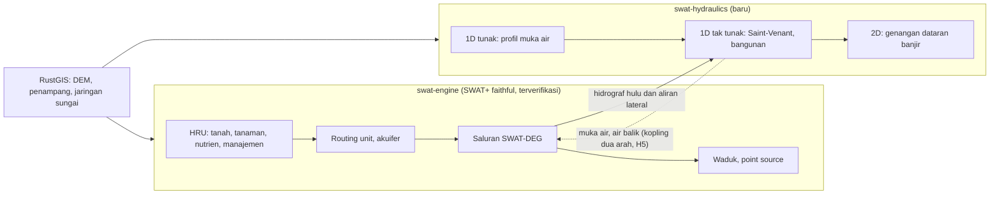

# Peta jalan: dari port SWAT+ ke engine hidrologi–hidrolika

*Dokumen perencanaan proyek, 29 Oktober 2026. Terpisah dari usulan riset MPhil, yang memakai
sebagian tahap di sini (H0 dan H1) tetapi tidak menunggu tahap lainnya.*

## Tujuan

Satu engine, ditulis dalam Rust, yang menghitung air **dari hujan di lahan sampai muka air dan
genangan di sungai**:

- **di lahan**: SWAT+ apa adanya, yang sudah memperhitungkan tanah, tata guna lahan, iklim, tanaman,
  nutrien, dan keputusan pengelolaan (tabel keputusan);
- **di sungai**: hidrolika yang selama ini dikerjakan model terpisah seperti HEC-RAS, yaitu muka
  air, kecepatan, air balik, bangunan air dan genangan dataran banjir;
- **dalam satu program** yang cepat, paralel, bisa berjalan di desktop, server dan browser, serta
  menyatu dengan editor RustGIS.

## Prinsip

1. **Inti SWAT+ tidak diubah.** `swat-engine` tetap terjemahan setia SWAT+ 6f51536, terverifikasi
   nilai demi nilai terhadap Fortran di setiap perubahan (`docs/validation-results/`). Semua yang
   baru ditambahkan di sampingnya, tidak di dalamnya.
2. **Tidak ada perubahan tanpa uji otomatis.** Untuk hidrolika tidak ada kode acuan, jadi ujinya
   adalah solusi analitik, kasus uji baku, dan pembandingan dengan HEC-RAS dalam toleransi yang
   ditetapkan di muka. Uji-uji itu berjalan di CI seperti validasi SWAT+.
3. **Dibangun dari persamaan, bukan dari kode orang lain.** HEC-RAS gratis tetapi kode sumbernya
   tidak terbuka. Modul hidrolika ditulis dari persamaan yang dipublikasikan (*HEC-RAS Hydraulic
   Reference Manual*, buku teks hidrolika saluran terbuka, makalah metode), dengan rujukan di setiap
   fungsi, seperti fungsi-fungsi port yang menyebut rutin SWAT+-nya.
4. **Setiap tahap bisa dipakai dan diterbitkan sendiri.** Tidak ada tahap yang baru berguna setelah
   tahap berikutnya selesai.
5. **Tanpa dependensi di inti**, seperti sekarang. Akselerasi GPU, kalau ada, menjadi fitur opsional.

## Arsitektur

- **`swat-engine`**: tidak berubah. Ruas yang ditangani hidrolika ditandai, lalu engine menyerahkan
  hidrograf masuknya, yaitu debit hulu dan aliran lateral dari routing unit di sepanjang ruas,
  setiap langkah waktu.
- **`swat-hydraulics`** (crate baru): penampang, jaringan ruas, bangunan, dan pemecah numerik 1D/2D.
  Bisa dipakai sendiri, tanpa SWAT+, dengan hidrograf dari berkas.
- **Lapisan kopling**: memetakan saluran SWAT-DEG ke ruas hidrolika dan menyamakan langkah waktu
  (harian atau per jam di SWAT+, detik sampai menit di hidrolika).
- **RustGIS**: menyiapkan masukan, yaitu penampang dari survei atau dipotong dari DEM (DEMNAS),
  garis sungai, nilai *n* dari tata guna lahan, dan jaring 2D. RustGIS juga menampilkan hasilnya.

## Tahapan

| Tahap | Isi | Setara | Status |
| --- | --- | --- | --- |
| **H0** | Inti SWAT+ terverifikasi; optimasi; mode paralel reprodusibel | SWAT+ | 1.0.3 selesai; optimasi berjalan (`docs/performance.md`); paralel direncanakan |
| **H1** | Keluaran hidrolika SWAT-DEG; kurva rating dari penampang survei | — | Berikutnya |
| **H2** | Aliran tunak 1D: profil muka air dari penampang melintang | HEC-RAS *steady* | Direncanakan |
| **H3** | Aliran tak tunak 1D dengan bangunan, kopling satu arah dengan SWAT+ | HEC-RAS *unsteady* 1D | Direncanakan |
| **H4** | Genangan 2D di atas DEM, paralel | HEC-RAS 2D | Direncanakan |
| **H5** | Kopling dua arah: air balik dan genangan kembali ke SWAT+ | — | Riset |

### H0: inti SWAT+, kecepatan, paralel

- **Selesai:** port SWAT+ 6f51536, 37 skenario identik (2,08 miliar nilai), rilis untuk semua
  platform, DOI Zenodo, dan naskah GMD.
- **Berjalan:** optimasi berurutan berbasis profil. Suhu saluran dan data tanaman sudah dioptimasi,
  sekitar 10% lebih cepat dengan hasil identik.
- **Berikutnya:** mode paralel di `--fix-swat`. Keadaan yang terbawa antar-HRU dijadikan milik
  masing-masing HRU, lalu HRU dihitung paralel setiap hari. Ujinya: hasil identik di berapa pun
  jumlah thread.

### H1: keluaran hidrolika yang sudah dihitung

SWAT-DEG sudah menghitung kurva rating setiap saluran: kedalaman, luas basah, keliling basah, lebar
muka air, kecepatan (Manning), volume alur dan dataran banjir, serta waktu tempuh. H1 mencetaknya.

1. Tabel tambahan `channel_hyd_*` per saluran: kedalaman, kecepatan, lebar muka air, volume dataran
   banjir dan waktu tempuh, harian atau per jam. Tabel ini di luar tabel SWAT+, sehingga tidak
   mengganggu validasi.
2. Kurva rating dari **penampang hasil survei** untuk ruas yang ditentukan, sebagai pengganti
   trapesium dari rumus. Ini mode tersendiri dengan uji tersendiri.
3. **Uji:** kurva rating trapesium terhadap rumus Manning analitik; kurva dari penampang terhadap
   hitungan tangan; kedalaman simulasi terhadap TMA AWLR di pos riset.

### H2: aliran tunak 1D

Profil muka air di sepanjang ruas untuk debit tertentu, dengan metode *standard step* (persamaan
energi antar-penampang, kehilangan gesekan, kontraksi dan ekspansi), aliran subkritis dan
superkritis, serta kedalaman kritis.

- **Masukan:** penampang (stasiun dan elevasi, tanggul, nilai *n* per bagian), jarak antar-penampang,
  debit, dan kondisi batas (kedalaman normal, muka air tertentu, atau kurva rating di hilir).
- **Kegunaan:** muka air banjir rencana (dengan debit Q25, Q50, Q100 dari analisis frekuensi hasil
  SWAT+), lengkung debit hidrolis di pos AWLR, dan pemeriksaan tinggi jagaan tanggul.
- **Uji:** kedalaman normal dan kritis analitik; profil aliran berubah lambat (M1, M2, S2) terhadap
  integrasi numerik halus; pembandingan dengan HEC-RAS *steady* pada beberapa ruas contoh.

### H3: aliran tak tunak 1D dan kopling

Persamaan Saint-Venant (kontinuitas dan momentum) dengan skema implisit empat titik Preissmann,
skema yang juga dipakai HEC-RAS 1D.

1. Ruas tunggal, lalu jaringan dengan pertemuan sungai.
2. Kondisi batas: hidrograf hulu, kurva rating atau pasang surut di hilir, dan aliran lateral.
3. Bangunan: bendung (rumus pelimpah), gorong-gorong, dan jembatan, mulai dari pendekatan
   sederhana.
4. Penampang kering dan basah, dan aliran yang melimpas ke dataran banjir (penampang majemuk).
5. **Kopling satu arah:** SWAT+ menyerahkan hidrograf hulu dan aliran lateral ruas yang ditandai.
   Ruas itu lalu dihitung hidrolika, menggantikan routing *variable storage* atau Muskingum-nya.

- **Kegunaan:** air balik dan pasang surut di dataran rendah (misalnya Batang Hari di Jambi),
  hidrograf banjir di titik tinjau, dan operasi pintu air.
- **Uji:** gelombang kinematik dan difusif analitik; keruntuhan bendungan (*dam break*) 1D dengan
  solusi Ritter dan Stoker; kekekalan massa di setiap langkah; pembandingan dengan HEC-RAS
  *unsteady* pada ruas contoh.

### H4: genangan 2D

Genangan dataran banjir di atas DEM, untuk peta luas, kedalaman dan lama genangan.

1. Mulai dari pendekatan **inersia lokal** (seperti LISFLOOD-FP; Bates dkk., 2010) di grid DEM: cepat,
   stabil, dan cukup untuk dataran banjir.
2. Lalu persamaan air dangkal penuh dengan volume hingga, bila diperlukan untuk aliran cepat.
3. Paralel di CPU sejak awal. GPU (`wgpu`) sebagai fitur opsional untuk grid besar.
4. Kopling dengan H3: limpasan dari alur 1D ke sel 2D, dan kembali.

- **Uji:** solusi analitik (misalnya Thacker), dan rangkaian kasus uji baku untuk model 2D seperti
  *benchmark* Environment Agency Inggris (Néelz dan Pender, 2013); pembandingan dengan HEC-RAS 2D.

### H5: kopling dua arah

Muka air hidrolika memengaruhi kembali SWAT+: air balik ke saluran hulu, genangan yang menyusup
kembali ke tanah atau menjadi tampungan lahan basah, dan pengaruhnya pada tanaman yang tergenang.
Ini bidang riset tersendiri. Di sini SWAT+ tidak lagi berjalan "seperti aslinya", jadi mode ini
terpisah dan diberi tanda jelas.

## Data yang dibutuhkan, per tahap

| Data | H1 | H2 | H3 | H4 |
| --- | :-: | :-: | :-: | :-: |
| Model SWAT+ (TxtInOut) | ✓ | | ✓ | ✓ |
| Penampang melintang hasil survei | ✓ (di pos) | ✓ | ✓ | |
| DEM (DEMNAS) dan garis sungai | | penampang dari DEM | penampang dari DEM | ✓ |
| Nilai *n* (dari tata guna lahan dan material dasar) | ✓ | ✓ | ✓ | ✓ |
| Data bangunan (bendung, jembatan, pintu) | | | ✓ | ✓ |
| TMA dan debit terukur (untuk uji) | ✓ | ✓ | ✓ | |
| Peta atau bekas genangan (untuk uji) | | | | ✓ |

## Hal sulit yang sudah diketahui

- **Kestabilan numerik:** pemilihan langkah waktu, sel atau penampang yang mengering dan membasah,
  dan aliran yang berubah dari subkritis ke superkritis.
- **Pertemuan sungai dan jaringan bercabang** di skema implisit 1D.
- **Perbedaan skala waktu:** SWAT+ harian atau per jam, hidrolika detik sampai menit.
- **Penampang dari DEM:** DEM tidak melihat dasar sungai di bawah air, sehingga penampang dari DEM
  perlu dikoreksi dengan survei atau dengan asumsi bentuk dasar.
- **Verifikasi tanpa kode acuan:** kepercayaan dibangun dari banyak kasus uji kecil yang terbukti,
  bukan dari satu pembandingan besar.

## Hubungan dengan riset MPhil

Usulan riset MPhil (kalibrasi berbasis TMA dengan optimasi berbasis AI) memakai **H0** (kecepatan
dan paralel) dan **H1** (kedalaman air saluran). Riset itu tidak bergantung pada H2–H5, jadi
jadwalnya tidak ikut terhambat. Sebaliknya, lengkung debit dan penampang hasil lapangan riset
menjadi bahan uji H1 dan H2.

## Rujukan awal

- Bates, P. D., Horritt, M. S., & Fewtrell, T. J. (2010). A simple inertial formulation of the
  shallow water equations for efficient two-dimensional flood inundation modelling. *Journal of
  Hydrology*, 387, 33–45.
- Brunner, G. W. (2016). *HEC-RAS River Analysis System: Hydraulic Reference Manual*. US Army Corps
  of Engineers, Hydrologic Engineering Center.
- Chow, V. T. (1959). *Open-Channel Hydraulics*. McGraw-Hill.
- Cunge, J. A., Holly, F. M., & Verwey, A. (1980). *Practical Aspects of Computational River
  Hydraulics*. Pitman.
- Néelz, S., & Pender, G. (2013). *Benchmarking the latest generation of 2D hydraulic modelling
  packages*. Environment Agency, Bristol, UK.

(Rujukan ditulis dari ingatan; edisi dan nomor laporan perlu dicek sebelum dikutip.)
