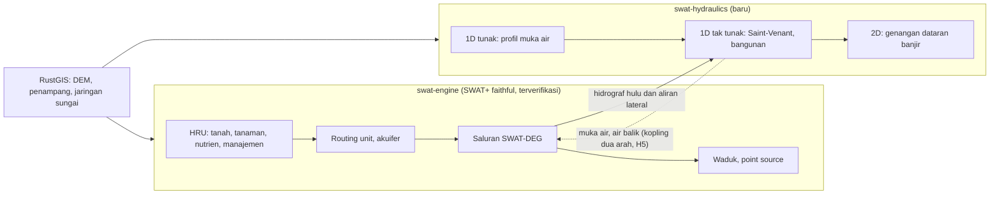

# Peta jalan: dari port SWAT+ ke engine hidrologi–hidrolika

*Dokumen perencanaan proyek, 29 Oktober 2026. Terpisah dari usulan riset MPhil, yang memakai
sebagian tahap di sini (H0 dan H1) tetapi tidak menunggu tahap lainnya.*

## Tujuan

Satu engine, ditulis dalam Rust, yang menghitung air **dari hujan di lahan sampai muka air dan
genangan di sungai**:

- **di lahan**: SWAT+ apa adanya, yang sudah memperhitungkan tanah, tata guna lahan, iklim, tanaman,
  nutrien, dan keputusan pengelolaan (tabel keputusan);
- **di sungai**: hidrolika yang selama ini dikerjakan model terpisah seperti HEC-RAS, yaitu muka
  air, kecepatan, air balik, bangunan air dan genangan dataran banjir;
- **dalam satu program** yang cepat, paralel, bisa berjalan di desktop, server dan browser, serta
  menyatu dengan editor RustGIS.

## Prinsip

1. **Inti SWAT+ tidak diubah.** `swat-engine` tetap terjemahan setia SWAT+ 6f51536, terverifikasi
   nilai demi nilai terhadap Fortran di setiap perubahan (`docs/validation-results/`). Semua yang
   baru ditambahkan di sampingnya, tidak di dalamnya.
2. **Tidak ada perubahan tanpa uji otomatis.** Untuk hidrolika tidak ada kode acuan, jadi ujinya
   adalah solusi analitik, kasus uji baku, dan pembandingan dengan HEC-RAS dalam toleransi yang
   ditetapkan di muka. Uji-uji itu berjalan di CI seperti validasi SWAT+.
3. **Dibangun dari persamaan, bukan dari kode orang lain.** HEC-RAS gratis tetapi kode sumbernya
   tidak terbuka. Modul hidrolika ditulis dari persamaan yang dipublikasikan (*HEC-RAS Hydraulic
   Reference Manual*, buku teks hidrolika saluran terbuka, makalah metode), dengan rujukan di setiap
   fungsi, seperti fungsi-fungsi port yang menyebut rutin SWAT+-nya.
4. **Setiap tahap bisa dipakai dan diterbitkan sendiri.** Tidak ada tahap yang baru berguna setelah
   tahap berikutnya selesai.
5. **Tanpa dependensi di inti**, seperti sekarang. Akselerasi GPU, kalau ada, menjadi fitur opsional.

## Arsitektur

- **`swat-engine`**: tidak berubah. Ruas yang ditangani hidrolika ditandai, lalu engine menyerahkan
  hidrograf masuknya, yaitu debit hulu dan aliran lateral dari routing unit di sepanjang ruas,
  setiap langkah waktu.
- **`swat-hydraulics`** (crate baru): penampang, jaringan ruas, bangunan, dan pemecah numerik 1D/2D.
  Bisa dipakai sendiri, tanpa SWAT+, dengan hidrograf dari berkas.
- **Lapisan kopling**: memetakan saluran SWAT-DEG ke ruas hidrolika dan menyamakan langkah waktu
  (harian atau per jam di SWAT+, detik sampai menit di hidrolika).
- **RustGIS**: menyiapkan masukan, yaitu penampang dari survei atau dipotong dari DEM (DEMNAS),
  garis sungai, nilai *n* dari tata guna lahan, dan jaring 2D; merekayasa terain menjadi terain
  siap-hidrolika dan terain skenario (T1). RustGIS juga menampilkan hasilnya.

## Tahapan

| Tahap | Isi | Setara | Status |
| --- | --- | --- | --- |
| **H0** | Inti SWAT+ terverifikasi; optimasi; mode paralel reprodusibel; perubahan tata guna lahan (`lu_change`) | SWAT+ | 1.0.3 selesai; optimasi berjalan (`docs/performance.md`); paralel dan `lu_change` direncanakan |
| **H1** | Keluaran hidrolika SWAT-DEG; kurva rating dari penampang survei | — | Berikutnya |
| **H2** | Aliran tunak 1D: profil muka air dari penampang melintang | HEC-RAS *steady* | Direncanakan |
| **H3** | Aliran tak tunak 1D dengan bangunan, kopling satu arah dengan SWAT+ | HEC-RAS *unsteady* 1D | Direncanakan |
| **T1** | Rekayasa terain di RustGIS: permukaan dari data ukur (penampang, profil memanjang, titik situasi) dipadukan dengan DEM; model 3D desain (SketchUp, BIM); DEM siap-hidrolika, skenario terain berversi, ketidakpastian | RAS Mapper *terrain modification*, dan lebih | Direncanakan; syarat H4, membantu H2–H3 |
| **H4** | Genangan 2D di atas DEM, paralel, dengan keluaran peta ala RAS Mapper | HEC-RAS 2D | Direncanakan |
| **V1** | Visualisasi 3D dan isometrik di RustGIS: muka air 3D di atas terain, animasi, penampang, web | RAS Mapper 3D, dan lebih | Direncanakan; fondasi 3D RustGIS sudah ada |
| **H5** | Kopling dua arah: air balik dan genangan kembali ke SWAT+ | — | Riset |
| **H6** | Sistem prakiraan banjir: data waktu nyata, prakiraan hujan, asimilasi, ensembel | — | Tujuan jangka panjang |

### H0: inti SWAT+, kecepatan, paralel

- **Selesai:** port SWAT+ 6f51536, 37 skenario identik (2,08 miliar nilai), rilis untuk semua
  platform, DOI Zenodo, dan naskah GMD.
- **Berjalan:** optimasi berurutan berbasis profil. Suhu saluran dan data tanaman sudah dioptimasi,
  sekitar 10% lebih cepat dengan hasil identik.
- **Berikutnya:** mode paralel di `--fix-swat`. Keadaan yang terbawa antar-HRU dijadikan milik
  masing-masing HRU, lalu HRU dihitung paralel setiap hari. Ujinya: hasil identik di berapa pun
  jumlah thread.

**Perubahan tata guna lahan di tengah simulasi.** Saat ini setiap run memakai satu peta tata guna
lahan, sehingga perbandingan skenario (lahan sekarang terhadap lahan rencana atau masa lalu) sudah
bisa dilakukan dengan run terpisah. Perubahan lahan *selama* run belum di-port, yaitu aksi
`lu_change` di tabel keputusan (`actions`) dan skenario `scen_lu.dtl` (`dtbl_scen_read`). Engine
menolaknya dengan pesan jelas. Port-nya mengikuti aturan yang sama dengan bagian lain:
terjemahan setia, diverifikasi nilai demi nilai terhadap SWAT+ dengan skenario uji baru, misalnya
varian Batanghari dengan pembukaan hutan bertahap. Ini dibutuhkan untuk:

- **simulasi jangka panjang yang realistis**, misalnya DAS yang hutannya berangsur menjadi sawit;
- **kalibrasi yang jujur**: parameter (CN, ESCO, dan lainnya) dikalibrasi dengan tutupan lahan yang
  sesuai dengan periode data debit, sehingga tidak "menyesuaikan diri" untuk menutupi selisih peta
  lahan;
- **memisahkan pengaruh iklim dan pengaruh lahan** pada perubahan debit dan sedimen.

### H1: keluaran hidrolika yang sudah dihitung

SWAT-DEG sudah menghitung kurva rating setiap saluran: kedalaman, luas basah, keliling basah, lebar
muka air, kecepatan (Manning), volume alur dan dataran banjir, serta waktu tempuh. H1 mencetaknya.

1. Tabel tambahan `channel_hyd_*` per saluran: kedalaman, kecepatan, lebar muka air, volume dataran
   banjir dan waktu tempuh, harian atau per jam. Tabel ini di luar tabel SWAT+, sehingga tidak
   mengganggu validasi.
2. Kurva rating dari **penampang hasil survei** untuk ruas yang ditentukan, sebagai pengganti
   trapesium dari rumus. Ini mode tersendiri dengan uji tersendiri.
3. **Uji:** kurva rating trapesium terhadap rumus Manning analitik; kurva dari penampang terhadap
   hitungan tangan; kedalaman simulasi terhadap TMA AWLR di pos riset.

### H2: aliran tunak 1D

Profil muka air di sepanjang ruas untuk debit tertentu, dengan metode *standard step* (persamaan
energi antar-penampang, kehilangan gesekan, kontraksi dan ekspansi), aliran subkritis dan
superkritis, serta kedalaman kritis.

- **Masukan:** penampang (stasiun dan elevasi, tanggul, nilai *n* per bagian), jarak antar-penampang,
  debit, dan kondisi batas (kedalaman normal, muka air tertentu, atau kurva rating di hilir).
- **Kegunaan:** muka air banjir rencana (dengan debit Q25, Q50, Q100 dari analisis frekuensi hasil
  SWAT+), lengkung debit hidrolis di pos AWLR, dan pemeriksaan tinggi jagaan tanggul.
- **Uji:** kedalaman normal dan kritis analitik; profil aliran berubah lambat (M1, M2, S2) terhadap
  integrasi numerik halus; pembandingan dengan HEC-RAS *steady* pada beberapa ruas contoh.

### H3: aliran tak tunak 1D dan kopling

Persamaan Saint-Venant (kontinuitas dan momentum) dengan skema implisit empat titik Preissmann,
skema yang juga dipakai HEC-RAS 1D.

1. Ruas tunggal, lalu jaringan dengan pertemuan sungai.
2. Kondisi batas: hidrograf hulu, kurva rating atau pasang surut di hilir, dan aliran lateral.
3. Bangunan: bendung (rumus pelimpah), gorong-gorong, dan jembatan, mulai dari pendekatan
   sederhana.
4. Penampang kering dan basah, dan aliran yang melimpas ke dataran banjir (penampang majemuk).
5. **Kopling satu arah:** SWAT+ menyerahkan hidrograf hulu dan aliran lateral ruas yang ditandai.
   Ruas itu lalu dihitung hidrolika, menggantikan routing *variable storage* atau Muskingum-nya.

- **Kegunaan:** air balik dan pasang surut di dataran rendah (misalnya Batang Hari di Jambi),
  hidrograf banjir di titik tinjau, dan operasi pintu air.
- **Uji:** gelombang kinematik dan difusif analitik; keruntuhan bendungan (*dam break*) 1D dengan
  solusi Ritter dan Stoker; kekekalan massa di setiap langkah; pembandingan dengan HEC-RAS
  *unsteady* pada ruas contoh.

### T1: rekayasa terain (RustGIS)

Model 2D hanya sebaik DEM-nya. DEMNAS adalah model permukaan: memuat atap, tajuk pohon dan sawit,
tidak melihat dasar sungai di bawah air, dan sering kehilangan tanggul, jalan dan saluran yang
sempit. T1 mengubahnya menjadi **terain siap-hidrolika**, dan menjadikan perubahan terain sebagai
skenario yang bisa dihitung.

RAS Mapper menyediakan modifikasi terain dasar: alur (*channel*) dari penampang, garis (tanggul atau
jalan dengan elevasi tertentu) dan poligon (elevasi ditetapkan atau digeser). Itu berguna, tetapi
terbatas: setiap modifikasi dibuat tangan satu per satu, tidak berparameter, tidak memuat
ketidakpastian, tidak bisa membangun permukaan langsung dari data ukur topografi, dan tidak
terhubung dengan proses di DAS. T1 ditulis asli dalam Rust di RustGIS,
dan setiap operasinya berupa **resep yang tercatat** (bukan suntingan piksel yang hilang jejaknya),
sehingga terain akhir bisa dibangun ulang, dibandingkan, dan diuji.

**0. Prasyarat di RustGIS: geometri ber-Z dan M.** Model geometri RustGIS (`Coord`) saat ini 2D.
Pembaca shapefile sudah mengenali PointZ, PolylineZ dan sejenisnya, tetapi nilai Z dibuang
(`crates/data/src/io.rs`), begitu juga pembaca WKT dan WKB (`interop.rs`, `wkb.rs`). Langkah
pertama T1 adalah membawa Z dan M di model geometri, pembaca dan penulis (shapefile, GeoPackage,
WKB, WKT), tanpa mengubah perilaku alat 2D yang sudah ada. **Uji:** baca–tulis bolak-balik
shapefile dan GeoPackage ber-Z dan M dengan nilai identik; semua uji 2D lama tetap lulus.

**1. Fondasi: datum, mosaik, potong.**
- Mosaik dan potong ubin DEMNAS (dan DEM global seperti FABDEM atau MERIT) menurut batas DAS.
- Penyelarasan datum tegak: geoid DEMNAS (EGM2008 atau InaGeoid) terhadap BM lokal survei dan nol
  papan duga AWLR. Selisihnya bisa puluhan sentimeter sampai beberapa meter, dan langsung menjadi
  galat muka air.
- Laporan mutu: lubang data, tepi ubin, artefak garis, dan selisih terhadap titik ikat.

**2. Dari model permukaan ke model terain (DSM → DTM).**
- Koreksi tajuk otomatis memakai **peta tutupan lahan** (yang sama dengan SWAT+) dan **tinggi
  kanopi** dari produk satelit, dengan nilai koreksi per kelas yang bisa dikalibrasi.
- Penyaringan bangunan dan objek dengan filter morfologi; titik ikat lapangan sebagai pembanding.
- Untuk daerah perkotaan, bangunan bisa dipilih: dihapus (aliran lewat), dipertahankan sebagai
  penghalang, atau diberi porositas.

**3. Permukaan dari data ukur, dipadukan dengan DEM.**

Ini inti T1. Data topografi hasil survei langsung menjadi permukaan, lalu dipadukan dengan DEM yang
ada. RAS Mapper hanya bisa membuat terain dari penampang yang sudah dimasukkan ke geometri 1D dan
menggabungkan terain menurut prioritas lapisan; data ukur mentah dan profil memanjang tidak bisa
dipakai langsung, dan sambungannya dengan DEM berupa tepi tajam.

- **Masukan data ukur yang umum di lapangan:**
  - penampang melintang (stasiun–elevasi, atau X, Y, Z per titik) dari CSV, Excel, atau format
    keluaran alat ukur;
  - profil memanjang dasar sungai, puncak tanggul dan muka air saat pengukuran;
  - titik detail situasi dari *total station* atau GNSS RTK, dan titik pemeruman (*echo sounder*);
  - **shapefile dan GeoPackage ber-Z**: PointZ untuk titik situasi, pemeruman dan BM; PolylineZ
    untuk garis penampang, profil memanjang dan puncak tanggul; nilai M (bila ada) sebagai stasiun
    alur. Elevasi juga bisa diambil dari **kolom atribut** (misalnya `ELEV`, `Z`, `TINGGI`) bila
    geometrinya 2D;
  - **LandXML**, jalur terbersih dari Civil 3D: *surface* (TIN dan garis patah), *alignment* (as
    sungai berstasiun), dan penampang dari *sample line* tetap membawa artinya;
  - **DXF** dari AutoCAD, Land Desktop, Civil 3D dan perangkat lain: titik dan polyline 3D, *3D
    face*, kontur. DWG dibaca lewat ekspor ke DXF atau LandXML;
  - **elevasi dari teks label**: gambar konsultan sering berisi titik atau garis 2D dengan elevasi
    hanya sebagai teks. Teks terdekat ditempelkan ke objeknya, dan pasangan yang meragukan ditandai
    untuk diperiksa;
  - **gambar penampang 2D** (grafik stasiun–elevasi berskala di DXF) diubah menjadi data
    stasiun–elevasi, lalu ditempatkan di peta dengan garis penampang atau patok di gambar situasi;
  - CSV dan format keluaran Trimble Business Center, Leica Infinity, Topcon Magnet dan Global
    Mapper;
  - metadata: datum tinggi, BM acuan, tanggal ukur, dan alat.
- **Pemeriksaan sebelum dipakai:** penampang yang terbalik arah kiri–kanan, stasiun yang tidak
  urut, BM yang berbeda antar-lembar, loncatan elevasi, penampang yang tidak memotong garis
  sungai, dan Z bernilai 0 atau kode kosong (misalnya -9999) yang harus ditandai, bukan dipakai.
  Datum tinggi dinyatakan pengguna per sumber, karena `.prj` dan DXF hanya memuat sistem koordinat
  horizontal (atau tidak sama sekali).
- **Pembuatan permukaan:**
  - interpolasi dalam **koordinat alur** (stasiun sepanjang sungai, jarak dari as), sehingga dasar
    sungai di antara dua penampang mengikuti alur di tikungan;
  - profil memanjang sebagai kendala: elevasi dasar di antara penampang mengikuti profil ukur, bukan
    garis lurus antar-penampang;
  - TIN dengan garis patah untuk titik situasi (tanggul, tebing, saluran), lalu dirasterkan;
  - *kriging* sebagai pilihan, yang sekaligus memberi peta ketidakpastian, dipakai untuk ensembel
    terain (bagian 8).
- **Pemaduan dengan DEM:**
  - selisih datum antara survei dan DEM dihitung di daerah yang tumpang tindih dan dikoreksi lebih
    dulu;
  - urutan prioritas per sumber (survei terbaru > survei lama > DTM terkoreksi > DEM global) dengan
    batas cakupan yang jelas;
  - **zona transisi**: elevasi berangsur dari survei ke DEM dalam lebar yang diatur, sehingga tidak
    ada tebing atau parit palsu di tepi area survei;
  - setiap sel menyimpan sumbernya, sehingga peta asal-data dan peta selisih survei terhadap DEM
    bisa ditampilkan.
- **Uji:** validasi silang (satu penampang disisihkan, lalu diprediksi dari yang lain); penampang
  yang dipotong dari permukaan hasil dibandingkan dengan penampang ukur; dan tidak ada loncatan
  elevasi di zona transisi.

**4. Alur sungai dan batimetri tanpa survei lengkap.**
- **Bentuk alur berparameter** bila penampang jarang atau tidak ada: trapesium, parabola, atau
  bentuk dari lebar muka air citra dan kedalaman dari geometri hidraulik (lebar, kedalaman dan debit
  saling terkait), sehingga semua ruas punya dasar yang masuk akal.
- Profil memanjang dasar sungai yang dihaluskan dan dipaksa monoton bila perlu, dengan pengecualian
  untuk bendung dan ambang.
- Tikungan, pulau, cabang dan muara.

**5. Garis dan struktur.**
- Garis patah (*breakline*) untuk tanggul, jalan, rel, pematang sawah besar dan saluran irigasi:
  elevasi puncak dari survei, dari DEM yang dihaluskan, atau ditetapkan; lebar dan kemiringan talud
  diatur.
- **Bukaan struktur:** jembatan, gorong-gorong dan pintu air memotong timbunan jalan atau tanggul,
  dan dicatat sebagai struktur untuk H3–H4, bukan sekadar lubang di DEM.
- Pemaksaan ketersambungan hidrologis (*breaching*) yang terkendali, sebagai pengganti pengisian
  cekungan buta yang meratakan dataran banjir.
- Perataan badan air (*hydro-flattening*) untuk danau, waduk dan rawa, dengan elevasi dari data
  atau dari tepi.

**6. Model 3D desain (SketchUp, BIM, dan lainnya) sebagai modifikasi terain.**

Desain kolam retensi, tanggul, bendung, jalan layang atau kawasan perumahan sering dibuat sebagai
model 3D. Model itu bisa langsung menjadi modifikasi terain atau struktur, tanpa digambar ulang.

- **Format:** berkas `.skp` tertutup dan SDK-nya hanya untuk Windows dan macOS, jadi jalurnya lewat
  ekspor: COLLADA (`.dae`, tersedia di SketchUp versi gratis), KMZ (COLLADA beserta lokasi
  geografisnya), OBJ, STL, glTF, dan IFC untuk model BIM dari Revit, Tekla, Civil 3D dan
  sejenisnya.
- **Penempatan di peta:** model SketchUp memakai koordinat lokal. Posisinya diambil dari lokasi
  geografis model (*geo-location* di KMZ) atau dari dua titik ikat atau lebih (geser, putar, skala),
  lalu elevasinya disamakan dengan datum terain. Satuan (inci, mm, m) diperiksa otomatis.
- **Cara model dipakai, dipilih per objek:**
  - **mengganti permukaan** (timbunan, tanggul, jalan di atas tanah): elevasi tertinggi model di
    setiap sel menggantikan terain;
  - **galian** (kolam retensi, saluran, sudetan): elevasi terendah permukaan dalam model menjadi
    dasar baru, dan volume galian dihitung;
  - **penghalang** (bangunan): sel ditutup atau diberi porositas, sesuai pilihan di bagian 2;
  - **struktur di atas aliran** (jembatan, jalan layang, gedung berkolong): lantai dan pilar tidak
    "ditempel" ke terain, karena air mengalir di bawahnya. Bentuknya diubah menjadi data struktur
    untuk H3–H4: elevasi bawah lantai, lebar bukaan, dan letak pilar.
- **Pemeriksaan:** model tidak tertutup, muka ganda atau terbalik, dan objek yang mengambang di atas
  atau tenggelam di bawah terain.
- **Uji:** model sintetis (kotak, prisma tanggul, kolam) dengan volume yang diketahui; volume galian
  dan timbunan dari model terhadap volume di SketchUp; posisi titik ikat setelah penempatan.

**7. Terain sebagai skenario.**
- Terain rencana: tanggul baru atau ditinggikan, normalisasi alur, galian kolam retensi, sudetan,
  tanggul jebol (lebar dan elevasi jebolan sebagai parameter), timbunan perumahan atau jalan baru.
- Setiap skenario adalah lapisan resep di atas terain dasar, **berversi**, dengan peta selisih
  elevasi dan volume galian dan timbunan.
- Satu masukan ke H4 untuk membandingkan skenario: luas, kedalaman dan lama genangan sebelum dan
  sesudah, dan volume pekerjaan tanah per skenario.

**8. Terain yang berubah dan terain yang tidak pasti.**
- **Perubahan dasar sungai dari sedimen:** degradasi dan agradasi alur yang dihitung SWAT-DEG
  diterjemahkan menjadi perubahan elevasi dasar per ruas, sehingga terain bisa diperbarui antar
  periode simulasi panjang.
- **Ensembel terain:** galat DEM dan ketidakpastian batimetri dibuat sebagai sejumlah realisasi
  terain, lalu dijalankan di H4. Hasilnya peta peluang genangan, bukan satu garis batas yang
  terlihat pasti. Ensembel ini sejalan dengan ensembel hujan di H6.

**9. Subgrid dan multi-resolusi.**
- Informasi DEM resolusi halus (misalnya 1–8 m) dipertahankan di dalam sel 2D yang lebih besar
  sebagai tabel elevasi–volume dan elevasi–luas per sel dan per sisi sel, seperti pendekatan
  *subgrid* HEC-RAS 2D, sehingga model cepat tanpa kehilangan alur dan tanggul kecil.
- Resolusi halus di alur dan pemukiman, kasar di dataran luas.

**10. Penyuntingan dan pemeriksaan.**
- Penyunting terain interaktif di RustGIS: profil memanjang dan melintang, sunting garis dan
  poligon, pratinjau selisih seketika.
- **Uji mutu otomatis** sebelum terain dipakai: selisih terhadap penampang survei dan titik ikat
  (RMSE, bias), ketersambungan alur dari hulu ke hilir, cekungan palsu yang tersisa, dan tanggul
  yang bocor.
- Ekspor GeoTIFF dan tabel subgrid, sehingga terain yang sama bisa dipakai di HEC-RAS untuk
  pembandingan.

- **Uji:** terain sintetis dengan jawaban yang diketahui (alur trapesium, tanggul dengan bukaan);
  volume galian dan timbunan terhadap hitungan analitik; penampang yang dipotong dari terain hasil
  terhadap penampang survei masukan; dan genangan H4 di terain hasil terhadap bekas banjir.

### H4: genangan 2D

Genangan dataran banjir di atas DEM, untuk peta luas, kedalaman dan lama genangan.

1. Mulai dari pendekatan **inersia lokal** (seperti LISFLOOD-FP; Bates dkk., 2010) di grid DEM: cepat,
   stabil, dan cukup untuk dataran banjir.
2. Lalu persamaan air dangkal penuh dengan volume hingga, bila diperlukan untuk aliran cepat.
3. Paralel di CPU sejak awal. GPU (`wgpu`) sebagai fitur opsional untuk grid besar.
4. Kopling dengan H3: limpasan dari alur 1D ke sel 2D, dan kembali.
5. Terain masukan dari T1, termasuk tabel subgrid, skenario terain dan ensembel terain.
6. Hujan langsung di sel 2D (*rain-on-grid*) sebagai pilihan, dengan limpasan dari HRU SWAT+.

**Kondisi awal dan asal air yang jelas.** Dua kelemahan yang sering terlihat di simulasi genangan:
alur sungai dimulai kosong lalu "diisi" oleh hidrograf, dan sel rendah tiba-tiba tergenang tanpa
jelas airnya dari mana. Penyebab yang umum: kondisi awal kering, satu elevasi muka air awal yang
diberlakukan ke seluruh area 2D (semua sel di bawah elevasi itu langsung basah, walaupun tidak
tersambung), hujan yang langsung jatuh di sel, dan peta kedalaman yang menginterpolasi muka air
sampai ke cekungan di sebelah sel basah. Rencana engine ini:

1. **Kondisi awal dari SWAT+:** simulasi kontinu SWAT+ sudah punya volume dan debit setiap saluran
   pada hari mulai. Alur 1D dan sel 2D di alur diisi dari keadaan itu (diubah menjadi muka air lewat
   kurva rating H1 atau profil tunak H2), bukan dari nol.
2. **Pemanasan (*spin-up*) dan *hot start*:** run dimulai beberapa hari sebelum kejadian dengan
   aliran dasar, atau dari berkas keadaan run sebelumnya, sehingga kejadian banjir dimulai dari
   sungai yang sudah mengalir.
3. **Muka air awal hanya untuk sel yang tersambung:** elevasi awal diberikan ke badan air (sungai,
   danau, rawa) dan sel yang tersambung hidraulis dengannya, bukan ke semua sel di bawah elevasi
   tertentu. Sel yang basah di awal dilaporkan.
4. **Hujan lewat SWAT+, bukan hujan mentah:** bila *rain-on-grid* dipakai, yang masuk ke sel adalah
   limpasan permukaan HRU (sudah dikurangi infiltrasi dan intersepsi), dan dapat dimatikan per area.
5. **Pelacak asal air (*tracer*):** setiap sel mencatat bagian air yang berasal dari luapan sungai,
   hujan lokal, aliran lateral, bangunan atau batas hilir (pasang surut, air balik), dengan waktu
   tibanya. Peta "asal genangan" menjawab langsung dari mana air di setiap sel datang.
6. **Neraca massa per sumber** di setiap langkah keluaran, sehingga air yang "muncul" tanpa sumber
   terlihat sebagai galat.
7. **Peta jujur:** pilihan tampilan nilai sel apa adanya, dan tampilan halus yang hanya mengisi
   cekungan yang tersambung hidraulis dengan sel basah.

- **Uji:** alur yang sudah berisi aliran dasar tetap tunak tanpa hidrograf masuk; cekungan tertutup
  tanpa hujan tetap kering; jumlah air dari tracer sama dengan total neraca massa.

**Keluaran dan visualisasi (setara RAS Mapper, dan lebih):**

- Peta per langkah keluaran: kedalaman, elevasi muka air, kecepatan (besar dan arah), dan debit
  per satuan lebar.
- Peta ringkasan: genangan maksimum, kedalaman dan kecepatan maksimum, **waktu tiba** genangan,
  **lama** genangan di atas ambang, dan **bahaya** (kedalaman × kecepatan, kelas bahaya untuk
  orang, kendaraan dan bangunan).
- Animasi pergerakan air di atas peta: kedalaman berwarna, panah atau partikel kecepatan, dan
  hidrograf titik tinjau yang bergerak bersama peta.
- Dari ensembel (T1, H6): **peta peluang genangan** dan waktu tiba dengan rentang ketidakpastian.
- Perbandingan skenario: peta selisih kedalaman dan lama genangan antar skenario lahan (H0) dan
  skenario terain (T1).
- Ekspor GeoTIFF (dan COG), GeoPackage untuk batas genangan, video, dan tampilan web lewat WASM
  sehingga peta dibuka di peramban tanpa instalasi.

- **Uji:** solusi analitik (misalnya Thacker), dan rangkaian kasus uji baku untuk model 2D seperti
  *benchmark* Environment Agency Inggris (Néelz dan Pender, 2013); pembandingan dengan HEC-RAS 2D.

### V1: visualisasi 3D dan isometrik (RustGIS)

Hasil H0–H4 ditampilkan di atas peta dan terain, sebagai peta datar, perspektif, atau isometrik.

**Yang sudah ada di RustGIS:** peta miring sampai 85° dengan rotasi arah (`crates/map/src/camera.rs`),
relief dari DEM lokal atau *elevation tiles* dengan pembesaran tinggi 0–20× (`map.terrain`), objek
ekstrusi berpencahayaan (bangunan), mode globe, dan *backend* GPU `wgpu` di aplikasi desktop.

**Yang ditambahkan:**

1. **Kamera isometrik (ortografik)** di samping kamera perspektif: proyeksi sejajar, sehingga skala
   sama di seluruh layar dan jarak tetap terbaca. Sudut baku isometrik (arah 45°, kemiringan sekitar
   54,7°) sebagai pilihan cepat, dengan arah dan kemiringan tetap bebas diatur. Terain, ekstrusi dan
   lapisan yang ada dipakai ulang. Batang skala dan arah utara tetap benar di mode ini.
2. **Permukaan air 3D:** muka air dari H4 (dan H2–H3 untuk alur) digambar sebagai mesh tersendiri di
   atas terain, bukan warna yang ditempel ke tanah. Warna menurut kedalaman, kecepatan, bahaya atau
   asal air (tracer H4), agak transparan, dengan panah atau partikel kecepatan. Tanggul, jalan dan
   bangunan dari T1 tampak menahan atau terlimpasi.
3. **Animasi waktu:** penggeser waktu, putar dan jeda, kecepatan putar, dan hidrograf serta TMA di
   titik tinjau yang bergerak sinkron dengan peta. Pembandingan dua skenario berdampingan atau
   sebagai peta selisih, dengan kamera terkunci bersama.
4. **Penampang di layar:** garis potong digambar di peta, lalu profil terain, dasar alur, muka air
   dan tanggul tampil di panel samping dan ikut beranimasi. Alat yang sama dipakai penyunting
   terain T1.
5. **Neraca air di peta:** hasil SWAT+ (hujan, ET, limpasan, debit per subDAS dan saluran) ditampilkan
   sebagai warna dan aliran di atas peta 3D, melanjutkan prototipe animasi neraca air Batanghari.
6. **Ekspor:** gambar resolusi tinggi dan video (MP4) dari animasi, dengan jalur kamera yang bisa
   diatur (terbang menyusuri sungai), serta legenda, skala dan waktu di setiap bingkai.
7. **Hujan waktu nyata dan hujan yang realistis di peta:**
   - **Sumber utama: GSMaP_NOW (JAXA)**, grid 0,1°, diperbarui setiap 30 menit, mencakup seluruh
     Indonesia, unduhan lewat FTP setelah registrasi gratis. Cadangan: GPM IMERG *Early* (NASA,
     jeda beberapa jam, akses terbuka dengan akun Earthdata), dan radar BMKG bila akses diberikan.
     Latar awan dari citra Himawari (inframerah dan sifat awan P-Tree).
   - **Mode ilmiah:** skala warna intensitas hujan per jam mengikuti kelas BMKG (ringan, sedang,
     lebat, sangat lebat), akumulasi 3, 6, 24 jam, dan rata-rata per subDAS sebagai masukan SWAT+.
   - **Mode realistis:** partikel hujan yang jatuh di tampilan 3D/isometrik, dengan kerapatan dan
     kecepatan menurut intensitas sel; arah miring menurut angin dari prakiraan cuaca; lapisan awan
     2,5D di ketinggian puncak awan Himawari dengan ketebalan dari ketebalan optiknya; tanah yang
     tampak basah dan genangan dari H4 di bawahnya.
   - **Animasi halus:** bingkai di antara dua data 30 menit diisi dengan adveksi (pergerakan sel
     hujan dihitung dari dua bingkai berurutan). Bingkai sisipan diberi tanda sebagai tampilan,
     bukan data, dan tidak dipakai sebagai masukan model.
   - **Syarat data:** ketentuan JAXA meminta pemberitahuan sebelum gambar atau data GSMaP
     disebarkan luas (misalnya di aplikasi atau situs publik), jadi distribusi RustGIS dengan
     GSMaP perlu izin JAXA lebih dulu; tanpa itu, pengguna memakai akun FTP mereka sendiri.
8. **Web lewat WASM:** tampilan yang sama di peramban tanpa instalasi, untuk berbagi hasil dengan
   instansi. Perlu dicek dulu sejauh mana jalur WASM RustGIS mendukung fitur 3D di atas.

- **Uji:** jarak dan luas yang diukur di mode isometrik sama dengan nilai sebenarnya; muka air dan
  kedalaman yang ditampilkan sama dengan nilai sel keluaran (tidak ada interpolasi yang menambah air,
  lihat "peta jujur" di H4); rata-rata hujan GSMaP per subDAS sama dengan hitungan langsung dari
  grid; bingkai animasi cocok dengan langkah waktu keluaran; uji tangkapan layar
  (*snapshot*, seperti `egui_kittest` yang sudah dipakai RustGIS) untuk mencegah regresi tampilan.

Data rahasia (Batanghari, Pessel) hanya ditampilkan dan diekspor sebagai berkas lokal, tidak
diterbitkan sebagai halaman web publik.

### H5: kopling dua arah

Muka air hidrolika memengaruhi kembali SWAT+: air balik ke saluran hulu, genangan yang menyusup
kembali ke tanah atau menjadi tampungan lahan basah, dan pengaruhnya pada tanaman yang tergenang.
Ini bidang riset tersendiri. Di sini SWAT+ tidak lagi berjalan "seperti aslinya", jadi mode ini
terpisah dan diberi tanda jelas.

### H6: sistem prakiraan banjir

Model yang terverifikasi baru satu bagian dari sistem prakiraan. Kesalahan terbesar dalam
prakiraan banjir biasanya berasal dari prakiraan hujan, bukan dari modelnya. H6 menambahkan:

| Komponen | Isinya |
| --- | --- |
| Data waktu nyata | Hujan dan TMA dari pos telemetri, diambil otomatis setiap jam atau lebih sering |
| Prakiraan hujan | Prakiraan cuaca numerik (BMKG, produk global), radar, dan prakiraan jangka sangat pendek dari satelit |
| Asimilasi data | Keadaan model (kadar air tanah, debit, muka air) diperbarui dengan pengamatan terbaru sebelum setiap prakiraan |
| Prakiraan ensembel | Puluhan prakiraan dengan masukan hujan berbeda, sehingga hasilnya berupa peluang melewati ambang siaga |
| Ambang dan keluaran | Batas siaga per pos dan lokasi rawan; peta genangan prakiraan (dari H4) |
| Tata guna lahan terkini | Peta lahan diperbarui berkala dari citra satelit (lewat RustGIS) |
| Operasi | Berjalan otomatis, tahan gangguan data, diawasi, dengan arsip setiap prakiraan |

Syarat dan urutannya:

1. **Langkah waktu per jam**: mode sub-harian SWAT+ dan hidrolika tak tunak (H3).
2. **Verifikasi pada banjir historis** dengan hujan terukur (simulasi).
3. **Uji ulang prakiraan (*hindcast*)** dengan arsip prakiraan hujan. Hasilnya: tingkat keberhasilan,
   peringatan palsu, dan waktu tenggang yang realistis per DAS. DAS kecil dan curam memberi waktu
   tenggang beberapa jam, sedangkan DAS besar seperti Batang Hari memberi waktu berhari-hari dari
   hulu ke hilir.
4. **Uji coba bersama instansi** di satu DAS, sebelum menjadi sistem operasional.

Kecepatan dan paralelisme engine (H0) menjadi syarat praktis di sini: setiap kali data baru masuk,
seluruh ensembel harus selesai dalam beberapa menit.

Peringatan banjir resmi adalah kewenangan instansi pemerintah: BMKG (cuaca), BWS/BBWS dan Dinas
SDA (sungai), BNPB/BPBD (penanggulangan bencana). Sistem ini dirancang sebagai **alat pendukung
keputusan** bagi mereka, bukan sumber peringatan mandiri.

## Data yang dibutuhkan, per tahap

| Data | H1 | H2 | H3 | H4 | H6 |
| --- | :-: | :-: | :-: | :-: | :-: |
| Model SWAT+ (TxtInOut) | ✓ | | ✓ | ✓ | ✓ |
| Peta tata guna lahan per periode (untuk `lu_change`, kalibrasi dan skenario) | ✓ | | ✓ | ✓ | ✓ (terkini) |
| Penampang melintang hasil survei | ✓ (di pos) | ✓ | ✓ | ✓ (lewat T1) | ✓ |
| Profil memanjang, titik situasi, pemeruman; shapefile/GeoPackage ber-Z, LandXML, DXF (untuk T1) | | ✓ | ✓ | ✓ | ✓ |
| DEM (DEMNAS) dan garis sungai | | penampang dari DEM | penampang dari DEM | ✓ | ✓ |
| Nilai *n* (dari tata guna lahan dan material dasar) | ✓ | ✓ | ✓ | ✓ | ✓ |
| Data bangunan (bendung, jembatan, pintu) | | | ✓ | ✓ | ✓ |
| TMA dan debit terukur (untuk uji) | ✓ | ✓ | ✓ | | ✓ |
| Peta atau bekas genangan (untuk uji) | | | | ✓ | ✓ |
| Titik ikat elevasi, BM, nol papan duga AWLR (untuk datum T1) | ✓ | ✓ | ✓ | ✓ | ✓ |
| Tanggul, jalan, rel, saluran, jembatan (garis dan elevasi puncak) | | | ✓ | ✓ | ✓ |
| Tinggi kanopi dan bangunan (untuk DSM → DTM) | | | | ✓ | ✓ |
| Rencana teknis (tanggul, normalisasi, kolam retensi) untuk skenario terain | | ✓ | ✓ | ✓ | |
| Hujan dan TMA waktu nyata, prakiraan hujan dan arsipnya | | | | | ✓ |

## Hal sulit yang sudah diketahui

- **Kestabilan numerik:** pemilihan langkah waktu, sel atau penampang yang mengering dan membasah,
  dan aliran yang berubah dari subkritis ke superkritis.
- **Pertemuan sungai dan jaringan bercabang** di skema implisit 1D.
- **Perbedaan skala waktu:** SWAT+ harian atau per jam, hidrolika detik sampai menit.
- **Penampang dari DEM:** DEM tidak melihat dasar sungai di bawah air, sehingga penampang dari DEM
  perlu dikoreksi dengan survei atau dengan asumsi bentuk dasar.
- **Terain:** galat DEM satu meter bisa mengubah luas genangan di dataran datar seperti hilir Batang
  Hari jauh lebih besar daripada perbedaan antar-skema numerik. Karena itu T1 dan ensembel terain
  sama pentingnya dengan solvernya.
- **Verifikasi tanpa kode acuan:** kepercayaan dibangun dari banyak kasus uji kecil yang terbukti,
  bukan dari satu pembandingan besar.

## Hubungan dengan riset MPhil

Usulan riset MPhil (kalibrasi berbasis TMA dengan optimasi berbasis AI) memakai **H0** (kecepatan
dan paralel) dan **H1** (kedalaman air saluran). Riset itu tidak bergantung pada H2–H5, jadi
jadwalnya tidak ikut terhambat. Sebaliknya, lengkung debit dan penampang hasil lapangan riset
menjadi bahan uji H1 dan H2.

## Rujukan awal

- Bates, P. D., Horritt, M. S., & Fewtrell, T. J. (2010). A simple inertial formulation of the
  shallow water equations for efficient two-dimensional flood inundation modelling. *Journal of
  Hydrology*, 387, 33–45.
- Brunner, G. W. (2016). *HEC-RAS River Analysis System: Hydraulic Reference Manual*. US Army Corps
  of Engineers, Hydrologic Engineering Center.
- Casas, A., Benito, G., Thorndycraft, V. R., & Rico, M. (2006). The topographic data source of
  digital terrain models as a key element in the accuracy of hydraulic flood modelling. *Earth
  Surface Processes and Landforms*, 31, 444–456.
- Chow, V. T. (1959). *Open-Channel Hydraulics*. McGraw-Hill.
- Cunge, J. A., Holly, F. M., & Verwey, A. (1980). *Practical Aspects of Computational River
  Hydraulics*. Pitman.
- Hawker, L., Uhe, P., Paulo, L., Sosa, J., Savage, J., Sampson, C., & Neal, J. (2022). A 30 m
  global map of elevation with forests and buildings removed. *Environmental Research Letters*, 17,
  024016.
- Lindsay, J. B. (2016). Efficient hybrid breaching-filling sink removal methods for flow path
  enforcement in digital elevation models. *Hydrological Processes*, 30, 846–857.
- Merwade, V., Cook, A., & Coonrod, J. (2008). GIS techniques for creating river terrain models for
  hydrodynamic modeling and flood inundation mapping. *Environmental Modelling & Software*, 23,
  1300–1311.
- Néelz, S., & Pender, G. (2013). *Benchmarking the latest generation of 2D hydraulic modelling
  packages*. Environment Agency, Bristol, UK.
- Alfieri, L., Burek, P., Dutra, E., Krzeminski, B., Muraro, D., Thielen, J., & Pappenberger, F.
  (2013). GloFAS – global ensemble streamflow forecasting and flood early warning. *Hydrology and
  Earth System Sciences*, 17, 1161–1175.

(Rujukan ditulis dari ingatan; edisi dan nomor laporan perlu dicek sebelum dikutip.)
